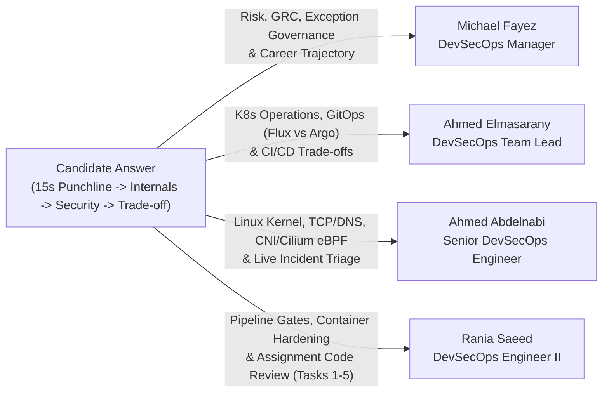
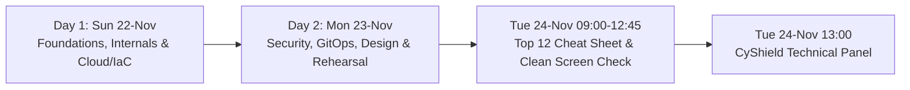

## 1. Executive Strategy, CyShield Panel Intelligence, and 48-Hour Study Plan

**Interview Target:** CyShield (Cyshield for Technology, Cairo, Egypt) — DevOps / DevSecOps Technical Panel  
**Confirmed Schedule:** Tuesday, 24-Nov-2026 @ 13:00 (Local Time)  
**Scope:** Broad Senior/Expert DevOps & DevSecOps mastery applicable to **any** top-tier engineering interview globally, calibrated specifically for CyShield's security-first banking, enterprise, and government engineering culture.

---

### 1.1 How to Use This Guide (Junior to Expert & Any Company Interview Readiness)

This guide is structured to elevate your answers from "tool operator" to **Security-First Platform & DevSecOps Architect**. Every technical module (Modules 02–09) and the assignment defense & behavioral module (Module 10) works across any cloud-native employer while highlighting where CyShield's specific panel will probe deeper.

#### Difficulty Progression Tags (`[Junior]` -> `[Mid]` -> `[Senior]` -> `[Expert]`)
All technical questions across the guide are tagged by seniority tier so you can calibrate depth and avoid over- or under-explaining:

| Tier Tag | What Interviewers Expect at This Level | Failure Mode to Avoid |
| :--- | :--- | :--- |
| **`[Junior]`** | Exact definitions, core primitives, basic CLI usage (`kubectl`, `docker`, `git`, `systemctl`), and clean mental models. | Hesitating on fundamentals (e.g., Pod vs. Container, TCP vs. UDP, SAST vs. DAST). |
| **`[Mid]`** | Day-2 operational execution: writing hardened Dockerfiles, CI/CD gates, Terraform modules, and diagnosing common failures. | Giving textbook theory without real YAML, exit codes, or operational steps. |
| **`[Senior]`** | Architectural trade-offs, scalability limits, failure domains, and security boundaries (`iptables` vs. `Cilium eBPF`, FluxCD vs. ArgoCD, state locking). | Jumping straight to one tool ("just use X") without explaining *why* and *when not to*. |
| **`[Expert]`** | Kernel/control-plane internals, zero-downtime migrations, cryptographic supply-chain trust, compliance exception governance, and live incident command. | Hand-waving under deep probing or guessing instead of isolating layer by layer. |

#### The "15-Second Architecture Punchline" Answering Protocol
Senior engineers lose points not from lack of knowledge, but from burying the conclusion under 60 seconds of preamble. Structure **every** technical answer in four disciplined beats:

1. **0–15s — Executive Punchline:** State the core architectural answer, mechanism, and primary trade-off in 1–2 crisp sentences. Let the panel hear immediately that you understand the system.
2. **15–55s — Internals & Data/Control Flow:** Walk through the exact sequence, components, kernel/network primitives, or lifecycle steps.
3. **55–80s — Production Trade-Off & Security Boundary:** Proactively call out the security risk, scalability bottleneck, or anti-pattern (e.g., why `kubectl rollout undo` breaks GitOps reconciliation, or why `:latest` breaks immutability).
4. **80–90s — Grounding Anchor:** Briefly tie back to real production experience or your assignment implementation (Tasks 1–5) and pause so the panel can drill deeper if they wish.

#### Using the Two Editions (Bilingual Recap vs. Pure English)
- **Pure English Technical Core (100% of Explanations, Code, Diagrams, and Q&As):** Read and rehearse all technical sections out loud in English. This builds instant precision with industry terminology (`EndpointSlice`, `eBPF socket lookup`, `admission webhook`, `Raft quorum`, `IMDSv2`) needed for international and Egyptian enterprise engineering panels.
- **Arabic Quick Recap Box:** Placed at the end of Modules 01–09 in the Bilingual Recap Edition (plus Egyptian Arabic live rehearsal scripts in Module 10). Use these boxes for rapid late-night comprehension checks and fast morning warm-up before the interview, or use the companion Pure English Edition when reviewing or sharing in English only.

---

### 1.2 CyShield Company Profile & Panel Strategy Matrix

#### CyShield Engineering Culture: "Secured by Design"
**Cyshield for Technology** (Cairo, Egypt) delivers mission-critical cybersecurity, digital transformation, and cloud-native infrastructure solutions for **banking, financial services, large enterprise, and government** sectors. Unlike fast-moving consumer startups that treat security as a post-launch cleanup task, CyShield operates under a **"Secured by Design"** engineering philosophy:

- **Default-Deny & Blast-Radius Containment:** Assume breach at every boundary. Management planes (`TCP/6443`, SSH `TCP/22`) never face `0.0.0.0/0`; workloads run non-root with dropped Linux capabilities, enforced `IMDSv2`, and explicit L3/L4/L7 segmentation.
- **Supply-Chain Integrity & Verifiability:** Artifact promotion relies on immutable tags/digests, automated SAST/SCA/container CVE gates before registry push, and traceable Git commits over ad-hoc cluster mutations.
- **GRC, Compliance & Audit Readiness:** Banking and government environments demand alignment with frameworks such as **ISO 27001, PCI-DSS, NIST 800-53/190, OWASP ASVS, and Central Bank regulations**. Every security control needs audit logs, separation of duties, and governed exception workflows (time-bounded risk sign-off, never silent scanner bypasses).
- **Sovereign / Self-Managed Resilience:** Regulated workloads frequently run on-premises, air-gapped, or sovereign cloud VMs rather than managed EKS/GKE—making `kubeadm`/K3s cluster internals, `etcd` backup/restore, and CNI proficiency mandatory.

#### Panel Calibration Architecture

#### Confirmed 4-Interviewer Strategy Matrix

| Interviewer | Title / Role | Primary Focus Areas | How to Calibrate Your Answers |
| :--- | :--- | :--- | :--- |
| **Michael Fayez** | DevSecOps Manager | End-to-end DevSecOps architecture; security gates vs. delivery velocity; GRC/audit evidence; vulnerability exception handling; cross-team collaboration; career stability (early-career short tenures). | Frame technical choices around **business risk, blast radius, and auditability**. Show that security gates accelerate safe delivery through fast feedback and formal time-bounded exceptions. Address short tenures transparently as deliberate progression into security-focused platform engineering (Module 10). |
| **Ahmed Elmasarany** | DevSecOps Team Lead | Practical Kubernetes architecture; GitOps design (FluxCD vs. ArgoCD); CI/CD and IaC maintainability; day-2 operations; why specific architectural trade-offs were chosen. | Highlight **operational simplicity, single source of truth, and clean failure recovery**. Contrast tools objectively (e.g., FluxCD's modular CRD image automation vs. ArgoCD's multi-tenant UI; K3s vs. `kubeadm` vs. EKS) and explain why manual `kubectl` hotfixes create drift. |
| **Ahmed Abdelnabi (Abdelnaby)** | Senior DevSecOps Engineer | Deep Linux internals (namespaces, cgroups, OOM, signals); TCP/IP, DNS (`ndots`), TLS; K8s CRI/CSI/`kube-proxy`; **Cilium eBPF** vs. `iptables`; live production outage troubleshooting. | Skip marketing buzzwords—go straight to **kernel mechanics, packet paths, and layer-by-layer diagnostic commands** (`ss`, `tcpdump`, `dig`, `crictl`, `journalctl`, `kubectl describe/events`). Never guess; narrate how you eliminate hypotheses cleanly. |
| **Rania Saeed** | DevSecOps Engineer II | CI/CD security scanning (SAST/DAST/SCA, Trivy/Grype); Dockerfile & K8s manifest hardening; secret hygiene; line-by-line walkthrough of your take-home assignment (`task-1` to `task-5`). | Own every line of your repo (`test-script.sh`, `juice-shop.yml`, `Dockerfile`, `docker-compose.yml`, Task 4 CI, `flux-fleet`). Proactively note production upgrades (e.g., pinning image digests instead of `:latest`, adding `readOnlyRootFilesystem: true`, keeping `.pem` keys out of workspaces via Vault/SSM). |

#### CyShield Email Topics & Mastery Targets -> Guide Module Mapping

| Interview Email Topic / Candidate Target | Core Depth Covered | Guide Module |
| :--- | :--- | :--- |
| **Linux & Network good knowledge** | Kernel vs. userspace, processes/signals/OOM, TCP handshake/conntrack/NAT, DNS resolution & `ndots:5`, TLS, `ss`/`tcpdump`/`ip route` | **Module 02** (Linux Internals & Networking Deep Dive) |
| **Virtualization / Containerization principles** | Type-1/2 hypervisors & KVM vs. containers; Linux namespaces & cgroups v2; OverlayFS; OCI/CRI/`containerd`/`runc`; Docker multi-stage & non-root hardening | **Module 03** (Virtualization, Containers & Docker Hardening) |
| **Kubernetes Architecture, Cluster Bootstrapping & Internals** | Building K8s from scratch (`kubeadm` & K3s, no EKS/GKE); Control Plane & HA `etcd` Raft; CRI, CSI storage lifecycle, `kube-proxy` modes | **Module 04** (K8s Architecture, Cluster Building, CRI & CSI) |
| **CNI, Ingress & Cilium eBPF** | CNI plugin lifecycle, Pod-to-Pod & Pod-to-Service packet flow, NGINX Ingress -> EndpointSlices, **Cilium eBPF** replacing `iptables`, L7 NetworkPolicies | **Module 05** (K8s Networking, Ingress, CNI & Cilium eBPF) |
| **4 C's of Cloud-Native Security & DevSecOps** | Cloud/Cluster/Container/Code defense-in-depth, API server `6443` hardening, RBAC & Admission Control, SAST/DAST/SCA, image gating & exception SLA | **Module 06** (Cloud-Native Security, 4 C's & Hardening) |
| **DevOps Tools (`git*`, CI/CD, IaC) & Public Cloud (AWS)** | Git workflows & commit signing, GitLab CI/CD security gates, **FluxCD vs. ArgoCD** (**Module 07**); Terraform state/locking, Ansible idempotency, AWS VPC/IAM/IRSA/IMDSv2/KMS (**Module 08**) | **Module 07** (CI/CD & GitOps) & **Module 08** (Terraform, Ansible & AWS Cloud) |
| **Live Production Troubleshooting & On-Call Triage** | Step-by-step triage for `CrashLoopBackOff`, `ImagePullBackOff`, `Pending`, Ingress `502/504`, CoreDNS timeouts, `etcd` failures, and 5/15/30-min On-Call response | **Module 09 (Section 9.3)** & Domain Playbooks in **Modules 02–08** |
| **System Design & Assignment Walkthrough** | 5 Senior DevSecOps system designs (banking K8s, zero-trust CI/CD, multi-cluster GitOps, air-gapped K8s, observability/SIEM) (**Module 09**) + full review of `task-1` through `task-5` (**Module 10**) | **Module 09** (5 System Designs) & **Module 10 (Sections 1–2)** (Assignment Code Defense) |
| **Behavioral, STAR Stories & Short-Tenure Framing** | 10 structured STAR+A behavioral scripts (`Q23`–`Q32`), security-vs-speed conflict, blameless postmortem, confident career narrative, English & Egyptian Arabic scripts | **Module 10 (Sections 3–4)** (Behavioral Mastery & Career Narrative) |

---

### 1.3 Intensive 48-Hour (2-Day) Preparation Roadmap

Your window spans **Sunday 22-Nov-2026 (Day 1)** and **Monday 23-Nov-2026 (Day 2)**, followed by a focused **Tuesday 24-Nov-2026 morning (09:00–12:45)** warm-up before the **13:00** interview. Prioritize understanding **how mechanisms work under failure** over passive reading.

#### Day 1 (Sun 22-Nov-2026) — Foundations, Internals & Cloud/IaC (~8.5 Hours)
1. **Session 1 (2.0h) — Linux & Networking Internals (Module 02):**
   - Drill process states (`D`, `Z`), `SIGTERM` -> grace period -> `SIGKILL`, `OOMKilled` (`oom_score_adj`), inode/FD exhaustion, TCP states (`TIME_WAIT`, `SYN_RECV`), `conntrack` table exhaustion, DNS resolution (`ndots:5`), and TLS handshakes.
   - *Active check:* Explain out loud how `curl https://api.internal` resolves DNS, opens TCP, negotiates TLS, and which tools inspect each layer (`dig`, `ss -tulpn`, `tcpdump`, `openssl s_client`).
2. **Session 2 (1.5h) — Virtualization & Containerization Principles (Module 03):**
   - Contrast KVM/QEMU hardware virtualization vs. Linux containers (shared host kernel). Master all 7 namespaces (`pid`, `net`, `mnt`, `ipc`, `uts`, `user`, `cgroup`), cgroups v2 CPU throttling vs. memory OOM, and OverlayFS (`lowerdir`/`upperdir`/`merged`).
   - Re-review `task-3/Dockerfile` and `task-3/docker-compose.yml` hardening (`USER newman`, `read_only: true`, `cap_drop: [ALL]`, `no-new-privileges:true`, `tmpfs` with `noexec,nosuid`).
3. **Session 3 (2.5h) — Kubernetes Control Plane, Cluster Building, CRI & CSI (Module 04):**
   - Master `kubeadm` bootstrap steps (OS sysctls, CRI `containerd`, static control-plane manifests, `etcd` stacked vs. external quorum math `(N/2)+1`) vs. K3s server/agent bootstrap (`--disable traefik`, `K10<CA-HASH>` node token).
   - Trace `kube-apiserver` (AuthN -> AuthZ -> Mutating/Validating Admission -> `etcd`), `kube-scheduler` (Filtering -> Scoring -> Binding), `kubelet` + CRI (`containerd-shim` + `pause` container), and CSI (`ControllerPublishVolume` / `NodeStageVolume` / `NodePublishVolume`).
4. **Session 4 (1.5h) — CNI, Ingress, `kube-proxy` & Cilium eBPF (Module 05):**
   - Trace Pod-to-Pod, Pod-to-Service, and external Ingress -> `EndpointSlice` -> Pod paths.
   - Nail why `iptables` degrades at `O(N)` rules/sequential traversal, how `IPVS` uses `O(1)` kernel hash tables, and how **Cilium eBPF** hooks `sockops`/XDP/`tc` to bypass `kube-proxy` and `conntrack` overhead while enabling identity-aware L3/L4/L7 policies and Hubble observability.
5. **Session 5 (1.0h) — Terraform, Ansible & AWS Public Cloud (Module 08):**
   - Terraform remote state + locking (S3 + DynamoDB / native S3 lockfile), `plan`/`apply` drift handling, module versioning; Ansible push SSH/WinRM idempotency, check mode, Ansible Vault.
   - AWS VPC CIDR/subnets/IGW/NAT/Security Groups vs. NACLs, IAM Roles & IRSA (OIDC federation instead of static keys), IMDSv2 (`HttpTokens=required`), KMS envelope encryption.

#### Day 2 (Mon 23-Nov-2026) — Security, GitOps, System Design & Live Rehearsal (~8.5 Hours)
1. **Session 1 (2.0h) — 4 C's of Cloud-Native Security (Module 06):**
   - Drill every layer: **Cloud** (IAM least privilege, VPC isolation, KMS, IMDSv2), **Cluster** (`6443` allowlist, RBAC, Pod Security Admission, Kyverno/OPA, `etcd` encryption, audit logs), **Container** (non-root UID, `drop ALL`, seccomp, immutable digests, Cosign + Trivy), **Code** (SAST, DAST, SCA, secret scanning, branch protection).
   - Practice the exact vulnerability exception workflow for Michael Fayez and Rania Saeed.
2. **Session 2 (1.5h) — GitLab CI/CD & FluxCD vs. ArgoCD (Module 07):**
   - Trace Task 4's security-gated GitLab CI pipeline (`build` -> `pytest` -> app scan -> staging -> Docker build -> image CVE gate blocking push).
   - Trace Task 5's FluxCD image automation (`ImageRepository` -> `ImagePolicy` -> `ImageUpdateAutomation` -> `source-controller` -> `kustomize-controller`) and practice your crisp answer on **FluxCD vs. ArgoCD** plus why `kubectl rollout undo` is an anti-pattern under GitOps.
3. **Session 3 (1.5h) — Production Troubleshooting Playbooks (Module 09 Section 9.3 & Troubleshooting Playbooks in Modules 02–08):**
   - Run through verbal triage drills for: `CrashLoopBackOff`, `ImagePullBackOff`, `Pending` (taints/tolerations, insufficient CPU/mem, unbound PVC), Ingress `502`/`504`, `NotReady` nodes, DNS failures, and the 5/15/30-minute On-Call outage command sequence.
4. **Session 4 (2.0h) — 5 System Design Scenarios & Assignment Code Walkthrough (Module 09 & Module 10 Sections 1–2):**
   - Practice sketching and talking through the 5 high-level designs in 5–7 minutes each (focusing on HA, zero-trust network paths, secret management, and compliance).
   - Do a 10-minute dry run walking through `README.md` and `task-1` through `task-5`, proactively calling out security hardening improvements you would add in production.
5. **Session 5 (1.5h) — Behavioral Mock Answers & Career Narrative (Module 10):**
   - Rehearse your 90-second STAR+A difficult technical problem story, security-vs-deadline negotiation story, and confident, concise explanation for early-career short tenures. Record yourself once and trim filler words.

#### Interview Morning (Tue 24-Nov-2026, 09:00–12:45)
- **09:00–10:00:** Review Subsection 1.4 (Top 12 Must-Master Questions) and skim the Arabic Quick Recaps across Modules 01–10.
- **10:00–11:00:** Re-verify your own assignment code & manifests so every filename, port, and CRD name rolls off your tongue accurately.
- **11:00–12:00:** Rest, hydrate, avoid cramming brand-new material.
- **12:00–12:45:** Complete Subsection 1.5 (Pre-Interview Technical & Environment Checklist), then join cleanly at **12:55**.

---

### 1.4 Top 12 Must-Master Questions (30-Second Executive Cheat Sheet)

> These 12 questions represent the highest-probability probes across all 4 CyShield interviewers and any Senior DevSecOps panel. They are ordered progressively from **`[Junior]` -> `[Mid]` -> `[Senior]` -> `[Expert]`**, with each answer crafted as a crisp **2–3 sentence 30-second executive punchline**.

#### Q1. `[Junior]` What is the difference between a Kubernetes Control Plane and a Worker Node, and what happens if the Control Plane goes down?
The **Control Plane** (`kube-apiserver`, `etcd`, `kube-scheduler`, `kube-controller-manager`) manages cluster desired state, scheduling, and reconciliation loops, whereas **Worker Nodes** (`kubelet`, `containerd`, `kube-proxy`/CNI) execute Pods and handle workload data-plane traffic. If the Control Plane goes down, **running Pods and active Services continue serving traffic normally** because node runtimes and local CNI/routing rules operate autonomously; however, no new Pods can be scheduled, crashed Pods on dead nodes will not be rescheduled, autoscaling halts, and `kubectl` writes fail until API Server and `etcd` quorum recover.  
*Deep Dive:* Module 04 (Control Plane Components & Failure Blast Radius).

#### Q2. `[Junior]` How do you systematically diagnose a Pod stuck in `CrashLoopBackOff`?
`CrashLoopBackOff` means the Pod was scheduled and started, but its container keeps exiting non-zero and `kubelet` is applying exponential restart backoff (up to 5 minutes). Run `kubectl describe pod <pod> -n <ns>` first to inspect the **Exit Code** (`137` = `OOMKilled`/`SIGKILL`, `1`/`2` = application/config error, `126`/`127` = permission or missing binary) and `Events`, then check `kubectl logs <pod> -n <ns> --previous` for pre-crash stderr/stdout, failing `livenessProbe` thresholds, missing Secrets/ConfigMaps, or non-root `readOnlyRootFilesystem` write failures.  
*Deep Dive:* Module 04 (Section 4.4 — Pod Failure Mode Diagnostics & Exit-Code Matrix).

#### Q3. `[Junior]` What is the difference between SAST, DAST, and SCA, and where does each fit in a CI/CD pipeline?
**SAST** (Static Application Security Testing, e.g., Semgrep, Bandit) inspects proprietary source code at rest during early CI to catch flaws like injection or hardcoded secrets; **SCA** (Software Composition Analysis, e.g., Trivy, Snyk) audits third-party libraries and transitive packages against CVE and license databases during build; and **DAST** (Dynamic Application Security Testing, e.g., OWASP ZAP) attacks a running staging deployment externally over HTTP/API to uncover runtime auth, header, and configuration vulnerabilities. Combining all three provides defense-in-depth because SAST misses runtime misconfigurations, DAST cannot trace exact source lines, and neither specializes in transitive package CVEs like SCA.  
*Deep Dive:* Module 06 (Code Layer Security & Shift-Left Testing Strategy).

#### Q4. `[Mid]` Trace a user's request end-to-end from Browser -> Ingress -> Ingress Controller -> Service -> Pod.
The user's browser resolves DNS to an external load balancer or node IP (`80`/`443`) and terminates TCP/TLS at the **NGINX Ingress Controller** Pod, which matches the `Host` and path rules defined in the `Ingress` (`L7` routing). Rather than double-hopping through the `ClusterIP` virtual IP, the Ingress Controller normally watches the Kubernetes **`EndpointSlice`** tied to the target `Service` selector and proxies directly over the **CNI overlay/eBPF network** to a healthy backend Pod IP and `targetPort` (while internal Pod-to-Service East-West calls rely on `kube-proxy` `iptables`/`IPVS` or **Cilium eBPF** DNAT to reach ready Pod endpoints).  
*Deep Dive:* Module 05 (North-South & East-West Packet Flow, Ingress & EndpointSlices).

#### Q5. `[Mid]` Walk through a production-grade GitLab CI/CD security-gated pipeline from commit to registry push.
On push or merge request, the pipeline runs fast shift-left checks (**Secret Detection**, **SAST**, **SCA** dependency audit), installs dependencies, compiles/builds artifacts, and executes automated tests (`pytest` as in Task 4), optionally running **DAST** against a staging deployment. Only after code and tests pass does it build an immutable container image tagged by Git SHA or SemVer, scan it with **Trivy/Grype**, and **fail the job to block registry push** if `HIGH`/`CRITICAL` CVEs exist—allowing only clean (and ideally Cosign-signed) images into the container registry.  
*Deep Dive:* Module 06 (Pipeline Gates) & Module 07 (GitLab CI/CD & Task 4 Walkthrough).

#### Q6. `[Senior]` How do you build a Kubernetes cluster from scratch without managed services like EKS or GKE?
Harden the Linux nodes first (disable swap, load `overlay` and `br_netfilter`, enable IP forwarding, enforce `IMDSv2`, and lock `TCP/6443` and SSH `TCP/22` to trusted `/32` CIDRs), install a CRI runtime (`containerd` with `SystemdCgroup = true`), and bootstrap an odd number (3+) of control-plane nodes with `kubeadm init` (or lightweight **K3s** with `--disable traefik --tls-san ... --write-kubeconfig-mode 600`) behind an HA TCP load balancer for API and `etcd` Raft quorum. Then deploy a CNI plugin (Calico or **Cilium eBPF**) so CoreDNS and networking activate, join workers using a CA-pinned token (`kubeadm join` or `k3s-agent` with `K10<CA-HASH>`), and codify the entire build in Terraform + Ansible.  
*Deep Dive:* Module 04 (Cluster Bootstrapping, `kubeadm` vs. K3s, HA `etcd` Quorum).

#### Q7. `[Senior]` How do you secure the Kubernetes API Server (`TCP/6443`)?
Protect `TCP/6443` in depth: at the **network layer**, place the API Server in private subnets behind VPN/bastion or strict `/32` firewall allowlists (never `0.0.0.0/0`), enforce mTLS with `--anonymous-auth=false`, and separate external client certs from internal node traffic. At the **API & data layer**, enforce OIDC or short-lived client certificates (AuthN), least-privilege **RBAC** with `automountServiceAccountToken: false` on workloads (AuthZ), **Admission Controllers** (Pod Security Admission `restricted` + Kyverno/OPA Gatekeeper), **KMS encryption at rest** for `etcd` Secrets, and immutable audit logging to an external SIEM.  
*Deep Dive:* Module 06 (Cluster Layer Hardening, RBAC & Admission Control).

#### Q8. `[Senior]` How do you prevent vulnerable images from reaching production, and how do you handle an urgent business exception?
Enforce a **two-layer control**: CI image scanning (Trivy/Grype) blocks pushing images with fixable `CRITICAL`/`HIGH` CVEs and attaches a Cosign signature/SBOM, while a **Kubernetes Admission Controller** (Kyverno or OPA Gatekeeper) verifies registry allowlists, immutable digests, and valid signatures at admission time so manual `kubectl` commands cannot bypass CI. If a zero-day lacks an upstream patch, never turn off the gate globally: issue a **scoped, ticketed exception** (PolicyException / `.trivyignore` linked to a GRC/CISO approval with strict expiry TTL, e.g., 7 days) paired with runtime compensating controls (`NetworkPolicy`, `readOnlyRootFilesystem: true`, `drop ALL`, and Falco syscall alerting).  
*Deep Dive:* Module 06 (Supply-Chain Policy Enforcement & Exception Governance).

#### Q9. `[Senior]` Explain how FluxCD Image Automation (`ImageRepository`, `ImagePolicy`, `ImageUpdateAutomation`) works end-to-end.
In Task 5's pull-based pipeline, `image-reflector-controller` uses an **`ImageRepository`** CRD (`demo-repo`) with `gitlab-regcred` to poll the container registry for tags, and also evaluates them against **`ImagePolicy`** (`demo-policy`, SemVer `1.x.x`) to pick the newest compliant tag (`1.0.1`). Next, `image-automation-controller` reconciles **`ImageUpdateAutomation`**, clones Git, updates only lines annotated with `# {"$imagepolicy": "flux-system:demo-policy"}` in `deployment.yaml`, and pushes a commit to `main` so `source-controller` and `kustomize-controller` roll out the update cleanly (`maxUnavailable: 0`, `readinessProbe`); for rollbacks, always **suspend automation and `git revert`**, never `kubectl rollout undo`.  
*Deep Dive:* Module 07 (FluxCD Controllers & Task 5 Manifest Walkthrough).

#### Q10. `[Senior]` Compare FluxCD vs. ArgoCD, and explain why you used FluxCD in the assignment despite having ArgoCD on your CV.
Both are CNCF graduated pull-based GitOps engines that avoid exposing cluster admin credentials to CI runners, but **ArgoCD** provides an application-centric hub with a visual diff UI, built-in SSO/RBAC, and ApplicationSets ideal for multi-team developer portals, whereas **FluxCD** is modular, CLI/CRD-native, lighter in footprint, and offers first-class automated registry-to-Git SemVer write-back (`ImageRepository`/`ImagePolicy`/`ImageUpdateAutomation`). I used ArgoCD in prior work and deliberately chose **FluxCD** for Task 5 because the goal was lightweight, headless image-tag automation on a self-managed K3s cluster—proving mastery of GitOps reconciliation principles across both tools.  
*Deep Dive:* Module 07 (GitOps Architecture Comparison & Tool Selection Matrix).

#### Q11. `[Expert]` What are your exact On-Call triage priorities during a live production outage (First 5, 15, and 30 minutes)?
In **Minutes 0–5**, prioritize **MTTR over root cause**: acknowledge the alert, assess user impact via Golden Signals (errors, latency, traffic, saturation), correlate with recent GitOps/infra deploys, and immediately execute a safe rollback or traffic failover (`git revert` + reconcile) if a recent change triggered the incident. In **Minutes 5–15**, isolate systematically from Edge/DNS/Ingress down to Compute (`CrashLoopBackOff`/`OOMKilled`/`Pending`), Dependencies (DB pool/timeouts), and Node/CNI health while capturing volatile logs/events before restarting Pods. By **Minutes 15–30**, confirm SLO recovery, post clear stakeholder updates, and schedule a **blameless postmortem** to codify permanent guardrails (alerts, PDBs, probes, or CI policy gates).  
*Deep Dive:* Module 09 (Section 9.3 — Incident Command Structure & Layer-by-Layer Runbooks).

#### Q12. `[Expert]` How do you structure a real-world hard technical problem story (STAR + architectural impact)?
Deliver a tight **90-second STAR+A** narrative: allocate **15%** to Situation/Task (production stakes, scale, or security compliance constraint), **20%** to systematic diagnostics (the exact metric, kernel log, packet trace, or bottleneck that revealed root cause), **45%** to your Action and architectural trade-off (why you chose solution A over B without risking data loss or downtime), and **20%** to quantified Results plus the permanent systemic prevention added in IaC/CI/monitoring. Keep pronouns accurate ("I diagnosed...", "I designed...") and connect the outcome directly to reliability, security posture, or engineering velocity.  
*Deep Dive:* Module 10 (Behavioral Storytelling & 10 Behavioral Mastery Scripts, Q23–Q32).

---

### 1.5 Pre-Interview Technical & Environment Checklist

Run this checklist **60 minutes before** the call (12:00 on Tuesday, 24-Nov-2026) so technical glitches or accidental screen-share leaks never derail your focus:

#### A. Assignment & Screen-Share Security Hygiene (Critical for CyShield)
- [ ] **Open clean review tabs only:** Have `README.md`, `task-1/test-script.sh`, `task-2/juice-shop.yml`, `task-3/Dockerfile`, `task-3/docker-compose.yml`, and `task-5/flux-fleet/clusters/staging/` open and formatted neatly.
- [ ] **Zero Secrets / Keys on Screen:** Ensure `task-2/cyshield-k8s-key.pem`, `task-4/ecommerce-staging-key.pem`, `sensitivefile`, `~/.kube/config`, `~/.aws/credentials`, and GitLab PATs are **closed** and never printed in terminal scrollback (`clear` terminal history before sharing; never run `env` or `cat` on secret paths).
- [ ] **Proactive Hardening Talking Points Ready:**
  - In `task-2/juice-shop.yml`, note you already enforced non-root UID `65532`, `allowPrivilegeEscalation: false`, `capabilities: drop: [ALL]`, `automountServiceAccountToken: false`, and resource limits—and state upfront that for CyShield banking production you would additionally pin an immutable SHA256 digest instead of `:latest`, add `readOnlyRootFilesystem: true`, and apply default-deny `NetworkPolicy`.
  - In `task-3`, point to both `Dockerfile` (`USER newman`, cleaned `apk`/npm caches) and `docker-compose.yml` (`read_only: true`, `/tmp` `noexec,nosuid,size=64m` tmpfs, `/etc/newman` `size=64m` tmpfs—noting you would also add `noexec,nosuid,uid=...,gid=...` alongside explicit UID/GID pinning in production—`cap_drop: [ALL]`, `no-new-privileges:true`), and explain why local `.pem` lab files belong in AWS SSM Session Manager / HashiCorp Vault and `.gitignore` + `gitleaks` in real repos.

#### B. Audio, Video, Network & Workspace Setup
- [ ] **Hardware & Network Test (12:00):** Test mic clarity (headset preferred over laptop mic to avoid echo), camera angle/lighting, and primary internet stability—have mobile hotspot tethering ready as instant failover.
- [ ] **Distraction Lockdown:** Enable OS **Do Not Disturb**, close personal chat apps/notifications, and close unrelated browser bookmarks/tabs.
- [ ] **Whiteboard Ready:** Keep a clean drawing tab (Excalidraw / draw.io / blank paper) nearby in case Ahmed Elmasarany or Michael Fayez asks you to sketch a VPC/Kubernetes/CI-CD architecture live.

#### C. Live Delivery & Anti-Guessing Protocol
- [ ] **Lead with the 15-second punchline** on every question before going deep.
- [ ] **Think out loud in structured layers** during troubleshooting drills (Client/DNS -> Ingress -> Service/Endpoints -> CNI/Node -> Pod/Container -> App).
- [ ] **Never bluff:** If an interviewer asks about an unfamiliar vendor feature or flag, state clearly what you *do* know, separate verified fact from hypothesis, and explain how you would validate it safely in documentation or staging.

---
### ملخص سريع للمراجعة (Arabic Quick Recap)

- **الهدف من اليومين دول (الأحد 22 نوفمبر والاثنين 23 نوفمبر قبل ميعاد الثلاثاء 24 نوفمبر الساعة 1:00 ظهراً):**
  - تركيزك الأساسي مش حفظ أوامر جافة؛ تركيزك على **فهم الـ Internals، والـ Trade-offs، وإزاي تحمي وتحل مشاكل الـ Production** بعقلية **Secured by Design**.
- **خريطة الـ 4 محاورين في CyShield وإزاي تكلم كل واحد:**
  - **Michael Fayez (DevSecOps Manager):** كلمه بلغة المخاطر والحوكمة (Risk, Blast Radius, GRC/Audit)، وإزاي بتتعامل مع الثغرات (Exceptions بوقت محدد وموافقة أمنية مش تعطيل للـ Gate)، واشرح تنقلاتك الأولى بثقة كتحول مقصود نحو DevSecOps.
  - **Ahmed Elmasarany (DevSecOps Team Lead):** ركز على الـ Trade-offs العملية في Kubernetes و GitOps (زي ليه استخدمت FluxCD في التاسك مع إن ArgoCD في الـ CV، وليه `git revert` بدل `kubectl rollout undo`).
  - **Ahmed Abdelnabi (Senior DevSecOps):** هيدخل في العمق (Linux kernel/OOM/signals، TCP/DNS `ndots`، رحلة الترافيك جوه Kubernetes، `Cilium eBPF` ضد `iptables`، و Troubleshooting لايف). اشرح طبقة بطبقة ومتخمنش أبداً.
  - **Rania Saeed (DevSecOps Engineer II):** هتراجع معاك كود الـ Assignment (`task-1` لحد `task-5`) وأمان الـ Pipeline والـ Dockerfiles. اعرف تبرر كل سطر، واذكر بنفسك التحسينات الإنتاجية (زي استبدال `:latest` بـ digest ثابت، وإبعاد أي `.pem` أو أسرار عن الـ Git بـ Vault و `.gitignore`).
- **القاعدة الذهبية وقت الإجابة:**
  - ابدأ دايماً بـ **15-second Punchline** (الخلاصة المعمارية في جملتين)، وبعدين اشرح آلية العمل من جوه، وبعدها الـ Trade-off والـ Security، وتأكد قبل المكالمة إن مفيش أي ملفات حساسة مفتوحة على الشاشة وقت الـ Screen Share.
