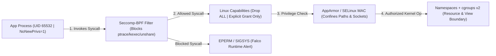
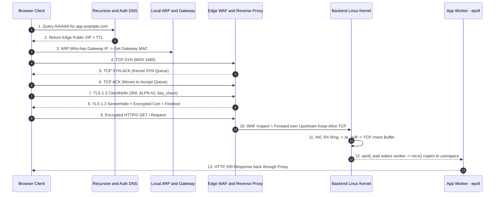
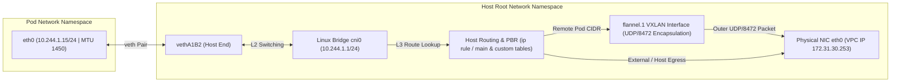

## 2. Linux Internals, Networking Fundamentals, and Reverse Proxies

Mastering Linux kernel mechanics and network packet paths separates operators who blindly restart pods from Senior and Expert DevOps/DevSecOps engineers who pinpoint root causes under pressure. Whether debugging CPU throttling in Kubernetes, securing unprivileged workloads (`UID 65532`, dropped capabilities, seccomp), or diagnosing silent MTU blackholes across VXLAN overlays and reverse proxies, every production incident maps directly to kernel primitives and TCP/IP behavior.

---

### 2.1 Linux Kernel, Process Lifecycle, Memory & Storage Internals

#### Q1. [Junior] What are the Linux process states (`R`, `S`, `D`, `Z`, `T`), why cannot a `D`-state process be killed with `kill -9`, and how are zombie (`Z`) processes reaped?

**Executive Takeaway:** Linux process states reflect where a task sits in the kernel scheduler or wait queues, and `D` (Uninterruptible Sleep) ignores `kill -9` (`SIGKILL`) because the thread is blocked deep inside kernel-mode I/O where abrupt termination could corrupt filesystem or hardware state. Zombie (`Z`) processes are already dead and cannot be killed either—their parent must call `wait()`/`waitpid()` to reap their exit status from the process table.

**Architectural Mechanics & Commands:**
- **`R` (Running / Runnable):** Actively executing on a CPU core or sitting in the CFS runqueue waiting for CPU time.
- **`S` (Interruptible Sleep):** Waiting for an event (network socket data, timer, pipe read); wakes up immediately upon receiving a signal such as `SIGTERM` or `SIGKILL`.
- **`D` (Uninterruptible Sleep):** Waiting in kernel space for a critical synchronous hardware/I/O operation (e.g., NVMe block read, hung NFS mount, page fault from swap). Signals are only delivered when returning from kernel mode to user mode, so `SIGKILL` remains pending until the underlying I/O completes or times out. Killing mid-syscall would leave VFS locks or DMA buffers in an inconsistent state.
- **`Z` (Zombie / Defunct):** Execution has finished and memory/FDs are freed, but the task struct (`PID` + exit code) remains so the parent can read it via `waitpid()`.
- **`T` / `t` (Stopped / Tracing Stop):** Suspended via job control (`SIGSTOP`, `SIGTSTP`) or paused by a debugger/tracer (`ptrace`, `strace`).

```bash
# Inspect process states and the exact kernel function a D-state process is blocked on
ps -eo pid,ppid,stat,wchan:24,comm | awk '$3 ~ /[DZ]/'

# Inspect the live kernel stack trace of a stuck D-state PID
sudo cat /proc/<PID>/stack
```

**Reaping Zombies & Handling `D`-State:**
- **For `Z` (Zombie):** Send `SIGCHLD` to the parent (`kill -SIGCHLD <PPID>`) if it handles dynamic reaping; otherwise restart the buggy parent process so `PID 1` adopts the orphaned child and reaps it immediately.
- **For `D` (Uninterruptible):** Fix the underlying storage/network dependency—e.g., unmount a hung NFS share with `umount -lf` (lazy/force) or check `dmesg -T` for failing disks/iSCSI timeouts; only a reboot clears permanently dead kernel I/O locks.

---

#### Q2. [Junior] How do `SIGTERM` (`15`), `SIGKILL` (`9`), and `SIGHUP` (`1`) differ, and how do you handle graceful shutdown in containers and `systemd` services?

**Executive Takeaway:** `SIGTERM` (`15`) politely asks a process to drain connections and shut down cleanly, `SIGHUP` (`1`) conventionally triggers configuration reloads without dropping traffic, and `SIGKILL` (`9`) instructs the kernel to destroy the process immediately with zero cleanup. In containers, `PID 1` receives special kernel signal protection that causes shell-wrapped apps to ignore `SIGTERM` until the orchestrator forcefully sends `SIGKILL`.

**Signal Mechanics & `PID 1` Pitfall:**
- **`SIGTERM` (`15`):** Catchable and blockable. Applications register signal handlers to stop accepting new connections, finish in-flight requests, flush WAL/disk buffers, and close DB pools.
- **`SIGKILL` (`9`):** Uncatchable, unblockable, kernel-enforced immediate termination. Leaves lockfiles, corrupted temporary state, and severed client TCP connections (`RST`).
- **`SIGHUP` (`1`):** Historically sent when a terminal disconnected; modern daemons (`nginx`, `haproxy`, `rsyslog`) trap `SIGHUP` to re-read config files and rotate worker pools gracefully.

In Linux, the kernel **does not install default signal-termination handlers for `PID 1`** (the init process). If a `Dockerfile` uses shell form (`CMD node server.js` instead of `ENTRYPOINT ["node", "server.js"]`), `/bin/sh` runs as `PID 1` and neither handles `SIGTERM` nor forwards it to the child Node process. As a result, `docker stop` stalls for 10s (or Kubernetes stalls for `terminationGracePeriodSeconds`, default 30s) and hard-kills the container with `SIGKILL`.

**Production Patterns (Containers, Kubernetes, `systemd`):**
```dockerfile
# Option A: Exec-form entrypoint + lightweight init (reaps zombies & forwards signals)
FROM alpine:3.20
RUN apk add --no-cache tini
ENTRYPOINT ["/sbin/tini", "--"]
CMD ["node", "server.js"]
```
- **Kubernetes Endpoint Propagation Race:** When a Pod terminates, `kubelet` sends `SIGTERM` at roughly the same time `kube-proxy`/Ingress updates `Endpoints`/`EndpointSlices`. Add a short `lifecycle.preStop` sleep (`sleep 5`) so existing traffic stops arriving *before* the app stops listening, and set `terminationGracePeriodSeconds` slightly above `preStop + max_request_drain`.
- **`systemd` Graceful Shutdown:** Configure `ExecReload=/bin/kill -HUP $MAINPID`, `TimeoutStopSec=30s`, and `KillMode=mixed` (sends `SIGTERM` only to the main process first, then `SIGKILL` to straggler cgroup descendants after timeout).

---

#### Q3. [Mid] Why can `df -h` show 100% disk full while `du -sh` shows plenty of free space, how do you fix deleted-but-open files, and what is inode exhaustion?

**Executive Takeaway:** `df` queries filesystem superblock counters while `du` walks visible directory entries—when an active process still holds an open file descriptor (`FD`) to a deleted (`unlink()`ed) file, the directory entry disappears from `du` while its blocks remain allocated in `df` until the FD closes. Conversely, inode exhaustion (`df -i` at 100%) prevents creating new files even when gigabytes of disk space remain free.

**Why Deleted-but-Open Files Happen:**
Deleting a file via `rm` only calls `unlink()`, decrementing its directory link count to `0`. POSIX guarantees that an open FD remains readable/writable until every process holding it closes it (for example, `logrotate` rotates or deletes an active application log without sending `SIGUSR1` or reloading the daemon).

```bash
# 1. Confirm block usage vs directory tree mismatch
df -hT /var
sudo du -xhd1 /var | sort -h

# 2. Find deleted files still pinned open by running processes
sudo lsof +L1 /var
# Alternative without lsof:
sudo ls -la /proc/*/fd 2>/dev/null | grep '(deleted)'
```

**Safe Remediation (Without Losing Service Availability):**
- **Never just `kill -9` stateful databases!** First check if the service supports log-reopen (`systemctl reload nginx` or `kill -USR1 <nginx_master_pid>`).
- To reclaim disk blocks **immediately without restarting the process**, truncate the open FD in place via `/proc`:
```bash
sudo truncate -s 0 /proc/<PID>/fd/<FD_NUM>
# Or shell redirection as root:
sudo sh -c ': > /proc/<PID>/fd/<FD_NUM>'
```

**Inode Exhaustion (`df -i`):**
Every file, directory, and symlink consumes one inode (metadata pointer). Millions of tiny temp, session, or mail-queue files exhaust the inode table (`100% IUse%`) on `ext4` (which pre-allocates a fixed inode count at `mkfs.ext4` time; `XFS` allocates dynamically up to `imaxpct`).

```bash
# Check inode saturation
df -ih

# Pinpoint the directory hoarding the most files
sudo find /var -xdev -printf '%h\n' | sort | uniq -c | sort -nr | head -n 15
```

---

#### Q4. [Mid] How does the Linux memory model balance Page Cache, Buffers, `RSS` vs `VSZ`, and Swap, and how does the kernel OOM Killer choose victims?

**Executive Takeaway:** Linux treats unused RAM as wasted RAM, filling it with reclaimable **Page Cache** (file contents) and **Buffers** (raw block metadata) that are instantly freed when applications request memory—so `available` in `free -h` matters, not `free`. Under true memory exhaustion, the **OOM Killer** scores processes (`oom_score` + `oom_score_adj`) and kills the highest-scoring non-critical consumer with `SIGKILL` (`Exit 137`).

**Key Memory Metrics & Reclaim:**
- **`VSZ` (Virtual Size):** Total virtual address space mapped by a process (including unbacked `malloc` reservations, memory-mapped files, and shared libraries). Rarely reflects actual RAM pressure.
- **`RSS` (Resident Set Size):** Physical RAM pages currently mapped into the process's page tables (includes full size of shared libraries counted across multiple processes).
- **`PSS` (Proportional Set Size):** Divides shared pages proportionally across sharing processes (accurate sum of real physical memory footprint; visible in `/proc/<PID>/smaps_rollup`).
- **Page Cache vs Buffers:** Page Cache caches VFS file pages (`read()`/`write()`); Buffers cache block-device metadata and raw disk blocks (inodes, superblocks, directory entries). Both are reclaimable unless pinned as dirty pages waiting on slow storage writeback.
- **`vm.swappiness` (`0`–`200`):** Controls kernel preference for swapping anonymous heap memory versus reclaiming file-backed Page Cache. Kubernetes nodes historically disable swap (`swapoff -a`) to guarantee deterministic OOM behavior and avoid severe tail-latency jitter (though K8s 1.28+ supports `LimitedSwap` under cgroups v2).

**OOM Killer Mechanics & Kubernetes QoS:**
When a cgroup hits `memory.max` (**cgroup OOM**, returning `OOMKilled` / exit code `137`) or the entire host runs out of reclaimable pages (**global OOM**), the kernel scans candidate tasks and computes `oom_score` (`0`–`1000` proportional to RAM usage) offset by `/proc/<PID>/oom_score_adj` (`-1000` = unkillable, `+1000` = kill first).

| Kubernetes QoS Class | Resource Spec Pattern | `oom_score_adj` | Kernel Eviction Priority |
| :--- | :--- | :--- | :--- |
| **`Guaranteed`** | `requests == limits` (CPU & Memory) | `-997` | Killed last (protected below kubelet `-999`) |
| **`Burstable`** | `requests < limits` | `2` to `999` (inversely scaled by request %) | Killed proportionally |
| **`BestEffort`** | No `requests` or `limits` | `1000` | Killed first under node pressure |

```bash
# Inspect live OOM scores and kernel OOM kill history
ps -eo pid,comm,rss,pmem --sort=-rss | head
cat /proc/<PID>/oom_score /proc/<PID>/oom_score_adj
dmesg -T | grep -iE 'oom|killed process'
```

---

#### Q5. [Mid] How do `systemd` unit dependencies (`After=`, `Requires=`, `Wants=`) and exit handling work, and how do you debug failing services with `journalctl`?

**Executive Takeaway:** In `systemd`, **ordering** (`After=`/`Before=`) is completely independent from **activation/dependency** (`Wants=`/`Requires=`/`BindsTo=`). A classic mistake is writing `Requires=network-online.target` without `After=network-online.target`, which starts both units simultaneously in parallel and triggers race-condition boot failures.

**Dependency Semantics & Hardened Service Units:**
- **Ordering (`After=`, `Before=`):** Governs startup/shutdown sequence only; implies no activation relationship.
- **`Wants=` (Recommended soft dependency):** Starts the target unit alongside this unit, but proceeds normally even if the wanted unit fails.
- **`Requires=` (Hard dependency):** Starts the dependency and **fails/stops this unit** if the required unit fails to start or crashes (unless paired with `After=`, they start concurrently).
- **`BindsTo=`:** Stronger than `Requires=`—if the bound unit stops cleanly or disappears (e.g., a device/socket), `systemd` immediately stops this unit too.

```ini
# /etc/systemd/system/api-gateway.service
[Unit]
Description=Hardened Internal API Gateway
After=network-online.target
Wants=network-online.target

[Service]
Type=notify
User=gateway
Group=gateway
ExecStart=/usr/local/bin/api-gateway --config /etc/gateway/config.yaml
ExecReload=/bin/kill -HUP $MAINPID
Restart=on-failure
RestartSec=3s
SuccessExitStatus=143
# Security sandboxing
NoNewPrivileges=yes
ProtectSystem=strict
ProtectHome=yes
PrivateTmp=yes

[Install]
WantedBy=multi-user.target
```
- `SuccessExitStatus=143` treats clean `SIGTERM` (`128 + 15 = 143`) exits as non-failures when using `Restart=on-failure`.
- Always protect crash-looping services with `StartLimitIntervalSec=60` and `StartLimitBurst=5` in `[Unit]` (or default rate limits).

**Fast `journalctl` & Boot Triage:**
```bash
# Tail logs since current boot filtered by unit and warning/error severity
sudo journalctl -u k3s-agent -b -p warning..emerg -n 50 --no-pager

# Check exact exit status and cgroup process tree
systemctl status k3s-agent --no-pager

# Profile slow boot dependency chains
systemd-analyze critical-chain api-gateway.service
```

---

#### Q6. [Senior] How do Linux namespaces isolate containers, and how do you inspect or debug a distroless container's network/mount namespaces from the host?

**Executive Takeaway:** Containers are ordinary Linux processes isolated by **8 kernel namespaces** that virtualize global OS resources per process group (`clone()`/`unshare()`). Because distroless and hardened containers (like non-root `UID 65532` images) omit shells and debugging tools, SREs attach host tools directly into a container's namespaces using `nsenter` or `kubectl debug`.

**The 8 Linux Namespaces:**
1. **`pid`:** Isolates process ID space (container sees its entrypoint as `PID 1`, while the host sees its real host PID).
2. **`net`:** Isolates network interfaces (`eth0`, `lo`), IP addresses, routing tables, `iptables`/`nftables` rules, and sockets.
3. **`mnt`:** Isolates filesystem mount points (`pivot_root` into container rootfs/OverlayFS without seeing host `/`).
4. **`ipc`:** Isolates System V IPC and POSIX message queues / shared memory segments.
5. **`uts`:** Isolates `hostname` and NIS domain name.
6. **`user`:** Maps unprivileged host UID/GID ranges (e.g., host `100000` -> container `0`), neutralizing root-in-container escapes (rootless Docker/Podman/K8s user namespaces).
7. **`cgroup`:** Virtualizes `/proc/self/cgroup` view so containers only observe their own cgroup hierarchy.
8. **`time`:** Isolates `CLOCK_MONOTONIC` and `CLOCK_BOOTTIME` offsets (added in Linux 5.6).

**Debugging a Distroless Container Using Host Tools (`nsenter`):**
Hardened containers intentionally ship without `sh`, `curl`, `ss`, or `tcpdump`. From the node host, locate the container's host PID and enter only its network (`-n`) or mount (`-m`) namespace while keeping host binaries in `$PATH`:

```bash
# 1. Resolve host PID via containerd/crictl or docker
CID=$(sudo crictl ps --name juice-shop -q)
HOST_PID=$(sudo crictl inspect --output go-template --template '{{.info.pid}}' "$CID")

# 2. Verify namespace inode links
ls -la /proc/"$HOST_PID"/ns/

# 3. Run host ss, tcpdump, or curl directly inside the container's network namespace
sudo nsenter -t "$HOST_PID" -n ss -tulnp
sudo nsenter -t "$HOST_PID" -n tcpdump -ni eth0 -c 20 port 3000
```

---

#### Q7. [Senior] What changed between `cgroups v1` and `cgroups v2`, and how does CPU CFS quota throttling degrade tail latency in Kubernetes?

**Executive Takeaway:** `cgroups v2` replaces `v1`'s fragmented multi-hierarchy controllers with a **single unified hierarchy** that accurately accounts buffered disk writeback, enables swap/memory soft throttling (`memory.high`), and exposes **Pressure Stall Information (PSI)**. Meanwhile, **CPU CFS quota throttling** remains a major cause of Kubernetes p99 tail-latency spikes because multi-threaded processes burn their entire `100ms` CPU quota across cores in a fraction of the period and freeze until the next window.

**`cgroups v1` vs `cgroups v2` Architectural Improvements:**

| Capability | `cgroups v1` | `cgroups v2` (Unified) |
| :--- | :--- | :--- |
| **Hierarchy** | Separate tree per controller (`cpu`, `memory`, `blkio`) | Single unified tree (`/sys/fs/cgroup`) via `cgroup.subtree_control` |
| **Writeback Accounting** | Page cache dirty writeback bypassed `blkio` limits | Memory + I/O controllers coordinate buffered writeback |
| **Memory Protection** | Hard limit OOM only; no gradual pressure signal | `memory.low` (protection), `memory.high` (soft throttle), `memory.max` (OOM) |
| **Stall Visibility** | No native contention metric | **PSI** (`cpu.pressure`, `memory.pressure`, `io.pressure` `some`/`full`) |
| **Rootless Safety** | Unsafe shared subtrees | Clean delegation model for rootless containers & systemd |

**CPU CFS Quota Throttling Mechanics:**
When you set `resources.limits.cpu: "500m"` in Kubernetes, the kubelet writes `50000 100000` into `cpu.max` (`50ms` of CPU time per `100ms` CFS period; in v1: `cpu.cfs_quota_us=50000`, `cpu.cfs_period_us=100000`). If a Node.js, Go, or JVM process spawns 4 runnable threads during a request burst, all 4 threads execute concurrently across 4 host cores for just **`12.5ms`** (`4 × 12.5ms = 50ms`), exhausting the quota. The kernel then **hard-freezes the entire cgroup for the remaining `87.5ms`**—even if host CPUs are 90% idle—causing severe tail-latency jitter.

```bash
# Inspect live CFS throttling and PSI memory/CPU stalls in cgroups v2
cat /sys/fs/cgroup/kubepods.slice/.../cpu.stat
# Look for high nr_throttled and throttled_usec

cat /sys/fs/cgroup/kubepods.slice/.../cpu.pressure
# Output: some avg10=12.40 avg60=8.15 avg300=4.02 total=9812345
```
**Mitigations:** Right-size or omit hard `limits.cpu` for latency-critical services (keeping `requests.cpu` for scheduling), align runtime thread pools (`GOMAXPROCS`, JVM `ActiveProcessorCount`), or lower `kubelet` `--cpu-cfs-quota-period` (e.g., `20ms`–`50ms` instead of `100ms`) with kernel `5.4+` CFS burst improvements.

---

#### Q8. [Senior] How do Linux Capabilities, `no_new_privs`, `seccomp`, and `AppArmor`/`SELinux` create defense-in-depth for containers?

**Executive Takeaway:** Linux Capabilities split all-powerful `root` into granular privileges (`CAP_NET_BIND_SERVICE`, `CAP_NET_RAW`, `CAP_SYS_ADMIN`), while `no_new_privs` blocks setuid privilege escalation, `seccomp` filters allowed kernel syscalls via BPF, and `AppArmor`/`SELinux` enforce Mandatory Access Control (MAC) over paths and labels. Combining `drop: [ALL]` with non-root UIDs and `RuntimeDefault` seccomp stops container escapes even when an application has an RCE vulnerability (such as OWASP Juice Shop).



**Core Hardening Primitives:**
- **Key Linux Capabilities:**
  - `CAP_NET_BIND_SERVICE`: Bind privileged ports `< 1024` (unneeded if NGINX/app listens on `:8080` or uses unprivileged sysctls).
  - `CAP_NET_RAW`: Craft raw sockets (`ping`, packet sniffing, ARP spoofing)—should almost always be dropped to prevent lateral LAN attacks.
  - `CAP_NET_ADMIN`: Modify interfaces, routing tables, and `iptables`/`nftables` (needed only by CNI plugins/VPN sidecars).
  - `CAP_SYS_ADMIN`: Overloaded "pseudo-root" capability (mounts, namespaces, BPF, trace)—never grant to application pods.
- **`no_new_privs` (`allowPrivilegeEscalation: false`):** Sets kernel flag `PR_SET_NO_NEW_PRIVS`, guaranteeing that `execve()` can never gain extra capabilities via `setuid`/`setgid` binaries or file capabilities (`setcap`).
- **`seccomp` vs `AppArmor`/`SELinux`:** `seccomp` operates at the **syscall ABI layer** (intercepting syscall numbers and scalar args before execution—e.g., Docker/K8s `RuntimeDefault` blocks ~44 risky syscalls like `mount`, `kexec_load`, `init_module`). `AppArmor` (path-based) and `SELinux` (inode label/type-enforcement `svirt_lxc_net_t`) operate at the **LSM (Linux Security Module) object layer**, blocking unauthorized file reads (e.g., `/etc/shadow` or `/proc/kcore`) even via allowed syscalls like `openat()`.

**CyShield Security-First Hardening Pattern & Live Verification:**
In security-sensitive Kubernetes deployments (like isolating intentionally vulnerable apps such as OWASP Juice Shop alongside Falco runtime syscall detection):
```yaml
securityContext:
  runAsNonRoot: true
  runAsUser: 65532
  seccompProfile:
    type: RuntimeDefault
containers:
  - name: app
    securityContext:
      allowPrivilegeEscalation: false
      readOnlyRootFilesystem: true
      capabilities:
        drop: ["ALL"]
```
Verify confinement live inside any container:
```bash
grep -E '^(Uid|Gid|NoNewPrivs|CapEff|Seccomp):' /proc/self/status
# Secure output: NoNewPrivs: 1 | CapEff: 0000000000000000 | Seccomp: 2 (filter mode)
```

---

#### Q9. [Expert] How does the `epoll` event loop outperform `select` and `poll` to power NGINX and Envoy at high concurrency?

**Executive Takeaway:** `select` and `poll` scale at `O(N)` because userspace must pass the full file-descriptor array into the kernel and the kernel must linearly scan every socket on every wait call. `epoll` achieves `O(1)` event retrieval by keeping the watched FD set inside a kernel red-black tree (`epoll_ctl`) and returning only active descriptors pushed onto a ready list (`rdllist`) by NIC/socket callbacks (`epoll_wait`).

**Under-the-Hood Scaling Comparison:**
- **`select`:** Hard-capped at `FD_SETSIZE` (`1024` descriptors by default), mutates bitmasks in-place requiring full `fd_set` re-initialization and user-to-kernel copy on every iteration (`O(N)`).
- **`poll`:** Removes the `1024` FD cap via dynamic `struct pollfd` arrays, but still copies the entire array across user/kernel space and performs `O(N)` polling scans per call—collapsing under C10K/C100K workloads where most idle keep-alive sockets have zero events.
- **`epoll` Architecture:**
  1. `epoll_create1(0)`: Allocates an in-kernel `eventpoll` instance.
  2. `epoll_ctl(epfd, EPOLL_CTL_ADD, fd, &ev)`: Registers an FD **once** into an `O(log N)` red-black tree and attaches a wait-queue callback to the socket.
  3. When packets arrive, the socket callback appends *only* the ready FD to `rdllist`.
  4. `epoll_wait()`: Returns immediately with only the `K` ready events (`O(K)` / `O(1)` relative to total idle connections).

**Level-Triggered (`LT`) vs Edge-Triggered (`EPOLLET`) & Thundering Herd:**
- **Level-Triggered (`LT`, default):** Keeps reporting an FD as ready as long as unread bytes remain in the kernel buffer.
- **Edge-Triggered (`EPOLLET`, used by NGINX):** Fires **once** when buffer state transitions (empty -> non-empty). Requires non-blocking sockets (`O_NONBLOCK`) and draining `accept()`/`read()` in a loop until `EAGAIN`/`EWOULDBLOCK`; otherwise remaining unread bytes hang forever.
- **Thundering Herd Fix:** Multi-worker proxies (`nginx`, `envoy`) either shard listening sockets per worker via `SO_REUSEPORT` (kernel load-balances SYNs across workers with zero lock contention) or use `EPOLLEXCLUSIVE` so only one sleeping worker wakes per incoming connection.

---

#### Q10. [Expert] How do you use `strace` safely for deep syscall debugging, and when should you switch to eBPF tracing in production?

**Executive Takeaway:** `strace` decodes every system call, argument, latency, and `errno` emitted by a process—making it unbeatable for diagnosing missing configs, `EACCES`/`EPERM` failures, and blocking sockets. However, because `strace` uses `ptrace` to pause the target twice *per syscall*, it causes massive slowdown (`10x`–`100x`) on high-throughput services, where eBPF tools (`bpftrace`, `opensnoop`, `tcplife`) are safer.

**High-Signal `strace` Recipes:**
```bash
# Trace network and file syscalls across all threads (-f), resolving IP:port (-yy) and duration (-T)
sudo strace -fp <PID> -e trace=network,file -T -yy -s 256

# Low-noise latency summary table (-c) over a 5-second window to find slow syscalls
sudo timeout 5 strace -fp <PID> -c
```

**Interpreting Critical Syscall Errors:**
- **`ENOENT`:** File/socket path missing (e.g., searching wrong shared library or Unix socket path).
- **`EACCES` vs `EPERM`:** `EACCES` indicates standard POSIX file permissions or AppArmor/SELinux denial; `EPERM` indicates missing Linux Capability (`CAP_*`) or a `seccomp` policy block (`Seccomp` mode 2 returning `EPERM`).
- **`EINPROGRESS` on `connect()`:** Normal for non-blocking sockets (`O_NONBLOCK`); look immediately after for `epoll_wait` / `getsockopt(..., SO_ERROR)` to see whether the handshake succeeded or hit `ETIMEDOUT`/`ECONNREFUSED`.
- **Blocked on `futex()` or `poll()`/`epoll_wait()`:** Thread is either deadlocked on a userspace mutex (`futex`) or waiting idle on an external upstream socket.

**Production Caveat & eBPF Replacement:**
Attaching `strace` to a busy Envoy, database, or Node.js worker triggers `ptrace(PTRACE_SYSCALL)` context-switch storms. For live production diagnostics, use kernel-space eBPF tracing (zero process stops, `<1–2%` overhead): `execsnoop-bpfcc` (short-lived process spawns), `opensnoop-bpfcc` (file open failures), `tcplife-bpfcc` (TCP session duration/bytes), or Falco syscall event streams.

---

#### Q11. [Expert] Which `sysctl` kernel parameters are essential for tuning Kubernetes nodes and high-concurrency reverse proxies?

**Executive Takeaway:** Default Linux kernel settings are tuned for general-purpose desktops and small servers—not thousands of container interfaces, high-RPS reverse proxies, or unprivileged rootless probes. Failing to tune forwarding, listen backlogs, inotify limits, ICMP ping permissions, and `conntrack` tables causes silent packet drops, stalled Ingress connections, and failing pod watch loops.

**Critical Production `sysctl` Profile (`/etc/sysctl.d/99-k8s-proxy.conf`):**

```ini
# 1. Enable IPv4 packet forwarding across host/CNI interfaces (mandatory for K8s routing/NAT)
net.ipv4.ip_forward = 1

# 2. Prevent silent SYN / Accept queue drops under traffic bursts
net.core.somaxconn = 32768
net.ipv4.tcp_max_syn_backlog = 16384
net.core.netdev_max_backlog = 16384

# 3. Expand ephemeral port range for outbound reverse-proxy upstream connections
net.ipv4.ip_local_port_range = 10240 65535

# 4. Prevent kubelet, Promtail/Fluent-Bit, and reload watchers from failing with ENOSPC / EMFILE
fs.inotify.max_user_watches = 524288
fs.inotify.max_user_instances = 8192

# 5. Allow non-root containers (e.g., UID 65532) to send ICMP pings without CAP_NET_RAW
net.ipv4.ping_group_range = 0 2147483647

# 6. Scale stateful NAT/conntrack table for high-churn Service & Ingress traffic
net.netfilter.nf_conntrack_max = 524288

# 7. Required if running Elasticsearch / OpenSearch / Loki-scale mmap workloads
vm.max_map_count = 262144
```

**Why Each Knob Matters:**
- **`net.core.somaxconn`:** Silently caps any application's `listen(fd, backlog)` call. Even if NGINX sets `listen 443 backlog=4096`, an older kernel with `somaxconn=128` truncates the accept queue to `128`, dropping completed handshakes during load spikes.
- **`fs.inotify.max_user_watches` / `max_user_instances`:** Log collectors (Promtail), container runtimes, and config-reloaders consume inotify resources rapidly; exhausting `max_user_watches` fails with **`ENOSPC`** (`No space left on device` on `inotify_add_watch()`), whereas exhausting `max_user_instances` fails with **`EMFILE`** (`Too many open files` on `inotify_init()`/`inotify_init1()`).
- **`net.ipv4.ping_group_range`:** Enables unprivileged ICMP probes inside hardened pods where `CAP_NET_RAW` is dropped.
- **Apply & Verify:** Run `sudo sysctl --system` and verify live values with `sysctl net.core.somaxconn net.netfilter.nf_conntrack_max`.

---

### 2.2 Networking Fundamentals, Packet Journey & Proxies

#### Q12. [Junior] What happens end-to-end—down to the OS kernel socket buffers—when a user types `https://app.example.com` in a browser?

**Executive Takeaway:** A single page load traverses DNS resolution, L2 ARP/gateway routing, a TCP 3-way handshake, a TLS 1.3 handshake, L7 reverse-proxy/WAF inspection, and finally kernel `sk_buff` allocation into the application socket's `recv()` buffer via `epoll_wait`. Knowing which layer fails (`DNS` vs `SYN` vs `TLS` vs `TTFB`) cuts mean-time-to-diagnose from hours to seconds.



**Layer-by-Layer Breakdown:**
1. **Browser Cache & HSTS:** Browser checks HSTS preload list (upgrading HTTP->HTTPS locally) and local/OS DNS caches.
2. **DNS Resolution:** Stub resolver sends UDP/53 (or DoH/DoT) query to recursive resolver -> Root -> `.com` TLD -> Authoritative NS -> caches `A`/`AAAA` record for `TTL` seconds.
3. **Routing & ARP:** OS checks routing table (`ip route get <VIP>`). Because the VIP is outside the local CIDR, it ARP-resolves the **default gateway's MAC address** and wraps the IP packet in an Ethernet frame destined for the gateway MAC.
4. **TCP 3-Way Handshake:** Client sends `SYN` -> Edge kernel validates and places connection in the `SYN` queue (`SYN_RECV`), replies `SYN-ACK` -> Client sends `ACK` -> Kernel moves socket to the `accept` queue (`somaxconn`), and `accept()` creates a new connected FD.
5. **TLS 1.3 (1-RTT):** Client sends `ClientHello` with **SNI** (`app.example.com`), **ALPN** (`h2`, `http/1.1`), and ECDHE `key_share`; Server responds with `ServerHello`, encrypted certificate chain, `CertificateVerify`, and `Finished`.
6. **Edge WAF / Reverse Proxy -> Backend Kernel:** Proxy inspects L7 payload (blocking SQLi/XSS), sets `X-Forwarded-For`, reuses an upstream connection pool, and sends packets to the backend NIC. The NIC DMA-writes frames into the RX ring, the kernel allocates `sk_buff`, validates TCP checksum/sequence, appends bytes to `SO_RCVBUF` (`sk_rmem`), and notifies the backend worker sleeping in `epoll_wait()` to `recv()`.

---

#### Q13. [Junior] How do ARP, CIDR routing, and Layer 2 vs Layer 3 headers interact as a packet traverses multiple network hops?

**Executive Takeaway:** Layer 3 IP addresses identify the logical **end-to-end source and destination** across the entire path (unless NAT rewrites them), whereas Layer 2 Ethernet MAC addresses are **hop-by-hop**—rewritten by every router using ARP (IPv4) or NDP (IPv6) until reaching the target subnet.

**Packet Encapsulation Mechanics:**
- **Same Subnet Test:** The sender applies its subnet mask (CIDR prefix, e.g., `/24` = `255.255.255.0`) to both its own IP and the destination IP.
  - **Match (On-Link):** Host ARPs (`Who-has <target_ip>?`) directly for the target's MAC and sends the L2 frame directly over the switch/bridge.
  - **No Match (Off-Link):** Host looks up the longest-prefix match in its routing table (`default via 10.0.1.1`), ARPs for `10.0.1.1`'s MAC, and sets `Dst MAC = Gateway MAC` while keeping `Dst IP = Remote Server IP`.
- **At Each Router Hop:** Router strips the incoming L2 Ethernet header, decrements IP `TTL` by `1` (dropping with ICMP `Time Exceeded` if `TTL == 0`), selects the next-hop interface via longest-prefix route match, and encapsulates the IP packet in a fresh L2 header using the next hop's MAC.

```bash
# Inspect local addresses, ARP/neighbor cache, and exact kernel forwarding decision
ip -br addr show
ip neigh show
ip route get 1.1.1.1
```

---

#### Q14. [Mid] How does DNS resolution work (recursive vs authoritative, record types, TTL, `/etc/resolv.conf`), and why does an `MX` lookup NOT prove a mailbox exists?

**Executive Takeaway:** Recursive resolvers perform iterative walking across Root, TLD, and Authoritative nameservers on a client's behalf and cache results by `TTL`, while `/etc/resolv.conf` controls nameserver order and search-domain expansion (`ndots`). Crucially, an `MX` lookup only identifies which SMTP servers accept mail for a **domain**—it never validates whether a specific user mailbox exists.

**Core DNS Mechanics:**
- **Recursive vs Authoritative:** Stub resolvers (`glibc`/containers) ask a **recursive resolver** (`10.96.0.10` CoreDNS, `1.1.1.1`), which either serves from cache or iteratively queries Root (`.`) -> TLD (`.com`) -> **Authoritative Nameserver** (holds the source-of-truth zone file). Negative (`NXDOMAIN`) responses are also cached using the zone's `SOA` minimum TTL.
- **Essential Record Types:**
  - `A` / `AAAA`: Hostname -> IPv4 / IPv6 address.
  - `CNAME`: Canonical alias to another domain name (**cannot** coexist with `SOA`/`NS` at the zone apex `@`; providers use `ALIAS`/`ANAME` flattening instead).
  - `MX`: Mail exchanger hostname + priority (lower integer = higher priority).
  - `TXT`: Arbitrary verification/policy strings (`SPF`, `DKIM`, `DMARC`, ACME DNS-01 challenges).
  - `SRV`: Service discovery (`_service._proto.name`) returning priority, weight, port, and target host.

**Why `MX` Does NOT Prove Mailbox Existence:**
DNS stores **domain-level** routing (`example.com -> mail.example.com`), not user mailboxes. Validating `user@example.com` is an SMTP-layer operation (`RCPT TO`), and modern mail servers block `VRFY`/`EXPN` commands or return `250 OK` accept-all responses followed by silent drops/bounces specifically to prevent user-enumeration attacks.

**Two DevOps/Kubernetes DNS Pitfalls:**
1. **Kubernetes `ndots:5` Amplification:** Default pod `/etc/resolv.conf` includes `search <ns>.svc.cluster.local svc.cluster.local cluster.local` and `options ndots:5`. Any external hostname with fewer than 5 dots (e.g., `api.github.com` has 2 dots) triggers **4 failed search-domain lookups (`A` + `AAAA` = 8 queries)** before querying the real FQDN—causing CoreDNS CPU spikes and `conntrack` saturation! Mitigate with trailing dots (`api.github.com.`) or `spec.dnsConfig.options: [{name: ndots, value: "2"}]`.
2. **Docker Build-Time `/etc/resolv.conf` Overwrite:** Editing `/etc/resolv.conf` inside a `Dockerfile` is ignored at container startup because the Docker daemon bind-mounts a runtime `/etc/resolv.conf` (so runtime flags like `docker run --dns 8.8.8.8 --dns 1.1.1.1` or daemon config must be used).

---

#### Q15. [Mid] What do TCP states (`SYN_SENT`, `ESTABLISHED`, `TIME_WAIT`, `CLOSE_WAIT`) tell you, and why is high `CLOSE_WAIT` an application bug while high `TIME_WAIT` is connection churn?

**Executive Takeaway:** `TIME_WAIT` is healthy TCP protocol state held by the **active closer** for `2*MSL` (`60s` on Linux) to absorb stray duplicate packets—high counts signal short-lived connection churn and risk ephemeral port exhaustion. By contrast, high `CLOSE_WAIT` means the remote peer already closed the socket (`FIN`), the kernel acknowledged it, and your **local application leaked the socket** without calling `close()`.

**Diagnostic State Breakdown (`ss -tan`):**
- **`SYN_SENT`:** Local host sent `SYN` and got neither `SYN-ACK` nor `RST` -> firewall drop, security group block, or asymmetric routing.
- **`SYN_RECV`:** Server received `SYN`, replied `SYN-ACK`, waiting for final `ACK` -> SYN flood attack or client packet loss.
- **`ESTABLISHED`:** Active 3-way handshake complete; data flowing.
- **`TIME_WAIT`:** Normal `60s` cooldown on the side that sent the first `FIN`. Prevents delayed packets from a closed session from corrupting a new connection reusing the same 4-tuple (`src_ip:src_port -> dst_ip:dst_port`).
- **`CLOSE_WAIT`:** Peer sent `FIN`; local kernel sent `ACK` and placed EOF on the socket, waiting indefinitely for the application code to call `close()`.

**Ephemeral Port Exhaustion & Fixes:**
When a reverse proxy (NGINX/Envoy) opens thousands of short-lived upstream connections per second without keep-alive pooling, all ports in `net.ipv4.ip_local_port_range` (`32768`–`60999` by default = ~28k ports) enter `TIME_WAIT`, causing `connect()` to fail with `EADDRNOTAVAIL`.
- **Correct Fix for `TIME_WAIT`:** Enable HTTP keep-alive (`proxy_http_version 1.1; proxy_set_header Connection "";` + `keepalive 128;`), expand `ip_local_port_range`, and enable `net.ipv4.tcp_tw_reuse = 1` (for outbound connections only). **Never** suggest `tcp_tw_recycle` (removed in Linux 4.12 because it drops legitimate packets behind NAT!).
- **Correct Fix for `CLOSE_WAIT`:** Fix the application resource leak (e.g., missing `defer resp.Body.Close()` in Go or missing `try/finally` socket close + HTTP client timeouts).

```bash
# Summarize TCP socket states cleanly in milliseconds
ss -s
ss -tan | awk 'NR>1 {print $1}' | sort | uniq -c | sort -nr
```

---

#### Q16. [Mid] How do Forward Proxies, Reverse Proxies, and L4 vs L7 Load Balancers differ, and how do you safely preserve client IP?

**Executive Takeaway:** A **Forward Proxy** sits in front of clients to broker outbound access, whereas a **Reverse Proxy** sits in front of origin servers to terminate TLS, cache, and protect backends. **L4 Load Balancers** forward raw TCP/UDP streams at ultra-low latency based on 5-tuples, while **L7 Load Balancers** terminate HTTP/gRPC to route on paths/headers—requiring careful `X-Forwarded-For` or **Proxy Protocol v2** configuration to prevent client-IP spoofing.

| Component | Position & Role | Protocol Visibility | Typical Use Cases |
| :--- | :--- | :--- | :--- |
| **Forward Proxy** | Client-side egress gateway | HTTP `CONNECT` / SOCKS5 | Outbound firewall allowlisting, corporate DLP, egress caching |
| **Reverse Proxy** | Server-side ingress front | L7 HTTP/HTTPS/gRPC | TLS termination, WAF, rate limiting, compression, caching |
| **L4 Load Balancer** | Transport-layer router | TCP/UDP 5-tuple (NAT/DSR) | Ultra-high PPS, non-HTTP protocols (DBs, MQTT), TLS passthrough |
| **L7 Load Balancer** | Application-layer proxy | Full L7 headers/URI/cookies | Canary routing, gRPC balancing, auth injection, retries |

**Preserving Real Client IP Safely:**
- **L7 Headers:**
  - `X-Real-IP`: Single IP header set by the edge proxy.
  - `X-Forwarded-For` (`XFF`): Comma-separated chain (`<client>, <proxy1>, <proxy2>`).
  - `Forwarded` (RFC 7239): Standardized replacement (`for=203.0.113.10;proto=https;by=...`).
- **L4 Proxy Protocol v1/v2 (v2 is binary, low-overhead):** Prepends a tiny header carrying source/dest IP:port immediately after TCP connect and *before* TLS `ClientHello`—essential when an L4 LB (like AWS NLB) forwards TCP passthrough to NGINX Ingress.
- **Security Hardening Against Spoofing:** An attacker can send `X-Forwarded-For: 127.0.0.1` to bypass IP allowlists or rate limits! **Never** trust raw `XFF`: strip untrusted headers at the outermost edge proxy, and configure downstream NGINX/Envoy with explicit `set_real_ip_from <LB_CIDR>;` + `real_ip_recursive on;` so only trusted proxy hops are stripped from the right.

---

#### Q17. [Mid] What are the architectural and security trade-offs between TLS Termination, TLS Passthrough, and TLS Re-encryption?

**Executive Takeaway:** **TLS Termination** gives the edge proxy/WAF full visibility for L7 inspection and caching at minimal CPU cost, **TLS Passthrough** preserves end-to-end encryption directly to the backend pod at the expense of L7 WAF blindness, and **TLS Re-encryption** delivers zero-trust defense-in-depth by inspecting traffic at the WAF and re-encrypting over mTLS internally.

| Pattern | How It Works | L7 WAF / Routing Visibility | Latency & CPU Overhead | Security Posture |
| :--- | :--- | :--- | :--- | :--- |
| **TLS Termination** | Edge decrypts HTTPS; forwards plain HTTP internally | Full (headers, URI, body, OWASP rules) | Lowest CPU (1 handshake) | Risky if internal VPC/node network is untrusted |
| **TLS Passthrough** | Edge reads SNI only; forwards encrypted TCP bytes to app | None (opaque encrypted stream) | Low proxy CPU; app does TLS | Strongest E2E privacy; required for app-level client mTLS; no WAF |
| **TLS Re-encryption** | Edge decrypts -> WAF inspects -> new mTLS session to pod | Full L7 WAF + zero-trust internal hop | Highest (2 TLS contexts, mitigated via persistent mTLS pools) | **Gold standard** for PCI-DSS, HIPAA, and zero-trust DevSecOps |

**Practical Implementation Note:** In Kubernetes NGINX Ingress, **TLS Re-encryption** is enabled via `nginx.ingress.kubernetes.io/backend-protocol: "HTTPS"` paired with upstream cert validation (`proxy-ssl-secret` + `proxy-ssl-verify: "on"`), ensuring a compromised cluster network cannot sniff plaintext session cookies or JWTs between Ingress and pods.

---

#### Q18. [Senior] Why do VXLAN, Geneve, and IPsec overlays cause silent MTU blackholes, and how do you size cluster and node MTU?

**Executive Takeaway:** Encapsulation protocols add **50+ bytes** of outer headers (`VXLAN = 50B`, `Geneve = 50–58B+`, `IPsec = 56–73B`). When pods still emit `1500B` packets over a `1500B` underlay network and a firewall drops ICMP `Fragmentation Needed` (`Type 3 Code 4`), Path MTU Discovery (PMTUD) breaks—creating a **silent MTU blackhole** where tiny `ping` and health checks pass while TLS handshakes and large API payloads hang forever.

**Exact Encapsulation Math:**
Standard Ethernet MTU is `1500` bytes (`TCP MSS = 1500 - 20 IPv4 - 20 TCP = 1460` bytes).
- **VXLAN Overhead (50 bytes):** `20B` Outer IPv4 + `8B` Outer UDP (`8472` in Flannel / `4789` IANA) + `8B` VXLAN Header + `14B` Inner Ethernet Header = **50 bytes**.
- If a pod sends a `1500B` packet with the `DF` (Don't Fragment) bit set, the VXLAN-encapsulated outer packet becomes **`1550B`**, exceeding the underlay VPC/NIC `1500B` limit.
- **Why It Fails Silently:** Under normal PMTUD, the underlay router drops the `1550B` packet and returns **ICMP Type 3 Code 4** (`Fragmentation Needed`, reporting next-hop MTU). Cloud security groups and overly strict firewalls frequently block all ICMP—meaning the sender never receives the shrink signal, retries full-sized segments repeatedly, and times out.

**Sizing Rules (Cloud & K8s):**
- **Standard `1500B` Underlay (e.g., EC2/bare-metal with Flannel VXLAN):** Configure pod/CNI MTU to **`1450`** (`1500 - 50`), or **`1440`/`1420`** for Geneve/WireGuard/IPsec.
- **AWS VPC Jumbo Frames (`9001B` inside VPC):** Intra-VPC traffic supports `9001B`, so set VXLAN pod MTU to **`8951`** (`9001 - 50`) for high-throughput East-West services—while noting that traffic crossing an AWS **Internet Gateway (IGW)** or VPN is capped at **`1500B`** (so external edge paths still rely on PMTUD or TCP MSS clamping).

---

#### Q19. [Senior] How do `veth` pairs, Linux bridges, `tun`/`tap` devices, and Policy-Based Routing connect container namespaces to the physical network?

**Executive Takeaway:** Containers talk to the host through virtual Ethernet patch cables (**`veth` pairs**) plugged into a host L2 **Linux bridge** (`cni0`/`docker0`), which hands packets to the host routing table or an encapsulation device (`tun`/VXLAN). On multi-NIC cloud nodes, **Policy-Based Routing (`ip rule`)** prevents asymmetric drops by ensuring reply packets exit the exact interface that received the request.



**Virtual Networking Primitives:**
- **`veth` Pair:** Always created in pairs—pushing a frame into one end instantaneously delivers it out the other end across network namespaces (`ip link add veth0 type veth peer name eth0`).
- **Linux Bridge (`cni0`, `br0`):** Kernel L2 virtual switch that learns MAC addresses across attached `veth` ports and forwards frames locally without hitting the physical NIC.
- **`tun` vs `tap`:**
  - **`tun` (L3 Tunnel):** Carries raw **IP packets** only (no Ethernet header/ARP overhead); used by WireGuard, OpenVPN L3, and IPIP/Calico tunnels.
  - **`tap` (L2 Tap):** Carries full **Ethernet frames** (including ARP/broadcasts); used by QEMU/KVM hypervisors to bridge VMs onto L2 segments.
- **Multiple Routing Tables & Policy-Based Routing (PBR):** Standard routing inspects only destination IP (`main` table). When an AWS EC2 node attaches multiple ENIs (e.g., AWS VPC CNI assigning secondary VPC IPs to pods), replies from a secondary ENI IP would wrongly exit the primary `eth0` and fail source-check (`rp_filter` / AWS SG). PBR solves this via source-based rules:
```bash
# Route traffic originating from secondary pod CIDR via dedicated table 100 (ENI #2)
ip rule add from 10.0.2.64/26 table 100 priority 512
ip route add default via 10.0.2.1 dev eth1 table 100
```

---

#### Q20. [Senior] How does Linux `conntrack` work, what causes `conntrack` table exhaustion, and how do you size and tune it for Kubernetes?

**Executive Takeaway:** `nf_conntrack` maintains a stateful kernel hash table tracking every active 5-tuple flow and NAT translation (`SNAT`/`DNAT` for Kubernetes Services and reverse proxies). When concurrent flows or lingering UDP DNS entries fill `nf_conntrack_max`, the kernel silently drops new packets (`nf_conntrack: table full, dropping packet`), causing mysterious connection timeouts even at low CPU.

**How `conntrack` Works & Breaks at Scale:**
Every tracked connection occupies a `~320-byte` kernel struct classified as `NEW`, `ESTABLISHED`, `RELATED`, or `INVALID`.
- **Kubernetes Amplification:** Each `ClusterIP` DNAT creates a conntrack entry. Worse, UDP is connectionless, so every DNS query lingers in conntrack for `nf_conntrack_udp_timeout` (`30s`, or `120s` if replied (`udp_timeout_stream`)). Paired with `ndots:5`, a single burst of HTTP calls can generate thousands of stale UDP entries and exhaust the default table (`~65k`–`131k` entries on small VMs).

**Diagnosis, Sizing & Remediation:**
```bash
# Check live conntrack utilization vs ceiling and drop counters
sysctl net.netfilter.nf_conntrack_count net.netfilter.nf_conntrack_max
sudo conntrack -S   # Watch insert_failed, drop, search_restart

# Inspect kernel drop log
dmesg -T | grep -i 'nf_conntrack: table full'
```
- **Memory & Hash Sizing:** `524,288` entries consume roughly `524288 × 320B ≈ 168 MB` of non-swappable kernel slab RAM. Always keep `hashsize` at **`nf_conntrack_max / 4`** (ideally `/sys/module/nf_conntrack/parameters/hashsize` set at boot/modprobe) to prevent long linked-list collisions per bucket.
- **Stateless Bypass (`NOTRACK`):** For ultra-high-PPS non-NAT traffic (e.g., `NodeLocal DNSCache` listening on `169.254.20.10`, standalone non-NAT DNS servers, internal metrics, or BGP) that does not require stateful NAT/firewalling, bypass `conntrack` in the Netfilter `raw` table—**scoped strictly to the non-NAT IP**. Never apply unscoped `--dport 53` / `--sport 53` `NOTRACK` rules on Kubernetes nodes, because `UNTRACKED` packets bypass the `nat` table and break `kube-proxy` `ClusterIP` DNAT (`10.96.0.10:53 -> CoreDNS Pod IP`), and `PREROUTING --dport 53` / `OUTPUT --sport 53` matches only inbound server-side DNS rather than outbound client queries:
```bash
# Scoped NOTRACK example for Kubernetes NodeLocal DNSCache (non-NAT link-local 169.254.20.10)
iptables -t raw -A PREROUTING -p udp -d 169.254.20.10 --dport 53 -j NOTRACK
iptables -t raw -A OUTPUT -p udp -d 169.254.20.10 --dport 53 -j NOTRACK
iptables -t raw -A OUTPUT -p udp -s 169.254.20.10 --sport 53 -j NOTRACK
```

---

#### Q21. [Expert] How do `iptables`, `nftables`, and `IPVS` compare across Netfilter hooks, and why does `iptables` hit `O(N)` scaling walls in Kubernetes?

**Executive Takeaway:** Netfilter exposes 5 kernel hook points (`PREROUTING`, `INPUT`, `FORWARD`, `OUTPUT`, `POSTROUTING`), and `iptables` evaluates Service NAT rules sequentially down a chain—resulting in `O(N)` per-packet traversal and painful full-table lock reloads at thousands of Kubernetes Services. `nftables` fixes rule atomicity and adds `O(1)`/`O(log N)` maps, while `IPVS` delivers `O(1)` kernel hash-table L4 load balancing.

**Netfilter Hook Traversal Order:**
- **Inbound to Host:** `PREROUTING` -> Routing Decision -> `INPUT` -> Local Socket.
- **Forwarded (Pod/Bridge):** `PREROUTING` -> Routing Decision -> `FORWARD` -> `POSTROUTING`.
- **Outbound from Host:** Local Socket -> Routing Decision -> `OUTPUT` -> `POSTROUTING`.
- Within each hook, tables execute strictly in order: `raw` -> `conntrack` -> `mangle` -> `nat` -> `filter`.

**Dataplane Scaling Comparison (`kube-proxy` Modes):**

| Dimension | `iptables` (Legacy Default) | `nftables` (`kube-proxy` 1.31+ GA/Beta) | `IPVS` (Linux Virtual Server) |
| :--- | :--- | :--- | :--- |
| **Lookup Complexity** | **`O(N)`** linear walk (`KUBE-SERVICES` -> `KUBE-SVC-*` -> `KUBE-SEP-*`) | **`O(1)` / `O(log N)`** via native vmaps & sets | **`O(1)`** kernel hash table lookup |
| **Rule Update Cost** | Full-ruleset atomic swap (`iptables-restore`) under `xtables` lock; seconds-long stalls at 5k–10k Services | Incremental atomic Netlink transactions | Incremental single virtual-server/real-server Netlink updates |
| **LB Algorithms** | Random `statistic --probability` only | Dynamic verdict maps / random / hash | `rr`, `lc` (least-conn), `wrr`, `sed`, `sh` (source-hash) |
| **Limitations** | Severe tail latency & control-plane CPU burn at scale | Newer ecosystem tooling | Still relies on `iptables`/`ipset` for SNAT/masquerading & nodeport hairpinning |

---

#### Q22. [Expert] How do `eBPF` (`tc`) and `XDP` bypass Netfilter overhead, and how does XDP drop DDoS traffic before `sk_buff` allocation?

**Executive Takeaway:** `eBPF` replaces sprawling `iptables` NAT chains with verifier-checked kernel bytecode backed by `O(1)` BPF hash maps at socket and `tc` hooks, translating `ClusterIP` directly inside `connect()` with zero per-packet NAT overhead. **XDP (eXpress Data Path)** executes even earlier—directly inside the NIC driver RX ring **before** the kernel allocates `sk_buff`—allowing a single core to drop volumetric DDoS floods at 10M–24M+ packets per second.

**How `eBPF` Replaces `kube-proxy` (e.g., Cilium):**
1. **Socket-Layer Hook (`cgroup/connect4`, `sendmsg`):** When an app calls `connect()` to a Kubernetes `ClusterIP:Port`, the eBPF program performs an `O(1)` hash lookup in a BPF map and rewrites the destination address *directly* to the selected backend Pod `IP:Port`. Every subsequent packet in that TCP flow flows straight to the Pod without traversing `KUBE-SERVICES` or per-packet DNAT.
2. **Traffic Control (`tc` Ingress/Egress):** Operates on `sk_buff` directly at the virtual interface (`veth`/`eth0`), enforcing L3/L4/L7 identity-based Kubernetes NetworkPolicies and direct-routing forwarding without Netfilter hook overhead.

**Why `XDP` Stops Volumetric DDoS at Wire Speed:**
Allocating, initializing, and freeing a Linux `sk_buff` struct (~256+ bytes + metadata) for every incoming SYN or UDP-flood packet consumes massive CPU cycles, collapsing normal `iptables`/`nftables` firewalls under 1–2M PPS floods. **XDP** runs immediately on the raw DMA packet buffer inside the NIC driver (or offloaded onto SmartNIC hardware) *prior* to `sk_buff` creation and emits one of four verdicts:
- **`XDP_DROP`:** Immediately recycles the RX ring page without touching the kernel network stack (highest-speed DDoS/SYN-flood/blocklist drop).
- **`XDP_TX`:** Rewrites L2/L3/L4 headers in-place and bounces the packet straight back out the same NIC (used for ultra-fast L4 Direct Server Return load balancers like Meta Katran / Cilium XDP LB).
- **`XDP_REDIRECT`:** Steers raw frames to another NIC, remote CPU core, or zero-copy `AF_XDP` userspace socket.
- **`XDP_PASS`:** Hands normal legitimate traffic upward to allocate `sk_buff` and enter the regular Linux TCP/IP stack.

---

### 2.3 Real-World Linux & Networking Troubleshooting Playbook

#### Scenario A: Node/Server at 100% CPU or High Load Average

**Symptom:** `uptime` reports load average `18.50` on a 4-vCPU VM, SSH feels sluggish, or API p99 latency spikes.

**Step-by-Step Diagnostic Ladder:**
```bash
# 1. Check load averages vs core count (Load = Runnable 'R' + Uninterruptible 'D' tasks)
nproc && uptime

# 2. Split CPU time across user, kernel sys, iowait, softirq, and hypervisor steal
mpstat -P ALL 1 5

# 3. Correlate runqueue depth (r), blocked I/O tasks (b), context switches (cs), and swap (si/so)
vmstat 1 5

# 4. Identify offending processes by CPU, I/O, and involuntary context switches
pidstat -u -d -w 1 5

# 5. Inspect disk queue depth and await latency if %wa is high
iostat -xz 1 5

# 6. Drill into specific hot threads or live kernel/user symbols
top -H -p <PID>
sudo perf top -p <PID>
```

**Root-Cause Interpretation & Safe Remediation:**
- **High `%usr`:** App infinite loop, regex ReDoS, tight spinlock, or JVM/Node GC thrashing (`top -H` + `perf top` / language flamegraph).
- **High `%sys` / high `cs` (context switches):** Syscall storm, mutex contention, or thread over-subscription.
- **High `%soft` / `%si`:** NIC packet flood (DDoS) or excessive `conntrack`/`iptables` traversal.
- **High `%wa` (`iowait`) + high `b` in `vmstat` + `D`-state processes:** CPU is actually idle waiting on slow storage/EBS IOPS exhaustion or hung NFS (`iostat -xz` `%util` near 100% or `r_await`/`w_await` > `50ms`). Fix storage bottleneck or EBS burst credit exhaustion—CPU upgrades will not help.
- **High `%st` (`steal` > 5–10%):** Hypervisor noisy-neighbor throttling on shared cloud instances (e.g., depleted AWS `T3` CPU credits or oversubscribed host). Disable unlimited throttling bottlenecks or migrate instance family (`M6i`/`C6i`).

---

#### Scenario B: Port/Connection Failures & Phantom Latency

**Symptom:** Clients report intermittent `502 Bad Gateway`, `Connection Refused`, `Connection Timed Out`, or multi-second stalls on fast endpoints.

**Step-by-Step Diagnostic Ladder:**
```bash
# 1. Verify listening sockets, bind address (127.0.0.1 vs 0.0.0.0), and Recv-Q/Send-Q saturation
sudo ss -tulnp
sudo ss -lnt  # Recv-Q approaching Send-Q (backlog) signals accept() queue overflow!

# 2. Check socket state distribution (spot CLOSE_WAIT leaks or TIME_WAIT churn)
ss -s
ss -tan state close-wait | head -n 20

# 3. Separate TCP reachability from TLS and L7 latency phases
nc -zv -w 3 <HOST> <PORT>
curl -sv --trace-time -o /dev/null \
  -w "dns:%{time_namelookup} connect:%{time_connect} tls:%{time_appconnect} ttfb:%{time_starttransfer} total:%{time_total}\n" \
  https://app.example.com/healthz

# 4. Inspect TLS certificate chain, SNI matching, and negotiated ALPN/TLS version
openssl s_client -connect <HOST>:443 -servername app.example.com -showcerts </dev/null

# 5. Check kernel conntrack drops and capture live wire handshake
sudo conntrack -S
sudo tcpdump -ni any "host <TARGET_IP> and port 443" -nn -vvv -c 50
```

**Root-Cause Interpretation & Safe Remediation:**
- **`Connection refused` (`RST` in `tcpdump`):** Service crashed, bound only to `127.0.0.1` instead of `0.0.0.0`, or listening on a mismatched `targetPort`.
- **`SYN_SENT` hangs -> `Connection timed out`:** Cloud Security Group, NACL, `NetworkPolicy`, or host firewall dropping `SYN` packets silently, or `conntrack` table full (`insert_failed`/`drop` incrementing in `conntrack -S`).
- **`time_namelookup` spike (> `100ms`–`5000ms`):** Dead `/etc/resolv.conf` upstream, `ndots:5` amplification, or UDP conntrack drops on CoreDNS.
- **High `Recv-Q` on `LISTEN` socket:** Application workers are blocked (GC pause / synchronous DB lock / insufficient `somaxconn`), overflowing the accept queue.
- **High `CLOSE_WAIT` count:** Application code is leaking upstream HTTP responses or sockets; patch missing `close()` + timeouts and perform a controlled rolling restart.

---

#### Scenario C: Disk Full / Inode Exhaustion / Deleted Open Files

**Symptom:** Services fail with `No space left on device` (`ENOSPC`), container image pulls fail, or logs stop writing.

**Step-by-Step Diagnostic Ladder:**
```bash
# 1. Check both block usage and inode exhaustion
df -hT
df -ih

# 2. Compare filesystem usage against visible directory totals
sudo du -xhd1 /var | sort -h

# 3. Detect unlinked files still kept alive by running PIDs
sudo lsof +L1

# 4. If df -i is 100%, find directories containing millions of small files
sudo find /var -xdev -printf '%h\n' | sort | uniq -c | sort -nr | head -n 10
```

**Safe Remediation:**
- **Deleted Open File Found (`lsof +L1`):** If it is an app/proxy log (e.g., `nginx`, `node`, `java`), first try graceful log reopen (`sudo kill -USR1 $(cat /run/nginx.pid)` or `systemctl reload`). If the app ignores reopen signals and cannot restart immediately, zero out its FD safely: `sudo truncate -s 0 /proc/<PID>/fd/<FD>`.
- **Inode Exhaustion:** Delete old cache/temp files cleanly in batches (`sudo find /var/cache/app -type f -mtime +7 -delete`—avoid `rm *` which hits `Argument list too long`), and fix the cron/logrotate job or move high-file-count workloads to `XFS`.

---

#### Scenario D: MTU Blackhole / Intermittent Large Payload Timeouts

**Symptom:** `ping`, SSH login, and tiny `GET /healthz` checks succeed immediately, while TLS handshakes (large certificate chains), `kubectl logs`, Docker pulls, or `POST` JSON payloads stall and time out over VPN, VXLAN, or cross-AZ overlays.

**Step-by-Step Diagnostic Ladder:**
```bash
# 1. Check interface MTUs on host and container (e.g., eth0 1500 vs flannel.1/cni0 1450)
ip -o link show | awk '{print $2, $4, $5}'

# 2. Probe Path MTU using DF (Don't Fragment) bit
# 1472 payload + 20 IP + 8 ICMP = 1500 bytes total
ping -M do -s 1472 -c 3 <TARGET_IP>

# Binary-search down to 1450-byte VXLAN ceiling (1422 + 28 = 1450)
ping -M do -s 1422 -c 3 <TARGET_IP>

# 3. Discover exact bottleneck hop MTU automatically
tracepath -n <TARGET_IP>

# 4. Verify in tcpdump whether large TCP packets (>1400B) never receive ACKs or ICMP Type 3 Code 4 is blocked
sudo tcpdump -ni any "host <TARGET_IP> and (icmp or greater 1400)" -nn
```

**Safe Remediation:**
1. **Fix CNI / Tunnel MTU:** Set pod/overlay MTU to `underlay_mtu - encap_overhead` (e.g., `1450` for VXLAN on `1500B` VPCs, `1420` for WireGuard, or `8951` inside `9001B` AWS Jumbo VPCs).
2. **Allow PMTUD ICMP:** Permit `ICMP Type 3 Code 4` (`Fragmentation Needed` / IPv6 `Packet Too Big`) through firewalls and cloud Security Groups.
3. **Clamp TCP MSS at Edge/Tunnel Gateway:** If intermediate links cannot be fixed, clamp MSS on `SYN` packets so endpoints never negotiate segments larger than the path MTU:
```bash
sudo iptables -t mangle -A POSTROUTING -p tcp --tcp-flags SYN,RST SYN -j TCPMSS --clamp-mss-to-pmtu
# nftables equivalent:
# nft add rule inet filter forward tcp flags syn tcp option maxseg size set rt mtu
```

---
### ملخص سريع للمراجعة (Arabic Quick Recap)

- **حالات العمليات والإشارات (`Processes & Signals`):** حالة `D` (Uninterruptible Sleep) لا تستجيب لـ `kill -9` لأن العملية داخل استدعاء Kernel I/O ولا يمكن مقاطعتها دون إفساد البيانات؛ بينما حالة `Z` (Zombie) تعني انتهاء العملية وبقاء سجلها بانتظار قراءة الأب عبر `wait()` (الحل: إعادة تشغيل الأب أو معالجة `SIGCHLD`). استخدم `SIGTERM (15)` للإغلاق الآمن، وتأكد في الحاويات من تشغيل التطبيق كـ `PID 1` بصيغة `exec` أو عبر `tini` لتجنب تجاهل إشارة الإغلاق.
- **القرص والذاكرة (`Disk & Memory`):** اختلاف `df -h` عن `du -sh` سببه ملفات محذوفة ما زالت مفتوحة في الذاكرة (`lsof +L1`)—أفرغها بأمان عبر `truncate -s 0 /proc/<pid>/fd/<fd>` أو أعد تحميل الخدمة. راقب استنفاد الـ Inodes عبر `df -i`. ذاكرة Page Cache قابلة للاسترداد، وعند امتلاء الذاكرة يختار OOM Killer الضحية وفق `oom_score` و`oom_score_adj` (كود الخروج `137` في Kubernetes).
- **العزل والأمان (`Namespaces, cgroups v2 & Capabilities`):** توفر Namespaces العزل المنطقي (ويمكن دخولها من المضيف عبر `nsenter`)، بينما تضبط `cgroups v2` الموارد بشجرة موحدة مع مؤشرات PSI ورصد اختناق CPU CFS quota throttling. طبّق مبدأ أقل الصلاحيات بإسقاط كل الـ Capabilities (`drop: [ALL]`) وتفعيل `no_new_privs` مع `seccomp` و`AppArmor`/`SELinux`.
- **الأداء وضبط النواة (`epoll, strace, sysctl`):** تعتمد NGINX وEnvoy على `epoll` (`O(1)` للأحداث الجاهزة) بدل `select`/`poll` (`O(N)`). تجنب `strace` المباشر على الخدمات الحساسة في الإنتاج واستبدله بأدوات eBPF، واضبط `ip_forward` و`somaxconn` و`fs.inotify.max_user_watches` و`nf_conntrack_max` و`ping_group_range`.
- **الشبكات والبروكسي (`DNS, TCP, Proxies, MTU, eBPF/XDP`):** انتبه لـ `ndots:5` في Kubernetes (مضاعفة استعلامات DNS)، وتفرقة `CLOSE_WAIT` (خطأ برمجي في عدم إغلاق الـ socket) عن `TIME_WAIT` (كثرة الاتصالات القصيرة). احمِ ترويسة `X-Forwarded-For` من التزوير، واضبط MTU للشبكات المغلفة مثل VXLAN (`1450` بدل `1500`) لمنع ثقوب MTU Blackhole. وعلى نطاق واسع، يتفوق `IPVS` (`O(1)`) و`eBPF`/`XDP` (إسقاط DDoS قبل تخصيص `sk_buff`) على `iptables` (`O(N)`).
- **منهجية استكشاف الأعطال:** للحمل المرتفع استخدم `mpstat`, `vmstat`, `pidstat`, `iostat` للتمييز بين استهلاك المعالج وI/O wait وCPU steal؛ ولأعطال الشبكة استخدم `ss`, `curl -v`, `openssl s_client`, `conntrack -S`, `tcpdump`؛ ولفحص MTU استخدم `ping -M do -s 1472` و`tracepath`.
