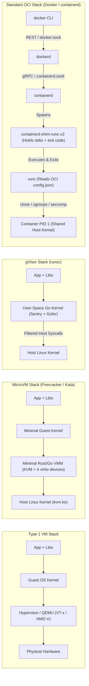
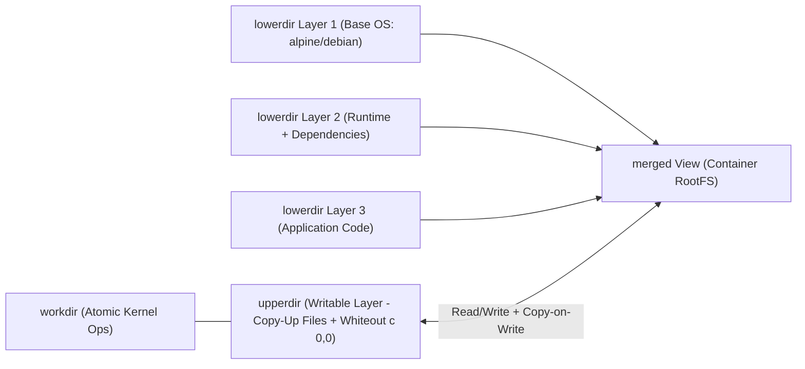
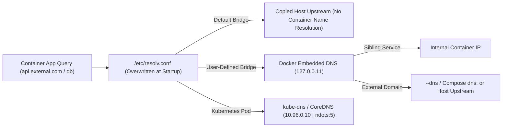

## 3. Virtualization, Container Internals, and Docker Mastery

This module covers the hardware-to-kernel isolation spectrum, OCI runtime internals, production container hardening, supply-chain verification, and real-world container troubleshooting for Senior and Expert DevOps and DevSecOps interviews.

---

### 3.1 Virtualization vs Containerization Principles

#### Q1. [Junior] What is the difference between Type 1 (Bare-Metal) Hypervisors, Type 2 (Hosted) Hypervisors, and OS-Level Containers?

**Executive Takeaway:** Type 1 hypervisors run directly on physical hardware to virtualize complete guest OS instances, Type 2 hypervisors run as applications on top of a host OS, and OS-level containers isolate processes that directly share a single host kernel.

**Architectural Breakdown:**

* **Type 1 Hypervisors (Bare-Metal):** Installed directly over CPU, RAM, and storage with hardware virtualization extensions (Intel VT-x / AMD-V, SLAT/EPT).
  * Examples: **VMware ESXi**, **Xen**, **Microsoft Hyper-V**, and **Linux KVM** (KVM turns the Linux kernel itself into a Type 1 hypervisor via `kvm.ko` coupled with user-space VMMs such as QEMU or Cloud Hypervisor).
  * **Why it dominates production:** Near-native CPU/memory throughput, direct hardware scheduling, and strong multi-tenant boundaries because each VM runs an independent guest kernel.
* **Type 2 Hypervisors (Hosted):** Run as a standard user-space program inside a general-purpose host OS (`Windows`, `macOS`, Linux desktop).
  * Examples: **Oracle VirtualBox**, **VMware Workstation / Fusion**.
  * **Trade-off:** Convenient for local developer workstations, but introduces double-scheduling overhead (host OS scheduler + hypervisor vCPU scheduling) and higher I/O latency.
* **OS-Level Containers:** Not virtualization in the hardware sense—containers are isolated Linux process trees sharing the host OS kernel.
  * Examples: **Docker (`runc`)**, **containerd**, **Podman (`crun`)**, **LXC**.
  * **Trade-off:** Sub-second startup and minimal memory overhead, at the cost of a shared kernel attack surface.

| Dimension | Type 1 Hypervisor | Type 2 Hypervisor | OS-Level Container |
| :--- | :--- | :--- | :--- |
| **Execution Layer** | Directly on physical hardware | Application on host OS | Isolated process on host kernel |
| **Kernel** | Dedicated guest kernel per VM | Dedicated guest kernel per VM | Shared host Linux kernel |
| **Hardware Emulation** | Full/paravirtualized devices (`virtio`) | Full device emulation via host OS | None (direct syscalls to host kernel) |
| **Boot Time** | 10–60+ seconds (BIOS/UEFI + OS init) | 15–90+ seconds | Milliseconds (process `execve`) |
| **Density & Footprint** | Tens per host (hundreds MB–GB RAM each) | Few per workstation | Hundreds–thousands per host (MBs each) |
| **Primary Use Case** | Cloud IaaS (AWS EC2), multi-tenant VMs | Local dev/test environments | Cloud-native microservices, CI jobs |

---

#### Q2. [Junior] How do Linux Namespaces and Control Groups (`cgroups` v2) work together to build a container?

**Executive Takeaway:** A Linux container is not a kernel primitive—it is an ordinary process constrained by **Namespaces** (which control *what the process can see*) and **Control Groups / cgroups** (which control *how much resource the process can consume*).

**Deep Mechanics:**

1. **Linux Namespaces (Visibility Isolation):** Created via `clone()`, `unshare()`, or joined with `setns()` syscalls (inspectable under `/proc/<pid>/ns/` or via `lsns`):
   * `mnt` (Mount): Private filesystem mount table (`pivot_root` into the image `rootfs`).
   * `pid` (Process ID): Isolates the PID tree so the container entrypoint sees itself as **PID 1**.
   * `net` (Network): Dedicated network stack (`eth0` veth pair, routing tables, `iptables`/`nftables`, loopback `lo`, listening sockets).
   * `ipc` (Inter-Process Communication): Isolates System V IPC and POSIX message queues.
   * `uts` (UNIX Time-sharing System): Dedicated hostname and NIS domain name.
   * `user` (User/Group IDs): Maps unprivileged host UIDs (e.g., host UID `100000`) to `uid=0` inside the container.
   * `cgroup`: Virtualizes `/proc/self/cgroup` paths inside the container.
   * `time`: Allows per-container monotonic/boottime clock offsets (Linux 5.6+).

2. **Control Groups v2 (`cgroups` v2 — Resource Accounting & Limits):** Mounted as a single unified hierarchy at `/sys/fs/cgroup`:
   * `cpu.max`: Enforces CFS bandwidth quotas (e.g., `50000 100000` equals `0.50` CPU).
   * `memory.high` / `memory.max`: Soft throttling threshold and hard ceiling; breaching `memory.max` invokes the kernel cgroup OOM killer inside that cgroup (`Exit 137`) without destabilizing the host.
   * `pids.max`: Prevents fork bombs by capping process/thread count inside the container.
   * `io.max`: Throttles block device read/write IOPS and throughput.

**Security Pitfall:** Docker does **not** enable `user` namespace remapping by default. Without `userns-remap` or an explicit `USER` directive, `uid=0` (`root`) inside the container equals `uid=0` on the host kernel—if a container breaks out of filesystem/capability boundaries, it owns the host. Always run workloads as an unprivileged UID (such as `USER newman` in hardened CLI images or `runAsUser: 65532` in Kubernetes).

```bash
# Inspect active namespaces and cgroup v2 limits of a running container
PID=$(docker inspect -f '{{.State.Pid}}' <container_id>)
sudo lsns -p "$PID"
cat /proc/"$PID"/cgroup
cat /sys/fs/cgroup/$(cut -d: -f3 /proc/"$PID"/cgroup)/memory.max
```

---

#### Q3. [Mid] Compare VMs and standard containers across kernel sharing, boot time, memory overhead, and blast radius—and when do you STILL choose VMs or MicroVMs over containers?

**Executive Takeaway:** Containers achieve superior density and sub-second startup by sharing the host kernel's ~350+ syscall interface, whereas VMs pay guest-kernel memory and boot overhead to enforce a hardware-enforced hypervisor boundary that shrinks blast radius.

**Deep Comparison:**

* **Kernel Sharing vs. Guest Kernel:** A container invokes host kernel syscalls directly (`open`, `clone`, `ioctl`, `bpf`). Any privilege-escalation CVE in the host Linux kernel (e.g., Dirty Pipe `CVE-2022-0847`, `io_uring` bugs, `netfilter` heap overflows) exposes every container on that node. A VM restricts untrusted code to its own guest kernel; escaping requires breaking the hypervisor's much smaller VMM/device-emulation boundary.
* **Boot Time & Density:** Containers start in tens of milliseconds because there is no firmware initialization, bootloader, or guest `systemd`; pages of identical base images (`libc`, language runtimes) are shared cleanly in the host page cache. VMs require separate page caches and fixed guest kernel memory reservations.
* **Blast Radius:** Compromise of a privileged container (or kernel exploit from an unprivileged container) compromises the entire worker node and every co-located tenant Pod.

**When You STILL Choose VMs or MicroVMs Over Standard Containers:**

1. **Multi-Tenant Untrusted Code Execution:** Public CI/CD runners executing arbitrary pull-request scripts, FaaS/serverless platforms, AI code-execution sandboxes, or SaaS webhook plugins.
2. **Custom Kernels or Kernel Modules:** Workloads requiring a specific kernel version, custom sysctls not namespaced by Linux, custom kernel modules (`.ko`), or incompatible OS kernels (e.g., running Windows workloads on Linux hosts).
3. **Strict Regulatory & Compliance Boundaries:** PCI-DSS CDE isolation, FedRAMP/HIPAA multi-tenant separation mandates, or cryptographic attestation requirements where auditors reject shared-kernel multi-tenancy.
4. **Legacy Monoliths Requiring Full Init Systems:** Appliances or vendor binaries tied to `systemd`, dedicated block devices, or independent kernel-patching schedules.

---

#### Q4. [Senior] How do the AWS Nitro System and Firecracker MicroVMs achieve hardware-isolated virtualization with near-bare-metal performance and <125ms boot times?

**Executive Takeaway:** The **AWS Nitro System** strips device emulation out of the hypervisor onto dedicated hardware ASICs, while **Firecracker** applies that same minimalist philosophy in software—running a tiny Rust VMM over Linux KVM with only 4 emulated devices to boot MicroVMs in **<125 ms**.

**1. AWS Nitro System Architecture:**

Traditional hypervisors (Xen Dom0 / QEMU) burn host CPU cycles emulating virtual network cards, disk controllers, and BIOS. Nitro moves those functions to dedicated hardware cards on the EC2 motherboard:
* **Nitro Cards (VPC, EBS, Instance Storage, Controller):** Hardware ASICs exposing VPC networking (ENA) and EBS/NVMe storage directly to guests via SR-IOV / PCIe pass-through. VPC hardware encryption in transit between supported Nitro instances occurs at line rate with zero guest CPU penalty.
* **Nitro Security Chip:** Embedded hardware root-of-trust on the motherboard that validates and locks BIOS/UEFI/firmware integrity so not even cloud operators can tamper with hypervisor boot state.
* **Nitro Hypervisor:** A minimal, KVM-based hypervisor stripped of complex I/O emulation—responsible solely for CPU and memory isolation via VT-x/AMD-V.
* **AWS Nitro Enclaves:** Carves an isolated secondary VM out of an EC2 instance with **no persistent storage, no interactive shell, and no external networking** (only a local `vsock` channel to the parent EC2), enabling cryptographic attestation (PCR measurements via `/dev/nsm`) with AWS KMS so even the EC2 root user cannot inspect plaintext keys inside the enclave.

**2. Firecracker MicroVMs (Powering AWS Lambda & Fargate):**

* **Why QEMU wasn't enough:** QEMU has >1.5 million lines of C code emulating floppy drives, sound cards, PCI buses, and legacy BIOS—a huge attack surface and ~1+ second boot latency.
* **Firecracker Design:** Written in memory-safe **Rust** (~50k LoC), using Linux **KVM** directly with a radically reduced device model of only **4 virtio/serial devices**:
  1. `virtio-net` (networking)
  2. `virtio-block` (root/data volumes)
  3. `virtio-vsock` (host-guest socket communication)
  4. Minimal serial console + keyboard controller (for CPU reset only)
* **Performance & Isolation Metrics:**
  * Cold boot to application execution: **<125 ms**
  * Memory overhead per MicroVM: **~5 MiB**
  * Density & launch rate: thousands of MicroVMs per bare-metal host at up to ~150 MicroVMs/second/host.
  * Paired with an external `jailer` process that locks Firecracker itself inside `chroot`, namespaces, `seccomp`, and cgroups for defense-in-depth.

---

#### Q5. [Senior] How do Kata Containers and gVisor (`runsc`) compare to standard `runc` containers for workload isolation?

**Executive Takeaway:** Standard `runc` sends syscalls straight to the host kernel; **gVisor (`runsc`)** intercepts syscalls in a user-space Go kernel (`Sentry`) without needing KVM, whereas **Kata Containers** boots an OCI-compatible Pod inside a hardware-virtualized MicroVM (`Cloud Hypervisor`, `Firecracker`, or `QEMU`).

**1. gVisor (`runsc`):**
* **Architecture:** Replaces direct host-kernel syscall execution with two user-space components:
  * **Sentry:** A user-space application kernel written in memory-safe **Go** that implements ~70%+ of the Linux syscall ABI, virtual memory management, and network stack (`netstack`).
  * **Gofer:** A separate sandboxed proxy process handling container filesystem operations over the 9P/LISAFS protocol.
* **Interception Platforms:** `systrap` (default modern mechanism rewriting/trapping syscalls fast in user-space), `ptrace`, or `KVM` (used only for fast address-space switching, not a guest Linux kernel).
* **Strengths:** No nested virtualization required—runs cleanly on standard cloud VMs (e.g., GKE Sandbox); eliminates host-kernel exploits against complex subsystems (`io_uring`, `netfilter`, `overlayfs`).
* **Trade-offs:** 10–35%+ overhead on syscall-heavy or file-I/O-heavy workloads (databases, heavy compilation); edge-case incompatibility for niche syscalls.

**2. Kata Containers:**
* **Architecture:** Implements the OCI runtime interface via `containerd-shim-kata-v2`. When Kubernetes schedules a Pod with `runtimeClassName: kata`, Kata boots a lightweight VM (using **Cloud Hypervisor**, **Firecracker**, or **QEMU**) containing a minimal Linux guest kernel and `kata-agent`.
* **Strengths:** Full Linux syscall compatibility (real Linux guest kernel!) plus hardware VT-x/AMD-V isolation between Pods.
* **Trade-offs:** Requires bare-metal or nested virtualization (`/dev/kvm`), slightly higher per-Pod RAM overhead (~30–100+ MiB depending on VMM), and slower cold start than `runc`.

| Runtime | Isolation Mechanism | Needs `/dev/kvm`? | Syscall Compatibility | Overhead Profile | Best Fit |
| :--- | :--- | :--- | :--- | :--- | :--- |
| **`runc`** | Namespaces + cgroups + seccomp | No | 100% (host kernel) | Baseline (near zero) | Trusted internal microservices |
| **gVisor (`runsc`)** | User-space Go kernel (`Sentry`) | Optional (`systrap` no) | ~75–85% Linux ABI | Moderate–High on I/O & syscalls | Cloud VMs running untrusted code |
| **Kata Containers** | Hardware VM + real guest kernel | Yes | ~100% (guest kernel) | Low CPU, +30–100 MiB RAM/Pod | Bare-metal multi-tenant K8s clusters |
| **Firecracker** | Hardware KVM MicroVM (Rust VMM) | Yes | ~100% (guest kernel) | <125 ms boot, ~5 MiB VMM overhead | Serverless (Lambda/Fargate), CI runners |

---

#### Q6. [Expert] Trace the OCI container execution stack (`docker CLI -> dockerd -> containerd -> containerd-shim -> runc`). Why do containers survive `dockerd` restarts, and how do the OCI Image Spec and Runtime Spec fit together?

**Executive Takeaway:** `dockerd` acts as a high-level API/build/network orchestrator, `containerd` manages image snapshots and lifecycle via gRPC, `containerd-shim-runc-v2` acts as the daemonless process parent holding stdio and exit codes, and `runc` performs the kernel `clone()`/`execve()` setup and immediately exits.

**Step-by-Step Execution Trace:**

1. **`docker CLI` -> `dockerd`:** `docker run` sends an HTTP/REST request over `/var/run/docker.sock` to `dockerd`.
2. **`dockerd` -> `containerd`:** `dockerd` sets up container networking (`libnetwork` / CNM) and volumes, then sends a gRPC request over `/run/containerd/containerd.sock` to `containerd`.
3. **`containerd` Snapshotter & OCI Bundle:** `containerd` pulls the **OCI Image** (image manifest + config + layers), unpacks layers via the `overlayfs` snapshotter, and generates an **OCI Runtime Bundle** on disk containing `rootfs/` and `config.json`.
4. **`containerd` -> `containerd-shim-runc-v2`:** `containerd` spawns `containerd-shim-runc-v2` as a decoupled daemon process and passes the bundle path.
5. **`containerd-shim` -> `runc`:** The shim runs `runc create` and `runc start`.
6. **`runc` Kernel Setup & Exit:** `runc` reads `config.json`, creates namespaces (`clone()`), attaches cgroups, drops capabilities, loads seccomp-BPF filters and AppArmor/SELinux profiles, runs `pivot_root` into `rootfs/`, calls `execve()` to launch the container's **PID 1** process, and **exits completely**.
7. **Why Containers Survive `dockerd` / `containerd` Restarts:** Because `runc` exits and `containerd-shim-runc-v2` becomes the container's subreaper (`PR_SET_CHILD_SUBREAPER`), holding open stdio FIFOs/PTYs and reaping zombie exit statuses independently. With `"live-restore": true` in `/etc/docker/daemon.json`, restarting `dockerd` (or upgrading `containerd`) reconnects to the existing shims over their sockets without interrupting running containers.

**OCI Image Spec vs. OCI Runtime Spec:**
* **OCI Image Spec:** Standardizes *at-rest* image distribution (`oci-layout`, `index.json` multi-arch index, and content-addressed `blobs/sha256/<digest>` objects storing the Image Manifest JSON with layer/config descriptors, the Image Config JSON with `Env`/`Entrypoint`/`Cmd`/`User`/`WorkingDir`/`RootFS.diff_ids`, and immutable compressed filesystem layer tarballs—distinct from legacy `docker save` archives that place `manifest.json` at the root).
* **OCI Runtime Spec (`config.json` inside bundle):** Standardizes *in-flight* execution parameters for any OCI runtime (`runc`, `crun`, `runsc`, `kata`)—`process` (`args`, `env`, `user`, `capabilities`, `noNewPrivileges`, `rlimits`), `root` (`path`, `readonly`), `mounts`, and `linux` (`namespaces`, `cgroupsPath`, `resources`, `seccomp`).



---

### 3.2 Docker Deep Dive & Container Hardening

#### Q7. [Junior] What is the difference between `CMD` and `ENTRYPOINT` (Exec Form vs Shell Form), and why does the PID 1 signal propagation trap cause `Exit 137` on shutdown?

**Executive Takeaway:** `ENTRYPOINT` defines the fixed executable of a container while `CMD` supplies default arguments (or default command if no `ENTRYPOINT` is set); using **exec form** (`["bin", "arg"]`) runs your binary directly as **PID 1** so `SIGTERM` triggers graceful shutdown, whereas **shell form** wraps it in `/bin/sh -c` and swallows `SIGTERM`.

**Deep Mechanics:**

* **Exec Form vs. Shell Form:**
  * **Exec form:** `ENTRYPOINT ["newman"]` + `CMD ["run", "collection.json"]` executes `newman run collection.json` directly via `execve()` as **PID 1**. Passing arguments on `docker run my-image --version` cleanly overrides `CMD` while preserving `ENTRYPOINT` (the pattern used in CyShield's `task-3/Dockerfile` with `ENTRYPOINT [ "newman" ]`).
  * **Shell form:** `CMD node server.js` executes `/bin/sh -c "node server.js"`. Now `/bin/sh` is **PID 1**, and `node` is a child process (PID 7+).
* **The PID 1 Signal Propagation Trap:**
  * On Linux, **PID 1** is special: default kernel signal dispositions are ignored unless PID 1 explicitly installs a signal handler. `/bin/sh` (`dash`/`ash`) does **not** forward `SIGTERM` to child processes when running a foreground command.
  * When `docker stop` or Kubernetes sends `SIGTERM`, `/bin/sh` ignores it, your app never flushes buffers or drains HTTP connections, and after the grace period (10s in Docker, 30s default in Kubernetes), the runtime sends an uncatchable `SIGKILL` (**Exit Code `137`**).
* **Zombie Reaping:** If your PID 1 application forks background helper processes that terminate, PID 1 is responsible for calling `waitpid()` to reap them. If your app doesn't do this, pass `--init` (`docker run --init`) or wrap the entrypoint with a lightweight init shim such as `tini` or `dumb-init`.

```dockerfile
# BAD: Shell form -> /bin/sh is PID 1, swallows SIGTERM -> forced SIGKILL (137)
CMD node dist/server.js

# GOOD: Exec form -> node is PID 1 and receives SIGTERM directly
ENTRYPOINT ["node"]
CMD ["dist/server.js"]
```

---

#### Q8. [Junior] Compare `COPY` vs `ADD`, `EXPOSE` vs `-p` vs `--network host`, and `ARG` vs `ENV`—and explain why secrets in `ARG` or `ENV` still leak.

**Executive Takeaway:** Always default to `COPY` over `ADD`, treat `EXPOSE` as documentation rather than a firewall or port publisher, avoid `--network host` unless strictly required, and never pass secrets through `ARG` or `ENV` because both persist in image layer metadata and `docker history`.

**1. `COPY` vs `ADD`:**
* **`COPY [--chown=user:group] [--chmod=0640] src dst`:** Transparent, predictable local file/directory or multi-stage (`--from=builder`) copy.
* **`ADD`:** Adds two implicit behaviors: automatically unpacks local `.tar`/`.tar.gz`/`.tar.xz` archives into `dst`, and downloads remote HTTP(S) URLs (without verifying TLS GPG signatures or cleaning up if chained badly). Only use `ADD` when you explicitly want local tar auto-extraction (or BuildKit `ADD --checksum=sha256:...` for checksum-pinned URLs).

**2. `EXPOSE` vs `-p` (`--publish`) vs `--network host`:**
* **`EXPOSE 3000`:** Pure metadata saved in image JSON. It publishes **zero ports** on the host; it only informs operators, `docker run -P` (ephemeral random port publishing), and tools like reverse proxies which port the container listens on.
* **`-p 127.0.0.1:8080:3000`:** Publishes host port `8080` (preferring loopback `127.0.0.1` instead of `0.0.0.0` for local services!) to container port `3000` via NAT/`docker-proxy`. Note that Docker's default `iptables` `DOCKER` chain modifies host `PREROUTING` directly—bypassing `UFW` rules unless explicitly hardened.
* **`--network host`:** Disables the container's `net` namespace entirely. The container binds host interfaces directly, can sniff/access host loopback services (`127.0.0.1`), and bypasses Docker bridge isolation—forbidden in hardened production workloads except specialized infrastructure daemons (e.g., ingress controllers or CNI node agents).

**3. `ARG` vs `ENV` (and Secret Leakage):**
* `ARG`: Available **only during `docker build`**. However, `ARG` values passed via `--build-arg` are baked verbatim into the image's build history! Anyone who runs `docker history --no-trunc <image>` sees `RUN |1 NPM_TOKEN=<build-token> ...` in plain text.
* `ENV`: Persists both at build time and runtime inside `docker inspect` and `/proc/<pid>/environ`, meaning any compromised subprocess or image scanner dumps every `ENV` variable.
* **Fix:** Pass build secrets via BuildKit `--mount=type=secret` and runtime secrets via mounted files (K8s Secrets / Vault CSI / Docker Swarm Secrets) rather than `ARG` or `ENV`.

---

#### Q9. [Mid] Compare Alpine (`apk`/`musl libc`) vs Debian/Ubuntu (`apt`/`glibc`) vs Google Distroless vs `scratch` as container base images.

**Executive Takeaway:** `scratch` and Google Distroless minimize runtime CVE surface by stripping shells and package managers; Alpine shrinks footprint using `musl libc` and `BusyBox`, while Debian Slim provides maximum `glibc` binary/DNS compatibility at a slightly larger size.

**Comparison Matrix:**

| Base Image | Typical Size | C Library | Package Manager / Shell | CVE Surface | Trade-offs |
| :--- | :--- | :--- | :--- | :--- | :--- |
| **`scratch`** | 0 MB | None (static only) | None / None | Near zero | Ideal for static Go/Rust binaries; need CA certs & `/etc/passwd` copied manually |
| **Distroless (`static` / `base` / `nodejs`)** | ~2–50 MB | `glibc` (Debian) | None / None | Very low | Includes CA certs, `tzdata`, non-root UID `65532`; no shell for attackers or debugging |
| **Alpine (`alpine:3.20`)** | ~7–10 MB | `musl libc` | `apk` / `ash` | Low | Tiny, fast pulls, but `musl` DNS quirks, small thread stack, slow Python C builds |
| **Debian Slim (`debian:bookworm-slim`)** | ~75 MB | `glibc` | `apt` / `bash` | Medium | Pre-built Python `manylinux` wheels, predictable `glibc` DNS, larger patch surface |

**Key Production Gotchas:**
1. **`musl libc` DNS Behavior on Alpine:** Unlike `glibc` (which resolves search domains sequentially and uses TCP fallback cleanly), older `musl` versions lacked TCP fallback for large DNS responses (added in `musl 1.2.4` / Alpine 3.18+) and issue parallel UDP `A`/`AAAA` queries for every `search` entry in `/etc/resolv.conf`. Under Kubernetes `ndots:5`, this multiplies DNS packets and triggers Linux `conntrack` SNAT UDP race conditions (`EAI_AGAIN`).
2. **Python Wheel Compilation Pain on Alpine:** Most PyPI packages publish `manylinux` wheels compiled against `glibc`. If a `musllinux` wheel is absent (`numpy`, `cryptography`, `scipy`, `lxml`), `pip install` on Alpine forces compiling C/Rust extensions from source—requiring `gcc`, `musl-dev`, and `rust`, turning a 15-second build into a 10-minute build and bloating the final image unless cleaned via multi-stage builds.
3. **Thread Stack Overflow (`SIGSEGV` / Exit `139`):** `musl` defaults to a **128 KB** thread stack size versus **8 MB** on `glibc`. Multi-threaded C/C++, Rust, or regex-heavy workloads can unexpectedly segfault on Alpine.
4. **Debugging Distroless / `scratch` Without a Shell:** Because `kubectl exec -it pod -- sh` fails when `/bin/sh` does not exist, debug in Kubernetes using **ephemeral containers** that share the target container's process namespace:
   ```bash
   kubectl debug -it <pod-name> -n <namespace> \
     --image=nicolaka/netshoot:v0.13 \
     --target=<container-name>
   ```
   Or in Docker: `docker debug <container>` (Docker CLI plugin) or inspect from the node via `nsenter -t <pid> -n -p`.

---

#### Q10. [Mid] Explain OverlayFS (`overlay2`) Copy-on-Write internals (`lowerdir`, `upperdir`, `merged`, whiteout files) and why writing large files or databases to the writable container layer kills performance.

**Executive Takeaway:** `overlay2` unions multiple immutable read-only `lowerdir` image layers with one thin writable `upperdir` into a single `merged` view; modifying any existing file in a lower layer triggers a full-file **copy-up** into `upperdir`, and deleting files creates **whiteout** masks that never reclaim lower-layer space.

**OverlayFS Architecture:**



* **`lowerdir`:** Stack of immutable, read-only image layers (`layerN:...:layer1`) shared across all containers using the same image.
* **`upperdir`:** Container-specific writable directory where new files, modified files, and deletions are recorded.
* **`workdir`:** Empty directory on the same filesystem used by the Linux kernel to prepare files atomically before renaming into `upperdir`.
* **`merged`:** Unified directory tree mounted as the container's `/`.

**Two Critical Performance & Size Traps:**
1. **Full-File Copy-Up Penalty:** OverlayFS operates at **file granularity**, not block granularity. If a container opens a 2 GB database file residing in `lowerdir` and appends 100 bytes, the Linux kernel copies the **entire 2 GB file** from `lowerdir` up to `upperdir` before applying the write—stalling I/O, doubling disk consumption, and fragmenting page cache (because the copied file gets a new inode).
2. **Whiteout Files (`c 0, 0`):** If Layer 2 installs a 150 MB `.apk` or `.deb` cache and Layer 3 runs `rm -rf /var/cache/apk/*`, OverlayFS cannot edit immutable Layer 2. Instead, Layer 3 writes a character device `0/0` (`c 0, 0`) whiteout file (or sets `trusted.overlay.opaque="y"` on directories) to hide it. **The 150 MB payload stays inside the image forever.**
* **Rule:** Always mount **Docker Volumes** or **Bind Mounts** (or Kubernetes PersistentVolumes) for databases, uploads, and heavy logs so I/O bypasses `overlay2` completely and reaches the underlying filesystem (`ext4`/`xfs`) natively.

```bash
# Inspect OverlayFS mounts for a running container
docker inspect -f '{{json .GraphDriver.Data}}' <container_id> | jq .
```

---

#### Q11. [Mid] How do Docker Volumes, Bind Mounts, and `tmpfs` mounts differ, and what security and ownership traps appear when pairing them with `read_only: true`?

**Executive Takeaway:** **Docker Volumes** are daemon-managed storage under `/var/lib/docker/volumes/` optimized for persistent stateful data, **Bind Mounts** expose arbitrary host paths directly (introducing host privilege risks), and **`tmpfs`** stores ephemeral scratch data solely in host RAM.

| Mount Type | Storage Location | Managed By | Lifecycle | Primary Use Case & Security Considerations |
| :--- | :--- | :--- | :--- | :--- |
| **Volume (`-v name:/path`)** | `/var/lib/docker/volumes/` | Docker Engine | Persists after `docker rm` | Databases, shared artifacts; supports volume plugins; isolated from host OS tree |
| **Bind Mount (`-v /host:/cont`)** | Arbitrary host path | Host OS / User | Tied to host filesystem | Config injection, local dev hot-reload; **never mount `/`, `/etc`, or `/var/run/docker.sock`** (`:ro` whenever read-only) |
| **`tmpfs` (`--tmpfs /tmp:noexec,nosuid`)** | Host RAM (or swap) | Linux Kernel | Destroyed on container stop | Scratch files, session caches, runtime secrets with `read_only: true` rootfs |

**Security & Ownership Traps:**
1. **Bind Mount `:rw` Host Path Traversal & Symlink Attacks:** Mounting `/etc` or `/var/log` read-write allows a compromised container to tamper with host config/cron or follow symlinks outside intended paths. Always append `:ro` for read-only configs.
2. **Hardened `read_only: true` + `tmpfs` Permissions:** When a container runs with `read_only: true` (as in CyShield's `task-3/docker-compose.yml`), apps need `tmpfs` mounts for `/tmp` and runtime write paths (`/etc/newman`, `/var/run`).
   * Add **`noexec,nosuid,nodev`** on scratch `tmpfs` (`/tmp:noexec,nosuid,size=64m`) so an attacker who achieves RCE cannot drop and `execve()` a binary payload or exploit setuid binaries in `/tmp`.
   * **Ownership Trap:** Mounting a `tmpfs` *hides* the directory ownership set during `docker build` (`chown -R newman:newman /etc/newman`). Short Compose syntax mounts `/tmp` as `mode=1777` (sticky world-writable), whereas long syntax or custom `mode=0755` defaults to `uid=0` (`root`), causing `EACCES: Permission denied` for non-root users unless `uid`/`gid` are explicitly set.

---

#### Q12. [Senior] Why does writing `nameserver 8.8.8.8` inside a `Dockerfile` fail at runtime, and how do Docker and Kubernetes manage `/etc/resolv.conf`?

**Executive Takeaway:** Container runtimes dynamically bind-mount and overwrite `/etc/resolv.conf` at container startup; baking DNS entries into a `Dockerfile` is wiped out on `docker run` or Pod creation, so DNS must be configured at runtime via Docker flags, `daemon.json`, Compose `dns:`, or Kubernetes `dnsConfig`.

**Deep Mechanics:**

1. **Why `Dockerfile` Changes Disappear:** During `docker build`, temporary `/etc/resolv.conf` modifications exist only during build or are shadowed when Docker starts the container and bind-mounts a runtime-generated `/etc/resolv.conf` from `/var/lib/docker/containers/<id>/resolv.conf`.
2. **Docker Default Bridge (`docker0`) vs. User-Defined Bridge:**
   * **Default `bridge`:** Docker copies the host's `/etc/resolv.conf` into the container (stripping local loopback entries like `127.0.0.53` from `systemd-resolved` and falling back to `8.8.8.8`/`8.8.4.4`). Containers **cannot** resolve each other by container name.
   * **User-Defined Bridge / Compose Network:** Docker injects `nameserver 127.0.0.11` (Docker's embedded DNS server) plus `options ndots:0` into `/etc/resolv.conf`. `127.0.0.11` resolves sibling container names/aliases locally and forwards external domains to upstream host DNS (or explicit runtime `--dns` servers).
3. **Kubernetes DNS (`kube-dns` / CoreDNS):** Kubelet generates `/etc/resolv.conf` inside every Pod pointing to the `kube-dns` ClusterIP (`10.96.0.10` or `10.43.0.10` in K3s) with `search <ns>.svc.cluster.local svc.cluster.local cluster.local` and `options ndots:5`.



**How to Configure DNS Properly:**
* **Docker CLI:** `docker run --rm --dns 8.8.8.8 --dns 1.1.1.1 my-image`
* **Docker Compose (`task-3/docker-compose.yml` pattern):**
  ```yaml
  services:
    newman:
      image: custom-newman:5.3-hardened
      dns:
        - 8.8.8.8
        - 1.1.1.1
  ```
* **Docker Daemon Global Default (`/etc/docker/daemon.json`):** `{"dns": ["10.0.0.2", "1.1.1.1"]}`
* **Kubernetes Pod Spec:** Set `dnsPolicy: None` with `dnsConfig: { nameservers: ["8.8.8.8"], options: [{ name: "ndots", value: "2" }] }` (or use `ClusterFirst` with CoreDNS `NodeLocal DNSCache` for performance).

---

#### Q13. [Senior] How do Multi-Stage Builds, Layer Caching, BuildKit (`--mount=type=cache`, `--mount=type=secret`), `.dockerignore`, and single-layer cache cleanup optimize build speed, size, and security?

**Executive Takeaway:** Multi-stage builds keep compilers, dev headers, and package managers out of production images, BuildKit mounts prevent build secrets from touching any layer and keep dependency caches across rebuilds, and package caches must be purged in the **same `RUN` instruction** so OverlayFS never commits them to a lower layer.

**1. Ordering Instructions for Layer Cache Hits:**
Place rarely changing layers first (`FROM`, OS packages, `package.json`/`go.mod` dependency install) and frequently changing application source code (`COPY . .`) last. One invalidated layer invalidates every downstream layer.

**2. `.dockerignore` (Speed & Secret Prevention):**
Always exclude `.git/`, `node_modules/`, `.env`, `*.pem`, `*.key`, `dist/`, and test fixtures in `.dockerignore`. Without it, `COPY . .` ships the entire `.git` history and local `.env` secrets straight into the build context and final image.

**3. Single-Layer Package Cache Cleanup:**
Because OverlayFS layers are immutable, running `rm -rf /var/cache/apk/*` in a *second* `RUN` instruction only writes whiteout markers while leaving the cached packages permanently inside the previous layer (bloating image pull size and leaking history). Clean up in the **same `RUN` layer**:
```dockerfile
RUN apk add --no-cache curl zip iputils \
    && npm install -g newman-reporter-csvallinone \
    && npm cache clean --force \
    && rm -rf /var/cache/apk/* /tmp/* /root/.npm
```

**4. BuildKit Cache & Secret Mounts (`# syntax=docker/dockerfile:1`):**
* **`--mount=type=cache`:** Persists `apt`, `pip`, `npm`, or Go build caches on the build host across builds without storing cache files in the final image layer.
* **`--mount=type=secret`:** Mounts private registry tokens (`.npmrc`, SSH keys, PyPI tokens) into `/run/secrets/<id>` during a single `RUN` step only—**zero bytes are written to image layers or `docker history`**.

```dockerfile
# syntax=docker/dockerfile:1
FROM node:22-bookworm-slim AS builder
WORKDIR /app
COPY package*.json ./
RUN --mount=type=cache,target=/root/.npm \
    --mount=type=secret,id=npmrc,target=/root/.npmrc \
    npm ci --omit=dev
COPY src/ ./src/
RUN npm run build
```
```bash
DOCKER_BUILDKIT=1 docker build --secret id=npmrc,src="$HOME/.npmrc" -t app:1.0 .
```

---

#### Q14. [Senior] How do you secure the container supply chain using SHA256 digest pinning, SBOMs (`Syft`), vulnerability scanning (`Trivy`/`Grype`), and cryptographic signing (`Sigstore Cosign`)?

**Executive Takeaway:** Mutable image tags (`:latest`, `:5.3-alpine`) can be silently overwritten by compromised registries or tag drift; production pipelines pin base images and deployments by immutable `@sha256:` digest, generate SBOMs, enforce CI CVE gates, and cryptographically sign and verify images with **Cosign** before Kubernetes admission.

**End-to-End Supply Chain Pipeline:**

1. **Immutable Digest Pinning (`@sha256:...`):**
   * Even versioned tags (`node:22-alpine`) are mutable pointers. Pin base images in `Dockerfile` and Kubernetes manifests by manifest digest (e.g., `FROM node:22-alpine@sha256:<64-char-digest>`), updated automatically via **Renovate** or **Dependabot**.
   * Beware of deploying mutable `:latest` tags in production (such as `bkimminich/juice-shop:latest` in dev labs): two nodes pulling the same tag minutes apart can run different code, breaking rollbacks and reproducibility.
2. **SBOM Generation (Syft / Trivy):**
   * Generate a **CycloneDX** or **SPDX** Software Bill of Materials listing every OS package, language library (`npm`, `pip`, `go.mod`), and binary inside the image so newly disclosed zero-days can be queried instantly across your fleet without re-pulling images.
   ```bash
   syft registry.example.com/app@sha256:<digest> -o cyclonedx-json=sbom.cdx.json
   ```
3. **Vulnerability & Misconfiguration Scanning (Trivy / Grype):**
   * Scan both the built image and generated SBOM in CI, failing builds on `CRITICAL`/`HIGH` CVEs with available fixes (`--ignore-unfixed` only after risk acceptance) and checking Dockerfile/K8s misconfigurations (`trivy config`).
   ```bash
   trivy image --exit-code 1 --severity CRITICAL,HIGH --ignore-unfixed registry.example.com/app@sha256:<digest>
   ```
4. **Cryptographic Signing & Admission Verification (Sigstore Cosign):**
   * Sign the immutable image digest (using OIDC keyless signing via Fulcio/Rekor transparency log in GitHub Actions/GitLab CI, or an AWS KMS key) and attach the SBOM as a signed attestation.
   * Enforce verification at cluster admission with **Kyverno** or **OPA Gatekeeper / Sigstore Policy Controller** so unsigned or tampered images are rejected by the Kubernetes API server before scheduling.
   ```bash
   cosign sign --yes registry.example.com/app@sha256:<digest>
   cosign attest --predicate sbom.cdx.json --type cyclonedx registry.example.com/app@sha256:<digest>
   ```

---

#### Q15. [Expert] Explain why mounting `/var/run/docker.sock` gives instant host root compromise, and how Rootless Docker, User Namespaces, and Seccomp/AppArmor mitigate runtime escape risks.

**Executive Takeaway:** Mounting `/var/run/docker.sock` lets any container user talk directly to the privileged `dockerd` daemon—allowing them to spawn a new `--privileged -v /:/host` container in one command and take complete `root` control over the host; mitigation requires removing socket access, dropping privileges, enforcing Seccomp/AppArmor, and isolating with Rootless or User Namespaces.

**1. Why `/var/run/docker.sock` = Instant Root on Host:**
`dockerd` runs as `root` on the host. Any container with read/write access to `/var/run/docker.sock` (commonly abused in naive Jenkins/GitLab Docker-in-Docker CI runners) bypasses every namespace, cgroup, capability drop, and read-only guard of its own container:
```bash
# Trivial host breakout from inside a container with docker.sock mounted
docker -H unix:///var/run/docker.sock run --rm -it \
  --privileged --pid=host --net=host -v /:/hostfs \
  alpine chroot /hostfs sh
```
**Safer Alternatives for CI Builds:** Daemonless rootless builders (**Kaniko**, **BuildKit rootless (`buildkitd-rootless`)**, **Buildah**, or **Podman**) inside isolated ephemeral MicroVMs/pods, or rootless `docker:dind` without mounting the host socket.

**2. User Namespaces (`userns-remap`) & Rootless Mode:**
* **`userns-remap`:** `dockerd` stays `root`, but maps container `uid=0` to an unprivileged host UID range (e.g., `100000:65536` via `/etc/subuid` and `/etc/subgid`). Even if an attacker escapes container `mnt` namespaces, they possess UID `100000` on the host—zero permissions on host `/etc/shadow` or `/root`.
* **Rootless Docker / Rootless Podman:** Runs the *entire* container engine (`dockerd`, `containerd`, `runc`) as an unprivileged host user via `newuidmap`/`slirp4netns`/`pasta`—eliminating `root` daemons completely (at the cost of needing `CAP_NET_BIND_SERVICE` sysctl tuning for ports `<1024` and slightly higher network NAT overhead with `slirp4netns`).

**3. Seccomp-BPF & AppArmor / SELinux:**
* **Seccomp:** Linux kernel syscall filter attached via `prctl()`. Docker's default seccomp profile blocks ~44+ dangerous syscalls out of 350+ (`kexec_load`, `reboot`, `init_module`, `keyctl`, `mount`, `bpf`, `ptrace` on older profiles, `userfaultfd` in hardened profiles). Custom profiles generated via **OCI Seccomp Operator** tighten this to only syscalls the app strictly uses.
* **AppArmor / SELinux:** Mandatory Access Control (MAC) restricting file paths, `/proc` writes, and mount capabilities (`docker-default` profile denies writes to `/proc/sys`, `/sys/fs/cgroup`, etc., even for container `root`).

---

#### Q16. [Expert] Provide a complete Production Container Security Hardening Checklist and an annotated, hardened multi-stage `Dockerfile` + runtime policy.

**Executive Takeaway:** Production container security requires **defense-in-depth across build time, supply chain, and runtime**: minimal non-root images pinned by SHA256 digest, zero embedded secrets, `read_only` rootfs, `cap_drop: ALL`, `no-new-privileges:true`, seccomp/AppArmor, resource/PID caps, and cryptographic admission verification.

**Production Container Security Hardening Checklist:**

1. **Image & Supply Chain (Build Time):**
   * Use minimal bases (`distroless`, `scratch`, or stripped `alpine`/`debian-slim`) via **multi-stage builds**.
   * Pin base images by immutable **`@sha256:` digest**; exclude secrets/VCS with **`.dockerignore`**.
   * Clean package caches in the **same `RUN` layer**; pass build tokens solely via `--mount=type=secret`.
   * Generate **SBOM (Syft)**, enforce **Trivy/Grype** CVE gates, and sign with **Sigstore Cosign**.
2. **Identity & Privileges (Runtime):**
   * Run as an explicit **non-root UID/GID** (`USER 65532:65532` in Dockerfile; `runAsNonRoot: true` in K8s).
   * Drop all Linux capabilities (**`cap_drop: ["ALL"]`**) and add back none unless strictly proven mandatory.
   * Block privilege escalation (**`no-new-privileges: true`** / K8s `allowPrivilegeEscalation: false`) so `setuid`/`setgid` binaries and file capabilities cannot elevate privileges.
   * Disable Kubernetes SA token auto-mount (`automountServiceAccountToken: false`) unless the Pod calls the K8s API.
3. **Filesystem & Kernel Surface:**
   * Enforce **`read_only: true`** root filesystem (`readOnlyRootFilesystem: true`) paired with bounded **`tmpfs`** mounts flagged `noexec,nosuid,nodev` (e.g., `/tmp:noexec,nosuid,size=64m`).
   * Enforce **default or custom Seccomp (`RuntimeDefault`)** and AppArmor/SELinux profiles; prohibit `--privileged`, `hostNetwork`, `hostPID`, `hostIPC`, and `docker.sock` mounts.
4. **Resource Quotas & Stability:**
   * Set strict **CPU, Memory, and PIDs (`pids_limit`)** caps to prevent noisy-neighbor DoS and fork bombs.
   * Use exec-form **`ENTRYPOINT`/`CMD`** so the app runs as PID 1 and handles `SIGTERM` gracefully.

**Annotated Hardened Multi-Stage `Dockerfile` (Node.js Service Example):**

```dockerfile
# syntax=docker/dockerfile:1

# --- Stage 1: Builder (toolchain & caches stay isolated and are discarded) ---
# Resolve immutable digests via: docker buildx imagetools inspect <image>
FROM node:22-bookworm-slim@sha256:<builder-manifest-digest> AS builder
WORKDIR /build

# Copy dependency manifests first to maximize layer cache hits
COPY package.json package-lock.json ./

# Mount npm cache & private token safely without baking them into any image layer;
# install devDependencies too for TypeScript compilation and preserve the BuildKit cache mount
RUN --mount=type=cache,target=/root/.npm \
    --mount=type=secret,id=npmrc,target=/root/.npmrc \
    npm ci

COPY tsconfig.json ./
COPY src/ ./src/
RUN npm run build && npm prune --omit=dev && rm -rf src/ tsconfig.json

# --- Stage 2: Minimal Hardened Runtime (Google Distroless, non-root, no shell) ---
FROM gcr.io/distroless/nodejs22-debian12:nonroot@sha256:<runtime-manifest-digest> AS runtime

ENV NODE_ENV=production
WORKDIR /app

# Copy only compiled artifacts and production node_modules owned by UID/GID 65532 (nonroot)
COPY --from=builder --chown=65532:65532 /build/node_modules ./node_modules
COPY --from=builder --chown=65532:65532 /build/dist ./dist
COPY --from=builder --chown=65532:65532 /build/package.json ./package.json

# Enforce non-root execution (matches Distroless 'nonroot' UID 65532)
USER 65532:65532
EXPOSE 3000

# Exec form ensures node runs directly as PID 1 and receives SIGTERM cleanly
ENTRYPOINT ["/nodejs/bin/node", "dist/server.js"]
```

**Matching Runtime Hardening (`docker-compose.yml` Enforcement):**

```yaml
services:
  api:
    image: registry.example.com/secure-api@sha256:<signed-image-digest>
    read_only: true
    tmpfs:
      - /tmp:noexec,nosuid,nodev,size=64m,uid=65532,gid=65532,mode=0700
    cap_drop:
      - ALL
    security_opt:
      - no-new-privileges:true
    pids_limit: 128
    dns:
      - 1.1.1.1
      - 8.8.8.8
    deploy:
      resources:
        limits:
          cpus: "0.50"
          memory: 256M
```

---

### 3.3 Real-World Docker & Container Troubleshooting Playbook

#### 1. Container Exit Codes Table & Diagnosis

| Exit Code | Signal / Meaning | Common Root Causes | Diagnostic Commands & Exact Fix |
| :--- | :--- | :--- | :--- |
| **`0`** | Clean exit | Normal termination, or a one-shot CLI container (`newman`, migration job) finished its task | Expected for Jobs/CLI tools; if a daemon exited `0`, verify foreground mode (not daemonizing into background) |
| **`1`** | General app error | Unhandled exception, invalid env/config, missing file, permission error | `docker logs --tail 100 <id>`; fix config, file perms, or missing secret mount |
| **`125`** | Engine / `docker run` failed | Invalid CLI flag, daemon unreachable, image pull/mount failure before entrypoint | Inspect `docker run` syntax, daemon logs (`journalctl -u docker`), and mount paths |
| **`126`** | Command cannot execute | Missing `+x` bit, `noexec` on mounted volume/`tmpfs`, incompatible CPU arch (`exec format error`) | `chmod +x` before `COPY`, remove `noexec` only if executable mount required, match `--platform linux/amd64` vs `arm64` |
| **`127`** | Command not found | Binary missing from `$PATH`, wrong `WORKDIR`, Windows CRLF (`\r\n`) shebang (`#!/bin/sh^M`), or `glibc` binary on Alpine `musl` | Check `docker run --entrypoint ls <image>`, convert scripts with `dos2unix`, verify dynamic libs (`ldd /bin/app`) |
| **`137`** | `128 + 9` (`SIGKILL`) | **OOMKilled** by cgroup (`memory.max` exceeded) OR PID 1 ignored `SIGTERM` until grace timeout expired | `docker inspect <id> -f '{{.State.OOMKilled}}'` + `dmesg -T \| grep -i oom`; raise memory limit/fix leak, or switch to exec-form PID 1 |
| **`139`** | `128 + 11` (`SIGSEGV`) | Segmentation fault in C/C++/native addon, ABI mismatch, or Alpine `musl` 128 KB thread stack overflow | Capture core/stack trace, verify `glibc` vs `musl` compatibility or increase stack size / switch to `debian-slim` |
| **`143`** | `128 + 15` (`SIGTERM`) | Graceful shutdown triggered by `docker stop`, `kubectl delete`, rolling update, or node preemption | Usually normal orchestration lifecycle; verify drain hooks & readiness probes if requests dropped |

---

#### 2. Scenario: Why `ping` Fails Inside a Hardened Non-Root Container with `cap_drop: ALL`

* **Symptom:** Running `ping 8.8.8.8` inside a hardened container (`USER nonroot`, `cap_drop: ALL`, `no-new-privileges: true`) fails with `ping: socket: Operation not permitted` or `ping: permission denied (are you root?)`.
* **Root Cause:**
  1. Traditional ICMP echo requires raw IP sockets (`SOCK_RAW`), guarded by **`CAP_NET_RAW`** (dropped by `cap_drop: ALL`).
  2. Even if the `ping` binary has `setuid root` or file capabilities (`cap_net_raw+ep`), **`no-new-privileges: true`** explicitly blocks privilege escalation at `execve()`.
  3. Unprivileged ICMP (`SOCK_DGRAM`, `IPPROTO_ICMP`) only works if two conditions hold: (a) the binary supports it (**`iputils-ping`** does; stock **BusyBox `ping`** on Alpine often requires `SOCK_RAW`), and (b) the container network namespace sysctl `net.ipv4.ping_group_range` includes the container user's GID (Docker >= 20.10 defaults to `0 2147483647`, whereas Kubernetes Pods or hardened sysctls may restrict it to `1 0`).
* **Diagnostic & Fix:**
  ```bash
  # Inspect effective capabilities and kernel ping_group_range inside the container
  grep CapEff /proc/self/status
  cat /proc/sys/net/ipv4/ping_group_range
  ```
  * **Recommended Security Fix:** Install `iputils` (`iputils-ping`) instead of relying on BusyBox `ping` (as done in CyShield's `task-3/Dockerfile`), and in Kubernetes set `securityContext.sysctls: [{ name: "net.ipv4.ping_group_range", value: "0 2147483647" }]` — **or better yet, replace ICMP healthchecks with TCP/HTTP probes via `curl`/app endpoints** rather than adding back `CAP_NET_RAW` (which enables ARP spoofing and packet crafting).

---

#### 3. Scenario: `read_only: true` + `tmpfs` Permission & Ownership Traps (`uid`/`gid` Mismatch)

* **Symptom:** Hardened container crashes immediately with `EROFS: read-only file system` or `EACCES: permission denied, open '/etc/newman/out.csv'` despite `RUN chown -R newman:newman /etc/newman` in the `Dockerfile`.
* **Root Cause:**
  1. `read_only: true` sets the entire `merged` OverlayFS root filesystem to read-only.
  2. Mounting a `tmpfs` (or Kubernetes `emptyDir`) **over** `/etc/newman` hides the build-time image directory and its `chown` metadata. Under Linux, a fresh `tmpfs` defaults to `uid=0,gid=0,mode=0755` unless overridden (Docker Compose short syntax sets `mode=1777`, whereas Compose long syntax, Podman, or K8s `emptyDir` without `fsGroup` can leave directories owned by `root` and unwritable by non-root `USER`).
  3. Placing `noexec` on `/tmp` breaks applications/runtimes that extract native `.so` shared libraries (Java JNI, Python/Node native bindings) into `/tmp` and `mmap(..., PROT_EXEC)` them (`failed to map segment from shared object: Operation not permitted`).
* **Diagnostic & Fix:**
  ```bash
  # Check actual mount options, permissions, and current UID inside container
  id && mount | grep -E 'overlay|tmpfs' && ls -ld /tmp /etc/newman
  ```
  * Specify explicit `uid`, `gid`, and restrictive `mode` on `tmpfs` (`tmpfs: ["/etc/newman:rw,noexec,nosuid,nodev,size=64m,uid=1000,gid=1000,mode=0700"]` or Compose long syntax), set `securityContext.fsGroup` in Kubernetes, and point temp env vars (`TMPDIR=/app-tmp`) to a dedicated volume if native `.so` execution is genuinely required rather than removing `noexec` from shared `/tmp`.

---

#### 4. Scenario: Container DNS Resolution Failures (Default Bridge vs User-Defined Bridge vs Alpine `musl`)

* **Symptom:**
  * Container A cannot resolve sibling Container B by name (`ping api` -> `bad address 'api'`).
  * Container inside corporate VPC fails to resolve internal private hostnames, falling back to `8.8.8.8`.
  * Alpine container in Kubernetes experiences intermittent 5-second timeouts or `EAI_AGAIN` lookups under load.
* **Root Causes & Fixes:**
  1. **Default `bridge` (`docker0`) Network:** Docker does **not** activate embedded DNS `127.0.0.11` on the legacy default `bridge` network, and strips `127.0.0.53` (`systemd-resolved`) from copied host `/etc/resolv.conf`, silently falling back to `8.8.8.8` (breaking corporate internal DNS).
     * *Fix:* Always create a **user-defined bridge network** (`docker network create app-net`) or use **Docker Compose** (which creates one automatically) and pass explicit `--dns` / `dns:` when corporate upstream DNS is required.
  2. **Alpine `musl` Search Domains & `ndots:5`:** Older Alpine (`musl < 1.2.4`) drops truncated UDP DNS responses without TCP retry and launches parallel `A`+`AAAA` lookups across all K8s search domains (`ndots:5`), saturating `conntrack` UDP NAT tables (`nf_conntrack` race).
     * *Fix:* Upgrade to Alpine 3.19+ (`musl >= 1.2.4`), configure `dnsConfig: options: [{ name: "ndots", value: "2" }]` on Pods, or use trailing-dot FQDNs (`api.external.com.`).

```bash
# Verify active DNS resolver and network driver for a container
docker inspect -f '{{range $k,$v := .NetworkSettings.Networks}}{{$k}} {{end}}' <id>
docker exec <id> cat /etc/resolv.conf
```

---

#### 5. Scenario: Docker Disk Exhaustion (`/var/lib/docker/overlay2`) & Unbounded `json-file` Logs

* **Symptom:** Node triggers Kubernetes `DiskPressure` taint or fails deployments with `no space left on device`, even though application volumes look clean.
* **Root Causes:**
  1. **Unbounded Container Logs:** Docker's default `json-file` logging driver has **no size or rotation limit** by default; a crash-looping or verbose service writes `/var/lib/docker/containers/<id>/<id>-json.log` until the root partition hits 100%.
  2. **Dangling Layers, BuildKit Cache & Dead Containers:** Accumulated unused layers and `/var/lib/docker/overlay2` caches, or inode exhaustion (`df -i` at 100%).
  3. **Open File Descriptor Trap:** Running `rm` on a massive `*-json.log` while `dockerd` holds it open deletes the directory entry *without* freeing disk blocks until `dockerd` restarts or the container is recreated.
* **Diagnostic & Fix:**
  ```bash
  # 1. Check block and inode usage + Docker breakdown
  df -h && df -i
  docker system df -v

  # 2. Locate bloated json.log files and open deleted files
  sudo du -sh /var/lib/docker/containers/*/*-json.log 2>/dev/null | sort -hr | head -n 10
  sudo lsof +L1 | grep json.log

  # 3. Emergency non-disruptive truncation (preserves inode/FD)
  sudo truncate -s 0 /var/lib/docker/containers/<id>/<id>-json.log

  # 4. Safe cleanup of stopped containers, dangling images, and old BuildKit cache
  docker container prune -f && docker image prune -f && docker builder prune --filter "until=168h" -f
  ```
* **Permanent Prevention (`/etc/docker/daemon.json`):**
  ```json
  {
    "log-driver": "json-file",
    "log-opts": {
      "max-size": "50m",
      "max-file": "3"
    },
    "live-restore": true
  }
  ```

---
### ملخص سريع للمراجعة (Arabic Quick Recap)

* **الفرق الجوهري بين VMs والـ Containers:** الـ Hypervisor (مثل KVM/ESXi) يشغل Guest Kernel كامل لكل VM مع عزل Hardware (VT-x/AMD-V)، أما الـ Container فهو عملية عادية تشارك الـ Host Kernel وتُعزل عبر **Namespaces** (لما تراه العملية) و **cgroups v2** (لما تستهلكه من CPU/RAM/PIDs). نختار الـ VMs أو **MicroVMs (Firecracker / Kata)** عند تشغيل كود غير موثوق (Multi-tenant / CI Runners) أو متطلبات امتثال صارمة لتقليل الـ Blast Radius.
* **الفرق بين `runc` و `gVisor` و `Firecracker`:**
  * `runc` يرسل الـ syscalls مباشرة للـ Host Kernel (أسرع أداء، أعلى خطورة عند وجود ثغرة Kernel).
  * **gVisor (`runsc`)** يعترض الـ syscalls في user-space عبر نواة Go آمنة ذاكرياً (`Sentry`) بدون الحاجة لـ KVM.
  * **Firecracker / Kata** يعزل كل Pod أو Workload داخل KVM MicroVM خفيف يقلع في أقل من **125ms** (Firecracker يستخدم 4 أجهزة virtio فقط).
  * **AWS Nitro** ينقل الشبكة والتخزين والأمان إلى شرائح Hardware ASICs مخصصة مع Hypervisor بسيط جداً.
* **مسار تشغيل الـ OCI Stack:** `docker CLI` -> `dockerd` -> `containerd` -> `containerd-shim-runc-v2` -> `runc` (يضبط الـ namespaces/cgroups/seccomp ثم يخرج، بينما يبقى الـ `shim` كأب للعملية، مما يسمح ببقاء الحاويات حية أثناء إعادة تشغيل `dockerd` مع `live-restore: true`).
* **تأمين صور Docker وتشغيلها (Hardening Essentials):**
  1. استخدم **Exec Form** (`ENTRYPOINT ["app"]`) لتكون التطبيقات **PID 1** وتستقبل `SIGTERM` بدون تعليق أو `SIGKILL (137)`.
  2. استخدم **Multi-stage builds** + قاعدة صغيرة (**Distroless / `scratch` / Alpine**) مع وعي بمشاكل `musl` DNS وتجميع Python wheels في Alpine.
  3. نظف الـ caches (`apk`, `apt`, `npm`) في **نفس سطر الـ `RUN`** بسبب طبيعة طبقات `OverlayFS` (`lowerdir`/`upperdir`/whiteouts)، ولا تضع الأسرار أبداً في `ARG` أو `ENV` بل استخدم `--mount=type=secret`.
  4. اضبط الـ DNS وقت التشغيل (`--dns` أو Compose `dns:`) لأن Docker و Kubernetes يعيدان كتابة `/etc/resolv.conf` عند الإقلاع.
  5. قائمة الأمان الإلزامية للإنتاج: تثبيت الصور بـ **`@sha256:`**، فحص الثغرات وتوليد **SBOM** (`Syft`/`Trivy`)، التوقيع بـ **Cosign**، التشغيل بـ **Non-root `USER`**، تفعيل **`read_only: true`** مع `tmpfs` (`noexec,nosuid`)، **`cap_drop: ALL`**، **`no-new-privileges:true`**، تحديد **CPU/Memory/PIDs**، وتدوير سجلات `json-file` لمنع امتلاء القرص.
* **رموز الخروج (Exit Codes) الأشهر في الإنترفيو:** `0` نجاح، `1` خطأ تطبيق، `125` فشل أمر `docker run` نفسه، `126` مشكلة صلاحيات تنفيذ/`noexec`، `127` الأمر غير موجود (أو CRLF/مشكلة `glibc` على Alpine)، `137` قتل فوري `SIGKILL` (غالباً **OOMKilled** أو تجاهل `SIGTERM`)، `139` `SIGSEGV`، `143` إغلاق نظيف عبر `SIGTERM`.
