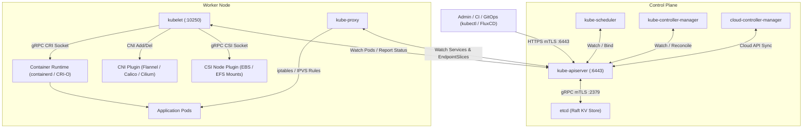
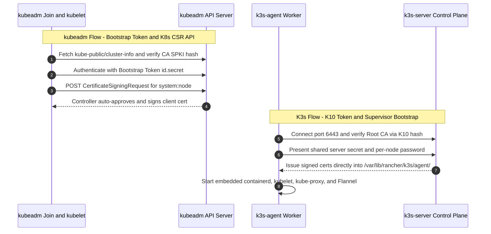
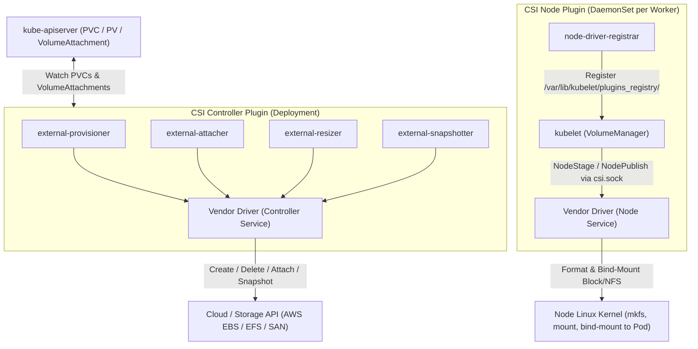
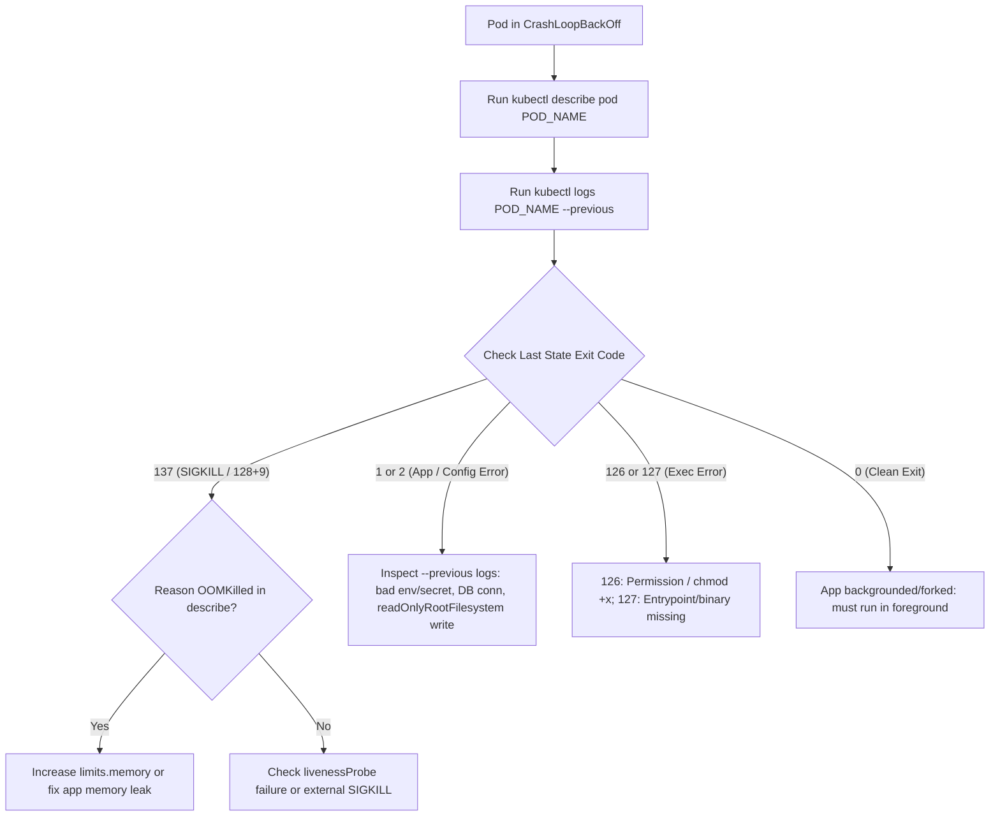

## 4. Kubernetes Architecture, Cluster Building, CRI, and CSI

> **Interview Scope & Focus:** This module covers Kubernetes internal control-plane and worker mechanics, `etcd` consensus and disaster recovery, building self-managed clusters (`kubeadm`, `K3s`, `RKE2`) versus managed services (EKS/GKE), Container Runtime Interface (`CRI`), Container Storage Interface (`CSI`), and systematic production troubleshooting. Security hardening references draw on practical DevSecOps deployments (such as hardened self-managed K3s clusters on AWS EC2 with `/32` API restriction, IMDSv2 enforcement, non-root Pod security contexts, and GitOps rollouts).

---

### 4.1 Kubernetes Control Plane & Worker Internals

#### Q1. [Junior] What are the core Kubernetes Control Plane and Worker Node components, and how do they interact?

**Executive Takeaway:** The Control Plane acts as the cluster's brain—persisting desired state in `etcd`, exposing it via `kube-apiserver`, scheduling Pods via `kube-scheduler`, and reconciling drift via `kube-controller-manager`—while Worker Nodes act as the execution engine using `kubelet`, `kube-proxy`, and a CRI-compliant container runtime.

- **Control Plane Components:**
  - **`kube-apiserver`:** The sole front-end gateway (`TCP/6443`) for all REST/gRPC cluster operations. Every component (`kubectl`, `kubelet`, controllers, webhooks) talks exclusively to `kube-apiserver`; nothing else reads or writes `etcd` directly.
  - **`etcd`:** Distributed, strongly consistent key-value store (Raft consensus) storing all cluster objects (`Pods`, `Secrets`, `ConfigMaps`, `Deployments`, `EndpointSlices`).
  - **`kube-scheduler`:** Watches for unscheduled Pods (`spec.nodeName == ""`), evaluates node fitness and scoring plugins, and writes a binding decision back to `kube-apiserver`.
  - **`kube-controller-manager`:** Single binary running background reconciliation loops (`NodeController`, `DeploymentController`, `ReplicaSetController`, `EndpointSliceController`, `ServiceAccountController`) that continuously drive current state toward desired state.
  - **`cloud-controller-manager` (CCM):** Decouples cloud-provider-specific loops (AWS/GCP/Azure LoadBalancer provisioning, Node lifecycle checks against cloud instance APIs, cloud route tables) from core Kubernetes code. Self-managed bare-metal/EC2 clusters without cloud integration omit CCM or run external providers (e.g., AWS Cloud Controller Manager).
- **Worker Node Components:**
  - **`kubelet`:** Node agent (`TCP/10250`) watching PodSpecs assigned to its node via `kube-apiserver`, invoking the Container Runtime over CRI, executing probes, mounting CSI volumes, and reporting `NodeStatus`/`PodStatus`.
  - **`kube-proxy`:** Network proxy maintaining node-level `iptables`, `IPVS`, or `nftables` rules (unless replaced by an eBPF CNI like Cilium) so `ClusterIP`/`NodePort` Services forward packets to healthy backend Pod IPs.
  - **Container Runtime (`containerd` / `CRI-O`):** Pulls OCI images, manages Pod sandboxes (`pause` container), configures cgroups/namespaces, and launches containers via `runc` (or sandboxed OCI runtimes).



---

#### Q2. [Mid] What happens to running workloads if the Control Plane (or `etcd`) goes completely offline?

**Executive Takeaway:** Healthy Pods already running on worker nodes continue running and serving existing traffic autonomously because the Data Plane (`kubelet`, `containerd`, `kube-proxy`, CNI) operates on cached local state—**however**, all control operations freeze and Pod IP changes break Service routing until the Control Plane recovers.

- **What Continues Working:**
  - Running containers on healthy workers keep executing under `containerd`/`runc`.
  - `kubelet` continues monitoring local containers, restarting crashed containers in-place (`restartPolicy: Always`) using its local checkpointed PodSpec, and running local `livenessProbe`/`readinessProbe` checks.
  - Existing `kube-proxy` (`iptables`/`IPVS`/eBPF) rules and CNI overlay tunnels (e.g., Flannel VXLAN `UDP/8472`) stay intact, so steady-state North-South (Ingress -> Service -> Pod) and East-West traffic keeps flowing.
  - **Static Pods** defined in `/etc/kubernetes/manifests/` continue being managed directly by `kubelet`.
- **What Breaks Immediately:**
  - **All API & GitOps Operations:** `kubectl` commands fail; FluxCD/ArgoCD reconciliation loops stall; HPA/VPA/Cluster Autoscaler cannot scale workloads.
  - **Scheduling & Node Failover:** If an entire worker node dies, `NodeController` cannot mark it unreachable or reschedule its Pods onto healthy nodes (`Deployment` replica count drops silently). Pending Pods cannot schedule.
  - **Stale `EndpointSlice` / Broken Routing on IP Churn:** If a Pod dies and is recreated with a new IP, a node reboots and CNI assigns a new IP, or a container fails its `readinessProbe` and should stop receiving traffic, `kube-controller-manager`'s `EndpointSliceController` cannot update `EndpointSlice` objects in `kube-apiserver`. Consequently, `kube-proxy` and `ingress-nginx` keep forwarding requests to dead or stale Pod IPs, causing 502/504 errors.
- **Interview Security/Design Note:** Never run single-node `etcd` in production; a single Control Plane outage leaves your cluster unable to heal or update endpoints during an active traffic spike or incident.

---

#### Q3. [Mid] Walk through the Pod lifecycle, `initContainers`, and the exact differences between `startupProbe`, `livenessProbe`, and `readinessProbe`.

**Executive Takeaway:** A Pod moves from `Pending` (scheduling/image pull/`initContainers`) to `Running` (app containers active) and tracks container health via three distinct probes: `startupProbe` protects slow boots, `readinessProbe` gates Service traffic, and `livenessProbe` triggers container restarts—and putting external dependency checks in `livenessProbe` is a classic cause of cascading cluster outages.

- **Pod Phases & Conditions:**
  - **Phases:** `Pending` (accepted by API, not yet running—waiting on scheduler, PVC binding, image pulls, or `initContainers`), `Running` (bound and at least one container started), `Succeeded`, `Failed`, `Unknown`.
  - **Key Conditions:** `PodScheduled` -> `Initialized` (`initContainers` succeeded) -> `ContainersReady` -> `Ready` (Pod is eligible for `EndpointSlice` traffic).
- **`initContainers` Mechanics:**
  - Execute strictly **sequentially** before any application container starts; all must exit `0` for `Initialized=True`.
  - Share the same Pod `netns` and volumes as app containers (useful for schema migrations, fetching Vault secrets into `emptyDir`, or waiting on upstream DNS/ports) while isolating setup tools (`psql`, `curl`) out of the runtime container image.
  - Must be **idempotent** because Pod restarts re-run `initContainers` from scratch. (Native sidecars—Kubernetes 1.29+ Beta and default-enabled, GA in 1.33—use `initContainers` with `restartPolicy: Always`, starting in order and staying alive alongside app containers).
- **Probes Comparison (`HTTPGet`, `TCPSocket`, `Exec`, `gRPC`):**
  1. **`startupProbe`:** Disables `livenessProbe` and `readinessProbe` until it succeeds once. Prevents slow-starting legacy/JVM apps from being killed before booting. Failure kills and restarts the container.
  2. **`readinessProbe`:** Runs continuously after startup. Failure removes the Pod IP from `EndpointSlice` (`Ready=False`) **without restarting the container**, gracefully draining traffic during temporary overload or lost DB connectivity.
  3. **`livenessProbe`:** Runs continuously after startup to detect deadlocks/infinite loops. Failure sends `SIGTERM` (then `SIGKILL` after `terminationGracePeriodSeconds`) and restarts the container.
- **Why a Misconfigured `livenessProbe` Causes a Cascading Outage:**
  - Suppose `/healthz` checks PostgreSQL connectivity and is wired to `livenessProbe`. If PostgreSQL has a 5-second transient network blip, **every Pod replica simultaneously fails `livenessProbe` and gets restarted by `kubelet`**.
  - On restart, all Pods hit cold-start CPU spikes and flood PostgreSQL with simultaneous TLS/connection handshakes, slowing DB responses further, causing the next `livenessProbe` cycle to fail again—locking the service into a self-inflicted `CrashLoopBackOff` thundering herd.
  - **Rule of Thumb:** Check internal process liveness (e.g., `/livez` returning `200 OK` from the event loop) in `livenessProbe`; check downstream dependencies (DB/Redis/warm cache) only in `readinessProbe` (or circuit-break gracefully inside the app).

```yaml
containers:
  - name: api-server
    image: registry.example.com/api:1.4.2
    ports:
      - containerPort: 8080
    startupProbe:
      httpGet:
        path: /livez
        port: 8080
      failureThreshold: 30   # Allows up to 30 * 5s = 150s cold start
      periodSeconds: 5
    readinessProbe:
      httpGet:
        path: /readyz         # Verifies app + local readiness (never kill on DB blip)
        port: 8080
      periodSeconds: 5
      failureThreshold: 2
    livenessProbe:
      httpGet:
        path: /livez          # Lightweight process-only deadlock check
        port: 8080
      periodSeconds: 10
      failureThreshold: 3
```

---

#### Q4. [Mid] How do Kubernetes Pod QoS classes (`Guaranteed`, `Burstable`, `BestEffort`) govern CPU throttling and OOMKill eviction order?

**Executive Takeaway:** Kubernetes assigns every Pod a Quality of Service (QoS) class (`Guaranteed`, `Burstable`, or `BestEffort`) solely from container `requests` and `limits`, directly setting Linux cgroup CPU quotas and kernel `oom_score_adj` values so critical Pods survive node memory exhaustion while unconstrained Pods die first.

| QoS Class | Exact Specification Rule | `oom_score_adj` | Node Memory Pressure Behavior |
| :--- | :--- | :--- | :--- |
| **`Guaranteed`** | Every container defines both `requests` and `limits` for both `cpu` and `memory`, and `requests == limits` for every container | `-997` | Killed **last** (only if exceeding its own limit or system daemons face starvation) |
| **`Burstable`** | Does not qualify as `Guaranteed`, and at least one container defines a `cpu` or `memory` `request` or `limit` | `2` to `999` (inversely proportional to memory request %) | Killed **second**, ordered by `(memory usage - memory request)` and priority |
| **`BestEffort`** | Zero `requests` and zero `limits` specified across all containers in the Pod | `1000` | Evicted / OOMKilled **first** |

- **Compressible vs. Incompressible Resources:**
  - **CPU is compressible:** Enforced via Linux CFS bandwidth control (`cpu.cfs_quota_us` / `cpu.cfs_period_us` in cgroups v1, `cpu.max` in cgroups v2). Exceeding `limits.cpu` throttles the container across 100ms periods, spiking `p99` tail latency without killing the process.
  - **Memory is incompressible:** Exceeding container `limits.memory` triggers a local cgroup OOM kill (container exits with code `137`, `OOMKilled`). If the **node** runs out of physical RAM (`memory.available < evictionHard`), `kubelet` evicts Pods in order: `BestEffort` -> `Burstable` exceeding requests -> `Burstable` within requests -> `Guaranteed`.
- **Production & Security Trade-Offs:**
  - Leaving Pods as `BestEffort` enables trivial noisy-neighbor Denial of Service (DoS); enforce `LimitRange` and `ResourceQuota` per namespace.
  - Setting `requests.cpu == limits.cpu` (`Guaranteed`) on integer CPU counts unlocks `kubelet` Static CPU Manager exclusive core pinning, avoiding CFS throttling for high-throughput proxies/databases, whereas setting tight `limits.cpu` on bursty Go/Node/JVM microservices often harms latency more than it helps.

---

#### Q5. [Senior] Trace a request inside `kube-apiserver` from TCP handshake to `etcd` persistence.

**Executive Takeaway:** Every write request into `kube-apiserver` traverses a strict pipeline—TLS termination, Authentication, Authorization, sequential Mutating Admission, OpenAPI/CRD Schema Validation, parallel Validating Admission, and finally optimistic-concurrency persistence in `etcd`.

```mermaid
flowchart LR
    Client["Client (kubectl / kubelet / Controller)"] -->|"1. mTLS / HTTPS (:6443)"| AuthN["2. Authentication (X.509 / OIDC / SA JWT)"]
    AuthN -->|"UserInfo"| AuthZ["3. Authorization (Node / RBAC / Webhook)"]
    AuthZ -->|"Allowed"| Mut["4. Mutating Admission (Sequential + Webhooks)"]
    Mut --> Schema["5. Schema Validation (OpenAPI / CRD Structural)"]
    Schema --> Val["6. Validating Admission (Parallel: PSA / CEL / Kyverno)"]
    Val -->|"Accepted"| Etcd["7. etcd Persistence (Raft + resourceVersion)"]
```



- **Stage-by-Stage Breakdown:**
  1. **TLS Termination:** Terminates TLS on port `6443` using the API server serving certificate (signed by the cluster CA with `--tls-san` / `--apiserver-cert-extra-sans`).
  2. **Authentication (`401 Unauthorized` on failure):** Evaluates authenticators sequentially until one succeeds: X.509 client certificates (`CN` = username, `O` = groups), bound ServiceAccount JWTs (`TokenRequest` API), OIDC bearer tokens, or Webhook `TokenReview`. Anonymous requests fall through as `system:anonymous` if enabled.
  3. **Authorization (`403 Forbidden` on failure):** Evaluates `Node`, `RBAC`, and `Webhook` authorizers. Logic is **deny-by-default**: any module returning `Allow` permits the request; `NoOpinion` passes to the next module; if none return `Allow`, the request is rejected. Crucially, the **`Node` authorizer** restricts each `kubelet` to reading only Secrets/ConfigMaps/PVs mounted by Pods scheduled onto *that specific node*—preventing a compromised worker from dumping cluster-wide Secrets.
  4. **Mutating Admission (Sequential):** Modifies the incoming object in-flight. Built-in plugins (`DefaultStorageClass`, `LimitRanger`, `ServiceAccount`) run first, followed by `MutatingAdmissionWebhook` (e.g., Istio/Vault sidecar injection, Kyverno mutate rules). Webhooks can trigger reinvocation (`reinvocationPolicy: IfNeeded`) if a later webhook modifies fields earlier webhooks inspected.
  5. **Object Schema Validation:** Validates field types, required keys, and structural OpenAPI/CRD schemas against the Group/Version/Kind (GVK).
  6. **Validating Admission (Parallel):** Enforces policy without modifying the object. Includes **`PodSecurity` Admission (PSA)** (`privileged`, `baseline`, `restricted`), `ResourceQuota`, in-process **`ValidatingAdmissionPolicy` (CEL)** (GA in K8s 1.30+, zero network hop latency), and `ValidatingAdmissionWebhook` (Kyverno / OPA Gatekeeper). Any single failure aborts the request.
  7. **`etcd` Persistence:** Serializes core objects as Protobuf (CRDs as JSON) and commits via Raft, bumping `metadata.resourceVersion` (enforcing optimistic concurrency control so stale `PUT` updates fail with `409 Conflict`).
- **DevSecOps Enforcement Pattern:** Enforcing PSA `restricted` at namespace labels alongside Kyverno/CEL policies guarantees that even if an attacker compromises a CI runner, they cannot deploy `privileged: true`, `hostNetwork: true`, or root UID `0` Pods.

---

#### Q6. [Senior] How does `kube-scheduler` place a Pod? Explain Filtering, Scoring, Taints/Tolerations, Affinity, `topologySpreadConstraints`, and `PodDisruptionBudget` (`PDB`).

**Executive Takeaway:** `kube-scheduler` processes pending Pods through a serial **Scheduling Cycle** (Filter eligible nodes -> Score and pick the best node -> Reserve in cache) and an asynchronous **Binding Cycle** (wait on pre-bind hooks like CSI provisioning -> write `spec.nodeName` to the API), guided by placement constraints while `PodDisruptionBudget` protects running replicas during voluntary disruptions.

- **Two-Phase Scheduling Pipeline:**
  1. **Scheduling Cycle (Serial per Pod):**
     - **Filtering (Predicates):** Eliminates nodes that cannot run the Pod (`NodeResourcesFit`, `NodeUnschedulable`, `TaintToleration`, `NodeAffinity` required rules, `VolumeBinding` AZ checks, `PodTopologySpread` `DoNotSchedule` constraints). If zero nodes pass, the Pod remains `Pending` (`FailedScheduling`), and `PostFilter` may trigger Pod preemption of lower-`PriorityClass` Pods.
     - **Scoring (Priorities):** Ranks surviving nodes from `0` to `100` across weighted plugins (`BalancedAllocation`, `LeastAllocated`, `ImageLocality`, `InterPodAffinity`, preferred `NodeAffinity`, `ScheduleAnyway` spread constraints). Highest total score wins.
     - **Reserve:** Temporarily deducts CPU/memory in the scheduler's in-memory cache to prevent race conditions before API persistence.
  2. **Binding Cycle (Asynchronous):**
     - **PreBind:** Executes slow external prerequisites (e.g., CSI volume provisioning/attachment under `WaitForFirstConsumer`).
     - **Bind:** Writes the `Binding` object (`spec.nodeName`) to `kube-apiserver`.
- **Placement Primitives (Repulsion vs. Attraction vs. Distribution):**
  - **Taints & Tolerations (Repulsion):** Placed on Nodes (`NoSchedule`, `PreferNoSchedule`, `NoExecute` with optional `tolerationSeconds`). A Toleration *permits* scheduling onto a tainted node—it does **not** force the Pod there. To dedicate nodes (e.g., DMZ ingress or GPU nodes), pair a Node Taint with a matching `NodeAffinity`.
  - **NodeAffinity (`requiredDuringSchedulingIgnoredDuringExecution` vs `preferred...`):** Constrains or prefers Pods on nodes matching label expressions.
  - **PodAntiAffinity:** Keeps replicas apart across `topologyKey` (`kubernetes.io/hostname` or `topology.kubernetes.io/zone`). `required...` prevents single-node SPOF, but blocks scaling if `replicas > nodes`.
  - **`topologySpreadConstraints`:** Controls skew (`maxSkew`) across failure domains (`whenUnsatisfiable: DoNotSchedule` or `ScheduleAnyway`). Handles cases where `replicas > zones` (e.g., 5 replicas across 3 AZs -> 2-2-1 split), which simple `PodAntiAffinity` cannot express.
- **`PodDisruptionBudget` (`PDB`):**
  - Protects against **voluntary** disruptions (`kubectl drain`, Cluster Autoscaler scale-down, EKS managed node group updates)—never against involuntary failures (kernel panic, OOMKill, hardware failure).
  - Uses `minAvailable` or `maxUnavailable`. **Pitfall:** Setting `minAvailable: 100%` or `maxUnavailable: 0` on a single-replica Pod permanently blocks `kubectl drain` and stalls cluster upgrades!

---

#### Q7. [Senior] How do Static Pods work in `/etc/kubernetes/manifests/`, why are they essential for bootstrapping `etcd` and the Control Plane, and how does `kubelet` manage them?

**Executive Takeaway:** Static Pods are defined as raw YAML manifests in `/etc/kubernetes/manifests/` and launched directly by `kubelet` without consulting `kube-apiserver` or `kube-scheduler`, solving the chicken-and-egg problem of starting `etcd` and the Control Plane before the API server exists.

- **How Static Pod Bootstrapping Works:**
  - `kubelet` starts with `--pod-manifest-path=/etc/kubernetes/manifests` (or `staticPodPath` in `KubeletConfiguration`).
  - `kubeadm init` writes `etcd.yaml`, `kube-apiserver.yaml`, `kube-controller-manager.yaml`, and `kube-scheduler.yaml` into `/etc/kubernetes/manifests/`. `kubelet` immediately boots `etcd` and `kube-apiserver` locally via CRI (`containerd`)—no `kubectl` or API connectivity needed beforehand!
  - **Mirror Pods:** Once `kube-apiserver` is reachable, `kubelet` creates a read-only **Mirror Pod** object in `kube-system` named `<pod>-<nodename>` so `kubectl get pods -n kube-system` can inspect logs and status.
- **Crucial Operational Differences from Normal Pods:**
  - **Ignoring `kubectl delete pod`:** Deleting a Mirror Pod via `kubectl` only deletes the API view—`kubelet` immediately recreates the Mirror Pod because the source manifest file still sits on disk. To stop or restart a Static Pod (for instance during `etcd` Disaster Recovery or certificate renewal), you must move/edit its YAML file in `/etc/kubernetes/manifests/` (or stop its sandbox via `crictl stopp`).
  - **Bypassing Scheduler & Admission:** Static Pods never pass through `kube-scheduler` or Admission Webhooks, and `kubelet` keeps restarting them locally even if `kube-apiserver` is offline.
  - **Kubeadm vs. K3s Contrast:** `kubeadm` and `RKE2` run Control Plane components and `etcd` as Static Pods inside `/etc/kubernetes/manifests/` (or `/var/lib/rancher/rke2/agent/pod-manifests/`), whereas `K3s` embeds `kube-apiserver`, `kube-controller-manager`, `kube-scheduler`, and `etcd` inside the single `k3s` systemd binary process.

---

#### Q8. [Expert] Deep dive into `etcd`: explain Raft consensus, quorum math (`(N/2)+1`), disk `fsync` latency sensitivity, and database quota alarms.

**Executive Takeaway:** `etcd` uses the Raft consensus protocol requiring strict majority quorum (`floor(N/2) + 1`) on every write—making odd cluster sizes (3 or 5) mandatory—and depends directly on low-latency disk `fsync()` because every committed API mutation must flush to the Raft Write-Ahead Log (WAL) before acknowledgment.

- **Raft Consensus Mechanics:**
  - One **Leader** handles all write proposals and linearizable reads; **Followers** replicate the log.
  - Write flow: `kube-apiserver` -> Leader appends entry to WAL (`fsync`) -> sends `AppendEntries` RPC to Followers -> Followers append to WAL (`fsync`) and ACK -> once **quorum** ACKs, Leader commits and applies to BoltDB MVCC B+tree, notifying `kube-apiserver`.
  - Heartbeats (`--heartbeat-interval`, default `100ms`) prevent Followers from timing out (`--election-timeout`, default `1000ms`) and starting a new leader election.
- **Quorum Math & Why Even Counts (`2`, `4`) Are Anti-Patterns:**
  - Formula: `Quorum = floor(N / 2) + 1`; Fault Tolerance = `N - Quorum`.

| Nodes (`N`) | Quorum Required | Fault Tolerance (Max Node Losses) | Production Assessment |
| :---: | :---: | :---: | :--- |
| **1** | 1 | **0** | Non-HA dev/lab only; any outage stops API |
| **2** | 2 | **0** | **Worst choice:** Higher latency than 1 node, zero fault tolerance (losing either node loses quorum) |
| **3** | 2 | **1** | Standard HA production cluster (survives 1 node loss/reboot) |
| **4** | 3 | **1** | **Anti-pattern:** Same fault tolerance as 3 nodes with extra replication overhead |
| **5** | 3 | **2** | Large/critical HA production (survives 1 planned maintenance + 1 unexpected failure) |
| **7** | 4 | **3** | Diminishing returns; high Raft broadcast latency rarely justified |

- **Disk IOPS / `fsync` Latency Sensitivity:**
  - `etcd` disk performance is governed by sequential `fsync()` latency (`wal_fsync_duration_seconds` `p99`), **not** sequential MB/s throughput.
  - Cloud `gp2` disks, burstable IOPS exhaustion, or co-located logging/DB I/O pushing `fsync` above `10–25ms` causes missed Raft heartbeats -> leader re-election storms -> `kube-apiserver` `etcdserver: request timed out` -> cascading controller/kubelet failures.
  - **Mitigation:** Dedicated local NVMe or AWS `gp3`/`io2` with provisioned >=3,000 IOPS, dedicated disk mount for `/var/lib/etcd`, and high `ionice` priority.
- **MVCC History, Compaction, Defrag & Quota Alarms:**
  - `etcd` keeps historical key revisions in BoltDB (`--quota-backend-bytes`, default `2 GiB`, hard ceiling `8 GiB`). If compaction lags or churn is high, hitting the quota raises a `NOSPACE` alarm and flips `etcd` into **read-only maintenance mode** (no Pod scheduling or API writes!).
  - Recovery: `etcdctl compact <rev>` -> `etcdctl defrag` (reclaims free pages back to OS, pauses node briefly—run sequentially on followers first, leader last!) -> `etcdctl alarm disarm`.

---

#### Q9. [Expert] How do you harden `etcd` at rest (`EncryptionConfiguration` + KMS v2) and execute a production `etcdctl` / `etcdutl` Disaster Recovery restore?

**Executive Takeaway:** By default, Kubernetes stores Secrets in `etcd` merely Base64-encoded (plaintext); production clusters must configure `EncryptionConfiguration` with KMS v2 envelope encryption and maintain tested, mTLS-authenticated `etcdctl snapshot save` + `etcdutl snapshot restore` workflows.

- **Encryption at Rest (`EncryptionConfiguration`):**
  - Configure `--encryption-provider-config=/etc/kubernetes/enc/encryption-config.yaml` on `kube-apiserver`.
  - **Provider Priority:**
    1. **`kms` (`apiVersion: v2`, GA in K8s 1.29):** Uses envelope encryption (local DEK encrypts Secret; AWS KMS / HashiCorp Vault encrypts DEK over local UNIX socket). Supports zero-downtime key rotation via `key_id` healthchecks and keeps key material off the node disk.
    2. **`secretbox` / `aescbc`:** Symmetric key stored in YAML on Control Plane disk (acceptable for self-managed without external KMS, provided file permissions are `0600` root-only and backups exclude or separately encrypt the key).
    3. **`identity`:** **Must remain last** during migration so `kube-apiserver` can read legacy unencrypted Secrets while writing new/updated ones with the top provider.
  - After enabling, rewrite existing Secrets so they are re-encrypted at rest:
    ```bash
    kubectl get secrets --all-namespaces -o json | kubectl replace -f -
    ```

```yaml
apiVersion: apiserver.config.k8s.io/v1
kind: EncryptionConfiguration
resources:
  - resources:
      - secrets
      # Add configmaps here only if needed (and re-encrypt existing ConfigMaps cautiously alongside Secrets)
    providers:
      - kms:
          apiVersion: v2
          name: aws-kms-provider
          endpoint: unix:///var/run/kmsplugin/socket.sock
          timeout: 3s
      - identity: {}   # Fallback read-only for unencrypted legacy objects; remove after full migration
```

- **mTLS Isolation:** `etcd` peer (`2380`) and client (`2379`) traffic uses strict mTLS; only `kube-apiserver` holds the `apiserver-etcd-client` certificate. Never expose port `2379` to worker subnets.
- **Disaster Recovery Workflow (`etcdctl` v3.5+ + `etcdutl`):**
  - Note: Starting in `etcd` v3.5+, `snapshot restore` moved from `etcdctl` to **`etcdutl`** (while `snapshot save` remains in `etcdctl`).
  ```bash
  # 1. Take a live consistent snapshot from a healthy member
  ETCDCTL_API=3 etcdctl snapshot save /var/backups/etcd-snapshot.db \
    --endpoints=https://127.0.0.1:2379 \
    --cacert=/etc/kubernetes/pki/etcd/ca.crt \
    --cert=/etc/kubernetes/pki/etcd/server.crt \
    --key=/etc/kubernetes/pki/etcd/server.key

  # 2. Verify snapshot integrity and revision count
  etcdutl snapshot status /var/backups/etcd-snapshot.db --write-out=table
  ```
  - **Multi-Node Restore Sequence (on ALL Control Plane nodes simultaneously):**
    1. Stop static Control Plane Pods on all masters by moving `/etc/kubernetes/manifests/*.yaml` to `/tmp/manifests/`. Wait for containers to exit (`crictl ps`).
    2. Move aside the corrupted `/var/lib/etcd` directory.
    3. On each master (`cp-1`, `cp-2`, `cp-3`), restore the **exact same snapshot** with a brand-new `--initial-cluster-token` so old stale members cannot rejoin:
       ```bash
       etcdutl snapshot restore /var/backups/etcd-snapshot.db \
         --data-dir=/var/lib/etcd \
         --name=cp-1 \
         --initial-cluster="cp-1=https://10.0.1.10:2380,cp-2=https://10.0.1.11:2380,cp-3=https://10.0.1.12:2380" \
         --initial-cluster-token=etcd-cluster-dr-01 \
         --initial-advertise-peer-urls=https://10.0.1.10:2380
       ```
    4. Move manifests back into `/etc/kubernetes/manifests/`, wait for `kubelet` to restart `etcd` and `kube-apiserver`, and verify `etcdctl endpoint health --cluster`.
    5. **DR Gotcha:** Back up `/etc/kubernetes/pki/` and KMS keys alongside `etcd` snapshots—an `etcd` snapshot encrypted with a destroyed KMS key or mismatched cluster CA is unrecoverable.

---

### 4.2 Building Self-Managed Clusters from Scratch (`kubeadm` vs `K3s` vs `RKE2` vs Managed EKS)

#### Q10. [Mid] Compare `kubeadm`, `K3s`, `RKE2`, and Managed Kubernetes (EKS/GKE) — architectural differences and when to choose each.

**Executive Takeaway:** Choose **Managed EKS/GKE** when SLA and zero control-plane ops outweigh cost; choose **`kubeadm`** for pure upstream modularity and fine-grained customization; choose **`K3s`** for lightweight edge, CI, or low-footprint EC2 clusters; and choose **`RKE2`** for hardened, CIS/FIPS-compliant self-managed production.

| Dimension | `kubeadm` | `K3s` | `RKE2` | Managed (`EKS` / `GKE`) |
| :--- | :--- | :--- | :--- | :--- |
| **Packaging** | Separate OS packages (`kubelet`, `kubeadm`, `kubectl`) + Static Control Plane Pods | Single ~70MB Go binary (`k3s server` / `k3s agent` systemd units) | Single launcher binary running Control Plane as **Static Pods** | Cloud-managed Control Plane + managed/self-managed worker nodes |
| **Datastore** | Stacked or External `etcd` | SQLite (single node), embedded `etcd` (`--cluster-init`), or external SQL via Kine | Embedded `etcd` (Static Pod) | Cloud-managed multi-AZ `etcd` (abstracted) |
| **Default Add-ons** | None (bring your own CNI, Ingress, StorageClass, LB) | Bundled Flannel, CoreDNS, Traefik, Klipper ServiceLB, `local-path` | Bundled Canal/Cilium, CoreDNS, NGINX Ingress (configurable) | Cloud VPC CNI, CoreDNS, `kube-proxy`, EBS/PD CSI add-ons |
| **Security Posture** | Vanilla upstream; requires manual CIS hardening (`kube-bench`) | Lightweight defaults; can disable add-ons (`--disable traefik`) & harden OS | CIS Benchmark & FIPS 140-2 defaults out-of-the-box (`PodSecurity`, non-root `etcd`) | Cloud IAM integration (IRSA / EKS Pod Identity), automated CP patching |
| **When to Choose** | Learning internals, custom bare-metal, upstream parity | Edge/IoT, constrained EC2 instances (`t3.small`), rapid self-managed labs/staging | Regulated on-prem / air-gapped / sovereign cloud production | Production cloud workloads prioritizing uptime SLA & low operational toil |

- **Practical Deployment Note (K3s Hardening Pattern):** In lean AWS EC2 self-managed deployments (e.g., running OWASP Juice Shop or GitOps FluxCD fleets without EKS cost), K3s avoids the RAM overhead of full `kubeadm` while allowing you to swap out defaults (`--disable traefik`, `--tls-san <PUBLIC_IP>`, `--write-kubeconfig-mode 600`) to install `ingress-nginx` and enforce `/32` Security Group locks on port `6443`.

---

#### Q11. [Senior] How does a worker node securely join a `kubeadm` cluster? Trace the Discovery and TLS Bootstrapping handshake.

**Executive Takeaway:** `kubeadm join` uses a two-layer zero-trust bootstrap: it pins the cluster Root CA's public-key SHA-256 hash (`--discovery-token-ca-cert-hash sha256:<CA-PUBKEY-HASH>`) to prevent rogue-master MITM attacks, authenticates via a short-lived Bootstrap Token (`<id>.<secret>`), and submits a Kubernetes CSR so `kubelet` receives its own unique, auto-rotating `system:node:<hostname>` client certificate.

```bash
kubeadm join 10.0.1.10:6443 \
  --token abcdef.0123456789abcdef \
  --discovery-token-ca-cert-hash sha256:9f86d081884c7d659a2feaa0c55ad015a3bf4f1b2b0b822cd15d6c15b0f00a08
```

- **Step-by-Step Handshake:**
  1. **Untrusted Discovery & CA Hash Pinning:** `kubeadm` connects to `https://<API_HOST>:6443` without initially trusting the TLS chain, fetches the `cluster-info` ConfigMap from namespace `kube-public` (which contains a JWS-signed kubeconfig), and verifies BOTH the server's CA public key hash against `--discovery-token-ca-cert-hash` (`sha256:<CA-PUBKEY-HASH>`) and the JWS signature using the Bootstrap Token secret.
  2. **Least-Privilege Bootstrap Auth:** `kubeadm` writes `/etc/kubernetes/bootstrap-kubelet.conf` containing the Bootstrap Token (`<id>.<secret>`, valid 24h by default, mapped to group `system:bootstrappers:kubeadm:default-node-token`). That RBAC group can **only** read `cluster-info` and create `CertificateSigningRequest` (`CSR`) objects—it cannot read Secrets or Pods.
  3. **CSR Generation (`kubelet`):** `kubelet` starts, generates an asymmetric private key on disk, creates a `CSR` requesting `CN=system:node:<nodeName>`, `O=system:nodes`, and submits it to `certificates.k8s.io/v1`.
  4. **Approval & Signing:** `kube-controller-manager`'s `csrapproving` controller validates that the requestor belongs to `system:bootstrappers` and `CN`/`O` strictly match `system:node:*`, auto-approving the CSR (or an admin approves manually via `kubectl certificate approve` if auto-approval is disabled). The `csrsigning` controller signs the client certificate with the cluster CA.
  5. **Final Credential Swap:** `kubelet` downloads the signed certificate to `/var/lib/kubelet/pki/kubelet-client-current.pem`, generates `/etc/kubernetes/kubelet.conf`, and drops bootstrap-token reliance. When approaching ~80% of cert lifetime, `RotateKubeletClientCertificate` automatically renews via CSR.

---

#### Q12. [Senior] How does `k3s-agent` join a K3s cluster, and how does K3s's join token and TLS bootstrap differ from `kubeadm`?

**Executive Takeaway:** `k3s-agent` joins using `K3S_URL=https://<MASTER_IP>:6443` and `K3S_TOKEN=K10<CA-CERT-HASH>::server:<SHARED-SECRET>`, where the agent verifies the master's CA hash directly from the `K10` prefix and authenticates against K3s's embedded bootstrap supervisor to receive signed node certificates under `/var/lib/rancher/k3s/agent/` before launching embedded `containerd`, `kubelet`, `kube-proxy`, and Flannel.

```bash
# On Master: inspect master private IP and K3s join token
hostname -I | awk '{print $1}'
sudo cat /var/lib/rancher/k3s/server/node-token
# Format: K10<CA-CERT-HASH>::server:<SHARED-SECRET>

# On Worker: install and start k3s-agent joined to Master Private IP
curl -sfL https://get.k3s.io | \
  K3S_URL="https://172.31.23.134:6443" \
  K3S_TOKEN="K10<CA-CERT-HASH>::server:<SHARED-SECRET>" sh -
```

- **Anatomy of the Join Sequence (`k3s-agent`):**
  1. **Token Parsing & CA Verification:** `k3s-agent` splits `K3S_TOKEN` into `K10<CA-CERT-HASH>` (SHA-256 of the K3s Server Root CA) and `server:<SHARED-SECRET>`. When dialing `https://172.31.23.134:6443`, `k3s-agent` validates the Control Plane CA against `<CA-CERT-HASH>` before transmitting credentials.
  2. **Supervisor Bootstrap & Node Cert Issuance:** `k3s-agent` authenticates with `<SHARED-SECRET>` to K3s's internal supervisor endpoint on port `6443` (authorized via internal VPC/Security Group rules). The server validates the per-node password (`/var/lib/rancher/k3s/server/cred/node-passwd` ensures unique node ownership so a duplicate hostname cannot hijack an existing node!) and issues signed client/serving certs (`client-kubelet.crt`, `kubelet.kubeconfig`, `client-kube-proxy.crt`) stored under `/var/lib/rancher/k3s/agent/`.
  3. **Embedded Runtime & CNI Bring-Up:** The `k3s-agent` systemd unit launches embedded `containerd` (`/run/k3s/containerd/containerd.sock`), `kubelet`, and `kube-proxy`, registers the worker node, and establishes the Flannel VXLAN (`UDP/8472`) overlay and Kubelet (`TCP/10250`) stream channel back to `k3s-master`.



- **Security Comparison (`kubeadm` vs `K3s`):**
  - `kubeadm` Bootstrap Tokens expire automatically (default 24h) and separate discovery from node identity.
  - K3s `/var/lib/rancher/k3s/server/node-token` does **not** expire automatically and uses the `server:` secret (which grants authority to join additional control-plane servers too!). In production K3s, configure `--agent-token` separately from `--token` for least privilege, rotate tokens via `k3s token rotate`, and restrict `TCP/6443` strictly to trusted admin `/32` IPs and internal node Security Groups.

---

#### Q13. [Senior] How do you design an HA Control Plane (Stacked `etcd` vs External `etcd`) and configure the API Load Balancer VIP/NLB?

**Executive Takeaway:** Production HA Control Planes require at least 3 odd-numbered nodes behind an **L4 TCP passthrough** Load Balancer (`6443`) with `--tls-san` / `--apiserver-cert-extra-sans` matching the VIP/DNS; **Stacked `etcd`** minimizes node count and complexity, while **External `etcd`** isolates storage I/O and failure domains.

- **Topology Trade-Offs:**
  - **Stacked `etcd` (3 or 5 Control Plane nodes):** Each node runs `kube-apiserver`, `kube-scheduler`, `kube-controller-manager`, AND a local `etcd` member.
    - *Pros:* Only 3 VMs needed for HA; automated natively by `kubeadm init --control-plane-endpoint` and `k3s server --cluster-init`.
    - *Cons:* Coupled failure domain—losing 1 node loses both API capacity and 1 `etcd` voter; runaway API/controller memory or disk I/O can starve `etcd` `fsync`.
  - **External `etcd` (3/5 dedicated `etcd` VMs + 2+ stateless Control Plane VMs):**
    - *Pros:* Dedicated high-IOPS NVMe for `etcd`; Control Plane nodes become stateless and horizontally scalable without touching Raft quorum.
    - *Cons:* Minimum 5–6 nodes; higher infrastructure cost and certificate management overhead.
- **API Load Balancer & Active/Passive Rules:**
  - **L4 TCP Passthrough Only:** Use an AWS NLB, HAProxy in `mode tcp`, or `kube-vip` (BGP/ARP VIP). **Never terminate TLS at an L7 ALB** on `6443`, because `kube-apiserver` relies on client X.509 mTLS certificates (`kubectl`, `kubelet`) for authentication.
  - **SAN Configuration:** Both `kubeadm` (`--control-plane-endpoint "k8s-api.internal:6443"`) and `K3s` (`--tls-san k8s-api.internal`) **must** inject the VIP/NLB hostname into the API server's serving TLS certificate SANs, or every `kubelet` and `kubectl` call rejects the cert with `x509: certificate is valid for ..., not k8s-api.internal`.
  - **Control Plane Concurrency:** `kube-apiserver` instances run **active-active** behind the L4 LB, whereas `kube-scheduler` and `kube-controller-manager` run **active-passive** using Kubernetes `Lease` objects in `kube-system` for leader election.

---

#### Q14. [Expert] Execute a zero-downtime Kubernetes cluster upgrade on `kubeadm` and `K3s` — what are the exact steps, skew rules, and failure traps?

**Executive Takeaway:** Upgrades strictly move Control Plane first, then Workers, stepping at most **one minor version** at a time (`1.30 -> 1.31`), backed by a verified `etcd` snapshot, `PDB`-aware node draining, and API deprecation checks before touching a single node.

- **Kubernetes Version Skew Policy (Mandatory):**
  - Never skip minor versions during upgrades (`N -> N+1` only).
  - `kube-apiserver` must be >= `kube-controller-manager` and `kube-scheduler` (at most 1 minor behind) and >= `kubelet` (up to 3 minor versions behind in K8s 1.28+, previously 2). `kubectl` supports +/-1 minor version skew relative to `kube-apiserver`.
- **Exact `kubeadm` Rolling Upgrade Sequence:**
  1. **Pre-Flight Checks:**
     - Take and verify an `etcd` snapshot (`etcdctl snapshot save` + `etcdutl snapshot status`).
     - Audit removed APIs (`pluto detect-all-in-cluster` or `kubent`).
     - Inspect `PodDisruptionBudgets` (`kubectl get pdb -A`)—watch for `ALLOWED DISRUPTIONS = 0`, which will deadlock `drain`.
  2. **Upgrade Primary Control Plane (`cp-1`):**
     ```bash
     # Upgrade kubeadm binary first, verify upgrade plan
     sudo apt-mark unhold kubeadm && sudo apt-get update && sudo apt-get install -y kubeadm=1.31.2-* && sudo apt-mark hold kubeadm
     sudo kubeadm upgrade plan
     sudo kubeadm upgrade apply v1.31.2

     # Drain workloads gracefully, upgrade kubelet & kubectl, uncordon
     kubectl drain cp-1 --ignore-daemonsets --delete-emptydir-data
     sudo apt-mark unhold kubelet kubectl && sudo apt-get install -y kubelet=1.31.2-* kubectl=1.31.2-* && sudo apt-mark hold kubelet kubectl
     sudo systemctl daemon-reload && sudo systemctl restart kubelet
     kubectl uncordon cp-1
     ```
  3. **Upgrade Secondary Control Planes (`cp-2`, `cp-3`):**
     - Same package sequence, except run **`sudo kubeadm upgrade node`** (NOT `apply`!) before draining and upgrading `kubelet`.
  4. **Upgrade Worker Nodes One-by-One (or Rolling Surge Batch):**
     - `kubectl drain <worker> --ignore-daemonsets --delete-emptydir-data` -> upgrade `kubeadm` -> `sudo kubeadm upgrade node` -> upgrade `kubelet`/`kubectl` -> `systemctl restart kubelet` -> `kubectl uncordon <worker>`.
- **K3s Rolling Upgrade Sequence:**
  - Always upgrade `k3s-server` nodes first, then `k3s-agent` nodes.
  - Drain node -> run `curl -sfL https://get.k3s.io | INSTALL_K3S_VERSION=v1.31.2+k3s1 sh -` (preserving existing flags or `/etc/rancher/k3s/config.yaml`) -> wait for `Ready` -> uncordon -> proceed to next node. For automated fleet upgrades inside K3s, deploy Rancher's **`system-upgrade-controller`** with separate `server-plan` and `agent-plan` CRDs (`prepare` step gating `agent-plan` on `server-plan` completion + `drain` configured).
- **Common Upgrade Traps:**
  - `PDB` with `maxUnavailable: 0` or `minAvailable: 1` on a `replicas: 1` app stalls `kubectl drain` indefinitely.
  - Passing `--delete-emptydir-data` wipes ephemeral pod caches (and `local-path` data if misconfigured as `emptyDir`).
  - Upgrading CNI/CSI drivers *after* node skew breaks container networking or volume attachment instead of verifying CNI/CSI compatibility matrix first.

---

#### Q15. [Expert] How does `kubeadm` manage cluster PKI and certificate rotation, and how do you recover if Control Plane certificates expire?

**Executive Takeaway:** `kubeadm` separates trust into three distinct CAs (Kubernetes CA, `etcd` CA, and `front-proxy` CA) with 10-year CA lifespans and 1-year leaf certificates; if leaf certs expire and `kubectl` locks up, `kubeadm certs renew all` plus static pod restarts restores full cluster access without recreating workloads.

- **Three-CA Separation (`ls /etc/kubernetes/pki/`):**
  - **Cluster CA (`ca.crt` / `ca.key`):** Signs `kube-apiserver` serving cert, `apiserver-kubelet-client`, `kubelet` client/serving certs, `admin.conf` (`system:masters`), and controller/scheduler client certs.
  - **`etcd` CA (`etcd/ca.crt`):** Isolates `etcd` peer/server/healthcheck trust so cluster workloads or aggregation proxies cannot impersonate `etcd` peers.
  - **Front-Proxy CA (`front-proxy-ca.crt`):** Used exclusively by `kube-apiserver` when authenticating requests forwarded to Extension API Servers (e.g., `metrics-server`, custom aggregated APIs).
- **Automatic vs. Manual Rotation:**
  - `kubelet` client certs auto-rotate via CSR when `RotateKubeletClientCertificate: true` (default).
  - Control Plane leaf certs (`apiserver.crt`, `apiserver-kubelet-client.crt`, `admin.conf`, etc.) expire in **1 year** and renew automatically ONLY during `kubeadm upgrade apply/node`—if you skip upgrades for >12 months, `kube-apiserver` fails mTLS handshakes and `kubectl` returns `x509: certificate has expired`. (By contrast, `K3s` automatically renews certs approaching <90 days remaining upon `k3s` restart).
- **Inspection & Live Recovery Workflow:**
  ```bash
  # Check remaining validity of all control-plane certificates
  sudo kubeadm certs check-expiration

  # If expired (or expiring soon), renew all leaf certs & kubeconfigs
  sudo kubeadm certs renew all

  # Copy renewed admin kubeconfig
  sudo cp /etc/kubernetes/admin.conf ~/.kube/config

  # Force static Control Plane Pods to reload new certs from disk
  sudo crictl pods --name 'kube-apiserver|kube-controller-manager|kube-scheduler|etcd' -q | xargs -r sudo crictl stopp
  ```
  - **Security Note:** Never leave `ca.key` or `admin.conf` (`system:masters` bypasses RBAC completely!) accessible on CI runners or operator laptops; for external access, issue scoped OIDC or short-lived CSR certificates (`kubeadm kubeconfig user`) rather than distributing `admin.conf`.

---

### 4.3 CRI (Container Runtime Interface) and CSI (Container Storage Interface)

#### Q16. [Mid] What is the Container Runtime Interface (CRI), why did Kubernetes remove `dockershim` in v1.24, and how do you debug containers with `crictl`?

**Executive Takeaway:** CRI is a gRPC API (`RuntimeService` and `ImageService` over a UNIX domain socket) that decouples `kubelet` from container runtime internals; `dockershim` was removed in v1.24 because maintaining an in-tree translation shim for non-CRI Docker Engine added complexity, latency, and security bloat.

- **Old (`dockershim`) vs. Modern CRI Architecture:**
  - **Before v1.24:** `kubelet` -> `dockershim` (in-tree) -> `dockerd` -> `containerd` -> `containerd-shim` -> `runc`. Extra IPC hops, conflicting cgroup management, and Docker-specific daemon overhead.
  - **Modern CRI (v1.24+):** `kubelet` -> (gRPC over `unix:///run/containerd/containerd.sock` or `crio.sock`) -> `containerd` (CRI plugin) / `CRI-O` -> `containerd-shim-runc-v2` / `conmon` -> `runc`.
- **Two CRI gRPC Services:**
  - **`RuntimeService`:** Manages Pod sandboxes (`RunPodSandbox`, `StopPodSandbox`, `RemovePodSandbox`) and container lifecycle (`CreateContainer`, `StartContainer`, `StopContainer`, `ExecSync`).
  - **`ImageService`:** Manages OCI image operations (`ListImages`, `PullImage`, `RemoveImage`, `ImageFsInfo`).
- **Debunking the "Kubernetes Dropped Docker" Myth:**
  - Kubernetes **still runs Docker-built OCI images** (`Dockerfile` -> OCI image manifest); only the `dockerd` *runtime daemon* was removed.
  - What actually breaks during migration: DaemonSets or troubleshooting scripts mounting `/var/run/docker.sock` (a severe container-escape security risk anyway!) or calling `docker ps` on nodes; CI pipelines in Pods must switch to rootless BuildKit, Kaniko, or Podman instead of Docker socket mounting.
- **Debugging Nodes Directly with `crictl` (NOT `docker ps`!):**
  ```bash
  # Configure endpoint (standard containerd vs K3s embedded containerd)
  cat <<'EOF' | sudo tee /etc/crictl.yaml
  runtime-endpoint: unix:///run/containerd/containerd.sock
  image-endpoint: unix:///run/containerd/containerd.sock
  timeout: 10
  EOF
  # Note: On K3s nodes, set socket to unix:///run/k3s/containerd/containerd.sock

  sudo crictl pods                         # List Pod sandboxes
  sudo crictl ps -a                        # List containers across all states
  sudo crictl logs -f <container-id>       # Tail container stdout/stderr
  sudo crictl exec -it <container-id> sh   # Debug inside running container
  sudo crictl inspectp <pod-sandbox-id>    # Inspect Pod IP, namespaces, cgroups
  sudo crictl rmi --prune                  # Reclaim unused images on DiskPressure
  ```
  - For low-level runtime inspection beneath CRI, `containerd` stores Kubernetes objects in the **`k8s.io` namespace** (`sudo ctr -n k8s.io containers list`).

---

#### Q17. [Mid] What is the Container Storage Interface (CSI), why did it replace in-tree volume plugins, and how do the Controller Plugin and Node Plugin work?

**Executive Takeaway:** CSI is a standardized out-of-tree gRPC interface (`Identity`, `Controller`, `Node` services) allowing storage providers to deploy drivers as ordinary Kubernetes Pods—eliminating in-tree cloud SDK coupling so storage bugfixes and features ship independently of Kubernetes releases.

- **Why Out-of-Tree CSI Replaced In-Tree Drivers:**
  - Legacy in-tree plugins (`kubernetes.io/aws-ebs`, `kubernetes.io/gce-pd`) compiled vendor SDKs directly into `kube-controller-manager` and `kubelet` binaries, forcing full cluster upgrades for simple storage patches and expanding the Control Plane's CVE blast radius.
- **CSI Architecture (Controller vs. Node Split):**



- **Controller Plugin (`Deployment`, 2+ replicas with leader election):**
  - Runs anywhere in the cluster (non-privileged, needs Cloud IAM/API credentials via IRSA/EKS Pod Identity).
  - Sidecars watch K8s objects and invoke CSI `Controller` gRPC calls:
    - `external-provisioner` -> `CreateVolume` / `DeleteVolume` (dynamic PV provisioning).
    - `external-attacher` -> `ControllerPublishVolume` / `ControllerUnpublishVolume` (attaches EBS volume to EC2 instance).
    - `external-resizer` -> `ControllerExpandVolume`.
    - `external-snapshotter` -> `CreateSnapshot` / `DeleteSnapshot`.
- **Node Plugin (`DaemonSet` on every worker node):**
  - Runs **privileged** (`Bidirectional` mount propagation, host `/dev` and `/var/lib/kubelet` mounts) to manipulate node block devices and filesystems.
  - `node-driver-registrar` registers the driver UNIX socket with `kubelet`.
  - `kubelet` calls `NodeStageVolume` (formats device if unformatted and mounts once to a global node staging path) and `NodePublishVolume` (bind-mounts staging path into `/var/lib/kubelet/pods/<pod-uid>/volumes/...` for each Pod).

---

#### Q18. [Senior] How do Pod sandboxes (`pause`), cgroups v2, and OCI runtime layers work together under `containerd`?

**Executive Takeaway:** Before any app container launches, `kubelet` instructs `containerd` to spin up a lightweight `pause` container that anchors the Pod's Linux network/IPC namespaces and cgroup hierarchy, ensuring Pod IPs and shared networking persist even if application containers crash and restart.

- **Exact Pod Creation Sequence:**
  1. `kubelet` invokes CRI `RunPodSandbox`: `containerd` creates the Pod-level cgroup slice (`kubepods-burstable-pod<uid>.slice`) and starts the `pause` binary (`registry.k8s.io/pause:3.x`), establishing the Pod's `net`, `ipc`, and optional `pid` namespaces.
  2. `kubelet` calls the CNI plugin (`ADD`), attaching a `veth` interface and Pod IP into the `pause` container's network namespace.
  3. `kubelet` invokes CRI `CreateContainer` and `StartContainer` for each `initContainer` (sequentially) and app container (concurrently), instructing `runc` to **join** the `pause` container's `net` and `ipc` namespaces while keeping separate `mnt` (rootfs) and `pid` namespaces.
  4. **Why `pause` matters:** If the main app container crashes and restarts, the `pause` container holds `eth0` and the network namespace alive so the Pod never loses its IP or drops open sidecar namespaces; it also reaps zombie processes when PID namespace sharing is enabled.
- **cgroup Driver Parity & cgroups v2:**
  - **Critical Rule:** `kubelet` (`cgroupDriver: systemd`) and `containerd` (`SystemdCgroup = true` in `/etc/containerd/config.toml`) **must** use the same cgroup driver. Mixing `systemd` on `kubelet` with `cgroupfs` on `containerd` creates split cgroup hierarchies that destabilize node memory pressure detection and cause random OOM kills under load.
  - **cgroups v2 Advantages (Default in Ubuntu 24.04 / K8s 1.25+):** Unified single hierarchy (preventing controller drift), Pressure Stall Information (PSI) telemetry for faster memory pressure eviction, `MemoryQoS` (`memory.min` / `memory.high` throttling before hard OOM), and secure rootless container runtime support.

---

#### Q19. [Senior] How does `RuntimeClass` enable multi-runtime clusters (`runc` vs `gVisor` vs `Kata Containers`) for untrusted multi-tenant workloads?

**Executive Takeaway:** `RuntimeClass` (`node.k8s.io/v1`) lets a cluster safely run high-risk or untrusted multi-tenant workloads inside isolated sandboxed runtimes (`gVisor` `runsc` or `Kata Containers` microVMs) alongside fast standard `runc` Pods by routing CRI `RunPodSandbox` calls to runtime-specific handlers.

| Runtime | Isolation Boundary | Security Against Kernel Exploits | Performance / Overhead | Ideal Workload |
| :--- | :--- | :--- | :--- | :--- |
| **`runc` (Default)** | Linux namespaces + cgroups + Seccomp/AppArmor | **Shared host kernel** (~350+ syscalls reachable; host kernel CVEs can escape container) | Near-native (~0ms boot, ~0MB RAM) | Trusted internal microservices |
| **`gVisor` (`runsc`)** | User-space Go application kernel (`ptrace` or `KVM`/`systrap`) | **Strong:** Intercepts syscalls in user space; exposes tiny syscall surface to host kernel | Fast boot (~20ms), medium syscall/I/O overhead | Untrusted code execution, internet-facing DMZ parsers, CI runners |
| **`Kata Containers` (`kata`)** | Hardware virtualization (QEMU / Cloud Hypervisor / Firecracker microVM) | **Strongest:** Dedicated guest Linux kernel + VT-x/AMD-V hardware isolation per Pod | ~50–100ms boot, ~30–120MB fixed RAM overhead per Pod | Strict multi-tenant isolation, regulated financial/security workloads |

- **Configuration Flow (`containerd` + `RuntimeClass`):**
  1. Register the runtime handler on capable worker nodes in `/etc/containerd/config.toml`:
     ```toml
     [plugins."io.containerd.grpc.v1.cri".containerd.runtimes.runsc]
       runtime_type = "io.containerd.runsc.v1"
     ```
  2. Define the cluster-scoped `RuntimeClass` (including `overhead` so `kube-scheduler` accounts for hypervisor/sandbox RAM and `scheduling` targets nodes with the runtime binary installed):
     ```yaml
     apiVersion: node.k8s.io/v1
     kind: RuntimeClass
     metadata:
       name: gvisor-sandbox
     handler: runsc
     overhead:
       podFixed:
         memory: "64Mi"
         cpu: "100m"
     scheduling:
       nodeSelector:
         runtime/gvisor: "true"
     ---
     apiVersion: v1
     kind: Pod
     metadata:
       name: untrusted-scanner
     spec:
       runtimeClassName: gvisor-sandbox
       containers:
         - name: analyzer
           image: registry.example.com/payload-analyzer:1.0.0
     ```
  - **DevSecOps Use Case:** In security platforms or SaaS multi-tenancy, running dynamic artifact analyzers or untrusted customer webhooks with `runtimeClassName: gvisor-sandbox` (or `kata-fc`) neutralizes host kernel privilege-escalation exploits without dedicating separate clusters.

---

#### Q20. [Senior] Why is `volumeBindingMode: WaitForFirstConsumer` critical in Multi-AZ clusters compared to `Immediate`, and how do `ReclaimPolicy`, `AccessModes`, EBS CSI, and EFS CSI compare?

**Executive Takeaway:** `Immediate` provisions zonal storage (like AWS EBS) in an arbitrary AZ the instant a PVC is created—frequently stranding Pods in `Pending` when `kube-scheduler` picks a different AZ—whereas `WaitForFirstConsumer` defers volume creation until `kube-scheduler` selects a node, guaranteeing AZ alignment.

- **`WaitForFirstConsumer` vs. `Immediate`:**
  - **`Immediate` Failure Mode:** PVC created -> `external-provisioner` immediately creates an EBS volume in `us-east-1a` (`nodeAffinity` locked to `1a`) -> Pod later created with NodeAffinity or `topologySpreadConstraints` placing it in `us-east-1b` -> Pod fails permanently with `0/6 nodes are available: 3 node(s) had volume node affinity conflict`.
  - **`WaitForFirstConsumer` Solution:** PVC remains `Pending` until a consuming Pod enters `kube-scheduler`. The `VolumeBinding` scheduler plugin evaluates Pod CPU/memory/affinity AND storage AZ availability simultaneously, picks a node in `us-east-1b`, annotates `volume.kubernetes.io/selected-node` on the PVC, and forces EBS CSI to provision in `us-east-1b`.
- **`ReclaimPolicy` (`Delete` vs `Retain`):**
  - **`Delete`:** Deleting the PVC automatically deletes the PV **and** the backing EBS volume/snapshot! Acceptable for scratch/CI caches; dangerous for production databases.
  - **`Retain`:** Deleting the PVC leaves the PV (`Released` phase) and physical EBS volume intact so engineers can manually recover or re-bind data before deleting cloud storage. (Note: a `Released` PV requires manual cleanup of `spec.claimRef` before binding to a new PVC).
- **`AccessModes` & Storage Drivers:**
  - **`ReadWriteOnce` (`RWO`):** Read-write mount by a **single Node** (multiple Pods on that *same* node can mount it, risking corruption if not coordinated). Used by **AWS EBS CSI** (block storage, `ext4`/`xfs`, low latency, high IOPS, zonal -> ideal for PostgreSQL, Kafka, Prometheus).
  - **`ReadOnlyMany` (`ROX`):** Read-only across multiple nodes.
  - **`ReadWriteMany` (`RWX`):** Concurrent read-write across multiple nodes. Used by **AWS EFS CSI** (managed NFSv4.1, regional Multi-AZ, higher per-op latency and metadata cost -> ideal for shared uploads, ML artifacts, cross-AZ shared content).
  - **`ReadWriteOncePod` (`RWOP`, GA in K8s 1.29):** Enforces single-**Pod** read-write exclusivity across the entire cluster (prevents even two Pods on the same node from corrupting a single block volume).

```yaml
apiVersion: storage.k8s.io/v1
kind: StorageClass
metadata:
  name: ebs-gp3-encrypted
provisioner: ebs.csi.aws.com
volumeBindingMode: WaitForFirstConsumer
reclaimPolicy: Retain
allowVolumeExpansion: true
parameters:
  type: gp3
  iops: "3000"
  throughput: "125"
  encrypted: "true"
  kmsKeyId: "arn:aws:kms:us-east-1:111122223333:key/example-key-id"
```

---

#### Q21. [Senior] How do CSI online volume expansion and `VolumeSnapshot` workflows operate in production without Pod downtime?

**Executive Takeaway:** Setting `allowVolumeExpansion: true` on a StorageClass lets CSI grow block volumes and filesystems live without restarting Pods (`ControllerExpandVolume` + `NodeExpandVolume`), while `VolumeSnapshot` creates incremental cloud snapshots—though stateful databases still require WAL archiving or pre-freeze hooks for application consistency.

- **Online Volume Expansion Flow:**
  1. Edit `PVC.spec.resources.requests.storage` upward (Kubernetes and CSI **never** support shrinking PVCs in-place; shrinking requires migrating data to a smaller PVC).
  2. `external-resizer` calls CSI `ControllerExpandVolume` (AWS resizes the EBS volume online) and sets PVC condition `FileSystemResizePending`.
  3. If the CSI driver declares `ONLINE` node expansion capability (supported by EBS CSI for `ext4`/`xfs`), `kubelet` invokes `NodeExpandVolume` (`resize2fs` / `xfs_growfs`) **while the Pod stays Running**, clearing `FileSystemResizePending`. (Drivers supporting only `OFFLINE` node expansion require restarting the Pod so `NodeStageVolume` resizes before mount).
  4. **AWS EBS Caveat:** EBS enforces a **6-hour cooldown** between consecutive size/IOPS modifications on the same volume—if you resize twice in 1 hour, the second attempt enters `VolumeModification` rate-limit failure until cooldown expires.
- **`VolumeSnapshot` & Cloning (`snapshot.storage.k8s.io/v1`):**
  - Requires `VolumeSnapshotClass` + `external-snapshotter` controller + snapshot CRDs.
  - Creating a `VolumeSnapshot` triggers CSI `CreateSnapshot` (incremental S3-backed EBS snapshot). Restoring or fast-cloning creates a new `PVC` referencing `spec.dataSource` (`kind: VolumeSnapshot` or `kind: PersistentVolumeClaim`).
  - **Consistency Trap:** Block snapshots are **crash-consistent** (equivalent to pulling the power plug), not transactionally consistent for busy databases unless paired with `fsfreeze` / DB checkpoint hooks (e.g., Velero pre/post hooks) or continuous PITR WAL backups (e.g., CloudNativePG + S3 WAL archiving).

---

#### Q22. [Expert] Walk through the Volume Attach/Mount/Unmount/Detach state machine and explain why Pods hit `Multi-Attach error` or `Terminating` hangs on ungraceful node loss.

**Executive Takeaway:** Kubernetes enforces strict unmount-before-detach ordering to prevent split-brain block corruption; `RWO` rolling updates fail with `Multi-Attach error` when a new Pod schedules before the old Pod detaches, and dead-node `Terminating` hangs require fencing via the `out-of-service` node taint rather than unsafe `--force` Pod deletion.

- **Attach -> Mount -> Unmount -> Detach Ordering:**
  1. **Attach:** `attachdetach` controller in `kube-controller-manager` creates a `VolumeAttachment` -> `external-attacher` calls `ControllerPublishVolume` (attaches EBS to Node A).
  2. **Stage & Mount:** `kubelet` on Node A calls `NodeStageVolume` -> `NodePublishVolume` -> reports volume in `Node.Status.VolumesInUse`.
  3. **Unmount before Detach:** On Pod deletion, `kubelet` runs `NodeUnpublishVolume` -> `NodeUnstageVolume` -> removes volume from `VolumesInUse`. **Only after** `VolumesInUse` clears does `attachdetach` call `ControllerUnpublishVolume` (Detach).
- **Root Cause 1 — `Multi-Attach error` During Rolling Update:**
  - A `Deployment` using an `RWO` PVC defaults to `RollingUpdate` (`maxSurge: 25%`, `maxUnavailable: 25%` or `0`), launching the new Pod on Node B while the old Pod still runs or terminates on Node A. Node B cannot attach an `RWO` EBS disk already attached to Node A!
  - **Fixes:** Switch the single-replica `Deployment` to `strategy.type: Recreate` (fully terminates and detaches old Pod before creating the replacement), convert scaled workloads to **`StatefulSet`** (`volumeClaimTemplates` give each Pod its own dedicated `RWO` PVC), or use **`RWX`** storage (EFS CSI) when true multi-node sharing is required.
- **Root Cause 2 — Ungraceful Node Failure (`NotReady` / Kernel Panic) & Safe Fencing:**
  - If Node A hard-crashes (`NotReady`/`Unknown`), its `kubelet` stops reporting `VolumesInUse`, leaving Pods stuck in `Terminating` and `VolumeAttachment` locked. Kubernetes intentionally refuses rapid auto-detach because if Node A was merely network-partitioned (not dead) and still writing to the block device, attaching to Node B would cause **catastrophic filesystem corruption**.
  - **Never** blindly run `kubectl delete pod --force --grace-period=0` while Node A might still be alive—that only removes the API record while leaving Node A writing!
  - **Modern Safe Solution (GA in K8s 1.28+):** First power off / fence the EC2 instance or host, then apply the **non-graceful node shutdown taint**:
    ```bash
    kubectl taint nodes <dead-node> node.kubernetes.io/out-of-service=nodeshutdown:NoExecute
    ```
    This signals `attachdetach` controller and `StatefulSet` controller that the node is truly down, cleanly deleting stuck terminating Pods, detaching `VolumeAttachment`s, and allowing immediate reschedule on healthy nodes. Remove the taint once the node is reprovisioned or replaced.

---

### 4.4 Real-World Kubernetes Core, CRI & CSI Troubleshooting Playbook

#### Q23. [Mid] How do you systematically debug a Pod stuck in `CrashLoopBackOff`?

**Executive Takeaway:** `CrashLoopBackOff` is not an error itself—it means the container repeatedly starts, exits (or fails `livenessProbe`), and `kubelet` is applying exponential restart backoff (`10s -> 20s -> ... -> 5m`); pinpoint the cause immediately from `kubectl describe pod` exit codes and `kubectl logs --previous`.



- **Triage Checklist:**
  ```bash
  kubectl describe pod <pod> -n <ns>        # Read Last State: Reason, Exit Code, Events (Probe failed?)
  kubectl logs <pod> -n <ns> --previous    # Inspect logs from the crashed container instance
  kubectl logs <pod> -n <ns> -c <init-ctr> # If stuck in Init:CrashLoopBackOff
  ```
  - **Security-Hardened Pitfall:** Enabling `readOnlyRootFilesystem: true` or `runAsNonRoot: true` (e.g., UID `65532`) without mounting writable `emptyDir` volumes at `/tmp` or `/var/cache/nginx` causes immediate Exit Code `1` crashes (`Permission denied` / `Read-only file system`).
  - **Interactive Debug Without Modifying Deployment:** Use ephemeral debug containers (`kubectl debug -it <pod> --image=busybox --target=<container>`) or override entrypoint via `kubectl debug <pod> --copy-to=debug-pod --container=<name> -- sleep infinity`.

---

#### Q24. [Mid] How do you diagnose and resolve `ImagePullBackOff` / `ErrImagePull` failures?

**Executive Takeaway:** `ImagePullBackOff` means the CRI `ImageService` (`containerd`) failed to fetch or verify the container image; `kubectl describe pod` immediately distinguishes registry authentication/IAM failures, tag/architecture mismatches, rate limits, and private-registry TLS trust errors.

- **Root Causes & Immediate Verification:**
  1. **Tag Typo or Architecture Mismatch (`manifest not found` / `no match for platform`):** Confirm image tag exists in registry and supports the node's CPU arch (`linux/amd64` vs `linux/arm64` Graviton!). Remember `imagePullPolicy: Always` fails even on cached images if the registry is unreachable.
  2. **Missing or Mis-Scoped `imagePullSecrets` (`unauthorized: authentication required`):**
     - Secrets are **namespace-scoped** (e.g., GitLab `gitlab-regcred` created in `flux-system` for `image-reflector-controller` must *also* exist in the workload's namespace and be referenced in `spec.imagePullSecrets` or the Pod's `ServiceAccount`).
     - Verify secret type is `kubernetes.io/dockerconfigjson` and decode `.dockerconfigjson` to confirm credentials and registry hostname (`registry.gitlab.com` vs `registry-1.docker.io`).
  3. **AWS ECR Token Expiry (`401/403`):** ECR authorization tokens expire every **12 hours**. Static `imagePullSecrets` break after 12h; use the node IAM role (`AmazonEC2ContainerRegistryReadOnly`) paired with `kubelet`'s AWS ECR `CredentialProviderConfig` (or an automated token refresher).
  4. **Rate Limits & Private Registry TLS (`429 Too Many Requests` / `x509: certificate signed by unknown authority`):**
     - Docker Hub unauthenticated pull limits trigger `429` -> authenticate pulls or configure an internal pull-through mirror.
     - Self-signed internal registries require adding the registry CA and mirror config in `/etc/containerd/certs.d/<registry>/hosts.toml` on every worker node (or `/etc/rancher/k3s/registries.yaml` on K3s!).
  - **Test Directly on the Worker Node:** `sudo crictl pull <image>` reveals raw CRI/TLS/auth errors bypassed by higher-level API summaries.

---

#### Q25. [Senior] A Pod stays in `Pending` forever — what is your diagnostic order across scheduler predicates, CSI binding, `PDB`, and autoscaling?

**Executive Takeaway:** A `Pending` Pod has not been bound to any node (`spec.nodeName` is empty) or is waiting on pre-bind hooks; `kubectl describe pod` almost always prints the exact `FailedScheduling` predicate blocking placement, while `PDB` and quota blocks often trap replacement Pods indirectly during drains or rollouts.

- **Ordered Diagnostic Flow:**
  ```bash
  kubectl describe pod <pod> -n <ns>
  kubectl get events -n <ns> --sort-by='.lastTimestamp'
  ```
  1. **Resource Exhaustion (`Insufficient cpu` / `Insufficient memory` / `Too many pods`):**
     - Inspect node capacity vs requests: `kubectl describe node <node>` (check `Allocated resources` `%` vs `Allocatable`, and ENI IP pod-density limits on AWS EKS!).
     - Fix: Rightsize inflated `requests`, check Cluster Autoscaler / Karpenter logs (`maxSize` reached, subnet IP exhaustion, or instance type mismatch).
  2. **CSI Volume Binding Conflicts (`waiting for first consumer` / `volume node affinity conflict`):**
     - Run `kubectl get pvc -n <ns>` and `kubectl describe pvc <pvc>`. If PVC is bound to AZ-a (`Immediate`) while the Pod needs AZ-b, recreate PVC under a `WaitForFirstConsumer` StorageClass.
  3. **Unmatched Taints, NodeAffinity, or Spread Constraints (`had untolerated taint` / `didn't match Pod's node affinity`):**
     - Check node labels & taints (`kubectl get nodes -o custom-columns=NAME:.metadata.name,TAINTS:.spec.taints`).
     - Check `topologySpreadConstraints` `maxSkew` (`DoNotSchedule`) and `requiredDuringScheduling` `podAntiAffinity`—scaling 4 replicas with host-level anti-affinity across 3 nodes leaves the 4th Pod permanently `Pending`.
  4. **`PDB` Blocking Eviction / Replacement & Quota Blocks:**
     - **PDB interaction:** When a replacement Pod stays `Pending` during a node drain, upgrade, or `RollingUpdate` (`maxUnavailable: 0` + `maxSurge: 1`) on a cluster near capacity, a strict `PodDisruptionBudget` (`ALLOWED DISRUPTIONS = 0`) can prevent the eviction/termination of old or competing Pods needed to free node capacity or `RWO` volumes—or Cluster Autoscaler refuses to consolidate nodes. Check `kubectl get pdb -A`.
     - If `kubectl get pods` shows **zero** Pod created at all, run `kubectl describe rs <replicaset>` and `kubectl describe resourcequota -n <ns>`—`ResourceQuota` or `LimitRange` violations block Pod creation inside the ReplicaSet controller before `kube-scheduler` ever sees it.

---

#### Q26. [Senior] A worker node flips to `NotReady` — how do you triage across `kubelet`, `containerd`, resource pressure, CNI, and expired TLS certs?

**Executive Takeaway:** `Node NotReady` means `kubelet` failed to renew its `NodeLease` within `--node-monitor-grace-period` (40s) or reported a fatal condition (`Ready=False` / `Unknown`); inspect `kubectl describe node` conditions first, then SSH into the node to check `kubelet`, `containerd`, disk/memory pressure, CNI pods, and cert validity.

- **Control Plane Triage (Before SSH):**
  ```bash
  kubectl describe node <node>             # Check Conditions, Taints, and Allocated resources
  kubectl get lease -n kube-node-lease     # Verify last Lease renewTime
  kubectl get pods -A --field-selector spec.nodeName=<node> -o wide
  ```
  - Check **Conditions**:
    - `Ready=Unknown`: `kubelet` stopped heartbeating (VM crashed, network down, `kubelet` dead, or `containerd` hung).
    - `Ready=False` with `NetworkUnavailable=True`: CNI plugin (Flannel/Calico/Cilium DaemonSet) failed to initialize on the node.
    - `DiskPressure` / `MemoryPressure` / `PIDPressure`: Node crossed eviction thresholds (`nodefs.available < 10%`, `imagefs.available < 15%`, `pid` exhaustion).
- **On-Node Diagnostic Sequence:**
  1. **Check `kubelet` / `k3s-agent` & logs:**
     ```bash
     sudo systemctl status kubelet --no-pager   # (or k3s-agent on K3s)
     sudo journalctl -u kubelet -n 100 --no-pager
     ```
     - Look for **`x509: certificate has expired`** (client cert rotation failed -> inspect CSRs with `kubectl get csr` and approve or re-bootstrap) or **`PLEG is not healthy`** (Pod Lifecycle Event Generator timed out >3m waiting on CRI).
  2. **Check `containerd` & Kernel I/O:**
     - Run `sudo crictl ps`. If it hangs, `containerd` or an underlying storage mount (e.g., hung NFS/EFS mount or saturated EBS IOPS) is deadlocked in kernel D-state (`ps aux | awk '$8 ~ /D/'` and `dmesg -T`). Restarting `containerd` carefully or fencing/replacing the instance clears hung shims.
  3. **Check Disk & PID Saturation:**
     - `df -h` and `df -i` (inode exhaustion!). Clean old exited containers/images (`sudo crictl rmi --prune`) and inspect runaway `/var/log/pods` or `/var/lib/containerd`.
  4. **Check CNI Agent Pod & Ports:**
     - Inspect the CNI DaemonSet pod on that node (`kubectl logs -n kube-system <cni-pod>`), and verify Security Groups/firewalls allow `kubelet` (`TCP/10250`), API (`TCP/6443`), and overlay traffic (e.g., Flannel VXLAN `UDP/8472`, Cilium Geneve/VXLAN).

---

#### Q27. [Expert] How do you diagnose a PVC stuck in `Pending` and resolve `Multi-Attach error` on an `RWO` volume during a rolling update?

**Executive Takeaway:** A `Pending` PVC is trapped waiting on either a first consumer Pod (`WaitForFirstConsumer`), a missing `StorageClass`, or a failing CSI Controller IAM/quota call—whereas a `Multi-Attach error` during a rolling update stems from running `RollingUpdate` on a `Deployment` bound to a `ReadWriteOnce` (`RWO`) volume, which is resolved cleanly by switching to `Recreate`, `StatefulSet`, or `RWX`.

- **Part A — Diagnosing PVC Stuck in `Pending`:**
  ```bash
  kubectl describe pvc <pvc-name> -n <ns>
  kubectl logs -n kube-system -l app=ebs-csi-controller -c csi-provisioner --tail=100
  ```
  - **Normal `WaitForFirstConsumer` wait:** Event reads `waiting for first consumer to be created before binding` -> create/fix the consuming Pod (`kubectl describe pod` for why the Pod isn't scheduling).
  - **StorageClass missing or no default:** `storageclass.storage.k8s.io "..." not found` -> align `spec.storageClassName` or mark a default StorageClass (`storageclass.kubernetes.io/is-default-class: "true"`).
  - **CSI Controller failure:** Check `ebs-csi-controller` logs for AWS IAM IRSA errors (`UnauthorizedOperation` on `ec2:CreateVolume` or `kms:CreateGrant` when using encrypted volumes!), VPC EBS volume limits, or unsupported size/IOPS combinations (`gp3` min 1 GiB, max IOPS ratio).
- **Part B — Resolving `Multi-Attach error` on `RWO` During Rolling Update:**
  - **Symptom (`kubectl describe pod`):**
    `Warning FailedAttachVolume ... Multi-Attach error for volume "pvc-..." Volume is already exclusively attached to one node and can't be attached to another`
  - **Why it Happens:** A `Deployment` with `strategy.type: RollingUpdate` spins up the **new** Pod before terminating the **old** Pod. If the new Pod lands on Node B while the old Pod holds the `RWO` EBS volume on Node A, Node B blocks forever in `ContainerCreating` (and if `maxUnavailable: 0` is set, Kubernetes won't kill the old Pod until the new Pod becomes Ready—creating a **permanent deadlock**!).
  - **Production Fixes (in order of preference):**
    1. **Single-Replica Stateful `Deployment`:** Set `spec.strategy.type: Recreate` so Kubernetes terminates the old Pod and completes `NodeUnpublish` -> `ControllerUnpublishVolume` (Detach) before scheduling the replacement Pod.
    2. **Scaled Stateful Workloads (`replicas > 1`):** Refactor from `Deployment` to **`StatefulSet`** using `volumeClaimTemplates`, ensuring each replica gets its own isolated `RWO` PVC (and apply `spec.podManagementPolicy` carefully).
    3. **Shared Multi-Pod State:** Migrate the PVC to an **`RWX`** driver (e.g., AWS EFS CSI) when concurrent multi-node writes are genuinely required.
  - **Diagnostic Verification Commands:**
    ```bash
    kubectl get volumeattachment                        # Inspect stuck node <-> PV attachments
    kubectl describe volumeattachment <va-name>         # Check attach/detach error messages
    kubectl get pod <old-pod> -o wide                   # Confirm whether old pod is still Running/Terminating
    ```

---
### ملخص سريع للمراجعة (Arabic Quick Recap)

- **الـ Control Plane والـ Worker Nodes:** كل الترافيك والتغييرات بتعدي على `kube-apiserver` فقط (مفيش أي مكون بيكلم `etcd` مباشرة). لو الـ Control Plane أو `etcd` وقعوا، الـ Pods الشغالة بتفضل شغالة وبتستقبل ترافيك عادي عبر `kube-proxy` والـ CNI، لكن مفيش Scheduling جديد، مفيش Scaling، والأخطر إن الـ `EndpointSlice` بتقف عن التحديث فلو Pod IP اتغير الترافيك بيروح لـ IP قديم ميت.
- **حياة الـ Pod والـ Probes والـ QoS:** الـ `initContainers` بتشتغل بالترتيب قبل التطبيق. الـ `startupProbe` بيحمي التطبيقات البطيئة، الـ `readinessProbe` بيتحكم في دخول الـ Pod للـ Service endpoints، والـ `livenessProbe` بيعمل Restart عند الـ Deadlock—وخطأ قاتل إنك تحط فحص قاعدة البيانات جوه `livenessProbe` لأنه بيسبب Cascading Outage. الـ QoS (`Guaranteed`, `Burstable`, `BestEffort`) بيحدد أولوية الـ OOMKill والـ CPU throttling.
- **مسار الـ API والـ Scheduler والـ `etcd`:** طلب الـ API بيعدي على `TLS -> AuthN -> AuthZ (RBAC/Node) -> Mutating Admission -> Schema -> Validating Admission (PSA/Kyverno/CEL) -> etcd`. الـ `kube-scheduler` بيشتغل بمرحلتين (`Filtering` ثم `Scoring` ثم `Binding`). الـ `etcd` بيعتمد على Raft Quorum `(N/2)+1` (دايماً عدد فردي 3 أو 5، وممنوع 2 أو 4)، حساس جداً لسرعة الـ `fsync` على الديسك، ولازم تشفير الـ Secrets في الـ `etcd` بـ `EncryptionConfiguration` + KMS v2 وعمل Backup/Restore بـ `etcdctl snapshot save` و `etcdutl snapshot restore`.
- **بناء الكلاستر (`kubeadm` vs `K3s` vs `RKE2` vs `EKS`):** في `kubeadm join` النود بتتحقق من الـ CA hash وبتستخدم Bootstrap Token عشان تبعت CSR وتاخد شهادة `system:node`. في `k3s-agent` النود بتتحقق من الـ `K10<CA-HASH>` داخل `K3S_TOKEN` وتاخد شهاداتها مباشرة من سيرفر K3s في `/var/lib/rancher/k3s/agent/`. في الترقية: دايماً Upgrade للـ Control Plane الأول ثم Workers، بحد أقصى Minor Version واحدة في المرة، مع احترام الـ `PDB`.
- **الـ CRI والـ CSI:** اتشال `dockershim` في K8s v1.24 عشان `kubelet` يكلم `containerd`/`CRI-O` مباشرة عبر gRPC (ونستخدم `crictl` للتشخيص بدل `docker ps`)، وممكن نعزل أحمال غير موثوقة على نفس الكلاستر عبر `RuntimeClass` (`gVisor`/`Kata`). في التخزين (CSI)، دايماً استخدم `WaitForFirstConsumer` في Multi-AZ بدل `Immediate` عشان الـ EBS ميتكريتش في AZ غير الـ Pod، واستخدم `Recreate` أو `StatefulSet` مع `RWO` لتفادي مشكلة `Multi-Attach error` أثناء الـ RollingUpdate.
