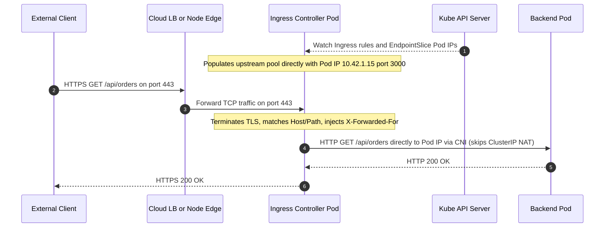
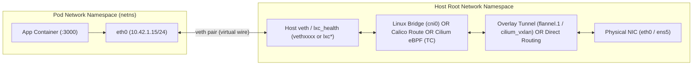
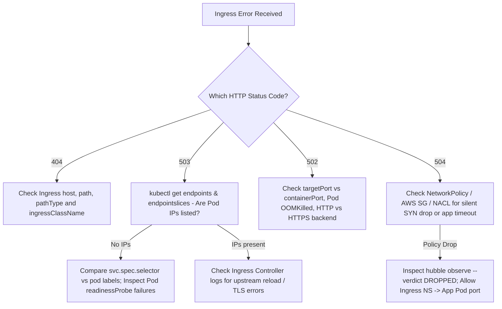

## 5. Kubernetes Networking, CNI, Cilium eBPF, Ingress, and Proxy

> **Module Goal:** Build intuitive, first-principles mastery of Kubernetes networking from `veth` pairs and `kube-proxy` up to modern eBPF datapaths with **Cilium, Hubble, Gateway API, and Tetragon**—designed for candidates starting with zero prior Cilium experience and targeting Senior/Expert DevOps and DevSecOps interviews across any cloud or self-managed environment (including security-hardened K3s/AWS clusters).

---

### 5.1 Kubernetes Networking Model, Services & kube-proxy

#### Q1. [Junior] What are the 3 fundamental Kubernetes networking rules, and why do they forbid Pod-to-Pod NAT?

**Executive Takeaway:** Kubernetes enforces a flat, NAT-free virtual network where every Pod gets a unique, routable IP address so workloads communicate identically across single-node and multi-node topologies without dynamic port mapping.

The Kubernetes networking specification imposes three non-negotiable invariants that any CNI plugin must implement:

1. **Pod-to-Pod without NAT:** Every Pod on any Node can reach every other Pod on any Node using its actual Pod IP, with zero Network Address Translation (NAT) in between.
2. **Node-to-Pod without NAT:** Agents and system daemons on a Node (such as `kubelet`, `containerd`, or node-level monitoring exporters) can reach all Pods scheduled on that Node without NAT.
3. **IP Symmetry (Self-Identity):** The IP address that a Pod sees inside its own network namespace (`ip addr show eth0`) is the **exact same IP address** that every other Pod and Node sees it as.

**Why forbidding NAT matters architecturally:**
- **Docker Bridge Contrast:** Legacy Docker `bridge` networking assigns container-private IPs behind host NAT (`docker run -p 8080:80`). Applications cannot easily advertise their real IP:Port to peers, and running two replicas listening on port `8080` on the same host causes port collisions.
- **Distributed Systems & Service Discovery:** Clustered systems like Kafka, Cassandra, Etcd, Consul, and Redis Cluster embed their own IP addresses inside cluster metadata and peer gossip messages. If Pod A sees itself as `172.17.0.2` while Pod B sees it as `10.0.1.15:31245`, leader election and replication handshakes break immediately.
- **Forensics & Zero-Trust Auditing:** When Pod IPs are preserved end-to-end (until explicitly SNATed at cluster egress), security tooling, audit logs, and network policies can attribute flows accurately to specific source workloads rather than opaque node IPs.

---

#### Q2. [Junior] Compare Kubernetes Service types (`ClusterIP`, `NodePort`, `LoadBalancer`, `ExternalName`) and explain Headless Services (`clusterIP: None`).

**Executive Takeaway:** Services decouple ephemeral Pod IPs from stable virtual endpoints, while Headless Services (`clusterIP: None`) bypass virtual IP load balancing completely so CoreDNS returns individual Pod IPs directly to the client.

| Service Type | Reachability | How Traffic Routes | Primary Use Case | Key Caveat / Security Note |
| :--- | :--- | :--- | :--- | :--- |
| **`ClusterIP`** (default) | Internal cluster only | Virtual VIP (`10.96.x.x`) balanced by `kube-proxy` or Cilium eBPF to ready Pods | Internal microservice-to-microservice APIs (e.g., `juice-shop-svc`) | Not externally routable; still reachable cluster-wide unless restricted by `NetworkPolicy` |
| **`NodePort`** | External + Internal | Opens static port (`30000-32767`) on **every** Node IP and forwards to `ClusterIP` | Bare-metal/on-prem ingress backends or quick lab access | Expands node attack surface across all cluster nodes; hard-to-manage fixed ports |
| **`LoadBalancer`** | External (Cloud/MetalLB) | Cloud Controller provisions NLB/ALB/GLB targeting NodePorts (or directly Pod IPs via AWS TargetGroupBinding) | Production L4 TCP/UDP exposure or Ingress Controller frontends | Security Groups must restrict CIDR exposure; creates one cloud LB per Service unless using Ingress/Gateway |
| **`ExternalName`** | Internal DNS alias | CoreDNS returns a `CNAME` record pointing to an external FQDN (no VIP, no proxying) | Abstracting external managed SaaS/RDS endpoints (`db.prod.example.com`) | Breaks TLS SNI/`Host` header validation if the client sends the Service name over HTTPS |
| **`Headless` (`clusterIP: None`)** | Internal direct Pod DNS | No VIP allocated; CoreDNS returns `A`/`AAAA` records for **every ready Pod IP** | StatefulSets (PostgreSQL, Kafka, ZooKeeper), gRPC client-side LB | Client must handle DNS caching/TTL and connection retries across returned Pod IPs |

**Headless Service Example for Stateful Databases:**

```yaml
apiVersion: v1
kind: Service
metadata:
  name: postgres-headless
  namespace: data
spec:
  clusterIP: None # Disables virtual IP allocation and kube-proxy NAT
  selector:
    app: postgres
  ports:
    - name: pg
      port: 5432
      targetPort: 5432
```

- Querying `postgres-headless.data.svc.cluster.local` returns all ready Pod IPs (`10.42.1.12`, `10.42.2.18`, ...).
- When paired with a `StatefulSet` (`serviceName: postgres-headless`), each replica receives a deterministic DNS record: `postgres-0.postgres-headless.data.svc.cluster.local`, allowing read/write splitting between the primary (`postgres-0`) and read replicas.

---

#### Q3. [Mid] Trace the full packet journey from an external user through Ingress, Ingress Controller, Service, and Pod — and explain why `EndpointSlices` replaced `Endpoints`.

**Executive Takeaway:** An `Ingress` is merely a passive API configuration object, whereas the `Ingress Controller` Pod watches `Ingress` rules plus `EndpointSlices` and forwards L7 HTTP traffic **directly to backend Pod IPs**, bypassing `ClusterIP` NAT by default.

Many engineers mistakenly assume `Ingress -> Service -> Pod` means traffic hits the Service's `ClusterIP` (`iptables`/`IPVS`). In reality:

1. **`Ingress` vs. `Ingress Controller`:**
   - **`Ingress` (`networking.k8s.io/v1`):** Passive YAML rules stored in etcd (`host: shop.example.com`, `path: /`, `backend: juice-shop-svc:80`). Creating an `Ingress` without a running controller does nothing.
   - **`Ingress Controller` (NGINX, Envoy, Traefik):** An active Deployment/DaemonSet running reverse-proxy Pods (exposed via a cloud `LoadBalancer` Service or bare-metal `hostNetwork: true` on `:80/:443`). It watches the Kubernetes API server for `Ingress` and `EndpointSlice` updates and dynamically reloads upstream routing tables.
2. **Direct-to-Pod Routing (Bypassing `ClusterIP`):**
   - When NGINX Ingress Controller sees `backend.service.name: juice-shop-svc`, it resolves the Service name **only to discover its `EndpointSlices`**—it reads the actual backend Pod IPs (`10.42.1.15:3000`, `10.42.2.21:3000`) and puts them directly into its `upstream` pool.
   - By default, traffic travels **Ingress Controller Pod -> Backend Pod IP** over the CNI network without hitting `kube-proxy` `ClusterIP` DNAT (unless explicitly overridden, e.g., `nginx.ingress.kubernetes.io/service-upstream: "true"`). This avoids an extra NAT hop, preserves L7 features like sticky cookies and active health checks, and enables zero-downtime graceful draining.
3. **Why `EndpointSlices` Replaced `Endpoints`:**
   - The legacy `Endpoints` object stored **all** backend Pod IPs for a Service inside a **single** etcd resource. In a cluster with 2,000 backend Pods and 500 nodes, a single Pod readiness toggle rewrote the entire `Endpoints` object and fanned it out to every `kube-proxy` and Ingress Controller (`O(N^2)` control-plane bandwidth, CPU spikes, and etcd's 1.5 MB object size ceiling).
   - `EndpointSlices` (`discovery.k8s.io/v1`) shard endpoints into chunks of up to **100 endpoints per slice** by default, support dual-stack IPv4/IPv6 + Topology Aware Hints, and transmit incremental updates only for the single slice that changed.



---

#### Q4. [Mid] Compare `externalTrafficPolicy: Cluster` vs `Local` on `NodePort` and `LoadBalancer` Services, including the health-check pitfall.

**Executive Takeaway:** `externalTrafficPolicy: Cluster` spreads traffic evenly across all nodes via cross-node SNAT (destroying client source IPs), whereas `Local` preserves real client IPs with zero extra hops—at the cost of asymmetric load and potential drops if the cloud LB health check is misconfigured.

- **`externalTrafficPolicy: Cluster` (Default):**
  - **Packet Path:** External LB sends traffic to **any** worker node (`Node A`). If no matching Pod lives on `Node A`, `kube-proxy` forwards the packet across the cluster network to `Node B` (where a Pod runs) and applies **SNAT**, replacing the client's IP with `Node A`'s IP so the reply returns through `Node A`.
  - **Pros:** Uniform traffic distribution; every node passes LB health checks even if it has zero Pods.
  - **Cons:** Extra cross-node network hop (latency + inter-AZ AWS egress fees) and **loss of original client source IP** (breaking WAF IP allowlists, rate limiting, geo-blocking, and SOC forensics).
- **`externalTrafficPolicy: Local`:**
  - **Packet Path:** A node only accepts external traffic for backend Pods scheduled **locally on that same node**, applying DNAT without SNAT.
  - **Pros:** Preserves the exact client IP at L4; eliminates cross-node hops and inter-AZ data transfer charges.
  - **Cons & The Health-Check Pitfall:**
    1. **Empty-Node Drop / Blackhole:** If `Node A` hosts 0 Pods for the Service and receives a packet, `Node A` **drops it immediately**.
    2. **`healthCheckNodePort` Requirement:** For `LoadBalancer` Services with `Local`, Kubernetes automatically opens a `healthCheckNodePort` (`30000-32767`) returning `HTTP 200` only if `localEndpoints > 0` and `HTTP 503` if `0`. If your external load balancer or firewall blocks this health-check port (or probes the wrong port, or you use bare-metal `NodePort` without an external health-checking LB), traffic will hit empty nodes and fail intermittently.
    3. **Load Imbalance:** A node with 1 Pod receives the same 50% share from an external NLB as a node with 5 Pods unless Pods are spread evenly (`topologySpreadConstraints` or `DaemonSet` for Ingress Controllers).

---

#### Q5. [Mid] Explain the CoreDNS `ndots:5` DNS latency trap and how to eliminate it in production.

**Executive Takeaway:** Because Kubernetes defaults to `ndots:5` in `/etc/resolv.conf`, resolving any external hostname with fewer than five dots (like `api.stripe.com`) triggers 4+ failed cluster-internal search queries (`A` + `AAAA`) before querying upstream DNS—causing latency spikes and conntrack exhaustion.

Inspect `/etc/resolv.conf` inside almost any Kubernetes Pod and you will see:

```text
nameserver 10.96.0.10
search payments.svc.cluster.local svc.cluster.local cluster.local ec2.internal
options ndots:5
```

**What happens when an app calls `api.stripe.com`:**
1. `api.stripe.com` contains **2 dots**, which is strictly less than `ndots:5`.
2. The stub resolver (`glibc` / `musl`) assumes it is a **relative internal name** and appends each entry in `search` sequentially—and often sends **both `A` (IPv4) and `AAAA` (IPv6)** queries in parallel/sequence:
   - `api.stripe.com.payments.svc.cluster.local` -> `NXDOMAIN`
   - `api.stripe.com.svc.cluster.local` -> `NXDOMAIN`
   - `api.stripe.com.cluster.local` -> `NXDOMAIN`
   - `api.stripe.com.ec2.internal` -> `NXDOMAIN`
   - **Finally:** `api.stripe.com.` (absolute lookup) -> `200 / IP address`
3. That single API call generated **8-10 UDP DNS packets** instead of 2! Under microservice burst traffic, this saturates CoreDNS CPU, triggers Linux kernel `nf_conntrack` table overflows / UDP source-port race drops, and adds tail latency (`p99` DNS timeouts).

**Three Production Fixes:**
1. **Lower `ndots` to `2` in Pod `dnsConfig`:** Internal short names like `postgres` (0 dots) or `postgres.data` (1 dot) still use search domains, while external domains like `api.stripe.com` (2 dots `>= 2`) resolve immediately as FQDNs:
   ```yaml
   spec:
     dnsConfig:
       options:
         - name: ndots
           value: "2"
   ```
2. **Use Trailing Dots in External URLs/Configs:** Calling `api.stripe.com.` forces an immediate absolute DNS lookup (verify TLS SNI / HTTP `Host` handling in your HTTP client first, as some strict TLS validators reject trailing dots).
3. **Deploy `NodeLocal DNSCache`:** Runs a lightweight DNS cache (`DaemonSet`) on every node listening on link-local `169.254.20.10`, upgrading upstream CoreDNS traffic to **TCP** and avoiding per-Pod `kube-proxy` UDP conntrack entries completely.

---

#### Q6. [Senior] Compare `kube-proxy` modes (`iptables` vs `IPVS` vs Cilium eBPF replacement) — why does `iptables` collapse at scale?

**Executive Takeaway:** `kube-proxy` in `iptables` mode scales poorly because every packet walks an `O(N)` sequential rule list and every endpoint update acquires a global lock to rewrite the entire NAT table (`O(N)`), whereas `IPVS` and Cilium eBPF deliver `O(1)` hash-table lookups.

| Feature | `iptables` Mode | `IPVS` Mode | Cilium `kube-proxy`-less (eBPF) |
| :--- | :--- | :--- | :--- |
| **Lookup Complexity** | `O(N)` linear chain traversal (`KUBE-SERVICES` -> `KUBE-SVC-*` -> `KUBE-SEP-*`) | `O(1)` Linux kernel hash table | `O(1)` eBPF hash map (and socket-level `connect()` bypass!) |
| **Control-Plane Update Cost** | Full atomic `iptables-restore` table lock & rewrite on every change | Incremental netlink updates to individual virtual servers | Incremental single-entry eBPF map updates |
| **Load Balancing Algorithm** | Random probabilistic (`-m statistic --probability`) only | `rr`, `lc` (least connections), `dh`, `sh`, `sed`, `nq` | Random, **Maglev** consistent hashing (minimal disruption on node churn) |
| **Scale Ceiling** | Noticeably degrades around **5,000+ Services / 25,000+ rules** | Handles **10,000+ Services** smoothly | Handles **100,000+ Services** with near-zero CPU overhead |
| **Per-Packet Overhead** | `netfilter` + `conntrack` DNAT/SNAT on **every packet** | `IPVS` + `iptables` masquerade/hairpin chains on **every packet** | `bpf_sock` rewrites dst IP **once at `connect()`**—zero per-packet NAT! |

**Why `iptables` collapses under Pod churn:**
`iptables` was designed as a static host firewall, not a high-churn service router. Whenever a Deployment performs a rolling update or HPA scales Pods, `kube-proxy` calls `iptables-restore` holding the `xtables` lock to replace **every** NAT chain atomically. At 5,000+ Services (~40,000+ rules), rule sync latency stretches into seconds or tens of seconds, causing stale endpoint blackholes and high `kube-proxy` CPU usage. *(Note: Modern Kubernetes 1.31+ also introduced `nftables` mode for `kube-proxy` as a successor to `iptables`, while `IPVS` mode faces eventual deprecation—making eBPF or `nftables` the modern path forward.)*

---

#### Q7. [Senior] Compare the legacy `Ingress` API vs the Kubernetes `Gateway API` (`GatewayClass`, `Gateway`, `HTTPRoute`).

**Executive Takeaway:** The `Ingress` API forces L7 routing, TLS, and vendor-specific features into one monolithic object choked by non-portable annotations, whereas `Gateway API` separates infrastructure from application routing via typed, role-oriented CRDs with native traffic splitting and cross-namespace security.

**Problems with Legacy `Ingress`:**
- Only natively models basic `host` + `path` HTTP routing.
- Everything essential in production (header matching, regex rewrites, timeouts, rate limits, weighted canary splits, CORS, TCP/gRPC) depends on fragile, vendor-locked annotations (`nginx.ingress.kubernetes.io/rewrite-target`, `alb.ingress.kubernetes.io/...`) that silently break if you swap controllers.
- Mixes cluster-admin concerns (TLS certificates, load balancer ports) with developer concerns (application paths) in the same resource.

**How Kubernetes `Gateway API` (`gateway.networking.k8s.io/v1`) Solves This:**
1. **`GatewayClass` (Infrastructure Provider / Platform Team):** Declares the controller implementation (e.g., `cilium`, `envoy-gateway`, `nginx-gateway-fabric`).
2. **`Gateway` (Cluster Operator / Security Team):** Defines actual network listeners (`:80`, `:443`), TLS certificate references, and explicitly which namespaces may attach routes (`allowedRoutes`).
3. **`HTTPRoute` / `GRPCRoute` / `TCPRoute` / `TLSRoute` (Application Developer):** Defines hostnames, HTTP header/method/query matches, URL rewrites, request mirroring, and **native weighted canary traffic splitting**—with zero proprietary annotations.
4. **`ReferenceGrant` (Security Boundary):** Explicitly authorizes cross-namespace backend references so a route in `team-a` cannot hijack a Service or TLS Secret in `payments` without consent.

```yaml
apiVersion: gateway.networking.k8s.io/v1
kind: HTTPRoute
metadata:
  name: checkout-canary
  namespace: payments
spec:
  parentRefs:
    - name: prod-https-gateway
      namespace: infra-gateway
  hostnames:
    - "checkout.example.com"
  rules:
    - matches:
        - path:
            type: PathPrefix
            value: /api/v2
          headers:
            - name: X-Canary
              value: "true"
      backendRefs:
        - name: checkout-v2
          port: 8080
    - backendRefs:
        - name: checkout-v1
          port: 8080
          weight: 90
        - name: checkout-v2
          port: 8080
          weight: 10
```

---

#### Q8. [Senior] How does `hostNetwork: true` work for an Ingress Controller (e.g., on self-managed K3s EC2 nodes), and what are its security and DNS pitfalls?

**Executive Takeaway:** `hostNetwork: true` binds the Ingress Pod directly to the node's root network namespace on ports `80/443` without needing a cloud LoadBalancer, but it weakens network isolation, limits one replica per node, and silently breaks internal Kubernetes DNS unless `dnsPolicy: ClusterFirstWithHostNet` is set.

**When it is used:** On self-managed bare-metal or single/two-node EC2 K3s clusters (such as running `ingress-nginx` directly on EC2 instances without AWS NLB/ALB cost), patching `hostNetwork: true` lets the Ingress Pod bind straight to the EC2 private/public interface `:80` and `:443`, preserving client source IP automatically.

**Critical Pitfalls & Security Implications:**
1. **DNS Resolution Failure (`ClusterFirst` Trap):** When `hostNetwork: true` is enabled, Kubernetes changes the Pod's default `dnsPolicy` from `ClusterFirst` to `Default` (inheriting the host's `/etc/resolv.conf`, e.g., VPC DNS `172.31.0.2`). The Ingress Controller may still work if it resolves backends solely via `EndpointSlices` (Pod IPs), **but any internal DNS lookup (external auth, webhook, telemetry service `.svc.cluster.local`) fails** unless you explicitly set `dnsPolicy: ClusterFirstWithHostNet`.
2. **Host Network Namespace Exposure:** The Pod shares the Linux host's network interfaces and loopback (`127.0.0.1`). If compromised via an RCE vulnerability in the proxy, an attacker can probe node-local daemons bound to `127.0.0.1` (`kubelet`, metadata proxy, local exporter endpoints) and bypass CNI Pod-level `NetworkPolicy` isolation on many CNIs.
3. **Scheduling & Port Collisions:** Only one Ingress Pod can bind `:80/:443` per node (`hostPort` conflict), preventing rolling updates (`maxSurge: 1`) on single-node clusters unless `maxUnavailable: 1` or `Recreate` strategy is configured.
4. **Defense-in-Depth Mitigations:** Drop `ALL` capabilities except `NET_BIND_SERVICE`, keep `allowPrivilegeEscalation: false`, use `runAsNonRoot` where supported, restrict node Security Group inbound `:80/:443` (and keep `:6443`/`:22` locked to trusted `/32` admin IPs), and enforce IMDSv2 (`HttpTokens=required`) on EC2 nodes so SSRF via Ingress cannot steal IAM node credentials.

---

### 5.2 CNI (Container Network Interface) Deep Dive — Architecture, Selection & Day-2 Operations

#### Q9. [Mid] What does a CNI plugin actually do on the Linux node when a Pod is created and deleted?

**Executive Takeaway:** CNI is a simple binary execution specification invoked by the container runtime (`containerd`/`CRI-O`)—not a Kubernetes component—that allocates a Pod IP (IPAM), creates a virtual Ethernet (`veth`) pair bridging the Pod's network namespace to the host datapath, and wires routes or eBPF programs.

**Exact Pod Sandbox Creation Sequence (`ADD`):**
1. **`kubelet` -> `containerd` (CRI):** `kubelet` calls `RunPodSandbox` over the CRI gRPC socket.
2. **Linux Network Namespace (`netns`):** `containerd` creates an isolated network namespace (`/var/run/netns/cni-...`) and starts the `pause` container holding that `netns` open (all containers inside the same Pod share this `netns` and `localhost`).
3. **CNI Discovery:** `containerd` reads the lexicographically first JSON/conflist file in **`/etc/cni/net.d/`** (e.g., `05-cilium.conflist` or `10-flannel.conflist`) and executes the matching binary in **`/opt/cni/bin/`**, passing `CNI_COMMAND=ADD`, `CNI_CONTAINERID`, `CNI_NETNS`, and `CNI_IFNAME=eth0` via environment variables and JSON config on `stdin`.
4. **IPAM Allocation:** The CNI binary invokes its IP Address Management (`IPAM`) plugin (`host-local`, `cilium-ipam`, or `aws-cni`) to reserve a free Pod IP from the node's allocated Pod CIDR.
5. **`veth` Pair & Datapath Attachment:**
   - Creates a virtual Ethernet cable (`veth` pair): one end is moved into the Pod's `netns` and renamed `eth0`, assigned the Pod IP and default gateway route.
   - The host-side end (`vethxxxx` or `lxc*` in Cilium) stays in the host root `netns` and is attached to a Linux bridge (`cni0`), programmed into host routing/policy tables (Calico), or hooked directly into **Cilium eBPF `TC` ingress/egress programs**.
6. **Pod Termination (`DEL`):** `containerd` calls `CNI_COMMAND=DEL` to detach eBPF hooks/delete the `veth` pair and release the IP back into IPAM. *(If a node crashes hard or `DEL` fails, orphaned IP leases can silently exhaust IPAM unless reconciled by CNI garbage collection.)*



---

#### Q10. [Mid] Compare Overlay Networking (VXLAN / Geneve) vs Direct Routing (BGP / Native VPC Routing).

**Executive Takeaway:** Overlay networks (VXLAN/Geneve) encapsulate Pod packets inside Node-to-Node UDP tunnels so clusters work effortlessly across any L3 network, whereas Direct Routing routes native Pod IPs directly at line rate—requiring BGP peering or VPC CIDR capacity.

| Dimension | Overlay (VXLAN `UDP/8472` or Geneve `UDP/6081`) | Direct / Native Routing (BGP / Native VPC / `host-gw`) |
| :--- | :--- | :--- |
| **How Cross-Node Packets Travel** | Inner Pod packet wrapped in outer Node-to-Node UDP header | Unencapsulated Pod packet routed via Linux kernel routes / VPC / ToR BGP |
| **Underlay Requirements** | Only requires nodes to reach each other over the tunnel UDP port (`UDP/8472` or `UDP/6081`) | Requires L2 adjacency (`host-gw`), BGP peering with switches, or cloud VPC ENI/route table integration |
| **MTU Overhead & Blackhole Risk** | **50 bytes (VXLAN)** or ~60+ bytes (Geneve) header overhead; Pod MTU typically `1450` (on `1500` underlay) | Full native underlay MTU (`1500` or `9001` AWS Jumbo Frames) |
| **VPC / Physical IP Consumption** | **Zero** extra VPC/LAN IPs for Pods (uses private cluster CIDR like `10.42.0.0/16`) | **High** if using VPC-native IPs (AWS VPC CNI consumes real VPC subnet IPs) |
| **Observability Outside Cluster** | External firewalls/VPC Flow Logs only see outer Node-to-Node UDP traffic | External routers/VPC Flow Logs see actual source/dest Pod IPs directly |

**Production Pitfall — MTU Fragmentation / Silent Blackholes:**
If an overlay CNI fails to clamp Pod interface MTU (`1450` for VXLAN on a `1500`-byte Ethernet link) and Path MTU Discovery (`ICMP Fragmentation Needed`) is blocked by an over-aggressive firewall dropping all ICMP, small `ping` and HTTP headers succeed while large TLS handshakes or SQL result payloads **hang silently forever**.

---

#### Q11. [Senior] Compare Flannel vs Calico vs Cilium vs AWS VPC CNI — including CNI Chaining.

**Executive Takeaway:** Flannel provides bare-bones VXLAN connectivity without network policies; Calico adds rock-solid L3/L4 policy and BGP; AWS VPC CNI delivers native VPC IPs with IP-exhaustion risk; and Cilium leads modern Kubernetes with eBPF `kube-proxy` replacement, L7/DNS policies, and Hubble observability.

| Capability | Flannel (e.g., default K3s) | Calico | Cilium | AWS VPC CNI (Amazon EKS default) |
| :--- | :--- | :--- | :--- | :--- |
| **Primary Datapath** | VXLAN (`UDP/8472`) or `host-gw` via Linux `cni0` bridge | `iptables` + BGP/VXLAN/IPIP (or optional Calico eBPF dataplane) | **Pure Linux eBPF** (VXLAN, Geneve, Native Routing, BGP) | Native AWS Elastic Network Interfaces (ENIs) |
| **K8s `NetworkPolicy` (L3/L4)** | **No** (must pair with `kube-router` or Canal) | **Yes** (+ `GlobalNetworkPolicy`) | **Yes** (+ `CiliumClusterwideNetworkPolicy`) | **Yes** (only when AWS Network Policy Agent eBPF mode is enabled, or chained with Calico/Cilium) |
| **L7 / DNS (`FQDN`) Policies** | No | OSS: No (Calico Enterprise only) | **Yes, built-in** (`toFQDNs`, HTTP/gRPC/Kafka) | No natively (add Cilium chaining) |
| **`kube-proxy` Replacement** | No | Optional (Calico eBPF mode) | **Flagship native feature** (`bpf_sock`, DSR, Maglev) | No (relies on `kube-proxy` unless chained with Cilium) |
| **Transparent Encryption** | Experimental WireGuard / IPsec | WireGuard | **Native WireGuard & IPsec** | Nitro hardware VPC in-transit encryption (selected EC2 types) |
| **IP Exhaustion Risk** | Low (cluster overlay CIDR) | Low (cluster overlay/BGP CIDR) | Low (or native VPC if using AWS ENI IPAM) | **High** (consumes real VPC subnet IPs unless using Prefix Delegation / Custom Networking) |
| **Observability** | Basic interface counters | Flow logs (Enterprise/Gold) | **Hubble** (real-time L3/L4/L7 + DNS UI/CLI/Prometheus) | AWS VPC Flow Logs (sees Pod IPs natively) |
| **Ideal Use Case** | Lightweight labs, single-tenant dev/K3s clusters | Hybrid/on-prem BGP clusters, strict L3/L4 compliance | **Production security-first clusters, high scale, zero-trust L7/DNS, deep visibility** | Native EKS workloads needing direct VPC routing / Security Groups for Pods |

**Enterprise Pattern — CNI Chaining (`AWS VPC CNI` + `Cilium`):**
In EKS environments where teams want AWS native ENI routing + VPC Flow Logs + IAM/Security Groups for Pods **without** sacrificing zero-trust L7/DNS policies or Hubble visibility, you run **AWS VPC CNI** solely for ENI IPAM/routing and **chain Cilium on top** (`cni.chainingMode=aws-cni`). Cilium skips IP allocation and attaches its eBPF policy and Hubble hooks onto the existing ENI-backed Pod interfaces.

---

#### Q12. [Senior] Which Linux network interfaces (`cni0`, `flannel.1`, `cilium_host`, `veth*`, `lxc*`) and Day-2 CNI metrics should you monitor in production?

**Executive Takeaway:** Knowing which Linux interfaces map to Pod namespaces, overlay VTEPs, and eBPF host links turns blind network debugging into fast root-cause isolation—while monitoring IPAM exhaustion, conntrack saturation, and eBPF drop counters catches outages before Pods fail.

**Linux Interface Cheat Sheet (`ip -br link show` / `ip route`):**
- **`veth*` / `cali*` / `lxc*`:** The host-side end of a Pod's `veth` cable (`lxc*` in Cilium, `cali*` in Calico, `veth*` in bridge/Flannel). Dropping packets here means the issue is inside the node's local Pod ingress/egress policy or veth hook.
- **`cni0`:** Linux L2 bridge created by bridge/Flannel CNIs linking all local Pod `veth` devices on that node to the node's Pod CIDR gateway (`10.42.0.1`).
- **`flannel.1` / `cilium_vxlan` / `cilium_geneve`:** Virtual Tunnel Endpoint (VTEP) interfaces encapsulating/decapsulating cross-node overlay traffic.
- **`cilium_host` & `cilium_net`:** A dedicated `veth` pair connecting the Linux host routing stack into Cilium's eBPF datapath for host-to-Pod and node-local traffic.

**Essential Day-2 CNI Metrics & Alerts:**
1. **IPAM Pool Saturation:** Alert above **80% Pod CIDR / ENI IP consumption** (`cilium_ipam_events_total` or `awscni_assigned_ip_per_eni` / subnet `AvailableIpAddressCount` in CloudWatch). Running out of IPs stalls all autoscaling (`FailedCreatePodSandBox`).
2. **Conntrack & eBPF Map Pressure:** Monitor `node_nf_conntrack_entries / node_nf_conntrack_entries_limit` (on `iptables` CNIs) and **`cilium_bpf_map_pressure`** (alerts before eBPF NAT/CT maps hit capacity and drop new connections!).
3. **Kernel Packet Drops by Reason:** Scrape **`cilium_drop_count_total`** grouped by `reason` (e.g., `Policy denied`, `Stale or unroutable IP`, `CT: Map insertion failed`).
4. **Sandbox / CNI Latency:** Alert on high `kubelet_runtime_operations_duration_seconds{operation_type="run_podsandbox"}`—spikes point to slow CNI IPAM lock contention or AWS EC2 `AttachNetworkInterface` API throttling.

---

#### Q13. [Expert] How do you size Pod CIDRs (`--cluster-cidr`, `--node-cidr-mask-size`) for growth, and how do you solve AWS VPC CNI IP exhaustion and Pod-level security groups?

**Executive Takeaway:** Under-sizing `--cluster-cidr` or over-sizing `--node-cidr-mask-size` caps maximum cluster node count irreversibly without cluster rebuilds; on AWS VPC CNI, **Prefix Delegation (`/28` blocks)** and **Custom Networking (`100.64.0.0/16`)** solve IP exhaustion while **Branch ENIs** enable per-Pod Security Groups.

**1. Pod CIDR Sizing Math (Controller Manager / CNI):**
- Standard defaults (`--cluster-cidr=10.244.0.0/16`, `--node-cidr-mask-size=24`):
  - A `/16` holds `65,536` IPs. Assigning a `/24` (`256` IPs) per node leaves room for **`2^(24 - 16) = 256` nodes max**—even if each node only runs 30 Pods!
  - Because Kubernetes defaults `maxPods: 110` per node, allocating a `/25` (`128` IPs per node -> `126` usable) supports `110` Pods while **doubling max nodes to 512** in the same `/16`.
  - For 1,000+ node clusters, allocate a **`/14` (`262,144` IPs)** with `/24` per node (**`1,024` nodes**) or `/25` per node (**`2,048` nodes**)—and ensure the CIDR never overlaps corporate VPNs, peered VPCs, or `service-cluster-ip-range`.

**2. Solving AWS VPC CNI IP Exhaustion & Granular Security:**
By default, an EC2 `t3.medium` supports max `3 ENIs x 6 IPs/ENI = 18` IPs (`3 × (6 - 1) = 15` usable secondary Pod VPC IPs, plus 2 `hostNetwork` system Pods = `17` EKS `maxPods`). Even on huge VPCs, instance ENI slot limits strangle Pod density, and small `/24` subnets run out of IPs during rolling deployments (`WARM_IP_TARGET`).

- **Prefix Delegation (`ENABLE_PREFIX_DELEGATION=true`):** Instead of assigning individual `/32` secondary IPs to each ENI slot, AWS assigns an entire **`/28` IPv4 prefix (16 IPs per slot)**. A `t3.medium` jumps from **17 Pods to 110 Pods**!
  - *Crucial Caveat:* Prefix delegation requires **contiguous free `/28` CIDR blocks** inside the AWS subnet. In heavily fragmented existing subnets with scattered `/32` reservations, prefix allocation fails even though free single IPs remain—always pre-allocate fresh subnets or reserve CIDR blocks cleanly.
- **Custom Networking (`AWS_VPC_K8S_CNI_CUSTOM_NETWORK_ENABLED=true`):** Attaches a non-overlapping secondary VPC CIDR (typically RFC 6598 CGNAT **`100.64.0.0/16`**) mapped via `ENIConfig` CRDs per AZ. Nodes consume minimal IPs from the primary corporate subnet while thousands of Pods scale inside `100.64.0.0/16`.
- **Security Groups for Pods (`ENABLE_POD_ENI=true`):** On Nitro EC2 instances, attaches dedicated AWS **trunk/branch ENIs** per Pod via `SecurityGroupPolicy` CRDs—letting a sensitive payment Pod hold its own RDS-allowlisted AWS Security Group instead of sharing the broad worker node SG! *(Caveat: increases Pod startup latency slightly and consumes branch ENI capacity per node.)*

---

#### Q14. [Expert] How do you safely migrate a live production cluster's CNI (e.g., Flannel to Cilium) without causing an outage?

**Executive Takeaway:** Never hot-swap CNI configs on live nodes with running Pods—conflicting `veth` devices, routes, and overlapping VXLAN ports will blackhole traffic; instead, perform either a **Blue-Green cluster cutover** or a **rolling node-pool taint/drain migration** with a non-conflicting secondary CIDR and distinct tunnel port.

**Why blind in-place replacement fails:**
Live Pods still have their `veth` ends wired into `cni0` (`flannel.1`) using old Pod CIDR routes. Overwriting `/etc/cni/net.d/` and killing Flannel leaves existing Pods unreachable by newly scheduled Cilium Pods, breaks DNS/API health checks, and triggers split-brain IPAM.

**Two Safe Production Strategies:**

1. **Strategy A — Blue-Green Cluster Migration (Recommended for Zero Blast Radius):**
   - Provision a parallel cluster running Cilium natively, sync manifests via GitOps (Argo CD / Flux), verify with `cilium connectivity test`, shift external DNS/ALB weighted targets gradually (`10% -> 50% -> 100%`), and decommission the old cluster.
2. **Strategy B — Rolling Node-by-Node Hybrid Migration (When In-Place is Required):**
   - **Pre-Check 1 (Secondary CIDR):** Configure Cilium with a **non-overlapping secondary Pod CIDR** (e.g., Flannel uses `10.42.0.0/16`, Cilium uses `10.43.0.0/16`) so IPAM never collides.
   - **Pre-Check 2 (VXLAN Port Collision Trap!):** Both Flannel and Cilium default to VXLAN **`UDP/8472`**! During dual-CNI coexistence, configure Cilium to use **Geneve (`UDP/6081`)** or a distinct `tunnelPort` (`8473`), and open that port in VPC Security Groups between nodes.
   - **Step 1 (Node Affinity & Startup Taint):** Scope the `cilium` DaemonSet via Helm `affinity`/`nodeSelector` (e.g., `io.cilium.migration/cilium-default: "true"`) or a `CiliumNodeConfig` `nodeSelector` so Cilium deploys only onto migrated nodes and leaves existing Flannel nodes untouched. Apply Cilium's automatic startup taint (`node.cilium.io/agent-not-ready=true:NoExecute`) on newly provisioned/migrated nodes so workload Pods wait until `cilium-agent` initializes CNI and removes the taint.
   - **Step 2 (Provision Fresh Cilium Nodes & Verify Cross-CNI Traffic):** Spin up new worker nodes carrying the migration label (`io.cilium.migration/cilium-default=true`) and startup taint, confirm Cilium configures `/etc/cni/net.d/05-cilium.conflist`, and verify Pod-to-Pod routing between Flannel Pods and Cilium Pods (routing both CIDRs via `ip route` / VPC routes or hybrid config).
   - **Step 3 (Cordon & Drain Old Nodes):** `kubectl cordon` and `kubectl drain` Flannel nodes one by one so Pods cleanly recreate on Cilium nodes.
   - **Step 4 (Cleanup):** Once zero Flannel worker nodes remain, remove Flannel DaemonSet/routes, enable Cilium `kube-proxy` replacement if planned, and roll nodes once more if needed.

---

### 5.3 Cilium & eBPF Zero-to-Hero Mastery

#### Q15. [Mid] From first principles: what is eBPF, how does the kernel verifier keep it safe, and where do eBPF hooks (`XDP`, `TC`, `bpf_sock`, `kprobes`) attach?

**Executive Takeaway:** eBPF lets engineers run sandboxed, JIT-compiled programs directly inside the Linux kernel on network and syscall events—delivering kernel-module speed without kernel-panic risk because an in-kernel **Verifier** statically proves every program safe before loading.

If you have never used Cilium before, start with the historical problem eBPF solved:
- **User-Space Proxies (e.g., Envoy sidecars, `userspace` proxy):** Safe to crash, easy to develop—but every packet must cross the kernel <-> user-space boundary via expensive memory copies and context switches.
- **Traditional Kernel Modules (`.ko`):** Blazing fast inside the kernel—but a single null-pointer dereference or infinite loop causes an instant **kernel panic**, taking down the entire Kubernetes node.

**How eBPF bridges both worlds:**
1. **Restricted C/Rust -> Bytecode -> JIT:** Developers compile eBPF programs using Clang/LLVM into architecture-neutral eBPF bytecode and load them via the `bpf()` syscall. The Linux kernel Just-In-Time (JIT) compiles the bytecode into native CPU machine instructions.
2. **The Kernel Verifier (Safety Gatekeeper):** Before an eBPF program is allowed to run, the in-kernel static analyzer inspects every execution path and rejects the program unless it guarantees:
   - **Termination:** No unbounded infinite loops (loops must have strict bounded iterations).
   - **Memory Safety:** Every pointer dereference and packet slice offset is bounds-checked (`if data + offset > data_end return DROP`).
   - **Valid Context & Helper Calls:** No reading arbitrary uninitialized kernel memory.
3. **eBPF Maps:** Shared high-speed key-value hash tables, arrays, and ring buffers in kernel memory enabling `O(1)` lookups between kernel hooks and user-space control-plane daemons (`cilium-agent`).

**The 4 Critical eBPF Hook Points in Kubernetes:**
- **`XDP` (eXpress Data Path):** Fires inside the NIC driver **before** Linux even allocates an `sk_buff` packet structure—capable of dropping DDoS traffic or forwarding L4 packets at **10M+ packets/sec per core**.
- **`TC` (Traffic Control Ingress/Egress):** Fires right as `sk_buff` enters or leaves network interfaces (`lxc*`, `eth0`). This is Cilium's core packet workhorse for Pod L3/L4 policy, NAT, encryption, and VXLAN/Geneve routing.
- **`bpf_sock` / `sock_ops` (`cgroup` Socket Hooks):** Fires when a Pod calls `connect()`, `sendmsg()`, or `recvmsg()`—rewriting Service VIPs to Pod IPs **at socket creation**, before TCP packets even hit `TC`!
- **`kprobes` / `tracepoints` / `LSM` Hooks:** Attaches to Linux kernel syscalls (`execve`, `openat`, `tcp_connect`) and security modules—powering **Hubble** tracing and **Tetragon** runtime security enforcement.

```mermaid
flowchart LR
    NIC["Physical NIC (Packets Arrive)"] -->|"1. Earliest hook (before sk_buff)"| XDP["XDP Hook (DDoS Drop / NodePort LB)"]
    XDP -->|"2. Allocate sk_buff"| TCIn["TC Ingress Hook (Cilium Policy / Decrypt / Route)"]
    TCIn -->|"Bypass netfilter/iptables!"| PodVeth["Pod lxc* / eth0"]
    App["App Process connect(ClusterIP)"] -->|"3. Socket syscall (no packet NAT!)"| Sock["cgroup bpf_sock Hook (Translate VIP -> Pod IP)"]
    Sock --> TCOut["TC Egress Hook (Identity Tag / Policy / Encrypt)"]
    TCOut --> NIC
```



---

#### Q16. [Mid] Why Cilium? How does it unify CNI, `kube-proxy` replacement, Zero-Trust security, encryption, Hubble, and Service Mesh in one datapath?

**Executive Takeaway:** Traditional Kubernetes clusters stitch together 5-6 disconnected networking and security tools with overlapping `iptables` chains and heavy sidecars; Cilium replaces that fragmented stack with a single programmable eBPF engine.

Think of the "legacy stack" vs. the "Cilium unified stack":

| Capability | Legacy Fragmented Stack | Cilium eBPF Unified Stack |
| :--- | :--- | :--- |
| **1. Pod Connectivity (CNI)** | Flannel / Bridge CNI | Cilium CNI (VXLAN, Geneve, Native Routing, BGP) |
| **2. Service Load Balancing** | `kube-proxy` (`iptables` / `IPVS`) | Built-in `kube-proxy` replacement (`bpf_sock`, DSR, Maglev) |
| **3. Network Security Policies** | Calico (`iptables`) or basic L3/L4 `NetworkPolicy` | Identity-based L3/L4 + L7 HTTP/gRPC/Kafka + `toFQDNs` DNS filtering |
| **4. Encryption in Transit** | Istio / Linkerd sidecar mTLS per Pod (high RAM/CPU) | Node-level transparent **WireGuard / IPsec** in kernel |
| **5. Network Observability** | `tcpdump`, conntrack logs, sidecar telemetry | **Hubble** (real-time L3/L4/L7 + DNS + drop verdicts) |
| **6. Ingress, Gateway & Mesh** | Separate NGINX/MetalLB/Istio sidecar mesh | Built-in **Gateway API**, BGP LB, and **Sidecar-Free Envoy** Mesh |

*(Plus Cilium's sister CNCF project **Tetragon** adds eBPF kernel runtime security blocking container escapes and malicious syscalls synchronously inside the kernel.)*

---

#### Q17. [Senior] How does Cilium's Identity-Based Security work, and why does IP-based `iptables` break down in dynamic Kubernetes clusters?

**Executive Takeaway:** `iptables` enforces firewall rules using ephemeral Pod IPs—causing constant rule churn and race conditions during scaling—whereas Cilium compiles Pod **labels** into a cluster-wide numeric **Security Identity** and enforces policies in `O(1)` eBPF hash maps regardless of Pod IP count.

**Why IP-Based Firewalls Fail in Kubernetes:**
In Kubernetes, an HPA event can spin up 100 Pods in 10 seconds and terminate 80 old ones. In IP-based `iptables` CNIs:
- Every single new Pod IP requires regenerating and injecting firewall rules onto **every node** in the cluster that talks to or enforces policy on that Deployment.
- Until `iptables-restore` finishes propagating across all nodes, packets from a newly started legitimate Pod can be **dropped** (false-negative outage), or traffic to a recycled IP can briefly hit **stale allow rules** (security race condition!).

**How Cilium Identity-Based Security Works:**
1. **Labels -> Numeric Security Identity:** `cilium-agent` extracts security-relevant labels from a Pod (`k8s:app=payments`, `k8s:env=prod`, `k8s:io.kubernetes.pod.namespace=checkout`) and maps that unique label set to a single cluster-wide integer ID (e.g., **Identity `1042`**), stored in `CiliumIdentity` CRDs.
2. **Identity Propagation on the Wire:**
   - **Cross-node overlay:** Cilium embeds the source Pod's `Identity 1042` directly inside the VXLAN/Geneve packet header!
   - **Native routing / local:** Cilium looks up the source IP in its **`ipcache`** eBPF map (`IP -> Identity`).
3. **`O(1)` Policy Map Lookup:** The destination node's eBPF program checks a single hash lookup: `PolicyMap[(SrcID=1042, DstID=2088, Port=5432, TCP)] -> ALLOW / DENY`.
4. **Zero Policy Churn Under Scaling:** Scaling `payments` from 2 Pods to 500 Pods does **not add a single policy rule**—all 500 Pods inherit `Identity 1042`, and only lightweight `ipcache` entries update.

---

#### Q18. [Senior] How do Cilium L7 Policies and DNS-Aware (`toFQDNs`) Egress Filtering work? Provide a complete `CiliumNetworkPolicy` YAML for a payment service.

**Executive Takeaway:** Standard Kubernetes `NetworkPolicy` only inspects L3 IPs and L4 ports—failing when external APIs rotate CDN IPs or when microservices need HTTP method/path restrictions; Cilium solves both via an embedded DNS proxy (`toFQDNs`) and a per-node eBPF-redirected Envoy proxy.

**How `toFQDNs` Works Under the Hood (Zero Race Condition):**
External SaaS endpoints like `api.stripe.com` sit behind CDNs whose IP addresses change every 60 seconds, making static IP `cidr` rules unmaintainable. When a `CiliumNetworkPolicy` includes `toFQDNs`:
1. Cilium inserts a rule redirecting DNS (`UDP/TCP 53`) queries from that Pod through **`cilium-agent`'s embedded DNS proxy** (requiring a `rules.dns` section on the port 53 egress rule!).
2. The Pod queries `api.stripe.com` -> Cilium forwards to CoreDNS -> CoreDNS returns `54.187.205.235` (TTL `60s`).
3. **Before** returning the DNS response to the Pod, `cilium-agent` synchronously injects `54.187.205.235` into that Pod's eBPF egress `PolicyMap`!
4. When the Pod initiates its TCP `SYN` millisecond later, eBPF already permits that exact resolved IP—and expires it after TTL + grace period.

**How L7 HTTP Enforcement Works (Sidecar-Free):**
Flows matching L7 rules (`rules.http`—where gRPC method/service filtering over HTTP/2 is configured—`rules.kafka`, and `rules.dns`) are transparently redirected via eBPF socket redirection (`TPROXY`) into a **per-node Envoy proxy** (or `cilium-agent`'s embedded DNS proxy for `rules.dns`) managed by Cilium. You gain L7 method/path security without running an Envoy sidecar container in every application Pod.

**Complete Production `CiliumNetworkPolicy` (`payment-service`):**
Restricts `payment-service` so:
- **Ingress:** Only `checkout-api` Pods in `checkout` namespace may call `GET /api/v1/rates` on port `8080` (blocking `POST`/`DELETE`/admin endpoints).
- **Egress:** Allowed **only** to CoreDNS (port `53` intercepted via `rules.dns`) and **`api.stripe.com:443`**—implicitly denying lateral movement to databases and blocking AWS IMDS SSRF (`169.254.169.254`).

```yaml
apiVersion: cilium.io/v2
kind: CiliumNetworkPolicy
metadata:
  name: payment-service-zero-trust
  namespace: payments
spec:
  endpointSelector:
    matchLabels:
      app: payment-service
  ingress:
    - fromEndpoints:
        - matchLabels:
            app: checkout-api
            k8s:io.kubernetes.pod.namespace: checkout
      toPorts:
        - ports:
            - port: "8080"
              protocol: TCP
          rules:
            http:
              - method: "GET"
                path: "^/api/v1/rates$"
  egress:
    # Step 1: Permit DNS to CoreDNS AND enable Cilium's DNS proxy to learn api.stripe.com IPs
    - toEndpoints:
        - matchLabels:
            k8s:io.kubernetes.pod.namespace: kube-system
            k8s-app: kube-dns
      toPorts:
        - ports:
            - port: "53"
              protocol: UDP
            - port: "53"
              protocol: TCP
          rules:
            dns:
              - matchName: "api.stripe.com"
    # Step 2: Allow HTTPS egress strictly to IPs dynamically resolved for api.stripe.com
    - toFQDNs:
        - matchName: "api.stripe.com"
      toPorts:
        - ports:
            - port: "443"
              protocol: TCP
```

---

#### Q19. [Senior] How does Hubble deliver zero-overhead L3/L4/L7 observability and DNS/drop forensics?

**Executive Takeaway:** Hubble reads structured flow metadata emitted straight from Cilium's eBPF kernel ring buffers—providing real-time Kubernetes-aware service maps, DNS error telemetry, and exact `VERDICT: DROPPED` forensics without `tcpdump` packet copying or sidecar proxies.

**Hubble Architecture:**
1. **Embedded Hubble Server (inside `cilium-agent`):** Captures eBPF perf/ring-buffer events on every node, enriching raw 5-tuple packets with Kubernetes Pod names, namespaces, labels, Security Identities, DNS queries/rcodes, and L7 HTTP methods/status codes.
2. **Hubble Relay (`Deployment`):** Connects to every node's Hubble Server gRPC socket so operators query the entire cluster from one unified endpoint.
3. **Hubble UI & Metrics Exporter:** Renders live L3/L4/L7 service dependency graphs and exports Prometheus metrics (`hubble_flows_processed_total`, `hubble_dns_responses_total`, `hubble_http_requests_total`).

**DevSecOps Forensics Value:**
In security-sensitive environments (e.g., verifying Juice Shop / OWASP defenses or zero-trust fintech namespaces), Hubble immediately reveals:
- Blocked SSRF attempts hitting `169.254.169.254` or internal DB ports (`VERDICT: DROPPED`, `Policy denied`).
- DNS tunneling or unexpected external exfiltration lookups (`--protocol dns`).
- Silent `NXDOMAIN` or `SERVFAIL` DNS spikes causing `502/504` application timeouts.

```bash
# Stream all dropped packets in production in real time
hubble observe --namespace prod --verdict DROPPED -f

# Inspect DNS failures (NXDOMAIN / SERVFAIL) for a specific Pod
hubble observe --pod payments/payment-service-xyz --protocol dns --last 50

# Watch L7 HTTP 5xx errors between services
hubble observe --namespace checkout --protocol http --http-status "5+"
```

---

#### Q20. [Senior] Compare WireGuard vs IPsec in Cilium Transparent Encryption — when is it required and what are the caveats?

**Executive Takeaway:** Cilium Transparent Encryption secures all node-to-node Pod traffic inside the kernel with zero application changes or mTLS sidecars; **WireGuard** offers effortless automatic key rotation and high performance, while **IPsec** is chosen primarily for strict FIPS 140-2/140-3 AES-GCM compliance.

**When Pod-to-Pod Encryption is Required:**
- Regulatory compliance (**PCI-DSS, HIPAA, SOC 2, banking/fintech**) requiring encryption in transit even inside private cloud VPCs (defense-in-depth against compromised nodes, underlay taps, or unencrypted legacy services).
- Multi-tenant or zero-trust environments where workloads cannot natively enforce TLS/mTLS.

| Dimension | WireGuard (`encryption.type=wireguard`) | IPsec (`encryption.type=ipsec`) |
| :--- | :--- | :--- |
| **Cipher Suite** | ChaCha20-Poly1305 (Linux kernel 5.6+) | AES-GCM via Linux kernel XFRM (hardware **AES-NI** offload) |
| **Key Management** | **Fully automatic**—`cilium-agent` generates keys, exchanges public keys via `CiliumNode` CRDs, and rotates seamlessly | **Manual**—requires creating a Kubernetes Secret (`cilium-ipsec-keys`) and rotating key IDs via CronJob/External Secrets |
| **Setup & Operations** | Single Helm toggle (`--set encryption.enabled=true --set encryption.type=wireguard`) | Requires key generation, Secret distribution, and careful key-rotation orchestration |
| **Compliance / FIPS** | Strong modern cryptography, but ChaCha20 is typically **not FIPS 140-2/3 validated** | **FIPS-compliant** when using validated kernel AES-GCM modules |

**Key Operational Caveats:**
- **MTU Reduction:** Both add encapsulation headers (~60-80 bytes); Cilium automatically lowers `route-mtu` on Pod routes, so avoid hardcoding conflicting `1500` MTUs manually.
- **Host-to-Pod / Node Encryption:** By default, WireGuard encrypts **Pod-to-Pod** cross-node traffic. Enable `--set encryption.nodeEncryption=true` if host-networked Pods or node-to-Pod traffic (including L7 Envoy proxy flows) must also be encrypted.
- **L7 Proxy Caveat:** Check your Cilium version's compatibility matrix when combining WireGuard with L7 policies or `hostFirewall`, as L7 proxy traffic originates from host network space unless `nodeEncryption` is enabled.

---

#### Q21. [Expert] Explain Cilium Socket-Level Load Balancing (`bpf_sock`) and Direct Server Return (DSR) — how do they eliminate per-packet NAT and asymmetric hops?

**Executive Takeaway:** `bpf_sock` eliminates per-packet DNAT/conntrack completely by rewriting Service `ClusterIP` destinations once at `connect()` time, while **DSR** eliminates the return-path bottleneck on `NodePort`/`LoadBalancer` ingress nodes by letting backend Pods reply directly to external clients.

**1. Socket-Level Load Balancing (`bpf_sock`):**
- **Traditional `kube-proxy`:** Every single packet sent from Pod A to `ClusterIP 10.96.0.10:80` triggers per-packet `conntrack` lookup + DNAT to `10.42.2.15:8080`, and every reply triggers reverse SNAT.
- **Cilium `bpf_sock`:** Attaches eBPF programs to Linux `cgroup` socket hooks (`connect4`/`connect6`, `sendmsg`/`recvmsg`). When Pod A calls `connect(10.96.0.10:80)`, eBPF picks a healthy backend Pod (`10.42.2.15:8080`) **inside the socket syscall** and rewrites the destination in kernel socket state.
- **Result:** The TCP handshake and all subsequent packets flow **directly between Pod A and `10.42.2.15:8080`**, completely bypassing `ClusterIP` NAT, `conntrack` state entries, and `netfilter` hooks! *(Expert caveat: Because the wire packet never carries the `ClusterIP`, tools or sidecars inspecting traffic on `eth0` expecting `ClusterIP` must set `bpf-lb-sock-hostns-only=true` if sidecars need to intercept Service VIPs.)*

**2. Direct Server Return (`DSR` — `--set loadBalancer.mode=dsr`):**
- **Standard SNAT Mode:** External Client -> `Node A` (receives `NodePort`/`LB`) -> SNAT + forward to `Node B` (Backend Pod) -> reply returns to `Node A` -> reverse SNAT -> External Client. **`Node A` pays double bandwidth and becomes a single-node asymmetric bottleneck.**
- **DSR Mode:** `Node A` forwards the packet to `Node B` with the **original Client IP preserved** (via IP options in native routing or Geneve options in overlay). `Node B`'s eBPF datapath passes the packet to the Pod, rewrites the reply's source IP back to the **Service External VIP**, and transmits the response **straight from `Node B` to the External Client**, bypassing `Node A`!
- **Cloud Caveat:** In AWS/GCP VPCs, hypervisor **Source/Destination Check** drops packets whose source IP does not match the EC2 instance's ENI unless disabled or routed via BGP/on-prem bare-metal networks.

---

#### Q22. [Expert] How do Cilium BGP Control Plane, ClusterMesh, and Tetragon work — and why does Tetragon block runtime threats faster than traditional user-space Falco?

**Executive Takeaway:** Cilium extends beyond single-cluster networking via native **BGP Control Plane** (replacing MetalLB) and **ClusterMesh** (multi-cluster identity/routing), while **Tetragon** enforces eBPF kernel security **synchronously** inside `kprobes`/`LSM` hooks—killing attacks before user-space Falco can even react.

- **Cilium BGP Control Plane (`CiliumBGPClusterConfig` / `CiliumBGPAdvertisement`):**
  - Turns `cilium-agent` into a BGP speaker peering directly with Top-of-Rack (ToR) routers or cloud gateways. Advertises Pod CIDRs for unencapsulated native routing **and** advertises `LoadBalancer` Service VIPs (`type: LoadBalancer`) on bare-metal clusters—eliminating MetalLB as a separate component.
- **ClusterMesh:**
  - Connects multiple Kubernetes clusters (across regions or hybrid on-prem + AWS) by synchronizing `CiliumIdentity` and `ipcache` states. Annotating a Service with `service.cilium.io/global: "true"` provides seamless cross-cluster failover, load balancing, and cross-cluster `CiliumNetworkPolicy` without slow gateway hairpins.
- **Tetragon vs. Traditional User-Space Falco (Critical DevSecOps Distinction):**
  - **How User-Space Falco Works (Asynchronous):** Falco's kernel driver/eBPF probe copies syscall events into a ring buffer -> **user-space** `falco` daemon parses rules -> alerts (or triggers a response webhook/Pod kill **milliseconds later**). By the time user-space Falco acts, an attacker inside a compromised container has already executed `cat /var/run/secrets/.../token` or `curl attacker.com | sh`!
  - **How Tetragon Works (Synchronous In-Kernel Enforcement):** Tetragon loads **`TracingPolicy` CRDs** directly onto kernel `kprobes`, `tracepoints`, and **Linux Security Module (`LSM`)** hooks. When a process attempts an unauthorized `sys_execve("/bin/sh")`, opens sensitive host paths, or connects to an unexpected socket outside its binary lineage, **Tetragon calls `override_return(-EPERM)` or `send_sig(SIGKILL)` synchronously inside the kernel BEFORE the syscall completes!** Zero race condition, full Kubernetes Pod/namespace/binary ancestry telemetry, and tamper-resistant against container escapes.

---

### 5.4 Real-World Kubernetes Networking, Ingress, CNI & Cilium Troubleshooting Playbook

#### 1. Ingress `404` / `502` / `503` / `504` Root-Cause Matrix

| HTTP Code | Where It Failed | Most Common Root Causes | Exact Diagnostic Command |
| :--- | :--- | :--- | :--- |
| **`404 Not Found`** | Ingress Controller matched nothing (or hit app's 404) | Wrong `ingressClassName` (e.g., `nginx` missing), `rules[].host` doesn't match HTTP `Host` header, `pathType: Exact` vs `Prefix` mismatch, or Ingress Controller scoped to wrong namespace | `kubectl describe ingress <name> -n <ns>` & `kubectl logs -n ingress-nginx deploy/ingress-nginx-controller --tail=50` |
| **`502 Bad Gateway`** | Ingress reached Pod, but got invalid/closed response | Wrong Service `targetPort` (Service sends to `80`, Pod listens on `3000`/`8080`), Pod crashed (`OOMKilled`) mid-request, HTTP sent to HTTPS backend without `backend-protocol: "HTTPS"`, or large JWT headers exceeding `proxy-buffer-size` | `kubectl logs <pod> -n <ns> --previous` & `kubectl get svc <svc> -n <ns> -o yaml` |
| **`503 Service Unavailable`** | Ingress Controller found **0 ready upstream Endpoints** | Service `spec.selector` labels don't match Pod labels, all Pods failing `readinessProbe`, or Deployment scaled to 0 / `CrashLoopBackOff` | `kubectl get endpoints,endpointslices -n <ns>` & `kubectl describe pod <pod> -n <ns>` |
| **`504 Gateway Timeout`** | Ingress connected or sent `SYN`, waited > `proxy-read-timeout` (`60s` default) | **Silent packet drop by `NetworkPolicy` or AWS Security Group/NACL** (`SYN` dropped with no `RST`!), downstream DB lock, or overloaded app exceeding NGINX timeout | `hubble observe --pod <ns>/<pod> --verdict DROPPED` & check `proxy-read-timeout` / Cloud SG rules |



---

#### 2. Service Has No Endpoints (`<none>`)

Run these four commands in order to resolve empty Endpoints in under 60 seconds:

```bash
# 1. Confirm Endpoints / EndpointSlices are empty
kubectl get endpoints <svc-name> -n <ns>
kubectl get endpointslices -l kubernetes.io/service-name=<svc-name> -n <ns>

# 2. Compare Service selector with actual Pod labels (90% of outages are typos here!)
kubectl get svc <svc-name> -n <ns> -o jsonpath='{.spec.selector}{"\n"}'
kubectl get pods -n <ns> --show-labels

# 3. Check if Pods exist and match labels, but are NOT Ready (readinessProbe failing!)
kubectl get pods -n <ns> -o wide
kubectl describe pod <pod-name> -n <ns> | grep -A 15 -E "Conditions:|Readiness:|Events:"

# 4. Verify targetPort matches containerPort (named ports like 'http' must match exact port name)
kubectl get svc <svc-name> -n <ns> -o jsonpath='{.spec.ports}{"\n"}'
kubectl get pod <pod-name> -n <ns> -o jsonpath='{.spec.containers[*].ports}{"\n"}'
```

*(Note: By default, Endpoints exclude unready Pods; if you intentionally need traffic during startup/debugging, inspect `publishNotReadyAddresses: true` on Headless Services for cluster bootstrapping.)*

---

#### 3. Pod Cannot Connect to Database or External API (4-Layer Isolation Ladder)

Attach an ephemeral network toolkit container (`nicolaka/netshoot`) directly into the failing Pod's network namespace (no cluster restarts needed):

```bash
kubectl debug -it <failing-pod> -n <ns> --image=nicolaka/netshoot --target=<app-container> -- bash
```

Walk strictly from **Layer 1 -> Layer 4**:

1. **Layer 1 — DNS Resolution:**
   ```bash
   cat /etc/resolv.conf                  # Check nameserver & ndots:5
   nslookup postgres.data.svc.cluster.local
   dig +time=2 +tries=1 api.stripe.com   # Check for timeout vs NXDOMAIN vs SERVFAIL
   ```
   *If DNS fails while direct IP works -> CoreDNS unhealthy, `ndots:5` saturation, or egress port 53 blocked by `NetworkPolicy`!*
2. **Layer 2 — Direct IP & L4 Port Test (Bypasses DNS + `ClusterIP`):**
   ```bash
   nc -zv -w 3 <DB_OR_TARGET_IP> 5432
   curl -v --connect-timeout 3 https://<EXTERNAL_IP>
   ```
   *If direct Pod IP works while Service VIP fails -> `kube-proxy` or Cilium `bpf lb` mapping is stale/broken.*
3. **Layer 3 — In-Cluster `NetworkPolicy` / Cilium Enforcement:**
   ```bash
   kubectl get networkpolicy,ciliumnetworkpolicy -A
   # If using Cilium:
   hubble observe --pod <ns>/<failing-pod> --verdict DROPPED --last 20
   ```
4. **Layer 4 — Host / Cloud Underlay (AWS SG, NACLs, Routes, MTU):**
   - Check **AWS Security Groups**: Does the RDS/target SG allow inbound `5432` from the **Worker Node SG** (or Pod Branch ENI SG)?
   - Check **Subnet NACLs** (stateless!): Did someone block return ephemeral ports (`1024-65535`)?
   - Check **NAT Gateway / Route Tables**: Private subnets need `0.0.0.0/0 -> NAT Gateway` (or VPC Interface Endpoint) for external APIs.
   - Check **VXLAN MTU Fragmentation**: `ping -M do -s 1420 <peer-node-or-pod-ip>`—if `1420` fails while `64` bytes passes, your overlay MTU is mismatched.

---

#### 4. The Classic NetworkPolicy Trap (Default Deny Breaks DNS!)

**The Trap:** Applying a security-best-practice `default-deny-all` `NetworkPolicy` with `policyTypes: ["Ingress", "Egress"]` immediately breaks **all** microservice communication and external API calls inside that namespace—not because service ports are blocked, but because **egress to CoreDNS (`UDP/TCP 53`) is silently dropped!**

**The Exact Production Fix (`default-deny` + explicit DNS allow):**

```yaml
apiVersion: networking.k8s.io/v1
kind: NetworkPolicy
metadata:
  name: default-deny-all-except-dns
  namespace: prod
spec:
  podSelector: {} # Applies to EVERY Pod in namespace 'prod'
  policyTypes:
    - Ingress
    - Egress
  egress:
    # Explicitly permit DNS lookups to kube-system CoreDNS / kube-dns Pods
    - to:
        - namespaceSelector:
            matchLabels:
              kubernetes.io/metadata.name: kube-system
          podSelector:
            matchLabels:
              k8s-app: kube-dns # On K3s CoreDNS, verify exact label (usually k8s-app: kube-dns)
      ports:
        - protocol: UDP
          port: 53
        - protocol: TCP
          port: 53
```

*(Pro Tip: Always run `kubectl get pods -n kube-system --show-labels | grep -i dns` before applying—some distros label CoreDNS `k8s-app: kube-dns`, while custom Helm releases may use `app.kubernetes.io/name: coredns`.)*

---

#### 5. Cilium & Hubble CLI Diagnostics Cheat Sheet

*(Note: Inside Cilium `1.15+` agent Pods, the debug binary was renamed from `cilium` to `cilium-dbg`; use the standalone `cilium` CLI on your workstation and `cilium-dbg` inside `ds/cilium`.)*

```bash
# 1. Cluster-wide health check (Cilium DaemonSet, Operator, Hubble Relay, WireGuard status)
cilium status --wait

# 2. Run synthetic multi-pod L3/L4/L7/DNS/host-to-pod verification suite
cilium connectivity test

# 3. Inspect eBPF Service VIP -> Backend Pod IP load balancer map (replaces iptables-save)
kubectl -n kube-system exec ds/cilium -- cilium-dbg bpf lb list

# 4. Verify Pod IP -> Security Identity cache and active Identities
kubectl -n kube-system exec ds/cilium -- cilium-dbg bpf ipcache list
kubectl -n kube-system exec ds/cilium -- cilium-dbg identity list

# 5. Live kernel packet drop monitor with exact drop reason (e.g., Policy denied, No route)
kubectl -n kube-system exec ds/cilium -- cilium-dbg monitor --type drop

# 6. Cluster-wide Hubble forensics (dropped packets & DNS failures)
hubble observe --namespace prod --verdict DROPPED --last 50
hubble observe --namespace prod --protocol dns --last 50

# 7. Inspect cilium-agent logs for eBPF verifier errors, IPAM exhaustion, or WireGuard issues
kubectl -n kube-system logs ds/cilium -c cilium-agent --tail=100
```

---
### ملخص سريع للمراجعة (Arabic Quick Recap)

- **قواعد شبكة Kubernetes الثلاث:** كل Pod له IP فريد، الاتصال بين أي Pod وأي Node أو Pod آخر يتم **بدون NAT**، والـ IP اللي بيشوفه الـ Pod جوا نفسه هو نفسه اللي بيشوفه الكل (`IP Symmetry`).
- **رحلة الترافيك عبر Ingress:** الـ `Ingress` مجرد ملف قواعد YAML؛ أما الـ `Ingress Controller` (زي NGINX أو Envoy) فبيراقب الـ `EndpointSlices` ويبعت الترافيك **مباشرة لـ Pod IP** متخطياً `ClusterIP` في الوضع الافتراضي. تم استبدال `Endpoints` بـ `EndpointSlices` (100 IP لكل شريحة) لمنع تضخم etcd وتقليل ضغط التحديثات عند التوسع.
- **`externalTrafficPolicy: Cluster` مقابل `Local`:** وضع `Cluster` يوزع الحمل على كل الـ Nodes لكن بيعمل SNAT وبيضيع الـ Client IP الحقيقي؛ وضع `Local` يحافظ على الـ Client IP ويمنع القفزة الإضافية، لكنه يسقط الترافيك على الـ Nodes الفارغة لو الـ Load Balancer ما استخدمش `healthCheckNodePort`.
- **فخ CoreDNS `ndots:5`:** الدومينات الخارجية الأقل من 5 نقط (زي `api.stripe.com`) بتولّد 4+ استعلامات بحث فاشلة جوا الكلاستر قبل الاستعلام الخارجي. الحل: تقليل `ndots` إلى `2` في `dnsConfig`، أو إضافة نقطة في النهاية، أو تفعيل `NodeLocal DNSCache`.
- **`kube-proxy` (`iptables` vs `IPVS` vs `eBPF`) و Gateway API:** الـ `iptables` بينهار فوق 5,000 Service بسبب البحث الخطي `O(N)` وإعادة كتابة الجدول بالكامل عند كل تغيير؛ الـ `IPVS` بيحلها بـ `O(1)` hash tables، و**Cilium eBPF** بيلغي `kube-proxy` تماماً. أما **Gateway API** (`GatewayClass`, `Gateway`, `HTTPRoute`) فبيفصل صلاحيات الإدارة عن المطورين ويدعم canary traffic splitting بدون annotations متضاربة.
- **الـ CNI والعمليات اليومية (Day-2):** عند إنشاء Pod، يقوم `containerd` بإنشاء `netns` وتشغيل CNI (`ADD`) لتخصيص IP (IPAM) وإنشاء زوج `veth`. الـ Overlay (VXLAN `UDP/8472`) أسهل تشغيلاً لكنه يقلل الـ MTU بمقدار 50 بايت؛ والـ Direct Routing / AWS VPC CNI أسرع لكنه يستهلك IPs الشبكة (حلها في AWS: `ENABLE_PREFIX_DELEGATION` و Custom Networking `100.64.0.0/16`). **ممنوع** تبديل الـ CNI فجأة على Nodes شغالة — اعمل Blue-Green أو ترحيل Node-by-Node مع الانتباه لتعارض بورت `8472`.
- **قوة Cilium و eBPF (من الصفر للاحتراف):** الـ **eBPF** بيشغل كود محمي ومفحوص بالـ **Verifier** داخل نواة Linux (`XDP`, `TC`, `bpf_sock`, `kprobes`) بسرعة النواة وبدون Kernel Panic. **Cilium** بيجمع CNI + بديل `kube-proxy` + أمان مبني على **Identity** (مش IP متغير) + فحص **L7 & `toFQDNs`** (عبر DNS proxy و Envoy مشترك بدون sidecars) + تشفير **WireGuard/IPsec** + مراقبة **Hubble** + **Tetragon** اللي بيوقف الاختراقات جوا النواة لحظياً (`SIGKILL`) أسرع من Falco.
- **قاعدة ذهبية في Troubleshooting:** كود `503` يعني غالباً `Endpoints` فاضية (غلط في `selector` أو `readinessProbe`)؛ كود `504` غالباً Drop صامت من `NetworkPolicy` أو Security Group؛ وأول ما تطبق `Default Deny Egress` لازم تسمح صراحةً ببورت `53 UDP/TCP` لـ `kube-dns` وإلا الكلاستر كله هيفقد الـ DNS!
