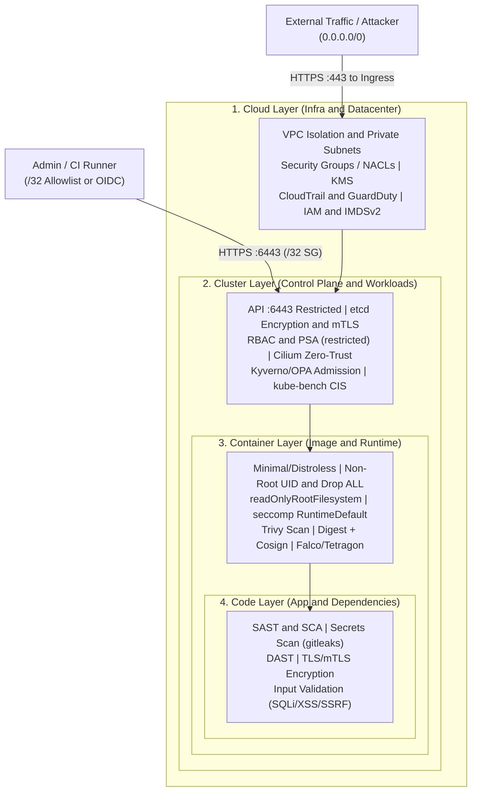
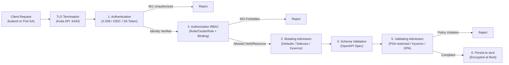
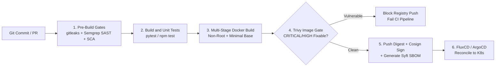
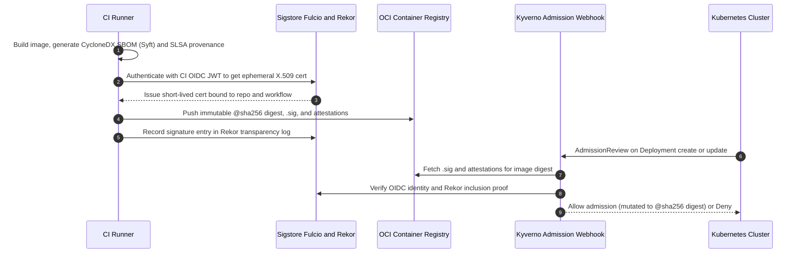
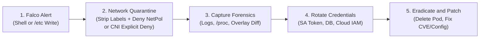

## 6. DevSecOps, the 4 Cs of Cloud-Native Security, and Compliance

### 6.1 The 4 C's of Cloud-Native Security (Defense-in-Depth Framework)

The **4 C's of Cloud-Native Security** (**Cloud -> Cluster -> Container -> Code**) form a nested, concentric defense-in-depth architecture. Security vulnerabilities at an outer ring (such as an exposed AWS IAM role or an unfirewalled Kubernetes API server on port `6443`) undermine inner controls, while hardened inner layers (non-root containers, read-only root filesystems, input validation) contain blast radius when a perimeter control is bypassed.



#### Q1. [Junior] What is the "4 C's of Cloud-Native Security" model, and why is defense-in-depth critical for modern Kubernetes platforms?

**Executive Takeaway:** The 4 C's model organizes Kubernetes and cloud security into four concentric layers — **Cloud, Cluster, Container, and Code** — where each inner ring relies on the integrity of its outer rings yet still enforces independent controls so no single exploit leads to full compromise.

**Why Defense-in-Depth Matters:**
- **Outer-layer failure collapses inner assumptions:** If an attacker steals host-level cloud credentials via SSRF against EC2 IMDSv1 or logs into an exposed `etcd` node, container `SecurityContext` settings cannot save the environment.
- **Inner-layer hardening contains outer compromises:** If a zero-day remote code execution (RCE) vulnerability hits a web app (for example, an unpatched OWASP Juice Shop or Django dependency), dropping Linux capabilities, running as a non-root UID, enforcing `readOnlyRootFilesystem: true`, blocking lateral movement with `NetworkPolicy`, and disabling mounted ServiceAccount tokens trap the attacker in an unprivileged sandbox.
- **Security-first mindset:** Relying purely on perimeter firewalls ("hard crunchy shell, soft chewy center") fails in cloud-native architectures where east-west microservice traffic, third-party registries, and CI/CD pipelines constantly cross trust boundaries.

---

#### Q2. [Mid] Walk through each of the 4 C's with concrete, production-grade security controls you would implement.

**Executive Takeaway:** A production-ready DevSecOps baseline binds infrastructure isolation, control-plane hardening, immutable container constraints, and automated code verification into an end-to-end control plane across all four layers.

1. **Cloud (Infrastructure / Datacenter):**
   - **Network Isolation:** Place worker nodes, control planes, and databases in **Private Subnets** with no public IPs; expose only managed Load Balancers / Ingress endpoints in public subnets. Enforce **Security Groups** (stateful L4 allowlists) and **NACLs** (stateless subnet boundaries).
   - **Encryption & Key Management:** Use **AWS KMS** (Customer-Managed Keys with automatic annual rotation) for EBS volumes, RDS, S3 buckets, and Kubernetes `etcd` envelope encryption.
   - **Audit & Threat Detection:** Enable multi-region **CloudTrail** (with log file validation and immutable S3 storage) and **Amazon GuardDuty** to detect anomalous API calls, crypto-mining, or impossible-travel credential use.
   - **IAM Least Privilege & IMDSv2:** Replace broad EC2 instance profiles with fine-grained workload identities (EKS **IRSA** / Pod Identity). Always enforce **IMDSv2** (`HttpTokens=required`, hop limit `1`) so SSRF bugs inside containers cannot curl `http://169.254.169.254/latest/meta-data/` without a session token:
     ```bash
     aws ec2 modify-instance-metadata-options \
       --instance-id i-0123456789abcdef0 \
       --http-tokens required \
       --http-put-response-hop-limit 1 \
       --http-endpoint enabled
     ```

2. **Cluster (Control Plane & Workloads):**
   - **Restrict API Server (`TCP/6443`):** Use private cluster endpoints (VPC-only + VPN/bastion) or strict `/32` admin CIDR Security Group rules on self-managed clusters (such as K3s master nodes).
   - **`etcd` Encryption & mTLS:** Configure `--encryption-provider-config` on `kube-apiserver` (AES-CBC or KMS v2) so Secrets at rest in `etcd` are ciphertext, and enforce **mTLS** across `kube-apiserver <-> etcd` and `kube-apiserver <-> kubelet`.
   - **RBAC & Pod Security Admission (PSA):** Grant strict namespace-scoped least-privilege RBAC and enforce PSA `restricted` on application namespaces.
   - **NetworkPolicies / Cilium Zero-Trust:** Apply default-deny ingress and egress `NetworkPolicy` objects (or `CiliumNetworkPolicy` with L7 HTTP/DNS awareness) so pods only reach required dependencies (e.g., Ingress -> App -> DB).
   - **Admission Control & CIS Posture:** Deploy **Kyverno** or **OPA Gatekeeper** to block non-compliant manifests before persistence, and continuously audit nodes/control plane against the **CIS Kubernetes Benchmark** with **`kube-bench`**.

3. **Container (Image & Runtime):**
   - **Minimal / Distroless Base Images:** Use `gcr.io/distroless/static`, `cgr.dev/chainguard/static`, or stripped Alpine multi-stage builds with zero package managers, shells (`/bin/sh`), or `curl` inside the runtime stage.
   - **Hardened `securityContext`:** Run as non-root UID, disable privilege escalation, drop `ALL` Linux capabilities, set `seccompProfile: RuntimeDefault`, and enforce `readOnlyRootFilesystem: true` (using `emptyDir` for scratch paths like `/tmp`). Compare a baseline hardened deployment (like `juice-shop` with `automountServiceAccountToken: false` and `runAsUser: 65532`) against a full PSA-`restricted` spec:
     ```yaml
     spec:
       automountServiceAccountToken: false
       securityContext:
         runAsNonRoot: true
         runAsUser: 65532
         runAsGroup: 65532
         fsGroup: 65532
         seccompProfile:
           type: RuntimeDefault
       containers:
         - name: app
           image: registry.example.com/apps/api@sha256:4f8c9e2a... # Digest-pinned
           securityContext:
             allowPrivilegeEscalation: false
             readOnlyRootFilesystem: true
             capabilities:
               drop: ["ALL"]
           volumeMounts:
             - name: tmp
               mountPath: /tmp
       volumes:
         - name: tmp
           emptyDir:
             sizeLimit: 64Mi
     ```
   - **Image Scanning, Digest Pinning & Signing:** Scan images in CI and registries using **Trivy** or **Grype**, pin immutable `@sha256:...` digests rather than mutable `:latest` tags, and verify **Sigstore Cosign** signatures at admission time.
   - **Runtime EDR:** Run **Falco** (eBPF behavioral detection) or **Cilium Tetragon** (synchronous kernel-level eBPF enforcement) to catch shell spawns, unexpected binary execution, and sensitive file writes.

4. **Code (Application & Dependencies):**
   - **Static & Dependency Analysis:** Run **SAST** (Semgrep, SonarQube), **SCA** (Trivy, Snyk, `pip-audit`), and **Secrets Scanning** (`gitleaks`, `trufflehog`) on every PR and pre-commit hook.
   - **Dynamic Testing & Transport Security:** Run **DAST** (OWASP ZAP, Nuclei) against staging environments and enforce **TLS 1.3** externally and **mTLS** internally.
   - **Secure Coding Controls:** Enforce strict schema/input validation, parameterized SQL/ORM queries (SQLi prevention), contextual output encoding + CSP headers (XSS prevention), and explicit outbound URL/IP allowlists (SSRF prevention).

---

#### Q3. [Senior] Why is Kubernetes RBAC NOT a substitute for a Firewall or Security Group (and vice versa)?

**Executive Takeaway:** Security Groups and firewalls enforce **Layer 3/4 network reachability** before packets reach the API server parser, whereas RBAC enforces **Layer 7 authorization** only *after* a client authenticates — leaving an internet-exposed `:6443` open to pre-auth CVEs/DoS, while RBAC alone stops internal token abuse when `:6443` is reachable.

**Deep Architectural Comparison:**

| Dimension | Firewall / AWS Security Group | Kubernetes RBAC |
| :--- | :--- | :--- |
| **OSI Layer & Timing** | L3/L4 — evaluated in kernel/hypervisor **before** TCP handshake or TLS parsing | L7 — evaluated inside `kube-apiserver` **after** TLS + Authentication succeed |
| **Primary Threat Mitigated** | Pre-auth RCE/DoS against API server (`:6443`), port scanning, unauthorized network paths | Privilege escalation, cross-namespace secret theft, lateral movement using valid JWT/X.509 |
| **Blind Spot if Used Alone** | Any host inside the allowed CIDR/SG (e.g., a compromised app Pod reaching `10.96.0.1:443`) has full L4 access | Public `:6443` accepts connections from any botnet, exposing HTTP/2, TLS, and pre-auth CVEs |

- **Why RBAC Cannot Replace a Security Group:**
  1. **Pre-Authentication Attacks & DoS:** Before RBAC ever executes, `kube-apiserver` terminates TLS, parses HTTP/2 frames, validates client certificates/JWTs, and allocates memory. Exposing `:6443` to `0.0.0.0/0` exposes the cluster to HTTP/2 Rapid Reset DoS, unauthenticated memory exhaustion, or historical pre-auth bugs (e.g., `CVE-2018-1002105` WebSocket proxy escalation).
  2. **Credential Brute-Force & Discovery:** Attackers can probe `--anonymous-auth` endpoints, health endpoints, or leaked kubeconfig tokens at wire speed unless dropped at L3/L4 via `/32` SG allowlists or private VPC endpoints.
- **Why a Security Group Cannot Replace RBAC:**
  1. **Inside-Out Lateral Movement:** Worker nodes and pods sit *inside* the cluster VPC/SG and must reach `kubernetes.default.svc` (`10.96.0.1:443` -> `:6443`). If a web pod (e.g., Juice Shop) suffers RCE and has an over-privileged `ServiceAccount` token mounted, the Security Group permits the packet — only strict RBAC (`403 Forbidden`) and `automountServiceAccountToken: false` stop the attacker from running `GET /api/v1/secrets`.
  2. **Trusted CIDR / VPN Blast Radius:** Engineers or CI runners on an allowlisted `/32` or corporate VPN should not all share `cluster-admin`; RBAC isolates read-only viewers from namespace deployers.

---

#### Q4. [Senior] Explain Authentication vs. Authorization (RBAC) vs. Admission Control in Kubernetes, why `automountServiceAccountToken: false` is critical, and how Kyverno enforces deploy-time policy.

**Executive Takeaway:** Every Kubernetes API call traverses a strict pipeline: **Authentication** proves identity, **Authorization (RBAC)** checks verb/resource permissions, and **Admission Control** mutates and validates the payload schema and security policies before `etcd` writes the object.



- **1. Authentication (Who are you?):**
  - Human users/CI use **X.509 client certs** or **OIDC JWTs** (e.g., Dex, Okta, AWS IAM); workloads use projected **ServiceAccount JWTs** (`TokenRequest` API with audience & expiry binding). Anonymous requests fail with `401 Unauthorized` unless explicitly permitted.
- **2. Authorization / RBAC (Can you perform verb X on resource Y?):**
  - RBAC is strictly **additive** (there is no `Deny` rule; everything not granted is denied with `403 Forbidden`).
  - `Role` + `RoleBinding`: **namespace-scoped** (use by default for app teams and CI deployers).
  - `ClusterRole` + `ClusterRoleBinding`: **cluster-scoped** (Nodes, Namespaces, Cluster-wide CRDs — grant sparingly). Note: a `RoleBinding` can reference a shared `ClusterRole` (e.g., `edit` or `view`) while keeping permissions strictly confined to that single namespace.
- **Why `automountServiceAccountToken: false` is Critical:**
  - By default, Kubernetes automatically mounts `/var/run/secrets/kubernetes.io/serviceaccount/token` into *every* container. Even if the `default` ServiceAccount has minimal permissions, any LFI/SSRF/RCE bug leaks a valid cluster JWT, enabling API enumeration or exploiting cluster-wide discovery roles (`system:authenticated` defaults). Workloads that do not query the Kubernetes API (web frontends, API backends, workers) must set `automountServiceAccountToken: false` on both the `ServiceAccount` and `PodSpec`.
- **3. Admission Control (Should this manifest be allowed in the cluster?):**
  - Even if a developer has RBAC permission (`create deployments`), **Mutating Admission Webhooks** first inject defaults/sidecars (e.g., Istio proxy, Kyverno labels, digest resolution), and **Validating Admission Webhooks** (`Kyverno`, `OPA Gatekeeper`, or Kubernetes `ValidatingAdmissionPolicy` CEL) reject non-compliant manifests (`:latest` tags, `privileged: true`, missing resource limits) before `etcd` persistence.

**Kyverno `ClusterPolicy` Example (Block `:latest` Tags & Privileged Escalation):**

```yaml
apiVersion: kyverno.io/v1
kind: ClusterPolicy
metadata:
  name: disallow-latest-and-privileged
spec:
  validationFailureAction: Enforce # Use Audit first during rollout
  background: false # Admission-only because foreach inspects request.object
  rules:
    - name: deny-latest-tag
      match:
        any:
          - resources:
              kinds: ["Pod"]
      validate:
        message: "Images using ':latest' or lacking a tag/digest are forbidden."
        foreach:
          - list: "request.object.spec.[ephemeralContainers, initContainers, containers][]"
            deny:
              conditions:
                any:
                  - key: "{{ split(split(element.image, '@')[0], '/')[-1] }}"
                    operator: Equals
                    value: "*:latest"
                  - key: "{{ regex_match('^[^:@]+(:[^:@]+(@sha256:[a-fA-F0-9]{64})?|@sha256:[a-fA-F0-9]{64})$', split(element.image, '/')[-1]) }}"
                    operator: Equals
                    value: false
    - name: disallow-privileged-and-escalation
      match:
        any:
          - resources:
              kinds: ["Pod"]
      validate:
        message: "Privileged containers and privilege escalation are forbidden."
        pattern:
          spec:
            containers:
              - securityContext:
                  =(privileged): false
                  allowPrivilegeEscalation: false
            =(initContainers):
              - securityContext:
                  =(privileged): false
                  allowPrivilegeEscalation: false
            =(ephemeralContainers):
              - securityContext:
                  =(privileged): false
                  allowPrivilegeEscalation: false
```

---

#### Q5. [Expert] How does Pod Security Admission (PSA) replace the deprecated PodSecurityPolicy (PSP), and where do PSA's three profiles fall short?

**Executive Takeaway:** Removed in Kubernetes `v1.25`, `PodSecurityPolicy` failed due to confusing RBAC coupling between users and controller ServiceAccounts; built-in **Pod Security Admission (PSA)** enforces three standardized Pod Security Standards (**`privileged`**, **`baseline`**, **`restricted`**) per namespace using labels without external webhook latency or outage risk.

- **Why `PodSecurityPolicy` (PSP) Was Deprecated & Removed:**
  - PSPs were authorized via RBAC `use` verbs. Because a Deployment creates a ReplicaSet which creates Pods via the `replicaset-controller` ServiceAccount, PSP frequently authorized the *controller* rather than the *human*, making least-privilege enforcement error-prone and impossible to disable safely in existing clusters.
- **PSA Profiles & Enforcement Modes:**
  - Configured directly via namespace labels (`enforce`, `audit`, `warn`) and pinned Kubernetes version (e.g., `enforce-version: v1.31` so cluster upgrades don't unexpectedly break running apps):
    1. **`privileged`:** Completely unrestricted (reserved strictly for `kube-system`, CNI plugins like Cilium/Flannel, and CSI storage drivers).
    2. **`baseline`:** Blocks known host-escape vectors (`privileged: true`, `hostNetwork`, `hostPID`, `hostIPC`, dangerous `capabilities` outside the safe default set, `hostPath` volumes, `procMount`).
    3. **`restricted`:** Enforces full container hardening (`runAsNonRoot: true`, `allowPrivilegeEscalation: false`, `capabilities.drop: ["ALL"]` with only `NET_BIND_SERVICE` optionally allowed, `seccompProfile.type: RuntimeDefault` or `Localhost`, restricted volume types only).
  - **Zero-Downtime Rollout Pattern:** Apply `warn=restricted` and `audit=restricted` alongside `enforce=baseline` first:
    ```bash
    kubectl label namespace payments \
      pod-security.kubernetes.io/enforce=baseline \
      pod-security.kubernetes.io/warn=restricted \
      pod-security.kubernetes.io/audit=restricted \
      pod-security.kubernetes.io/enforce-version=v1.31
    ```
- **Where PSA Falls Short (Why You Still Need Kyverno / CEL Policies):**
  - PSA validates *only* `PodSpec` security fields. It **cannot** check trusted container registries, reject `:latest` tags, verify Sigstore Cosign signatures, enforce `readOnlyRootFilesystem: true`, require resource `requests`/`limits`, or enforce multi-tenancy labels.

---

#### Q6. [Expert] Compare CIS Kubernetes Benchmark (`kube-bench`) with Runtime Security (`Falco` vs. `Tetragon`) — what separates posture auditing, userspace detection, and synchronous kernel enforcement?

**Executive Takeaway:** **`kube-bench`** performs static CIS posture checks against cluster control-plane and node configurations, **`Falco`** evaluates kernel syscall streams asynchronously in userspace for threat alerting, and **`Tetragon`** executes eBPF filtering and synchronous kernel-space enforcement (`SIGKILL`/`Override`) before an exploit syscall completes.

| Tool | Layer & Timing | Mechanism | Action / Output | Trade-off |
| :--- | :--- | :--- | :--- | :--- |
| **`kube-bench`** | Node & Control Plane Config (Periodic / CI) | Runs CIS Kubernetes Benchmark tests on flags, file permissions (`0600`), TLS, `etcd` | `PASS` / `WARN` / `FAIL` compliance posture report | Static point-in-time check; does not observe runtime syscalls |
| **`Falco`** | Runtime Syscalls (Asynchronous Detection) | Kernel module / `modern_ebpf` pushes syscall ring-buffer events to userspace daemon | Rich alerts -> Falcosidekick -> Slack, SIEM, SOAR webhook | Safe in production (never blocks syscalls), but alert fires *after* syscall occurred |
| **`Cilium Tetragon`** | Runtime Kernel Hooks (Synchronous Enforcement) | eBPF `TracingPolicy` on kprobes, tracepoints, and LSM hooks inside kernel space | In-kernel `Sigkill` / `Override` + K8s-aware process lineage telemetry | Prevents post-exploit actions synchronously, but misconfigured policies can kill valid pods |

- **`kube-bench` Critical Checks:** Verifies `--anonymous-auth=false`, `--encryption-provider-config` on API server, `kubelet` `--protect-kernel-defaults=true`, `readOnlyPort: 0`, `etcd` `--client-cert-auth=true`, and strict `0600`/`0700` file ownership on PKI keys and `/var/lib/etcd`. (On managed EKS/GKE, run `kube-bench run --targets node` because control-plane flags are provider-managed.)
- **Operational Pattern (`Falco` + `Tetragon`):** Start new runtime rules in **observe/audit mode** (`Falco` alerts or `Tetragon` `TracingPolicy` without `Sigkill`) to baseline normal application behavior (preventing noisy false kills during package forks or health probes), then promote high-confidence invariants (e.g., blocking `execve` of shells in distroless prod pods or reading `/var/run/secrets/...` by unauthorized binaries) to synchronous `Tetragon` enforcement.

---

### 6.2 Application Security, Supply Chain & Shift-Left

#### Q7. [Junior] What is "Shift-Left" Security, and how does it reduce remediation cost by 10x–100x?

**Executive Takeaway:** Shift-Left integrates automated security checks directly into developer workflows (IDE, pre-commit, PR, and CI builds) instead of discovering vulnerabilities late in QA pentesting or production, shrinking both remediation effort and incident blast radius by orders of magnitude.

- **Cost & Context Curve:**
  - **IDE / Pre-Commit (Seconds, ~1x cost):** Developer fixes an insecure SQL string or accidentally staged key immediately while the exact file and logic are in active mental context.
  - **PR / CI Gate (Minutes, ~5x–10x cost):** Automated SAST/SCA/Trivy blocks merge before code enters `main` or hits a container registry.
  - **Pre-Prod Pentest (Days/Weeks, ~20x–50x cost):** Release slips, cross-team triage tickets, emergency patch sprints, and re-testing cycles.
  - **Production Breach (Weeks/Months, 100x+ cost):** Data exfiltration, cloud key rotation, emergency war rooms, regulatory fines (GDPR/PCI), and customer trust loss.
- **Balanced Reality ("Shift-Left + Shield-Right"):** Shift-Left reduces preventable flaws before deployment, but zero-day CVEs (`Log4Shell`, `OpenSSL`) still emerge *after* code ships — requiring runtime "Shield-Right" controls (SBOM inventory lookup, NetworkPolicies, Falco/Tetragon, WAF virtual patching).

---

#### Q8. [Junior] Compare SAST, DAST, SCA, and IAST — when does each run, what does it detect, and how do you tune false positives?

**Executive Takeaway:** **SAST** analyzes proprietary source code statically, **SCA** audits open-source third-party dependencies and container OS packages, **DAST** probes live running applications from the outside, and **IAST** observes runtime execution from inside an instrumented app server.

| Dimension | SAST (Static App Security Testing) | SCA (Software Composition Analysis) | DAST (Dynamic App Security Testing) | IAST (Interactive App Security Testing) |
| :--- | :--- | :--- | :--- | :--- |
| **Access Model** | White-box (source code / AST) | Manifests, lockfiles, & binaries/SBOMs | Black-box (live HTTP/API endpoints) | Gray-box (in-app agent + live QA traffic) |
| **Pipeline Stage** | IDE / Every PR (< 2 min) | PR / Build / Registry Scan / Daily | Staging / Pre-Prod post-deploy | Automated QA / Integration test runs |
| **What It Finds** | Hardcoded logic flaws, SQLi, XSS sinks, insecure crypto, SSRF | Known CVEs in `pip`/`npm`/Maven/OS pkgs, license risk | Auth bypass, CORS/headers, runtime SQLi/XSS, TLS misconfig | Exploitable runtime taint flows with exact line numbers |
| **Representative Tools** | `Semgrep`, `SonarQube`, `Bandit`, `CodeQL` | `Trivy`, `Snyk`, `Grype`, `pip-audit`, `npm audit` | `OWASP ZAP`, `Nuclei`, `Burp Suite Enterprise` | `Contrast Security`, `Seeker` |

- **Tuning False Positives:**
  - Replace naive regex SAST rules with AST/dataflow taint rules (`Semgrep Pro` / `CodeQL`) that verify untrusted user input actually reaches a dangerous sink without sanitization.
  - Gate PRs on **newly introduced** findings (`diff-aware` scanning) while triaging legacy backlog separately.
  - Configure `OWASP ZAP` / `Nuclei` with OpenAPI/Swagger specs and real authenticated test sessions so scanners test business endpoints rather than spamming 404 login forms.

---

#### Q9. [Mid] How do you wire a practical DevSecOps CI/CD pipeline (from developer commit to container registry gate) using real tools?

**Executive Takeaway:** A practical CI/CD security pipeline gates code before build (`gitleaks`, `Semgrep`, `pip-audit`/`npm`), builds a hardened minimal container image, and scans the final image (`Trivy`) *before* pushing an immutable tag to the registry — ensuring vulnerable artifacts never reach production GitOps.



- **Real-World Pattern (GitLab CI Security Gate):** Notice how in a Django E-Commerce CI pipeline (such as CyShield Task 4), running the container image scan *after* `docker build` and *before* `docker push` acts as a hard quality firewall:
  ```yaml
  stages: [secrets_sast, test, build_scan, push_sign]

  secret_and_sast:
    stage: secrets_sast
    script:
      - gitleaks detect --source . --verbose --redact
      - semgrep scan --config auto --error --metrics=off

  container_build_and_gate:
    stage: build_scan
    script:
      - docker build -t "$CI_REGISTRY_IMAGE:$CI_COMMIT_SHORT_SHA" .
      # Fail pipeline on fixable CRITICAL or HIGH OS/library CVEs before pushing!
      - trivy image --exit-code 1 --severity CRITICAL,HIGH --ignore-unfixed --no-progress "$CI_REGISTRY_IMAGE:$CI_COMMIT_SHORT_SHA"
  ```
- **Why `--ignore-unfixed` in PR Gates (Carefully Governed):** Blocking a PR on a low-severity or upstream-unfixed distro CVE halts all releases; instead, gate PRs strictly on fixable `CRITICAL`/`HIGH` CVEs while alerting asynchronously on unfixed `CRITICAL` CVEs for manual risk triage.

---

#### Q10. [Senior] How do you handle transitive dependency vulnerabilities when your team did not directly declare the vulnerable package?

**Executive Takeaway:** Never blindly overwrite lockfiles with `npm audit fix --force` or break ABI compatibility; trace the dependency graph, determine whether the vulnerable code path is reachable and fixable, apply deterministic lockfile overrides or upgrade the direct parent, and add compensating controls if no patch exists.

**Step-by-Step Resolution Protocol:**
1. **Map the Exact Dependency Chain:**
   - Python: `pipdeptree -r -p <vulnerable-pkg>` or `uv tree --invert <pkg>`
   - Node.js: `npm ls <vulnerable-pkg>`
   - Java/Maven: `mvn dependency:tree -Dincludes=<groupId>:<artifactId>`
   - Container/Binary: `trivy fs --list-all-pkgs .`
2. **Prefer Upgrading the Direct Parent Dependency:** If `framework-A@1.2.0` depends on `urllib3<2.0` and `framework-A@1.3.1` bumps it safely, upgrade `framework-A` and regenerate the lockfile (`package-lock.json`, `uv.lock`, `poetry.lock`).
3. **Apply Targeted Overrides / Constraints When Parent Is Slow:**
   - Node.js (`package.json`): `"overrides": { "minimist": "^1.2.8" }`
   - Python: add patched transitive floor in `constraints.txt` (`pip install -r requirements.txt -c constraints.txt`) or `uv`/`poetry` dependency overrides, then execute the full unit + integration test suite (`pytest`) to catch breaking API changes.
4. **Assess Reachability & Publish VEX Before Panic-Breaking Builds:**
   - Check if the vulnerable function is actually reachable in runtime execution (e.g., an XML parser vulnerability inside a build-time docs generator or an unused helper function). If confirmed unreachable, document it via **VEX** (`status: not_affected`, `justification: vulnerable_code_not_in_execute_path`) rather than introducing risky major-version overrides.
5. **Apply Compensating Controls When Upstream Has No Fix:**
   - Deploy targeted **WAF rules** (virtual patching malicious headers/payloads), tighten **NetworkPolicy** egress (mitigating SSRF/JNDI callbacks), or isolate the service until an upstream release ships.

---

#### Q11. [Senior] Explain SBOM (SPDX / CycloneDX via Syft), SLSA Provenance, and Sigstore Cosign — how do they prevent supply-chain compromises end to end?

**Executive Takeaway:** An **SBOM** inventories every component inside an artifact for rapid zero-day triage, **SLSA Provenance** proves the binary was built hermetically from trusted source code rather than a compromised laptop, and **Sigstore Cosign** binds OIDC-signed image digests to **Kyverno** admission policies so unsigned or tampered images can never execute in production.



- **SBOM (`SPDX` vs. `CycloneDX` via `Syft`):**
  - Generate at build time: `syft "$IMAGE_DIGEST" -o cyclonedx-json=sbom.cdx.json`.
  - **SPDX** (Linux Foundation / ISO standard) excels at license compliance; **CycloneDX** (OWASP) excels at security vulnerability & VEX tracking. Having a central SBOM inventory (e.g., Dependency-Track) answers *"Which clusters run `openssl 3.0.x`?"* in 2 seconds during a 0-day outbreak.
- **SLSA Provenance (Levels 1–3):**
  - Cryptographic `in-toto` attestation linking `image@sha256` -> exact Git commit SHA -> exact CI workflow YAML -> isolated CI runner. Defeats build tampering (SolarWinds pattern) and blocks unreviewed local builds from reaching prod.
- **Sigstore Cosign (Keyless OIDC Signing + Kyverno Enforcement):**
  - Eliminates long-lived private signing keys in CI secrets! Cosign exchanges the CI job's short-lived OIDC token with **Fulcio** for an ephemeral certificate, signs the image digest, and writes an immutable entry to the **Rekor** transparency log:
    ```bash
    cosign sign --yes "$IMAGE_REGISTRY/$IMAGE_NAME@$DIGEST"
    cosign attest --yes --predicate sbom.cdx.json --type cyclonedx "$IMAGE_REGISTRY/$IMAGE_NAME@$DIGEST"
    ```
  - Enforce in Kubernetes with **Kyverno `verifyImages`** (`mutateDigest: true` pins tags to verified digests automatically):
    ```yaml
    apiVersion: kyverno.io/v1
    kind: ClusterPolicy
    metadata:
      name: verify-signed-prod-images
    spec:
      validationFailureAction: Enforce
      rules:
        - name: check-cosign-keyless
          match:
            any:
              - resources:
                  kinds: ["Pod"]
                  namespaces: ["production"]
          verifyImages:
            - imageReferences: ["registry.example.com/apps/*"]
              mutateDigest: true
              attestors:
                - entries:
                    - keyless:
                        subject: "https://gitlab.com/org/platform//.gitlab-ci.yml@refs/heads/main"
                        issuer: "https://gitlab.com"
                        rekor:
                          url: "https://rekor.sigstore.dev"
    ```

---

#### Q12. [Senior] How do you defend CI/CD and Kubernetes environments against Dependency Confusion, Typosquatting, Compromised CI Runners, and Mutable Image Tags?

**Executive Takeaway:** Supply-chain attackers target the build toolchain itself through package namespace hijacking, poisoned CI runners, and mutable container tags; mitigation requires scoped private registry mirrors, ephemeral single-use CI runners with OIDC, and immutable `@sha256` digest pinning in GitOps.

- **Dependency Confusion & Typosquatting:**
  - Attackers publish public packages on PyPI/npm matching internal package names (e.g., `cyshield-auth-lib`) with higher version numbers (`99.0.0`).
  - **Controls:** Reserve internal package prefixes/scopes (`@company/...`), configure package managers (`pip --index-url` pointing **only** to internal Artifactory/Nexus proxy rather than `--extra-index-url` which checks public PyPI in parallel!), and verify lockfile integrity hashes (`npm ci`, `pip install --require-hashes`).
- **Compromised CI Runners:**
  - **Controls:** Never run untrusted fork PRs on self-hosted persistent runners holding prod credentials; use **ephemeral single-use runners** (destroyed after one job), enforce **OIDC short-lived federation** (AWS STS / GCP WIF) scoped to `branch:main` / protected environments instead of static cloud keys, and restrict runner egress.
- **Mutable Image Tags vs. GitOps Digest Pinning:**
  - A tag like `:1.0.1` or `:latest` is a mutable pointer in an OCI registry — an attacker with registry write access can overwrite `:1.0.1` without touching Git. Even in automated GitOps (such as FluxCD `ImagePolicy` updating SemVer tags), configure `ImageUpdateAutomation` or Kyverno `mutateDigest: true` to pin `@sha256:...` digests so Git commits and deployed bytes are cryptographically identical.

---

#### Q13. [Expert] How do you design Risk-Based CI/CD Security Gates without causing developer revolt or constant emergency bypasses?

**Executive Takeaway:** Blanket "fail on any CVE" gates burn engineering trust and trigger `skip-ci` workarounds; sustainable DevSecOps gates weight **CVSS Severity x Fix Availability x Runtime Reachability x Exposure** into explicit SLAs, pair sub-2-minute PR feedback with asynchronous deep scans, and govern exceptions via expiring Git-reviewed records.

**Risk-Based Gate & SLA Matrix:**

| Severity & Fixability | Workload Context / Reachability | CI/CD Gate Action | Remediation SLA |
| :--- | :--- | :--- | :--- |
| **Critical / High (Fixable)** | Internet-facing Prod & reachable path | **Hard Block** (PR / image push fails) | Immediate (0 days — before deploy) |
| **Critical (Unfixable Upstream)** | Internet-facing Prod | **Conditional Pass** with compensating control (WAF / NetPol) + Security Champion approval | 7 days (re-evaluated weekly) |
| **Critical / High (Verified Unreachable)** | Dead code / non-shipped dev test dep | **Suppress via VEX / expiring ignore** | Documented VEX / next base refresh |
| **Medium** | Production runtime | **Non-blocking Warn** + auto-created Jira/GitLab issue | 30 days |
| **Low / Dev-Only** | Build stage only (stripped from runtime) | **Log / Metric Only** | 90 days / best effort |

- **Three Engineering Guardrails Against Alert Fatigue:**
  1. **Sub-2-Minute PR Feedback Budget:** Keep blocking PR checks fast (`gitleaks` on diff, `Semgrep` on changed files, cached `trivy fs`). Offload multi-minute full DAST crawls, full container layers, and daily newly-published CVE re-scans to post-merge / nightly pipelines.
  2. **Time-Boxed, Auditable Exceptions (Never Permanent Ignores):** Require `.trivyignore.yaml` or **OpenVEX** entries in Git with mandatory `expired_at` dates, justification, and ticket IDs, protected by `CODEOWNERS` so only a **Security Champion** or AppSec engineer can approve an exception:
     ```yaml
     vulnerabilities:
       - id: CVE-2024-XXXX
         expired_at: 2026-12-15
         statement: "OpenSSL DTLS path unused in HTTP-only service; ticket SEC-412."
     ```
  3. **Security Champions Program & Safe Self-Service Templates:** Provide blessed, pre-hardened golden base images and Helm/Terraform modules so the secure path is the *fastest* path for developers.

---

### 6.3 Cryptography, Secrets Management & Incident Playbooks

#### Q14. [Junior] Compare Symmetric (AES-256-GCM) vs. Asymmetric (RSA/ECDSA) vs. Hashing (SHA-256/Argon2) vs. Encoding (Base64) — and why are Kubernetes `Secret` objects NOT encrypted by default?

**Executive Takeaway:** Encryption protects confidentiality using keys, hashing creates a one-way integrity or password fingerprint, and Base64 is merely reversible text encoding — meaning default Kubernetes `Secret` objects sit unencrypted (Base64-encoded) in `etcd` unless `etcd` encryption at rest and strict RBAC are explicitly enabled.

| Mechanism | Purpose | Reversible? | Representative Algorithms | Primary DevSecOps Use Case |
| :--- | :--- | :--- | :--- | :--- |
| **Symmetric Encryption** | Bulk confidentiality + integrity (AEAD) | Yes (same secret key) | `AES-256-GCM`, `ChaCha20-Poly1305` | TLS bulk traffic, EBS/S3 disk encryption, `etcd` KMS envelope |
| **Asymmetric Encryption / Signing** | Key exchange & identity proof | Encrypt: yes (private key); Sign: verify with public key | `X25519` (ECDHE), `ECDSA P-256`, `Ed25519`, `RSA-2048+` | TLS handshake, SSH keys, Cosign/JWT signatures |
| **Cryptographic Hashing / KDF** | Integrity digest or password storage | **No** (one-way) | `SHA-256` (fast); `Argon2id`/`bcrypt` (slow, salted) | Image `@sha256` digests, HMAC (`SHA-256`), user passwords (`Argon2id`) |
| **Encoding** | Binary-to-ASCII text transport | **Yes (trivial, NO key)** | `Base64`, `Hex` | Wrapping binary payloads in YAML/JSON — **zero security** |

- **Why TLS Uses Both Asymmetric and Symmetric Crypto:** Asymmetric math (`ECDHE` + `ECDSA`) is ~1000x slower than hardware-accelerated `AES-256-GCM`. TLS therefore uses asymmetric certificates to verify identity and run an ephemeral `ECDHE` key exchange (giving **Forward Secrecy**), then switches to symmetric `AES-256-GCM` for all HTTP data.
- **Why Kubernetes `Secret` Objects Are NOT Secure Out of the Box:**
  - Creating a Kubernetes `Secret` only Base64-encodes values (`echo "my-db-pass" | base64`), which any user with `get secrets` RBAC or disk access to `etcd` (`/var/lib/etcd/member/snap/db`) can decode instantly with `base64 -d`.
  - **Mandatory Hardening:** (1) Enable `EncryptionConfiguration` (`kms` v2 provider or `aescbc`) on `kube-apiserver`, (2) restrict `secrets` RBAC (`get`/`list`/`watch`) strictly, (3) set `automountServiceAccountToken: false` on pods, and (4) never commit plain K8s `Secret` YAML to Git.

---

#### Q15. [Mid] How do TLS 1.3 and mTLS enforce zero-trust service communication, and how do you automate certificate rotation in Kubernetes?

**Executive Takeaway:** Standard TLS authenticates only the server, whereas **mTLS (Mutual TLS)** cryptographically verifies *both* client and server workload identities on every connection — automated via **`cert-manager`** for north-south/internal services or a **SPIFFE/Service Mesh** (Istio/Cilium/Linkerd) for transparent east-west rotation.

- **TLS 1.3 Advantages:** Eliminates legacy weak ciphers (`RC4`, `3DES`, static `RSA` key transport without forward secrecy), mandates ephemeral `ECDHE` key exchange, encrypts server certificates in transit, and cuts handshake latency to **1-RTT** (two messages).
- **Zero-Trust mTLS Mechanics:**
  - Instead of trusting pod IP addresses (which are ephemeral and spoofable inside flat CNI networks), every pod receives a short-lived X.509 certificate encoding a **SPIFFE ID** (`spiffe://cluster.local/ns/payments/sa/checkout-api`).
  - **Automation:**
    - **North-South & Explicit Internal TLS:** **`cert-manager`** integrates with Let's Encrypt (ACME) or HashiCorp Vault PKI (`Issuer`/`ClusterIssuer`) to issue certificates into K8s Secrets and auto-renew before expiry (e.g., at 2/3 lifetime).
    - **Zero-Code East-West mTLS:** Service meshes (**Istio**, **Linkerd**) or **Cilium Mutual Authentication** rotate workload certs automatically (e.g., every 24h) via Envoy/eBPF without modifying application code.

---

#### Q16. [Senior] Compare Enterprise Secrets Management architectures: HashiCorp Vault vs. AWS Secrets Manager + External Secrets Operator (ESO) vs. Mozilla SOPS + `age`/KMS for GitOps.

**Executive Takeaway:** Choose **HashiCorp Vault** for dynamic short-lived credentials, centralized multi-cloud PKI, and audit logging; choose **AWS Secrets Manager + ESO** for simple cloud-native secret syncing; and choose **Mozilla SOPS + KMS/`age`** when encrypting secrets directly inside GitOps repositories.

| Architecture | How Secrets Are Stored & Synced | Key Strengths | Key Trade-offs & "Secret Zero" Solution |
| :--- | :--- | :--- | :--- |
| **HashiCorp Vault** (Agent Injector / CSI) | Encrypted in Vault storage; fetched dynamically at pod start via K8s/IAM Auth | **Dynamic DB/Cloud secrets** (unique per pod, auto-revoked on TTL), PKI engine, Transit encryption, strict audit logs | Higher operational overhead (HA Raft, unseal/auto-unseal via KMS); **Secret Zero** solved via Pod SA JWT or AWS IAM auth |
| **AWS Secrets Manager + ESO** | Stored in AWS SM; **External Secrets Operator** syncs `ExternalSecret` -> K8s `Secret` | Zero cluster state to manage, native AWS RDS password rotation Lambdas, GitOps-friendly `ExternalSecret` CRD | Secrets still materialize as K8s `Secret` objects in `etcd` (pair with KMS `etcd` encryption or AWS Secrets Store CSI `tmpfs` mount); ESO uses IRSA |
| **Mozilla SOPS + KMS / `age`** | Encrypted YAML/JSON values committed directly in Git; decrypted by FluxCD / ArgoCD | 100% GitOps native (PR diffs show changed key names while values stay AES-GCM encrypted), zero external runtime agent needed for apps | Static secrets only (no dynamic lease generation); must rotate keys if an engineer retains raw access to KMS decrypt permissions |

- **Example `ExternalSecret` (ESO syncing AWS Secrets Manager without putting secrets in Git):**
  ```yaml
  apiVersion: external-secrets.io/v1
  kind: ExternalSecret
  metadata:
    name: django-db-credentials
    namespace: ecommerce
  spec:
    refreshInterval: 1h
    secretStoreRef:
      name: aws-secrets-manager
      kind: ClusterSecretStore
    target:
      name: django-db-secret
      creationPolicy: Owner
    data:
      - secretKey: DATABASE_PASSWORD
        remoteRef:
          key: prod/ecommerce/db
          property: password
  ```
  *(Note: In a FluxCD stack, Mozilla SOPS + AWS KMS/`age` decrypts SOPS-encrypted secrets natively inside `kustomize-controller`, while CI/CD registry tokens like `gitlab-regcred` should migrate toward short-lived workload identity or Vault-managed credentials rather than long-lived static PATs.)*

---

#### Q17. [Senior] Incident Playbook: A developer accidentally committed an AWS Access Key, DB password, or `.pem` SSH private key to Git! What is your exact 6-step response?

**Executive Takeaway:** Assume automated scrapers harvest leaked credentials within seconds of hitting a remote repository — **revoke and rotate the credential at the provider FIRST**, audit for abuse, and only then scrub Git history and enforce automated prevention guardrails.

1. **Step 1 — REVOKE / ROTATE Immediately at the Provider (Minutes 0–5):**
   - Treat the exposed credential as permanently burned regardless of whether the repo is "private" or quickly deleted.
   - **AWS IAM Key:** Deactivate immediately (`aws iam update-access-key --access-key-id <LEAKED_KEY_ID> --status Inactive --user-name <USER>`), issue a replacement only if required (prefer migrating to IAM Roles / OIDC), and revoke active temporary sessions (`aws iam put-user-policy` deny-all or revoke STS tokens).
   - **DB Password / SSH `.pem` Key:** Rotate the DB password at the database/Secrets Manager and immediately remove the leaked public key from `~/.ssh/authorized_keys` / EC2 keypairs on every host.
2. **Step 2 — Audit Provider & Access Logs for Unauthorized Usage:**
   - Query **AWS CloudTrail** (`aws cloudtrail lookup-events --lookup-attributes AttributeKey=AccessKeyId,AttributeValue=<LEAKED_KEY_ID>`) and **GuardDuty** across all regions from the exact Git commit timestamp until revocation.
   - Check DB auth/query logs, SSH `/var/log/auth.log`, and container registry pull logs for unexpected IPs, new IAM user/role creation, or privilege escalation.
3. **Step 3 — Replace with Managed Secret Injection:**
   - Remove hardcoded `.env` / `.pem` / config secrets from the codebase; load them dynamically via **HashiCorp Vault**, **AWS Secrets Manager + ESO**, **IRSA/OIDC**, or masked/protected CI/CD variables (never tracked in Git).
4. **Step 4 — Purge Git History (Knowing Rotation Is STILL Mandatory):**
   - Add leaked file patterns (`*.pem`, `.env*`, `sensitivefile`) to `.gitignore`.
   - Rewrite history across all refs using **`git filter-repo`** (preferred over legacy `git filter-branch`):
     ```bash
     git filter-repo --invert-paths --path path/to/leaked-key.pem
     git push --force --all --tags
     ```
   - Contact GitHub/GitLab support to purge server-side cached PR diffs, dangling objects, and reflogs — **while remembering that forks, developer clones, CI caches, and search bots still hold the old commit, which is why Step 1 rotation is non-negotiable**.
5. **Step 5 — Enforce Automated Prevention Guardrails:**
   - Enable **GitHub Secret Push Protection** / **GitLab Secret Push Protection** (blocks `git push` server-side before the commit lands), add **`gitleaks`** in CI pipelines, and distribute pre-commit hooks (`pre-commit` + `gitleaks protect --staged`) via developer bootstrap tooling.
6. **Step 6 — Conduct a Blameless Post-Mortem:**
   - Document timeline, root cause (e.g., missing `.gitignore` rule, lack of push protection, reliance on static IAM keys instead of OIDC), and systemic action items so engineers feel safe reporting accidental leaks immediately rather than hiding them.

---

#### Q18. [Expert] How do you implement Compliance-as-Code and continuous audit readiness (SOC 2 / ISO 27001 / PCI-DSS) in a Kubernetes & GitOps platform without slowing delivery?

**Executive Takeaway:** Auditors demand verifiable evidence of change control, least privilege, encryption, and vulnerability governance; a GitOps + Policy-as-Code architecture emits audit evidence *as a natural byproduct of deployments* rather than manual spreadsheet screenshots.

| Compliance Control Domain | Manual Pain Point | Automated GitOps + DevSecOps Evidence |
| :--- | :--- | :--- |
| **Change Management & Separation of Duties** | Tickets manually matching SSH/kubectl edits | Protected `main` branch + mandatory 2-reviewer PR approval + signed commits + FluxCD/ArgoCD Git SHA reconciliation logs (no manual cluster drift) |
| **Access Control & Least Privilege** | Quarterly CSV dumps of static IAM/SSH keys | OIDC/IRSA short-lived sessions + RBAC manifests in Git + Vault audit logs + automated revocation on offboarding |
| **Vulnerability & Supply-Chain Governance** | Outdated PDF pentest snapshots | CI Trivy gate logs + Syft SBOMs + Sigstore Rekor attestations + Kyverno admission verification |
| **Configuration & Posture Drift** | Ad-hoc manual compliance audits | Scheduled `kube-bench` CIS reports + Kyverno `PolicyReport` CRDs + AWS Config / CloudTrail logs in immutable WORM S3 |

- **Operationalizing Compliance-as-Code:** Tag every Kyverno policy and Terraform check with control IDs (e.g., `policies.kyverno.io/category: SOC2-CC6.1`), export `PolicyReport` metrics to Prometheus/Grafana for real-time compliance dashboards, and alert immediately if FluxCD detects manual out-of-band edits or drift.

---

### 6.4 Real-World DevSecOps & Security Troubleshooting Playbook

#### Scenario 1: Zero-Day Critical CVE (e.g., Log4Shell / OpenSSL / Ingress-NGINX CVE) Hits Mid-Release

**Symptoms:** High-severity security advisory drops (`CVSS >= 9.0`) affecting a core library (`log4j-core`, `openssl`, `ingress-nginx`) while a major product release is staged.

1. **Blast-Radius Triage via SBOM (Not Manual Guessing):**
   - Query central SBOM store (Dependency-Track / OCI registry attestations / stored CycloneDX files) or run live cluster inventory scans:
     ```bash
     trivy k8s --report summary cluster --severity CRITICAL
     # Or query saved SBOM JSONs across repos/services:
     jq -r '.components[] | select(.name | test("openssl|log4j")) | "\(.name)@\(.version)"' sbom-*.cdx.json
     ```
2. **Assess Reachability & Exposure Path:**
   - Separate **internet-facing / reachable** services (e.g., Ingress controller or public API) from **internal / unexposed** build tools. For example, an Ingress-NGINX admission/annotation RCE requires restricting `Ingress` creation RBAC and disabling vulnerable annotations immediately.
3. **Apply Immediate Compensating Controls (Virtual Patching):**
   - Deploy **WAF signatures** at CloudFront/ALB/ModSecurity to drop exploit payloads (`${jndi:...}` or malformed headers).
   - Restrict outbound egress via `NetworkPolicy` (blocking unexpected external LDAP/RMI/HTTP callbacks from app pods).
4. **Emergency Patch, Sign & Staged Rollout:**
   - Bump fixed base image/library -> build in CI -> verify CVE absent in `trivy image` -> sign with Cosign -> roll out via Canary/GitOps (`maxUnavailable: 0`, watch `5xx` & readiness probes) rather than reckless cluster-wide restarts.

---

#### Scenario 2: Debugging Kubernetes RBAC `Forbidden (403)` Errors

**Symptoms:** Application pod or CI/CD pipeline fails with `User "system:serviceaccount:staging:deployer-sa" cannot list resource "deployments" in API group "apps" in the namespace "staging"`.

1. **Reproduce & Test Exact Permissions Using Impersonation (`kubectl auth can-i`):**
   ```bash
   # Check the exact failing verb, apiGroup/resource, and namespace
   kubectl auth can-i list deployments.apps -n staging \
     --as=system:serviceaccount:staging:deployer-sa

   # List ALL permissions granted to that ServiceAccount in the namespace
   kubectl auth can-i --list -n staging \
     --as=system:serviceaccount:staging:deployer-sa
   ```
2. **Inspect Bindings & Common Root Causes:**
   ```bash
   kubectl get rolebindings,clusterrolebindings -A -o wide | grep deployer-sa
   kubectl describe rolebinding <binding-name> -n staging
   ```
   - **Pitfall A — Wrong `apiGroups`:** `deployments` belongs to `"apps"`, not core `""`; `ingresses` belongs to `"networking.k8s.io"`.
   - **Pitfall B — Wrong Binding Namespace or `ClusterRoleBinding` Confusion:** A `RoleBinding` only grants permissions inside its own namespace; check `subjects[].namespace` matches `staging`.
   - **Pitfall C — Missing Subresources:** `kubectl logs` requires `pods/log`; `kubectl exec` requires `pods/exec`; status updates require `deployments/status`.
   - **Pitfall D — `automountServiceAccountToken: false`:** If a controller legitimately needs API access, check if the token file `/var/run/secrets/kubernetes.io/serviceaccount/token` is actually mounted inside the pod.
3. **Fix with Least Privilege:** Grant *only* the exact missing verb/resource/namespace in a dedicated `Role` + `RoleBinding` — **never** grant `cluster-admin` or wildcard `["*"]` to silence a 403 error.

---

#### Scenario 3: Pods Silently Rejected by PSA `restricted` or Kyverno Admission Webhook (Zero Pods Created!)

**Symptoms:** `kubectl apply` of a `Deployment` succeeds, `kubectl get deploy` shows `0/1` ready, yet `kubectl get pods -n <ns>` returns **`No resources found`** — leaving junior engineers confused where the Pod went.

1. **Understand Why:** The `Deployment` object passed API admission, so `kubectl apply` returned `created`, *but* when the `ReplicaSet` controller tried to create the `Pod`, PSA or Kyverno rejected the `Pod` creation request!
2. **Trace Events on the Parent `ReplicaSet` (Where the Rejection Lives):**
   ```bash
   kubectl get rs -n <ns>
   kubectl describe rs <replicaset-name> -n <ns>
   # Look under Events for:
   # Warning FailedCreate ... pods "app-xxx" is forbidden: violates PodSecurity "restricted:latest": allowPrivilegeEscalation != false ...
   # OR: admission webhook "validate.kyverno.svc-fail" denied the request ...
   ```
3. **Inspect Cluster Events, Kyverno Logs & PolicyReports:**
   ```bash
   kubectl get events -n <ns> --sort-by='.lastTimestamp' | tail -n 20
   kubectl logs -n kyverno -l app.kubernetes.io/component=admission-controller --tail=50
   kubectl get policyreport -n <ns> -o wide
   ```
4. **Fix & Pre-Validate Safely:**
   - Update the `PodSpec` template (`runAsNonRoot: true`, `allowPrivilegeEscalation: false`, `capabilities.drop: ["ALL"]`, `seccompProfile.type: RuntimeDefault`, pinned SemVer/digest tag).
   - Validate before merge/apply with server-side dry-run and Kyverno CLI:
     ```bash
     kubectl apply --dry-run=server -f deployment.yaml
     kyverno apply cluster-policies/ --resource deployment.yaml
     ```

---

#### Scenario 4: Triage of a `Falco` Runtime Alert (e.g., `Terminal shell in container` or `Write below /etc`)

**Symptoms:** Falcosidekick fires a high-priority alert: `Notice A shell was spawned in a container with an attached terminal (k8s.ns=prod k8s.pod=api-7d9f... proc.cmdline=sh -i)` or `Error File below /etc opened for writing`.



1. **Golden Rule — Isolate First, Do NOT Blindly `kubectl delete pod`:**
   - Immediately running `kubectl delete pod` destroys volatile RAM, `/proc` process lineage, open TCP sockets, and container writable overlay layers needed to prove *how* the attacker entered and *what* they touched.
2. **Quarantine the Pod Without Additive `NetworkPolicy` Bypass:**
   - Standard Kubernetes `NetworkPolicy` rules are strictly **additive** (union of all matching policies). Merely adding `quarantine=true` and `quarantine-pod-isolate` does **not** block traffic if the pod still matches an existing allow `NetworkPolicy` (such as `app: api`).
   - **Option A (Standard `NetworkPolicy` + Label Stripping):** Strip existing traffic-selecting labels (`app-`) while applying `quarantine=true` so the pod detaches from both `Service` endpoints and existing allow policies, while staying alive for forensics (note that the parent `ReplicaSet` automatically spins up a healthy replacement pod to preserve availability; also confirm no namespace-wide `podSelector: {}` allow policy still matches the pod):
     ```bash
     kubectl label pod api-7d9f -n prod app- quarantine=true
     ```
     ```yaml
     apiVersion: networking.k8s.io/v1
     kind: NetworkPolicy
     metadata:
       name: quarantine-pod-isolate
       namespace: prod
     spec:
       podSelector:
         matchLabels:
           quarantine: "true"
       policyTypes: ["Ingress", "Egress"]
     ```
   - **Option B (Preferred in Production — CNI Explicit-Deny Policy):** When running Cilium or Calico, apply an explicit-deny policy (`CiliumNetworkPolicy` with `ingressDeny`/`egressDeny` matching `quarantine: "true"`, or Calico `NetworkPolicy` with `action: Deny`), which overrides existing allow policies immediately without relying solely on label removal.
3. **Collect Volatile Forensics (Without Alerting/Mutating Workload State):**
   - Capture Kubernetes pod logs (`kubectl logs api-7d9f -n prod --timestamps > pod.log`) and inspect exact node placement (`kubectl get pod api-7d9f -n prod -o wide`).
   - On the worker node (if authorized for forensics), inspect container metadata and overlayfs `upperdir` file modifications without running interactive tools inside the compromised container namespace:
     ```bash
     sudo crictl ps --name api
     sudo crictl inspect <CONTAINER_ID> | jq '.info.pid, .info.runtimeSpec.process'
     # Inspect process tree & open sockets from host /proc/<PID>
     ps -ef --forest | grep <PID>
     ```
   - Confirm whether it was benign developer debugging (`kubectl exec` authorized in audit logs? -> tighten RBAC!) vs. true exploitation (spawned by `node`/`python` web process -> RCE!).
4. **Rotate All Accessible Credentials:**
   - Rotate every secret mounted in the pod, revoke dynamic Vault leases, invalidate the pod's `ServiceAccount` or IAM credentials, and verify CloudTrail/DB logs for unauthorized access.
5. **Eradicate, Patch & Harden:**
   - Delete the quarantined Pod (`kubectl delete pod api-7d9f -n prod`), cordon/replace the node if kernel/container escape is suspected, patch the underlying RCE/image vulnerability, enforce `readOnlyRootFilesystem: true` + distroless (removing `/bin/sh`), and promote detection rules to `Tetragon` enforcement where appropriate.

---
### ملخص سريع للمراجعة (Arabic Quick Recap)

- **نموذج الـ 4 C's (Defense-in-Depth):** أربع طبقات متداخلة تحمي بعضها البعض: **Cloud** (عزل VPC، Private Subnets، Security Groups، KMS، CloudTrail/GuardDuty، وأهم نقطة **IMDSv2** `HttpTokens=required` لمنع سرقة بيانات AWS عبر SSRF) ← **Cluster** (تقييد بورت `6443` بـ `/32` أو Private Endpoint، تشفير `etcd` + mTLS، أقل صلاحيات RBAC، PSA `restricted`، وـ NetworkPolicies / Cilium، وـ `kube-bench` لـ CIS) ← **Container** (صور Distroless/Minimal، مستخدم غير Root، `readOnlyRootFilesystem: true`، حذف كل الصلاحيات `drop: ALL`، تفعيل `seccompProfile: RuntimeDefault`، فحص Trivy، تثبيت Digest مع توقيع Cosign، ومراقبة السلوك عبر Falco أو Tetragon) ← **Code** (فحص SAST/SCA، منع تسريب الأسرار بـ `gitleaks`، فحص DAST، وحماية التطبيق من SQLi/XSS/SSRF).
- **لماذا RBAC لا يغني عن Firewall والعكس:** الـ Security Group يمنع الوصول على مستوى الشبكة (L3/L4) قبل أن يعالج API Server أي Packet (فيحميه من ثغرات ما قبل المصادقة وـ DoS على `:6443`)، بينما RBAC يتحكم في الصلاحيات (L7) بعد المصادقة ليمنع الحركة الجانبية من داخل الـ Cluster. وأساسي جدا تعطيل `automountServiceAccountToken: false` لأي Pod لا يحتاج مخاطبة Kubernetes API.
- **منظومة القبول والسياسات:** الطلب يمر بـ **Authentication** (من أنت؟) ثم **Authorization / RBAC** (هل مسموح لك؟) ثم **Mutating & Validating Admission** (مثل **Kyverno** أو **OPA** لمنع `:latest` والحاويات الـ Privileged) قبل الحفظ في `etcd`. ومستوى **PSA `restricted`** حل محل `PodSecurityPolicy` الملغى.
- **سلسلة التوريد وـ Shift-Left:** اكتشاف الثغرات في IDE/PR يوفر 10x-100x من تكلفة إصلاحها في الإنتاج. استخدم **Syft** لتوليد **SBOM** (SPDX/CycloneDX) للتتبع السريع عند ظهور Zero-Day، وـ **SLSA + Sigstore Cosign** (توقيع Keyless عبر OIDC) مع **Kyverno `verifyImages`** لضمان عدم تشغيل أي Image غير موقعة. وأدِر بوابات الـ CI بالاعتماد على المخاطرة (Severity + Reachability + Exposure) مع استثناءات محددة بوقت وموافقة Security Champion.
- **التشفير والأسرار وخطة تسريب المفاتيح:** **Kubernetes `Secret`** مشفر بـ **Base64 فقط** (وهو Encoding وليس تشفيرا!) ما لم تفعل تشفير `etcd` وـ RBAC صارم. استخدم **Vault** للأسرار الديناميكية أو **AWS Secrets Manager + ESO** أو **SOPS** للـ GitOps. وإذا تسرب مفتاح في Git: **(1) ألغِ/بدّل المفتاح فورا عند المزود**، (2) افحص السجلات (CloudTrail)، (3) انقله لمدير أسرار، (4) نظف تاريخ Git بـ `git filter-repo` (التدوير يظل إجباريا لوجود نسخ لدى الـ Bots)، (5) فعّل `gitleaks` وـ Push Protection، (6) اعمل Post-mortem بدون لوم شخصي.
- **استكشاف الأعطال الأمنية:** عند Zero-Day ابدأ بـ **SBOM** ثم **WAF/NetworkPolicy** قبل إعادة البناء؛ في أخطاء **403** استخدم `kubectl auth can-i --as=...`؛ عند اختفاء الـ Pods بسبب **PSA/Kyverno** افحص Events الخاصة بـ **ReplicaSet**؛ وعند تنبيه **Falco** اعزل الـ Pod (بإزالة الـ labels وتطبيق **NetworkPolicy** أو CNI Explicit Deny) لجمع الأدلة قبل حذفه ثم دوّر الأسرار فورا.
