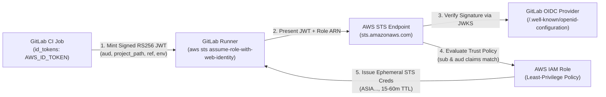
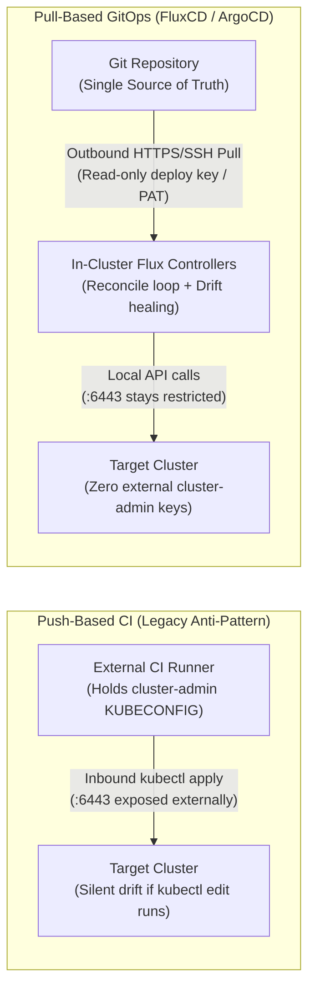
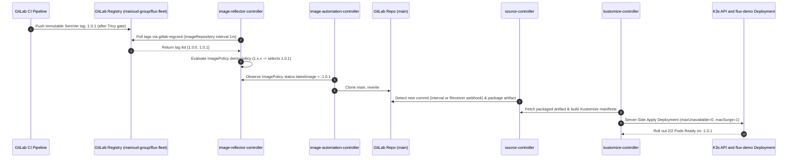
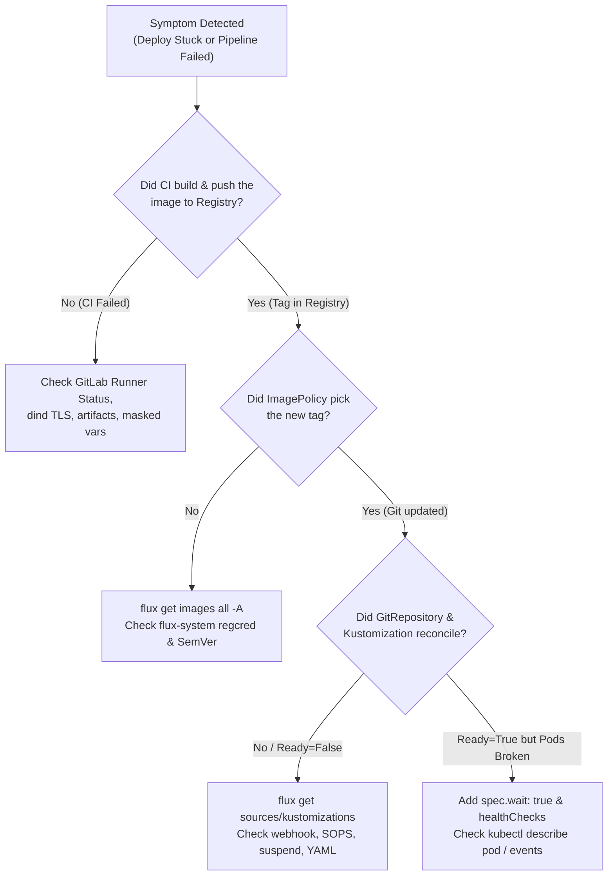

## 7. CI/CD Pipelines, GitLab CI, and GitOps with FluxCD and ArgoCD

### 7.1 Git Engineering & CI/CD Pipeline Architecture (GitLab CI Focus)

#### Q1. [Junior] How do Trunk-Based Development, GitFlow, and GitHub/GitLab Flow compare, and when should you choose each?

**Executive Takeaway:** Trunk-Based Development (TBD) maximizes delivery velocity and GitOps alignment by merging short-lived branches (`< 1-2 days`) directly into `main` behind feature flags, whereas GitFlow trades deployment speed for formal parallel release stabilization (`develop`, `release/*`, `hotfix/*`). Choosing the wrong branching model creates artificial merge bottlenecks or environment configuration drift.

**Branching Strategy Comparison:**

| Dimension | Trunk-Based Development (TBD) | GitHub Flow | GitLab Flow | GitFlow |
| :--- | :--- | :--- | :--- | :--- |
| **Core Branches** | `main` (+ tiny feature branches `< 48h`) | `main` + feature branches | `main` + environment/release branches | `main`, `develop`, `feature/*`, `release/*`, `hotfix/*` |
| **Release Cadence** | Continuous (multiple times/day) | Continuous (deploy on merge to `main`) | Scheduled or staged env promotion | Periodic / versioned software releases |
| **Merge Conflict Risk** | Very low | Low | Moderate | High (long-lived `develop` vs `release/*`) |
| **Safety Mechanism** | Feature flags + automated tests | PR reviews + CI status checks | Protected env branches + manual gates | Formal QA stabilization branches |
| **Best Fit** | Cloud-native microservices, SaaS, GitOps | Web apps with single prod target | Multi-env services needing staged sign-off | Packaged/on-prem/mobile multi-version software |

**Architectural Trade-offs & Senior Guidance:**
- **Trunk-Based Development & Feature Flags:** Incomplete features merge safely into `main` using runtime toggles (feature flags) or **Branch by Abstraction** rather than sitting on stale branches for weeks. This keeps every commit continuously integrated and prevents "merge day" outages.
- **GitHub Flow vs GitLab Flow:** GitHub Flow assumes `main` is always deployable directly to production. GitLab Flow extends that with upstream-first promotion across environment branches (`main` -> `pre-production` -> `production`) or versioned `*-stable` release branches.
- **GitOps Caveat:** In Kubernetes GitOps repositories (like `marioud-group/flux-fleet` in Task 5), avoid using GitFlow's multi-branch topology for environment state; keep infrastructure config in a single trunk (`main`) using folder overlays instead of long-lived environment branches (see Q16).

---

#### Q2. [Junior] What is the difference between `git merge`, `git rebase`, and `git revert`, why must you never `reset --hard` and force-push on shared `main`, and why sign commits with GPG/SSH?

**Executive Takeaway:** `git merge` preserves exact branching topology via a merge commit, `git rebase` replays local commits onto a new base for a linear history, and `git revert` appends an inverse commit safely without altering history—whereas `git reset --hard` plus `git push --force` on `main` breaks collaborators, destroys audit trails, and corrupts GitOps reconciliation. Cryptographic commit signing prevents trivial Git author spoofing in regulated DevSecOps pipelines.

**Mechanics & Safe Usage:**
- **`git merge --no-ff feature/auth`:** Preserves true chronological branch points and creates an explicit merge commit that is easy to revert as one logical unit.
- **`git rebase origin/main`:** Rewrites commit hashes on your **private, unshared** feature branch so commits sit cleanly on top of the latest `main`. If you already pushed your feature branch privately, update it with `git push --force-with-lease` (never raw `--force`), which aborts if someone else pushed commits in the meantime.
- **`git revert <COMMIT_SHA>`:** Creates a **new** commit that applies the exact inverse diff of `<COMMIT_SHA>`. Because Git history remains append-only, teammates pull cleanly and audit logs remain intact.

**Why `git reset --hard` + Force Push on Shared `main` Is Forbidden:**
1. **Dangling/Diverged Team History:** Any teammate who branched from or pulled the discarded commits will re-introduce deleted commits on their next merge or hit forced conflicts.
2. **Broken GitOps & Deployment Provenance:** Controllers like FluxCD `source-controller` track branch tips by commit SHA. Rewriting `main` mid-flight breaks commit-to-artifact traceability, invalidates signed tags, and can leave clusters running unreferenced manifests until the next forced fetch.
3. **Compliance Failure (SOC 2 / ISO 27001):** Production change control requires an immutable audit trail of who approved and shipped every change.

**GPG and SSH Commit Signing (Supply-Chain Provenance):**
- Git's `user.name` and `user.email` are unverified metadata—any user can run `git config user.email "cto@company.com"` and forge attribution.
- Modern Git (`>= 2.34`) supports native SSH commit signing alongside GPG, removing GPG keyring friction:

```bash
# Configure Git to sign every commit using an SSH signing key
git config --global gpg.format ssh
git config --global user.signingkey ~/.ssh/id_ed25519_signing.pub
git config --global commit.gpgsign true

# Verify commit signatures locally or in CI
git log --show-signature -n 5
git verify-commit HEAD
```

- Enforce **GitLab Push Rules ("Reject unsigned commits")** + **Signed Commits badge verification** on protected branches (`main`) so unsigned commits or spoofed author identities are rejected before CI even triggers.

---

#### Q3. [Junior] In GitLab CI, how do stages and jobs work, why does `rules:` replace `only/except`, what is the difference between `artifacts` and `cache`, and how does `needs:` DAG execution reduce pipeline lead time?

**Executive Takeaway:** `stages` enforce sequential synchronization barriers across parallel `jobs`, while `needs:` builds a Directed Acyclic Graph (DAG) so independent jobs start immediately as soon as their specific upstream dependencies complete; `rules:` replaces deprecated `only/except` with deterministic ordered conditionals, `artifacts` pass job outputs downstream, and `cache` accelerates repeated builds across pipelines.

**`artifacts` vs `cache` Comparison:**

| Feature | `artifacts` | `cache` |
| :--- | :--- | :--- |
| **Primary Purpose** | Pass build binaries, test reports, SBOMs, or JUnit XML to downstream jobs/UI | Speed up jobs across pipelines by reusing downloaded dependencies (`.venv`, `node_modules`) |
| **Guarantee** | **Guaranteed** (downstream job fails or skips if missing) | **Best-effort** (jobs must tolerate a cache miss) |
| **Storage & Scope** | Stored in GitLab object storage per pipeline; downloadable via UI/API | Stored per runner or shared S3/GCS bucket keyed by `key:` across pipelines |
| **Lifecycle** | Controlled by `expire_in:` (e.g., `1 week`) | Persists across runs until key changes (e.g., `files: [requirements.txt]`) |

**`rules:` vs Deprecated `only/except`:**
- Legacy `only`/`except` suffered from opaque precedence rules and could not combine complex branch, MR, file-change, and manual trigger conditions cleanly.
- `rules:` evaluates a single ordered list of `if:` / `changes:` / `exists:` clauses top-to-bottom and stops at the first match (`when: on_success`, `when: manual`, `when: never`).

**GitLab CI DAG Pipeline Example (Inspired by CyShield Task 4):**

```yaml
workflow:
  rules:
    - if: '$CI_PIPELINE_SOURCE == "merge_request_event"'
    - if: '$CI_COMMIT_BRANCH && $CI_OPEN_MERGE_REQUESTS'
      when: never
    - if: '$CI_COMMIT_BRANCH == $CI_DEFAULT_BRANCH'

stages:
  - build
  - verify
  - containerize

variables:
  PIP_CACHE_DIR: "$CI_PROJECT_DIR/.cache/pip"

.mr_or_main_rules: &mr_or_main_rules
  - if: '$CI_PIPELINE_SOURCE == "merge_request_event"'
  - if: '$CI_COMMIT_BRANCH == $CI_DEFAULT_BRANCH'

build_app:
  stage: build
  image: python:3.12-slim
  cache:
    key:
      files:
        - requirements.txt
    paths:
      - .cache/pip
      - .venv/
  script:
    - python -m venv .venv && . .venv/bin/activate
    - pip install -r requirements.txt
    - python manage.py check
    - python manage.py collectstatic --noinput
  artifacts:
    paths:
      - .venv/
      - staticfiles/
    expire_in: 1 hour
  rules: *mr_or_main_rules

pytest_unit:
  stage: verify
  image: python:3.12-slim
  needs: ["build_app"]
  script:
    - . .venv/bin/activate
    - pytest --junitxml=report.xml
  artifacts:
    when: always
    reports:
      junit: report.xml
  rules: *mr_or_main_rules

dependency_sca_scan:
  stage: verify
  image:
    name: aquasec/trivy:0.58.1
    entrypoint: [""]
  needs: []  # Starts immediately at t=0 without waiting for build_app
  script:
    - trivy fs --scanners vuln --severity CRITICAL,HIGH --exit-code 1 .
  rules: *mr_or_main_rules

docker_build_and_gate:
  stage: containerize
  needs: ["pytest_unit", "dependency_sca_scan"]
  rules:
    - if: '$CI_COMMIT_BRANCH == $CI_DEFAULT_BRANCH'
  script:
    - echo "Build and scan OCI image before registry push (see Q4 and Q7)"
```

Notice how `dependency_sca_scan` sets `needs: []` to start concurrently with `build_app`, cutting total wall-clock pipeline time rather than blocking behind stage barriers.

---

#### Q4. [Mid] Why do mounting `/var/run/docker.sock` and running privileged `docker:dind` break runner isolation, and how do rootless Kaniko, Buildah, or isolated Buildx runners harden CI container builds?

**Executive Takeaway:** Binding `/var/run/docker.sock` or running `--privileged` `docker:dind` effectively grants untrusted pipeline code root privileges on the CI worker host, enabling container escape, secret theft from concurrent jobs, and persistent runner backdoors. Modern DevSecOps pipelines build OCI images daemonlessly in userspace (Buildah, Kaniko) or inside rootless BuildKit / single-use ephemeral microVMs.

**Why Legacy Docker-in-CI Patterns Are Critical Risks:**
1. **Mounting `/var/run/docker.sock` (Docker Socket Exposure):**
   - The Docker socket speaks directly to the **host's** root `dockerd` daemon, bypassing container namespace and cgroup boundaries.
   - Any developer who can edit `.gitlab-ci.yml` or a test script on a PR can immediately execute a full host root escape:
     ```bash
     # Trivial container escape when /var/run/docker.sock is mounted
     docker run --rm -v /:/host --privileged alpine chroot /host sh -c "cat /etc/shadow && env"
     ```
   - Attackers can inspect sibling job containers running on the same runner (`docker inspect`), steal injected CI/CD cloud tokens, and implant cronjobs on the runner host.
2. **Privileged `docker:dind` (Docker-in-Docker):**
   - Running `docker:dind` requires `privileged = true` on the GitLab Runner, which disables seccomp, AppArmor, and Linux capability dropping (`CAP_SYS_ADMIN`, device cgroups), letting kernel exploits or host `sysfs`/`procfs` manipulation escape to the node.

**Hardened Container Build Alternatives:**

| Builder Approach | Root / Daemon Required? | Isolation Mechanism | Trade-offs & Operational Reality |
| :--- | :--- | :--- | :--- |
| **Buildah (Rootless)** | No daemon; unprivileged UID | Linux user namespaces + `fuse-overlayfs` / `vfs` | Native OCI builds (`buildah bud`); requires `/etc/subuid` & kernel userns support; active CNCF/Red Hat support |
| **Docker Buildx / Rootless BuildKit** | Rootless `buildkitd` (`UID 1000`) | User namespaces + seccomp/AppArmor; zero `--privileged` | Fast layer caching, multi-arch builds, BuildKit `--mount=type=secret`; needs rootless-compatible runner config |
| **Kaniko** | No daemon; runs in K8s pod | Executes `RUN` instructions in userspace | Works inside unprivileged K8s pods without userns; note upstream Google repo entered maintenance mode (evaluate Chainguard forks) and verify non-root FS edge cases |
| **Ephemeral VM-Isolated Runners** | Isolated per-job VM (`dind` inside VM) | Hardware virtualization (Firecracker / AWS EC2 Autoscaler) | Strongest multi-tenant boundary; `dind` only compromises a single-use VM destroyed right after the job |

**Hardened Rootless Buildah Example in `.gitlab-ci.yml`:**

```yaml
build_oci_image:
  stage: containerize
  image: quay.io/buildah/stable:v1.37
  variables:
    STORAGE_DRIVER: "vfs"
    BUILDAH_FORMAT: "oci"
  script:
    - buildah bud --isolation chroot -t "$CI_REGISTRY_IMAGE:sha-${CI_COMMIT_SHORT_SHA}" .
    # Scan locally BEFORE logging in or pushing (Task 4 security gate pattern)
    - buildah push "$CI_REGISTRY_IMAGE:sha-${CI_COMMIT_SHORT_SHA}" "oci-archive:image.tar"
    # Only log in right before pushing after Trivy passes, using --password-stdin to avoid ps exposure:
    # - printf '%s' "$CI_REGISTRY_PASSWORD" | buildah login -u "$CI_REGISTRY_USER" --password-stdin "$CI_REGISTRY"
```

---

#### Q5. [Senior] How do you replace static AWS IAM keys (`AKIA...`) in GitLab CI with keyless OIDC federation, and how do you mitigate OWASP Top 10 CI/CD security risks?

**Executive Takeaway:** Long-lived static IAM keys (`AKIA...`) in CI variables never expire automatically and can leak via debug logs, runner memory, or misconfigured fork pipelines; GitLab OIDC `id_tokens` exchange short-lived signed JWTs directly with AWS STS `AssumeRoleWithWebIdentity` for ephemeral credentials scoped to exact repository, branch, and environment claims.

**Keyless GitLab OIDC -> AWS STS Authentication Flow:**



**Implementation Snippets (`.gitlab-ci.yml` + AWS IAM Trust Policy):**

```yaml
deploy_staging_aws:
  stage: deploy
  image:
    name: amazon/aws-cli:2.27.63
    entrypoint: [""]
  id_tokens:
    AWS_ID_TOKEN:
      aud: https://sts.amazonaws.com
  rules:
    - if: '$CI_COMMIT_BRANCH == "main"'
  script:
    - |
      CREDS=$(aws sts assume-role-with-web-identity \
        --role-arn "arn:aws:iam::<AWS_ACCOUNT_ID>:role/gitlab-ci-staging-role" \
        --role-session-name "gitlab-${CI_PROJECT_ID}-${CI_PIPELINE_ID}" \
        --web-identity-token "${AWS_ID_TOKEN}" \
        --duration-seconds 900 \
        --query 'Credentials.[AccessKeyId,SecretAccessKey,SessionToken]' \
        --output text)
      read -r AWS_ACCESS_KEY_ID AWS_SECRET_ACCESS_KEY AWS_SESSION_TOKEN <<EOF
      $CREDS
      EOF
      export AWS_ACCESS_KEY_ID AWS_SECRET_ACCESS_KEY AWS_SESSION_TOKEN
      aws sts get-caller-identity
```

```json
{
  "Version": "2012-10-17",
  "Statement": [
    {
      "Effect": "Allow",
      "Principal": {
        "Federated": "arn:aws:iam::<AWS_ACCOUNT_ID>:oidc-provider/gitlab.com"
      },
      "Action": "sts:AssumeRoleWithWebIdentity",
      "Condition": {
        "StringEquals": {
          "gitlab.com:aud": "https://sts.amazonaws.com"
        },
        "StringLike": {
          "gitlab.com:sub": "project_path:marioud-group/my-app:ref_type:branch:ref:main"
        }
      }
    }
  ]
}
```

**OWASP Top 10 CI/CD Risks & Hardening Controls:**
1. **Poisoned Pipeline Execution (`CICD-SEC-4: PPE`) on Fork MRs/PRs:**
   - **Direct PPE:** An external fork modifies `.gitlab-ci.yml` in a Merge Request to exfiltrate environment tokens or crypto-mine on internal runners.
   - **Indirect PPE:** Even if `.gitlab-ci.yml` is protected or externalized, a fork modifies `Makefile`, `pytest` fixtures, or `setup.py` executed by the pipeline.
   - **Defense:** Never run fork MR pipelines on internal privileged runners; disable secret/OIDC access on untrusted branches; require explicit **Maintainer approval** before executing pipelines from forks; separate unprivileged PR checks from protected release pipelines.
2. **Untrusted Third-Party Actions, Orbs, and Includes (`CICD-SEC-8`):**
   - Never reference mutable tags like `include: ref: main` or `@v1` in CI templates/GitHub Actions. Pin external components to immutable **40-character Git commit SHAs** or vendor/mirror vetted templates inside an internal registry/group.
3. **Insufficient Flow Control & Runner Isolation (`CICD-SEC-1`, `CICD-SEC-5`):**
   - Enforce **Protected Branches** (`main` disallows direct pushes, requires MR approvals + CODEOWNERS) and **Protected + Masked CI Variables** (Protected variables are injected *only* into protected branches/tags; Masked variables are scrubbed from job logs).
   - Use ephemeral single-job runners with strict egress firewalls (`NetworkPolicy` / Security Group) so compromised test code cannot reach internal cluster APIs or AWS IMDS (`169.254.169.254` — require IMDSv2 `HttpTokens=required` as applied in Task 2).

---

#### Q6. [Senior] Why must you never deploy `:latest` in production or GitOps, and how do RollingUpdate, Blue-Green, and Canary Progressive Delivery (Flagger) compare?

**Executive Takeaway:** Deploying `:latest` violates immutability, breaks Kubernetes node image caching (`IfNotPresent`), blinds GitOps diffing because Git shows no commit change when `:latest` is overwritten, and prevents deterministic rollbacks. Production pipelines must publish immutable SemVer (`1.0.1`), Git-SHA (`sha-9f3a1c2`), or digest (`@sha256:...`) tags paired with `readinessProbe` and progressive delivery.

**Why `:latest` Fails in Production & GitOps:**
- **Silent Drift Across Nodes:** Node A may pull `:latest` at 10:00 (v1), while Node B scales up at 14:00 and pulls `:latest` (v2) under `imagePullPolicy: IfNotPresent`—running split binaries inside the same `ReplicaSet`.
- **Breaks FluxCD/ArgoCD Reconciliation:** Flux `ImagePolicy` cannot establish a monotonic SemVer/numerical ordering over `:latest`, and `git revert` cannot roll back when two deployments share the exact same tag string.

**Kubernetes Deployment Strategies Comparison:**

| Strategy | Traffic Shift Mechanism | Infra Overhead | Rollback Speed & Blast Radius | When to Use |
| :--- | :--- | :--- | :--- | :--- |
| **RollingUpdate** | K8s `Deployment` replaces pods incrementally (`maxUnavailable: 0, maxSurge: 1`) | Minimal (`+1` surge pod) | Halts automatically if `readinessProbe` fails; slow full rollback without Git revert | Default stateless APIs with backward-compatible changes (Task 5 `flux-demo`) |
| **Blue-Green** | Two full stacks (Blue live, Green preview); atomic `Service` selector / `Ingress` swap | `2x` compute during cutover | Instant (`Service` flips back to Blue); zero mixed-version traffic | Strict no-mixed-version workloads, major UI/API cutovers |
| **Canary + Progressive Delivery** | Incremental weighted routing (`5% -> 10% -> 25% -> 50%`) via **Flagger** + Ingress/Gateway API | Low (`~5-20%` canary pods) | Automated metrics-driven abort in seconds; smallest user blast radius | High-traffic prod services with strict SLOs (`5xx` rate, `p99` latency) |

**How Task 5's `RollingUpdate` + Flagger Progressive Delivery Work:**
- In `task-5/flux-fleet/clusters/staging/apps/demo/deployment.yaml`, the `flux-demo` Deployment specifies:
  - `strategy.rollingUpdate.maxUnavailable: 0` and `maxSurge: 1`: ensures 100% healthy capacity remains serving before old pods terminate.
  - `progressDeadlineSeconds: 120` + `readinessProbe`: if a broken image crashes (`CrashLoopBackOff`) or fails `/`, Kubernetes freezes the rollout, keeps the old healthy ReplicaSet serving, and marks the Deployment `Progressing=False (ProgressDeadlineExceeded)` (note `ProgressDeadlineExceeded` reason).
- **Upgrading to Canary with Flagger (Flux Ecosystem):**
  - **Flagger** (part of the Flux CNCF ecosystem) watches a target `Deployment` and `Canary` CRD. When Flux updates the image tag in Git, Flagger creates a canary ReplicaSet, shifts traffic incrementally through **NGINX Ingress** or **Cilium Gateway API / Envoy**, queries **Prometheus** (`request-success-rate >= 99%`, `request-duration p99 < 500ms`) every `30s`, and either promotes the new primary or automatically rolls back traffic to `0%` canary—zero manual intervention required.
  - **Database Compatibility Rule:** Both RollingUpdate and Canary run old and new code simultaneously, requiring backward-compatible **Expand-and-Contract** schema migrations before deploying breaking code.

---

#### Q7. [Expert] How do you architect an end-to-end DevSecOps supply-chain security gate in CI/CD (SCA, CVE gating, SBOM, Cosign, and Kubernetes admission)?

**Executive Takeaway:** A production-grade DevSecOps pipeline treats CI as an untrusted-code boundary that validates dependencies (SAST/SCA), builds minimal non-root images, blocks vulnerable images *before* registry publication (as demonstrated in CyShield Task 4), emits an SBOM, signs immutable `@sha256:` digests with Cosign, and enforces signature + provenance checks at Kubernetes admission (`Kyverno` / `OPA Gatekeeper`).

**Defense-in-Depth Gate Mechanics (Extending CyShield Task 4):**
1. **Why Pre-Push Gating Matters (Task 4 Lesson):**
   - In Task 4 (`zinmyoswe/Django-Ecommerce`), running the container vulnerability scan **before** `docker push` blocked a vulnerable Django image from ever entering `registry.gitlab.com`.
   - If you push first and scan later, FluxCD's `image-reflector-controller` could immediately detect and deploy the vulnerable SemVer tag during the scan window!
2. **Pipeline Gate Stages:**
   - **SAST & Secrets:** `semgrep` + `gitleaks` catch hardcoded keys/tokens and SQLi/XSS bugs on MR events.
   - **SCA & Container CVE Gate:** Scan the local OCI archive (`trivy image --input image.tar --severity CRITICAL,HIGH --ignore-unfixed --exit-code 1`). Use `--ignore-unfixed` pragmatically or manage risk-accepted exceptions via time-bound VEX / `.trivyignore` files (requiring Security Lead approval and expiry dates) so pipelines don't silently stall on unfixable base OS noise while still blocking patchable exploits.
   - **SBOM & Provenance Attestation:** Generate a CycloneDX/SPDX SBOM (`syft`) and attach it to the OCI artifact alongside SLSA provenance.
   - **Keyless Signing with Cosign (Sigstore):** Sign the exact immutable registry **digest** (`image@sha256:...`, never just the mutable tag) using GitLab's OIDC token so there are no static signing private keys to rotate.
3. **Runtime Admission Enforcement (Kubernetes Boundary):**
   - Deploy **Kyverno** (`verifyImages`) or **OPA Gatekeeper** as a ValidatingAdmissionWebhook on the cluster to enforce:
     1. Reject `:latest` tags and require `@sha256:` digest or immutable SemVer.
     2. Verify the Cosign signature against your GitLab OIDC issuer + repository subject (`marioud-group/*`)—stopping anyone with direct registry credentials from sneaking an unscanned image past CI!

---

### 7.2 GitOps & FluxCD v2 Deep Dive

#### Q8. [Junior] What is GitOps, what are the 4 OpenGitOps Principles, and why is Git the Single Source of Truth?

**Executive Takeaway:** GitOps is an operating model for Kubernetes and cloud infrastructure where the entire desired system state is stored declaratively in Git, and autonomous in-cluster software agents continuously pull and reconcile live cluster resources to match Git. Git becomes the Single Source of Truth (SSOT) providing peer-reviewed change control, cryptographic attribution, and atomic rollbacks.

**The 4 CNCF OpenGitOps Principles:**
1. **Declarative:** The desired state of the system (Deployments, Services, HelmReleases, NetworkPolicies, CRDs) must be expressed declaratively (YAML/JSON/Kustomize/Helm), never via imperative scripts (`kubectl create`, `kubectl patch` in loops).
2. **Versioned and Immutable:** Desired state is stored in Git (or signed OCI artifacts) in a way that enforces immutability, versioning, and retains a complete commit history of every configuration change.
3. **Pulled Automatically:** Software agents (FluxCD or ArgoCD controllers) running *inside* the target cluster automatically pull desired state declarations from the source repository—nothing external pushes commands into the cluster.
4. **Continuously Reconciled:** Controllers continuously observe live cluster state against Git desired state and self-heal any divergence (configuration drift) automatically.

**Why Git as SSOT Beats Ad-Hoc `kubectl`:**
- Every production change passes through a Pull/Merge Request (`git diff` + code review + automated CI validation).
- `git log` provides an exact audit trail of *who* changed *what*, *when*, and *why*.
- Disaster recovery of a destroyed cluster reduces to bootstrapping FluxCD against the same Git repository and letting controllers recreate every namespace and workload deterministically.

---

#### Q9. [Mid] Push-based CI (`kubectl apply` from CI) vs Pull-based GitOps (FluxCD/ArgoCD): why does Pull-based win on security, drift healing, and auditability?

**Executive Takeaway:** Push-based CI pipelines require exporting powerful `cluster-admin` kubeconfig credentials to external CI servers and exposing Kubernetes API ports (`TCP/6443`), whereas Pull-based GitOps keeps cluster credentials strictly inside the cluster and continuously repairs manual configuration drift.

**Architectural Contrast:**



**Push vs Pull Comparison:**

| Dimension | Push-Based CI (`kubectl apply` / `helm upgrade` in CI) | Pull-Based GitOps (FluxCD / ArgoCD) |
| :--- | :--- | :--- |
| **Credential Blast Radius** | External CI SaaS/runners hold `cluster-admin` kubeconfig/tokens | Cluster credentials never leave the cluster; GitOps only needs read-only (or scoped image-write) Git access |
| **Network Exposure** | CI runners must reach cluster API (`:6443`), violating `/32` IP allowlists | Cluster initiates outbound pull to Git; `:6443` stays locked down to admin VPN/bastion (as in Task 2) |
| **Drift Detection & Healing** | None; manual `kubectl edit` stays broken until next CI run | Continuous reconciliation loop detects and reverts manual drift automatically |
| **Deployment State Visibility** | CI exits `0` after `apply`; blind to pod crash loops 2 minutes later unless polled | In-cluster controller observes live pod/rollout readiness and reports `Ready=True/False` |
| **Multi-Cluster Scaling** | CI scripts loop over `N` cluster kubeconfigs (brittle, slow) | Each cluster autonomously pulls its fleet path from Git (`clusters/dev`, `clusters/prod`) |

---

#### Q10. [Mid] Does FluxCD build Docker images or replace CI? How do CI and CD cleanly separate concerns?

**Executive Takeaway:** **No**—FluxCD never compiles application code, executes unit tests, runs vulnerability scanners on source code, or builds Docker images. CI and GitOps CD operate on a strict separation of concerns joined only by an immutable OCI container registry and a declarative Git repository.

**Clean Separation of Concerns (Task 4 -> Task 5 Workflow):**
1. **CI Pipeline Responsibility (GitLab CI — Task 4):**
   - Triggers on application repository commits/MRs.
   - Installs dependencies, runs unit/integration tests (`pytest`), performs SAST/SCA scans, builds the OCI container image, enforces the container CVE gate (`Trivy`), and pushes an immutable SemVer/Git-SHA tag to `registry.gitlab.com`.
2. **CD / GitOps Responsibility (FluxCD — Task 5):**
   - Never checks out application source code (`Dockerfile`, `manage.py`) or invokes `docker build`.
   - Watches container registries for approved tags (`ImageRepository` + `ImagePolicy`) or watches Git manifest repos (`GitRepository`), writes the promoted image tag into Kubernetes YAML, and reconciles cluster state (`source-controller`, `kustomize-controller`, `helm-controller`).

**Why Mixing Image Builds into CD Is Dangerous:**
- Building images inside the production cluster widens the runtime attack surface (build tools, compilers, source secrets inside prod).
- Non-deterministic builds (`apt-get update` during deploy) make rollbacks impossible because rebuilding an old commit can pull different upstream packages.

---

#### Q11. [Senior] What are the FluxCD v2 controllers, what exact role does each play, and why is "image-policy-controller" a common misconception?

**Executive Takeaway:** FluxCD v2 (built on the CNCF GitOps Toolkit) comprises **four core controllers** (`source-controller`, `kustomize-controller`, `helm-controller`, `notification-controller`) plus **two optional image-automation controllers** (`image-reflector-controller`, `image-automation-controller`). Crucially, FluxCD has **no** separate `image-policy-controller`—`image-reflector-controller` handles **both** registry scanning (`ImageRepository`) and policy evaluation (`ImagePolicy`).

**FluxCD v2 Controllers & Exact CRD Ownership (Verified in `task-5/flux-fleet/.../gotk-components.yaml`):**

| Controller Deployment | Primary Responsibility | CRDs Managed (`apiVersion` / `kind`) |
| :--- | :--- | :--- |
| **`source-controller`** | Unified artifact fetcher; clones Git, pulls Helm charts/OCI artifacts, verifies GPG/Cosign signatures, and serves versioned tarballs internally | `GitRepository`, `HelmRepository`, `HelmChart`, `OCIRepository`, `Bucket` (`source.toolkit.fluxcd.io`) |
| **`kustomize-controller`** | Renders Kustomize overlays, performs server-side `apply`, garbage-collects deleted resources (`prune: true`), checks readiness (`wait: true`, `healthChecks`), and decrypts **SOPS** secrets | `Kustomization` (`kustomize.toolkit.fluxcd.io`) |
| **`helm-controller`** | Declaratively manages full Helm v3 chart lifecycles using the native Helm Go SDK (install, upgrade, test, dependency ordering, and automated Helm rollback on failure) | `HelmRelease` (`helm.toolkit.fluxcd.io`) |
| **`notification-controller`** | Handles **inbound** webhook events (triggering instant source syncs on Git push without waiting for polling) and **outbound** alerts (Slack, MS Teams, GitLab/GitHub commit statuses) | `Receiver`, `Provider`, `Alert` (`notification.toolkit.fluxcd.io`) |
| **`image-reflector-controller`** | Polls container registries for image metadata/tags **AND** evaluates tag-selection rules (SemVer ranges, regex filters, alphabetical/numerical ordering) | `ImageRepository`, `ImagePolicy` (`image.toolkit.fluxcd.io`) |
| **`image-automation-controller`** | Checks out Git repositories, locates `# {"$imagepolicy": "..."}` setter comments, updates image tags to the latest `ImagePolicy` selection, and commits + pushes back to Git | `ImageUpdateAutomation` (`image.toolkit.fluxcd.io`) |

> **CRITICAL ACCURACY NOTE (Common Interview Trap):**
> Some documentation summaries informally write "image-policy-controller" when describing step 3 of the Flux image update flow, and candidates sometimes repeat it in interviews. **FluxCD v2 does NOT have an `image-policy-controller` binary or deployment.** Verify with `flux bootstrap ... --components-extra=image-reflector-controller,image-automation-controller` or `kubectl get deploy -n flux-system`: there are only 6 controller Deployments, and **`image-reflector-controller`** reconciles both `ImageRepository` and `ImagePolicy`. Calling this out accurately immediately signals genuine hands-on FluxCD v2 mastery!

**End-to-End CI Push to Kubernetes Deployment Sequence (Task 5 Architecture):**



---

#### Q12. [Senior] How does FluxCD Image Automation work in practice (`ImageRepository`, `ImagePolicy`, `ImageUpdateAutomation`), and what security safeguards should surround it?

**Executive Takeaway:** `ImageRepository` caches registry tags, `ImagePolicy` selects the highest permitted version (e.g., SemVer `1.x.x`), and `ImageUpdateAutomation` edits `# {"$imagepolicy": "namespace:policy"}` comment markers in Git—requiring proper pull-secret scoping across namespaces, SOPS encryption for Git secrets, and branch/PR guardrails for production.

**Concrete Task 5 Resource Chain:**

1. **`ImageRepository` (`clusters/staging/image-automation/image-repository.yaml`):**
   ```yaml
   apiVersion: image.toolkit.fluxcd.io/v1
   kind: ImageRepository
   metadata:
     name: demo-repo
     namespace: flux-system
   spec:
     image: registry.gitlab.com/marioud-group/flux-fleet
     interval: 1m0s
     secretRef:
       name: gitlab-regcred
   ```
2. **`ImagePolicy` (`clusters/staging/image-automation/image-policy.yaml`):**
   ```yaml
   apiVersion: image.toolkit.fluxcd.io/v1
   kind: ImagePolicy
   metadata:
     name: demo-policy
     namespace: flux-system
   spec:
     imageRepositoryRef:
       name: demo-repo
     policy:
       semver:
         range: 1.x.x
   ```
3. **`ImageUpdateAutomation` (`clusters/staging/image-automation/image-update.yaml`) + Setter Marker (`deployment.yaml`):**
   ```yaml
   apiVersion: image.toolkit.fluxcd.io/v1
   kind: ImageUpdateAutomation
   metadata:
     name: flux-system
     namespace: flux-system
   spec:
     interval: 1m0s
     sourceRef:
       kind: GitRepository
       name: flux-system
     git:
       checkout:
         ref:
           branch: main
       commit:
         author:
           email: marioud@users.noreply.github.com
           name: marioud
         messageTemplate: 'chore(flux): update image to {{range .Changed.Changes}}{{.NewValue}}{{end}}'
       push:
         branch: main
     update:
       path: ./clusters/staging/apps
       strategy: Setters
   ```
   Target line in `clusters/staging/apps/demo/deployment.yaml`:
   ```yaml
   image: registry.gitlab.com/marioud-group/flux-fleet:1.0.1 # {"$imagepolicy": "flux-system:demo-policy"}
   ```

**Senior Security & Operational Safeguards:**
- **Dual-Namespace Registry Secrets:** `image-reflector-controller` reads `gitlab-regcred` inside **`flux-system`**, whereas the Kubelet pulling pod images reads `imagePullSecrets` from the workload's namespace (**`default`** for `flux-demo`). Omitting either secret breaks discovery or pod startup.
- **No Plaintext Secrets in Git (Mozilla SOPS):** Never commit raw `Secret` manifests (`gitlab-regcred`, DB passwords) to Git. Encrypt `stringData` / `data` fields with **SOPS** using `age`, AWS KMS, or GPG keys and enable `spec.decryption: { provider: sops, secretRef: { name: sops-age } }` on the Flux `Kustomization` so `kustomize-controller` decrypts strictly in memory inside the cluster.
- **Staging vs Production Push Guardrails:** Direct push to `main` (`push.branch: main`) is ergonomic for `dev`/`staging` labs (Task 5), but in production configure `push.branch: flux-image-updates` and automate a GitLab Merge Request so human approvals or integration tests gate production rollouts. Also scope Flux's GitLab PAT (`read_registry`, `api` / `write_repository`) exclusively to the fleet repo—never a personal admin token across all org repos.

---

#### Q13. [Senior] How does `notification-controller` eliminate polling lag and close the CI/CD observability loop in FluxCD?

**Executive Takeaway:** Relying exclusively on `GitRepository.spec.interval` (`1m`–`10m`) wastes registry/Git API quota and introduces multi-minute deployment lag; `notification-controller` enables **event-driven inbound webhooks** (`Receiver`) for sub-second sync and **outbound notifications** (`Provider` + `Alert`) to report reconciliation success or failure straight to GitLab commit statuses and Slack.

**Inbound Webhook (`Receiver`) + Outbound Feedback (`Provider` / `Alert`):**

```yaml
apiVersion: notification.toolkit.fluxcd.io/v1
kind: Receiver
metadata:
  name: gitlab-fleet-receiver
  namespace: flux-system
spec:
  type: gitlab
  events:
    - "Push Hook"
  secretRef:
    name: webhook-token   # Shared HMAC/token validated against X-Gitlab-Token
  resources:
    - kind: GitRepository
      name: flux-system
---
apiVersion: notification.toolkit.fluxcd.io/v1beta3
kind: Provider
metadata:
  name: gitlab-commit-status
  namespace: flux-system
spec:
  type: gitlab
  address: https://gitlab.com/marioud-group/flux-fleet
  secretRef:
    name: gitlab-api-token # Dedicated Secret containing a `token` key (GitLab PAT with `api` scope)
---
apiVersion: notification.toolkit.fluxcd.io/v1beta3
kind: Alert
metadata:
  name: kustomization-status
  namespace: flux-system
spec:
  providerRef:
    name: gitlab-commit-status
  eventSeverity: info
  eventSources:
    - kind: Kustomization
      name: "*"
```

**Why Interviewers Care:**
- Even with webhooks enabled, keep a fallback `interval` (e.g., `5m`–`10m`) so missed webhook deliveries during network blips self-heal automatically.
- Outbound `Provider` authentication requires a dedicated `Secret` holding a `token` key (a GitLab PAT with `api` scope to update commit statuses); the bootstrap `flux-system` secret (`identity`/`known_hosts` for SSH or `username`/`password` for HTTPS) lacks the `token` key and deploy keys lack `api` scope.
- Outbound `Alert` resources close the feedback loop for developers who have no `kubectl` access to production—they see Flux reconciliation health directly as green/red checkmarks on their GitLab commit or Slack channel.

---

#### Q14. [Senior] How do FluxCD and ArgoCD compare architecturally, and how do you answer "Your CV lists ArgoCD, why did your CyShield assignment use FluxCD?"

**Executive Takeaway:** ArgoCD is an opinionated, centralized GitOps platform featuring a built-in Web UI, SSO/RBAC, and `ApplicationSet`, whereas FluxCD is a modular, headless Kubernetes-native toolkit with native Helm SDK lifecycle control, `ServiceAccount` RBAC impersonation, and first-class Git image automation. Both implement the identical OpenGitOps pull-reconciliation model.

**FluxCD v2 vs ArgoCD Senior Comparison:**

| Capability | FluxCD v2 | ArgoCD |
| :--- | :--- | :--- |
| **Architecture** | Modular Kubernetes controllers (`source`, `kustomize`, `helm`, `notification`, `image-*`) configured via CRDs + `flux` CLI | Monolithic/hub architecture (`application-controller`, `repo-server`, `api-server`, `redis`, `dex`) |
| **Web UI & SSO** | Headless by default (optional lightweight UIs like Capacitor / Weave GitOps) | Rich built-in Web UI with live resource topology graphs, OIDC/Dex SSO, and RBAC |
| **Multi-Tenancy Security** | Native Kubernetes RBAC via `Kustomization.spec.serviceAccountName` impersonation + `crossNamespaceRef` disable flags | Custom `AppProject` boundaries + ArgoCD RBAC CSV policies (optional controller sharding) |
| **Helm Integration** | Native Helm v3 Go SDK via `helm-controller` (`HelmRelease`: runs Helm hooks, tests, native `helm rollback`) | Runs `helm template` and applies raw YAML (`argocd` tracks resources, emulates hooks via Sync Waves) |
| **Image Automation** | Built-in (`image-reflector-controller` + `image-automation-controller`) | Requires separate add-on (**Argo CD Image Updater**) |
| **Multi-Cluster Model** | Decentralized (each cluster runs lightweight Flux) or Cluster API remote `kubeconfig` | Centralized hub-and-spoke (`ApplicationSet` generators pushing/managing across registered clusters) |
| **Resource Footprint** | Very lightweight (ideal for edge/K3s clusters like Task 2/5 `t3.small` nodes) | Heavier baseline RAM/CPU (`redis`, `repo-server`, `api-server`) |

**Model Interview Answer ("CV has ArgoCD, Assignment used FluxCD"):**
> "At the senior level, GitOps is an architectural pattern—declarative state, pull-based reconciliation, immutable artifacts, and continuous drift healing—rather than memorizing one UI. I used ArgoCD in prior environments where platform teams needed a centralized SSO Web UI and `ApplicationSet` hub across multiple clusters. For the CyShield assessment on a compact self-managed K3s cluster, I chose FluxCD v2 because it has a much smaller memory footprint, treats every primitive as a composable Kubernetes CRD, handles `HelmRelease` natively via the Helm SDK, enforces multi-tenancy with pure Kubernetes `ServiceAccount` impersonation, and includes native `image-reflector-controller` and `image-automation-controller` for SemVer Git write-back without bolting on an external image updater. Because the reconciliation and rollback semantics are identical, moving between ArgoCD and FluxCD is straightforward."

---

#### Q15. [Expert] Why is `kubectl rollout undo` an anti-pattern in GitOps, and what is the exact rollback workflow when Image Automation is enabled?

**Executive Takeaway:** Running `kubectl rollout undo` modifies live cluster state out-of-band without updating Git, creating immediate configuration drift that FluxCD's `kustomize-controller` reverts right back to the broken tag on the next reconciliation cycle. Furthermore, when `ImageUpdateAutomation` is active, simply running `git revert` is insufficient unless you suspend automation first—otherwise Flux re-commits the broken highest SemVer tag within 60 seconds!

**Failure Containment Before Rollback (Task 5 `deployment.yaml`):**
- Because `clusters/staging/apps/demo/deployment.yaml` sets `maxUnavailable: 0`, `maxSurge: 1`, `progressDeadlineSeconds: 120`, and an HTTP `readinessProbe`, a bad image (e.g., `1.0.2` crashing on startup) cannot terminate existing `1.0.1` pods—Kubernetes stalls the new ReplicaSet and keeps `1.0.1` serving `100%` of live traffic while Flux surfaces `Kustomization` `Ready=False` (provided `wait: true` or `healthChecks` is enabled).

**Exact 5-Step GitOps Rollback Procedure (Image Automation Enabled):**

```bash
# 1. Pause image automation immediately so Flux does NOT re-commit the faulty tag
flux suspend image update flux-system

# 2. Revert the bad commit in Git (preserves immutable audit history) and push
git revert <BAD_COMMIT_SHA> --no-edit
git push origin main

# 3. Force immediate pull + Kustomize reconciliation without waiting for interval
flux reconcile kustomization flux-system --with-source

# 4. Verify healthy ReplicaSet restoration in cluster
kubectl rollout status deployment/flux-demo -n default

# 5. Remediate the broken artifact before resuming automation:
#    Either delete/yank the broken tag from GitLab Registry, push a fixed patch tag (e.g., 1.0.3),
#    or exclude the broken tag in ImagePolicy (e.g., filterTags / semver constraint), THEN resume:
flux resume image update flux-system
```

**`kustomize-controller` vs `helm-controller` Rollback Semantics:**
- `kustomize-controller` does **not** automatically `git revert` on failure; it halts progression (`Ready=False`) and alerts operators via `notification-controller` so Git remains the sole authority.
- `helm-controller` (`HelmRelease`) *can* perform automatic chart-level rollbacks (`spec.upgrade.remediation.retries: 3` and `spec.rollback`) when a Helm upgrade fails readiness checks—still leaving the `HelmRelease` status clearly flagged until Git is updated.

---

#### Q16. [Expert] How do you design multi-environment promotion (`dev -> staging -> prod`) and ordered reconciliation (`dependsOn`, `wait`, `healthChecks`) without branch-per-environment sprawl?

**Executive Takeaway:** Model environments using **directory-per-environment Kustomize overlays** (or versioned OCI artifacts) on a single `main` branch and promote changes through Merge/Pull Requests—never long-lived `dev`/`staging`/`prod` Git branches. Coordinate cluster boot ordering across CRDs, CNI/Ingress, and workloads using `Kustomization` `spec.dependsOn`, `spec.wait: true`, and `spec.healthChecks`.

**Why Branch-Per-Environment Is a GitOps Anti-Pattern:**
- Merging `dev -> staging -> prod` branches inevitably merges environment-specific replica counts, hostnames, resource quotas, or IAM role ARNs across environments, creating constant merge conflicts and silent prod regressions.
- `git diff` between environments becomes obscure instead of a crisp side-by-side directory diff.

**Recommended Multi-Environment Layout & PR Promotion:**

```text
flux-fleet/
├── apps/
│   ├── base/demo/              # Shared Deployment, Service, base Kustomization
│   └── overlays/
│       ├── dev/                # Auto-updated by ImageUpdateAutomation (replicas: 1)
│       ├── staging/            # Promoted via CI MR after dev E2E tests pass (replicas: 2)
│       └── prod/               # Promoted via MR requiring Lead approval + soak (replicas: 5)
└── clusters/
    ├── dev/                    # Flux bootstrap entrypoints pointing to overlays/dev
    ├── staging/                # Flux bootstrap entrypoints pointing to overlays/staging
    └── prod/                   # Flux bootstrap entrypoints pointing to overlays/prod
```

- **Promotion Mechanics:** `ImageUpdateAutomation` auto-updates `dev` only (`update.path: ./apps/overlays/dev`). Once automated smoke/Newman tests pass in `dev`, CI opens a Merge Request bumping the exact immutable SemVer tag or `@sha256:` digest inside `apps/overlays/staging/kustomization.yaml` (`images:` transformer), and after staging soak + manual approval, opens an MR into `prod`.

**Ordered Reconciliation DAG (`dependsOn` + `wait: true`):**

```yaml
apiVersion: kustomize.toolkit.fluxcd.io/v1
kind: Kustomization
metadata:
  name: platform-apps
  namespace: flux-system
spec:
  interval: 10m0s
  dependsOn:
    - name: crds-and-operators     # Must install CRDs + Cilium/cert-manager first
    - name: ingress-nginx          # Must be Ready before app Ingresses reconcile
  wait: true                       # Blocks dependents AND validates workload readiness
  timeout: 3m0s
  path: ./clusters/prod/apps
  prune: true
  sourceRef:
    kind: GitRepository
    name: flux-system
```

- **Why `wait: true` Is Essential:** Without `wait: true` (or explicit `healthChecks`), `kustomize-controller` considers a `Kustomization` healthy as soon as the Kubernetes API server accepts the YAML `apply`—meaning `platform-apps` could fire before `cert-manager` webhook pods or CRDs are actually serving, causing cascading apply errors.

---

### 7.3 Real-World CI/CD & GitOps Troubleshooting Playbook

Use this structured triage workflow when pipelines fail or cluster state diverges from Git:



#### Failure Playbook 1: Git Updated, Cluster Did NOT Update
- **Diagnostic Commands:**
  ```bash
  flux get sources git -A
  flux get kustomizations -A
  flux logs --all-namespaces --level=error --since=15m
  flux events --for Kustomization/flux-system -n flux-system
  ```
- **Common Root Causes & Fixes:**
  1. **Polling Delay vs Broken Webhook:** Default `GitRepository` `interval` (`1m`) + `Kustomization` `interval` (`10m` in `gotk-sync.yaml`) delays propagation if the `notification-controller` `Receiver` webhook failed or isn't configured. Run `flux reconcile kustomization flux-system --with-source` to force immediate pull and inspect `Receiver` ingress/HMAC logs.
  2. **Suspended Resource Left Over From an Incident:** `SUSPENDED=True` in `flux get kustomizations`. Fix with `flux resume source git flux-system` and `flux resume kustomization flux-system`.
  3. **Kustomize Build or Schema Error:** Validate locally with `kustomize build ./clusters/staging` and `flux diff kustomization flux-system --path=./clusters/staging` before pushing.
  4. **SOPS Decryption Failure:** Missing `age` / GPG secret or expired AWS KMS IAM role in `flux-system`; check `kustomize-controller` logs for `failed to decrypt`.
  5. **ServiceAccount Impersonation RBAC Error:** `spec.serviceAccountName` lacks RBAC permissions to create a newly added resource kind or namespace.

#### Failure Playbook 2: `ImageRepository` / `ImagePolicy` Not Picking Up New Tag
- **Diagnostic Commands:**
  ```bash
  flux get images all -A
  kubectl describe imagerepository demo-repo -n flux-system
  kubectl describe imagepolicy demo-policy -n flux-system
  flux logs --kind=ImageRepository --level=error
  flux reconcile image repository demo-repo -n flux-system
  ```
- **Common Root Causes & Fixes:**
  1. **Missing Registry Pull Secret in `flux-system`:** `image-reflector-controller` looks for `spec.secretRef` (`gitlab-regcred`) in the **`flux-system`** namespace, even if pods pull images in `default`. Verify both secrets exist and PAT includes `read_registry`.
  2. **SemVer Range / Prerelease Mismatch:** A `semver: range: 1.x.x` policy intentionally ignores prereleases like `1.0.2-rc1`, `2.0.0`, or non-SemVer tags (`sha-a1b2c3d`, `latest`). For SHA/build-stamped tags, add `filterTags: { pattern: '^main-[a-f0-9]+-(?P<ts>[0-9]+)$', extract: '$ts' }` with `policy: { numerical: { order: asc } }`.
  3. **Git Write-Back Failure (`ImageUpdateAutomation`):** Check `flux get image update -A`. Common causes: read-only PAT lacking `write_repository` / `api`, branch protection blocking the bot user from pushing to `main`, or malformed setter comment (`# {"$imagepolicy": "flux-system:demo-policy"}` missing exact JSON quotes).

#### Failure Playbook 3: Bad Rollout NOT Marking Flux `Kustomization` `Ready=False`
- **Root Cause:** `flux bootstrap` generates `gotk-sync.yaml` **without** `spec.wait: true` or `spec.healthChecks`. Consequently, `kustomize-controller` submits the broken `Deployment` to the Kubernetes API server, receives `200 OK`, and immediately reports `Ready=True`—even while new pods crash in `CrashLoopBackOff` or `ImagePullBackOff`!
- **Exact Fix:**
  1. Add `wait: true` and `timeout: 3m0s` (or explicit `healthChecks`) on the `Kustomization` resource so `kustomize-controller` blocks until every applied `Deployment`, `StatefulSet`, and `DaemonSet` reports healthy conditions.
  2. Pair with `progressDeadlineSeconds: 120`, `maxUnavailable: 0`, and a strict `readinessProbe` on the `Deployment` (as in Task 5's `flux-demo`) so Kubernetes transitions the Deployment condition to `Progressing=False (ProgressDeadlineExceeded)` within 2 minutes instead of waiting the 600s default.

#### Failure Playbook 4: GitLab Runner & Pipeline Failures

| Symptom | Root Cause | Immediate Diagnosis & Fix |
| :--- | :--- | :--- |
| **Job stuck `Pending`** | Runner `tags:` mismatch, `run_untagged: false`, runner offline, or K8s executor pod unschedulable (`Insufficient cpu/memory`) | Match job `tags:` to active runners in **Settings -> CI/CD -> Runners**; inspect `kubectl describe pod -n gitlab-runner` |
| **`docker:dind` TLS / connection refused (`Cannot connect to the Docker daemon`)** | `DOCKER_HOST` (`tcp://docker:2376`) vs `DOCKER_TLS_CERTDIR` mismatch, race condition before daemon listens, or missing `privileged = true` | Align `DOCKER_TLS_CERTDIR: "/certs"` or **migrate to rootless Buildah/Kaniko** to eliminate `dind` completely |
| **`overlay2` driver error in CI build** | Host kernel/FS doesn't support nested `overlay2` inside container | Switch Buildah to `STORAGE_DRIVER=vfs` or `fuse-overlayfs` with `/dev/fuse` |
| **Missing `artifacts` in downstream job** | Upstream job failed without `artifacts: when: always`, `expire_in` elapsed, path outside `$CI_PROJECT_DIR`, or `dependencies: []` omitted them | Ensure paths are relative to `$CI_PROJECT_DIR`, verify `needs:`/`dependencies:`, and set `when: always` for test/scan reports |
| **Masked variable exposed or fails masking** | Secret shorter than `8` chars, contains unsupported chars (whitespace/newlines/`$`/`@`), or `Protected` flag blocks feature branches | Base64-encode multi-line secrets or use `File` variable type; understand `Protected` variables inject *only* on protected branches/tags |

---
### ملخص سريع للمراجعة (Arabic Quick Recap)

- **هندسة Git والـ CI (GitLab CI):**
  - استراتيجية **Trunk-Based Development (TBD)** مع Feature Flags هي الأسرع والأنسب للـ CI/CD والـ GitOps، عكس **GitFlow** المعرض للـ Merge Conflicts.
  - ممنوع تماماً عمل `git reset --hard` + `force push` على برانش `main` المشترك؛ استخدم `git revert` للحفاظ على الـ Audit Trail. فعّل **GPG/SSH Commit Signing** لمنع انتحال هوية المبرمجين (Author Spoofing).
  - في GitLab CI: `needs:` يحوّل البايبلاين لـ **DAG** لتشغيل الـ jobs المستقلة بالتوازي، `rules:` بديل `only/except`، والـ `artifacts` تنقل مخرجات البناء/التقارير بين الـ jobs (مضمونة) بينما `cache` تسرّع الـ dependencies بين البايبلاينز (Best-effort).
- **تأمين بناء الكونتينرز وبدون مفاتيح ثابتة (CI/CD Security):**
  - ربط `/var/run/docker.sock` أو تشغيل `docker:dind` بوضع `privileged` يعطي الكود صلاحية Root على السيرفر المضيف! البديل الآمن: **Buildah (Rootless)** أو **Kaniko** أو **Rootless Buildx / Ephemeral VMs**.
  - استبدل مفاتيح AWS الثابتة (`AKIA...`) بـ **GitLab OIDC (`id_tokens`)** مع `AssumeRoleWithWebIdentity` للحصول على Credentials مؤقتة مقيدة بالريبو والبرانش، واحمِ البايبلاين من **Poisoned Pipeline Execution (PPE)** على الـ Fork MRs، وثبّت قوالب الطرف الثالث بالـ Commit SHA، ولا تستخدم تاج `:latest` أبداً في الإنتاج (استخدم SemVer أو Git-SHA مع Rollout آمن أو Canary عبر Flagger).
- **أساسيات GitOps و FluxCD v2:**
  - مبادئ **OpenGitOps الـ 4**: التصريحية (Declarative)، الإصدارات الثابتة (Versioned & Immutable)، السحب التلقائي (Pulled Automatically)، والمصالحة المستمرة (Continuously Reconciled).
  - نموذج **Pull-based** يمنع إعطاء `cluster-admin kubeconfig` لسيرفرات الـ CI الخارجية ويصلح الـ Configuration Drift تلقائياً. تذكّر: **FluxCD لا يبني صور Docker**؛ الـ CI يبني ويفحص ويدفع للـ Registry (كما في Task 4)، والـ CD يسحب ويطبق (كما في Task 5).
  - مكونات **FluxCD v2** الستة: `source-controller` و `kustomize-controller` و `helm-controller` و `notification-controller` (للـ Webhooks الفورية بدل الانتظار) و `image-reflector-controller` و `image-automation-controller`.
  - **ملاحظة دقة حرجة في المقابلات:** لا يوجد في FluxCD كنترولر باسم `image-policy-controller`؛ كنترولر **`image-reflector-controller`** هو الذي يدير كلاً من `ImageRepository` و `ImagePolicy` معاً!
- **الفرق مع ArgoCD والـ Rollback:**
  - كلاهما يطبق نفس مبادئ GitOps؛ اختيار FluxCD في التاسك يعكس فهماً عميقاً لأنه أخف على K3s، يعتمد على Kubernetes RBAC (`ServiceAccount` impersonation)، ويدعم Image Automation و `HelmRelease` بشكل أصلي (Native).
  - ممنوع `kubectl rollout undo` في GitOps لأن Flux سيعيد الحالة المكسورة من Git! الترتيب الصحيح للـ Rollback عند تفعيل Image Automation:
    `flux suspend image update` ⬅️ `git revert <BAD_SHA> && git push` ⬅️ `flux reconcile kustomization --with-source` ⬅️ إصلاح/حذف التاج المعطوب ⬅️ `flux resume image update`.
  - وتذكّر تفعيل `wait: true` أو `healthChecks` في `Kustomization` وإلا سيبلغ Flux بـ `Ready=True` بمجرد قبول الـ YAML حتى لو البودات في `CrashLoopBackOff`!
