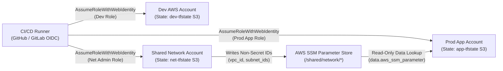
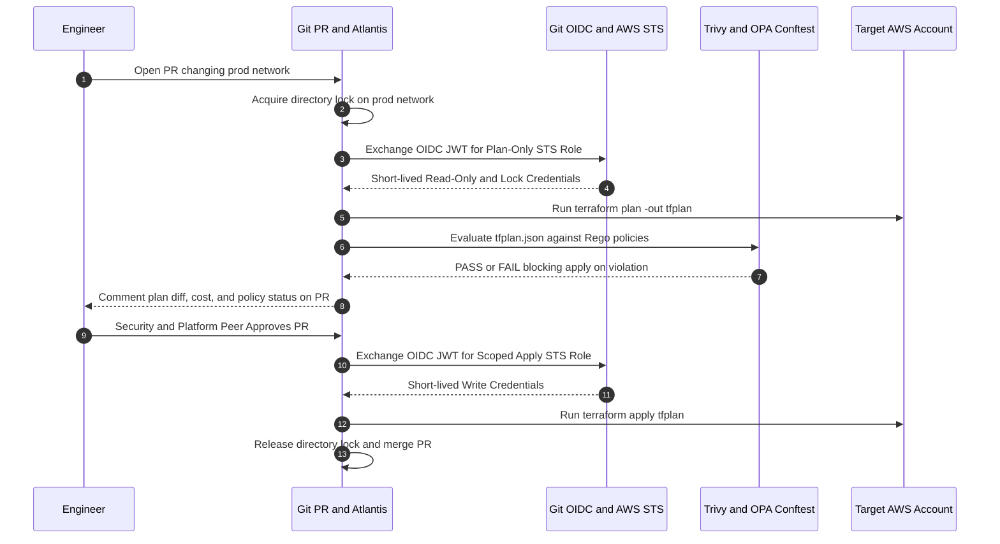
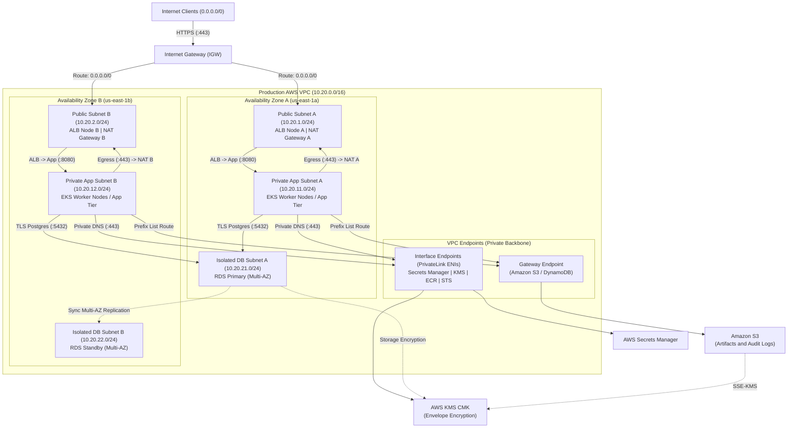
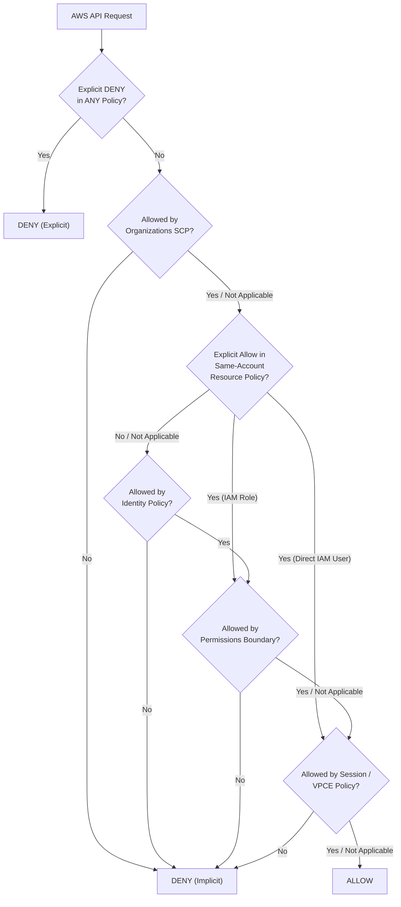
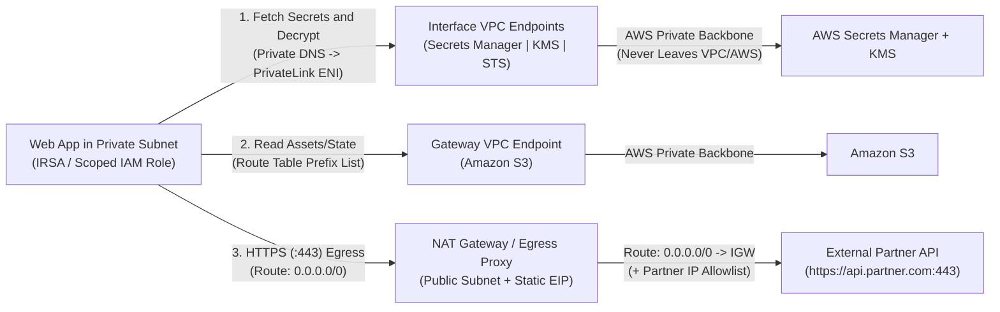

## 8. Infrastructure as Code with Terraform and Ansible, and AWS Cloud Architecture

### 8.1 Terraform / OpenTofu IaC Deep Dive

#### Q1. [Junior] What is the core Terraform/OpenTofu workflow (`init` -> `plan` -> `apply` -> `destroy`), and why must `.terraform/` and `*.tfstate` NEVER be committed to Git?

**Executive Takeaway:** `init` downloads providers and initializes the remote backend, `plan` computes a deterministic execution graph against live cloud APIs and state, `apply` executes mutations in dependency order while updating state, and `destroy` tears down managed resources. Neither `.terraform/` nor `*.tfstate` belongs in Git because `.terraform/` caches large OS-specific provider binaries, while `*.tfstate` stores plaintext secrets and causes silent state corruption across concurrent engineers.

**Core Workflow Mechanics:**
1. **`terraform init`** (or `tofu init`): Initializes the backend (e.g., S3 + locking), downloads provider plugins and external modules into `.terraform/`, and verifies provider checksums against `.terraform.lock.hcl`.
2. **`terraform validate` & `terraform fmt -check`**: Checks HCL syntax, attribute types, and canonical formatting locally without network calls.
3. **`terraform plan -out=tfplan`**: Refreshes resource metadata from cloud APIs, builds a Directed Acyclic Graph (DAG) of dependencies, and produces an immutable binary plan file showing exact creations (`+`), updates (`~`), replacements (`-/+`), and deletions (`-`). Saving `-out=tfplan` guarantees reviewers' approved diff is what `apply` runs.
4. **`terraform apply tfplan`**: Executes the saved DAG concurrently (default parallelism `10`), updates the state file after each resource mutation, and records computed attributes (VPC IDs, ARNs, IPs).
5. **`terraform destroy`**: Traverses the dependency graph in reverse order to delete all state-tracked resources (always inspect `terraform plan -destroy` first).

**Why `.terraform/` and `*.tfstate` Must Stay Out of Git (vs. `.terraform.lock.hcl`):**
- **`.terraform/` (Gitignore):** Stores compiled provider binaries (hundreds of megabytes per OS/architecture) and cached module copies. It is 100% reproducible via `init`.
- **`.terraform.lock.hcl` (COMMIT to Git):** Pins exact provider versions and cryptographic hashes (`h1:` / `zh:`) across platforms to prevent supply-chain tampering (`terraform providers lock -platform=linux_amd64 -platform=darwin_arm64`).
- **`*.tfstate` & `*.tfstate.backup` (NEVER Commit):**
  - **Plaintext Secrets Exposure:** Marking a variable or output `sensitive = true` only redacts CLI terminal output—it does **not** encrypt the state JSON. Resources such as `aws_db_instance` (`password`), `random_password` (`result`), `tls_private_key` (`private_key_pem`), and Kubernetes bootstrap tokens are stored verbatim in `terraform.tfstate`. Anyone with repository read access—or Git commit history access even after deleting the file—can extract production credentials.
  - **Concurrency Corruption:** Git merges do not serialize infrastructure mutations. Two engineers branching off the same state file create divergent cloud resources and overwrite each other's state on merge, leaving orphaned, unmanaged cloud assets.

```gitignore
# Mandatory .gitignore entries for Terraform / OpenTofu repositories
.terraform/
*.tfstate
*.tfstate.*
*.tfplan
tfplan
crash.log
override.tf
override.tf.json
*.auto.tfvars
```

```hcl
# Even with sensitive = true, Terraform stores the raw password in state JSON!
resource "random_password" "db" {
  length  = 32
  special = true
}

resource "aws_db_instance" "app" {
  identifier     = "app-prod-db"
  engine         = "postgres"
  instance_class = "db.t4g.medium"
  username       = "app_admin"
  password       = random_password.db.result
}
```

**OpenTofu Note:** OpenTofu (`v1.7+`) mitigates plaintext state exposure natively via **client-side state encryption** (`encryption { method "aes_gcm" ... }`), encrypting state before it reaches the S3 or local backend—whereas upstream Terraform relies on backend storage encryption plus `ephemeral` / write-only attributes.

---

#### Q2. [Mid] How do you configure a production-hardened remote state backend on AWS S3 with locking, and why is `terraform force-unlock` dangerous?

**Executive Takeaway:** Production AWS state backends combine an S3 bucket with Versioning, SSE-KMS encryption, TLS-only bucket policies, and distributed locking—using either native S3 lockfiles (`use_lockfile = true` in Terraform `v1.10+` / OpenTofu `v1.10+`) or a DynamoDB table with a `LockID` primary key. Running `force-unlock` while another `apply` is genuinely in flight breaks mutual exclusion, allowing two concurrent writers to race against AWS APIs and overwrite each other's state.

**Production S3 Backend Configuration:**
```hcl
terraform {
  required_version = ">= 1.10.0"

  backend "s3" {
    bucket       = "acme-prod-tfstate-123456789012"
    key          = "network/vpc/terraform.tfstate"
    region       = "us-east-1"
    encrypt      = true
    kms_key_id   = "arn:aws:kms:us-east-1:123456789012:key/11112222-3333-4444-5555-666677778888"
    use_lockfile = true # Native S3 conditional PutObject (.tflock); replaces legacy dynamodb_table
  }
}
```
> **Compatibility Note:** For Terraform `< 1.10`, specify `dynamodb_table = "acme-tfstate-locks"` backed by a DynamoDB table with partition key `LockID` (`String`) and `PAY_PER_REQUEST` billing.

**S3 State Bucket Security Controls:**
1. **Versioning Enabled:** Allows point-in-time recovery of a prior state version if a partial failure or operator error corrupts `terraform.tfstate`.
2. **Public Access Block:** All four S3 public access block flags set to `true`.
3. **TLS & Encryption Bucket Policy Guardrails:** Explicitly deny unencrypted `PutObject` calls (`s3:x-amz-server-side-encryption != "aws:kms"`) and explicitly deny non-HTTPS requests (`aws:SecureTransport == "false"`).
4. **Dedicated KMS CMK + IAM Separation:** Restrict `kms:Decrypt` and `s3:GetObject` on production state strictly to the CI deployment IAM role and break-glass platform admins—never grant production state read access to general developer IAM roles.

**Why `terraform force-unlock <LOCK_ID>` Is Dangerous:**
- When Terraform acquires a lock, it writes lock metadata (`ID`, `Operation`, `Who`, `Created`, `Path`) into DynamoDB or `<key>.tflock` using conditional writes (`If-None-Match: *`).
- If a laptop crashes or a CI runner is terminated with `SIGKILL`, a stale lock remains and blocks subsequent runs.
- **The Danger:** If you blindly execute `terraform force-unlock` assuming a lock is stale—while a slow `apply` (such as provisioning a 20-minute RDS Multi-AZ cluster or CloudFront distribution) is still running in another CI pipeline—two Terraform processes mutate the same live infrastructure concurrently. Both call AWS APIs simultaneously, causing partial conflicts, duplicate resources, and a **last-writer-wins** state overwrite that permanently drops the other process's created resource IDs from state.
- **Safe Verification Procedure Before Unlocking:**
  1. Read lock metadata (`Who`, `Created`, `Operation`) from the lock error or DynamoDB/S3 lock object.
  2. Confirm across all CI runners (GitHub Actions, GitLab CI, Atlantis) that zero `plan`/`apply` jobs are actively executing.
  3. Only after verifying no writer exists, run `terraform force-unlock <LOCK_ID>`.

---

#### Q3. [Mid] When should you choose `for_each` over `count`, how does `depends_on` differ from implicit dependencies, and how do `lifecycle` rules prevent production outages?

**Executive Takeaway:** Reserve `count` for simple boolean feature flags (`count = var.enabled ? 1 : 0`) or identical disposable resources, and use `for_each` for named collections because `count` keys state by integer list index—removing an item mid-list shifts every subsequent index and destroys/recreates unrelated live resources. Rely on implicit DAG edges via attribute references whenever possible, and configure `lifecycle` blocks (`create_before_destroy`, `prevent_destroy`, `ignore_changes`) to avoid replacement downtime, accidental database deletion, and autoscaler drift wars.

**1. `count` vs. `for_each` Indexing Behavior:**
Suppose you create three subnets from `["10.20.11.0/24", "10.20.12.0/24", "10.20.13.0/24"]` using `count = length(var.cidrs)`. State addresses them as `aws_subnet.app[0]`, `[1]`, `[2]`. Deleting `"10.20.12.0/24"` (`[1]`) shifts `"10.20.13.0/24"` from `[2]` to `[1]`, forcing Terraform to **destroy and recreate the third subnet**—causing an outage on workloads running inside it.

```hcl
variable "app_subnets" {
  type = map(object({
    cidr = string
    az   = string
  }))
  default = {
    app-a = { cidr = "10.20.11.0/24", az = "us-east-1a" }
    app-b = { cidr = "10.20.12.0/24", az = "us-east-1b" }
    app-c = { cidr = "10.20.13.0/24", az = "us-east-1c" }
  }
}

# Stable key-based state addressing: aws_subnet.app["app-c"] stays untouched if "app-b" is removed
resource "aws_subnet" "app" {
  for_each          = var.app_subnets
  vpc_id            = aws_vpc.main.id
  cidr_block        = each.value.cidr
  availability_zone = each.value.az
}
```

**2. Implicit Dependencies vs. `depends_on`:**
- **Implicit (Preferred):** Referencing `aws_vpc.main.id` inside `aws_subnet.app` creates a directed edge automatically in Terraform's DAG.
- **Explicit (`depends_on`):** Use only for hidden runtime or eventual-consistency side effects not captured in attributes—for example, forcing an EC2 instance or EKS Node Group to wait for `aws_iam_role_policy_attachment` to propagate before bootstrapping, or waiting for a Lambda permission before creating `aws_s3_bucket_notification`.
- **Pitfall:** Putting `depends_on` on a `data` source forces Terraform to defer reading that data source until `apply` time, causing downstream diffs to display `(known after apply)` churn on every `plan`.

**3. Critical `lifecycle` Meta-Arguments:**
- **`create_before_destroy = true`:** Provisions the replacement resource and switches references before deleting the old one. Essential for ACM certificates, Launch Templates, ALB Target Groups, and Security Groups bound to live ENIs. *Gotcha:* Fails if the resource uses a fixed `name` that collides globally or per-VPC; pair with `name_prefix` instead.
- **`prevent_destroy = true`:** Hard safety guardrail aborting any plan/apply that would destroy stateful assets (RDS databases, KMS keys, S3 state buckets). *Gotcha:* Removing the entire `resource` block from HCL bypasses `prevent_destroy` because the lifecycle block vanishes with the code—complement with IAM/SCP deletion denies.
- **`ignore_changes = [desired_count, tags["LastRotated"]]`:** Prevents Terraform from reverting attributes legitimately mutated out-of-band by AWS Auto Scaling, Kubernetes HPA/Karpenter, or Flux/Argo CD image automation.

---

#### Q4. [Senior] How should you structure multi-environment infrastructure at scale: Terraform Workspaces vs. Separate State Directories vs. Terragrunt, and how should cross-stack outputs be shared safely?

**Executive Takeaway:** Terraform CLI Workspaces share the same root code, backend bucket, and IAM role—creating unacceptable blast-radius coupling for production—so mature teams isolate environments into separate directories backed by distinct AWS accounts and IAM roles, optionally orchestrated with Terragrunt to stay DRY. Share cross-stack outputs via AWS SSM Parameter Store or native data sources rather than `terraform_remote_state` to preserve least-privilege state isolation.

| Approach | Isolation & Blast Radius | DRYness | Typical Failure Mode | Best Fit |
| :--- | :--- | :--- | :--- | :--- |
| **CLI Workspaces (`terraform workspace`)** | Low (shared backend bucket, often shared IAM credentials; easy to apply in wrong workspace) | High | Sizing/destroying `prod` due to active workspace human error | Ephemeral PR preview stacks in a single sandbox account |
| **Separate State Directories + Versioned Modules** | High (explicit `envs/dev`, `envs/prod` folders, separate S3 buckets/accounts, distinct OIDC roles) | Moderate (minor `backend.tf`/`provider.tf` duplication) | Copy-paste parameter drift between `staging` and `prod` root stacks | Mid-to-large teams using vanilla Terraform + CI pipelines |
| **Terragrunt + Versioned Modules** | High (auto-generated isolated state files per account/region/component + dependency DAG) | Very High | Added abstraction layer; debugging `run-all` dependency graphs | Multi-account, multi-region enterprise landing zones |

**Multi-Account Isolation & Cross-Stack Output Decoupling:**


**Why Prefer SSM Parameter Store / Data Sources Over `terraform_remote_state`:**
- `terraform_remote_state` grants the downstream consumer read access to the **entire upstream JSON state file**. If the upstream stack manages RDS passwords or TLS keys, the downstream app team's IAM role gets `s3:GetObject` + `kms:Decrypt` over those upstream secrets—violating least privilege.
- It tightly couples consumers to internal output names inside the upstream root module.
- Publishing explicit non-secret interfaces (VPC IDs, Subnet IDs, KMS Key ARNs) to **SSM Parameter Store** (or AWS RAM / Secrets Manager for real secrets) lets downstream stacks read `data "aws_ssm_parameter"` with zero access to upstream Terraform state.

---

#### Q5. [Senior] How do you refactor live Terraform resources without downtime, detect drift continuously, and enforce Shift-Left IaC security scanning in CI?

**Executive Takeaway:** Declarative `moved {}` and `import {}` blocks let teams refactor modules, migrate `count` to `for_each`, and adopt legacy resources through Git PR review without risky `terraform state mv` surgery or destructive replacements. Pairing scheduled `-refresh-only` drift detection with static HCL (`Checkov`/`Trivy`) and plan-JSON (`OPA`/`Conftest`) gates blocks misconfigurations before `apply`.

**1. Zero-Downtime Refactoring (`moved {}` & `import {}`):**
- **`moved {}` Blocks:** When renaming a resource, moving resources into a child module, or migrating `count` to `for_each`, Terraform interprets the new address as destroy+create unless directed otherwise. A `moved` block updates state addresses in place during `plan` without touching the live AWS resource, flowing sequentially through `dev -> staging -> prod` via standard PRs.
- **`import {}` Blocks (Terraform `1.5+` / OpenTofu `1.7+`):** Onboards click-ops AWS resources declaratively during `plan`/`apply`, optionally generating starter HCL with `-generate-config-out=imported.tf`.

```hcl
# Safe refactoring from count to module + for_each without destroying live Subnet/RDS
moved {
  from = aws_subnet.private[0]
  to   = module.vpc.aws_subnet.private["az-a"]
}

# Declarative onboarding of an existing KMS key into Terraform state
import {
  to = aws_kms_key.app_data
  id = "11112222-3333-4444-5555-666677778888"
}
```

**2. Automated Drift Detection (`-refresh-only`):**
Run a scheduled read-only pipeline (`cron`) executing:
```bash
terraform plan -refresh-only -detailed-exitcode
```
- Exit `0`: No drift.
- Exit `1`: Configuration or API error.
- Exit `2`: Live infrastructure drifted from state (e.g., an emergency SG rule opened in AWS Console). Trigger a Slack/PagerDuty alert rather than blindly running `terraform apply`, because auto-remediation can wipe out active incident-response mitigations.

**3. Shift-Left IaC Security Scanning (Static + Plan-JSON):**
- **Static HCL Scanning (`trivy config .`, `checkov -d .`, `tfsec` [merged into Trivy]):** Fast PR feedback catching hardcoded secrets, `0.0.0.0/0` SSH/RDP, unencrypted EBS/RDS, or missing IMDSv2 (`http_tokens = "required"`).
- **Plan-JSON Evaluation (`OPA / Conftest` or Checkov on `tfplan.json`):** Static HCL scanners miss dynamic `for_each` maps, remote module defaults, and `tfvars` overrides. Evaluating resolved `plan.json` enforces exact post-interpolation invariants before `apply`:

```bash
terraform plan -out=tfplan
terraform show -json tfplan > plan.json
trivy config --exit-code 1 --severity HIGH,CRITICAL .
conftest test plan.json -p policy/aws_security.rego
```

```rego
# policy/aws_security.rego — Block unencrypted RDS or 0.0.0.0/0 SSH / all-traffic at plan time
package main

import rego.v1

deny contains msg if {
  rc := input.resource_changes[_]
  rc.type == "aws_db_instance"
  rc.change.actions[_] != "delete"
  not rc.change.after.storage_encrypted
  msg := sprintf("SECURITY VIOLATION: RDS %s must enable storage_encrypted = true", [rc.address])
}

_exposes_ssh_or_all_ports(after) if {
  after.ip_protocol == "-1"
}

_exposes_ssh_or_all_ports(after) if {
  after.from_port <= 22
  after.to_port >= 22
}

deny contains msg if {
  rc := input.resource_changes[_]
  rc.type == "aws_vpc_security_group_ingress_rule"
  rc.change.actions[_] != "delete"
  rc.change.after.cidr_ipv4 == "0.0.0.0/0"
  _exposes_ssh_or_all_ports(rc.change.after)
  msg := sprintf("SECURITY VIOLATION: SG rule %s exposes SSH (22) or all traffic (-1) to 0.0.0.0/0", [rc.address])
}
```

---

#### Q6. [Expert] How do you architect GitOps for Terraform (Atlantis, Spacelift, or GitLab Managed State) with PR locking, OIDC authentication, and split `plan`/`apply` security boundaries?

**Executive Takeaway:** Production Terraform GitOps automates `plan` on pull requests and `apply` under strict approval gates—eliminating local laptop AWS keys via short-lived OIDC federation, preventing concurrent state collisions via directory locking, and blocking policy violations (`0.0.0.0/0` SGs, unencrypted RDS) on `plan.json` before `apply`. Crucially, `plan` runners must be isolated from `apply` credentials because untrusted PRs can execute arbitrary code via `external` data sources, custom providers, or `local-exec`.

**GitOps Execution & Policy-Gate Sequence:**


**Critical Architectural Decisions:**
1. **Apply-Before-Merge (Atlantis Default) vs. Apply-On-Merge (Spacelift / GitLab CI):**
   - *Apply-Before-Merge:* Ensures `main` only commits infrastructure verified to apply cleanly, avoiding broken `main` states. Configure `atlantis.yaml` with `when_modified` path triggers and `apply_requirements: [approved, mergeable, undiverged]` so stale plans cannot run after `main` advances.
   - *Apply-On-Merge:* Keeps `main` as strict source of truth before mutation; uses deployment queues (Spacelift stacks or GitLab CI `resource_group` + GitLab Managed HTTP State lock endpoints) to serialize merges.
2. **Zero Static Credentials via OIDC (`sts:AssumeRoleWithWebIdentity`):**
   - AWS IAM trust policies bind `token.actions.githubusercontent.com:sub` (or GitLab `sub`) strictly to exact `repo`, `environment: prod`, and protected branch `refs/heads/main`.
3. **Hardening the `plan` Runner Attack Surface (Expert Security Point):**
   - Running `terraform plan` on an unreviewed PR is **arbitrary code execution**—a malicious PR can reference an external module, `external` data source, or custom provider binary to dump runner environment variables or abuse attached STS credentials!
   - **Defense:** Split **Plan IAM Roles** (read-only on cloud resources + write strictly to the state lock key, with zero secret-read permissions) from **Apply IAM Roles** (scoped write permissions restricted to approved commits / protected environments), forbid untrusted fork PRs from auto-running CI plans, and run pre-plan AST policy checks rejecting unauthorized `external`/`local` providers.

---

#### Q7. [Expert] How do you prevent secrets from leaking into Terraform state, plan artifacts, and CI logs?

**Executive Takeaway:** Because traditional Terraform resources persist all input attributes in state JSON, modern secret hygiene avoids passing raw secrets through Terraform state altogether—using Terraform `1.10+`/`1.11+` `ephemeral` resources paired with write-only attributes (`_wo`), RDS `manage_master_user_password`, or OpenTofu client-side state encryption.

**Defense-in-Depth Techniques:**
1. **Ephemeral Resources & Write-Only Attributes (Terraform `1.10+` / `1.11+`):**
   - `ephemeral` resources, input variables, and outputs exist strictly in memory for the current run and are **never** written into `tfstate` or `tfplan`.
   - Write-only attributes (e.g., `password_wo` + `password_wo_version` on `aws_db_instance`, or `secret_string_wo` on `aws_secretsmanager_secret_version`) transmit values to the cloud API without recording them in state; incrementing `*_wo_version` rotates the secret cleanly.
2. **AWS-Managed Secret Rotation (`manage_master_user_password = true`):**
   - On `aws_db_instance` and `aws_rds_cluster`, enabling `manage_master_user_password = true` delegates password generation, KMS encryption, and Secrets Manager lifecycle directly to AWS RDS—no secret ever touches HCL, CLI logs, or `terraform.tfstate`.
3. **Pipeline & Plan Artifact Controls:**
   - Treat binary `tfplan` and `plan.json` files with the same sensitivity as state (they contain resolved inputs and data lookups): keep them ephemeral on isolated runners, delete immediately post-apply, and never pass secrets via verbose `TF_VAR_*` debug logs.

---

### 8.2 Ansible Configuration Management Deep Dive

#### Q8. [Junior] How does Ansible's agentless architecture work, and how do Inventory (static vs. `aws_ec2` dynamic), Playbooks, Roles, Handlers, and `become` interact?

**Executive Takeaway:** Ansible uses a push-based, agentless model that connects from a control node over SSH (Linux), WinRM (Windows), or AWS SSM Session Manager, uploads ephemeral Python modules, executes them, and cleans up with zero persistent agent daemon. Inventory defines *target hosts*, Playbooks map *hosts to Roles/tasks*, Handlers execute *idempotent service reloads via `notify`*, and `become` manages *privilege escalation*.

**Core Components & Mechanics:**
- **Static vs. Dynamic Inventory (`amazon.aws.aws_ec2`):**
  - Static INI/YAML inventories hardcode IPs (`10.20.11.15`), which go stale immediately under Auto Scaling and immutable instance replacement.
  - Dynamic inventory queries AWS EC2 APIs live and groups hosts by tags (`Environment`, `Role`) using `private_ip_address` inside the VPC:

```yaml
# inventory/aws_ec2.yml — Dynamic AWS EC2 inventory grouping by tags
plugin: amazon.aws.aws_ec2
regions:
  - us-east-1
filters:
  instance-state-name: running
  "tag:ManagedBy": ansible
keyed_groups:
  - key: tags.Environment
    prefix: env
  - key: tags.Role
    prefix: role
compose:
  ansible_host: private_ip_address
```

- **Playbooks vs. Roles:**
  - A **Playbook** maps host patterns (`hosts: env_prod:&role_web`) to execution rules (`serial`, `become`, `vars`) and ordered `roles`/`tasks`.
  - A **Role** packages reusable automation cleanly: `tasks/`, `handlers/`, `templates/` (`.j2`), `files/`, `defaults/` (lowest precedence, easily overridden), and `vars/` (high-precedence role constants).
- **Handlers (`notify`):**
  - Tasks modifying `/etc/nginx/nginx.conf` declare `notify: Reload Nginx`. Handlers run **once** at the end of the play—and **only** when at least one notifying task reported `changed=true` (use `meta: flush_handlers` if an immediate reload is required mid-play).
- **Privilege Escalation (`become`):**
  - Authenticate as an unprivileged user (`ubuntu` or `ssm-user`) and enable `become: true` (`become_method: sudo`, `become_user: root`) scoped to privileged tasks rather than logging in over SSH as `root`.

---

#### Q9. [Mid] How do you ensure idempotency in Ansible playbooks and execute safe, zero-downtime rolling deployments?

**Executive Takeaway:** Idempotency guarantees that running a playbook repeatedly converges to the identical desired state with `changed=0` on healthy nodes—achieved by preferring native declarative modules over raw `shell`/`command` tasks, or guarding shell tasks with `creates`, `removes`, `changed_when`, and `failed_when`. Safe production rollouts pair `--check --diff` dry runs with `serial` canary batching, `max_fail_percentage`, and health-check verification gates.

**Writing Strictly Idempotent Tasks:**
- Prefer declarative modules (`ansible.builtin.apt`, `template`, `lineinfile`, `systemd`) that inspect state before modifying anything.
- When `command` or `shell` is unavoidable:
  - Use `creates:` / `removes:` to skip execution if an artifact already exists.
  - Set `changed_when: false` on read-only inspection commands (and `check_mode: false` so read-only discovery runs even during `--check` dry runs!).
  - Evaluate `rc` or `stdout` in `changed_when:` instead of always reporting `changed=true`.

```yaml
- name: Read current kernel ip_forward value
  ansible.builtin.command: sysctl -n net.ipv4.ip_forward
  register: ip_fwd_state
  changed_when: false
  check_mode: false

- name: Deploy hardened sshd configuration and validate syntax before overwriting
  ansible.builtin.template:
    src: sshd_config.j2
    dest: /etc/ssh/sshd_config
    owner: root
    group: root
    mode: "0600"
    validate: "/usr/sbin/sshd -t -f %s"
  notify: Restart sshd
```

**Dry Runs & Rolling Batch Strategy:**
- Run `ansible-playbook site.yml --check --diff -l env_staging` to preview exact file diffs before touching production.
- Roll out across fleets with progressive `serial` batches so a bad change halts at the canary instead of taking down 100% of capacity:
```yaml
- hosts: role_web
  become: true
  serial:
    - 1       # Canary host first
    - "25%"   # Rolling 25% batches afterward
  max_fail_percentage: 0
  tasks:
    - name: Render application config
      ansible.builtin.template:
        src: app.conf.j2
        dest: /etc/app/app.conf
      notify: Reload app
    - name: Flush handlers before health validation
      ansible.builtin.meta: flush_handlers
    - name: Wait for healthy HTTP 200 before advancing batch
      ansible.builtin.uri:
        url: "http://127.0.0.1:8080/healthz"
        status_code: 200
      retries: 10
      delay: 3
```

---

#### Q10. [Mid] How does Ansible Vault encrypt secrets at rest, and what are the best practices for managing secrets in CI/CD?

**Executive Takeaway:** Ansible Vault encrypts sensitive YAML files or individual inline variable values at rest using AES-256 so encrypted credentials can live in Git alongside playbooks and decrypt strictly in memory at runtime. For readable PR diffs and environment isolation, prefer `encrypt_string` per secret key with `--vault-id` labels, enforce `no_log: true` on tasks handling credentials, or retrieve runtime secrets directly from AWS Secrets Manager / HashiCorp Vault.

**Vault Patterns & Security Guardrails:**
1. **Whole-File Encryption vs. Inline `encrypt_string`:**
   - `ansible-vault encrypt group_vars/prod/secrets.yml` encrypts the entire file, turning every Git PR diff into an unreadable ciphertext blob.
   - **Better Practice (`encrypt_string`):** Encrypt individual secret values inside plaintext YAML so code reviewers can audit *which* key changed while the secret remains AES-256 encrypted:
     ```bash
     ansible-vault encrypt_string --vault-id prod@prompt 'S3cr3tValue!' --name 'db_password'
     ```
2. **Multi-Environment Vault IDs:**
   - Separate keys per environment (`--vault-id dev@~/.vault_dev --vault-id prod@scripts/fetch-vault-pass-from-kms.sh`) so a dev pipeline cannot decrypt production secrets.
3. **Preventing Log Exposure (`no_log: true`):**
   - Always attach `no_log: true` to any task consuming passwords, tokens, or Vault variables; otherwise `-v` verbosity or task error traces print decrypted secrets straight into stdout and CI logs.
4. **External Secret Managers:**
   - Query secrets dynamically via `lookup('amazon.aws.aws_secretsmanager', 'prod/app/db_pass')` using short-lived OIDC IAM credentials so zero secret material—even encrypted—is stored in Git.

---

#### Q11. [Senior] How do you divide responsibilities between Terraform and Ansible, and how do Packer + Ansible create immutable Golden AMIs?

**Executive Takeaway:** Terraform provisions and manages stateful cloud infrastructure (VPCs, subnets, IAM, RDS, EKS, ASGs), whereas Ansible excels at OS-level configuration, CIS Linux hardening, and bare-metal cluster bootstrapping (`kubespray`). Instead of running Ansible against live instances via fragile Terraform `remote-exec` hooks, teams bake **Golden AMIs** in CI using **Packer + Ansible** so Auto Scaling instances boot pre-hardened in seconds with zero runtime configuration drift.

**Boundary of Responsibilities:**

| Dimension | Terraform / OpenTofu | Ansible |
| :--- | :--- | :--- |
| **Primary Domain** | Cloud & SaaS API infrastructure (VPC, IAM, RDS, EKS, DNS) | OS hardening (CIS benchmarks), systemd services, legacy VMs, bare-metal K8s (`kubespray`) |
| **State Model** | Stateful (`terraform.tfstate` DAG tracks exact resource IDs and deletions) | Stateless convergence (inspects host at runtime; removing a task does not auto-uninstall packages) |
| **Scaling / Drift** | Detects and reconciles infrastructure drift cleanly | Mutable runtime changes drift over time ("snowflake servers") if run ad hoc |

**Why Terraform `remote-exec` + Ansible Is an Anti-Pattern:**
Triggering Ansible inside Terraform `local-exec`/`remote-exec` requires the Terraform runner to reach private subnets over SSH, couples cloud provisioning state to OS package mirrors, and breaks Auto Scaling (because ASG scale-out instances never invoke Terraform).

**Immutable Golden Image Pipeline (Packer + Ansible + Terraform ASG):**

```mermaid
flowchart LR
    Repo["Git Repo\n(Packer HCL + Ansible CIS Role)"] -->|"CI Trigger"| Packer["Packer Builder\n(Ephemeral EC2 in Build VPC)"]
    Packer -->|"Executes Over Local/SSM"| Ansible["Ansible Provisioner\n(CIS Hardening + Monitoring Agents)"]
    Ansible -->|"Strip Host Keys and Temp Logs"| AMI["KMS-Encrypted Golden AMI\n(ami-0abc123...)"]
    AMI -->|"Terraform Data Lookup\nor SSM Parameter"| TF["Terraform ASG\n(New Launch Template Version)"]
    TF -->|"Zero-Downtime Rolling Replacement"| ASG["Auto Scaling Group\n(Instance Refresh)"]
```


```hcl
# packer/ubuntu-hardened.pkr.hcl — Bake pre-hardened Golden AMI with zero runtime drift
source "amazon-ebs" "ubuntu" {
  region        = "us-east-1"
  instance_type = "t3.small"
  ami_name      = "cis-ubuntu-2404-{{timestamp}}"
  encrypt_boot  = true
  kms_key_id    = var.ami_kms_key_arn
  ssh_username  = "ubuntu"

  source_ami_filter {
    filters     = { name = "ubuntu/images/hvm-ssd-gp3/ubuntu-noble-24.04-amd64-server-*" }
    owners      = ["099720109477"]
    most_recent = true
  }
}

build {
  sources = ["source.amazon-ebs.ubuntu"]

  provisioner "ansible" {
    playbook_file   = "../ansible/cis-hardening.yml"
    extra_arguments = ["--extra-vars", "cis_level=1"]
  }

  # Remove ephemeral SSH keys, machine-id, and cloud-init logs before AMI snapshot
  provisioner "shell" {
    inline = [
      "sudo rm -rf /root/.ssh/authorized_keys /home/ubuntu/.ssh/authorized_keys /etc/ssh/ssh_host_*",
      "sudo truncate -s 0 /etc/machine-id",
      "sudo cloud-init clean --logs"
    ]
  }
}
```
Terraform then selects the latest validated Golden AMI via `data "aws_ami"` or an SSM Parameter pointer, creates a new `aws_launch_template` version, and triggers an `aws_autoscaling_group` `instance_refresh` (`min_healthy_percentage = 90`).

---

#### Q12. [Senior] How do you run Ansible securely in private AWS subnets with zero open SSH ports, and how do you test roles before production?

**Executive Takeaway:** Replace bastion hosts, port `22` Security Group rules, and SSH private keys with the `amazon.aws.aws_ssm` connection plugin—tunneling Ansible over AWS Systems Manager Session Manager with IAM authorization and full CloudTrail/S3 session audit logs. Validate playbooks before production using `ansible-lint` and behavioral idempotency testing in **Molecule**.

**Zero-SSH Private Subnet Architecture (`aws_ssm`):**
1. **Target EC2 Setup:** Run `amazon-ssm-agent` (pre-installed on official AWS AMIs), attach `AmazonSSMManagedInstanceCore` to the instance profile, and allow outbound HTTPS (`443`) via NAT Gateway or **SSM Interface VPC Endpoints** (`ssm`, `ssmmessages`, `ec2messages`).
2. **Zero Inbound Exposure:** Remove TCP `22` completely from Security Groups and omit EC2 SSH key pairs (`key_name = null`).
3. **Inventory/Group Vars Config:**
```yaml
# group_vars/all.yml
ansible_connection: amazon.aws.aws_ssm
ansible_aws_ssm_bucket_name: acme-ansible-ssm-staging
ansible_aws_ssm_region: us-east-1
```
4. **Testing Pyramid (`ansible-lint` + `Molecule`):**
   - `ansible-lint` catches deprecated modules, unsafe `shell` calls, and missing file permissions.
   - `molecule test` launches an isolated Docker/EC2 target, runs `converge`, automatically runs an **idempotence check** (failing if a second run reports `changed > 0`), and asserts OS hardening (`sshd_config`, open sockets, file modes) via `verify.yml` or `Testinfra`.

---

### 8.3 AWS Cloud & Security Architecture Deep Dive

#### Q13. [Junior] How do you design a production multi-AZ AWS VPC (CIDR planning, Public vs. Private App vs. Isolated DB subnets, IGW vs. NAT Gateway, and Route Tables)?

**Executive Takeaway:** A production AWS VPC segments workloads across three subnet tiers across at least two Availability Zones—Public subnets (ALB + per-AZ NAT Gateways routing `0.0.0.0/0 -> IGW`), Private App subnets (EKS/EC2 workloads routing `0.0.0.0/0 -> NAT GW` + VPC Endpoints), and Isolated DB subnets (RDS/ElastiCache with *zero* internet route). Upfront non-overlapping CIDR planning prevents catastrophic IP collisions when interconnecting VPCs via VPC Peering or Transit Gateway.

**CIDR & Subnet Tiering Design Rules:**
- **Non-Overlapping CIDRs:** Avoid reusing AWS default `172.31.0.0/16` or duplicating `10.0.0.0/16` across accounts. Assign unique VPC blocks per environment/region (e.g., Prod `10.20.0.0/16`, Staging `10.30.0.0/16`, Shared Services `10.10.0.0/16`) so future **VPC Peering**, **AWS Transit Gateway (TGW)**, or **Site-to-Site VPN** routing connects cleanly without overlapping IP conflicts.
- **Public Subnets (`10.20.1.0/24`, `10.20.2.0/24`):** Host *only* internet-facing ALBs and NAT Gateways (deploy one NAT Gateway per AZ so losing AZ-A does not sever AZ-B's egress!). Route table: `local` + `0.0.0.0/0 -> igw-...`.
- **Private App Subnets (`10.20.11.0/24`, `10.20.12.0/24`):** Larger blocks (e.g., `/20` or `/22` in EKS clusters due to VPC CNI pod ENI IP allocation!) for app servers and pods, with no public IPs. Each AZ's route table points `0.0.0.0/0 -> local AZ nat-...`, plus Gateway Endpoint prefix-list routes (`pl-...`) for S3/DynamoDB.
- **Isolated DB Subnets (`10.20.21.0/24`, `10.20.22.0/24`):** Hosts RDS Multi-AZ and ElastiCache. Route table holds **only** the `10.20.0.0/16 -> local` route—making direct internet inbound or outbound traffic physically impossible even if an SG is misconfigured.

**Production 2-AZ AWS VPC Architecture:**


---

#### Q14. [Junior] How do Security Groups (stateful) and Network ACLs (stateless) differ, and why do stateless NACLs commonly break outbound responses?

**Executive Takeaway:** Security Groups bind to ENIs/instances and are **stateful** (allowed inbound connections automatically permit return outbound packets, and rules are allow-only), whereas Network ACLs bind to subnets and are **stateless** (inbound and outbound rules evaluate independently in ascending rule-number order and support explicit `DENY`). Because NACLs are stateless, omitting **ephemeral return ports (`1024-65535`)** breaks TCP responses silently.

| Feature | Security Group (SG) | Network ACL (NACL) |
| :--- | :--- | :--- |
| **Scope** | ENI / Instance / ALB / RDS / VPC Endpoint | Entire Subnet (all packets crossing subnet boundary) |
| **State Tracking** | **Stateful:** Return packets for permitted flows are automatically allowed | **Stateless:** Return packets must be explicitly permitted in the opposite direction |
| **Rule Actions** | **Allow only** (implicit deny if no match; cannot explicitly block one attacker IP) | **Allow and Explicit Deny** (lowest matching rule number wins!) |
| **Evaluation Order** | Aggregate union of all rules (most permissive allow wins) | Sequential by **rule number** (`100`, `200`, ... `*`); stops on first match |
| **Source References** | CIDRs, Prefix Lists, and **SG-to-SG chaining** (`sg-alb` -> `sg-app`) | CIDRs only (cannot reference Security Groups) |

**The Stateless Ephemeral Port Trap:**
1. A client initiates HTTPS from source port `54321` -> server port `443`.
2. **Inbound NACL** must allow `TCP/443`.
3. Server responds from source port `443` -> client destination port `54321`.
4. **Outbound NACL** evaluates destination port `54321`! If Outbound NACL only permits `80`/`443`, return packets drop silently unless you add an Outbound NACL rule for ephemeral ports **`1024-65535`**.
5. Likewise, when a private EC2 instance initiates an outbound `443` call (to download packages or call an API) from client port `48120`, the **Inbound NACL** must permit return traffic on **`1024-65535`**.

**When to Use NACLs in Security Architecture:**
- **Explicit IP Blocking:** Because Security Groups cannot explicitly deny a single malicious IP when `0.0.0.0/0` is open on an ALB, place a low-numbered **`DENY` rule (e.g., Rule #50)** on the Public Subnet NACL (or mitigate at L7 with AWS WAF).
- **Subnet Guardrails:** Enforce defense-in-depth on Isolated DB Subnets so only Private App Subnet CIDRs can reach port `5432`, even if an RDS Security Group is misconfigured.

---

#### Q15. [Mid] How do IAM Users, Groups, Roles (STS), Identity vs. Resource Policies, Permission Boundaries, and AWS Organizations SCPs interact during authorization?

**Executive Takeaway:** Production AWS environments eliminate long-lived IAM Users and static keys in favor of **IAM Roles + STS temporary credentials** (OIDC, instance profiles, IAM Identity Center SSO), governed by an evaluation chain where an explicit `DENY` in any policy—or missing permission in an **Organization SCP**, **Permission Boundary**, or **Identity/Resource Policy**—denies the request.

**Core IAM Primitives:**
- **IAM Users & Groups:** Static long-lived identities—avoid for workloads and CI/CD; authenticate humans via IAM Identity Center (AWS SSO) with MFA.
- **IAM Roles & STS (`sts:AssumeRole` / `AssumeRoleWithWebIdentity`):** Issue short-lived (`15m–12h`) temporary credentials (`AccessKeyId`, `SecretAccessKey`, `SessionToken`) constrained via `Condition` keys (`aws:PrincipalOrgID`, `aws:SourceArn`).
- **Identity-Based vs. Resource-Based Policies:**
  - *Same-Account Access:* Either an Identity Policy OR a Resource Policy granting `Allow` (with no explicit `Deny`) succeeds (exception: KMS Key Policies must at minimum delegate IAM evaluation!).
  - *Cross-Account Access:* **BOTH** the caller's Identity Policy in Account A AND the target Resource Policy (S3 bucket policy, KMS key policy, IAM Role trust policy) in Account B must explicitly `Allow`!
- **IAM Permission Boundaries:** Attached to an IAM Role/User to cap the *maximum* permissions that identity can ever hold—even if granted `AdministratorAccess`. Vital when delegating IAM role creation to app teams (require a `PermissionsBoundary` condition so developers cannot escalate privileges!).
- **AWS Organizations Service Control Policies (SCPs):** Account/OU-level guardrails binding every IAM principal—**including the account `root` user**—in member accounts. SCPs never grant permissions; they enforce ceiling guardrails (e.g., denying `cloudtrail:StopLogging`, denying weakening S3 Block Public Access, restricting regions, or denying `ec2:RunInstances` without IMDSv2).

**Authorization Evaluation Flow (Within an Account):**


```json
// Example SCP Guardrail: Block launching EC2 instances unless IMDSv2 is enforced
{
  "Version": "2012-10-17",
  "Statement": [
    {
      "Sid": "RequireIMDSv2OnLaunch",
      "Effect": "Deny",
      "Action": "ec2:RunInstances",
      "Resource": "arn:aws:ec2:*:*:instance/*",
      "Condition": {
        "StringNotEquals": {
          "ec2:MetadataHttpTokens": "required"
        }
      }
    }
  ]
}
```

---

#### Q16. [Mid] Why is IMDSv1 vulnerable to SSRF attacks, and how does enforcing IMDSv2 (`HttpTokens=required`, `HttpPutResponseHopLimit=1`) stop both SSRF and container credential theft?

**Executive Takeaway:** Under IMDSv1, a single unauthenticated HTTP `GET` to `http://169.254.169.254/latest/meta-data/iam/security-credentials/` returns the EC2 instance's temporary IAM credentials—enabling any Server-Side Request Forgery (SSRF) bug in a web app (such as OWASP Juice Shop or an exposed reverse proxy) to steal cloud credentials trivially. IMDSv2 defeats SSRF via a session-oriented `PUT` token handshake (`X-aws-ec2-metadata-token`) paired with `HttpPutResponseHopLimit=1`, which drops metadata packets traversing container bridges.

**Attack Anatomy (IMDSv1) vs. Defense (IMDSv2):**
1. **IMDSv1 SSRF Exploit:**
   - An attacker exploits a URL-fetch feature (image proxy, webhook, PDF generator) to request `http://169.254.169.254/latest/meta-data/iam/security-credentials/<role-name>`.
   - Because classic SSRF flaws typically issue simple `GET` calls without stateful custom headers, the app fetches the link-local endpoint and leaks the EC2 role's `AccessKeyId`, `SecretAccessKey`, and `Token`.
2. **How IMDSv2 Stops SSRF & Container Hops:**
   - **Step 1 (`PUT` + TTL Header):** Client must first send HTTP `PUT` to `http://169.254.169.254/latest/api/token` with header `X-aws-ec2-metadata-token-ttl-seconds: 21600`.
   - **Step 2 (Header Auth on `GET`):** Subsequent `GET` requests must carry `X-aws-ec2-metadata-token: <TOKEN>`. Simple SSRF payloads cannot perform `PUT` + state retention + custom headers across two calls, and IMDSv2 rejects proxy requests containing `X-Forwarded-For`.
   - **Step 3 (`HttpPutResponseHopLimit = 1`):** Limits the IP TTL of the `PUT` response packet to `1`. When a container or Kubernetes Pod (on a veth/bridge interface adding an extra network hop) tries requesting an IMDSv2 token from the underlying EC2 worker node, the response TTL reaches `0` at the host bridge and drops—forcing pods to use scoped **IRSA / EKS Pod Identity** instead of inheriting the node's IAM role!

```hcl
# Terraform enforcement on EC2 Launch Template
resource "aws_launch_template" "hardened_worker" {
  name_prefix   = "hardened-app-"
  image_id      = data.aws_ami.golden.id
  instance_type = "t3.medium"

  metadata_options {
    http_endpoint               = "enabled"
    http_tokens                 = "required" # Disables IMDSv1 completely
    http_put_response_hop_limit = 1          # Blocks bridged containers from reaching IMDSv2
    instance_metadata_tags      = "disabled"
  }
}
```

---

#### Q17. [Senior] How do EKS Pod Identity and IRSA (IAM Roles for Service Accounts) enforce least-privilege IAM for Kubernetes workloads, and why must you never rely on the EC2 node IAM role?

**Executive Takeaway:** Relying on the EC2 worker node's IAM Instance Profile grants **every pod on that node** the union of all permissions assigned to the node—so compromising one internet-facing frontend container exposes S3, Secrets Manager, and DynamoDB permissions intended for unrelated jobs. **IRSA** and **EKS Pod Identity** isolate pod permissions by cryptographically binding a single Kubernetes `ServiceAccount` (`namespace:name`) to its own minimally scoped AWS IAM role via short-lived STS tokens.

**How IRSA vs. EKS Pod Identity Works Under the Hood:**
1. **IRSA (OIDC Federation):**
   - EKS exposes an OIDC provider registered with AWS IAM.
   - Annotate a `ServiceAccount` with `eks.amazonaws.com/role-arn: arn:aws:iam::123456789012:role/payments-app`.
   - The EKS **Pod Identity Webhook** mutates pods at admission to mount a projected time-bound OIDC JWT (`AWS_WEB_IDENTITY_TOKEN_FILE`) and `AWS_ROLE_ARN`.
   - The AWS SDK calls `sts:AssumeRoleWithWebIdentity`, verified by an IAM Trust Policy requiring exact `StringEquals` on `"<oidc-issuer>:sub": "system:serviceaccount:prod:payments-sa"`.
2. **EKS Pod Identity (Modern Simplified Replacement):**
   - Eliminates per-cluster OIDC IAM trust policy sprawl: roles trust `pods.eks.amazonaws.com`, the **`eks-pod-identity-agent`** DaemonSet runs on worker nodes, and EKS API associations (`aws eks create-pod-identity-association`) bind `(cluster, namespace, serviceAccount) -> roleArn`.
   - Allows sharing one role policy cleanly across clusters and inspecting session tags (`aws:PrincipalTag/eks-cluster-arn`, `kubernetes-namespace`, `kubernetes-service-account`) directly in IAM conditions.
3. **Container Hardening Complement:**
   - Enforce `http_put_response_hop_limit = 1` on worker nodes so compromised pods cannot fall back to IMDS to steal `AmazonEKSWorkerNodePolicy` / `ECR` permissions.
   - Set `automountServiceAccountToken: false` on pods (like stateless frontends / OWASP Juice Shop) that need **zero** Kubernetes API or AWS IAM permissions.

---

#### Q18. [Senior] Scenario (Architecture & Security Interview): "A web app in a private subnet needs to securely fetch secrets AND call an external partner API. Design the networking, routing, and IAM access."

**Executive Takeaway:** Keep all AWS API traffic (Secrets Manager, KMS, S3, STS, ECR) on AWS's private backbone via **VPC Endpoints (PrivateLink + S3 Gateway)** so secrets never touch the public internet, while routing external partner API calls through a **NAT Gateway** (or FQDN-filtering Egress Proxy / AWS Network Firewall) in the public subnet. Restrict Security Group egress strictly to TCP `443` and attach an explicit **IRSA / IAM Role** scoped to the secret ARN and KMS key with `kms:ViaService` and `aws:SourceVpce` conditions.

**End-to-End Architecture & Packet Flow:**


**Design Breakdown Across All Three Layers:**
1. **Networking & Routing:**
   - **Private App Subnet (No Public IPs):** Deploy across 2+ AZs.
   - **Internal AWS Traffic via VPC Endpoints:**
     - Create **Interface VPC Endpoints (AWS PrivateLink)** with `private_dns_enabled = true` for `secretsmanager`, `kms`, `sts`, and `ecr.*`/`logs`—Private DNS resolves `secretsmanager.us-east-1.amazonaws.com` directly to private ENIs inside the VPC so secret payloads **never traverse a NAT Gateway or public internet**.
     - Create a **Gateway VPC Endpoint** for `s3` (zero hourly/data-processing fees!) attached to Private Subnet route tables via prefix list routes.
   - **External Partner API Egress:**
     - Route `0.0.0.0/0` in Private Subnet route tables to per-AZ **NAT Gateways** in Public Subnets (with static Elastic IPs so the partner can IP-allowlist your egress!).
     - *Zero-Trust Egress Upgrade:* Place an **AWS Network Firewall** or centralized **Egress Proxy (Squid/Envoy)** enforcing an **FQDN allowlist** (`api.partner.com` only) to block data exfiltration or C2 callbacks if the app suffers RCE/SSRF.
2. **Firewalling (Security Groups & NACLs):**
   - **App Security Group:** Inbound allowed solely from the ALB SG on app port (e.g., `8080`). Egress restricted strictly to TCP `443` toward the VPC CIDR (for Interface Endpoints), the S3 prefix list ID, and the Partner API CIDR or Egress Proxy SG—**never** wide-open `0.0.0.0/0` all-ports egress.
   - **VPC Endpoint Security Group:** Inbound TCP `443` permitted solely from `sg-app`.
3. **IAM & KMS Least Privilege:**
   - Use an **IAM Role** (EC2 Instance Profile with IMDSv2 or **EKS IRSA / Pod Identity**—zero static access keys).
   - Scope `secretsmanager:GetSecretValue` strictly to `arn:aws:secretsmanager:us-east-1:<ACCOUNT_ID>:secret:prod/partner-api-creds-*`.
   - Scope `kms:Decrypt` strictly to the dedicated CMK ARN **with conditions** `"kms:ViaService": "secretsmanager.us-east-1.amazonaws.com"` and `"aws:SourceVpce": "vpce-0123456789abcdef0"`, guaranteeing decryption only via Secrets Manager inside your VPC.

---

#### Q19. [Senior] How do you choose between ALB (L7) and NLB (L4), and how do AWS WAF and Shield protect internet-facing workloads?

**Executive Takeaway:** Choose an **Application Load Balancer (ALB)** for HTTP/HTTPS traffic requiring Layer-7 host/path routing, TLS termination, WebSockets, gRPC, and **AWS WAF** inspection; choose a **Network Load Balancer (NLB)** for non-HTTP TCP/UDP/TLS-passthrough workloads, ultra-low latency, static Elastic IPs, or native client source-IP preservation. Pair public endpoints (or CloudFront -> WAF -> ALB) with **AWS Shield** for volumetric DDoS absorption and **AWS WAF** for Layer-7 exploit filtering.

**Architectural Comparison & Security Integration:**
- **ALB (Layer 7):** Terminates client TLS using ACM certificates (`ELBSecurityPolicy-TLS13-1-2-2021-06`), inspects HTTP paths/headers/JWTs, integrates natively with **AWS WAFv2**, and forwards client IP via `X-Forwarded-For`.
- **NLB (Layer 4):** Routes flows at Hyperplane speed with static Anycast/Elastic IPs per AZ, preserves client IP natively at TCP level, and supports end-to-end mTLS passthrough—but **cannot** attach AWS WAF directly (pattern for static IPs + WAF: **NLB -> ALB** or **Global Accelerator -> ALB**!).
- **AWS Shield Standard vs. Shield Advanced:**
  - *Standard:* Free automatic L3/L4 SYN-flood and UDP-reflection mitigation across ALBs, NLBs, CloudFront, and Route 53.
  - *Advanced:* Adds L7 DDoS detection, 24/7 Shield Response Team (SRT) escalation, automated WAF rate-limiting, and financial **DDoS scaling cost protection**.
- **Preventing CloudFront/WAF Origin Bypass on ALB:** Restrict the ALB Security Group ingress to AWS's managed **CloudFront origin-facing prefix list** (`com.amazonaws.global.cloudfront.origin-facing`) AND verify a rotated custom secret header (`X-Origin-Verify`) in a WAF/ALB listener rule so attackers cannot hit the ALB DNS directly.

---

#### Q20. [Senior] How do you harden Amazon S3 buckets and Amazon RDS databases against public leaks, credential compromise, and ransomware?

**Executive Takeaway:** S3 defense-in-depth pairs account-wide Block Public Access with bucket policies enforcing TLS + SSE-KMS encryption, Versioning, and **Object Lock (WORM)** or cross-account immutable backups against ransomware. RDS hardening places databases inside Isolated DB Subnets (`publicly_accessible = false`), mandates KMS storage encryption and TLS in transit (`rds.force_ssl = 1`), and eliminates static passwords via Secrets Manager auto-rotation or IAM DB auth.

**S3 Hardening Checklist:**
1. **Block Public Access (Account + Bucket Level):** Enable all four flags (`block_public_acls`, `block_public_policy`, `ignore_public_acls`, `restrict_public_buckets`).
2. **Bucket Policy Guardrails:** Explicitly deny `s3:*` where `aws:SecureTransport == "false"` (enforce HTTPS), and deny `s3:PutObject` unless `s3:x-amz-server-side-encryption == "aws:kms"`.
3. **Ransomware Resilience (Versioning + Object Lock):** Enable `versioning` plus **S3 Object Lock (Compliance Mode)** on audit logs and backups—not even the AWS root user can purge locked versions before retention expires.
4. **VPC/Org Scoping:** Restrict sensitive buckets with `aws:SourceVpce` or `aws:PrincipalOrgID` so stolen IAM keys fail immediately outside your Org/VPC.

**RDS Hardening Checklist:**
1. **Network Isolation:** Deploy exclusively inside Isolated DB Subnets (`publicly_accessible = false`), allowing inbound (`5432`/`3306`) **only** from the App Security Group (`sg-app`).
2. **Encryption at Rest & In Transit:** Enable `storage_encrypted = true` with a Customer-Managed KMS Key (`kms_key_id`) at creation time (cannot encrypt an unencrypted RDS instance in place—requires snapshot copy + restore!). Enforce TLS via parameter groups (`rds.force_ssl = 1` on PostgreSQL; `require_secure_transport = ON` on MySQL).
3. **Zero Long-Lived Passwords:** Enable `manage_master_user_password = true` (Secrets Manager auto-rotation) or **IAM Database Authentication** (`rds-db:connect` 15-minute tokens) for microservices.

---

#### Q21. [Expert] How do CloudTrail, GuardDuty, Security Hub, and AWS Config work together to deliver continuous threat detection and automated compliance?

**Executive Takeaway:** A production AWS security telemetry pipeline separates **immutable audit logging** (**CloudTrail** + VPC Flow Logs centralized in a locked Log Archive account), **ML/behavioral threat detection** (**GuardDuty** correlating CloudTrail, DNS, VPC Flow, S3, and EKS Runtime signals), **continuous configuration compliance** (**AWS Config**), and **unified aggregation + auto-remediation** (**Security Hub** triggering EventBridge + Lambda).

**How the Components Integrate:**
- **AWS CloudTrail (Organization Trail):** Logs control-plane API calls (`sts:AssumeRole`, `iam:CreateAccessKey`, `s3:DeleteBucket`) and S3/Lambda data events across every Organization account into an isolated **Log Archive Account** using KMS encryption, `--enable-log-file-validation` integrity digests, S3 Object Lock, and SCPs blocking trail tampering.
- **Amazon GuardDuty:** Serverless threat detection evaluating **CloudTrail**, **VPC Flow Logs**, **Route 53 DNS Query Logs**, **S3 Data Events**, **EKS Audit Logs**, and **Runtime Monitoring** (eBPF agent spotting container escapes, reverse shells, or crypto-mining). Example high-severity alert: `UnauthorizedAccess:IAMUser/InstanceCredentialExfiltration.OutsideAWS` when an IMDSv1 credential stolen via SSRF is replayed from an external attacker IP.
- **AWS Config:** Evaluates resource compliance continuously against managed/custom rules (`s3-bucket-public-read-prohibited`, `ec2-imdsv2-check`, `rds-storage-encrypted`) and tracks configuration timelines for incident forensics.
- **AWS Security Hub:** Aggregates findings from GuardDuty, Config, Inspector (EC2/ECR CVEs), and IAM Access Analyzer into ASFF, scores posture against **CIS AWS Foundations** & **AWS FSBP**, and invokes **EventBridge** playbooks for automated containment (quarantining compromised EC2 Security Groups, revoking active STS sessions, or disabling leaked IAM access keys).

---

### 8.4 Real-World Terraform, Ansible & AWS Troubleshooting Playbook

#### Playbook 1: Terraform State Lock Stuck, Configuration Drift & Circular Dependencies

- **Symptom 1 — State Lock Stuck (`Error acquiring the state lock`):**
  - *Root Cause:* A prior `terraform apply` crashed (`OOMKilled`, laptop sleep, CI job canceled mid-flight), or another pipeline is currently applying.
  - *Diagnostic Commands:*
    ```bash
    # Inspect native S3 lockfile (Terraform 1.10+) or DynamoDB LockID item
    aws s3 cp s3://acme-prod-tfstate-123456789012/network/vpc/terraform.tfstate.tflock -
    aws dynamodb get-item --table-name acme-tfstate-locks \
      --key '{"LockID":{"S":"acme-prod-tfstate-123456789012/network/vpc/terraform.tfstate"}}'
    ```
  - *Resolution:* Check `Who`, `Operation`, and `Created`. Verify in GitHub Actions / GitLab CI / Atlantis that **zero apply jobs are still active**. Only then execute `terraform force-unlock <LOCK_ID>`.
- **Symptom 2 — Unexpected Configuration Drift:**
  - *Root Cause:* Manual hotfix applied in AWS Console/CLI, or an external autoscaler/GitOps controller updated attributes.
  - *Diagnostic & Resolution:*
    ```bash
    terraform plan -refresh-only # Preview live API state vs. tfstate without mutating AWS
    ```
    If the console edit was an authorized emergency fix, codify it in HCL first, verify `terraform plan` converges cleanly, and apply—never overwrite an active incident mitigation blindly.
- **Symptom 3 — Circular Dependency (`Error: Cycle:`):**
  - *Root Cause:* Two resources reference each other mutually (most frequently two Security Groups referencing each other inside inline `ingress {}` blocks).
  - *Resolution:* Strip inline `ingress`/`egress` blocks and extract them into standalone `aws_vpc_security_group_ingress_rule` / `aws_vpc_security_group_egress_rule` (or legacy `aws_security_group_rule`) resources so both Security Groups create first and rule edges wire cleanly afterward.

---

#### Playbook 2: Ansible SSH Timeouts, `become` Password Failures & Python Interpreter Mismatches

- **Symptom 1 — `UNREACHABLE! => Failed to connect to the host via ssh: Operation timed out`:**
  - *Root Cause:* Wrong `ansible_user`, missing Security Group TCP/22 ingress, missing bastion `ProxyJump`, or unreachable private IP from the control node.
  - *Diagnostics:* Run `ansible all -m ping -vvv` to inspect exact SSH arguments, identity key, and user.
  - *Resolution:*
    ```ini
    # inventory/hosts.ini (or migrate to amazon.aws.aws_ssm to eliminate SSH entirely)
    [app:vars]
    ansible_user=ubuntu
    ansible_ssh_common_args='-o ProxyJump=ubuntu@bastion.example.com -o StrictHostKeyChecking=accept-new'
    ```
- **Symptom 2 — `Missing sudo password` / `Incorrect sudo password`:**
  - *Root Cause:* Remote user lacks `NOPASSWD` sudo privileges and no `become` password was supplied.
  - *Resolution:* Pass `--ask-become-pass` (`-K`) interactively, or inject `ansible_become_password` securely via Ansible Vault / CI secret env var with `no_log: true`.
- **Symptom 3 — `/bin/sh: 1: /usr/bin/python: not found` or `Failed to import the required Python library (botocore/boto3)`:**
  - *Root Cause:* Modern distros ship only `python3` (no `/usr/bin/python`), or an `amazon.aws.*` module running on the control node is missing `boto3`.
  - *Resolution:*
    - Configure `interpreter_python = auto_silent` in `ansible.cfg` (or `ansible_python_interpreter: /usr/bin/python3`).
    - Distinguish execution location: OS modules (`apt`, `template`) require Python on the **target host**; AWS API modules (`amazon.aws.ec2_instance`) execute on the **control node** (`delegate_to: localhost`), requiring `boto3`/`botocore` in the controller's Python virtualenv.

---

#### Playbook 3: Private Subnet Instance Has No Outbound Internet / Cannot Pull OS Packages

- **Symptom:** `apt-get update`, `curl`, or container registry pulls hang and time out from an EC2 instance in a private subnet.
- **Step-by-Step Packet-Path Diagnostics:**
  1. **Check Private Subnet Route Table:** Verify the subnet is explicitly associated with a route table containing `0.0.0.0/0 -> nat-0abc123...` (never `igw-...` for a private subnet!).
     ```bash
     aws ec2 describe-route-tables --filters "Name=association.subnet-id,Values=<PRIVATE_SUBNET_ID>"
     ```
  2. **Verify NAT Gateway Placement & State:** Confirm the NAT Gateway is deployed inside a **Public Subnet** (whose own route table has `0.0.0.0/0 -> igw-...`), is `Available`, and has an Elastic IP attached. *(Classic pitfall: deploying a NAT Gateway inside a private subnet!)*
  3. **Verify Security Group Egress:** Confirm the instance's Security Group permits outbound TCP `443` and `80` (remember NAT Gateways do not use Security Groups).
  4. **Check Stateless Network ACLs (Ephemeral Return Port Bug):** Confirm **both** the Private Subnet NACL and the Public Subnet NACL allow outbound TCP `443`/`80` AND **inbound ephemeral return ports `1024-65535`**!
  5. **Verify VPC DNS Flags & Flow Logs:** Ensure both `enableDnsSupport` and `enableDnsHostnames` are `true` on the VPC (otherwise the VPC `.2` DNS resolver fails), and inspect VPC Flow Logs or **VPC Reachability Analyzer** (`aws ec2 create-network-insights-path`) to pinpoint the exact dropping hop.

---

#### Playbook 4: IAM `AccessDenied` Debugging & ALB `502 Bad Gateway` / `504 Gateway Timeout`

**Part A — Debugging Complex IAM `AccessDenied` Failures:**
1. **Audit Policy Layers in Exact Evaluation Order:** Explicit `Deny` anywhere -> **AWS Org SCP** -> **Resource Policy** (S3/KMS/SQS/Role Trust; required alongside Identity Policy for cross-account!) -> **IAM Permission Boundary** -> **STS Session Policy** -> **Identity Policy** -> **VPC Endpoint Policy** (often blocks PrivateLink S3/Secrets Manager calls if restrictive!) -> **KMS Key Policy** (reading KMS-encrypted S3 objects or Secrets Manager entries also requires `kms:Decrypt` allowed in **both** IAM and the KMS Key Policy!).
2. **Decode Encrypted STS Authorization Errors:**
   ```bash
   aws sts decode-authorization-message \
     --encoded-message "<ENCODED_AUTHORIZATION_FAILURE_MESSAGE>" \
     --query DecodedMessage --output text | jq .
   ```
   Inspect `explicitDeny` vs. `implicitDeny`, `principal`, `action`, `resource`, and `context.items` (missing tags, wrong `aws:SourceVpce`, or expired session context).

**Part B — Debugging ALB `502 Bad Gateway` vs. `504 Gateway Timeout`:**

| Error Code | Meaning at ALB | Top Root Causes & Exact Fixes |
| :--- | :--- | :--- |
| **`502 Bad Gateway`** | ALB received a malformed response, TLS error, or premature TCP FIN/RST from target | **1. Keep-Alive Race Condition:** ALB default `idle_timeout` is `60s`, whereas Node.js/Express (e.g., OWASP Juice Shop) defaults `keepAliveTimeout` to `5s`—the app closes the idle socket right as ALB reuses it! **Fix:** Set app `keepAliveTimeout` strictly above ALB (`ALB = 60s`, app `keepAliveTimeout = 65s`, `headersTimeout = 66s`). **2. Protocol/TLS Mismatch:** HTTPS Target Group hitting HTTP backend port (`3000`). **3. Target Crash (`OOMKilled`):** Process dies mid-response. |
| **`504 Gateway Timeout`** | ALB connected or waited, and target did not respond before `idle_timeout` (`60s`) | **1. Security Group / NACL Mismatch:** ALB SG lacks egress to Target SG port, Target SG lacks ingress from **ALB SG**, or stateless NACL drops ephemeral return ports (`1024-65535`). **2. Hung App / DB Lock:** Request exceeds `60s`. **3. Health Check / Log Triage:** Check Target Group health matcher (`302` redirect vs `200` expected) and ALB Access Logs (`elb_status_code`, `target_status_code`, `target_processing_time`). |

---
### ملخص سريع للمراجعة (Arabic Quick Recap)

- **Terraform & OpenTofu:** الـ workflow الأساسي (`init -> plan -> apply -> destroy`). ممنوع نهائياً رفع `.terraform/` أو `*.tfstate` على Git لأن الـ state بتحتوي على secrets وpasswords كـ plaintext (بعكس `.terraform.lock.hcl` اللي لازم يترفع لتثبيت الـ provider hashes). في AWS استخدم S3 Remote State مع Versioning وSSE-KMS وTLS Bucket Policy وLocking (`use_lockfile = true` في Terraform v1.10+ أو DynamoDB `LockID`). لا تستخدم `force-unlock` إلا بعد التأكد إن مفيش `apply` شغال حالياً عشان ما يحصلش state corruption.
- **State Safety & Scaling:** استخدم `for_each` بدل `count` مع القوائم عشان حذف عنصر من النص ما يغيرش الـ index ويدمر resources شغالة. افصل البيئات بـ directories وحسابات AWS مختلفة (أو Terragrunt) مع OIDC بدل Workspaces، واستخدم SSM Parameter Store بدل `terraform_remote_state` لتقليل الـ coupling وتسريب صلاحيات الـ state. استخدم `moved {}` و`import {}` للـ refactoring، و`-refresh-only` لاكتشاف الـ drift، و`Trivy`/`Checkov`/`OPA Conftest` على `plan.json` (Shift-Left Security)، ويفضل استخدام `ephemeral` أو `_wo` attributes (أو `manage_master_user_password`) لمنع تخزين الـ secrets في الـ state.
- **Ansible:** أداة agentless تعتمد على SSH/WinRM أو `aws_ssm` (بدون فتح port 22 أو توزيع SSH keys). استخدم `aws_ec2` dynamic inventory بدل static IPs، والتزم بالـ idempotency (تجنب `shell`/`command` بدون `creates`/`changed_when`)، واختبر بـ `--check --diff` و`serial` rolling batches و`Ansible Vault` (`encrypt_string` + `no_log: true`). القاعدة الذهبية: **Terraform** للبنية التحتية السحابية، و**Packer + Ansible** لبناء **Golden AMIs** متأمنة (CIS) تشتغل فوراً في الـ ASG بدون drift.
- **AWS Network & Security:** قسّم الـ VPC على 2+ AZs (Public لـ ALB/NAT فقط، Private App، وIsolated DB بدون أي route للإنترنت) مع تخطيط CIDR بدون تداخل للـ Peering/TGW. **Security Groups** هي stateful وallow-only، بينما **NACLs** هي stateless وتدعم Explicit `DENY` ولازم تفتح فيها الـ **ephemeral ports (`1024-65535`)** لـ return traffic. في **IAM** استخدم Roles/STS وPermission Boundaries وOrganizations SCPs (تطبق حتى على الـ root user). فعّل **IMDSv2 (`HttpTokens=required`, `HopLimit=1`)** لمنع ثغرات SSRF وسرقة صلاحيات الـ node من الـ containers، واستخدم **IRSA / EKS Pod Identity** لعزل صلاحيات كل Pod.
- **سيناريو السيرفر في Private Subnet + Troubleshooting:** الوصول لـ Secrets Manager/KMS/S3/STS يتم داخلياً عبر **Interface & Gateway VPC Endpoints (PrivateLink)** بدون الخروج للإنترنت، والوصول لـ Partner API خارجي يتم عبر **NAT Gateway** (أو Egress Proxy بـ FQDN allowlist) + SG مقفول على `:443` + IAM Role مقيد بـ `kms:ViaService`/`aws:SourceVpce`. لو في `AccessDenied` راجع الترتيب (Explicit Deny -> SCP -> Resource Policy -> Permission Boundary -> Identity Policy -> VPC Endpoint Policy -> KMS Key Policy) وفك الرسالة بـ `aws sts decode-authorization-message`. ولو ظهر `502` على الـ ALB راجع mismatch الـ **keepAliveTimeout** (خلي التطبيق أعلى من `60s` الخاص بالـ ALB)، ولو `504` راجع الـ SGs والـ NACL ephemeral ports والـ Target Group health checks.
