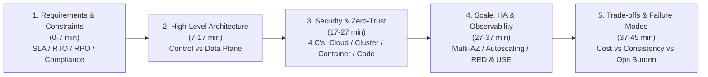
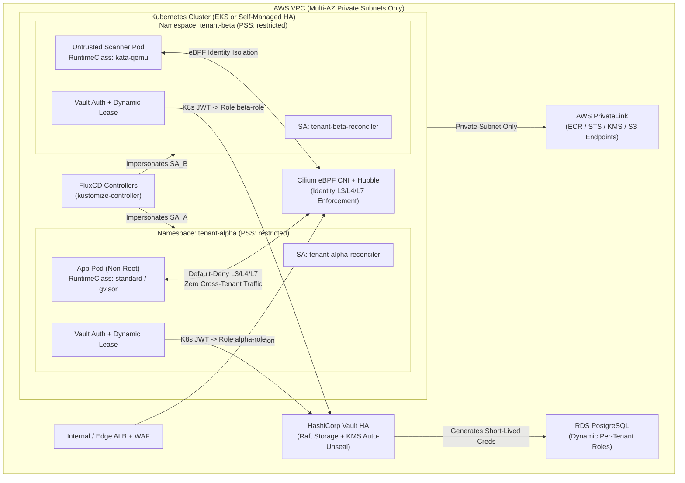
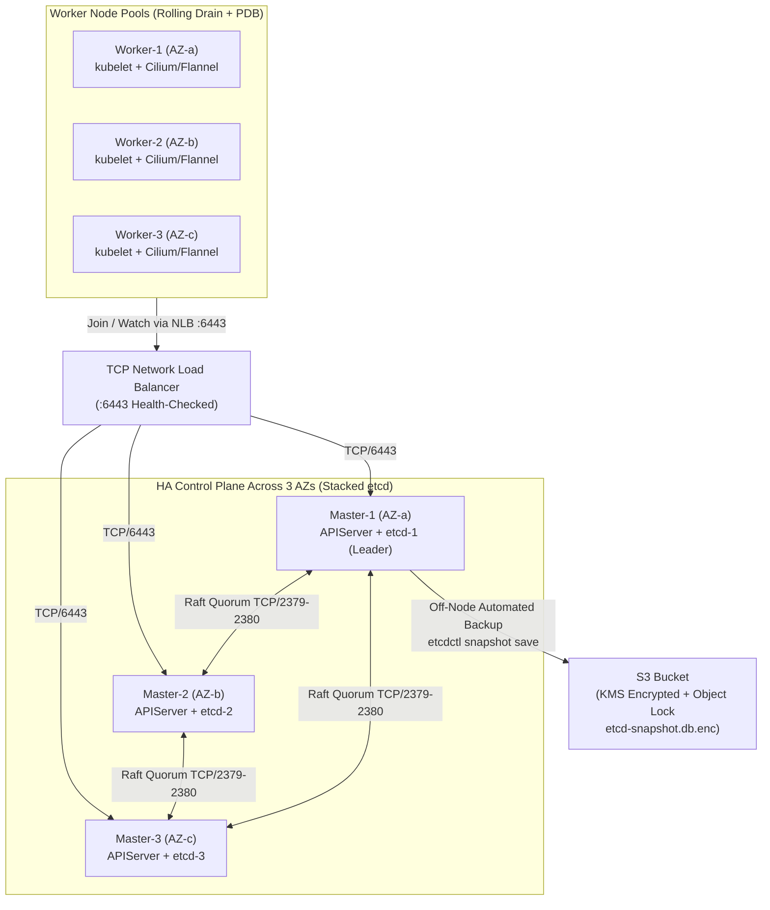
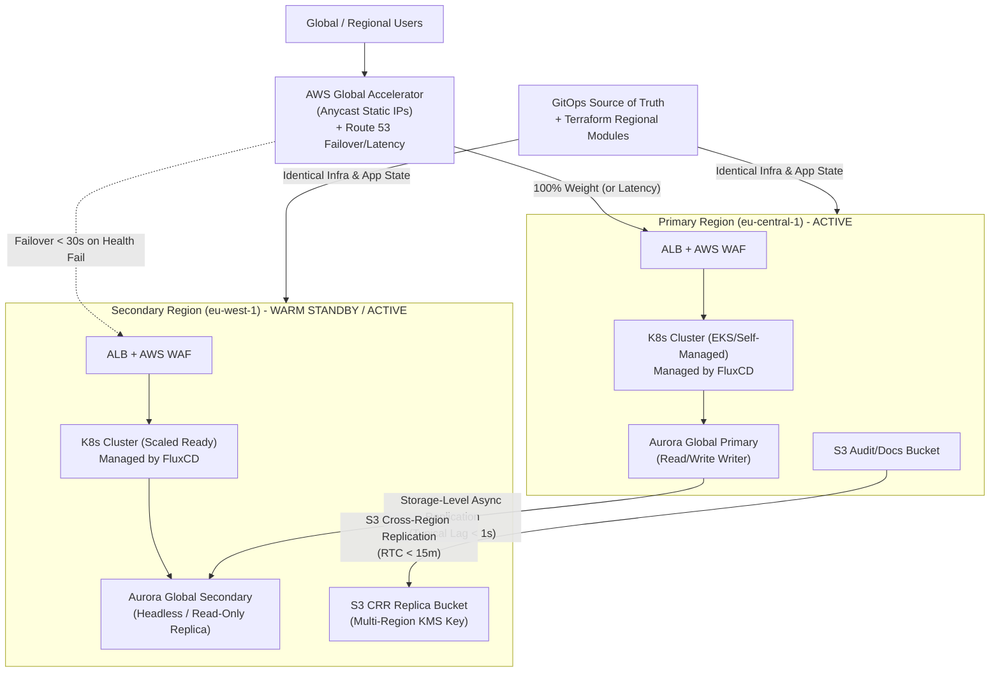
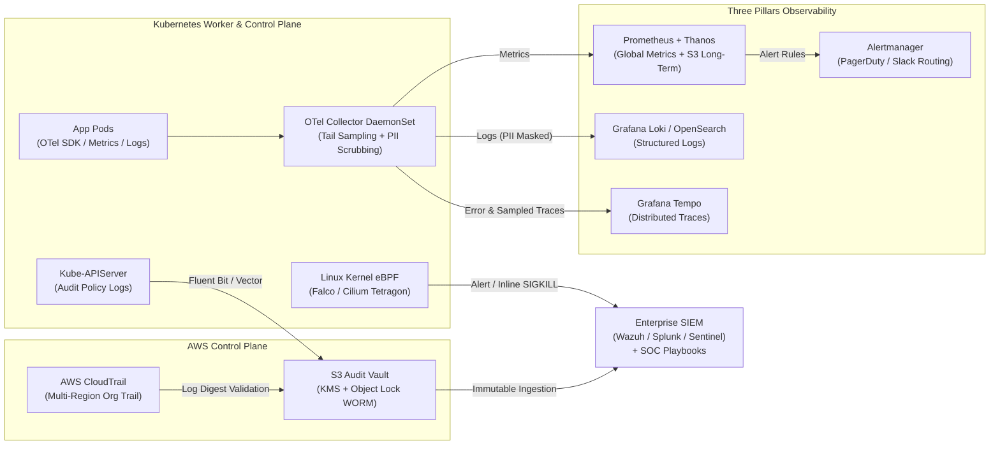
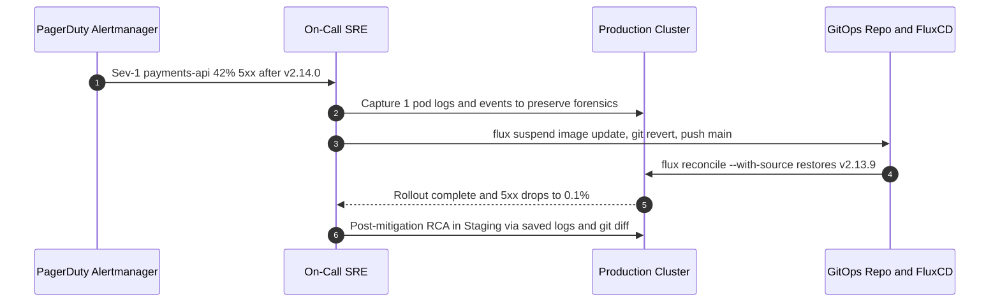
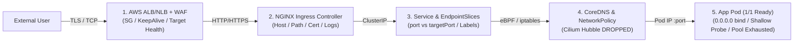
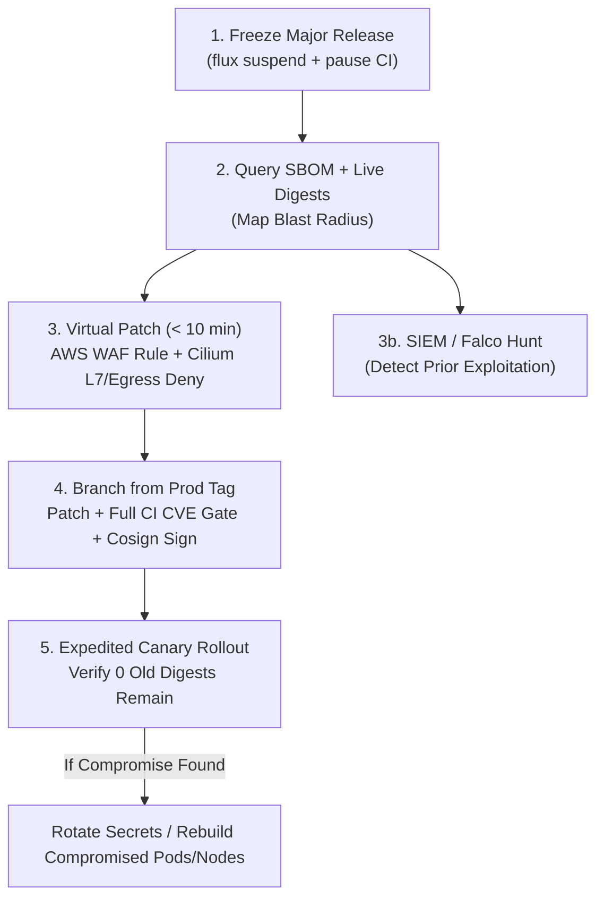

```mermaid
flowchart LR
    Dev["Signed Git Commit\n(GPG / SSH + Gitleaks)"] --> Runner["Ephemeral Rootless\nGitLab Runner Pod\n(OIDC JWT Auth)"]

    subgraph CI["Isolated CI Build & Verification Plane"]
        Runner --> SAST["SAST & SCA\n(Semgrep + pip-audit/npm)"]
        SAST --> Kaniko["Rootless Image Build\n(Kaniko -> Digest @sha256)"]
        Kaniko --> SBOM["Syft SBOM\n(CycloneDX JSON)"]
        SBOM --> Trivy{"Trivy Gate\n0 CRITICAL/HIGH?"}
        Trivy -->|"CVE Found"| Fail["Fail Pipeline\nBlock Push"]
        Trivy -->|"Clean"| Cosign["Cosign Keyless Sign\n& Attest Provenance\n(Fulcio + Rekor)"]
    end

    Cosign -->|"Push Immutable Digest"| Reg["Immutable OCI Registry\n(Tag Immutability ON)"]
    Reg -->|"ImageRepository Scan"| Flux["FluxCD\n(ImageUpdateAutomation)"]
    Flux -->|"Apply Digest Manifest"| Kyverno{"Kyverno Gate\nVerify Cosign Sig\n& SLSA Attestation?"}
    Kyverno -->|"Invalid / Unsigned"| Reject["Admission Webhook\nDENY Deploy"]
    Kyverno -->|"Verified"| Flagger["Flagger Canary Rollout\n(Prometheus SLO Check)"]
```

## 9. System Design Architectures and Real-World Incident Case Studies

This module prepares you for **Senior and Expert DevOps / DevSecOps** system design whiteboarding and live incident-response interviews at top engineering and regulated cybersecurity/fintech organizations (including **CyShield**). Every architecture emphasizes defense-in-depth, measurable reliability targets (`SLA`/`RTO`/`RPO`), and operational simplicity under real-world failure modes.

---

### 9.1 How to Structure a Senior System Design Answer (5-Step Framework)

#### Q1. [Senior] How do you structure a 45-minute Senior/Expert DevOps System Design interview answer from scratch?

**Executive Takeaway:** Junior candidates immediately name tools ("I'll deploy EKS with Terraform and Prometheus"). Senior and Expert engineers drive the whiteboard top-down: lock **business constraints and compliance boundaries first**, sketch the **control/data plane**, overlay **Zero-Trust (4 C's) boundaries**, prove **scalability and observability**, and proactively defend **architectural trade-offs and failure modes**.

Use this disciplined **5-Step Time-Boxed Framework** to control a 45-minute interview:



1. **Step 1 — Requirements & Constraints (`0–7 min`):**
   - **Functional Requirements:** Who are the users/tenants (internal engineers, external B2B tenants, automated CI runners)? What workloads run (stateless APIs, PCI cardholder data, untrusted third-party scans)?
   - **Non-Functional Requirements (NFRs):**
     - **Availability (`SLA`/`SLO`):** `99.9%` vs `99.99%` dictates whether Multi-AZ suffices or Multi-Region is mandatory.
     - **Disaster Recovery (`RPO` / `RTO`):** Maximum acceptable data loss (`RPO`) and maximum acceptable recovery time (`RTO`).
     - **Scale & Latency:** Peak RPS, burst factor (`10x` flash traffic), `p95`/`p99` tail latency budget, data volume growth.
     - **Compliance & Residency:** SOC 2 Type II, ISO 27001, PCI-DSS, HIPAA, GDPR data residency, or regional central-bank/cybersecurity mandates (audit log immutability, FIPS/KMS key custody, zero public database endpoints).
2. **Step 2 — High-Level Architecture (`7–17 min`):**
   - Separate **Edge / Ingress**, **Compute / Data Plane**, **Stateful Tier**, **Secret / Identity Plane**, and **GitOps / CI/CD Control Plane**.
   - Trace the **happy-path packet flow** end-to-end (Client -> WAF/Edge -> LB -> Ingress -> Service -> Pod -> DB) and the **deployment flow** (Git -> CI -> Registry -> GitOps Pull -> Cluster).
3. **Step 3 — Security & Zero-Trust Boundaries: The 4 C's (`17–27 min`):**
   - **Cloud:** Private subnets only for workloads, VPC Interface Endpoints (PrivateLink), KMS customer-managed keys (CMKs), IAM IRSA/Pod Identity (no long-lived access keys), IMDSv2 enforced (`HttpTokens=required`).
   - **Cluster:** Private API endpoint (or `/32` + VPN/bastion allowlist), OIDC short-lived RBAC, etcd encryption at rest, Pod Security Admission (`restricted`), Cilium eBPF L3/L4/L7 default-deny policies, Kyverno/OPA policy-as-code.
   - **Container:** Non-root UID, `readOnlyRootFilesystem: true`, `capabilities.drop: ["ALL"]`, `seccompProfile: RuntimeDefault`, Cosign signature verification, SBOM/Trivy CVE gates, `RuntimeClass` isolation (Kata/gVisor) for untrusted code.
   - **Code:** GPG/SSH-signed commits, pre-commit & CI secret scanning, SAST/SCA, mTLS workload identity (SPIFFE/Cilium/Istio), Vault dynamic short-lived DB credentials.
4. **Step 4 — Scalability, HA & Observability (`27–37 min`):**
   - Multi-AZ stateless scaling (`HPA` / `KEDA` + `Karpenter`), `PodDisruptionBudget` (`PDB`), `topologySpreadConstraints`, odd-numbered stateful quorums (`3` or `5` nodes).
   - **Observability:** **RED** (Rate, Errors, Duration) for services + **USE** (Utilization, Saturation, Errors) for nodes/DBs + OpenTelemetry distributed traces + Falco/Tetragon eBPF runtime security alerts + immutable audit logs to SIEM.
5. **Step 5 — Trade-offs & Failure Modes (`37–45 min`):**
   - Never present an architecture as "free." State what you traded off (e.g., *cost of NAT Gateways vs PrivateLink*, *gVisor syscall latency vs microVM overhead*, *Managed EKS control plane vs self-managed HA etcd ops burden*, *async replication RPO vs sync latency*).
   - Walk through 2 concrete failure scenarios: *"What happens if an entire AZ fails?"* and *"What happens if a container is compromised via RCE?"*

---

#### Q2. [Senior] How do you translate SLA availability targets, Error Budgets, RPO, and RTO into concrete infrastructure tiers?

**Executive Takeaway:** Every additional "nine" of availability roughly cuts your annual downtime budget by `10x` and forces an architectural boundary jump—from single-node (`99%`), to Multi-AZ (`99.9%–99.95%`), to automated Multi-Region failover (`99.99%+`).

| Availability SLA | Allowed Downtime / Year | Allowed Downtime / Month | Typical RPO / RTO | Required Architecture Tier |
| :--- | :--- | :--- | :--- | :--- |
| **`99.0%` ("Two 9s")** | `3.65 days` | `7.31 hours` | RPO: `24h` / RTO: `4h` | Single-AZ compute + automated nightly DB snapshots |
| **`99.9%` ("Three 9s")** | `8.77 hours` | `43.8 minutes` | RPO: `15m` / RTO: `15m` | Multi-AZ active compute + RDS Multi-AZ standby + IaC rebuild |
| **`99.95%`** | `4.38 hours` | `21.9 minutes` | RPO: `< 5m` / RTO: `< 5m` | Multi-AZ stateless + Multi-AZ RDS + automated PDB/HPA + Warm DR |
| **`99.99%` ("Four 9s")** | `52.6 minutes` | `4.38 minutes` | RPO: `< 5s` / RTO: `< 60s` | Multi-Region Active-Passive Warm Standby (Aurora Global + Global Accelerator) |
| **`99.999%` ("Five 9s")** | `5.26 minutes` | `26.3 seconds` | RPO: `~0s` / RTO: `< 10s` | Multi-Region Active-Active cell-based / shard-by-region + zero-downtime GitOps |

**Key Interview Rule on Composite SLAs:** Serial dependencies multiply. If your API depends synchronously on a Database (`99.95%`) and an Identity Provider (`99.9%`), your theoretical ceiling is `0.9995 * 0.999 = 99.85%` unless you decouple with caching, circuit breakers, or asynchronous queues.

---

### 9.2 Production System Design Case Studies

#### Q3. [Senior] Design 1: Multi-Tenant "Secured by Design" Enterprise Platform (AWS + Self-Managed/EKS K8s + Cilium + FluxCD + HashiCorp Vault)

**Executive Takeaway:** True Kubernetes multi-tenancy requires **layered blast-radius containment** because Kubernetes namespaces alone are only soft administrative boundaries sharing a single Linux kernel and control plane. Combining Cilium eBPF identity-based L3/L4/L7 segmentation, `RuntimeClass` sandboxing (Kata Containers or gVisor) for untrusted tenant workloads, Vault dynamic secrets, FluxCD service-account impersonation, and AWS PrivateLink prevents lateral movement across tenants and cloud services.

##### 1. Requirements & Constraints
- **Functional:** Host multiple B2B enterprise tenants (or isolated security-assessment / fintech customer pipelines) on a shared platform; each tenant deploys workloads via GitOps and accesses isolated DB schemas/secrets.
- **Non-Functional:** `99.95%` SLA, `< 50ms` internal service latency overhead, strict tenant-to-tenant zero-trust isolation (compromised Pod in Tenant A must NOT reach Tenant B, cloud metadata, or Vault paths of Tenant B).
- **Compliance:** SOC 2 Type II / ISO 27001; zero static credentials; all AWS API calls stay off the public internet.

##### 2. Architecture Diagram



##### 3. Component Breakdown
1. **Control-Plane & GitOps Tenant Isolation (`FluxCD`):**
   - A platform repo owns cluster-wide infrastructure (`cilium`, `vault`, `kyverno`), while each tenant has a dedicated Git repository/path reconciled by a `Kustomization` configured with `spec.serviceAccountName: tenant-alpha-reconciler`.
   - Because `kustomize-controller` **impersonates** that tenant-scoped ServiceAccount (which holds a namespace-scoped `RoleBinding`, never a `ClusterRoleBinding`), Tenant Alpha physically cannot create a `ClusterRole`, mutate `kube-system`, or deploy resources into `tenant-beta`.
2. **Identity-Aware Network Isolation (`Cilium` eBPF):**
   - Replaces `kube-proxy` and legacy `iptables` IP-based matching with eBPF **Security Identities** (`tc`/socket hooks).
   - Enforces a default-deny ingress/egress `CiliumClusterwideNetworkPolicy`, allowing traffic strictly to CoreDNS (`UDP/TCP 53` with `toFQDNs` L7 inspection), approved ingress gateways, and explicit egress FQDNs.
3. **Compute & Kernel Sandboxing (`RuntimeClass`):**
   - Standard trusted microservices run on hardened `containerd` with `seccompProfile: RuntimeDefault`.
   - Untrusted or high-risk workloads (e.g., customer-submitted code, DAST/SAST scanners, PDF parsers) specify `runtimeClassName: gvisor` (user-space syscall kernel in Go) or `runtimeClassName: kata-qemu` (lightweight Firecracker/QEMU microVM with dedicated guest kernel), eliminating shared-kernel container escape risks.
4. **Dynamic Identity & Secrets (`HashiCorp Vault`):**
   - Vault runs in HA Raft mode with AWS KMS auto-unseal. Pods authenticate via Kubernetes ServiceAccount JWT (`auth/kubernetes`), scoped strictly to `bound_service_account_namespaces: ["tenant-alpha"]`.
   - Vault's PostgreSQL secrets engine dynamically mints short-lived `1h` DB credentials (`v-k8s-alpha-xxxx`) and revokes them automatically when the Pod terminates.
5. **Private Cloud Connectivity (`AWS PrivateLink`):**
   - Worker nodes sit in private subnets with **no public IPs** and route ECR pulls, KMS decryption, STS calls, and S3 access through VPC Interface/Gateway Endpoints, preventing data exfiltration via rogue internet egress.

##### 4. Security Hardening
- **Pod Security Standards & Resource Guardrails:** Every tenant namespace carries `pod-security.kubernetes.io/enforce: restricted`, a `ResourceQuota` (capping CPU/memory/PVC count), and a `LimitRange`.
- **IMDSv2 Hop-Limit Hardening:** Node launch templates enforce `HttpTokens=required` and `HttpPutResponseHopLimit=1` so pods inside containers cannot hop to `169.254.169.254` to steal node IAM credentials.
- **Cilium L3/L4/L7 Tenant Isolation Policy:**

```yaml
apiVersion: cilium.io/v2
kind: CiliumNetworkPolicy
metadata:
  name: tenant-alpha-zero-trust
  namespace: tenant-alpha
spec:
  endpointSelector: {}
  ingress:
    - fromEndpoints:
        - matchLabels:
            k8s:io.kubernetes.pod.namespace: tenant-alpha
    - fromEndpoints:
        - matchLabels:
            k8s:io.kubernetes.pod.namespace: ingress-nginx
  egress:
    - toEndpoints:
        - matchLabels:
            k8s:io.kubernetes.pod.namespace: kube-system
            k8s-app: kube-dns
      toPorts:
        - ports:
            - port: "53"
              protocol: ANY
          rules:
            dns:
              - matchPattern: "*.tenant-alpha.internal"
              - matchPattern: "alpha-db.internal.rds.amazonaws.com"
              - matchPattern: "*.vault.svc.cluster.local"
    - toFQDNs:
        - matchName: "alpha-db.internal.rds.amazonaws.com"
      toPorts:
        - ports:
            - port: "5432"
              protocol: TCP
    - toEndpoints:
        - matchLabels:
            k8s:io.kubernetes.pod.namespace: vault
            app.kubernetes.io/name: vault
      toPorts:
        - ports:
            - port: "8200"
              protocol: TCP
```

- **Kata/gVisor `RuntimeClass` Binding:**

```yaml
apiVersion: node.k8s.io/v1
kind: RuntimeClass
metadata:
  name: kata-qemu
handler: kata-qemu
scheduling:
  nodeSelector:
    workload-isolation: microvm
```

##### 5. Architectural Trade-offs
- **Namespace + Cilium + Kata vs Dedicated Cluster-per-Tenant:**
  - *Shared cluster with Kata/Cilium* saves `40–60%` on control-plane/DaemonSet overhead and simplifies platform upgrades, at the risk of a Kubernetes API server zero-day or noisy-neighbor control-plane saturation (`etcd` rate limits).
  - *Dedicated cluster-per-tenant* (e.g., via Cluster API / EKS) provides true control-plane isolation for regulated Tier-1 banks at higher cost and fleet-upgrade complexity.
- **gVisor vs Kata Containers:** `gVisor` has fast startup (`~50ms`) and low RAM overhead but incurs `15–40%` penalty on syscall/I/O-heavy workloads and occasional Linux syscall incompatibilities; `Kata` runs a real kernel (nearly `100%` compatibility) in a microVM (`~120MB` memory overhead per Pod) and requires bare-metal or nested-virtualization EC2 instances (`.metal` / Nitro hypervisor constraints).
- **PrivateLink vs NAT Gateway:** PrivateLink eliminates internet exposure and avoids NAT per-GB processing charges on high-volume ECR/S3 traffic, at a fixed hourly cost per AZ per Interface Endpoint (`~$0.01/hr` per ENI).

---

#### Q4. [Senior] Design 2: SLSA Level 3 Hardened DevSecOps Software Supply Chain CI/CD Pipeline

**Executive Takeaway:** Blocking a vulnerable image in CI (like basic image scanning) is necessary but insufficient against supply-chain attacks (SolarWinds, Codecov, compromised Git tags). A **SLSA v1.0 Level 3** pipeline guarantees **build isolation** (ephemeral rootless runners), **zero static credentials** (OIDC federation), **unforgeable cryptographic provenance & SBOM attestations** (Cosign keyless signing), and **fail-closed admission enforcement** (Kyverno verifying signatures by immutable `@sha256` digest before Flagger canary rollout).

##### 1. Requirements & Constraints
- **Functional:** Automate commit-to-production delivery with SAST, SCA, SBOM generation, rootless container builds, CVE gating, cryptographic signing, and progressive canary promotion.
- **Non-Functional:** Build latency `< 8 min`, zero mutable `:latest` tags in production, automatic rollback within `< 2 min` on canary regression.
- **Compliance:** **SLSA v1.0 Level 3** (isolated ephemeral build environment, non-falsifiable provenance), NIST SSDF (`SP 800-218`), zero long-lived CI secrets (`AWS_ACCESS_KEY_ID` or registry passwords forbidden).

##### 2. Architecture Diagram



##### 3. Component Breakdown
1. **Source Integrity:** Branch protection enforces signed commits (`git commit -S`), `2` peer approvals, `CODEOWNERS` on pipeline/Helm paths, and pre-receive `Gitleaks` secret detection so secrets never enter Git history.
2. **Ephemeral Rootless Runner + OIDC (`GitLab Runner` on K8s):**
   - Each job spins up a fresh Pod (`privileged: false`, `docker.sock` **never** mounted) that is destroyed on completion so build artifacts cannot poison subsequent builds.
   - GitLab injects a short-lived **OIDC JWT (`id_tokens`)** exchanged directly with Vault or AWS STS (`AssumeRoleWithWebIdentity`)—zero static credentials exist in CI variables.
3. **Shift-Left Security & Rootless Build (`Semgrep` -> `Kaniko` -> `Syft` -> `Trivy`):**
   - `Kaniko` builds the container image in user space without a Docker daemon (`--no-push` to local OCI tarball first so vulnerable images **never touch the registry** until scanned).
   - `Syft` produces a CycloneDX SBOM (`sbom.cdx.json`) from the local OCI tar; `Trivy` gates on `--severity CRITICAL,HIGH --exit-code 1 --ignore-unfixed`.
4. **Keyless Cryptographic Signing & Attestation (`Cosign` + `Sigstore`):**
   - After passing Trivy, the image is pushed by digest (`$IMAGE@$DIGEST`). `cosign sign` uses the GitLab OIDC token to mint a short-lived X.509 certificate from **Fulcio** (bound to the exact GitLab repo/ref/commit SHA) and logs the signature in **Rekor** (append-only transparency log).
   - `cosign attest` attaches the signed SBOM and SLSA v1.0 provenance predicates directly to the OCI registry as referrers.
5. **Immutable Registry + Policy-Enforced GitOps (`FluxCD` + `Kyverno` + `Flagger`):**
   - Registry tag immutability prevents overwriting `v1.2.3`. Flux's `image-reflector-controller` scans tags and evaluates `ImagePolicy` (configured with `digestReflectionPolicy: Always` or `IfNotPresent` when digest pinning is intended), while **`image-automation-controller`** (`ImageUpdateAutomation`) updates Git with `image: registry/app:v1.2.3@sha256:...`.
   - **Kyverno `verifyImages`** intercepts every `Pod` admission request, checks Rekor + Fulcio OIDC issuer/subject, mutates tags to resolved digests, and blocks any unsigned or manually patched image.
   - **Flagger** shifts traffic (`5% -> 25% -> 50% -> 100%`) while polling Prometheus HTTP `5xx` rate and `p99` latency, automatically halting and reverting if SLO thresholds breach.

##### 4. Security Hardening
- **GitLab CI Split Rootless Build, Scan-Before-Push & Isolated Keyless Cosign Pattern:**

```yaml
stages: [build, scan, push, sign]

build_rootless:
  stage: build
  image:
    name: gcr.io/kaniko-project/executor:v1.23.2-debug
    entrypoint: [""]
  script:
    # 1. Build rootless into local OCI tarball (never push unscanned image)
    - /kaniko/executor --context "$CI_PROJECT_DIR" --no-push --tar-path image.tar --destination "$IMAGE:$CI_COMMIT_SHORT_SHA"
  artifacts:
    paths: [image.tar]
    expire_in: 1 hour

sbom_generate:
  stage: scan
  needs: ["build_rootless"]
  image:
    name: ghcr.io/anchore/syft:v1.54.0-debug
    entrypoint: [""]
  script:
    - syft oci-archive:image.tar -o cyclonedx-json=sbom.cdx.json
  artifacts:
    paths: [sbom.cdx.json]
    expire_in: 1 hour

cve_gate:
  stage: scan
  needs: ["build_rootless"]
  image:
    name: aquasec/trivy:0.58.1
    entrypoint: [""]
  script:
    # 2. Enforce CVE gate BEFORE registry push
    - trivy image --input image.tar --severity CRITICAL,HIGH --ignore-unfixed --exit-code 1

push_image:
  stage: push
  needs: ["build_rootless", "cve_gate"]
  image:
    name: gcr.io/go-containerregistry/crane:debug
    entrypoint: [""]
  script:
    # 3. Push scanned tarball and resolve immutable @sha256 digest
    - crane push image.tar "$IMAGE:$CI_COMMIT_SHORT_SHA"
    - echo "DIGEST=$(crane digest "$IMAGE:$CI_COMMIT_SHORT_SHA")" > image.env
  artifacts:
    reports:
      dotenv: image.env

sign_and_attest:
  stage: sign
  needs: ["push_image", "sbom_generate"]
  image: alpine:3.21
  id_tokens:
    SIGSTORE_ID_TOKEN:
      aud: sigstore
  before_script:
    - apk add --no-cache cosign
  script:
    # 4. Keyless sign and attach SBOM attestation in an isolated job without build script execution
    - cosign sign --yes "$IMAGE@$DIGEST"
    - cosign attest --yes --predicate sbom.cdx.json --type cyclonedx "$IMAGE@$DIGEST"
```

- **SLSA v1.0 Level 3 Provenance Isolation Requirement:** Splitting `sign_and_attest` into a separate container prevents untrusted build scripts inside `build_rootless` from stealing `SIGSTORE_ID_TOKEN` or tampering with `sbom.cdx.json` in-process. However, for **strict SLSA v1.0 Level 3** non-falsifiable provenance, provenance generation and signing must be executed by the **CI/build control plane itself** outside any user-editable `.gitlab-ci.yml` script step (e.g., GitLab Runner native SLSA v1.0 attestation generation, GitHub Artifact Attestations, or **Tekton Chains**).

- **Kyverno Admission Policy Enforcing Keyless Cosign Verification:**

```yaml
apiVersion: kyverno.io/v1
kind: ClusterPolicy
metadata:
  name: verify-slsa-signed-images
spec:
  validationFailureAction: Enforce
  background: false
  rules:
    - name: verify-cosign-oidc
      match:
        any:
          - resources:
              kinds: ["Pod"]
              namespaces: ["production"]
      verifyImages:
        - imageReferences: ["registry.example.com/platform/*"]
          mutateDigest: true
          verifyDigest: true
          required: true
          attestors:
            - entries:
                - keyless:
                    subject: "https://gitlab.com/org/platform//.gitlab-ci.yml@refs/heads/main"
                    issuer: "https://gitlab.com"
                    rekor:
                      url: "https://rekor.sigstore.dev"
```

##### 5. Architectural Trade-offs
- **Scan Local Tarball Before Push vs Push-Then-Scan:** Scanning a local tarball ensures vulnerable images never land in ECR/GitLab Registry (zero race window for another pipeline to pull an unvetted tag), at the cost of extra disk/ephemeral storage in the CI runner pod and slightly slower upload (no layer caching reuse prior to scan unless using a staging quarantine repo).
- **Public Sigstore (Fulcio/Rekor) vs Self-Hosted Private Sigstore:** Public Rekor leaks metadata (repo URL, builder identity, timestamp) into a public transparency log; regulated fintech/defense orgs (like CyShield clients) should deploy **private internal Sigstore** or AWS KMS-backed Cosign keys (`cosign sign --key awskms:///...`) inside their air-gapped/VPC boundary.
- **Ignore-Unfixed vs Strict Zero-CVE Gate:** Blocking on unfixed upstream OS CVEs halts releases indefinitely; senior pipelines fail on `CRITICAL/HIGH` with `fixed` versions while logging accepted risk with time-bound VEX (Vulnerability Exploitability eXchange) exceptions.

---

#### Q5. [Expert] Design 3: Zero-Downtime Self-Managed Kubernetes HA Cluster Upgrade & `etcd` Disaster Recovery

**Executive Takeaway:** Self-managed Kubernetes upgrades fail in production for three predictable reasons: broken `etcd` quorum, overly strict `PodDisruptionBudgets` (`minAvailable == replicas`) deadlocking `kubectl drain`, or skipping a minor version (`v1.29 -> v1.31` violates Kubernetes skew policy). A zero-downtime upgrade requires an odd-numbered `etcd` quorum behind an NLB, an off-node encrypted snapshot **verified before touching anything**, sequential minor upgrades (`v1.30 -> v1.31`), and a rehearsed quorum-loss restore drill.

##### 1. Requirements & Constraints
- **Functional:** Upgrade a self-managed HA Kubernetes cluster (e.g., `kubeadm` or HA `K3s` upgraded from a single-master prototype to 3-node production) from `v1.30.x` to `v1.31.x` with zero API/data-plane downtime, and support full recovery from total control-plane quorum loss.
- **Non-Functional:** `0` dropped user requests during rolling upgrades; Control Plane recovery RTO `< 15 min`, RPO `< 5 min` via periodic encrypted `etcd` snapshots.
- **Constraints:** Kubernetes supports **at most +1 minor version skew** between `kube-apiserver` and `kubelet`/`controller-manager`/`scheduler`, and `etcd` quorum requires `floor(N / 2) + 1` healthy nodes (`2 of 3` for a 3-node cluster).

##### 2. Architecture Diagram



##### 3. Component Breakdown & Exact Runbook
1. **Topology & Quorum Design:**
   - Place `3` control-plane nodes across `3` Availability Zones behind a Layer-4 NLB (`TCP/6443` with `/livez` or TCP health checks). *Never use `2` etcd nodes*: a 2-node cluster has quorum `floor(2 / 2) + 1 = 2`, meaning losing 1 node breaks availability—worse than 1 node.
2. **Phase 1 — Pre-Flight Checks & Encrypted Off-Node Backup (Mandatory Before Any Upgrade):**
   - Check deprecated APIs removed in `v1.31` using `kubent` or `pluto` (e.g., removed beta CRDs/FlowSchema versions).
   - Check CNI (`Cilium` / `Flannel` / `Calico`) and `containerd` compatibility matrix against `v1.31`.
   - Identify blocking `PodDisruptionBudgets` where `ALLOWED DISRUPTIONS == 0` (`kubectl get pdb -A`) so `kubectl drain` will not hang indefinitely.
   - Verify etcd cluster health and take + verify an off-node snapshot:

```bash
# 1. Verify all 3 etcd members are healthy and identify Leader
ETCDCTL_API=3 etcdctl \
  --endpoints=https://10.0.1.10:2379,https://10.0.2.10:2379,https://10.0.3.10:2379 \
  --cacert=/etc/kubernetes/pki/etcd/ca.crt \
  --cert=/etc/kubernetes/pki/etcd/server.crt \
  --key=/etc/kubernetes/pki/etcd/server.key \
  endpoint status --write-out=table

# 2. Take consistent etcd snapshot & verify hash integrity
ETCDCTL_API=3 etcdctl \
  --endpoints=https://127.0.0.1:2379 \
  --cacert=/etc/kubernetes/pki/etcd/ca.crt \
  --cert=/etc/kubernetes/pki/etcd/server.crt \
  --key=/etc/kubernetes/pki/etcd/server.key \
  snapshot save /tmp/etcd-pre-v131.db

etcdutl snapshot status /tmp/etcd-pre-v131.db --write-out=table

# 3. Encrypt and push off-node to S3 (never store backups solely on the master disk!)
aws s3 cp /tmp/etcd-pre-v131.db s3://prod-k8s-etcd-backups/pre-v131-$(date +%F).db \
  --sse aws:kms --sse-kms-key-id alias/k8s-etcd-backup-key
```

3. **Phase 2 — Sequential Control Plane Upgrade (`v1.30 -> v1.31`):**
   - Upgrade **one master at a time** (preserving `2/3` etcd quorum and NLB routing to healthy masters):
     - On `Master-1`: upgrade `kubeadm`, run `kubeadm upgrade plan`, then `sudo kubeadm upgrade apply v1.31.x` (upgrades control-plane static manifests + etcd safely). Drain `Master-1`, upgrade `kubelet` & `kubectl`, restart `kubelet`, `kubectl uncordon master-1`.
     - On `Master-2` & `Master-3`: upgrade `kubeadm`, run `sudo kubeadm upgrade node` (note: `node`, NOT `apply`), drain, upgrade `kubelet`, restart `kubelet`, uncordon.
4. **Phase 3 — PDB-Aware Worker Pool Rolling Upgrade:**
   - Ensure critical workloads have `replicas >= 2` and `topologySpreadConstraints` across AZs.
   - Drain one worker at a time (`kubectl drain <worker> --ignore-daemonsets --delete-emptydir-data`), upgrade `kubelet` (and CNI binaries if needed), restart `kubelet`, verify `Ready`, and `kubectl uncordon <worker>`.
5. **Phase 4 — Total Quorum Loss Disaster Recovery Drill (2+ Masters Lost):**
   - If 2 of 3 etcd members die simultaneously, quorum is lost and `etcd` refuses all writes (cluster is read-only/frozen). Restoring requires **re-bootstrapping a brand-new cluster state from the snapshot across all 3 replacement nodes** so stale Raft logs do not split-brain:

```bash
# On ALL 3 new/clean master nodes (with kube-apiserver & etcd static pods stopped):
# Each node restores the EXACT SAME snapshot with its own --name, --initial-advertise-peer-urls, and shared --initial-cluster
ETCDCTL_API=3 etcdutl snapshot restore /tmp/etcd-pre-v131.db \
  --name master-1 \
  --initial-cluster "master-1=https://10.0.1.10:2380,master-2=https://10.0.2.10:2380,master-3=https://10.0.3.10:2380" \
  --initial-cluster-token etcd-cluster-restore-01 \
  --initial-advertise-peer-urls https://10.0.1.10:2380 \
  --data-dir /var/lib/etcd-restored
```

   - Update `/etc/kubernetes/manifests/etcd.yaml` (`hostPath` `etcd-data` -> `/var/lib/etcd-restored` or swap directories atomically), start `kubelet` simultaneously on all 3 nodes, verify `etcdctl endpoint health`, delete stale `Node` objects for dead workers, and **immediately rotate any Kubernetes Secrets/SA tokens** if time-travel occurred relative to external systems.

##### 4. Security Hardening
- **Encryption at Rest (`EncryptionConfiguration`):** Encrypt `Secret` objects in `etcd` using `aescbc` or KMSv2 plugin (`aws-encryption-provider`) so an `etcd` snapshot alone cannot expose plaintext Secrets.
- **mTLS Peer & Client Enforcement:** Enforce `--peer-client-cert-auth=true` and `--client-cert-auth=true` on `etcd`, restricting `TCP/2379-2380` strictly to control-plane security groups.
- **Immutable Backup Custody:** Lock S3 `etcd` snapshots with S3 Object Lock + separate AWS KMS key permissions (CI/workload nodes have zero `s3:GetObject` access to etcd backups).

##### 5. Architectural Trade-offs
- **Stacked `etcd` vs External `etcd`:** *Stacked* reduces node count (3 nodes instead of 6) and simplifies bootstrap (`kubeadm`), ideal for most teams; *External* isolates noisy API server CPU/memory spikes from etcd disk fsync latency (etcd is hypersensitive to NVMe `wal_fsync_duration_seconds > 10ms`) at 2x control-plane VM cost.
- **Self-Managed HA K8s vs Managed EKS:** Self-managed avoids vendor lock-in and meets strict on-prem/sovereign data requirements, but transfers `etcd` compaction/defrag, PKI CA rotation, and CVE patching (`kube-apiserver`) to your SRE team.
- **In-Place Node Upgrade vs Blue/Green Worker Node Replacement:** *Blue/Green node pools* (provisioning fresh `v1.31` AMIs, cordoning old `v1.30` nodes, draining) are cleaner, rollback-friendly, and avoid OS drift compared to in-place `apt upgrade` on workers.

---

#### Q6. [Expert] Design 4: Multi-Region AWS Active-Passive vs Active-Active Architecture for FinTech/Government (RPO/RTO)

**Executive Takeaway:** Regulated FinTech and Government platforms demand strict auditability and data consistency—meaning naive Active-Active multi-writer databases cause catastrophic **split-brain double-spends**. Unless business requirements strictly dictate `< 10s` global RTO, a **Warm Standby Active-Passive** design (Aurora Global + Global Accelerator + Terraform regional parity + FluxCD) delivers `< 60s` RTO and `< 5s` RPO without distributed consensus nightmares.

##### 1. Requirements & Constraints
- **Functional:** Survive total loss of a primary AWS Region (e.g., `eu-central-1` Frankfurt) by failing over to a compliant secondary Region (`eu-west-1` Ireland) while keeping regional data residency intact.
- **Non-Functional:**
  - *Option A (Warm Standby Active-Passive):* RTO `1–5 min`, RPO `< 5 sec`.
  - *Option B (Active-Active Home-Region Sharded):* RTO `< 30 sec`, RPO `~0 sec` for healthy home-region transactions.
- **Compliance:** Zero cross-border leakage outside approved jurisdictions, immutable financial ledger integrity (zero duplicate/lost commits), identical security posture across both regions.

##### 2. Architecture Diagram



##### 3. Component Breakdown
1. **Traffic Steering (`AWS Global Accelerator` + `Route 53`):**
   - Route 53 Health Checks + DNS Failover suffer from client/ISP **DNS TTL caching** (even `60s` TTL can take minutes for legacy clients to respect). **AWS Global Accelerator** solves this at the BGP Anycast layer by keeping two static IPs constant and draining unhealthy regional ALBs within `10–30s`.
2. **Infrastructure & Config Parity (`Terraform Regional Modules` + `FluxCD`):**
   - Both regions are stamped out from **one parameterized Terraform module** (`module "platform_eu_central"` and `module "platform_eu_west"`) and separate remote state files—preventing "DR drift" where security group rules or IAM policies exist in Primary but were forgotten in DR.
   - FluxCD reconciles identical Helm/Kustomize manifests (`overlays/eu-central-1` vs `overlays/eu-west-1`) so DR clusters never wake up with outdated container versions.
3. **Stateful Data Tier (`Aurora Global Database` + `S3 CRR` + `DynamoDB Global Tables`):**
   - **Aurora Global Database** performs dedicated storage-layer replication (`< 1s` typical lag) independent of compute threads.
   - **S3 Cross-Region Replication (CRR)** with Replication Time Control (RTC) backs up documents/audit trails encrypted via AWS **KMS Multi-Region Keys (`mrk-...`)** so the secondary region can decrypt replicated objects immediately without re-encryption.
   - **DynamoDB Global Tables** are reserved strictly for eventually consistent, conflict-tolerant state (rate limits, session cache, idempotency tokens)—**never** for financial ledger balances.
4. **Split-Brain Prevention (Critical Expert Mechanics):**
   - **What is split-brain?** If a network partition hides Primary from Health Checks while Primary is still reachable by batch jobs or stale clients, promoting Secondary creates **two active database writers** and irreconcilable ledger divergence.
   - **Mitigations:**
     1. **Automated Fencing via Managed Failover:** Use `aws rds failover-global-cluster` (for planned switchover) or **explicitly fence/demote** the old primary (`aws rds remove-from-global-cluster` / revoke app SG or WAF block) *before* routing write traffic to Secondary.
     2. **Application Read-Only Circuit Breaker:** Secondary region apps run in read-only mode until the database endpoint passes `SELECT pg_is_in_recovery() = false`.
     3. **Idempotency Keys & Home-Region Sharding (Active-Active):** If true Active-Active is mandated, partition accounts deterministically by `home_region` (`eu-central-1` vs `eu-west-1`); a user's writes proxy to their single authoritative home region writer while reads serve locally.

##### 4. Security Hardening
- **Per-Region Blast Radius:** Separate Terraform state files and IAM deployment roles per region so a bad `terraform apply` in `eu-west-1` cannot destroy `eu-central-1`.
- **Symmetric WAF & KMS Controls:** Identical AWS WAF rulesets, CloudTrail multi-region auditing, and Multi-Region KMS key policies restricted to identical role ARNs across both regions.
- **Regular Automated Game Days:** Monthly/quarterly automated failover drills in staging and controlled switchovers in production (`failover-global-cluster` guarantees RPO=0 during planned switchovers) to prove DR actually works.

##### 5. Architectural Trade-offs (Cost vs RTO/RPO Matrix)

| DR Strategy | Typical RTO | Typical RPO | Monthly Infra Cost Multiplier | Consistency / Split-Brain Risk | Best Fit |
| :--- | :--- | :--- | :--- | :--- | :--- |
| **Backup & Restore** | `2–6 hours` | `1–24 hours` | `~1.05x` | None (single writer rebuilt) | Internal tools, dev/staging |
| **Pilot Light** | `15–45 mins` | `< 5 mins` | `~1.2x` (DB replica on, compute at 0) | Low (manual/scripted promotion) | Cost-sensitive compliance apps |
| **Warm Standby (Active-Passive)** | `1–5 mins` | `< 5 secs` | `~1.5–1.8x` (minimal compute + Aurora Global) | Controlled via fenced failover | **FinTech / Gov Core Platforms (Recommended)** |
| **Active-Active (Home-Sharded)** | `< 30 secs` | `~0 secs` (healthy shard) | `~2.2x+` (full dual capacity + cross-AZ/region egress) | High if unsharded; complex reconciliation | Ultra-low-latency global payments / auth |

---

#### Q7. [Senior] Design 5: Enterprise Observability, Audit & Runtime Threat Detection Stack

**Executive Takeaway:** Classic monitoring ("CPU is 80%, HTTP 500s spiked") misses stealthy post-exploitation attacks (reverse shells, `/proc` credential scraping, unauthorized IAM changes). An enterprise security-first stack separates **Operational Telemetry** (OpenTelemetry -> Thanos/Loki/Tempo + Alertmanager) from **Kernel Runtime Detection & Immutable Audit Custody** (Tetragon/Falco + K8s Audit + CloudTrail -> S3 Object Lock + SIEM).

##### 1. Requirements & Constraints
- **Functional:** Unified metrics, logs, and distributed traces across multiple K8s clusters; real-time kernel syscall detection and automated containment; centralized immutable audit trail for SOC triage.
- **Non-Functional:** `< 2%` node CPU/RAM overhead from telemetry agents; `< 30s` alert latency for Sev-1 outages or critical runtime security events; `1–7 year` tamper-proof audit retention.
- **Compliance:** PCI-DSS Req 10 (tamper-evident audit logs, synchronized NTP time, centralized SIEM), SOC 2 logging/alerting controls.

##### 2. Architecture Diagram



##### 3. Component Breakdown
1. **Unified Telemetry Pipeline (`OpenTelemetry Collector`):**
   - Deployed as DaemonSet + Gateway deployment. Performs **PII/token redaction** (regex-masking bearer tokens, PANs, passwords before logs ever leave the cluster) and **tail-based sampling** (retains `100%` of error/slow `> 500ms` traces while sampling healthy `200 OK` traces at `2%` to slash Tempo storage cost).
2. **The Three Pillars + Correlation:**
   - **Metrics (`Prometheus + Thanos`):** Prometheus scrapes `/metrics` locally; Thanos Sidecar uploads 2-hour TSDB blocks to S3, while Thanos Querier unifies metrics across all clusters and deduplicates HA Prometheus pairs.
   - **Logs (`Grafana Loki` or `OpenSearch`):** Loki indexes only low-cardinality metadata labels (`cluster`, `namespace`, `pod`, `severity`—never `user_id` or `request_id`) and stores compressed chunks in S3. (If SOC analysts require heavy ad-hoc full-text regex across terabytes, pair or use OpenSearch.)
   - **Traces (`Grafana Tempo`):** Links `trace_id` exemplars directly inside Prometheus histograms so clicking a `p99` spike in Grafana jumps straight to the exact failing DB span and correlated Loki log lines.
3. **Alerting (`Alertmanager`):**
   - Implements **Multi-Window Burn-Rate SLO alerts** (alert on error-budget burn rather than noisy transient CPU spikes), **grouping**, and **inhibition** (suppress 50 downstream pod alerts when the entire upstream Node or RDS cluster is already alerting).
4. **eBPF Runtime Threat Detection (`Falco` vs `Cilium Tetragon`):**
   - Hooks directly into kernel syscalls (`execve`, `openat`, `ptrace`, `connect`) via eBPF CO-RE (zero kernel module instability).
   - Detects container drift: interactive shell spawned in prod pod (`sh`/`bash`), unexpected binary executed from `/tmp`, attempts to read `/var/run/secrets/kubernetes.io/serviceaccount/token` from unexpected binaries, or outbound crypto-mining/C2 sockets.
   - **Tetragon** goes beyond passive alerting by supporting **in-kernel synchronous enforcement (`Sigkill`)** via `TracingPolicy` before a malicious syscall completes.
5. **Immutable Audit & SIEM Custody (`kube-apiserver` + `CloudTrail` -> `S3 Object Lock` -> `SIEM`):**
   - `kube-apiserver` `--audit-policy-file` logs `Metadata` for `Secret`/`ConfigMap` reads (never `RequestResponse` on `Secret` bodies, or you leak secrets into logs!) and `RequestResponse` for RBAC mutations, `pods/exec`, and `pods/portforward`.
   - AWS CloudTrail delivers organization-wide API logs with `LogFileValidationEnabled` (SHA-256 hash chaining) into a centralized Security Account S3 bucket protected by **S3 Object Lock (Compliance Mode)**—even an AWS Root user in the workload account cannot delete tracks. Shipped in near real-time to SIEM (Wazuh/Splunk/Sentinel).

##### 4. Security Hardening
- **Kubernetes Audit Policy (Safe Metadata vs RBAC RequestResponse):**

```yaml
apiVersion: audit.k8s.io/v1
kind: Policy
rules:
  # Log Secret access metadata ONLY (never log secret payload!)
  - level: Metadata
    resources:
      - group: ""
        resources: ["secrets", "configmaps"]
  # Log full request/response for RBAC escalation & container exec
  - level: RequestResponse
    resources:
      - group: ""
        resources: ["pods/exec", "pods/attach", "pods/portforward"]
      - group: "rbac.authorization.k8s.io"
        resources: ["clusterroles", "clusterrolebindings", "roles", "rolebindings"]
```

- **Tetragon `TracingPolicyNamespaced` (Detect/Block Interactive Shell in Prod Containers):**

```yaml
apiVersion: cilium.io/v1alpha1
kind: TracingPolicyNamespaced
metadata:
  name: block-shell-in-prod
  namespace: production
spec:
  kprobes:
    - call: "sys_execve"
      syscall: true
      args:
        - index: 0
          type: "string"
      selectors:
        - matchNamespaces:
            - namespace: Mnt
              operator: NotIn
              values: ["host_ns"]
          matchArgs:
            - index: 0
              operator: "Postfix"
              values: ["/sh", "/bash", "/dash"]
          matchActions:
            - action: Sigkill
```

##### 5. Architectural Trade-offs
- **Grafana Loki vs OpenSearch:** Loki is `3–5x` cheaper to run (no full inverted index, object storage chunks) and tightly integrated with Grafana, but high-cardinality label mistakes (`user_id` as a label) will crush its ingester; OpenSearch offers powerful arbitrary SIEM searching at substantial JVM RAM/disk cost.
- **Falco (Alert-First) vs Tetragon (Inline Enforcement):** Blocking syscalls in-kernel (`Sigkill`) eliminates post-breach dwell time, but a misconfigured `TracingPolicy` can accidentally kill legitimate startup scripts or diagnostic tools—always run new rules in **Audit/Post mode first** before enabling `Sigkill`.
- **100% Trace Retention vs Tail-Based Sampling:** Storing 100% of microservice traces is financially ruinous at scale; tail-based sampling keeps cost linear while preserving 100% forensic fidelity on `5xx` errors and latency outliers.

---

### 9.3 Real-World Production Incident Case Studies (Live Interview Scenarios)

#### Q8. [Senior] Incident 1: Production Outage Right After a Release (On-Call Priority Triage)

**Executive Takeaway:** Never debug a live production outage caused by a fresh release before mitigating customer impact—capture one snapshot of forensic logs/events, execute a GitOps-safe rollback (`flux suspend` + `git revert`), restore SLOs first, and perform root-cause analysis once production is green.

##### Scenario Prompt
> *"Five minutes after your team ships `v2.14.0` of the core payments API to production, PagerDuty pages you: checkout error rate jumped from `0.1%` to `42%` HTTP `500`/`502`, and `p99` latency spiked from `120ms` to `8s`. What do you do?"*

##### First 60 Seconds (Stabilize vs Gather Evidence)
**Golden Rule:** **Mitigate MTTR first (rollback/traffic shift via GitOps/Flagger), THEN root-cause!** Users do not care *why* your new release is broken while checkout is down.
1. **Declare & Coordinate (`0–20s`):** Acknowledge the page, open the Sev-1 incident channel, assume **Incident Commander (IC)** role (or split IC / Ops Lead / Comms Lead as teammates join), and post an initial update: *"Investigating elevated 5xx on payments-api following v2.14.0 release; preparing immediate rollback."*
2. **Verify Deployment Correlation (`20–40s`):** Confirm whether `v2.14.0` just rolled out (`flux get kustomizations -A`, `git log -n 5`, Argo/Flagger canary state) and check the RED dashboard (Rate, Errors, Duration) alongside USE saturation (DB connections, CPU/RAM).
3. **Preserve Minimal Forensics Before Wiping Pods (`40–60s`):** Do *not* destroy all failing pods before saving one set of logs/events, or you erase the crime scene! Capture one failing pod's logs and events before rolling back.

##### Step-by-Step Root Cause Isolation (With Exact Commands)

```bash
# 1. Snapshot forensic evidence from a failing pod BEFORE rolling back
kubectl logs -n production deploy/payments-api --tail=200 > /tmp/payments-v214-logs.txt
kubectl logs -n production deploy/payments-api --previous --tail=200 > /tmp/payments-v214-prev.txt || true
kubectl get events -n production --sort-by='.lastTimestamp' | tail -n 30

# 2. Check GitOps / Flagger state (NEVER run `kubectl rollout undo` blindly under Flux/Argo!)
flux get all -n flux-system
kubectl get canary -n production

# 3. IMMEDIATE MITIGATION: GitOps-safe rollback (or pause Flux + revert Git)
flux suspend image update flux-system
git revert <BAD_COMMIT_SHA> --no-edit && git push origin main
flux reconcile kustomization apps --with-source
flux resume image update flux-system

# Option B (if Flagger canary is active at e.g. 25% weight):
# Revert Git commit or scale/fail canary check; Flagger immediately shifts 100% traffic back to primary.

# 4. Verify MTTR recovery on RED dashboard & live rollout status
kubectl rollout status deploy/payments-api -n production --timeout=120s
```



##### Mitigation & Post-Mortem Action Items
- **Why NOT `kubectl rollout undo` in a GitOps cluster?** Running `kubectl rollout undo` creates out-of-band cluster drift—FluxCD/ArgoCD will silently re-deploy the broken `v2.14.0` on its next 1-minute reconciliation loop unless Git is reverted or reconciliation is suspended.
- **Post-Recovery Root Cause Analysis:** Diff `git diff v2.13.9..v2.14.0`, inspect `/tmp/payments-v214-logs.txt` (common culprits: missing env var/Vault secret path in prod overlay, incompatible DB migration locking a hot table, `OOMKilled` exit code `137`, or missing DB index).
- **Blameless Post-Mortem Action Items (48h SLA):**
  - Gate production with **Flagger progressive canary** (`5% -> 20% -> 100%`) wired to Prometheus `5xx` auto-rollback so a bad release never blasts 100% of traffic.
  - Enforce **expand-and-contract** backward-compatible DB migrations so a code rollback never breaks against an already-migrated schema.
  - Add automated synthetic checkout smoke tests immediately post-canary step 1.

---

#### Q9. [Senior] Incident 2: Pods Show `Running` (`1/1 Ready`), Yet External Users Get Errors / Timeout

**Executive Takeaway:** A Pod reporting `1/1 Ready` only proves its configured probe passed—it does not guarantee the Ingress, Service `targetPort`, `EndpointSlices`, eBPF NetworkPolicy, loopback binding, or upstream connection pool is healthy. Trace the packet path hop-by-hop from AWS Edge/ALB down into the container socket without blindly restarting pods.

##### Scenario Prompt
> *"External users report `502 Bad Gateway`, `504 Gateway Timeout`, or connection timeouts hitting `https://api.company.com`. You run `kubectl get pods -n app` and every pod shows `Running` and `1/1 Ready` with `0` restarts. How do you isolate the failure?"*

##### First 60 Seconds (Stabilize vs Gather Evidence)
1. **Do NOT restart the pods!** Restarting healthy-looking pods destroys connection state and masks routing or infrastructure bugs.
2. **Scope the Failure:** Is it failing for *all* paths or one route? Is the error coming from Edge/WAF (`403`/`502`), Ingress (`502`/`503`/`504`), or TCP timeout (silent drop)? Run `curl -svI https://api.company.com/healthz` and inspect Ingress/ALB metrics immediately.

##### Step-by-Step Root Cause Isolation (With Exact Commands)



Walk systematically outside-in:

```bash
# Layer 1: AWS Load Balancer / Target Group Health (if using ALB/NLB)
aws elbv2 describe-target-health --target-group-arn <TG_ARN>
# Watch for: ALB HTTP 502 due to Keep-Alive race (App idle timeout < ALB 60s idle timeout)!
# Watch for: Security Group blocking ALB -> Worker NodePort / Pod ENI!

# Layer 2: Ingress Resource & Ingress Controller Logs
kubectl get ingress -n app -o wide
kubectl describe ingress <ingress-name> -n app
kubectl logs -n ingress-nginx deploy/ingress-nginx-controller --tail=100 | grep -iE "error|502|503|504|upstream"

# Layer 3: Service Selectors, Ports & EndpointSlices (MOST COMMON CULPRIT!)
kubectl get svc -n app <svc-name> -o yaml
kubectl get endpointslices -n app -l kubernetes.io/service-name=<svc-name>
# Verify:
# - Are EndpointSlices empty? (Label selector mismatch between Service and Pod!)
# - Does Service targetPort (e.g., 8080) match actual container listening port (e.g., 3000)?

# Layer 4: In-Cluster Path Test + NetworkPolicy + DNS
kubectl run netshoot --rm -it --restart=Never -n app --image=nicolaka/netshoot -- \
  curl -sv --max-time 5 http://<svc-name>.app.svc.cluster.local:<svc-port>/
# If Service fails, curl a specific Pod IP directly to isolate Service vs Pod:
kubectl run netshoot --rm -it --restart=Never -n app --image=nicolaka/netshoot -- \
  curl -sv --max-time 5 http://<POD_IP>:<TARGET_PORT>/

# Check Cilium/K8s NetworkPolicies & Hubble drops (is Ingress namespace allowed to hit app pods?)
kubectl get networkpolicy,ciliumnetworkpolicy -n app
hubble observe --namespace app --verdict DROPPED --last 50

# Layer 5: Inside the Pod (Why is 1/1 Ready lying?)
kubectl exec -n app <pod-name> -- ss -tulpn
# Classic bug: App bound to 127.0.0.1:8080 instead of 0.0.0.0:8080!
```

**Top 5 Hidden Causes Behind "1/1 Ready But Users Get Errors":**
1. **Shallow `readinessProbe`:** `/healthz` returns hardcoded `200 OK` without checking whether the upstream DB/cache connection pool is deadlocked or worker threads are 100% blocked.
2. **AWS ALB Keep-Alive Race (`502`):** App server (e.g., Node.js default `5s` or Gunicorn) closes an idle keep-alive socket right as the ALB (`60s` idle timeout) sends a new request down that connection.
3. **`Service.targetPort` or `Ingress` backend port mismatch:** Pod listens on `:3000`, `readinessProbe` checks `:3000` (so Pod is `1/1 Ready`), but `Service` forwards to `targetPort: 8080`.
4. **Missing Ingress -> App `NetworkPolicy`:** Pod starts cleanly and passes kubelet probes (host-to-pod node traffic can succeed), while `ingress-nginx` traffic is silently dropped by default-deny NetworkPolicy -> timeouts.
5. **Loopback Binding (`127.0.0.1`):** App listens on `localhost` instead of `0.0.0.0`.

##### Mitigation & Post-Mortem Action Items
- Fix the specific mismatch (`targetPort`, `0.0.0.0` bind, Cilium/NetworkPolicy ingress rule allowing `ingress-nginx`, or configure app `keepAliveTimeout = 65s > ALB 60s`).
- Split `/livez` (lightweight process liveness, **never** checks DB—avoid cascading restarts!) from `/readyz` (validates critical local readiness / non-blocked worker queue).
- Add Blackbox Exporter synthetic probes hitting the **external public Ingress URL** plus alerts on `cilium_drop_count_total` and `ingress-nginx` `5xx` by upstream service.

---

#### Q10. [Senior] Incident 3: Application Pod Cannot Connect to RDS/PostgreSQL Database

**Executive Takeaway:** Database connectivity failures are solved fastest by mapping the application's exact error signature (`NXDOMAIN`, `ETIMEDOUT`, `ECONNREFUSED`, `SSL verify failed`, `auth failed`, `too many clients`) directly to its layer, then testing bottom-up from the Pod (`dig` -> `Hubble/NetworkPolicy` -> `nc -zv` -> AWS SG/NACL/Routes -> `openssl` -> Vault lease -> RDS `DatabaseConnections`).

##### Scenario Prompt
> *"A critical microservice pod in namespace `payments` logs repeated database connection failures and enters `CrashLoopBackOff` / degraded mode. Other services in different namespaces or EC2 instances may or may not be affected. How do you systematically isolate from the Pod up to AWS RDS?"*

##### First 60 Seconds (Stabilize vs Gather Evidence)
1. **Read the Exact Error Signature First:** Never guess—the error string tells you which layer failed:
   - `could not translate host name` / `NXDOMAIN` -> **DNS / CoreDNS**
   - `connection timed out` (`ETIMEDOUT`) -> **NetworkPolicy / Firewall / SG / Route Table**
   - `connection refused` (`ECONNREFUSED`) -> **Wrong port, RDS stopped, or local proxy down**
   - `SSL SYSCALL error` / `certificate verify failed` -> **TLS / RDS CA mismatch**
   - `password authentication failed` -> **Vault lease / Secret rotation / IAM token expiry**
   - `FATAL: sorry, too many clients already` -> **Connection Pool Exhaustion**
2. **Check Recent Blast Radius:** Was there a Terraform SG update, Vault policy/lease change, RDS parameter/CA rotation, or NetworkPolicy deploy in the last 30 minutes?

##### Step-by-Step Root Cause Isolation (With Exact Commands)

```bash
# 1. Inspect application logs for exact error class
kubectl logs -n payments deploy/ledger-svc --tail=100

# 2. Layer A — DNS Resolution inside the Pod's exact namespace (detect ndots:5 or CoreDNS failure)
kubectl run netshoot --rm -it --restart=Never -n payments --image=nicolaka/netshoot -- \
  dig +stats prod-ledger.c9xyz.eu-central-1.rds.amazonaws.com

# 3. Layer B — Pod Egress NetworkPolicy / Cilium eBPF Drop Check
kubectl get networkpolicy,ciliumnetworkpolicy -n payments
hubble observe --from-pod payments/<pod-name> --to-port 5432 --verdict DROPPED --last 50
# Common pitfall: Egress NetworkPolicy allows port 5432 CIDR, but forgot UDP/TCP 53 to kube-dns!

# 4. Layer C — L4 TCP Reachability & AWS Network Controls
kubectl run netshoot --rm -it --restart=Never -n payments --image=nicolaka/netshoot -- \
  nc -zv -w 3 prod-ledger.c9xyz.eu-central-1.rds.amazonaws.com 5432

# If nc times out, verify AWS Security Group, Subnet NACLs, & Route Tables:
aws rds describe-db-instances --db-instance-identifier prod-ledger \
  --query "DBInstances[0].{Status:DBInstanceStatus,Endpoint:Endpoint,SGs:VpcSecurityGroups,Subnets:DBSubnetGroup.Subnets[].SubnetIdentifier}"
aws ec2 describe-security-groups --group-ids <RDS_SG_ID>
# Confirm RDS SG allows TCP/5432 from Worker Node SG (or Pod ENI SG if using AWS VPC CNI SG-for-Pods)!
# Check VPC Flow Logs for REJECT records on dest port 5432.

# 5. Layer D — TLS / Certificate Verification Check (e.g., RDS CA Rotation!)
kubectl run netshoot --rm -it --restart=Never -n payments --image=nicolaka/netshoot -- \
  openssl s_client -starttls postgres -connect prod-ledger.c9xyz.eu-central-1.rds.amazonaws.com:5432 -showcerts </dev/null

# 6. Layer E — Credentials / Vault Dynamic Lease / Connection Exhaustion
kubectl describe externalsecret -n payments
kubectl logs -n payments <pod-name> -c vault-agent --tail=50
aws cloudwatch get-metric-statistics --namespace AWS/RDS --metric-name DatabaseConnections \
  --dimensions Name=DBInstanceIdentifier,Value=prod-ledger \
  --start-time "$(date -u -d '15 minutes ago' +%FT%TZ)" --end-time "$(date -u +%FT%TZ)" \
  --period 60 --statistics Maximum
```

##### Mitigation & Post-Mortem Action Items
- **Targeted Fixes by Layer:**
  - *Egress drop:* Add Cilium/NetworkPolicy egress rule for `toFQDNs` RDS endpoint + `UDP/53` CoreDNS.
  - *AWS SG/NACL:* Permit Worker/Pod SG in RDS SG via Terraform PR (avoid lingering click-ops drift).
  - *RDS CA rotation failure:* Bundle the latest AWS global RDS CA (`global-bundle.pem`) in the container base image or mount via ConfigMap.
  - *Vault credential mismatch:* Ensure Vault Agent / VSO triggers app reload (`SIGHUP` or rolling restart) or app refreshes credentials dynamically on auth error.
  - *Connection storm:* Deploy **RDS Proxy** or **PgBouncer** (`transaction` pooling mode) in front of RDS so 500 scaling pods share `50` persistent server connections instead of exhausting `max_connections`.
- **Post-Mortem Prevention:** Add CI/Terraform tests checking SG references, monitor `DatabaseConnections / max_connections > 80%`, and alert on Vault lease renewal failures before expiry.

---

#### Q11. [Expert] Incident 4: Worker Node Hits 100% CPU & Cascading Pod Evictions

**Executive Takeaway:** Kubelet's `EvictionManager` does not directly evict pods for CPU—instead, unthrottled noisy neighbors (or AWS T-instance CPU credit depletion) starve `kubelet`, `containerd`, and CNI until `PLEG`/heartbeat stalls mark the node `NotReady`, or backed-up queues breach `memory.available`/`pid.available` hard thresholds and trigger cascading evictions across remaining nodes. Immediately **`kubectl cordon`** the node, isolate the culprit with `crictl stats` and `top -H`, shed low-priority load, and enforce `PriorityClass` + `kube-reserved` + `LimitRange`.

##### Scenario Prompt
> *"Alerts fire for `KubeNodeNotReady` and cascading `PodEvicted` across `worker-04`. High-priority API pods on that node are getting killed or failing health checks, and `kubectl top nodes` shows `worker-04` pinned at `100%` CPU. What is happening under the hood, and how do you stabilize and prevent recurrence?"*

##### First 60 Seconds (Stabilize vs Gather Evidence)
1. **Stop the Scheduler from Pouring Fuel on the Fire:** Immediately **`kubectl cordon worker-04`** so the scheduler stops placing evicted pods back onto the thrashing node.
2. **Capture Cluster State Before Pods Vanish:** List pods on `worker-04`, inspect eviction conditions, and determine whether this is a **noisy-neighbor pod**, **kubelet/kernel CPU starvation**, or **burstable cloud CPU credit exhaustion** (`t3`/`t4g`).

##### Step-by-Step Root Cause Isolation (With Exact Commands)

```bash
# 1. Immediately prevent new scheduling onto the distressed node
kubectl cordon worker-04

# 2. Check node conditions (MemoryPressure / DiskPressure / PIDPressure / Ready) and eviction events
kubectl describe node worker-04 | sed -n '/Conditions:/,/Addresses:/p'
kubectl get events -A --field-selector involvedObject.name=worker-04 --sort-by='.lastTimestamp'
kubectl get pods -A -o wide --field-selector spec.nodeName=worker-04

# 3. Check container-level consumption (fallback to crictl on node if metrics-server lags!)
kubectl top pods -A --sort-by=cpu
# On worker-04 (via SSH / AWS SSM Session Manager):
# Column 3 is CPU % in standard CRI table output (or use `sudo crictl stats -o json | jq` for runtime-version safety):
sudo crictl stats --no-stream | sort -k3 -hr | head -n 15

# 4. Inspect OS CPU breakdown: User (%us) vs Kernel (%sy) vs I/O Wait (%wa) vs AWS CPU Steal (%st)!
top -H -b -n 1 | head -n 25
vmstat 1 5
# CRITICAL CLOUD TRAP: On AWS T3/T4g instances, high %st (steal) or capped CPU after burning Burst Credits
# causes 100% effective saturation even under modest load!

# 5. Inspect kubelet EvictionManager & cgroup CPU throttling
sudo journalctl -u kubelet -n 150 --no-pager | grep -iE "evict|threshold|pressure|oom|pleg"
# Check if critical pods suffer cgroup CFS quota throttling (cpu.limits too low):
find /sys/fs/cgroup/kubepods* -name cpu.stat -exec grep -H "nr_throttled\|throttled_usec" {} + | sort -t: -k3 -nr | head -n 10
```

**Why Does 100% CPU Cause Cascading Pod Evictions?**
1. **Noisy-Neighbor Pod Without `cpu.limits`:** A BestEffort/Burstable batch pod (`requests: 0`, no `limits`) pegs all host cores, starving `kubelet`, `containerd`, and `cilium-agent`. Kubelet misses `PLEG` deadlines or node heartbeat lease updates, marking the node `NotReady` -> Node Lifecycle Controller triggers **mass pod eviction** onto remaining nodes (cascading overload).
2. **Memory/Disk/PID Cascade:** Starved app pods back up in-memory request queues, breaching `memory.available < 100Mi` or `pid.available` -> `EvictionManager` evicts pods (BestEffort first, then Burstable exceeding requests).
3. **Aggressive `cpu.limits` Throttling:** Overly tight `limits` on latency-sensitive APIs triggers CFS period throttling (`100ms` window exhausted in `10ms`, stalled `90ms`), failing readiness/liveness probes and triggering retry storms.

##### Mitigation & Post-Mortem Action Items
- **Immediate Mitigation:**
  - Delete or scale down the runaway BestEffort/batch pod identified via `crictl stats` / `top -H` (`kubectl delete pod <noisy-batch-pod> -n batch` or `kubectl scale job/deploy ... --replicas=0`).
  - If hardware/burst-credit exhausted, gracefully `kubectl drain worker-04 --ignore-daemonsets --delete-emptydir-data` once replacement Karpenter/ASG capacity is healthy, then terminate the degraded node.
- **Structural Prevention (Post-Mortem):**
  1. **Reserve System/Kubelet Resources:** Configure kubelet `--kube-reserved` and `--system-reserved` (plus `--eviction-hard=memory.available<500Mi,nodefs.available<10%`) so OS daemons, `kubelet`, `containerd`, and Cilium never starve.
  2. **PriorityClasses:** Assign `system-node-critical` to CNI/DNS, `prod-high-priority` to customer APIs, and `batch-low-priority` to jobs so kubelet always evicts batch workloads first.
  3. **Governance via `LimitRange` & `ResourceQuota`:** Block `BestEffort` pods in production via Kyverno/OPA; set accurate `requests` on all workloads (avoid unnecessarily tight `cpu.limits` on latency-sensitive Go/JVM microservices on cgroup v2, or use `Guaranteed` QoS `requests == limits` for critical tier-1 isolation).
  4. **Compute Discipline:** Ban burstable AWS `t3`/`t4g` instances from production worker pools; use `m6i`/`c6i`/`c7g` via Karpenter consolidation + HPA scaling before saturation.

---

#### Q12. [Expert] Incident 5: Critical Zero-Day RCE Announced While Mid-Major Release

**Executive Takeaway:** When a CVSS 10.0 RCE drops mid-release, immediately **freeze the major release**, isolate blast radius via **SBOM + live cluster `imageID` digests**, deploy **virtual patches** (`WAF` + Cilium egress deny) within minutes, ship a clean **hotfix branched strictly from the current production tag** through full security/Cosign gates (never push unscanned manual images!), and hunt SIEM/Falco logs across the exposure window.

##### Scenario Prompt
> *"At 14:00 UTC, a CVSS 10.0 unauthenticated Remote Code Execution (RCE) zero-day is publicly disclosed in a core library/ingress dependency you use—with active exploit PoCs circulating on GitHub. Your team is right in the middle of deploying a major multi-service release. How do you manage triage, containment, emergency patching, and verification?"*

##### First 60 Seconds (Stabilize vs Gather Evidence)
1. **FREEZE the Major Release Immediately:** Pause all automated image promotions and active multi-service rollouts (`flux suspend kustomization --all` / pause GitLab deploy stages). Never mix unvetted feature changes with an emergency zero-day response—keep production immutable on a single known baseline.
2. **Mobilize Dual-Track Command:** Split Incident Commander (coordination), **Containment Lead** (WAF/NetworkPolicy virtual patching + SIEM threat hunting), and **Patch Lead** (SBOM inventory + clean hotfix branch from current prod tag).

##### Step-by-Step Root Cause Isolation & Blast Radius Discovery (With Exact Commands)

```bash
# 1. Discover exact running image digests across ALL clusters/namespaces (truth is live runtime, not Git!)
kubectl get pods -A -o jsonpath='{range .items[*]}{.metadata.namespace}{"\t"}{.metadata.name}{"\t"}{range .status.containerStatuses[*]}{.image}{"|"}{.imageID}{" "}{end}{"\n"}{end}' \
  | sort -u > /tmp/live-cluster-images.txt

# 2. Query SBOM repository (Dependency-Track / Harbor / S3 CycloneDX artifacts) OR batch-scan live digests with Trivy
awk '{for (i=3; i<=NF; i++) print $i}' /tmp/live-cluster-images.txt \
  | cut -d'|' -f2 \
  | sed 's|^docker-pullable://||' \
  | sort -u \
  | while read -r ref; do
      [ -n "$ref" ] && trivy image --quiet --severity CRITICAL --vuln-type library,os "$ref" | grep -E "CVE-2026-XXXX|$ref"
    done

# 3. Hunt active exploitation in Falco / Tetragon / SIEM / Ingress logs immediately!
kubectl logs -n security -l app.kubernetes.io/name=falco --since=24h | grep -iE "shell|outbound|curl|wget|python"
```

##### Mitigation & Post-Mortem Action Items



1. **Layer 1 — Immediate Virtual Patch (`< 10–15 min`):**
   - Apply **AWS WAF managed/custom rules** blocking known exploit payload headers/URIs at the edge.
   - Apply a **`CiliumNetworkPolicy` using explicit `egressDeny`** (standard `egress:` allow rules are additive and do not override existing allow policies—alternatively delete or tighten existing permissive egress policies) on vulnerable namespaces to block **all unexpected outbound egress** (killing reverse shells and remote class-loading callbacks even if the exploit payload slips past WAF).
   - If an exposed non-critical component cannot be virtually patched and has no upstream fix yet, scale it down (`replicas: 0`) rather than leave RCE exposed.
2. **Layer 2 — Expedited Patch Pipeline (Never Bypass Security Gates!):**
   - **Critical Rule:** Never run `kubectl set image` with an unscanned local build from a developer laptop.
   - Create `hotfix/cve-xxxx` **strictly from the clean production Git tag** (do *not* include half-merged major-release commits).
   - Bump the patched library/base image, trigger an **expedited CI pipeline** keeping **Trivy CVE verification**, **Syft SBOM**, and **Cosign signing** intact (only optional non-functional lint/perf benchmarks may be temporarily deferred with IC sign-off).
   - Deploy via FluxCD + Flagger canary (`maxUnavailable: 0`) so availability stays intact while vulnerable replicas drain out.
3. **Layer 3 — Post-Patch Verification & Forensic Closure:**
   - Assert **zero** pods across all namespaces still execute the vulnerable `imageID` digest (re-run the `kubectl get pods` check).
   - Search CloudTrail, K8s Audit, Falco/Tetragon, and VPC Flow Logs across the entire vulnerability exposure window (`T_disclosure - 7 days` through `T_patch_complete`).
   - **If exploitation cannot be ruled out:** treat the workload identity as compromised—terminate affected worker nodes, force-rotate all Vault dynamic/static secrets, RDS passwords, API keys, and TLS certs accessible to those pods.
4. **Post-Mortem Action Items:**
   - Automate continuous SBOM indexing (e.g., Dependency-Track + Trivy Operator in-cluster) so CVE blast radius queries run in `< 30 seconds` instead of manual loops.
   - Codify an emergency Kyverno policy blocking admission of the vulnerable dependency/image digest forever.
   - Keep zero-downtime deployment pipelines decouple-ready (feature flags + branch-by-abstraction) so major releases never trap security patches in dirty feature branches.

---
### ملخص سريع للمراجعة (Arabic Quick Recap)

- **إطار عمل حل أي System Design في 45 دقيقة (5-Step Framework):** ابدأ دايماً بالـ **Requirements & Constraints** (الـ `SLA`، `RPO`/`RTO`، والـ Compliance) → ارسم الـ **High-Level Architecture** (فصل الـ Control Plane عن الـ Data Plane) → طبّق حدود الـ **Zero-Trust (4 C's: Cloud, Cluster, Container, Code)** → وضّح الـ **Scalability, HA & Observability** (RED & USE + Runtime eBPF) → واختم بالـ **Trade-offs & Failure Modes** (عشان تثبت إنك فاهم التكلفة والبدائل مش بترص أدوات).
- **أهم مبادئ الـ 5 تصاميم الهندسية:**
  1. **Multi-Tenant Platform:** الـ Namespace لوحده مش عزل كافي؛ العزل الحقيقي يجمع بين `Cilium` eBPF L3/L4/L7 + `RuntimeClass` (`Kata`/`gVisor`) للحاويات غير الموثوقة + `Vault` dynamic secrets + `FluxCD` service-account impersonation + `PrivateLink`.
  2. **SLSA Level 3 CI/CD:** Runners معزولة مؤقتة وبدون Root + OIDC بدون أي مفاتيح ثابتة + فحص `Trivy`/`Syft` قبل الـ Push + توقيع بدون مفاتيح (`Cosign` Keyless) على `sha256` digest + حظر أي صورة غير موقّعة عبر `Kyverno` + نشر تدريجي بـ `Flagger`.
  3. **HA K8s Upgrade & etcd DR:** عدد فردي (`3` أو `5`) للـ Control Plane ورا NLB + نسخة مشفرة لـ `etcd` بره السيرفر (`S3` + `KMS`) قبل الترقية + ترقية تدريجية للـ minor version مع مراعاة الـ `PDB` + خطة استعادة Quorum موثقة ومجربة.
  4. **Multi-Region FinTech/Gov:** في الأنظمة المالية/الحكومية، **Warm Standby Active-Passive** (`Aurora Global` + `Global Accelerator` + `Terraform/Flux` متطابقين) غالباً أنسب من Active-Active لتفادي كارثة الـ **Split-Brain** وازدواج المعاملات المالية.
  5. **Enterprise Observability & Runtime Security:** افصل بين الـ Telemetry (`OTel` → `Thanos`/`Loki`/`Tempo`) وبين المراقبة الأمنية لحظياً (`Falco`/`Tetragon` eBPF) وسجلات التدقيق غير القابلة للتعديل (`K8s Audit` + `CloudTrail` → `S3 Object Lock` → `SIEM`).
- **القواعد الذهبية في الـ 5 سيناريوهات للـ Live Incident Response:**
  1. **عطل بعد النشر مباشرة:** قلّل الـ **MTTR أولاً** (احفظ لقطة Logs بسرعة، اعمل `flux suspend` و `git revert` — **ممنوع** `kubectl rollout undo` يدوي تحت GitOps)، وبعدين حقق في السبب الجذري.
  2. **Pod `1/1 Ready` والمستخدمين عندهم Error/Timeout:** لا تعيد تشغيل الـ Pods! تتبع المسار بالترتيب: `ALB/WAF` (Keep-Alive race!) → `Ingress logs` → `Service targetPort & EndpointSlices` → `DNS/NetworkPolicy` → `ss -tulpn` (`127.0.0.1` vs `0.0.0.0`) وShallow Readiness Probe.
  3. **Pod مش عارف يوصل لـ RDS:** اقرأ رسالة الخطأ الأول عشان تحدد الطبقة (`NXDOMAIN` vs `ETIMEDOUT` vs `TLS/CA` vs `Auth` vs `max_connections`)، وافحص بالترتيب من الـ Pod لحد الـ AWS (`dig` → `hubble DROPPED` → `nc -zv 5432` → `SG/NACL` → `openssl` → `Vault lease`).
  4. **Worker Node CPU 100% و Cascading Evictions:** اعمل `kubectl cordon` فوراً، استخدم `crictl stats` و `vmstat` (افحص `%st` على AWS `t3`)، وافتكر إن الـ CPU نفسه مش بيعمل Evict مباشر لكنه بيخنق الـ `kubelet`/`Memory`/`PID`؛ الحل الجذري بـ `LimitRange` + `PriorityClass` + `kube-reserved`.
  5. **ثغرة RCE حرجة أثناء Release كبير:** جمّد الـ Release فوراً، احصر البصمات الحيّة (`imageID` + `SBOM`)، اقفل الهجوم لحظياً بـ `WAF` + `Cilium Egress Deny` (Virtual Patch)، واعمل `hotfix` من تاج الإنتاج السليم عبر الـ CI الكامل وتوقيع `Cosign` دون تخطي البوابات الأمنية، ثم فتش في الـ SIEM ولو فيه شك دور كل الـ Secrets.
