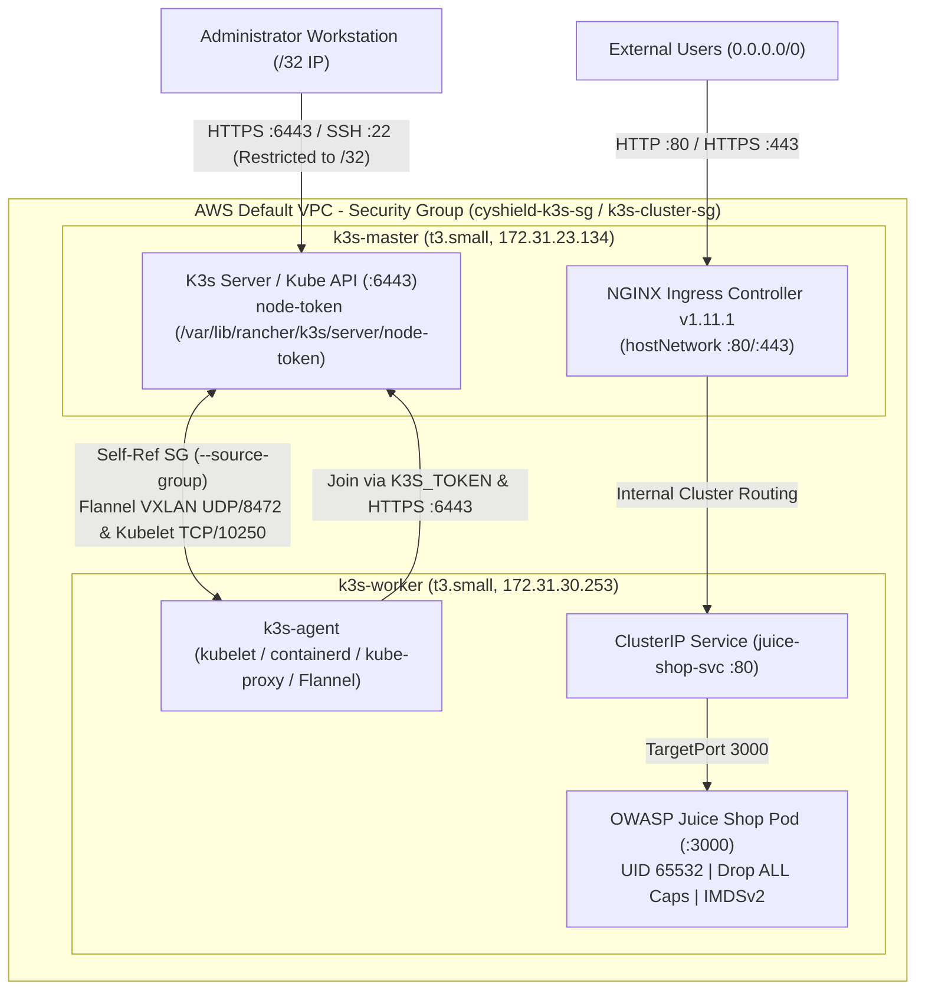
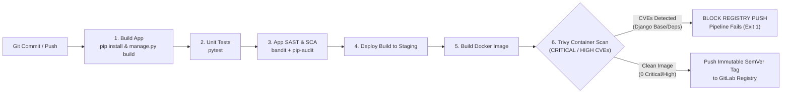
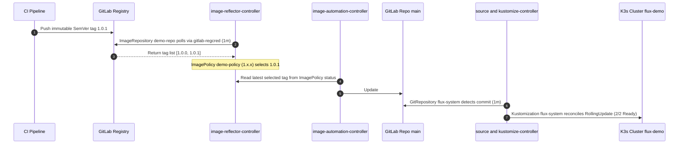

## 10. Technical Assignment Defense and Behavioral Mastery

> **Interview Target:** CyShield (Cyshield for Technology, Cairo, Egypt) — DevOps / DevSecOps Panel | **Scheduled:** Tue 24-Nov-2026 @ 13:00  
> **Core Engineering Principle:** Every architectural defense in this module applies equally to **any Senior/Expert DevSecOps interview** while directly addressing CyShield's *"Secured by Design"* enterprise, banking, and government bar.

---

### 1. Panel Strategy & Proactive Repository Self-Audit

Before answering individual questions, know **who** is evaluating **what** so you can calibrate depth on the fly:

| Panelist | Role | Primary Evaluation Lens | High-Impact Defense Angles Across Tasks 1–5 |
| :--- | :--- | :--- | :--- |
| **Michael Fayez** | DevSecOps Manager | Risk governance, security gates, ownership, career stability | Immutability, blast-radius containment, CI CVE blocking (Task 4), honest repo self-audit, long-term commitment |
| **Ahmed Elmasarany** | DevSecOps Team Lead | Hands-on K8s, GitOps, CI/CD, pragmatic trade-offs | `hostNetwork` vs NLB trade-off (Task 2), Flux v2.10.1 controller mechanics & `wait: true` gap (Task 5), ArgoCD vs FluxCD |
| **Ahmed Abdelnabi** | Senior DevSecOps Engineer | Deep Linux, networking, live cluster/CNI troubleshooting | Bash subshell & non-numeric bugs (Task 1), Flannel VXLAN `UDP/8472`, `cap_drop: ALL` vs ICMP `ping` & `tmpfs` UIDs (Task 3) |
| **Rania Saeed** | DevSecOps Engineer II | Pipeline security, container hardening, code review | Regex/CSV edge cases, `Dockerfile` single-layer cleanup & `apk upgrade` gap, Pod `securityContext`, Trivy gate exceptions |

#### Proactive Senior Self-Audit (Turn Repo Gaps into Proof of Ownership)
If Rania or Michael brings up repository hygiene or subtle edge cases — **or better yet, raise them proactively when asked *"What would you improve before production?"***:
1. **`.gitignore` Leading-Whitespace Bug & Tracked Key Files:** Lines 2–9 of `.gitignore` contain three leading spaces (`   *.pem`, `   sensitivefile`, `   task-2/critical-commands.txt`, etc.). Git interprets leading spaces literally, so those patterns did not ignore `task-2/cyshield-k8s-key.pem`, `task-4/ecommerce-staging-key.pem`, `sensitivefile`, or `task-2/critical-commands.txt` (all currently tracked in `git ls-files`). **Fix:** revoke/rotate keys in AWS, strip leading spaces in `.gitignore`, purge blobs with `git filter-repo`, and enforce `gitleaks` pre-commit / GitLab push secret detection.
2. **Flux v2 Controller Naming Precision (`README.md` & `task-5/flux-fleet/README.md`):** Both READMEs refer to `image-policy-controller`, and the sequence diagram attributes `ImagePolicy` to `image-automation-controller`. In Flux `v2.10.1` (`gotk-components.yaml`), **`image-reflector-controller` handles BOTH `ImageRepository` and `ImagePolicy`** (there is no `image-policy-controller`), while `image-automation-controller` handles `ImageUpdateAutomation`.
3. **Flux Rollout Health Detection (`gotk-sync.yaml`):** `Kustomization/flux-system` sets `prune: true` without `wait: true` or `healthChecks`, meaning `kustomize-controller` reports success immediately after applying YAML rather than surfacing a stalled `progressDeadlineSeconds: 120` rollout as `Ready=False`.

---

### 2. Complete 5-Task Assignment Defense (Deep Senior Code & Architecture Q&A)

#### 2.1 Task 1 (`task-1/test-script.sh`, `users.txt`) — Scripting & Large-Scale Parsing

##### Exact Behavior of `task-1/test-script.sh`
- `users.txt` contains a header (`name, email, id`) plus five records (`John`, `Susan`, `Menna`, `Magdy`, `Jake`).
- `tail -n +2 "$FILE"` skips line 1 (header) and streams from line 2 onward.
- `IFS=',' read -r name email id || [ -n "$name" ]` splits each line by comma and ensures the final line is still read even if `users.txt` lacks a trailing newline (note: `users.txt` currently has no trailing newline).
- `tr -d ' '` strips literal spaces from `name`, `email`, and `id`.
- `if [ -z "$id" ] || [[ "$email" != *@*.* ]]; then` rejects `Susan` (empty email), `Menna` (missing ID), and `Magdy` (`@localhost` has no dot after `@`), while evaluating `John` (`325`, odd) and `Jake` (`131`, odd).

#### Q1. [Junior] Walk us through `task-1/test-script.sh` line by line and explain why each Bash construct was chosen.
**Executive Takeaway:** `test-script.sh` is a streaming line-by-line parser that skips the CSV header, handles missing trailing newlines, normalizes field spacing, validates both ID presence and FQDN-style email structure, and classifies odd/even IDs without aborting the batch on malformed rows.

**Detailed Breakdown:**
- **`tail -n +2 "$FILE"`:** Starts output at line 2 rather than line 1, avoiding fragile `NR > 1` state flags inside Bash.
- **`IFS=',' read -r name email id || [ -n "$name" ]`:** Temporarily sets the Internal Field Separator to `,` only for `read`, uses `-r` to prevent backslash escaping, and checks `[ -n "$name" ]` because `read` returns exit code `1` at EOF if the last line has no `\n`.
- **`tr -d ' '`:** Strips spaces around commas (`John, john_j123@domain.com, 325`), though as a Senior improvement it should only trim leading/trailing whitespace rather than deleting internal spaces.
- **`[ -z "$id" ] || [[ "$email" != *@*.* ]]`:** Short-circuits invalid rows with `continue` after printing a warning so valid rows like `Jake` still process cleanly.
- **`(( id % 2 == 0 ))`:** Uses Bash arithmetic modulo evaluation to classify even vs odd numeric IDs.

#### Q2. [Mid] What happens in `test-script.sh` if a user has a non-numeric ID like `abc` or `12a`, and how do you fix it?
**Executive Takeaway:** Because `test-script.sh` only checks `[ -z "$id" ]`, a non-numeric string like `abc` passes validation and silently evaluates as `0` (`even`) inside Bash `(( id % 2 == 0 ))`! You fix it with an explicit regex guard `[[ ! "$id" =~ ^[0-9]+$ ]]`.

**Why Bash Fails Silently Here:**
- In Bash arithmetic context `(( ... ))`, an unquoted identifier like `abc` is treated as a variable reference. If `$abc` is unset, Bash evaluates it to `0`, so `0 % 2 == 0` is **true** and prints `The abc of user@domain.com is even number.`
- Worse, if `id` is `12a`, Bash throws a syntax error (`value too great for base` or invalid arithmetic operator), potentially breaking pipelines running with `set -e`.

**Exact Regex Guard Fix:**
```bash
if [[ ! "$id" =~ ^[0-9]+$ ]] || [[ "$email" != *@*.* ]]; then
    echo "Warning: Invalid email or non-numeric ID for user '$name'" >&2
    continue
fi
```
- **Edge-case note:** `^[0-9]+$` enforces non-negative integers only. If IDs could have leading zeros (e.g., `008`), Bash arithmetic interprets `008` as **invalid octal**! Fix that by forcing base-10 arithmetic: `(( 10#$id % 2 == 0 ))`.

#### Q3. [Mid] Why is `[[ "$email" != *@*.* ]]` weak for email validation, and what is the difference between regex validation, DNS `MX` checks, and proving a mailbox exists?
**Executive Takeaway:** Glob/regex checks only validate syntax, DNS `MX` lookups only prove the domain advertises a mail server, and neither proves a real mailbox exists—only an actual SMTP transaction (`RCPT TO`) or an out-of-band verification token confirms deliverability.

**Three Levels of Email Verification:**
1. **Syntax Check (Glob vs Regex):**
   - `[[ "$email" != *@*.* ]]` accepts broken addresses like `@.`, `a@@b..com`, `user@domain.com.`, or illegal characters.
   - A stronger Bash ERE regex: `^[A-Za-z0-9._%+-]+@[A-Za-z0-9-]+(\.[A-Za-z0-9-]+)*\.[A-Za-z]{2,63}$` rejects leading/trailing dots, missing TLDs, and multiple `@` signs.
2. **DNS `MX` (and `A`/`AAAA` fallback per RFC 5321):**
   - Running `dig +short MX domain.com` proves the domain exists in DNS and publishes mail exchanger records, catching typos like `gmial.com` or internal-only domains like `localhost`. It still does **not** prove `john_j123` exists on that mail server.
3. **Mailbox Existence:**
   - Opening port `25` to send `VRFY` / `RCPT TO` is frequently blocked, greylisted, or masked by catch-all relays to prevent address harvesting. In production applications, **confirmation links / OTP tokens** are the only reliable proof that a user controls a real inbox.

#### Q4. [Senior] What other hidden Bash bugs exist in `test-script.sh` (CRLF, tabs, duplicate IDs, subshells), and how would you rewrite it for production?
**Executive Takeaway:** Piping `tail` into `while read` spawns a subshell where counters or deduplication maps vanish on loop exit, `tr -d ' '` corrupts multi-word names while missing `\r` and `\t`, and duplicate IDs go undetected.

**Hidden Production Bugs & Fixes:**
1. **Subshell Variable Loss (`tail ... | while`):** Anything accumulated inside the `while` loop (`valid_count++`, `declare -A seen_ids`) is lost after `done` because the RHS of a pipe executes in a child subshell. **Fix:** Use process substitution `done < <(tail -n +2 "$FILE")`.
2. **CRLF (`\r`), Tabs (`\t`), and Over-Aggressive Space Deletion:** Windows CRLF leaves `\r` attached to `$id`, breaking `^[0-9]+$`. Meanwhile `tr -d ' '` turns `"John Doe"` into `"JohnDoe"`. **Fix:** Strip `\r` (`${line%$'\r'}`) and trim only leading/trailing `[[:space:]]` via parameter expansion.
3. **Missing File / Duplicate IDs / Extra Columns:** No check verifies `"$FILE"` exists; extra commas leak into `$id`; duplicate IDs are silently re-emitted.

**Hardened Production Bash Version:**
```bash
#!/usr/bin/env bash
set -euo pipefail

FILE="${1:-users.txt}"
[[ -r "$FILE" ]] || { echo "Error: Cannot read '$FILE'" >&2; exit 1; }

trim() {
    local s="$1"
    s="${s#"${s%%[![:space:]]*}"}"
    s="${s%"${s##*[![:space:]]}"}"
    printf '%s' "$s"
}

EMAIL_RE='^[A-Za-z0-9._%+-]+@[A-Za-z0-9-]+(\.[A-Za-z0-9-]+)*\.[A-Za-z]{2,63}$'
declare -A seen_ids=()
valid_count=0
invalid_count=0

while IFS=',' read -r name email id extra || [[ -n "${name:-}" ]]; do
    name="$(trim "${name%$'\r'}")"
    email="$(trim "${email%$'\r'}")"
    id="$(trim "${id%$'\r'}")"

    if [[ -n "${extra:-}" || -z "$name" || ! "$id" =~ ^[0-9]+$ || ! "$email" =~ $EMAIL_RE ]]; then
        echo "Warning: Invalid record for user '${name:-<empty>}'" >&2
        ((++invalid_count))
        continue
    fi

    if [[ -n "${seen_ids[$id]+x}" ]]; then
        echo "Warning: Duplicate ID '$id' for user '$name' (already seen for '${seen_ids[$id]}')" >&2
        ((++invalid_count))
        continue
    fi
    seen_ids["$id"]="$name"

    if (( 10#$id % 2 == 0 )); then
        echo "The $id of $email is even number."
    else
        echo "The $id of $email is odd number."
    fi
    ((++valid_count))
done < <(tail -n +2 "$FILE")

echo "Summary: valid=$valid_count invalid=$invalid_count" >&2
```

#### Q5. [Expert] If `users.txt` scales to 1,000,000+ rows in production, why does Bash break down and how do you engineer a streaming Python 3 solution?
**Executive Takeaway:** Forking subshells (`echo ... | tr`) inside a 1M-iteration Bash loop spawns ~3M child processes, taking minutes instead of ~1–2 seconds in Python, and lacks structured error auditing; a streaming Python 3 `csv.DictReader` pipeline processes rows in $O(1)$ I/O memory, isolates malformed rows with `try/except`, logs warnings, and streams structured error reports.

**Architecture & Scaling Trade-offs:**
- **I/O Memory ($O(1)$):** `csv.DictReader` yields one row dictionary at a time rather than loading the entire CSV into memory (`readlines()` or `pandas.read_csv()`).
- **Error Report Memory ($O(1)$):** Streaming invalid records directly to `errors.csv` via `csv.DictWriter` (plus a compact `summary.json` at completion) prevents a high error rate from exhausting RAM.
- **Deduplication Memory Trade-off:** At 1,000,000 integer IDs, a Python `set[int]` occupies ~70–90 MB of RAM (trivial on modern containers). If the file grows to 100M+ rows under tight pod memory limits (`256Mi`), swap the in-memory `set` for a disk-backed `sqlite3` `PRIMARY KEY` table or external merge-sort (`LC_ALL=C sort -t, -k3`).

**Complete Production-Grade Python 3 Script (`parse_users.py`):**
```python
#!/usr/bin/env python3
"""Stream-parse and validate large user CSV files with structured error reporting."""

from __future__ import annotations

import argparse
import csv
import json
import logging
import re
import sys
from collections import Counter
from pathlib import Path
from typing import TextIO

EMAIL_REGEX = re.compile(
    r"^[A-Za-z0-9.!#$%&'*+/=?^_`{|}~-]+"
    r"@[A-Za-z0-9](?:[A-Za-z0-9-]{0,61}[A-Za-z0-9])?"
    r"(?:\.[A-Za-z0-9](?:[A-Za-z0-9-]{0,61}[A-Za-z0-9])?)+$"
)
NUMERIC_ID_REGEX = re.compile(r"^[0-9]+$")

def configure_logging(verbose: bool) -> None:
    level = logging.DEBUG if verbose else logging.INFO
    logging.basicConfig(
        level=level,
        format="%(asctime)s %(levelname)s %(message)s",
        stream=sys.stderr,
    )

def validate_row(
    raw_row: dict[str | None, str | None],
    seen_ids: set[int],
) -> tuple[str, str, int] | tuple[None, str, str]:
    """Validate one normalized CSV row. Returns (name, email, id) or (None, reason, detail)."""
    if None in raw_row:
        return None, "extra_columns", f"Unexpected columns: {raw_row[None]}"

    normalized = {
        (k.strip() if k is not None else ""): (v.strip() if v is not None else "")
        for k, v in raw_row.items()
    }
    name = normalized.get("name", "")
    email = normalized.get("email", "")
    id_str = normalized.get("id", "")

    if not name:
        return None, "missing_name", "Empty name field"
    if not email or not EMAIL_REGEX.match(email):
        return None, "invalid_email", f"Invalid email '{email}'"
    if not NUMERIC_ID_REGEX.match(id_str):
        return None, "invalid_id", f"Non-numeric or empty ID '{id_str}'"

    user_id = int(id_str)
    if user_id in seen_ids:
        return None, "duplicate_id", f"Duplicate ID '{user_id}'"

    seen_ids.add(user_id)
    return name, email, user_id

def process_stream(
    input_stream: TextIO,
    output_stream: TextIO,
    error_csv_path: Path,
    summary_json_path: Path,
) -> dict[str, int]:
    """Stream CSV rows in O(1) I/O memory, emitting valid lines and error reports."""
    reader = csv.DictReader(input_stream, skipinitialspace=True)
    if reader.fieldnames is None:
        raise ValueError("Input CSV is empty or missing a header row.")

    clean_headers = {h.strip() for h in reader.fieldnames if h is not None}
    required_headers = {"name", "email", "id"}
    if not required_headers.issubset(clean_headers):
        missing = sorted(required_headers - clean_headers)
        raise ValueError(f"Missing required CSV headers: {missing}")

    seen_ids: set[int] = set()
    reason_counts: Counter[str] = Counter()
    total_rows = 0
    valid_rows = 0
    invalid_rows = 0

    with error_csv_path.open("w", encoding="utf-8", newline="") as err_fh:
        err_writer = csv.DictWriter(
            err_fh,
            fieldnames=["line_number", "reason", "detail", "raw_name", "raw_email", "raw_id"],
        )
        err_writer.writeheader()

        for line_number, raw_row in enumerate(reader, start=2):
            total_rows += 1
            try:
                result = validate_row(raw_row, seen_ids)
                if result[0] is None:
                    _, reason, detail = result
                    invalid_rows += 1
                    reason_counts[reason] += 1
                    logging.warning("Line %d skipped (%s): %s", line_number, reason, detail)
                    err_writer.writerow(
                        {
                            "line_number": line_number,
                            "reason": reason,
                            "detail": detail,
                            "raw_name": raw_row.get("name", ""),
                            "raw_email": raw_row.get("email", ""),
                            "raw_id": raw_row.get("id", ""),
                        }
                    )
                    continue

                _, email, user_id = result
                parity = "even" if user_id % 2 == 0 else "odd"
                output_stream.write(f"The {user_id} of {email} is {parity} number.\n")
                valid_rows += 1
            except Exception as exc:  # Isolate corrupted rows in 1M-row runs
                invalid_rows += 1
                reason_counts["unexpected_exception"] += 1
                logging.warning("Line %d raised %s: %s", line_number, type(exc).__name__, exc)
                err_writer.writerow(
                    {
                        "line_number": line_number,
                        "reason": "unexpected_exception",
                        "detail": str(exc),
                        "raw_name": str(raw_row.get("name", "")),
                        "raw_email": str(raw_row.get("email", "")),
                        "raw_id": str(raw_row.get("id", "")),
                    }
                )

    summary = {
        "total_rows": total_rows,
        "valid_rows": valid_rows,
        "invalid_rows": invalid_rows,
        "error_breakdown": dict(reason_counts),
    }
    summary_json_path.write_text(json.dumps(summary, indent=2) + "\n", encoding="utf-8")
    logging.info("Completed: total=%d valid=%d invalid=%d", total_rows, valid_rows, invalid_rows)
    return summary

def main() -> int:
    parser = argparse.ArgumentParser(description="Validate user CSV at scale.")
    parser.add_argument("input_file", type=Path, help="Path to input CSV (e.g., users.txt)")
    parser.add_argument("--error-csv", type=Path, default=Path("errors.csv"))
    parser.add_argument("--summary-json", type=Path, default=Path("errors_summary.json"))
    parser.add_argument("--verbose", action="store_true")
    args = parser.parse_args()

    configure_logging(args.verbose)
    try:
        with args.input_file.open("r", encoding="utf-8-sig", newline="") as in_fh:
            process_stream(in_fh, sys.stdout, args.error_csv, args.summary_json)
        return 0
    except (OSError, ValueError, csv.Error) as exc:
        logging.error("Fatal processing failure: %s", exc)
        return 1

if __name__ == "__main__":
    raise SystemExit(main())
```

---

#### 2.2 Task 2 (`task-2/juice-shop.yml`, K3s Cluster) — Self-Managed K8s & Hardening



#### Q6. [Junior] Why did you choose K3s on AWS EC2 (`t3.small`, Ubuntu 24.04), and why are `--disable traefik`, `--tls-san`, and `--write-kubeconfig-mode 600` required?
**Executive Takeaway:** The assessment explicitly prohibited managed Kubernetes (EKS/GKE), so K3s provided a CNCF-conformant Kubernetes distribution with minimal control-plane memory overhead on `t3.small` (2 GiB RAM), while those three flags prevent ingress port collisions, fix remote TLS validation, and lock down cluster-admin credentials on disk.

**Defense Details:**
- **`t3.small` & Ubuntu 24.04 (`ami` owner `099720109477`):** Full `kubeadm` + `etcd` + control plane comfortably exceeds 1 GB RAM before workloads start; K3s uses SQLite/embedded datastore by default and leaves ample headroom for `ingress-nginx` and `juice-shop` (`512Mi` limit) on `t3.small`.
- **`--disable traefik`:** K3s bundles Traefik with `ServiceLB` (Klipper) binding host ports `80` and `443`. Disabling it avoids port collisions when deploying `ingress-nginx`.
- **`--tls-san "$(curl -s https://checkip.amazonaws.com)"`:** By default, K3s issues the API server TLS certificate only for `127.0.0.1` and the node's private VPC IP (`172.31.23.134`). Adding the master's public IP as a Subject Alternative Name allows remote `kubectl` over `TCP/6443` without disabling TLS verification.
- **`--write-kubeconfig-mode 600`:** Restricts `/etc/rancher/k3s/k3s.yaml` to owner read/write (`0600`) instead of leaving admin kubeconfig readable by non-root local users.

#### Q7. [Mid] Walk through exactly how `k3s-worker` joins `k3s-master` using `node-token` and `k3s-agent`.
**Executive Takeaway:** Passing `K3S_URL` over the private VPC IP (`172.31.23.134:6443`) and `K3S_TOKEN` (`K10<CA-HASH>::server:<SECRET>`) installs `k3s-agent`, which cryptographically pins the master's CA certificate, authenticates for node client certs, starts `containerd`/`kubelet`/`kube-proxy`, and brings up the Flannel VXLAN mesh.

**Step-by-Step Handshake:**
1. **Token Structure (`sudo cat /var/lib/rancher/k3s/server/node-token`):**
   - `K10<CA-CERT-HASH>` pins the SHA-256 hash of the control plane's root CA so the joining worker rejects MITM certificates before sending credentials.
   - `server:<SHARED-SECRET>` authenticates the registration request to the K3s supervisor API on `:6443`.
2. **TLS Bootstrap & Client Cert Issuance:** `k3s-agent` dials `https://172.31.23.134:6443` over the internal VPC interface (permitted by `--source-group "$SG_ID"`), verifies the master cert against `K10<CA-HASH>`, and stores issued client certs/kubeconfigs under `/var/lib/rancher/k3s/agent/`.
3. **Node Runtime & Overlay Startup:** `k3s-agent` launches embedded `containerd`, `kubelet`, and `kube-proxy`, registers `ip-172-31-30-253` in the API server, and establishes cross-node pod networking over Flannel VXLAN (`UDP/8472`) alongside Kubelet control/metrics (`TCP/10250`).

#### Q8. [Mid] How did you secure the AWS Security Group perimeter and mitigate SSRF risk against OWASP Juice Shop?
**Executive Takeaway:** The Security Group enforces least-privilege ingress—restricting `:22` and `:6443` to the admin `/32`, isolating intra-cluster ports (`UDP/8472`, `TCP/10250`, internal `:6443`) via a self-referencing `--source-group`, and exposing only `:80/:443` externally—while IMDSv2 (`HttpTokens=required`) blocks Juice Shop SSRF exploits from stealing IAM credentials.

**Security Mechanics:**
- **Admin Plane Lockdown:** `TCP/22` and `TCP/6443` allow only `$MY_IP` (`/32`), preventing internet-wide kube-apiserver brute force or CVE scanning.
- **Self-Referencing SG (`--source-group "$SG_ID"`):** Nodes communicate over private VPC IPs without opening `10250` (Kubelet API) or `8472` (VXLAN) to the VPC CIDR or `0.0.0.0/0`.
- **IMDSv2 (`--metadata-options "HttpTokens=required,HttpEndpoint=enabled"`):** OWASP Juice Shop is an intentionally vulnerable app containing SSRF flaws. Under IMDSv1, a single `GET http://169.254.169.254/latest/meta-data/iam/security-credentials/` inside an SSRF payload leaks the EC2 instance role token. IMDSv2 requires an HTTP `PUT` to `/latest/api/token` with `X-aws-ec2-metadata-token-ttl-seconds` first, neutralising simple GET-based SSRF and headerless proxies.

#### Q9. [Senior] Defend deploying `ingress-nginx` baremetal `v1.11.1` with `hostNetwork: true` and the security controls in `task-2/juice-shop.yml`—what hidden scheduling pitfall exists here?
**Executive Takeaway:** Patching `hostNetwork: true` exposes ports `80/443` directly on EC2 without an AWS Load Balancer, and `juice-shop.yml` enforces defense-in-depth (`runAsNonRoot`, UID `65532`, dropped capabilities, disabled SA token); however, running `hostNetwork: true` on a single-replica `Deployment` fails if the controller pod schedules onto the worker node while clients hit the master public IP!

**Defending What Was Built (`task-2/juice-shop.yml`):**
- `automountServiceAccountToken: false`: Prevents Juice Shop from mounting `/var/run/secrets/kubernetes.io/serviceaccount/token`, stopping compromised app processes from querying the Kubernetes API.
- Pod & Container `securityContext`: `runAsNonRoot: true`, `runAsUser: 65532`, `fsGroup: 65532`, `allowPrivilegeEscalation: false`, and `capabilities.drop: ["ALL"]` block root execution and setuid privilege escalation.
- `resources` requests (`100m`/`256Mi`) & limits (`500m`/`512Mi`): Prevent Node.js memory leaks or DoS payloads from OOM-starving kubelet/system daemons on `t3.small`.

**The Senior Pitfall & Fix (`hostNetwork: true` + `replicas: 1`):**
- Baremetal `ingress-nginx` defaults to a `NodePort` Service and a 1-replica `Deployment`. If the scheduler places that pod on `k3s-worker` (`<WORKER_PUBLIC_IP>`), traffic sent to `http://<MASTER_PUBLIC_IP>` hits a closed socket!
- **Fix for raw EC2:** Convert `ingress-nginx-controller` to a `DaemonSet` (listening on `:80/:443` on every node behind DNS/NLB), or pin it with `nodeSelector` (`node-role.kubernetes.io/control-plane` + toleration), or use K3s `ServiceLB` / AWS NLB targeting nodeports.

#### Q10. [Expert] How would you harden and re-architect Task 2 for a real CyShield enterprise/banking production environment?
**Executive Takeaway:** Move from a single-master public-EC2 PoC to a 3-node HA control plane in private subnets behind an AWS NLB, replace SSH `:22` with AWS SSM Session Manager, enforce TLS + strict container/network policies (`readOnlyRootFilesystem`, `RuntimeDefault` seccomp, default-deny `NetworkPolicy`, image digests), and remediate the repo's `.gitignore`/tracked `.pem` issue.

**Concrete Production Upgrades:**
1. **Control Plane & Network Architecture:**
   - 3 control-plane nodes across 3 AZs (`--cluster-init` embedded etcd) + dedicated worker ASG in **private subnets** (no public IPs on nodes; NAT Gateway egress; AWS NLB terminating or passing `:443` to Ingress).
   - Eliminate public `:22` and public `:6443` completely: manage hosts via **AWS SSM Session Manager** and access `:6443` only through a private VPN / Bastion / AWS PrivateLink.
   - Set IMDSv2 `HttpPutResponseHopLimit=1` explicitly (`--metadata-options "HttpTokens=required,HttpPutResponseHopLimit=1,HttpEndpoint=enabled"`) so pods running on the host network or bridged CNI cannot reach EC2 metadata across an extra network hop!
2. **Workload & Ingress Hardening (`juice-shop.yml`):**
   - Pin immutable version + SHA256 digest instead of `bkimminich/juice-shop:latest`.
   - Add `seccompProfile: { type: RuntimeDefault }`, `readOnlyRootFilesystem: true` (mounting `emptyDir` with `sizeLimit` for writable runtime paths), plus `readinessProbe` and `livenessProbe`.
   - Add an Ingress `host:` rule + `tls:` section automated via **`cert-manager`** (`ClusterIssuer` with Let's Encrypt or internal Vault PKI) and enforce `nginx.ingress.kubernetes.io/ssl-redirect: "true"`.
   - Enforce namespace isolation with a **default-deny `NetworkPolicy`** permitting only `ingress-nginx -> juice-shop:3000` and `juice-shop -> CoreDNS UDP/53` (requires replacing Flannel with Cilium/Calico because Flannel alone does not enforce `NetworkPolicy`—K3s uses `kube-router` network policy controller by default unless disabled).
3. **Observability & Repo Hygiene:**
   - Deploy `kube-prometheus-stack` (Prometheus, Grafana, Alertmanager), `Grafana Loki` + `Promtail`, `Blackbox Exporter`, and `Falco` (runtime syscall anomaly alerts), plus align the minor version typo in `task_2_kubernetes_cluster_juice_shop_readme.md` (`v1.37.2+k3s1` vs `v1.31.x+k3s1`).
   - Strip leading spaces from `.gitignore`, rotate SSH keys in AWS, purge `task-2/cyshield-k8s-key.pem`, `task-4/ecommerce-staging-key.pem`, `sensitivefile`, and `task-2/critical-commands.txt` with `git filter-repo`.

---

#### 2.3 Task 3 (`task-3/Dockerfile`, `task-3/docker-compose.yml`) — Custom Newman Image

#### Q11. [Junior] Walk through `task-3/Dockerfile` line by line and explain the design decisions.
**Executive Takeaway:** `task-3/Dockerfile` extends `postman/newman:5.3-alpine`, installs `curl`, `zip`, `iputils`, and `newman-reporter-csvallinone`, cleans all caches inside a single `RUN` layer, sets `NODE_PATH` for global module resolution, creates a dedicated non-root `newman` user owning `/etc/newman`, and configures `ENTRYPOINT ["newman"]`.

**Line-by-Line Defense:**
- **`FROM postman/newman:5.3-alpine`:** Keeps image footprint small using Alpine musl/BusyBox rather than full Debian/Ubuntu Node images.
- **Single chained `RUN` layer:** Installs `curl`, `zip`, `iputils` (`--no-cache`), installs `newman-reporter-csvallinone` globally, runs `npm cache clean --force`, removes `/var/cache/apk/* /tmp/* /root/.npm`, and creates system group/user `newman` owning `/etc/newman`—preventing deleted cache files from bloating intermediate OCI layers.
- **`ENV NODE_PATH=/usr/local/lib/node_modules`:** Ensures Node resolves globally installed reporters (`-r csvallinone`) even when Newman runs from arbitrary working directories like `/etc/newman`.
- **`WORKDIR /etc/newman`, `USER newman`, `ENTRYPOINT ["newman"]`:** Runs the CLI tool without root privileges directly inside the collection mount directory.

#### Q12. [Mid] Why did you set DNS (`8.8.8.8`, `1.1.1.1`) in `task-3/docker-compose.yml` (and `--dns`) rather than writing `/etc/resolv.conf` inside the `Dockerfile`?
**Executive Takeaway:** Baking `/etc/resolv.conf` into an image fails at runtime because the container engine dynamically bind-mounts and overwrites `/etc/resolv.conf` on every container startup (routing through `127.0.0.11` on user-defined Compose networks or copying the host's resolvers).

**Container Engine Internals:**
- During `docker build`, `RUN printf ... > /etc/resolv.conf` mutates a build-layer file—or hits Docker's build-time mount—which gets completely shadowed when `docker run` or `docker compose` starts the container.
- On user-defined bridge networks (the default for `docker compose`), Docker injects `nameserver 127.0.0.11` (the embedded DNS server) into `/etc/resolv.conf` and forwards upstream queries to the configured `dns:` servers (`8.8.8.8`, `1.1.1.1`) or `--dns` flags.
- Note that `README.md` showed `RUN printf ... > /etc/resolv.conf` in its inline example, whereas `task-3/Dockerfile` and `task-3/docker-compose.yml` correctly moved DNS enforcement to runtime (`dns: [8.8.8.8, 1.1.1.1]`) and documented why.

#### Q13. [Senior] Comparing `task-3/Dockerfile` against `README.md`, what build/CVE gaps exist in the actual `Dockerfile` and how do you make it production-ready?
**Executive Takeaway:** `task-3/Dockerfile` creates `USER newman` (good, missing in `README.md` snippet) and cleans `/root/.npm`, but omits `apk upgrade --no-cache` and leaves package/image versions unpinned (`newman-reporter-csvallinone`, `:5.3-alpine` mutable tag).

**Concrete Upgrades:**
1. **Patch Base OS CVEs:** Add `apk upgrade --no-cache` before `apk add --no-cache` (as documented in `task_3_custom_newman_docker_image_readme.md`) so stale Alpine libraries in `postman/newman:5.3-alpine` (`openssl`, `libcrypto`, `curl`) are patched at build time.
2. **Pin Digest & Deterministic Versions:** Pin `FROM postman/newman:5.3-alpine@sha256:<DIGEST>` and `npm install -g newman-reporter-csvallinone@<EXACT_VERSION>` (and `apk add` or rebuild via scheduled CI) for reproducible supply-chain builds.
3. **Deterministic UID/GID:** Replace `addgroup -S newman && adduser -S` (which auto-picks the next free system UID, e.g., `100`) with explicit numeric IDs (`addgroup -S -g 10001 newman && adduser -S -u 10001 -G newman newman`) so Kubernetes `runAsUser: 10001` and host bind-mount permissions stay predictable.

#### Q14. [Expert] Look closely at `task-3/docker-compose.yml`: what happens when `USER newman`, `cap_drop: ALL`, `no-new-privileges:true`, `read_only: true`, and `tmpfs` `/etc/newman` interact with `ping` and CSV report writes?
**Executive Takeaway:** This is a classic Linux kernel hardening trap: dropping `CAP_NET_RAW` with `no-new-privileges:true` breaks traditional `iputils` `ping` unless `net.ipv4.ping_group_range` permits unprivileged ICMP sockets for `newman`'s GID, and mounting `tmpfs` over `/etc/newman` without `uid`/`gid` options resets directory ownership to `root:root`, blocking non-root CSV report output!

**Deep Linux Diagnostics & Exact Fixes:**
1. **`ping` Under `cap_drop: ALL` + `no-new-privileges:true`:**
   - Traditional `ping` requires `CAP_NET_RAW` (either via root or file capability `cap_net_raw+ep` on `/bin/ping`).
   - Setting `cap_drop: ALL` removes `CAP_NET_RAW` from the bounding/effective sets, and `no-new-privileges:true` blocks `setuid`/`setcap` elevation via `execve()`.
   - On modern Linux kernels where Docker/host configures `net.ipv4.ping_group_range = 0 2147483647`, `iputils-ping` falls back to unprivileged `SOCK_DGRAM` `IPPROTO_ICMP` sockets and succeeds! On stricter hosts (`1 0`), `ping` fails with `socket: Operation not permitted`.
   - **Explicit Compose Fix:** Add `sysctls: net.ipv4.ping_group_range: "0 2147483647"` (if ICMP health checks are genuinely required) or drop `iputils` if `curl` HTTP checks suffice, shrinking attack surface.
2. **`tmpfs` Ownership Masking Image `chown`:**
   - In `task-3/Dockerfile`, `chown -R newman:newman /etc/newman` sets ownership in the image layer. At runtime, however, `docker-compose.yml` mounts `tmpfs: - /etc/newman:size=64m`, shadowing the underlying image directory with a fresh `tmpfs` owned by `root:root` (`0755` or `1777` depending on mount defaults).
   - **Explicit Fix:** Pin UID/GID `10001` in `Dockerfile` and configure `tmpfs` as `- /etc/newman:uid=10001,gid=10001,mode=0750,size=64m` (or mount a dedicated non-root output volume `- ./reports:/etc/newman/reports:rw`).

---

#### 2.4 Task 4 (GitLab CI/CD + Django E-Commerce) — DevSecOps Pipeline & Security Gate



**Production-Grade Reference `.gitlab-ci.yml` (Upgrading Task 4):**
```yaml
stages:
  - build
  - test
  - security-app
  - package
  - security-container
  - publish

variables:
  PIP_CACHE_DIR: "$CI_PROJECT_DIR/.cache/pip"
  IMAGE_TAG: "$CI_REGISTRY_IMAGE:$CI_COMMIT_SHORT_SHA"

build_app:
  stage: build
  image: python:3.12-slim
  script:
    - python -m venv .venv && . .venv/bin/activate
    - pip install --no-cache-dir -r requirements.txt
    - python manage.py check
  artifacts:
    paths: [.venv/]
    expire_in: 1 hour

unit_tests:
  stage: test
  image: python:3.12-slim
  needs: [build_app]
  script:
    - . .venv/bin/activate
    - pytest --junitxml=report.xml
  artifacts:
    reports:
      junit: report.xml

app_sast:
  stage: security-app
  image: python:3.12-slim
  needs: [build_app]
  script:
    - . .venv/bin/activate
    - pip install --no-cache-dir bandit
    - bandit -r . -x ./.venv -f json -o bandit.json
  artifacts:
    when: always
    paths: [bandit.json]

app_sca:
  stage: security-app
  image: python:3.12-slim
  needs: [build_app]
  script:
    - . .venv/bin/activate
    - pip install --no-cache-dir pip-audit
    - pip-audit -r requirements.txt --format json --output pip-audit.json
  artifacts:
    when: always
    paths: [pip-audit.json]

build_image:
  stage: package
  image:
    name: gcr.io/kaniko-project/executor:v1.23.2-debug
    entrypoint: [""]
  needs: [unit_tests, app_sast, app_sca]
  script:
    - /kaniko/executor
      --context "$CI_PROJECT_DIR"
      --dockerfile "$CI_PROJECT_DIR/Dockerfile"
      --no-push
      --tar-path "$CI_PROJECT_DIR/image.tar"
      --destination "$IMAGE_TAG"
  artifacts:
    paths: [image.tar]
    expire_in: 1 hour

trivy_image_gate:
  stage: security-container
  image:
    name: aquasec/trivy:0.58.1
    entrypoint: [""]
  needs: [build_image]
  script:
    - trivy image --input image.tar --exit-code 1 --severity CRITICAL,HIGH --ignore-unfixed
  allow_failure: false

push_verified_image:
  stage: publish
  image: gcr.io/go-containerregistry/crane:debug
  needs: [build_image, trivy_image_gate]
  rules:
    - if: '$CI_COMMIT_BRANCH == $CI_DEFAULT_BRANCH'
  script:
    - crane auth login -u "$CI_REGISTRY_USER" -p "$CI_REGISTRY_PASSWORD" "$CI_REGISTRY"
    - crane push image.tar "$IMAGE_TAG"
```

#### Q15. [Junior] Walk us through the Task 4 pipeline stages and explain why Task 5 switched from Django E-Commerce to `nginx:1.25-alpine`.
**Executive Takeaway:** The pipeline runs build (`pip install` + `manage.py`), `pytest`, application vulnerability scanning, staging deployment, Docker build, and container image scanning; the container security gate intentionally failed and blocked pushing the vulnerable Django E-Commerce image, proving the gate worked and motivating a clean `nginx:1.25-alpine` (`1.0.0` $\rightarrow$ `1.0.1`) image for Task 5's GitOps demo.

**Key Talking Points:**
- Fail-fast ordering puts fast deterministic checks (`build` and `pytest`) before heavier Docker image builds.
- The final security gate acted as a **hard non-bypassable policy boundary**: no vulnerable artifact ever entered `registry.gitlab.com`, ensuring downstream GitOps controllers (Task 5) only ever reconcile scanned, clean images.

#### Q16. [Mid] Compare SAST, SCA, Container Image Scanning, and DAST—what distinct risks does each catch in a Django pipeline?
**Executive Takeaway:** No single scanner sees the full stack: SAST reads your Python code, SCA inspects `requirements.txt` libraries, Container Scanning inspects OS packages + layered binaries inside the OCI image, and DAST probes the running HTTP app (like Juice Shop or Django staging) from the outside.

| Scan Type | Target | Typical Django Findings | Example Tools |
| :--- | :--- | :--- | :--- |
| **SAST** | First-party source code | Raw SQL injection (`cursor.execute`), hardcoded `SECRET_KEY`, `DEBUG=True`, XSS templates | `Bandit`, `Semgrep`, GitLab SAST |
| **SCA** | `requirements.txt` / lockfiles | Known CVEs in pinned `Django`, `Pillow`, `PyJWT`, or transitive `urllib3` packages | `pip-audit`, `Safety`, Dependency-Track |
| **Container Scan** | Full OCI image layers | Vulnerable Alpine/Debian `openssl`, `glibc`, `zlib`, root user misconfigs | `Trivy`, `Grype`, GitLab Container Scanning |
| **DAST** | Live running HTTP endpoint | Missing CSRF/CSP headers, broken auth/IDOR, misconfigured CORS on staging URL | `OWASP ZAP`, `Nuclei` |

#### Q17. [Senior] Look at the original Task 4 flow (`Staging Deploy` before `Docker Build`) and `task-4/ecommerce-staging-key.pem` in the repo—what two architectural issues do you flag?
**Executive Takeaway:** Deploying a raw build to staging *before* building and scanning the Docker image creates artifact drift between staging and production, and using a static `.pem` SSH key creates long-lived credential exposure; a Senior upgrade uses "Build Once, Scan Tarball/Quarantine, Deploy Same Digest to Staging, Promote to Prod" plus short-lived OIDC/SSM auth.

**Architectural Analysis:**
1. **Artifact Drift ("Build Once, Promote Everywhere"):**
   - If staging runs raw `venv` code on an EC2 VM while production runs a Docker container built afterward, staging never validates the container entrypoint, `collectstatic` permissions, non-root user, or Alpine musl C-extension behavior.
   - **Fix:** Build the OCI image tarball once (Kaniko/BuildKit without root Docker daemon), run Trivy against `image.tar`, push only if clean (or push to a quarantine tag -> scan -> re-tag/promote by `@sha256:` digest), and deploy the exact same container digest to Staging and Production.
2. **Eliminating Static SSH `.pem` Keys:**
   - `task-4/ecommerce-staging-key.pem` was committed to Git because of the `.gitignore` whitespace issue. Even if stored in GitLab CI variables, static private keys lack automatic expiration and per-job auditability.
   - **Fix:** Use **GitLab OIDC (`id_tokens`) federated with AWS IAM Roles** + **AWS SSM SendCommand** or pull-based GitOps (Flux/ArgoCD), completely eliminating inbound SSH `:22` and static `.pem` deploy keys.

#### Q18. [Expert] In a high-stakes enterprise like CyShield, how do you enforce `CRITICAL`/`HIGH` CVE gates without halting urgent production hotfixes due to false positives or unpatched upstream CVEs?
**Executive Takeaway:** Never disable the gate globally; pair strict default blocking (`exit-code 1`) with `--ignore-unfixed` hygiene, time-bound **OpenVEX / `.trivyignore` waivers signed off by AppSec**, SBOM traceability, and Cosign attestation so exceptions are audited, scoped, and auto-expire.

**Enterprise Security Gate Governance:**
1. **Separate Fixable vs Unfixable (`--ignore-unfixed`):** Blocking on an unpatched OS CVE with zero vendor fix causes alert fatigue; instead, alert SecOps while blocking on any `CRITICAL`/`HIGH` CVE with an available patch or exploitable application dependency.
2. **Time-Bound Risk Acceptance (VEX / `.trivyignore` with Expiry):** Require a PR modifying `.trivyignore` (with mandatory `exp:YYYY-MM-DD` date and JIRA/AppSec justification) approved via `CODEOWNERS` by AppSec/DevSecOps—so an accepted false positive (e.g., an unused OS binary) expires automatically after 14–30 days.
3. **SBOM + Cryptographic Attestation:** Generate CycloneDX SBOMs on every build (`trivy image --format cyclonedx`) and sign verified images with **Sigstore Cosign** (keyless OIDC); enforce admission verification in Kubernetes via **Kyverno** so even a manually pushed untagged image cannot run on the cluster.

---

#### 2.5 Task 5 (`task-5/flux-fleet/`, Flux v2.10.1) — GitOps & Automated Image Updates



#### Q19. [Junior] Trace the complete end-to-end flow from `flux bootstrap gitlab` to rolling out `flux-demo:1.0.1`.
**Executive Takeaway:** `flux bootstrap gitlab` installs Flux v2.10.1 controllers and creates a self-reconciling `GitRepository` + `Kustomization` pointing at `clusters/staging`; `ImageRepository` polls registry tags, `ImagePolicy` picks the highest `1.x.x` SemVer tag, `ImageUpdateAutomation` commits the updated tag back to `main`, and `kustomize-controller` rolls out `flux-demo` zero-downtime.

**Resource Chain Verified in `task-5/flux-fleet/`:**
1. **`gotk-sync.yaml` (`GitRepository/flux-system` & `Kustomization/flux-system`):** Polls `https://gitlab.com/marioud-group/flux-fleet.git` (`branch: main`, `interval: 1m0s`) using `flux-system` secret, and reconciles `./clusters/staging` every `10m0s` with `prune: true`.
2. **`image-repository.yaml` (`ImageRepository/demo-repo`):** Scans `registry.gitlab.com/marioud-group/flux-fleet` every `1m0s` using `secretRef: gitlab-regcred`.
3. **`image-policy.yaml` (`ImagePolicy/demo-policy`):** Filters tags with `semver.range: 1.x.x`, picking `1.0.1` over `1.0.0`.
4. **`image-update.yaml` (`ImageUpdateAutomation/flux-system`):** Every `1m0s`, checks out `main`, scans `./clusters/staging/apps` using `strategy: Setters` for `# {"$imagepolicy": "flux-system:demo-policy"}`, updates `deployment.yaml`, commits (`chore(flux): update image to ...`), and pushes to `main`.
5. **`apps/demo/deployment.yaml` (`Deployment/flux-demo`):** Runs `replicas: 2` with `maxUnavailable: 0`, `maxSurge: 1`, `progressDeadlineSeconds: 120`, and an HTTP `readinessProbe` on `:80 /`.

#### Q20. [Mid] Which Flux controllers actually own `ImageRepository`, `ImagePolicy`, and `ImageUpdateAutomation`, and why did you create `gitlab-regcred` in two namespaces?
**Executive Takeaway:** In Flux v2 (`v2.10.1` in `gotk-components.yaml`), **`image-reflector-controller` reconciles BOTH `ImageRepository` and `ImagePolicy`** (there is no separate `image-policy-controller`), while `image-automation-controller` handles `ImageUpdateAutomation`; meanwhile `gitlab-regcred` lives in both `flux-system` (for tag scanning) and `default` (for kubelet image pulls) because Kubernetes `Secret` objects are strictly namespace-scoped.

**Precision Details:**
- **Correcting the README Slip Proactively:** `gotk-components.yaml` installs `source-controller`, `kustomize-controller`, `helm-controller`, `notification-controller`, `image-reflector-controller`, and `image-automation-controller`. Explaining that `image-reflector-controller` owns *both* registry reflection and SemVer policy selection shows you inspect real controller pods/CRDs rather than guessing from docs.
- **Namespace-Scoped Secrets:** `ImageRepository/demo-repo` sits in `flux-system`, so `image-reflector-controller` reads `flux-system/gitlab-regcred` to list tags. `Deployment/flux-demo` sits in `default`, so kubelet on `k3s-worker` needs `default/gitlab-regcred` (`imagePullSecrets`) to pull the container layers—least privilege keeps the read-only pull secret separate from the `api` + `write_registry` bootstrap PAT.

#### Q21. [Senior] Look closely at `gotk-sync.yaml` and `deployment.yaml`: why might Flux report `Ready=True` even during a failing `flux-demo` rollout, how do you fix it, and why is `kubectl rollout undo` an anti-pattern here?
**Executive Takeaway:** `Kustomization/flux-system` in `gotk-sync.yaml` omits `wait: true` (or explicit `healthChecks`), so `kustomize-controller` finishes without waiting for `flux-demo`'s `progressDeadlineSeconds: 120` to fail; additionally, `kubectl rollout undo` creates manual cluster drift that Flux overwrites on the next sync, so rollbacks must happen cleanly via Git.

**Three Senior Improvements & Exact Rollback Workflow:**
1. **Detecting Stalled Rollouts (`gotk-sync.yaml`):**
   - Add `wait: true` (which monitors all reconciled resources using `kstatus`) or an explicit `healthChecks` entry targeting `Deployment/flux-demo` in `default` plus `timeout: 3m`. Only then will a failing `readinessProbe` or `CrashLoopBackOff` flip the `Kustomization` status to `Ready=False` and trigger Alertmanager/Slack notifications via `notification-controller`.
2. **Hardening `apps/demo/deployment.yaml`:**
   - Add `resources` requests/limits, `livenessProbe`, `automountServiceAccountToken: false`, `allowPrivilegeEscalation: false`, `capabilities.drop: ["ALL"]`, and switch from root `nginx:1.25-alpine` on `:80` to `nginxinc/nginx-unprivileged` on `:8080` with `runAsNonRoot: true`.
3. **Production GitOps Rollback Workflow (Never `kubectl rollout undo`):**
   ```bash
   # 1. Suspend image automation first so Flux does not re-commit the broken 1.0.1 tag
   flux suspend image update flux-system

   # 2. Revert the bad commit in Git and push to main (preserving full audit trail)
   git revert <BAD_COMMIT_SHA>
   git push origin main

   # 3. Reconcile source and kustomization immediately (don't wait 10m)
   flux reconcile kustomization flux-system --with-source

   # 4. Fix/yank the broken tag or tighten ImagePolicy, then resume automation
   flux resume image update flux-system
   ```

#### Q22. [Expert] Your CV highlights ArgoCD while the assignment uses FluxCD. Compare their architectures and explain how you would scale Task 5 for multi-environment (`staging` $\rightarrow$ `prod`) promotion in a regulated enterprise.
**Executive Takeaway:** Both implement pull-based GitOps reconciliation, but ArgoCD excels at multi-team visual dashboards and ApplicationSets in a centralized UI/API model, whereas FluxCD uses lightweight, composable Kubernetes-native controllers with built-in image automation and cleaner least-privilege per-namespace impersonation; for production banking apps, never let `ImageUpdateAutomation` auto-push directly to `prod` `main`.

**ArgoCD vs FluxCD Trade-Off Matrix:**

| Dimension | FluxCD v2 (`v2.10.1`) | ArgoCD |
| :--- | :--- | :--- |
| **Architecture** | Modular GitOps Toolkit microservices (`source`, `kustomize`, `helm`, `image-reflector`, `image-automation`) | Centralized `application-controller`, `repo-server`, `api-server`, Redis, Dex SSO |
| **UX & Visibility** | Headless CLI-first (`flux get all`, Prometheus metrics, optional Capacitor/Weave UI) | Rich built-in Web UI with live resource diffs, RBAC, and SSO out of the box |
| **Image Automation** | Native CRDs (`ImageRepository`, `ImagePolicy`, `ImageUpdateAutomation`) | External companion (`argocd-image-updater`) |
| **Multi-Tenancy RBAC** | `Kustomization.spec.serviceAccountName` impersonates tenant SAs natively on apply | `AppProject` allowlists + centralized controller cluster RBAC |

**Regulated `staging` $\rightarrow$ `prod` Promotion Design:**
- Keep `ImageUpdateAutomation` committing automatically **only** to `clusters/staging/` (or a feature/release branch).
- For `clusters/production/`, configure `ImageUpdateAutomation` (or a GitLab CI promotion job triggered after staging smoke tests pass) to push to a `promote/prod-*` branch and open a **GitLab Merge Request** requiring peer + SecOps approval, branch protection, and signed commits—preserving automated velocity in staging and strict change-control auditability in production.

---

### 3. 10 Behavioral, Leadership & Manager Q&A Mastery Scripts (English + Egyptian Arabic)

> **Delivery Coaching:** Maintain steady eye contact, speak at a measured pace (especially when explaining architecture or career transitions), never badmouth past employers, and treat Michael Fayez as a strategic engineering partner rather than an interrogator.

---

#### Q23. [Mid] *"Tell me about yourself & walk us through your DevOps/DevSecOps experience."*
**Interviewer Intent:** Assess whether you think in terms of **systems, business impact, and ownership**—not a laundry list of tool names from a CV.

**Polished English Answer:**
> "I'm Mustafa, a DevOps and DevSecOps engineer focused on building secure, reproducible cloud and Kubernetes platforms—from infrastructure provisioning to automated CI/CD and GitOps delivery. Across my work with AWS, Terraform, Ansible, Docker, Kubernetes, and monitoring stacks like Prometheus and Grafana, my core focus has been eliminating manual deployment drift and embedding security checks directly into delivery pipelines so teams ship faster without opening operational risk.
>
> For example, in the assessment I built for this role—and in my day-to-day workflows—I treat security and reliability as default baselines rather than afterthoughts: locking down cluster API surfaces, enforcing IMDSv2 and least-privilege container security contexts, gating container pushes on CVE scans in GitLab CI, and using pull-based GitOps like ArgoCD and FluxCD so every production state is auditable in Git. At this stage of my career, I'm looking to bring that hands-on automation mindset to a strong security-driven team like CyShield where stability, compliance, and deep engineering discipline really matter."
**الرد بالعامية المصرية:**
> "أنا مصطفى، مهندس DevOps وDevSecOps، تركيزي الأساسي إني أبني بيئات Cloud وKubernetes تكون مستقرة، قابلة للتكرار، ومتأمنة من أول سطر لحد الـ Production. اشتغلت عمليًا على AWS، وTerraform، وAnsible، وDocker، وKubernetes، مع CI/CD وMonitoring بـ Prometheus وGrafana، وGitOps سواء بـ ArgoCD أو FluxCD.
>
> الفكرة اللي دايمًا بمشي بيها في شغلي مش مجرد رص أدوات، لكن إزاي أمنع الأخطاء اليدوية والـ configuration drift، وإزاي أخلي الأمان جزء طبيعي جوه الـ pipeline بدل ما يجي في الآخر ويعطل الشغل. يعني زي ما طبقت في الـ assessment هنا: تقفيل الـ network perimeter، وتطبيق IMDSv2 وnon-root containers، ووقف أي image فيها Critical أو High CVEs قبل ما توصل للـ registry، واستخدام GitOps عشان أي تغيير أو rollback يكون متسجل ومضمون. ودلوقتي بدور على مكان تقيل في الـ security والـ architecture زي CyShield أقدر أضيف فيه بخبرتي وأكبر فيه على المدى الطويل."
---

#### Q24. [Mid] *"Tell us about the hardest technical problem you solved yourself."*
**Interviewer Intent:** Verify genuine hands-on debugging depth—how you isolate layers (DNS $\rightarrow$ Network/CNI $\rightarrow$ Runtime $\rightarrow$ App), read logs/metrics instead of guessing, and prevent recurrence.

**Polished English Answer (STAR + Root-Cause Structure):**
> "One of the toughest debugging problems I handled independently was an intermittent production-like service outage after hardening a containerized workload behind an Ingress controller on Kubernetes—where health checks started flapping and external calls failed unpredictably even though the application code itself hadn't changed.
>
> Instead of restarting pods blindly, I isolated it layer by layer from the bottom up: first checking pod events and `kubectl describe` to rule out OOMKills (`Exit Code 137`), then inspecting container logs and running an ephemeral debug check inside the pod's network namespace. I found two compounding root causes: first, under strict non-root + read-only filesystem hardening, the container couldn't write a runtime temporary file/socket and DNS lookups were hitting unexpected upstream timeouts; second, the `readinessProbe` thresholds were tighter than the cold-start dependency check, causing Endpoints to flap and NGINX Ingress to return intermittent `502`s during traffic bursts.
>
> I fixed it systematically by adding explicit bounded `emptyDir` scratch mounts with proper `fsGroup` permissions, configuring deterministic DNS and connection timeouts, tuning `readinessProbe` / `startupProbe` separately from `livenessProbe`, and adding a synthetic Blackbox/Ingress `5xx` alert in Prometheus so we'd catch probe degradation before users ever noticed. That taught me never to treat hardening and probes in isolation—you always test the exact hardened runtime behavior under realistic traffic."
**الرد بالعامية المصرية:**
> "من أصعب المشاكل اللي قابلتني وحليتها بنفسي كانت مشكلة تقطيع عشوائي و`502` errors ظهرت على خدمة شغالة على Kubernetes بعد ما طبقنا container hardening وزودنا الـ security controls، رغم إن كود الأبلكيشن نفسه ما اتغيرش.
>
> بدل ما أعمل restart للـ pods وخلاص، مشيت بالتدريج layer بـ layer: اتأكدت الأول من `kubectl describe` والـ events إن مفيش `OOMKilled`، وبعدين دخلت شفت الـ logs وفحصت الـ networking والـ DNS من جوه نفس الـ namespace. واكتشفت سببين متداخلين: أول سبب إن مع الـ non-root والـ `readOnlyRootFilesystem`، الأبلكيشن كان بيحاول يكتب ملفات مؤقتة أو يعمل socket في مسار مقفول، وده أخر استجابته وخلى الـ `readinessProbe` تقع؛ والسبب التاني إن أوقات الـ `readinessProbe` كانت أضيق من وقت الـ cold start، فـ Kubernetes كان بيشيل الـ pod من الـ Endpoints ويرجعها تاني، وده اللي عمل الـ `502` عند الـ Ingress.
>
> الحل اللي عملته كان جذري: خصصت `emptyDir` بمساحة محدودة ومسار محدد مع `fsGroup` مظبوط، وفصلت `startupProbe` عن `readinessProbe` و`livenessProbe` بأرقام واقعية، وضبطت الـ DNS timeouts، وزودت alert على نسب الـ `5xx` والـ probe failures في Prometheus. ومن وقتها بقيت دايمًا بختبر الـ hardened manifest تحت ضغط حقيقي قبل ما يطلع."
---

#### Q25. [Mid] *"Why did you move between companies in a relatively short period?"*
**Interviewer Intent:** Michael Fayez wants to check for red flags (performance issues, team conflict, job hopping for tiny pay bumps) vs deliberate career growth toward stronger DevSecOps engineering.

**Polished English Answer:**
> "That's a completely fair question, and I want to be transparent about it. Early in my career, my main priority was getting real hands-on production exposure—learning how infrastructure, CI/CD, and cloud environments operate under actual delivery pressure. In those roles, once I delivered the core automation and stabilized the day-to-day setup, the scope naturally plateaued into repetitive maintenance without deeper architecture, Kubernetes scale, or true security-by-design challenges.
>
> Each move was a deliberate step up toward higher technical ownership—moving from basic operations toward cloud infrastructure, GitOps, and DevSecOps—not running away from challenges or team friction, and I've always kept solid professional relationships where I worked. Now that I have a clear technical direction, my goal isn't another short stepping stone; I'm deliberately targeting a mature engineering organization like CyShield where the security and infrastructure problems stay deep enough to keep me growing for years."
**الرد بالعامية المصرية:**
> "بصراحة تامة يا بشمهندس، ده سؤال منطقي جدًا ومن حقك تسأله. في بداية شغلي، كان هدفي الأساسي إني ألمس production حقيقي وأفهم الدنيا بتمشي إزاي في السوق من أول الـ Linux والـ CI/CD لحد الـ Cloud والـ Kubernetes. بس في بعض الأماكن، بعد ما أسست الشغل الأساسي واستقر، لقيت إن الدور تحول لصيانة روتينية ومفيش مساحة أكبر للتطوير في الـ architecture، ولا في عمق حقيقي في الـ security أو الـ Kubernetes على scale محترم.
>
> فأنا كل نقلة عملتها مكنتش بسبب مشاكل مع تيم أو هروب من ضغط، بالعكس الحمد لله علاقاتي ممتازة في كل مكان اشتغلت فيه، لكنها كانت خطوة مقصودة عشان أطلع لـ level تقني أعلى وأتعامل مع تحديات DevSecOps حقيقية. ودلوقتي بعد ما بقيت عارف بالظبط الاتجاه اللي عايز أكمل فيه، أنا مش بدور على محطة مؤقتة—أنا بدور على شركة قوية زي CyShield فيها تحديات تقنية وأمنية تخليني أستقر وأبني فيها على المدى الطويل."
---

#### Q26. [Mid] *"What guarantees you won't leave CyShield after 6 months?"*
**Interviewer Intent:** Assess commitment, realistic expectations, and whether CyShield's actual engineering environment matches what keeps you motivated long-term.

**Polished English Answer:**
> "To be honest, no engineer can give a paper promise—what actually keeps someone in a company for years is **alignment** between what they want to build and what the company needs. Looking at why I moved earlier, it was always because the technical ceiling topped out quickly.
>
> At CyShield, the exact things that usually cause an engineer to outgrow a role don't run out in six months: enterprise, banking, and government systems with a genuine 'Secured by Design' bar, real DevSecOps governance, Kubernetes and CNI depth, and experienced leads and managers I can learn from while taking real ownership. On top of that, I invested serious effort into the five-task take-home assessment because I'm treating this as a long-term move—not just another interview. If I have clear ownership, strong engineering standards, and room to grow into deeper architecture here, I have every reason to build my next three-plus years right here."
**الرد بالعامية المصرية:**
> "بصراحة يا بشمهندس، الضمان الحقيقي عمره ما بيكون كلام مرسل—الضمان الحقيقي هو إن أسباب المشي أصلاً متكونش موجودة. أنا قبل كده كنت بمشي لما بوصل لسقف تقني بدري أو لما الشغل بيبقى متكرر ومفيهوش تعلم أو ownership حقيقي.
>
> لكن في شركة زي CyShield، الوضع مختلف تمامًا: طبيعة المشاريع في البنوك والقطاع الحكومي والـ enterprise، وفلسفة 'Secured by Design'، مع وجود تيم تقيل من managers وleads أتعلم منهم وأساهم معاهم في بناء أنظمة حقيقية، دي حاجات متخلصش في 6 شهور ولا حتى في سنة. وأنا تعبت في الـ assignment واشتغلت عليه بجد لأني داخل وأنا ناوي أستقر وأثبت نفسي على المدى الطويل، فطالما في مساحة تطوير وتحدي تقني مستمر وتقدير للشغل، مفيش أي سبب يخليني أفكر أتحرك من هنا."
---

#### Q27. [Senior] *"What do you do if you disagree with a Senior Engineer or Team Lead on an architecture decision?"*
**Interviewer Intent:** Test ego vs engineering maturity ("disagree and commit"), evidence-based persuasion, and respecting accountability without being passive.

**Polished English Answer:**
> "I separate ego from architecture and bring concrete evidence—trade-offs, failure modes, security risk, or a quick PoC—not just an opinion. First, I make sure I truly understand *why* the Lead prefers their option, because they often have organizational context, compliance constraints, or timeline trade-offs I haven't seen yet.
>
> If I still see a concrete risk—for example, exposing an ingress port unnecessarily, skipping an immutable promotion step, or introducing a single-node SPOF—I document the specific failure scenario and an alternative with numbers or a minimal PoC in a calm 1-on-1 or design review. Once the Lead has the facts and makes the final call, **I disagree and commit 100%**—we execute cleanly as one team, document the decision and risks in an ADR, and monitor metrics in production so data guides any future iteration."
**الرد بالعامية المصرية:**
> "أول حاجة بعملها إني أفصل نفسي وأسمع كويس وجهة نظر الـ Senior أو الـ Team Lead، لأن كتير بيكون عنده سياق أوسع مني في البيزنس أو القيود الأمنية أو مواعيد التسليم.
>
> لو لسه شايف إن في مخاطرة تقنية أو security gap واضحة—مثلاً حاجة هتعمل single point of failure أو تفتح ثغرة في الـ network—بناقشه بهدوء بالدليل العملي: سيناريو الفشل إيه، والبديل تكلفته وتأثيره إيه، ولو الموضوع يستاهل بعمل PoC صغير يثبت الفكرة بالأرقام بدل الجدال النظري. وفي الآخر، لو القرار استقر عند الـ Lead بعد ما كل الحقائق وضحت، بشتغل بمبدأ 'disagree and commit'؛ يعني أنفذ القرار بكل التزام كأننا اخترناه سوا، بس نسجل الافتراضات والمخاطر في ADR أو documentation عشان لو احتجنا نراجعها بالأرقام قدام."
---

#### Q28. [Senior] *"You have multiple production issues and a tight release deadline at the same time — how do you prioritize?"*
**Interviewer Intent:** Verify incident triage discipline under pressure—protecting customer-facing production & security invariants before feature releases, clear communication, and avoiding heroic shortcuts.

**Polished English Answer:**
> "I triage strictly by **blast radius and risk**: active security breaches or customer-facing production outages always take #1 priority, degraded/non-critical prod issues take #2, and unshipped release deadlines move behind stabilizing prod—because shipping new code onto an unstable platform just compounds the outage.
>
> Operationally, I stabilize first and investigate root cause second: check alerts/metrics to assess impact, declare an explicit owner per incident if teammates are available so two engineers aren't duplicating work, restore service safely (e.g., GitOps revert to a known-good immutable tag rather than hacking live pods), and communicate a crisp ETA + trade-off immediately to the Team Lead and stakeholders. If the release must move by a few hours—or needs a scoped feature freeze—managers respect early transparent visibility far more than silent missed deadlines or broken production."
**الرد بالعامية المصرية:**
> "في المواقف دي، الترتيب بيكون بالـ impact والـ blast radius، مش بالصوت العالي: رقم واحد دايمًا هو أي security incident أو outage مأثر على الـ production والعملاء؛ رقم اتنين مشاكل الـ performance أو الأعطال الجزئية؛ ورقم تلاتة الـ release الجديد—لأن مستحيل أطلع release جديد على بيئة أصلاً بتقع، ده هيكبر الكارثة.
>
> عمليًا، بأمن الخدمة الأول بأسرع حل آمن—زي إني أعمل GitOps rollback لنسخة مستقرة بدل ما ألعب يدوي في الـ cluster—وببلغ الـ Team Lead والـ stakeholders فورًا بالوضع الحالي والـ ETA الواقعي ولو الـ release محتاج يتأخر ساعات قليلة. ولو معايا زمايل، بنقسم الشغل عشان ما نشتتش نفسنا في نفس المشكلة، وبعد ما الدنيا تستقر نعمل postmortem هادي نمنع بيه تكرار السبب الجذري."
---

#### Q29. [Senior] *"You are asked to implement or troubleshoot a tool you have never used before (e.g., Cilium). How do you approach it?"*
**Interviewer Intent:** Assess first-principles learning speed—knowing that Linux namespaces, routing, iptables/eBPF, and Kubernetes CNI contracts transfer across any tool, rather than copy-pasting random commands.

**Polished English Answer:**
> "I always anchor on **first principles and official docs** before touching production. Every new tool solves a known infrastructure layer—for example, with Cilium, it still implements the Kubernetes CNI spec, pod IPAM, Service load balancing, and `NetworkPolicy`, just replacing `iptables` chains with eBPF maps and kernel hooks.
>
> My exact playbook is: first, read the official architecture docs and release notes for the exact version; second, spin up an isolated local or staging lab (like K3s/kind) and trace how the happy path looks in real life—inspecting CRDs, agent logs, and low-level observables like `cilium status`, `hubble observe`, `cilium bpf lb list`, or `tcpdump` rather than guessing; third, test failure and rollback behavior before recommending it for production; and finally, document a concise internal runbook so the entire team levels up from the investigation."
**الرد بالعامية المصرية:**
> "أهم حاجة إني ما بدخلش على أداة جديدة كأنها سحر، لأني برجع الأول للـ fundamentals اللي الأداة مبنية عليها. يعني مثلاً لو هتعامل مع Cilium لأول مرة، هو في النهاية CNI plugin جوه Kubernetes بيعمل routing وService load balancing و`NetworkPolicy`، بس بدل `iptables` شغال بـ eBPF في الـ kernel.
>
> فالطريقة اللي بمشي بيها: أول خطوة بقرأ الـ official architecture docs عشان أفهم الـ components والـ control plane vs data plane؛ تاني خطوة بجربها في lab معزول وأبص على الـ logs والـ state الحقيقي بأدوات التشخيص زي `cilium status` و`hubble observe` والـ packet flow عشان أعرف الطبيعي شكله إيه قبل ما أشخص أعطال؛ تالت خطوة بختبر سيناريوهات الفشل والـ rollback؛ وفي الآخر بكتب runbook واضح للتيم كله عشان المعرفة متفضلش عند شخص واحد."
---

#### Q30. [Senior] *"Developers complain security gates slow them down. How do you handle friction?"*
**Interviewer Intent:** Crucial DevSecOps Manager question! Michael wants to see you solve friction via **engineering enablement ("Golden Paths") and fast feedback loops**, never by weakening security controls.

**Polished English Answer:**
> "I listen seriously first—because when developers complain about security gates, 80% of the time the problem isn't the rule itself, it's **late, slow, or noisy feedback**. Finding out a base image has 40 CVEs 20 minutes into a release deploy feels like a blocker; getting a clear 30-second check on a PR with the exact upgraded base tag feels like help.
>
> Practically, I solve it on three fronts without ever lowering the security bar: first, **shift feedback left** via fast pre-commit/MR scans (`gitleaks`, `bandit`, `trivy` cached DBs) so devs fail in seconds, not at release time; second, provide **secure-by-default Golden Paths**—hardened base Dockerfiles, Helm/Kustomize templates, and auto-remediation PRs (Renovate/Dependabot) so doing the secure thing requires zero extra work; and third, filter noise with `--ignore-unfixed` and a transparent time-bound exception SLA for real false positives. When developers see security saves them from midnight incidents, resistance turns into partnership."
**الرد بالعامية المصرية:**
> "أول حاجة بسمعهم بجد مش برد دفاعي، لأن في أغلب الأوقات المطورين مش زعلانين من الـ security نفسه، هم زعلانين من الـ friction: إن الـ pipeline يكون بطيء، أو الـ error message مش واضحة، أو يكتشفوا مشكلة بعد ما يخلصوا شغلهم خالص وقت الـ release.
>
> الحل عندي عمره ما بيكون إني أطفي الـ security gate، الحل بيكون إني أسهل عليهم الطريق الآمن عن طريق 3 حاجات: أولاً أعمل shift-left بفحوصات سريعة على الـ MR تاخد ثواني وتقولهم الحل بالظبط؛ ثانياً أوفرلهم Golden Templates وhardened base images جاهزة يشتغلوا بيها من غير ما يضيعوا وقت في إعدادات الـ security؛ وتالتاً أقلل الـ noise زي استخدام `--ignore-unfixed` أو وضع آلية واضحة وسريعة للـ exceptions المؤقتة مع AppSec لو في false positive. لما المطور يحس إن الـ DevSecOps بيسرعله شغله ويحميه من مشاكل الـ production، الخناق بيتحول لتعاون."
---

#### Q31. [Expert] *"Why do you want to join CyShield specifically?"*
**Interviewer Intent:** Test whether you researched CyShield genuinely ("Secured by Design", enterprise/banking/government scale) and see real synergy between DevOps and Security—not generic flattery.

**Polished English Answer:**
> "Two concrete reasons set CyShield apart for me. First, most software shops bolt security onto DevOps as a compliance checkbox right before launch; CyShield's core identity is literally **cybersecurity and 'Secured by Design'** for enterprise, banking, and government platforms where an architectural mistake isn't just downtime—it's a critical security incident. That matches exactly how I prefer to engineer systems.
>
> Second, even the technical assessment reflected your engineering standards—combining Linux scripting, self-managed hardened Kubernetes, strict container hardening, CI/CD CVE gating, and GitOps automation rather than trivia questions. I want to work in an environment where hardening, zero-trust networking, and automation rigor are celebrated as the baseline, and where I can contribute immediately to your delivery platforms while growing alongside dedicated security and DevSecOps specialists."
**الرد بالعامية المصرية:**
> "في سببين رئيسيين خلوني أستهدف CyShield بالذات. السبب الأول إن كتير من الشركات بتتعامل مع الـ security إنه حاجة إضافية بتتحط قبل التسليم وخلاص، لكن CyShield أساسها أصلًا الـ cybersecurity وفلسفة 'Secured by Design' في أنظمة حساسة زي البنوك والقطاع الحكومي والـ enterprise—يعني الأمان هنا جزء من الـ DNA بتاع الهندسة، وده نفس الأسلوب اللي بحب أشتغل بيه.
>
> والسبب التاني ظهرلي بوضوح حتى من شكل الـ technical assessment نفسه: كان بيربط بين Linux وself-managed Kubernetes وcontainer hardening وCI/CD security gate وGitOps كمنظومة متكاملة، مش أسئلة نظرية وخلاص. فأنا حابب أكون في بيئة هندسية تقيلة تقدر الـ security والـ automation وتحدي المشاريع فيها كبير، أقدر أفيدها بخبرتي من أول يوم وأطور نفسي فيها مع تيم متخصص."
---

#### Q32. [Expert] *"Where do you see yourself in 3 years?"*
**Interviewer Intent:** Assess realism, ambition aligned with team needs (Platform/Principal DevSecOps Architect or Lead), and retention commitment.

**Polished English Answer:**
> "In three years, I want to have grown inside CyShield into a **Lead or Principal-level DevSecOps / Platform Architect**—someone the team relies on not just to keep pipelines and clusters healthy, but to design end-to-end secure platform blueprints across cloud, Kubernetes/eBPF networking, zero-trust CI/CD supply chains, and automated compliance gates.
>
> In year one, my priority is mastering your production stack, earning the team's trust through reliable execution, and eliminating operational friction. By years two and three, I aim to be driving cross-team platform standards, mentoring junior and mid-level DevOps engineers, and partnering closely with AppSec and architecture leadership to scale 'Secured by Design' delivery across more high-stakes enterprise clients."
**الرد بالعامية المصرية:**
> "في خلال 3 سنين، شايف نفسي بتطور جوه CyShield لـ **Lead أو Principal DevSecOps / Platform Architect**؛ الشخص اللي التيم والإدارة بيعتمدوا عليه مش بس في تشغيل الـ pipelines والـ clusters، لكن في تصميم الـ platform architecture الآمنة من أول الـ cloud والـ Kubernetes والـ eBPF networking لحد تأمين الـ software supply chain والـ compliance automation.
>
> خطتي واضحة: في أول سنة أستوعب بيئة الشغل عندكم بالكامل وأثبت نفسي بتنفيذ مضبوط يحل مشاكل حقيقية للتيم، وفي تاني وتالت سنة أبدأ أساهم في توحيد الـ platform standards، وأساعد في توجيه المهندسين الأصغر في التيم، وأكون شريك تقني ليكم في توسيع منظومة 'Secured by Design' لمشاريع أكبر."
---

### 4. Four Smart Questions to Ask the CyShield Interview Panel at the End

> **Coaching Tip:** Never say *"No, I don't have any questions."* Pick the **2 strongest questions** below that weren't already answered during the interview—ideally **1 technical/architecture question** (for Ahmed Elmasarany / Ahmed Abdelnabi) and **1 alignment/outcomes question** (for Michael Fayez).

1. **Infrastructure, CNI & GitOps Stack Evolution:**
   > *"In your production client environments today, how standardized are you across managed vs self-managed Kubernetes, CNI choices like Cilium/Calico, and GitOps controllers like Flux vs ArgoCD—and what's the biggest architectural evolution the DevSecOps team is tackling over the next 6–12 months?"*
   - *Why it hits:* Shows Senior platform perspective and surfaces real upcoming priorities you can align with immediately.

2. **DevOps & Cybersecurity / AppSec Collaboration on Security Gates:**
   > *"Since CyShield builds high-stakes banking and enterprise systems, how do the DevOps and AppSec/Cybersecurity teams collaborate day-to-day when a zero-day CVE hits or a pipeline security gate flags a blocking issue right before a client release?"*
   - *Why it hits:* Speaks directly to Michael Fayez's risk governance lens and proves you care about real cross-team security workflows.

3. **First 90-Day Outcomes & Success Bar:**
   > *"If I join the team and we look back after my first 90 days, what specific problems solved or outcomes delivered would make you say this hire was a huge win?"*
   - *Why it hits:* Frames you as already thinking about delivering measurable value and clarifies expectations before day one.

4. **Incident Response & GitOps Rollback Culture:**
   > *"Under strict enterprise change-control requirements, how does the team handle urgent production incident rollbacks and blameless postmortems today—and are there parts of your observability or automated remediation stack you want to strengthen next?"*
   - *Why it hits:* Resonates strongly with Ahmed Abdelnabi and Ahmed Elmasarany on live operational maturity.
**نصائح سريعة لأسئلة نهاية المقابلة (اختار سؤالين بس):**
- متسألش الـ 4 أسئلة كلهم عشان ما يبقاش شكلها استجواب—اختار **سؤالين بس**: واحد تقني للـ Team Lead أو الـ Senior (زي السؤال 1 عن الـ CNI والـ GitOps أو السؤال 4 عن الـ incident response)، وواحد استراتيجي للـ Manager (زي السؤال 2 عن التنسيق مع تيم الـ Cybersecurity أو السؤال 3 عن أول 90 يوم).
- لو الـ panel جاوب جزء من سؤال أثناء النقاش، عدل سؤالك بسرعة على اللي قالوه ("عجبني كلامك عن X، هل ده معناه إنكم في الـ 6 شهور الجايين رايحين ناحية Y؟")—ده بيخليهم يحسوا إنك مركز معاهم بجد ومش بتقرا من ورقة.
